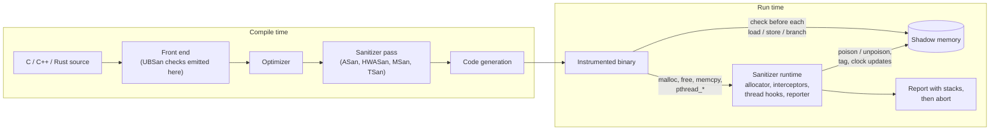
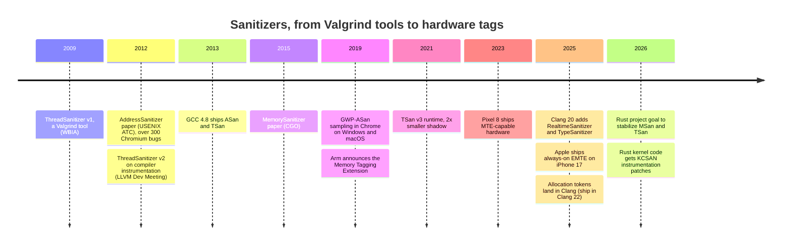
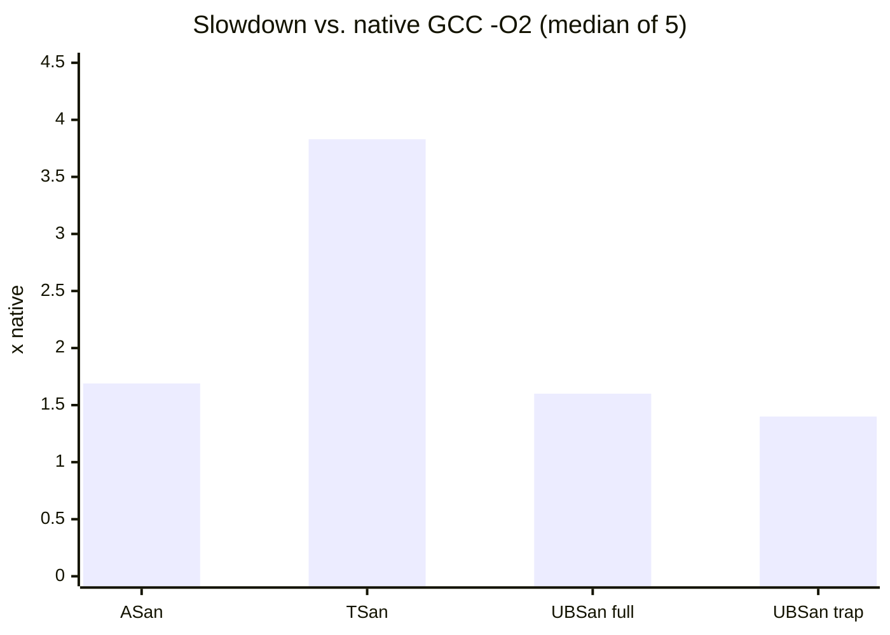

---
tags:
  - compilers
  - sanitizers
  - asan
  - hwasan
  - msan
  - tsan
  - ubsan
  - memory-tagging
  - mte
  - shadow-memory
  - memory-safety
  - data-races
  - llvm
  - gcc
status: complete
sources:
  - https://usenix.org/system/files/conference/atc12/atc12-final39.pdf
  - https://clang.llvm.org/docs/AddressSanitizer.html
  - https://learn.microsoft.com/en-us/cpp/sanitizers/asan-shadow-bytes
  - https://clang.llvm.org/docs/HardwareAssistedAddressSanitizerDesign.html
  - https://research.google/pubs/memorysanitizer-fast-detector-of-uninitialized-memory-use-in-c/
  - https://clang.llvm.org/docs/MemorySanitizer.html
  - https://cs.columbia.edu/%7Ejunfeng/11fa-e6121/papers/thread-sanitizer.pdf
  - https://LLVM.org/devmtg/2012-11/Serebryany_TSan-MSan.pdf
  - https://clang.llvm.org/docs/ThreadSanitizer.html
  - https://chromium.org/developers/testing/threadsanitizer-tsan-v2
  - https://hackmd.io/@tsaninternals/rJ-jh1It0
  - https://lists.llvm.org/pipermail/all-commits/Week-of-Mon-20211213/070501.html
  - https://clang.llvm.org/docs/UndefinedBehaviorSanitizer.html
  - https://clang.llvm.org/docs/RealtimeSanitizer.html
  - https://gcc.sourceware.org/gcc-4.8/changes.html
  - https://www.chromium.org/Home/chromium-security/articles/gwp-asan
  - https://kernel.org/doc/html/latest/dev-tools/kasan.html
  - https://developer.android.com/ndk/guides/arm-mte?hl=en
  - https://security.apple.com/blog/memory-integrity-enforcement/
  - https://www.usenix.org/conference/usenixsecurity22/presentation/zhang-yuchen
  - https://arxiv.org/html/2506.05022v4
  - https://releases.llvm.org/20.1.0/tools/clang/docs/ReleaseNotes.html
  - https://releases.llvm.org/22.1.0/tools/clang/docs/ReleaseNotes.html
  - https://releases.llvm.org/23.1.0/tools/clang/docs/ReleaseNotes.html
  - https://github.com/rust-lang/rust/pull/123617
  - https://goals.rust-lang.org/2026/stabilization-of-sanitizer-support.html
  - https://lwn.net/Articles/1100184/
created: 2026-11-26
updated: 2026-11-28
---

## Table Of Contents

- [[#TL;DR|TL;DR]]
- [[#The Problem|The Problem]]
- [[#Foundations|Foundations]]
    - [[#Three Pieces - Pass, Shadow, Runtime|Three Pieces - Pass, Shadow, Runtime]]
    - [[#Shadow Memory|Shadow Memory]]
    - [[#Five Ways to Catch a Bug|Five Ways to Catch a Bug]]
    - [[#Why Compile-Time Instrumentation Won|Why Compile-Time Instrumentation Won]]
- [[#How We Got Here|How We Got Here]]
- [[#How It Works|How It Works]]
    - [[#ASan - The Check on Every Load and Store|ASan - The Check on Every Load and Store]]
    - [[#ASan - Redzones and Quarantine|ASan - Redzones and Quarantine]]
    - [[#Measured - An ASan Report|Measured - An ASan Report]]
    - [[#Measured - Draining the Quarantine|Measured - Draining the Quarantine]]
    - [[#HWASan - Tags in the Pointer|HWASan - Tags in the Pointer]]
    - [[#Memory Tagging in Hardware - MTE and KASAN|Memory Tagging in Hardware - MTE and KASAN]]
    - [[#MSan - Bit-Precise Shadow Propagation|MSan - Bit-Precise Shadow Propagation]]
    - [[#TSan - Happens-Before With Shadow Cells|TSan - Happens-Before With Shadow Cells]]
    - [[#Measured - A TSan Report|Measured - A TSan Report]]
    - [[#UBSan - Local Checks From the Front End|UBSan - Local Checks From the Front End]]
    - [[#The Newer Sanitizers|The Newer Sanitizers]]
    - [[#Measured - What Each Sanitizer Costs|Measured - What Each Sanitizer Costs]]
    - [[#Making Checks Cheaper|Making Checks Cheaper]]
- [[#Where It Is Now|Where It Is Now]]
- [[#Trade-offs & Open Problems|Trade-offs & Open Problems]]
- [[#Resources|Resources]]
- [[#Related Notes|Related Notes]]

## ***TL;DR***
---
*A sanitizer is a compiler pass plus a run-time library that turns a silent bug (an out-of-bounds write, a read of uninitialized memory, a data race, signed overflow) into a loud, precise report at the moment it happens. The compiler inserts a check before the risky operation; the runtime keeps a "shadow" picture of memory that the check consults.*

- **The family.** **ASan** finds out-of-bounds and use-after-free with shadow bytes, redzones and a quarantine; **HWASan** finds the same bugs by putting a random tag in each pointer's top byte and comparing it with a tag stored per 16-byte granule; **MSan** finds uses of uninitialized memory by tracking one shadow bit per bit of data; **TSan** finds data races with a happens-before algorithm over per-word shadow cells; **UBSan** inserts local checks for C and C++ undefined behavior.
- **Costs differ by an order of magnitude.** Clang's docs give typical slowdowns of about 2x for ASan, 3x for MSan and 5x to 15x for TSan; UBSan "has small runtime cost" ([ASan](https://clang.llvm.org/docs/AddressSanitizer.html), [MSan](https://clang.llvm.org/docs/MemorySanitizer.html), [TSan](https://clang.llvm.org/docs/ThreadSanitizer.html), [UBSan](https://clang.llvm.org/docs/UndefinedBehaviorSanitizer.html)). The 2012 ASan paper measured 73% on SPEC CPU2006 against 20x for Valgrind's Memcheck ([Serebryany et al.](https://usenix.org/system/files/conference/atc12/atc12-final39.pdf)).
- **Measured here** (GCC 13.3, x86-64): on a sort-plus-hash-table benchmark, ASan cost 1.7x, single-threaded TSan 3.8x with 3.6x the memory, full UBSan 1.6x and trapping UBSan 1.4x. ASan's freed-memory quarantine let a dangling pointer go unreported only after about 226 MB of allocation churn at the default setting, but after 0.9 MB with a 1 MB quarantine.
- **Most of them cannot be combined.** ASan, MSan, TSan and HWASan each lay out shadow memory differently, so Clang refuses `-fsanitize=address,thread` or `address,memory`; UBSan combines with any of them.
- **The line between testing and production is moving.** Sanitizers were built for tests and fuzzing, not shipping. Today trapping UBSan checks, sampled GWP-ASan, hardware memory tagging (Arm MTE on Pixel 8 and later; Apple's always-on EMTE on iPhone 17 since September 2025) and the kernel's hardware-tag KASAN run in the field.
- **As of November 2026:** Clang 22 added allocation tokens (`-fsanitize=alloc-token`) and trap reasons in debug info for trapping UBSan; Clang 23.1 extended UBSan's null, alignment and bounds checks to aggregate copies; Rust's stabilization of ASan and LeakSanitizer is still an open pull request, with MSan and TSan stabilization a 2026 project goal.

## ***The Problem***
---
*C and C++ let a program read past an array, use freed memory, read memory nobody wrote, or race on a variable, and most of the time nothing visible happens. The bug corrupts some other object and the crash, if any, comes much later and somewhere else. Sanitizers exist to move the failure to the faulting instruction.*

The language standards call these errors undefined behavior (see [[Undefined Behavior and Compiler Semantics]]). The hardware does not check them: a store one element past a `malloc`'d array writes into the allocator's metadata or a neighboring object; a read through a dangling pointer returns whatever the allocator has since put there; two threads incrementing the same counter without a lock lose updates. The symptoms are intermittent, depend on layout and timing, and often show up only in production. They are also the raw material of most serious security bugs: of the more than 300 bugs ASan found in Chromium in its first ten months, 210 were heap use-after-free and 73 heap buffer overflows ([Serebryany et al., 2012](https://usenix.org/system/files/conference/atc12/atc12-final39.pdf)).

Before sanitizers the main tool was dynamic binary instrumentation: Valgrind's Memcheck and Dr. Memory translate the machine code as it runs and check every access. The ASan paper put their cost at "20x and 10x slowdowns" on SPEC CPU2006, and noted they miss most stack and global overflows because a binary does not say where one stack array ends and the next begins ([Serebryany et al.](https://usenix.org/system/files/conference/atc12/atc12-final39.pdf)). At 20x, nobody runs a full test suite or a fuzzer under the tool.

The compiler knows things the binary does not: the size of every stack array and global, which memory accesses can be proved safe, which operations C calls undefined. A sanitizer uses that knowledge to insert only the checks that matter, cheaply, and pairs them with a runtime that owns the allocator and the thread library.

| Sanitizer | Flag | Bug class | Typical cost |
|---|---|---|---|
| **AddressSanitizer** (ASan) | `-fsanitize=address` | Heap, stack and global out-of-bounds; use-after-free, use-after-return, use-after-scope; double free; leaks (via LeakSanitizer) | About 2x time; stack up to 3x |
| **HWASan** | `-fsanitize=hwaddress` | Same as ASan, probabilistically, on AArch64 | Lower memory than ASan |
| **MemorySanitizer** (MSan) | `-fsanitize=memory` | Branching on, dereferencing or passing uninitialized values | About 3x time, 2x memory |
| **ThreadSanitizer** (TSan) | `-fsanitize=thread` | Data races, some deadlocks | 5x to 15x time, 5x to 10x memory |
| **UndefinedBehaviorSanitizer** (UBSan) | `-fsanitize=undefined` and friends | Signed overflow, bad shifts, misalignment, null, out-of-bounds array index, invalid enum or bool | Small |

Costs are from the Clang docs linked in the TL;DR.

## ***Foundations***
---
*Every sanitizer is the same three pieces in different proportions: an instrumentation pass, a shadow encoding of program state, and a run-time library that maintains the shadow and reports. The differences are in what the shadow records and when the check fires.*

### Three Pieces - Pass, Shadow, Runtime

*The compiler pass decides where checks go; the shadow memory is what the checks read; the runtime keeps the shadow true by owning malloc, free, thread creation and the libc functions the compiler never sees.*



- **The pass** runs in the middle end (LLVM IR) for ASan, HWASan, MSan and TSan, after the main optimizations, so it instruments the code that will actually run and does not instrument accesses the optimizer already removed. UBSan is different: its checks are emitted by Clang's front end while lowering C to IR, because only the front end knows that `a + b` was a *signed* `int` addition or that an index went into an array of known bound. That is also why UBSan misses UB that the front end folds away before checks are emitted, as [[Undefined Behavior and Compiler Semantics]] shows.
- **The runtime** lives in LLVM's compiler-rt (see [[LLVM]]) and in GCC's libsanitizer, which is the same code imported. It replaces `malloc` and `free` with an allocator that can poison memory, intercepts libc and pthread functions so that `memcpy` or `pthread_mutex_lock` update the shadow, unwinds stacks, and symbolizes reports.
- **The shadow** is a large region of virtual memory at a fixed (or per-process) location whose contents describe the application's memory. It is mapped lazily, so most of it costs address space, not RAM: ASan "maps 16+ TB of virtual address space" on 64-bit platforms ([Clang docs](https://clang.llvm.org/docs/AddressSanitizer.html)).

### Shadow Memory

*Shadow memory is a direct-mapped side table: from any application address, one shift and one add (or XOR) give the address of the metadata for it. No hash lookup, no tree walk, so the check can be inlined.*

For ASan, one shadow byte describes eight application bytes:

$$
\text{Shadow}(a) = (a \gg 3) + \text{Offset}
$$

In plain English: divide the address by 8 and add a constant. The 2012 paper used $\text{Offset} = 2^{44}$ on x86-64 ([Serebryany et al.](https://usenix.org/system/files/conference/atc12/atc12-final39.pdf)); Clang 18 today emits `0x7fff8000`, visible in the assembly below. Because allocations are at least 8-byte aligned, the first $k$ bytes of each 8-byte granule are addressable and the rest are not, so one byte is enough:

| Shadow value | Meaning |
|---|---|
| `00` | All 8 bytes addressable |
| `01` to `07` | Only the first $k$ bytes addressable (the tail of an object whose size is not a multiple of 8) |
| Negative (`fa`, `fd`, `f1`, `f2`, `f3`, `f5`, `f8`, `f9`, ...) | Not addressable; the value says why (heap redzone, freed, stack redzone, after return, after scope, global redzone) |

The scale changes per tool: HWASan keeps one tag byte per 16-byte granule (1/16 of memory), MSan keeps one shadow bit per application bit (1:1, plus another 1:1 for origins if enabled), and TSan keeps several 8-byte shadow cells per 8-byte word, which is why it is the most memory-hungry ([HWASan design](https://clang.llvm.org/docs/HardwareAssistedAddressSanitizerDesign.html), [MSan paper](https://research.google/pubs/memorysanitizer-fast-detector-of-uninitialized-memory-use-in-c/), [TSan v2 slides](https://LLVM.org/devmtg/2012-11/Serebryany_TSan-MSan.pdf)).

### Five Ways to Catch a Bug

*Each sanitizer answers "is this access wrong?" with a different invariant. Knowing the invariant tells you exactly what the tool can and cannot see.*

| Tool | Invariant it maintains | Check fires when | Blind spot |
|---|---|---|---|
| ASan | Memory around and between objects is *poisoned* (redzones); freed memory stays poisoned in a quarantine | An access touches a poisoned byte | Overflow that jumps over the redzone into another live object; use-after-free after the memory is recycled |
| HWASan / MTE | Each object and each pointer to it carry the same random tag | Pointer tag differs from memory tag | Two objects that happen to share a tag (1 in 256 with 8-bit tags, 1 in 16 with 4-bit MTE tags) |
| MSan | Each bit has a shadow bit: 1 means "never written" | An uninitialized bit decides a branch, an address, a call argument or return value | Code not compiled with MSan (all of the program must be) |
| TSan | Per thread, a vector clock; per word, the last few accesses with their thread and epoch | Two accesses to overlapping bytes, at least one a write, with no happens-before order | Races on paths the test never runs; accesses evicted from the shadow cells |
| UBSan | None; each check is local | The operation itself is undefined (overflow, bad shift, misaligned pointer) | UB folded away before the check, and UB that needs memory state (that is ASan's and MSan's job) |

The TSan invariant is the happens-before relation from [[Concurrency Memory Models]]: event $e_1$ happens before $e_2$ if they are in the same thread in program order, or a release that $e_1$ precedes synchronizes with an acquire that precedes $e_2$. With vector clocks $C$, a previous access at epoch $c@t$ (clock $c$ of thread $t$) is ordered before the current thread $u$'s access exactly when

$$
c \le C_u[t]
$$

In plain English: thread $u$ has, through some chain of locks or atomics, already "heard about" thread $t$'s clock reaching $c$. If not, and one of the two accesses is a write, it is a race. Storing only the epoch $c@t$ for the last write instead of a whole vector is the FastTrack trick (PLDI 2009) that TSan v2 builds on ([TSan v2 slides](https://LLVM.org/devmtg/2012-11/Serebryany_TSan-MSan.pdf)).

### Why Compile-Time Instrumentation Won

*Instrumenting in the compiler costs a rebuild, but buys static knowledge (object bounds, types, which accesses are provably safe) and lets the optimizer clean up after the checks.*

- **Bounds are known.** The compiler lays out stack frames and globals, so it can put a redzone between two arrays. A binary translator sees only a block of stack.
- **Checks are optimizable.** The checks are ordinary IR, so [[Classic Optimizations]] such as common-subexpression elimination and loop-invariant code motion apply, and the pass can skip accesses it proves in bounds.
- **No translation overhead.** The program runs as native code. TSan's own history shows the difference: the Valgrind-based v1 ran typical Google tests 20x to 50x slower ([Serebryany and Iskhodzhanov, 2009](https://cs.columbia.edu/%7Ejunfeng/11fa-e6121/papers/thread-sanitizer.pdf)); the compiler-based v2 brought an RPC benchmark from 40x to 7x and a web-server test from 25x to 2.5x ([2012 slides](https://LLVM.org/devmtg/2012-11/Serebryany_TSan-MSan.pdf)).
- **The cost: everything must be rebuilt.** Uninstrumented code (a prebuilt library, hand-written assembly, a JIT's output) is invisible. For ASan that means missed bugs; for MSan and TSan it means *false positives*, because the shadow is never updated for writes or synchronization that the uninstrumented code performs. The MSan docs say flatly that it "requires that all program code is instrumented" ([MSan docs](https://clang.llvm.org/docs/MemorySanitizer.html)).

## ***How We Got Here***
---
*Sanitizers came out of Google's dynamic-tools team between 2009 and 2015, moved into both LLVM and GCC, and then spread outward: into the kernel, into hardware (memory tagging), and into production as sampled or trapping variants.*



- **2009, TSan v1.** Konstantin Serebryany and Timur Iskhodzhanov built a hybrid happens-before and lockset race detector as a Valgrind tool; it ran Chromium tests about 28.6x slower in its full mode, against 62.3x for Helgrind ([WBIA 2009](https://cs.columbia.edu/%7Ejunfeng/11fa-e6121/papers/thread-sanitizer.pdf)).
- **2011 to 2012, ASan.** The same group built AddressSanitizer as an LLVM pass, published at USENIX ATC 2012 with the shadow-byte encoding still used today, a 73% average SPEC CPU2006 slowdown and 3.37x memory ([paper](https://usenix.org/system/files/conference/atc12/atc12-final39.pdf)). In November 2012, TSan v2 moved race detection onto the same compiler-instrumentation model ([slides](https://LLVM.org/devmtg/2012-11/Serebryany_TSan-MSan.pdf)).
- **2013, GCC.** GCC 4.8 added "AddressSanitizer, a fast memory error detector" and ThreadSanitizer, sharing the runtime with LLVM ([GCC 4.8 changes](https://gcc.sourceware.org/gcc-4.8/changes.html)). The `-fsanitize=` flag spelling became common to both compilers.
- **2015, MSan.** Evgeniy Stepanov and Serebryany published MemorySanitizer at CGO 2015: bit-precise shadow, propagation through copies, about 2.5x time and 2x memory, and an origin-tracking mode ([paper](https://research.google/pubs/memorysanitizer-fast-detector-of-uninitialized-memory-use-in-c/)).
- **2019, production sampling.** GWP-ASan put a small random sample of heap allocations on their own guarded pages in shipping Chrome, for "negligible overhead"; by November 2019 it had found over sixty bugs, about 90% of them use-after-free ([Chromium](https://www.chromium.org/Home/chromium-security/articles/gwp-asan)). The same year, Arm announced MTE, the hardware version of HWASan's tagging idea ([Apple](https://security.apple.com/blog/memory-integrity-enforcement/) dates MTE to 2019 and the enhanced EMTE to 2022).
- **2021, TSan v3.** Dmitry Vyukov's new runtime landed in December 2021 with "2x smaller shadow memory (2x of app memory)", vectorized race checks, fixed 512-byte vector clocks and "unlimited number of alive threads/goroutines" ([commit](https://lists.llvm.org/pipermail/all-commits/Week-of-Mon-20211213/070501.html)).
- **2023 to 2025, tagging ships.** Android lists MTE support on Pixel 8 and later phones ([Android](https://developer.android.com/ndk/guides/arm-mte?hl=en)); Apple announced Memory Integrity Enforcement on September 9, 2025, with synchronous EMTE on by default on iPhone 17 and iPhone Air ([Apple](https://security.apple.com/blog/memory-integrity-enforcement/)).

## ***How It Works***
---
*Each subsection shows what one sanitizer actually inserts, with real compiler output where possible, and what its runtime does. Assembly is from Clang 18.1.3; run-time reports are from GCC 13.3 on x86-64 Linux, because this machine has GCC's sanitizer runtimes but not Clang's.*

### ASan - The Check on Every Load and Store

*Every load and store gets a shadow-byte lookup: a shift, a load, and a branch that is almost never taken. The slow path handles the partially addressable last granule of an object.*

A one-line function, compiled with `clang-18 -O2 -fsanitize=address`:

```c
int load(int *p) { return *p; }
```

```asm
load:
    pushq   %rax
    movq    %rdi, %rax
    shrq    $3, %rax                # a >> 3
    movzbl  2147450880(%rax), %eax  # k = shadow byte at (a >> 3) + 0x7fff8000
    testb   %al, %al
    jne     .LBB0_1                 # k != 0: maybe bad, go check
.LBB0_2:
    movl    (%rdi), %eax            # the real load
    popq    %rcx
    retq
.LBB0_1:                            # slow path for a 4-byte access
    movl    %edi, %ecx
    andb    $7, %cl                 # offset of p inside its 8-byte granule
    addb    $3, %cl                 # offset + size - 1 = last byte touched
    cmpb    %al, %cl
    jl      .LBB0_2                 # last byte < k: still inside the object
    callq   __asan_report_load4@PLT
```

This is the check from the paper, almost verbatim:

```c
k = *((a >> 3) + Offset);
if (k != 0 && ((a & 7) + size - 1) >= k)
    report_load(a, size);
```

Two details make it cheap. The fast path is one extra load and a never-taken branch, because almost every access hits a fully addressable granule (`k == 0`). And every "not addressable" code is negative as a signed byte, so the slow-path signed comparison `last_byte >= k` is always true for them: one test covers both "past the end of a 13-byte object" ($k = 5$) and "in a freed chunk" ($k = $ `0xfd`).

The pass also adds a module constructor that calls `__asan_init` and registers every global with its redzone (`__asan_register_elf_globals`), so the runtime can poison the gaps between globals at load time.

### ASan - Redzones and Quarantine

*Out-of-bounds accesses are caught by surrounding every object with poisoned redzones; use-after-free is caught by keeping freed memory poisoned for a while before reuse. Both are heuristics with known escape routes.*

- **Heap.** ASan's `malloc` lays chunks out as redzone, object, redzone, object. The left redzone (at least 32 bytes in the 2012 design) holds the allocator's metadata, including the allocation stack trace used in reports ([paper](https://usenix.org/system/files/conference/atc12/atc12-final39.pdf)).
- **Stack.** The pass rewrites each function's frame so that local arrays sit between redzones (32 bytes plus alignment in the paper), poisons them in the prologue and unpoisons them on return. Use-after-return detection goes further and moves frames to a heap-allocated "fake stack" so that a returned frame stays poisoned; Clang's default (`-fsanitize-address-use-after-return=runtime`) compiles the check in and enables it at run time on Linux ([Clang docs](https://clang.llvm.org/docs/AddressSanitizer.html)). This is why ASan stack usage can grow "up to 3x".
- **Globals.** Redzones are added at compile time by padding each global and registering it.
- **Quarantine.** `free` poisons the chunk (shadow `fd`) and puts it at the back of a FIFO queue instead of returning it to the allocator. Only when the quarantine exceeds its budget (256 MB by default in the paper and in GCC 13's runtime, measured below) does the oldest chunk become reusable.
- **Container overflow.** Libraries like libc++ can annotate `std::vector` so that the unused capacity between `size()` and `capacity()` is poisoned; this is opt-in and "prone to false positives" with partially instrumented binaries ([Clang docs](https://clang.llvm.org/docs/AddressSanitizer.html)).

The paper lists the escape routes directly: a partially out-of-bounds unaligned access can slip through, an overflow that jumps past the redzone into another valid object is not seen, and a use-after-free is missed if enough memory is allocated and freed in between to drain the quarantine ([paper](https://usenix.org/system/files/conference/atc12/atc12-final39.pdf)). The next two measurements show the first kind of report and the last kind of miss.

### Measured - An ASan Report

*An off-by-one heap write, caught at the faulting instruction, with the allocation site and a dump of the shadow bytes around it.*

```c
#include <stdlib.h>
int main(int argc, char **argv) {
  int *a = malloc(10 * sizeof(int));
  a[argc + 9] = 42;            /* argc == 1, so a[10]: one past the end */
  int r = a[0];
  free(a);
  return r;
}
```

`gcc -g -O0 -fsanitize=address oob.c && ./a.out` (paths shortened):

```text
==1046==ERROR: AddressSanitizer: heap-buffer-overflow on address 0x504000000038 ...
WRITE of size 4 at 0x504000000038 thread T0
    #0 0x56448451c259 in main oob.c:4

0x504000000038 is located 0 bytes after 40-byte region [0x504000000010,0x504000000038)
allocated by thread T0 here:
    #0 0x7fb86c0fd9c7 in malloc ../../../../src/libsanitizer/asan/asan_malloc_linux.cpp:69
    #1 0x56448451c205 in main oob.c:3

Shadow bytes around the buggy address:
=>0x504000000000: fa fa 00 00 00 00 00[fa]fa fa fa fa fa fa fa fa
```

Reading the shadow line: two `fa` bytes are the 16-byte left heap redzone, five `00` bytes are the 40-byte array (5 granules of 8), and the bracketed `fa` is the granule just after it, where `a[10]` landed. An aside on the first attempt: the same program without the `int r = a[0]` line produced no report at `-O1`, because GCC deleted the store into memory that was freed on the next line. The sanitizer can only check accesses that survive optimization.

### Measured - Draining the Quarantine

*A use-after-free is caught only while the freed chunk is still in quarantine. Once enough other memory is allocated and freed, the chunk is handed out again, and a write through the old pointer silently corrupts the new owner.*

```c
char *p = malloc(64);
free(p);                         /* p now dangles */
long churned = 0;
char *q;
for (;;) {                       /* allocate and free until p's memory comes back */
  q = malloc(64);
  if (q == p) break;
  free(q);
  churned += 64;
}
p[0] = 'x';                      /* use after free, but the memory is live again */
return q[0] == 'x';              /* 1 means q was silently corrupted */
```

| `ASAN_OPTIONS` | Churn before `p`'s memory was reused | Report? | Exit code |
|---|---|---|---|
| `quarantine_size_mb=0` | 0 KB (the very next `malloc`) | None | 1 (corrupted) |
| `quarantine_size_mb=1` | 911 KB | None | 1 |
| `quarantine_size_mb=16` | 14,471 KB | None | 1 |
| default | 231,455 KB (about 226 MB) | None | 1 |

In every row ASan stayed silent, because at the moment of `p[0] = 'x'` the shadow said "allocated". The quarantine only buys time: the same write a few allocations after the `free` was reported as `heap-use-after-free`. The defaults trade memory (hundreds of megabytes held back) for that window. HWASan and MTE close this hole differently: a recycled chunk gets a new random tag, so the stale pointer's tag mismatches with probability $1 - 2^{-TS}$ no matter how much churn there was.

### HWASan - Tags in the Pointer

*HWASan uses the AArch64 "top byte ignore" feature to store a random tag in the unused top 8 bits of every pointer, and a matching tag per 16-byte granule in shadow memory. No redzones, no quarantine; detection is probabilistic.*

The algorithm from the design doc ([HWASan design](https://clang.llvm.org/docs/HardwareAssistedAddressSanitizerDesign.html)):

- Every heap, stack and global object is aligned to the tagging granule $TG$ and given a random $TS$-bit tag, stored in the pointer's top byte and in the shadow (one shadow byte per $TG$ bytes).
- Every load and store compares the pointer tag with the memory tag. `free` retags the memory, so stale pointers mismatch; adjacent objects get different tags, so overflows mismatch.
- A **short granule** handles objects whose size is not a multiple of $TG$: the shadow stores the number of valid bytes and the real tag goes in the granule's last byte.
- Stack allocas share one random base tag per frame, and alloca $M$ gets `ReTag(BaseTag, M)`, for example an XOR, so the frame does not keep $M$ tagged pointers live.

The same `load` function for AArch64 (`clang-18 --target=aarch64-linux-gnu -O2 -fsanitize=hwaddress`):

```asm
load:
    stp   x30, x20, [sp, #-16]!
    adrp  x8, :gottprel:__hwasan_tls
    ldr   x8, [x8, :gottprel_lo12:__hwasan_tls]
    mrs   x9, TPIDR_EL0
    ldr   x8, [x9, x8]              # per-thread word that encodes the shadow base
    ubfx  x9, x0, #4, #52           # untagged address / 16  -> 16-byte granules
    orr   x8, x8, #0xffffffff
    add   x20, x8, #1               # shadow base (4 GB aligned)
    lsr   x8, x0, #56               # pointer tag = top byte
    ldrb  w9, [x20, x9]             # memory tag from shadow
    cmp   w8, w9
    b.ne  .LBB0_2                   # mismatch: maybe a short granule
.LBB0_1:
    ldr   w0, [x0]                  # the real load, through the tagged pointer
    ldp   x30, x20, [sp], #16
    ret
.LBB0_2:
    bl    __hwasan_check_x0_2_short_v2   # outlined: short-granule check or report
    b     .LBB0_1
```

The code shows the parameters Clang uses on AArch64: 16-byte granules (`#4`) and 8-bit tags (`#56`). A bug is missed only when the two tags collide, probability $2^{-8} \approx 0.39\%$ per bug. Memory overhead is about $1/TG$ for the shadow plus alignment padding, much less than ASan's redzones ([design doc](https://clang.llvm.org/docs/HardwareAssistedAddressSanitizerDesign.html)).

The catch is the architecture. HWASan needs address tagging in hardware. On x86-64 it falls back to page aliasing, tags only the heap, and "is really only safe for applications that do not fork"; 32-bit targets are unsupported. The doc also warns that the runtime "was not developed with security-sensitive constraints in mind" and should not ship in production binaries.

### Memory Tagging in Hardware - MTE and KASAN

*Arm's Memory Tagging Extension moves HWASan's check into the load/store unit: the CPU itself compares a 4-bit pointer tag with a 4-bit tag stored per 16-byte granule. With no inserted check, tagging becomes cheap enough for production.*

MTE keeps the tag storage out of the address space and adds instructions to set tags (`STG` for one granule, `ST2G` for two). Allocators tag memory on `malloc` and retag on `free`; the compiler is needed only for the stack (`-fsanitize=memtag`, which on Android requires stack-tagging support from Android 14 QPR3) ([Android](https://developer.android.com/ndk/guides/arm-mte?hl=en)). Two reporting modes trade precision for speed:

| Mode | When the fault arrives | Use |
|---|---|---|
| **SYNC** | On the offending load or store, with allocation and free stacks | Testing; production where the app is a high-value attack surface |
| **ASYNC** | At the next kernel entry, without the faulting address | Mitigation in production on well-tested code |

Android calls SYNC mode "a faster alternative to HWASan that does not require you to recompile your code" for heap bugs ([Android](https://developer.android.com/ndk/guides/arm-mte?hl=en)). The cost is detection probability: with 4-bit tags, a collision happens 1 time in 16 instead of 1 in 256, which is acceptable for a mitigation that only needs to make exploits unreliable.

The Linux kernel offers all three designs side by side as KASAN modes ([kernel docs](https://kernel.org/doc/html/latest/dev-tools/kasan.html)):

| KASAN mode | How it works | Arch | Intended use |
|---|---|---|---|
| Generic (`CONFIG_KASAN_GENERIC`) | Shadow bytes and compiler checks, like ASan; the only mode with a quarantine | x86-64, arm64, riscv, powerpc, s390 and others | Debugging; "significant performance and memory overheads" |
| Software tag-based (`CONFIG_KASAN_SW_TAGS`) | Top-byte tags and compiler checks per 16-byte cell, like HWASan | arm64 | Debugging and dogfood testing on real devices |
| Hardware tag-based (`CONFIG_KASAN_HW_TAGS`) | MTE; no compiler checks, no shadow | arm64 with MTE | "can be used in production" |

### MSan - Bit-Precise Shadow Propagation

*MSan shadows every bit of memory and every SSA value with a "this bit is uninitialized" bit, propagates it through arithmetic and copies, and reports only when an uninitialized bit could change the program's behavior.*

Copying uninitialized memory is legal and very common (struct padding, partially filled buffers), so reporting on every read would drown in false positives. MSan instead *propagates* the shadow, like a taint analysis, and checks only at a few sinks: a conditional branch, a pointer dereference, a call argument or return value (the default since `-fsanitize-memory-param-retval` became on by default), and data passed to some libc calls ([MSan docs](https://clang.llvm.org/docs/MemorySanitizer.html)).

Clang 18 IR for two small functions (`clang-18 -O1 -fsanitize=memory -S -emit-llvm`, metadata trimmed):

```c
int pick(int *p, int y) {
  if (*p > 0) return y;
  return 0;
}
void copy2(int *dst, int *src) { *dst = src[0] + src[1]; }
```

```llvm
define i32 @pick(ptr %p, i32 %y) {
entry:
  %0 = ptrtoint ptr %p to i64
  %1 = xor i64 %0, 87960930222080          ; shadow address = p XOR 0x500000000000
  %2 = inttoptr i64 %1 to ptr
  %_msld = load i32, ptr %2                 ; shadow of *p
  %.not = icmp eq i32 %_msld, 0             ; *p fully initialized?
  %_mscmp.not1 = icmp eq i32 %y, 0          ; or both outcomes return the same value?
  %_mscmp.not = or i1 %.not, %_mscmp.not1
  br i1 %_mscmp.not, label %4, label %3
3:
  call void @__msan_warning_noreturn()
  unreachable
4:
  %5 = load i32, ptr %p
  %cmp = icmp sgt i32 %5, 0
  %y. = select i1 %cmp, i32 %y, i32 0
  ret i32 %y.
}

define void @copy2(ptr %dst, ptr %src) {
entry:
  %0 = load i32, ptr %src
  ...                                       ; shadow of src[0] -> %_msld
  %4 = load i32, ptr %arrayidx1
  ...                                       ; shadow of src[1] -> %_msld3
  %_msprop = or i32 %_msld3, %_msld         ; result is poisoned where either input is
  %add = add nsw i32 %4, %0
  ...
  store i32 %_msprop, ptr %10               ; store the shadow beside the value
  store i32 %add, ptr %dst
  ret void
}
```

Three things to see:

- **The mapping** on x86-64 Linux is an XOR with `0x500000000000`, not a shift: shadow is 1:1, so it needs no scaling.
- **Propagation** in `copy2` is an approximation: for addition, the result's shadow is the OR of the operands' shadows. Copying `src` to `dst` copies its shadow too, with no report.
- **Precision** in `pick`: the optimizer turned the `if` into a `select`, and MSan's rule for `select` is bit-precise. If `*p` is uninitialized but `y` is 0, both outcomes are 0, so the uninitialized condition cannot change the result and MSan stays quiet. That is the "bit-precise" in the paper's title.

**Origins.** A report saying "uninitialized value used here" is hard to act on; `-fsanitize-memory-track-origins=2` keeps a second 1:1 shadow of 4-byte origin ids recording where each poisoned value was allocated and every store it passed through, for an extra 1.5x to 2x slowdown ([MSan docs](https://clang.llvm.org/docs/MemorySanitizer.html)).

**The all-or-nothing rule.** If an uninstrumented library writes a buffer, the shadow still says "uninitialized" and MSan reports a false positive. The runtime carries 70+ libc interceptors to cover libc itself, but C++ users must build libc++ with MSan too ([MSan docs](https://clang.llvm.org/docs/MemorySanitizer.html)). This is the main reason MSan is used less than ASan, and why Rust's 2026 goal includes shipping instrumented standard libraries through rustup ([Rust goals](https://goals.rust-lang.org/2026/stabilization-of-sanitizer-support.html)).

### TSan - Happens-Before With Shadow Cells

*TSan records, for every 8-byte word, the last few accesses (thread, that thread's clock, which bytes, read or write), and keeps a vector clock per thread that the runtime advances at every lock, unlock, atomic and thread start or join. A new access is checked against the recorded ones.*

The compiler side is simple: a call before each memory access and at function entry and exit (`clang-18 -O2 -fsanitize=thread`):

```asm
load:
    pushq   %rbx
    movq    %rdi, %rbx
    movq    8(%rsp), %rdi
    callq   __tsan_func_entry@PLT   # push the return address on TSan's shadow stack
    movq    %rbx, %rdi
    callq   __tsan_read4@PLT        # check and record a 4-byte read of *p
    movl    (%rbx), %ebx
    callq   __tsan_func_exit@PLT
    movl    %ebx, %eax
    popq    %rbx
    retq
```

The function-entry and exit hooks maintain a shadow call stack, so that a report can show the *earlier* access's stack, long after that thread has moved on. Atomics become calls like `__tsan_atomic32_fetch_add` that both perform the operation and update clocks.

The runtime does the real work:

- **Shadow cells (v2).** Each 8 bytes of application memory have 4 shadow cells of 8 bytes each. A cell packs about 16 bits of thread id, 42 bits of epoch, 5 bits of position and size, and 1 read/write bit. When all four are full, a random one is evicted ([2012 slides](https://LLVM.org/devmtg/2012-11/Serebryany_TSan-MSan.pdf)). Eviction is a deliberate trade: memory stays bounded, at the cost of occasionally forgetting an access that would have formed a race.
- **The check.** On each access, compare the new access with each stored cell: if the byte ranges overlap, the threads differ, at least one is a write, and the stored epoch is not $\le$ the current thread's clock entry for that thread, report a race. TSan v3 does this comparison with SIMD across all four cells at once ([TSan internals](https://hackmd.io/@tsaninternals/rJ-jh1It0)).
- **Clocks.** Mutex unlock and release atomics copy the thread's vector clock into the sync object; lock and acquire merge it back. TSan v3 made vector clocks a fixed 512 bytes and halved the shadow to 2x application memory ([commit](https://lists.llvm.org/pipermail/all-commits/Week-of-Mon-20211213/070501.html)).

### Measured - A TSan Report

*A race is a missing happens-before edge, not a bad interleaving. TSan reported this one even though, by the time thread 2 ran, thread 1 had already finished.*

```c
long counter;                                   /* shared, unprotected */
void *work(void *arg) {
  for (int i = 0; i < 100000; i++) counter++;   /* read-modify-write, no lock */
  return NULL;
}
/* main starts two threads running work, joins both, prints counter */
```

`gcc -g -O1 -fsanitize=thread race.c && ./a.out`:

```text
WARNING: ThreadSanitizer: data race (pid=1252)
  Read of size 8 at 0x55b128fbf018 by thread T2:
    #0 work race.c:5
  Previous write of size 8 at 0x55b128fbf018 by thread T1:
    #0 work race.c:5
  Location is global 'counter' of size 8 at 0x55b128fbf018
  Thread T2 (tid=1256, running) created by main thread at: ... race.c:11
  Thread T1 (tid=1255, finished) created by main thread at: ... race.c:10
SUMMARY: ThreadSanitizer: data race race.c:5 in work
counter = 200000 (expected 200000)
```

The instrumented run printed the right answer and still reported the race: T1 had "finished", but nothing (no join, no lock) ordered its writes before T2's reads. The same program built without TSan at `-O1` printed `counter = 100000`, a lost update. TSan finds the race whether or not this particular run loses data, which is what makes it useful on flaky tests.

### UBSan - Local Checks From the Front End

*UBSan checks are tiny inline tests (an overflow flag, a shift amount, an alignment mask) placed where Clang lowers the operation. They need no shadow memory and no allocator, which is why UBSan is the one sanitizer that composes with all the others and the one most often shipped.*

`int add(int a, int b) { return a + b; }` with `clang-18 -O2 -fsanitize=signed-integer-overflow -fsanitize-trap=signed-integer-overflow`:

```asm
add:
    addl    %esi, %edi
    jo      .LBB0_1         # overflow flag set: undefined behavior
    movl    %edi, %eax
    retq
.LBB0_1:
    ud1l    (%eax), %eax    # trap; no runtime library needed
```

UBSan has three reporting modes ([UBSan docs](https://clang.llvm.org/docs/UndefinedBehaviorSanitizer.html)):

| Mode | Flag | What happens on a check failure | Intended for |
|---|---|---|---|
| Full runtime | default | Message with source location and values; optional recovery | Testing |
| Minimal runtime | `-fsanitize-minimal-runtime` | Short message, deduplication, small attack surface | "suitable for use in production environments" |
| Trap | `-fsanitize-trap=...` | A trap instruction, no runtime linked | Hardening; kernels; size-critical code |

Since Clang 22, trapping UBSan writes a string describing the reason for each trap into the debug info, so a crash dump can say "signed integer overflow" instead of only showing a `ud1` ([Clang 22 notes](https://releases.llvm.org/22.1.0/tools/clang/docs/ReleaseNotes.html)). The `-fsanitize=bounds` group (`array-bounds` and `local-bounds`) checks indexing into arrays whose bound is known statically, which is the piece most used for hardening. A detailed look at what UBSan does and does not catch, with GCC output, is in [[Undefined Behavior and Compiler Semantics]].

### The Newer Sanitizers

*Since 2024 the `-fsanitize=` family has grown beyond memory safety into real-time constraints, strict aliasing and allocator hardening. Several are thin runtimes with little or no per-access instrumentation.*

| Sanitizer | Since | Finds | How |
|---|---|---|---|
| **RealtimeSanitizer** (`-fsanitize=realtime`) | Clang 20 | Calls to `malloc`, `free`, `pthread_mutex_lock` and other non-deterministic-time functions from a `[[clang::nonblocking]]` function, such as an audio callback | Interceptors that check whether the current thread is in a real-time context; overhead described as negligible ([RTSan docs](https://clang.llvm.org/docs/RealtimeSanitizer.html)) |
| **TypeSanitizer** (`-fsanitize=type`) | Clang 20, experimental | Violations of C and C++ type-based aliasing rules, the rules that TBAA in [[Pointer and Alias Analysis]] relies on | A type-descriptor shadow checked on each access ([Clang 20 notes](https://releases.llvm.org/20.1.0/tools/clang/docs/ReleaseNotes.html)) |
| **AllocToken** (`-fsanitize=alloc-token`) | Clang 22 | Not a detector: gives each allocation call a token derived from its type so an allocator can separate types | Compile-time tokens passed to allocation functions ([Clang 22 notes](https://releases.llvm.org/22.1.0/tools/clang/docs/ReleaseNotes.html)) |
| **GWP-ASan** | 2019 | Heap overflow and use-after-free in production | Samples a tiny fraction of allocations onto their own page between guard pages; free unmaps the page ([Chromium](https://www.chromium.org/Home/chromium-security/articles/gwp-asan)) |

GWP-ASan is the clearest example of the "sample instead of check everything" idea: no compiler involvement at all, an allocator hook with a fixed per-call cost (up to 5% on allocation-heavy microbenchmarks) and a per-process sampling probability, with examples of 1/1000 and 1/8000 in Chromium's simulations ([Chromium](https://www.chromium.org/Home/chromium-security/articles/gwp-asan)).

### Measured - What Each Sanitizer Costs

*On one mixed workload, the ranking matches the documentation: UBSan is cheapest, ASan roughly doubles the time, and TSan is the most expensive in both time and memory even with a single thread.*

The benchmark merge-sorts 4 million integers, then does 2 million lookups and inserts in a chained hash table of small `malloc`'d nodes. GCC 13.3, `-O2`, x86-64 container with 4 cores, median of 5 runs, peak resident memory from `getrusage`; ASan was run with `detect_leaks=0` because the benchmark deliberately never frees.

| Build | Time | vs. native | Peak RSS | vs. native |
|---|---|---|---|---|
| GCC native | 0.672 s | 1.00x | 49 MB | 1.0x |
| GCC `-fsanitize=address` | 1.136 s | 1.69x | 63 MB | 1.3x |
| GCC `-fsanitize=thread` (1 thread) | 2.575 s | 3.83x | 176 MB | 3.6x |
| GCC `-fsanitize=undefined` (full runtime) | 1.072 s | 1.60x | 51 MB | 1.0x |
| GCC `-fsanitize=undefined`, trap on error | 0.944 s | 1.40x | 49 MB | 1.0x |
| Clang 18 native | 0.539 s | 1.00x | 49 MB | 1.0x |
| Clang 18 `-fsanitize=undefined -fsanitize-trap=all` | 0.723 s | 1.34x | 49 MB | 1.0x |

A second run gave the same ratios within 5%. Three caveats: ASan's memory ratio is low here because two large 16 MB arrays dominate the footprint and need little redzone (small objects pay far more, which is why the paper's average was 3.37x); with leak detection on, peak RSS rose to 91 MB; and `-fsanitize=undefined` in GCC includes null, alignment and object-size checks on every pointer access, which is why it costs more than the "small" in Clang's docs on a pointer-heavy loop. MSan and HWASan could not be run on this machine (no Clang runtimes, no AArch64 hardware), so they appear above only as compiler output.



### Making Checks Cheaper

*Most of ASan's run-time cost is the checks themselves, so research has focused on proving checks redundant, the same game as [[Bounds Check Elimination]] in safe languages.*

- **ASan-- (USENIX Security 2022)** found that ASan's high overhead "is mainly caused by the extensive sanitizer checks on memory accesses" and removed redundant ones with static analysis (checks dominated by an equivalent check, checks on provably in-bounds accesses, merging neighbors, hoisting out of loops). It cut ASan's overhead by 41.7% on SPEC CPU2006 and 35.7% on Chromium, and sped up AFL fuzzing by over 40% ([ASan--](https://www.usenix.org/conference/usenixsecurity22/presentation/zhang-yuchen)).
- **Tech-ASan (Internetware 2025)** replaces the shadow lookup with a two-stage check: first compare the accessed bytes themselves with a magic value written into redzones and freed memory (for a load, the value is being loaded anyway), and only consult the shadow when they match. On SPEC CPU2006 it measured geometric-mean overheads of 97.7% for ASan, 81.9% for ASan-- and 64.0% for Tech-ASan ([arXiv 2506.05022](https://arxiv.org/html/2506.05022v4)).
- **Production compilers** do a simpler version: the instrumentation runs after the main optimizations (so eliminated loads need no check), can skip accesses to stack slots and globals at constant, in-bounds offsets, and offers `-fsanitize-merge` to let identical UBSan traps share one trap block (Clang 20) ([Clang 20 notes](https://releases.llvm.org/20.1.0/tools/clang/docs/ReleaseNotes.html)).

## ***Where It Is Now***
---
*As of November 2026, the classic five are stable and boring in C and C++, the active work is at the edges: new sanitizer kinds in Clang, Rust and the Linux kernel catching up, and hardware tagging carrying sanitizer ideas into production phones.*

- **Clang.** Clang 20 (early 2025) added RealtimeSanitizer, experimental TypeSanitizer and `-fsanitize-undefined-ignore-overflow-pattern` to silence idiomatic overflow tests like `a + b < a`, and stopped reporting `NULL + 0` as UB in C following N3322 ([Clang 20 notes](https://releases.llvm.org/20.1.0/tools/clang/docs/ReleaseNotes.html)). Clang 22 added `-fsanitize=alloc-token`, trap reasons in debug info and `__builtin_allow_sanitize_check` ([Clang 22 notes](https://releases.llvm.org/22.1.0/tools/clang/docs/ReleaseNotes.html)). Clang 23.1, the current release, makes UBSan perform "null, alignment, and array-bounds checks for aggregate" copies, adds `__ubsan_default_suppressions`, and brings RTSan and TySan to Hexagon ([Clang 23.1 notes](https://releases.llvm.org/23.1.0/tools/clang/docs/ReleaseNotes.html)). The in-progress LLVM 24 notes have an empty sanitizer section so far.
- **Rust.** Sanitizers remain unstable flags. The pull request to stabilize ASan and LeakSanitizer through a new `-Csanitize` option, plus an `x86_64-unknown-linux-gnuasan` target, had its final-comment period cancelled and is still open ([rust#123617](https://github.com/rust-lang/rust/pull/123617)). A 2026 project goal aims to stabilize MSan and TSan on Tier 1 targets and ship pre-instrumented standard libraries ([Rust goals](https://goals.rust-lang.org/2026/stabilization-of-sanitizer-support.html)).
- **Linux kernel.** KASAN offers generic, software-tag and hardware-tag (MTE) modes ([kernel docs](https://kernel.org/doc/html/latest/dev-tools/kasan.html)). On October 12, 2026, Marco Elver posted patches to build the kernel's Rust code with TSan-style instrumentation for KCSAN, the kernel's race detector, initially on x86-64 only ([LWN](https://lwn.net/Articles/1100184/)).
- **Phones.** Android supports MTE on Pixel 8 through Pixel 10 devices, opt-in per app through `android:memtagMode` ([Android](https://developer.android.com/ndk/guides/arm-mte?hl=en)). Apple's Memory Integrity Enforcement, shipping since September 2025 on A19 chips, combines typed allocators with always-on synchronous EMTE; Apple says EMTE checking "imposes a performance cost", so it tags smaller allocations and relies on the allocators elsewhere ([Apple](https://security.apple.com/blog/memory-integrity-enforcement/)).
- **Fuzzing.** Sanitizers remain the default oracle for fuzzers: a crash-free run is not interesting, an ASan report is (see [[Compiler Testing and Fuzzing]]).

## ***Trade-offs & Open Problems***
---
*Sanitizers find bugs only on executed paths, only in instrumented code, and only one bug class per build. Each of those limits is a design choice, and each is being chipped at.*

- **Dynamic, not static.** A sanitizer proves nothing about paths a test does not run. Coverage comes from tests and fuzzers; proof comes from static tools like [[Abstract Interpretation]] or from safe languages. The two are complementary: static tools have false positives, sanitizers have false negatives.
- **One build per bug class.** ASan, MSan, TSan and HWASan cannot share a binary because their shadows collide, so CI runs separate builds. UBSan is the exception and is commonly added to the ASan build.
- **Heuristic holes.** ASan misses overflows that jump redzones and use-after-free after the quarantine drains (measured above); tagging misses tag collisions; TSan forgets accesses evicted from its four cells. Bigger redzones, quarantines and cells cost memory.
- **The rebuild-everything rule.** MSan and TSan give false positives around uninstrumented code, which makes them hard to adopt in projects with binary dependencies, inline assembly or JIT-generated code.
- **Optimization changes what is checked.** Instrumentation sees the optimized program: a dead store into freed memory is deleted before ASan sees it, and UB folded by the front end is never checked. Building tests at `-O0` or `-O1` trades speed for fidelity.
- **Sanitizers in production.** The full runtimes are not hardened (the HWASan doc says so explicitly) and the costs are too high. The production path is trap-mode UBSan, sampling (GWP-ASan) and hardware (MTE). Whether software tag checks can get cheap enough to ship everywhere, and whether 4-bit hardware tags are enough against attackers who can retry, are open questions; Apple's critique of async MTE and its move to synchronous EMTE is one answer ([Apple](https://security.apple.com/blog/memory-integrity-enforcement/)).
- **Cheaper checks.** ASan-- and Tech-ASan show that a third to two-fifths of ASan's cost is removable redundancy; how much of that production compilers will adopt is open.
- **Beyond C and C++.** Rust needs sanitizers mainly for `unsafe` code and FFI boundaries, and still lacks stable flags; GPU kernels and [[WebAssembly]] have only research-grade equivalents (for example, Cage uses MTE inside Wasm, see [[Software Fault Isolation]]).

## ***Resources***
---
*Papers that introduced each tool, the official design docs that describe the current implementations, and the posts that track production deployment.*

**Papers**
- [AddressSanitizer: A Fast Address Sanity Checker](https://usenix.org/system/files/conference/atc12/atc12-final39.pdf): Serebryany, Bruening, Potapenko, Vyukov; USENIX ATC 2012.
- [ThreadSanitizer: data race detection in practice](https://cs.columbia.edu/%7Ejunfeng/11fa-e6121/papers/thread-sanitizer.pdf): Serebryany and Iskhodzhanov; WBIA 2009 (the Valgrind-based v1).
- [MemorySanitizer: fast detector of uninitialized memory use in C++](https://research.google/pubs/memorysanitizer-fast-detector-of-uninitialized-memory-use-in-c/): Stepanov and Serebryany; CGO 2015.
- [Debloating Address Sanitizer (ASan--)](https://www.usenix.org/conference/usenixsecurity22/presentation/zhang-yuchen): USENIX Security 2022.
- [Tech-ASan: Two-stage check for Address Sanitizer](https://arxiv.org/html/2506.05022v4): Internetware 2025.

**Design docs and manuals**
- Clang: [AddressSanitizer](https://clang.llvm.org/docs/AddressSanitizer.html), [HWASan design](https://clang.llvm.org/docs/HardwareAssistedAddressSanitizerDesign.html), [MemorySanitizer](https://clang.llvm.org/docs/MemorySanitizer.html), [ThreadSanitizer](https://clang.llvm.org/docs/ThreadSanitizer.html), [UndefinedBehaviorSanitizer](https://clang.llvm.org/docs/UndefinedBehaviorSanitizer.html), [RealtimeSanitizer](https://clang.llvm.org/docs/RealtimeSanitizer.html).
- [ASan shadow bytes](https://learn.microsoft.com/en-us/cpp/sanitizers/asan-shadow-bytes): Microsoft's explanation of the encoding and check, as used by MSVC's ASan.
- [Kernel Address Sanitizer (KASAN)](https://kernel.org/doc/html/latest/dev-tools/kasan.html): the three kernel modes.
- [Arm Memory Tagging Extension on Android](https://developer.android.com/ndk/guides/arm-mte?hl=en): modes, devices, enabling.

**Talks, commits and posts**
- [ThreadSanitizer and MemorySanitizer](https://LLVM.org/devmtg/2012-11/Serebryany_TSan-MSan.pdf): Serebryany, LLVM Dev Meeting, November 2012; TSan v2 shadow-cell layout and early numbers.
- [tsan: new runtime (v3)](https://lists.llvm.org/pipermail/all-commits/Week-of-Mon-20211213/070501.html): Vyukov, December 2021.
- [TSan internals notes](https://hackmd.io/@tsaninternals/rJ-jh1It0): shadow values, access masks, vectorized checks.
- [ThreadSanitizer in Chromium](https://chromium.org/developers/testing/threadsanitizer-tsan-v2): v1 to v2 history and practical flags.
- [GWP-ASan: Detect bugs in the wild](https://www.chromium.org/Home/chromium-security/articles/gwp-asan): Tsyrklevich, November 2019.
- [Memory Integrity Enforcement](https://security.apple.com/blog/memory-integrity-enforcement/): Apple Security Engineering and Architecture, September 2025.
- [Stabilize AddressSanitizer and LeakSanitizer (rust#123617)](https://github.com/rust-lang/rust/pull/123617) and [Rust 2026 sanitizer goal](https://goals.rust-lang.org/2026/stabilization-of-sanitizer-support.html).
- [kbuild: rust: enable KCSAN support](https://lwn.net/Articles/1100184/): LWN, October 2026.
- Release notes: [GCC 4.8](https://gcc.sourceware.org/gcc-4.8/changes.html), [Clang 20.1](https://releases.llvm.org/20.1.0/tools/clang/docs/ReleaseNotes.html), [Clang 22.1](https://releases.llvm.org/22.1.0/tools/clang/docs/ReleaseNotes.html), [Clang 23.1](https://releases.llvm.org/23.1.0/tools/clang/docs/ReleaseNotes.html).

## ***Related Notes***
---
*The semantics sanitizers check, the analyses that could remove their checks, the tools that rely on them as oracles, and the sandboxing and hardware that carry the same ideas into production.*

- [[Undefined Behavior and Compiler Semantics]] — What counts as UB, and a hands-on look at UBSan's reach and limits.
- [[Memory Models and Pointer Provenance]] — The abstract machine whose rules ASan, MSan and TySan approximate at run time.
- [[Pointer and Alias Analysis]] — Type-based alias analysis, the assumption TypeSanitizer checks.
- [[Compiler Testing and Fuzzing]] — Sanitizer reports as the oracle that makes fuzzing work.
- [[LLVM]] — compiler-rt, where the sanitizer runtimes live, and the IR passes that insert checks.
- [[Intermediate Representations]] — The IR that ASan, MSan, TSan and HWASan instrument.
- [[Compiler Pipeline]] — Where the sanitizer passes sit relative to optimization and code generation.
- [[Classic Optimizations]] — Redundancy elimination and code motion that remove or hoist checks.
- [[Dataflow Analysis]] — MSan's shadow propagation is a run-time dataflow analysis; ASan-- uses static dataflow to delete checks.
- [[Abstract Interpretation]] — The static alternative: prove the absence of the bugs sanitizers detect.
- [[Software Fault Isolation]] — Bounds enforcement for untrusted code, and MTE-based Wasm sandboxing.
- [[WebAssembly]] — Linear-memory safety and hardware tagging proposals.
- [[Garbage Collection]] — The other answer to use-after-free: never free memory that is still reachable.
- [[Reference Counting and Reuse]] — Deterministic freeing without dangling pointers.
- [[Bounds Check Elimination]] — Proving checks redundant, the same problem ASan-- attacks.
- [[Concurrency Memory Models]] — Planned: happens-before and data races, the semantics TSan checks.
- [[Stack Unwinding and Exception Tables]] — The unwinding every sanitizer report depends on.
- [[Linear and Uniqueness Types]] — Planned: static ownership that rules out use-after-free at compile time.
