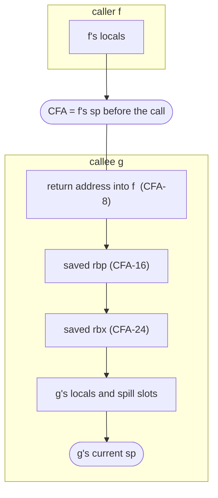
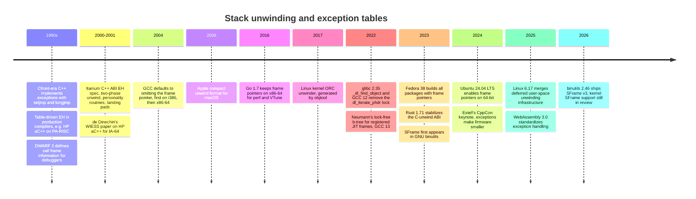
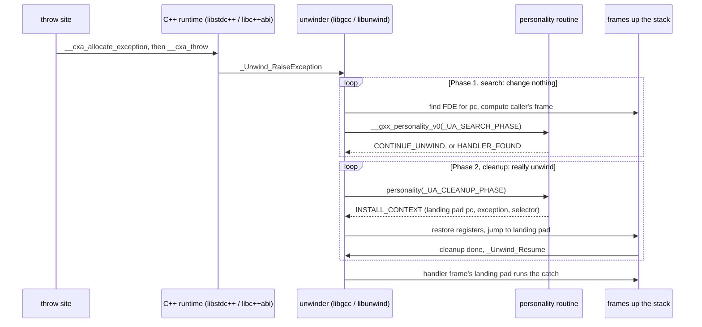

---
tags:
  - compilers
  - toolchains
  - stack-unwinding
  - exceptions
  - dwarf
  - cfi
  - eh-frame
  - frame-pointers
  - sframe
  - abi
  - profiling
  - fibers
status: complete
sources:
  - https://refspecs.linuxfoundation.org/abi-eh-1.22.html
  - https://maskray.me/blog/2020-12-12-c++-exception-handling-abi
  - https://maskray.me/blog/2020-11-08-stack-unwinding
  - https://maskray.me/blog/2025-10-26-stack-walking-space-and-time-trade-offs
  - https://maskray.me/blog/2025-09-28-remarks-on-sframe
  - https://lkml.iu.edu/2510.3/07277.html
  - https://www.mail-archive.com/linux-trace-kernel@vger.kernel.org/msg23466.html
  - https://llvm.org/docs/ExceptionHandling.html
  - https://www.usenix.org/legacy/events/wiess2000/full_papers/dinechin/dinechin_html/index.html
  - https://learn.microsoft.com/cpp/build/exception-handling-x64
  - https://learn.microsoft.com/en-us/cpp/build/x64-unwind-information-v3
  - https://gankra.github.io/blah/compact-unwinding
  - https://www.brendangregg.com/blog/2024-03-17/the-return-of-the-frame-pointers.html
  - https://ubuntu.com/blog/ubuntu-performance-engineering-with-frame-pointers-by-default
  - https://fedoraproject.org/wiki/Changes/fno-omit-frame-pointer
  - https://www.fedoraproject.org/wiki/Changes/SFrameInBinaries
  - https://go.dev/doc/go1.7
  - https://developers.redhat.com/articles/2024/10/30/limitations-frame-pointer-unwinding
  - https://databasearchitects.blogspot.com/2022/06/making-unwinding-through-jit-ed-code.html
  - https://git.almalinux.org/rpms/gcc/src/commit/62cd20ee1a89bbb3160bc2faccbc4a6eef5068fa/gcc-RHEL-105072-8.patch
  - https://gcc.gnu.org/bugzilla/show_bug.cgi?id=71744
  - https://lkml.indiana.edu/hypermail/linux/kernel/2507.3/08764.html
  - https://patchew.org/linux/176173056623.2601451.17637048270139232619.tip-bot2@tip-bot2
  - https://lwn.net/Articles/1073871/
  - https://ratatoskr.run/lkml/2026/08/17446896/t
  - https://kernel.org/doc/html/v5.5/x86/orc-unwinder.html
  - https://arxiv.org/pdf/2104.00250.pdf
  - https://ocaml.org/manual/5.4/native-debugger.html
  - https://rust-lang.github.io/rfcs/2945-c-unwind-abi.html
  - https://releases.rs/docs/1.71.0/
  - https://webassembly.org/news/2025-09-17-wasm-3.0/
  - https://groups.google.com/a/mozilla.org/g/dev-platform/c/3RviH3g05wg
  - https://caniuse.com/mdn-webassembly_exceptionsfinal
  - https://cppcon.org/2024-keynote-khalil-estell/
  - https://isocpp.org/blog/2025/08/cppcon-2025-cutting-cpp-exception-time-by-93.4-khalil-estell
  - https://open-std.org/JTC1/SC22/WG21/docs/papers/2024/p3068r6.html
  - https://open-std.org/JTC1/SC22/WG21/docs/papers/2026/p3818r2.html
  - https://open-std.org/JTC1/SC22/WG21/docs/papers/2024/p3166r0.html
  - https://www.di.ens.fr/~zappa/projects/frdwarf/dwarf-oopsla19-slides.pdf
created: 2026-11-28
updated: 2026-11-28
---

## Table Of Contents

- [[#TL;DR|TL;DR]]
- [[#The Problem|The Problem]]
- [[#Foundations|Foundations]]
    - [[#The Frame and the Canonical Frame Address|The Frame and the Canonical Frame Address]]
    - [[#Frame Pointers - The Linked List on the Stack|Frame Pointers - The Linked List on the Stack]]
    - [[#Unwind Tables - A Frame Layout for Every pc|Unwind Tables - A Frame Layout for Every pc]]
    - [[#Synchronous vs Asynchronous Unwinding|Synchronous vs Asynchronous Unwinding]]
    - [[#Three Ways to Implement Exceptions|Three Ways to Implement Exceptions]]
- [[#How We Got Here|How We Got Here]]
- [[#How It Works|How It Works]]
    - [[#DWARF CFI in ELF - CIEs, FDEs and the Search Index|DWARF CFI in ELF - CIEs, FDEs and the Search Index]]
    - [[#Zero-Cost C++ Exceptions - Landing Pads and the LSDA|Zero-Cost C++ Exceptions - Landing Pads and the LSDA]]
    - [[#The Two-Phase Throw|The Two-Phase Throw]]
    - [[#What Exceptions Cost the Optimizer|What Exceptions Cost the Optimizer]]
    - [[#Other Unwind Formats|Other Unwind Formats]]
    - [[#Unwinding for Profilers - Frame Pointers, DWARF, SFrame|Unwinding for Profilers - Frame Pointers, DWARF, SFrame]]
    - [[#JIT Code and the Global Lock|JIT Code and the Global Lock]]
    - [[#Unwinding Across Fibers and Language Boundaries|Unwinding Across Fibers and Language Boundaries]]
- [[#Where It Is Now|Where It Is Now]]
- [[#Trade-offs & Open Problems|Trade-offs & Open Problems]]
- [[#Resources|Resources]]
- [[#Related Notes|Related Notes]]

## ***TL;DR***
---
*Stack unwinding is walking back up the call stack from an arbitrary instruction: to throw an exception, print a backtrace, take a profile sample or inspect a crash. Modern compilers make the ordinary path free by moving everything about "how do I leave this frame?" into side tables indexed by program counter, and pay for it with binary size, a slow throw, and a decade-long fight over whether frame pointers or tables should power profilers.*

- **The core question.** Given only a program counter (pc) and a stack pointer, where is the caller's return address, and where did this function save the caller's registers? Optimized code without a frame pointer doesn't say, so the compiler must describe each function's frame layout at every pc.
- **Two answers.** A **frame pointer** register (`rbp` on x86-64, `x29` on AArch64) turns the stack into a linked list that anyone can walk, at the cost of one register and a few instructions per call. **Unwind tables** (DWARF CFI in `.eh_frame` on Linux, `.pdata`/`.xdata` on Windows, compact unwind on Apple, ORC in the Linux kernel) describe the frame per pc range, cost nothing at run time, and are much harder to interpret.
- **Zero-cost exceptions.** Since the Itanium C++ ABI, a `try` block emits no code on the normal path. Each call that may throw gets an entry in a per-function **call-site table** (the LSDA, in `.gcc_except_table`) naming a **landing pad**. A throw runs a **two-phase** walk: first search for a handler without changing anything, then unwind frame by frame running destructors ([Itanium EH ABI](https://refspecs.linuxfoundation.org/abi-eh-1.22.html); [MaskRay](https://maskray.me/blog/2020-12-12-c++-exception-handling-abi)). "Zero cost" means zero on the path that doesn't throw; a throw itself is very expensive.
- **The profiling fight.** GCC dropped frame pointers by default in 2004, which broke system profilers for years ([Gregg, 2024](https://www.brendangregg.com/blog/2024-03-17/the-return-of-the-frame-pointers.html)). Fedora 38 (2023) and Ubuntu 24.04 (2024) turned them back on for whole distributions at a measured 1 to 2% cost ([Fedora](https://fedoraproject.org/wiki/Changes/fno-omit-frame-pointer); [Ubuntu](https://ubuntu.com/blog/ubuntu-performance-engineering-with-frame-pointers-by-default)). **SFrame**, a lighter table just for stack walking, is the other bet.
- **Late 2026.** binutils 2.46 (February 2026) shipped SFrame version 3; the kernel's SFrame unwinder was still an unmerged patch series (v15 in May 2026), challenged on size, and an August 2026 RFC proposed having the kernel read `.eh_frame` directly instead ([LWN, May 2026](https://lwn.net/Articles/1073871/); [RFC v2](https://ratatoskr.run/lkml/2026/08/17446896/t)). WebAssembly 3.0 (September 2025) standardized native exception handling ([Wasm 3.0](https://webassembly.org/news/2025-09-17-wasm-3.0/)).

## ***The Problem***
---
*A running program knows where it is, not how it got there. Exceptions, debuggers, profilers, crash reporters and garbage collectors all need the chain of callers, and optimized code destroys the evidence on purpose.*

When function `f` calls `g`, the `call` instruction pushes a return address and jumps. Inside `g`, the compiler is free to adjust the stack pointer, save callee-saved registers anywhere in its frame, keep values in registers, and never mention `f` again. That freedom is what makes optimized code fast ([[Register Allocation]] in particular wants every register it can get).

Then someone needs the call stack:

| Consumer | When it unwinds | What it needs from each frame |
|---|---|---|
| C++, Rust (`panic=unwind`), Ada, Objective-C exceptions | On `throw` | Caller's pc and sp, **all callee-saved registers restored**, plus which handler or cleanup to run |
| Debugger (`bt` in gdb, lldb) | At a breakpoint or crash, at *any* instruction | Caller's pc and sp; saved registers to read caller's variables |
| Sampling profiler (perf, eBPF tools) | At a timer interrupt, at *any* instruction, often in the kernel | Caller's pc only, as fast as possible |
| Crash reporter, `backtrace()` | In a signal handler | Caller's pc |
| Precise GC, [[Deoptimization and Speculation|deoptimization]] | At safepoints | Which slots hold pointers or live values (a different table, see [[Safepoints and Stack Maps]]) |

The problem has three hard parts. **Finding the frame**: at pc *X*, how far above the stack pointer is the return address? **Restoring registers**: an exception resumes execution in the caller, so every callee-saved register the dead frames clobbered must be put back. **Deciding what to run**: which frames have destructors to run, and which frame catches this exception type?

The constraint that shapes every answer is the C++ promise that "you don't pay for features that you don't use" ([de Dinechin, 2000](https://www.usenix.org/legacy/events/wiess2000/full_papers/dinechin/dinechin_html/index.html)). Programs throw rarely and call constantly, so the cost has to land on the throw.

## ***Foundations***
---
*Five ideas carry the rest of the note: the canonical frame address that names a frame, the frame-pointer chain, unwind tables as a function from pc to frame layout, the difference between unwinding at call sites and at arbitrary instructions, and the three historical ways to implement exceptions.*

### The Frame and the Canonical Frame Address

DWARF names each frame by its **Canonical Frame Address (CFA)**: by convention, the value the stack pointer had in the caller just before the `call` instruction ([MaskRay, stack unwinding](https://maskray.me/blog/2020-11-08-stack-unwinding)). On x86-64 the return address sits just below it, at CFA − 8. If you can compute the CFA at any pc, you can find the return address, and the caller's stack pointer *is* the CFA, so you can repeat.



### Frame Pointers - The Linked List on the Stack

The classic prologue reserves a register as the frame pointer and saves the caller's value in the frame:

```asm
g:  push  rbp          ; save caller's frame pointer
    mov   rbp, rsp     ; rbp now points at the saved rbp
    ...                ; body; rbp stays fixed
    pop   rbp
    ret
```

Each saved `rbp` points at the previous one, so "the frame pointer and its saved values in the stack form a singly linked list" ([MaskRay](https://maskray.me/blog/2020-11-08-stack-unwinding)). Walking it is two loads per frame: return address at `[rbp+8]`, next frame at `[rbp]`. That is cheap enough to do in an interrupt handler with no tables at all, which is why profilers love it.

The costs: one fewer general-purpose register (painful on 32-bit x86 with eight, minor on x86-64 with sixteen), two or three instructions per call, and a chain that breaks the moment one library in the stack was built without it ([Gregg](https://www.brendangregg.com/blog/2024-03-17/the-return-of-the-frame-pointers.html)). It also only recovers pc and sp, never the other callee-saved registers, so it is not enough to resume execution after an exception. And it is wrong for a few instructions in every prologue and epilogue, before `rbp` is set up or after it is popped ([Red Hat, 2024](https://developers.redhat.com/articles/2024/10/30/limitations-frame-pointer-unwinding)).

### Unwind Tables - A Frame Layout for Every pc

The alternative is to let the compiler describe, for every instruction, how to compute the CFA and where each saved register lives. Conceptually it is a table with one row per pc range. For this x86-64 function (AT&T syntax, with the assembler directives that generate the table):

```asm
f:
    .cfi_startproc             # CFA = rsp+8; return address at CFA-8
    pushq   %rbp
    .cfi_def_cfa_offset 16     # CFA = rsp+16
    .cfi_offset %rbp, -16      # caller's rbp saved at CFA-16
    pushq   %rbx
    .cfi_def_cfa_offset 24     # CFA = rsp+24
    .cfi_offset %rbx, -24      # caller's rbx saved at CFA-24
    subq    $24, %rsp
    .cfi_def_cfa_offset 48     # CFA = rsp+48
    call    g
    addq    $24, %rsp
    .cfi_def_cfa_offset 24
    popq    %rbx
    .cfi_def_cfa_offset 16
    popq    %rbp
    .cfi_def_cfa_offset 8
    ret
    .cfi_endproc
```

The table it encodes:

| pc range | CFA rule | rbp | rbx |
|---|---|---|---|
| entry | rsp + 8 | unchanged | unchanged |
| after `push %rbp` | rsp + 16 | at CFA − 16 | unchanged |
| after `push %rbx` | rsp + 24 | at CFA − 16 | at CFA − 24 |
| body (`call g` is here) | rsp + 48 | at CFA − 16 | at CFA − 24 |
| epilogue rows | shrink back to rsp + 8 | restored | restored |

One unwind step, from a frame at pc with registers $r$, is then:

$$
\text{CFA} = r_{\text{base}(pc)} + \text{off}(pc), \qquad
pc' = \text{mem}[\text{CFA} - 8], \qquad
sp' = \text{CFA}, \qquad
r_i' = \begin{cases} \text{mem}[\text{CFA} + o_i(pc)] & \text{if } r_i \text{ was saved} \\ r_i & \text{otherwise} \end{cases}
$$

In plain English: look up this pc's row, add the row's offset to the named base register to get the CFA, read the return address just below it, and pull each saved register back out of its slot. The result is the caller's register state, and the loop repeats with $pc'$. Real DWARF also allows full expressions for the CFA and for register locations (a small stack machine), which is how unusual frames like signal trampolines or fiber switches are described.

Note that `rbp` here is just another callee-saved register; nothing relies on it as a frame pointer, so the function is free to use it.

### Synchronous vs Asynchronous Unwinding

A C++ `throw` can only leave a frame at a **call site**, because that is the only place control can transfer to the unwinder. Tables accurate at call sites are enough: **synchronous** unwind tables. A profiler interrupt, a debugger stop or a signal can arrive at **any** instruction, including mid-prologue or mid-epilogue, so they need **asynchronous** tables accurate at every pc ([MaskRay](https://maskray.me/blog/2020-11-08-stack-unwinding)). GCC and Clang emit `.eh_frame` with `-fasynchronous-unwind-tables -fexceptions`; with both turned off and no debug info, no unwind section is emitted at all, and at `-g1` and above only the non-loaded `.debug_frame` is.

### Three Ways to Implement Exceptions

| Approach | Normal-path cost | Throw cost | Where used |
|---|---|---|---|
| **setjmp/longjmp (SjLj)**: each `try` calls `setjmp`, a linked list tracks objects with destructors | Paid on every `try` entry and every object registration, "even if no exception is ever thrown" | Fast: one `longjmp` per handler | Cfront-era C++; LLVM still supports it as a fallback ([LLVM EH](https://llvm.org/docs/ExceptionHandling.html)) |
| **Registration (frame-based)**: each frame links a handler record into a per-thread list on entry | A few instructions per frame with handlers | Walk the list | 32-bit Windows SEH |
| **Table-driven ("zero-cost")**: tables map pc ranges to cleanups and handlers | Zero instructions; the cost is table size and lost optimizations | Slow: decode tables, two passes | Itanium C++ ABI everywhere on Unix, Windows x64 and ARM64, ARM EHABI |

The table column is from de Dinechin's account of HP's move from setjmp to tables and then to landing pads on IA-64 ([WIESS 2000](https://www.usenix.org/legacy/events/wiess2000/full_papers/dinechin/dinechin_html/index.html)), and the LLVM documentation's summary that SjLj "builds and removes the unwind frame context at runtime" ([LLVM](https://llvm.org/docs/ExceptionHandling.html)).

## ***How We Got Here***
---
*Exceptions started as a library trick with setjmp, became tables in the 1990s, and were standardized for Unix by the Itanium C++ ABI around 2000, reusing the DWARF debug format's frame description. Frame pointers were dropped for speed in 2004 and brought back for observability two decades later.*



- **Before tables.** Cfront translated a `try` into `setjmp` and a `throw` into `longjmp`, the same trick C programmers used to fake exceptions; the price was paid on every `try` entry ([de Dinechin](https://www.usenix.org/legacy/events/wiess2000/full_papers/dinechin/dinechin_html/index.html)).
- **Tables and landing pads.** Compilers moved to tables mapping pc to actions. HP's IA-64 design added **landing pads**: per-call-site alternate return paths, placed in a cold section, where the compiler can put compensation code and destructors. de Dinechin argued "the ability to insert compensation code alone is a compelling reason for selecting a landing pad based approach" ([WIESS 2000](https://www.usenix.org/legacy/events/wiess2000/full_papers/dinechin/dinechin_html/index.html)). That design became the Itanium C++ ABI's exception chapter, which every Unix C++ compiler still follows on every architecture, Itanium or not ([Itanium EH ABI](https://refspecs.linuxfoundation.org/abi-eh-1.22.html)).
- **Reusing DWARF.** Rather than invent a new frame format, the ABI reused DWARF's call frame information as `.eh_frame`, a loaded, slightly compressed variant of `.debug_frame` ([MaskRay](https://maskray.me/blog/2020-11-08-stack-unwinding)).
- **Dropping frame pointers.** In 2004 GCC made `-fomit-frame-pointer` the default on 32-bit x86, where freeing `%ebp` was a real win, and the change carried over to x86-64, where the gain was small and the breakage to profilers was large ([Gregg](https://www.brendangregg.com/blog/2024-03-17/the-return-of-the-frame-pointers.html)). Profilers fell back to DWARF unwinding, which is too slow for busy production machines, or to short hardware branch records.
- **Other platforms chose differently.** Windows x64 made table-based unwinding part of the ABI: every non-leaf function must have a table entry ([Microsoft](https://learn.microsoft.com/cpp/build/exception-handling-x64)). Apple built a compact 32-bit-per-function encoding generated by the linker ([Gankra](https://gankra.github.io/blah/compact-unwinding)). Go 1.7 kept frame pointers on x86-64 at "around 2%" so perf and VTune would work ([Go 1.7](https://go.dev/doc/go1.7)). The Linux kernel built ORC, a minimal table generated by objtool, so it too could drop frame pointers ([kernel docs](https://kernel.org/doc/html/v5.5/x86/orc-unwinder.html)).
- **The return of the frame pointer.** With eBPF making whole-system profiling routine, Fedora 38 and Ubuntu 24.04 rebuilt their archives with frame pointers ([Fedora](https://fedoraproject.org/wiki/Changes/fno-omit-frame-pointer); [Ubuntu](https://ubuntu.com/blog/ubuntu-performance-engineering-with-frame-pointers-by-default)), and Oracle and others pushed SFrame as a table-based alternative ([LWN](https://lwn.net/Articles/1073871/)).

## ***How It Works***
---
*The detail behind each piece: how ELF finds and reads DWARF frame descriptions, how a C++ throw finds its catch, what all this costs the optimizer, the other platforms' formats, the profiler-specific schemes, JIT code, and the hard cases at fiber switches and language boundaries.*

### DWARF CFI in ELF - CIEs, FDEs and the Search Index

`.eh_frame` is a sequence of two record types ([MaskRay](https://maskray.me/blog/2020-11-08-stack-unwinding)):

- A **Common Information Entry (CIE)** holds what many functions share: code and data alignment factors, the return-address register, initial instructions (on x86-64, "CFA = rsp+8, return address at CFA−8"), and optionally a **personality routine** for exceptions.
- A **Frame Description Entry (FDE)** covers one function or fragment: a pointer to its CIE, a start address and length, the CFA instructions for that range (`DW_CFA_def_cfa_offset`, `DW_CFA_offset`, `DW_CFA_advance_loc`, and so on), and optionally a pointer to the function's **LSDA**, the exception table.

Finding the FDE for a pc takes two lookups. First, which loaded module contains the pc? The unwinder classically asked the dynamic loader with `dl_iterate_phdr`, which takes a global lock; glibc 2.35 added `_dl_find_object`, a lock-free lookup ([Neumann, 2022](https://databasearchitects.blogspot.com/2022/06/making-unwinding-through-jit-ed-code.html)). Second, which FDE in that module? Scanning `.eh_frame` would be linear, so the linker builds `.eh_frame_hdr`, "a binary search index table describing (initial_location, FDE address) pairs," exposed to the loader through the `PT_GNU_EH_FRAME` program header ([MaskRay](https://maskray.me/blog/2020-11-08-stack-unwinding)).

Sizes give a sense of the cost. In a Clang build targeting only x86, `.text` was 51.7 MiB and `.eh_frame` 4.2 MiB for 82,745 FDEs, about 8% of the code size, all loaded into memory for a feature most runs never use ([MaskRay](https://maskray.me/blog/2020-11-08-stack-unwinding)). Every function split by [[Code Layout|hot/cold splitting]] needs its own FDE, and [[Linking and LTO|the linker]] must keep `.eh_frame` and the index consistent through garbage collection and section groups.

DWARF CFI is also easy to get wrong in hand-written assembly and in compiler bugs, because nothing checks it until an unwind goes through that pc. Bastian, Kell and Zappa Nardelli built tools to validate CFI against the code and to compile it into native unwinding code ([OOPSLA 2019 slides](https://www.di.ens.fr/~zappa/projects/frdwarf/dwarf-oopsla19-slides.pdf)).

### Zero-Cost C++ Exceptions - Landing Pads and the LSDA

Take a function with a destructor and a handler:

```cpp
struct Lock { Lock(); ~Lock(); };
int f();                                 // may throw

int g() {
    Lock l;
    try {
        return f();
    } catch (const std::bad_alloc&) {
        return -1;
    }
}
```

In [[LLVM]] IR, a call that may throw into code with cleanups or handlers becomes an `invoke` with two successors: the normal return and an **unwind destination**, the landing pad. A simplified, hand-written version of what Clang emits:

```llvm
define i32 @g() personality ptr @__gxx_personality_v0 {
entry:
  %l = alloca %struct.Lock
  call void @_ZN4LockC1Ev(ptr %l)               ; nothing to clean up yet
  %r = invoke i32 @f() to label %ok unwind label %lpad
ok:                                             ; normal path: no EH code at all
  call void @_ZN4LockD1Ev(ptr %l)
  ret i32 %r
lpad:                                           ; landing pad, placed out of line
  %lp  = landingpad { ptr, i32 } cleanup
           catch ptr @_ZTISt9bad_alloc
  %sel = extractvalue { ptr, i32 } %lp, 1       ; which clause matched
  %id  = call i32 @llvm.eh.typeid.for(ptr @_ZTISt9bad_alloc)
  %hit = icmp eq i32 %sel, %id
  br i1 %hit, label %catch, label %cleanup
catch:
  %exn = extractvalue { ptr, i32 } %lp, 0
  call ptr @__cxa_begin_catch(ptr %exn)
  call void @__cxa_end_catch()
  call void @_ZN4LockD1Ev(ptr %l)
  ret i32 -1
cleanup:                                        ; not ours: destroy l, keep unwinding
  call void @_ZN4LockD1Ev(ptr %l)
  resume { ptr, i32 } %lp
}
```

`llvm.eh.typeid.for` "returns the type info index in the exception table of the current function," and the landing pad compares the selector the personality routine passed in against it ([LLVM EH](https://llvm.org/docs/ExceptionHandling.html)).

The backend lowers the landing pads and clauses into the function's **LSDA** (language-specific data area), usually in `.gcc_except_table`, with three parts ([MaskRay, EH ABI](https://maskray.me/blog/2020-12-12-c++-exception-handling-abi)):

- **Call-site table**: one entry per range of code, giving the range, its landing pad offset (0 for none) and an action record (0 for cleanup only).
- **Action table**: singly linked records. A positive value indexes the type table (a `catch`), a negative value an exception specification, and 0 means cleanup.
- **Type table**: pointers to `std::type_info` objects; a null entry means `catch (...)`.

For `g`:

| Call-site range | Landing pad | Action |
|---|---|---|
| `call Lock::Lock()` | none | None: if the constructor throws, there is no `l` to destroy, so unwinding passes through |
| `invoke f()` | `lpad` | Catch `std::bad_alloc`, otherwise cleanup |
| `call Lock::~Lock()` on the normal path | none | None |

The normal path through `g` is a constructor, a call, a destructor and a return. The `try` costs nothing at run time; the cost is the table, the out-of-line landing pad, and the constraints below.

### The Two-Phase Throw



The split comes straight from the ABI ([Itanium EH ABI](https://refspecs.linuxfoundation.org/abi-eh-1.22.html); [MaskRay](https://maskray.me/blog/2020-12-12-c++-exception-handling-abi)):

1. **Allocate and throw.** `__cxa_allocate_exception` allocates the exception object behind a `__cxa_exception` header; `__cxa_throw` fills the header and calls the language-neutral `_Unwind_RaiseException`.
2. **Phase 1, search.** The unwinder walks up, calling each frame's personality routine with `_UA_SEARCH_PHASE`. The personality parses the LSDA and answers "continue" or "handler found". Nothing is destroyed. The point is to avoid "any actual stack unwinding if there is no handler," so an uncaught exception reaches `std::terminate` with the full stack intact for the debugger or core dump.
3. **Phase 2, cleanup.** The unwinder walks again with `_UA_CLEANUP_PHASE`. For each frame with a landing pad, the personality sets the exception pointer and selector registers and returns `_URC_INSTALL_CONTEXT`; the unwinder restores that frame's registers and jumps into the landing pad. A cleanup pad ends in `_Unwind_Resume`, "the only Level 1 API that is directly called by the compiler," which continues phase 2. The handler frame's pad calls `__cxa_begin_catch` and `__cxa_end_catch`.
4. **Caching.** For native C++ exceptions the personality caches its phase-1 results (landing pad, selector, adjusted pointer) in the exception header, so phase 2 can skip reparsing the handler frame's table.

The split between levels is what makes mixing languages possible: the unwinder knows frames, the personality knows one language's rules. Rust's panics, Ada and Objective-C use the same unwinder with their own personalities.

### What Exceptions Cost the Optimizer

"Zero cost" is about instructions on the normal path, not about code quality. With exceptions enabled, every call that may throw adds an edge to the control-flow graph, and de Dinechin lists what that does to an optimizer ([WIESS 2000](https://www.usenix.org/legacy/events/wiess2000/full_papers/dinechin/dinechin_html/index.html)):

- Variables used in a handler must stay live across every call in the `try`, which "puts additional pressure on the register allocator" (see [[Register Allocation]]).
- Each call's implicit exceptional edge complicates control flow and can block [[Loop Optimizations|loop optimizations]].
- Stores must stay ordered with respect to calls, "whenever exceptions are enabled, regardless of whether there are exception-related constructs in the code."
- Inlining duplicates landing pads and table entries, so inlining budgets run out sooner.

This is why C++ code bases that never catch still build with `-fno-exceptions`, why `noexcept` matters to code generation (a `noexcept` callee lets the caller use a plain `call`), and why [[Undefined Behavior and Compiler Semantics|UB]] and exceptions interact: an optimizer that can prove a call never throws removes the edge entirely.

The other side, measured by Khalil Estell on ARM microcontrollers, is that the table-plus-landing-pad scheme can make firmware **smaller** than equivalent `if (err) return err;` code, because the error checks disappear from every call site ([CppCon 2024 keynote](https://cppcon.org/2024-keynote-khalil-estell/)). His follow-up work reported cutting exception time on ARM microcontrollers by over 90% inside the fixed ABI, using data-oriented design to turn an O(log n) lookup into O(1) ([CppCon 2025 abstract](https://isocpp.org/blog/2025/08/cppcon-2025-cutting-cpp-exception-time-by-93.4-khalil-estell)).

### Other Unwind Formats

| Format | Platform | Shape | Notes |
|---|---|---|---|
| **DWARF CFI** (`.eh_frame` + `.eh_frame_hdr`, LSDA in `.gcc_except_table`) | ELF on Linux, BSDs | Bytecode per FDE, interpreted; binary-search index | Most general; describes all callee-saved registers; slowest to interpret ([MaskRay](https://maskray.me/blog/2020-11-08-stack-unwinding)) |
| **ARM EHABI** (`.ARM.exidx`, `.ARM.extab`) | 32-bit Arm | `.ARM.exidx` is a sorted table of two-word pairs; compact entries inline the unwind ops | `.ARM.extab` combines the roles of `.eh_frame` and `.gcc_except_table` ([MaskRay](https://maskray.me/blog/2020-11-08-stack-unwinding)) |
| **Windows x64** (`.pdata`, `.xdata`) | PE/COFF | `RUNTIME_FUNCTION` (start, end, unwind info) per non-leaf function, sorted; `UNWIND_INFO` with prolog size, frame register and a list of unwind codes | A function with no entry is assumed to be a leaf with the return address at `[RSP]` ([Microsoft](https://learn.microsoft.com/cpp/build/exception-handling-x64)) |
| **Windows ARM64** (`.pdata`, `.xdata`) | PE/COFF | Unwind codes; canonical functions use **packed unwind data** with no `.xdata` record at all | Often cited as a model for compact ELF unwinding ([MaskRay](https://maskray.me/blog/2020-11-08-stack-unwinding)) |
| **Apple compact unwind** (`__TEXT,__unwind_info`) | Mach-O | One 32-bit descriptor per function in a two-level page table; modes for rbp frames, frameless frames and a DWARF escape | Built by the linker; unwind info about 0.6% of text in Fangrui Song's measurement ([Gankra](https://gankra.github.io/blah/compact-unwinding); [LKML, Oct 2025](https://lkml.iu.edu/2510.3/07277.html)) |
| **ORC** | Linux kernel, x86-64 | Generated by objtool from the object code; records only what stack walking needs | "most callee-saved registers other than BP are unneeded, so ORC does not bother recording them" ([MaskRay](https://maskray.me/blog/2020-11-08-stack-unwinding); [kernel docs](https://kernel.org/doc/html/v5.5/x86/orc-unwinder.html)) |
| **SFrame** (`.sframe`) | ELF, from GNU as | Per-pc rules for CFA, frame pointer and return address only; no exception data | ORC's idea for user space; can't replace `.eh_frame`, only sit beside it ([LWN](https://lwn.net/Articles/1073871/); [LKML](https://lkml.iu.edu/2510.3/07277.html)) |

The Windows x64 unwind codes read like a recipe for undoing the prologue: `UWOP_PUSH_NONVOL` ("push a nonvolatile integer register, decrementing RSP by 8"), `UWOP_ALLOC_SMALL` and `UWOP_ALLOC_LARGE`, `UWOP_SET_FPREG`, `UWOP_SAVE_NONVOL`, `UWOP_SAVE_XMM128`, and `UWOP_PUSH_MACHFRAME` for interrupt frames. The unwinder finds the entry for RIP, decides whether RIP is in the prolog, the epilog or the body, and either simulates the rest of the epilog, undoes the prolog, or calls the frame's language-specific handler ([Microsoft](https://learn.microsoft.com/cpp/build/exception-handling-x64)). Windows C++ exceptions use **funclets**: handlers compiled as separate small functions called by the runtime while the throwing frame is still on the stack, which LLVM models with `catchswitch`, `catchpad` and `cleanuppad` instead of `landingpad` ([LLVM EH](https://llvm.org/docs/ExceptionHandling.html)). A version 3 of the x64 unwind format adds support for Intel APX's extra registers ([Microsoft, Unwind V3](https://learn.microsoft.com/en-us/cpp/build/x64-unwind-information-v3)).

### Unwinding for Profilers - Frame Pointers, DWARF, SFrame

A profiler, unlike an exception, needs only the chain of return addresses, needs it at any instruction, and needs it fast, often from an interrupt handler in the kernel where touching user memory that isn't resident is not allowed. The options ([Gregg, 2024](https://www.brendangregg.com/blog/2024-03-17/the-return-of-the-frame-pointers.html)):

| Method | How | Cost and limits |
|---|---|---|
| Frame pointers | Follow the `rbp` chain in the kernel | 1 to 2% at run time in most measurements; breaks at any frame built without them; wrong in prologues and epilogues |
| DWARF | perf copies a slice of the user stack per sample and unwinds it later with `.eh_frame` | High overhead and large samples; unsuited to busy servers, especially JIT runtimes |
| Hardware branch records (Intel LBR) | Read the CPU's record of recent calls | 16 or 32 entries deep, so no full stacks |
| Runtime-specific eBPF walkers | Read the interpreter's or VM's own frame structures | Brittle across runtime versions |
| ORC / SFrame | Small per-pc tables a kernel can read | ORC works for the kernel today; SFrame for user space is still landing |
| Shadow stacks | Read the hardware's return-address stack (Intel CET, AMD) | Possible future source of stacks |

The measured costs of frame pointers: Fedora's tests found the GCC-compiled kernel about 2.4% slower, Blender about 2%, CPython benchmarks 1 to 10%, and openssl, zstd and Redis unaffected ([Fedora](https://fedoraproject.org/wiki/Changes/fno-omit-frame-pointer)); Netflix found adding them to libc and Java usually under 1%, with one 1000-frame-deep Java service at about 10% ([Gregg](https://www.brendangregg.com/blog/2024-03-17/the-return-of-the-frame-pointers.html)). Ubuntu enabled them only on 64-bit targets because "the penalty is higher" on 32-bit, and left the Python interpreter out until its slowdown was addressed ([Ubuntu](https://ubuntu.com/blog/ubuntu-performance-engineering-with-frame-pointers-by-default)). In MaskRay's LLVM measurement, frame pointers for non-leaf functions cost 2.44% more instructions and 0.56% wall time ([MaskRay, 2025](https://maskray.me/blog/2025-10-26-stack-walking-space-and-time-trade-offs)).

To walk user stacks that may be paged out, the kernel now **defers** the unwind: the profiler's interrupt records a request, and the walk happens just before the task returns to user space, where faulting pages in is allowed. Linux 6.17 merged that infrastructure, initially with frame-pointer support only ([pull request](https://lkml.indiana.edu/hypermail/linux/kernel/2507.3/08764.html)), and perf gained a `PERF_RECORD_CALLCHAIN_DEFERRED` record in the tip tree in October 2025, which also de-duplicates the user stack across samples taken in one kernel entry ([commit](https://patchew.org/linux/176173056623.2601451.17637048270139232619.tip-bot2@tip-bot2)). SFrame support is meant to plug into the same hook ([LWN](https://lwn.net/Articles/1073871/)).

For how a JVM's own profilers walk Java frames, and why most of them only sample at safepoints, see [[Sampling Profilers and Safepoint Bias]].

### JIT Code and the Global Lock

A [[JIT Compilation|JIT]] produces code that no ELF file describes, so it must register unwind information at run time: `__register_frame` with libgcc on Linux, `RtlAddFunctionTable` or `RtlInstallFunctionTableCallback` on Windows, where "failure to do so results in unreliable exception handling and debugging" ([Microsoft](https://learn.microsoft.com/cpp/build/exception-handling-x64)).

That registration path turned out to be a scalability bottleneck. libgcc kept registered frames in a list guarded by a global mutex, and `_Unwind_Find_FDE` searched that list holding the same lock, while `dl_iterate_phdr` took a loader lock for ahead-of-time code. On a 256-thread machine the TUM database group saw "worse-than-single-threaded behavior even for relatively modest failure rates" ([Neumann, 2022](https://databasearchitects.blogspot.com/2022/06/making-unwinding-through-jit-ed-code.html); [GCC bug 71744](https://gcc.gnu.org/bugzilla/show_bug.cgi?id=71744)). The fixes came in two steps: glibc 2.35's lock-free `_dl_find_object` with a GCC 12 libgcc change for code without registered JIT frames, then Thomas Neumann's patch replacing the list with a b-tree read under optimistic lock coupling, so lookups take no lock and need no atomic writes ([commit](https://git.almalinux.org/rpms/gcc/src/commit/62cd20ee1a89bbb3160bc2faccbc4a6eef5068fa/gcc-RHEL-105072-8.patch)). The lesson: a "rare" path that holds a global lock becomes the common path at high core counts.

Profilers face the same JIT problem from outside the process: native unwinders need frame pointers in JIT code, or jitdump-style records of its unwind info, or a runtime-aware walker (see [[Sampling Profilers and Safepoint Bias]]). Code that [[On-Stack Replacement|replaces frames]] or [[Inline Caches and Code Patching|patches itself]] must keep that metadata in step.

### Unwinding Across Fibers and Language Boundaries

**Fibers.** A [[Green Threads and Virtual Threads|green thread]] or [[Effect Handlers and Delimited Continuations|effect-handler]] fiber runs on its own small stack, so the logical caller of a fiber's bottom frame lives on a different stack. A naive unwinder stops at the fiber's base, or worse, walks into garbage. OCaml 5 solves this for DWARF unwinders by emitting, at each handler entry, DWARF expressions that "follow the parent_fiber pointer" and dereference the saved stack pointer to compute the CFA on the parent stack; external calls follow a saved link to the OCaml stack, and callbacks from C save the system stack pointer in a context block. With that, gdb shows the same logical backtrace as before fibers ([Sivaramakrishnan et al., PLDI 2021](https://arxiv.org/pdf/2104.00250.pdf)). The paper notes a remaining limit: perf's DWARF mode copies only the current stack, so it "only captures the call stack of the current fiber." Frame pointers give the same backtrace but are off by default in OCaml, because they increase stack size; OCaml supports them as a configure-time option on AMD64 and ARM64 ([OCaml manual](https://ocaml.org/manual/5.4/native-debugger.html)).

Other runtimes make different choices. A JVM virtual thread that is unmounted lives as heap objects, so a native unwinder sampling the carrier thread sees only what is currently mounted (see [[Green Threads and Virtual Threads]]). Go keeps frame pointers on x86-64 so external profilers can walk goroutine stacks ([Go 1.7](https://go.dev/doc/go1.7)).

**Language boundaries.** An exception that tries to cross from C++ into C, or a Rust panic into C++, depends on both sides having unwind tables and agreeing what crossing means. Rust's answer, RFC 2945, added an `extern "C-unwind"` ABI for functions that may unwind across the boundary in either direction; a panic that would escape a plain `extern "C"` function now aborts instead, while foreign unwinding into plain `"C"` stays undefined behavior ([RFC 2945](https://rust-lang.github.io/rfcs/2945-c-unwind-abi.html)). `extern "C-unwind"` was stabilized in Rust 1.71, released 13 July 2023 ([releases.rs](https://releases.rs/docs/1.71.0/)).

**WebAssembly.** [[WebAssembly]] code can't walk its own stack or read native unwind tables, so before native support compilers threw by "escaping to the host language, e.g., JavaScript" ([Wasm 3.0](https://webassembly.org/news/2025-09-17-wasm-3.0/)). The exception-handling proposal adds **tags** (exception types with payloads), `throw`, and handler blocks; the engine does the unwinding. A first version shipped in browsers (Firefox 100), was revised "due to some significant issues discovered" into the `exnref` design ([Mozilla intent to ship, Aug 2024](https://groups.google.com/a/mozilla.org/g/dev-platform/c/3RviH3g05wg)), and became part of Wasm 3.0 in September 2025.

## ***Where It Is Now***
---
*As of November 2026: frame pointers are back in the big Linux distributions, the SFrame bet is shipping in binutils but stalled in the kernel and contested on size, ELF compact unwinding is a serious prototype, exception handling is native in Wasm, and C++ exceptions are being made cheaper rather than replaced.*

| Area | State (Nov 2026) | Source |
|---|---|---|
| Frame pointers in distros | Fedora (since 38) and Ubuntu (since 24.04, 64-bit only) build packages with frame pointers; Arch reported to follow | [Fedora](https://fedoraproject.org/wiki/Changes/fno-omit-frame-pointer), [Ubuntu](https://ubuntu.com/blog/ubuntu-performance-engineering-with-frame-pointers-by-default), [Gregg](https://www.brendangregg.com/blog/2024-03-17/the-return-of-the-frame-pointers.html) |
| SFrame in the toolchain | binutils 2.46 (released 8 Feb 2026) shipped SFrame v3 (`--gsframe-3`) for x86-64, AArch64 and s390x; v2 sections are rejected by the kernel patches; LLVM support only under discussion | [LWN, May 2026](https://lwn.net/Articles/1073871/), [linux-trace-kernel, Jun 2026](https://www.mail-archive.com/linux-trace-kernel@vger.kernel.org/msg23466.html) |
| SFrame in the kernel | Deferred unwinding core merged in 6.17 (2025); the SFrame series reached v15 on 7.1-rc4 (May 2026) and is unmerged; proposed `sframe_register` syscalls drew objections in June 2026 that they would lock the kernel into a format still growing in size | [LWN](https://lwn.net/Articles/1073871/), [mail-archive](https://www.mail-archive.com/linux-trace-kernel@vger.kernel.org/msg23466.html) |
| `.eh_frame` in the kernel | An August 2026 RFC (v2, 24 patches) by Jens Remus, one of the SFrame authors, parses DWARF CFI from `.eh_frame_hdr`/`.eh_frame` so user stacks can be walked without frame pointers or SFrame | [RFC v2](https://ratatoskr.run/lkml/2026/08/17446896/t) |
| Distro SFrame | Fedora's "SFrame in binaries" change proposal targeted Fedora 43, pending FESCo approval as of its last update | [Fedora wiki](https://www.fedoraproject.org/wiki/Changes/SFrameInBinaries) |
| ELF compact unwind | Fangrui Song's prototype produced binaries 4.5 to 6.1% smaller than the frame-pointer build, with 6.4% of functions needing a DWARF escape; SFrame binaries were 4.8 to 37.5% larger | [MaskRay, Oct 2025](https://maskray.me/blog/2025-10-26-stack-walking-space-and-time-trade-offs) |
| Wasm exceptions | Standardized in Wasm 3.0 (Sept 2025); `exnref` in Chrome 137+, Firefox 131+, Safari 18.4+ | [Wasm 3.0](https://webassembly.org/news/2025-09-17-wasm-3.0/), [caniuse](https://caniuse.com/mdn-webassembly_exceptionsfinal) |
| C++ exceptions | Work on making throws cheaper within the existing ABI (Estell, CppCon 2025); constant evaluation can throw and catch (P3068), with a May 2026 C++29 paper fixing its interaction with constant initialization (P3818R2); static exception specifications proposed (P3166) | [isocpp](https://isocpp.org/blog/2025/08/cppcon-2025-cutting-cpp-exception-time-by-93.4-khalil-estell), [P3068R6](https://open-std.org/JTC1/SC22/WG21/docs/papers/2024/p3068r6.html), [P3818R2](https://open-std.org/JTC1/SC22/WG21/docs/papers/2026/p3818r2.html), [P3166R0](https://open-std.org/JTC1/SC22/WG21/docs/papers/2024/p3166r0.html) |

The SFrame debate is the live one. The case for it, from Steven Rostedt: the kernel should avoid "any interpreter that becomes basically executing user space code," which a DWARF unwinder is, and SFrame is "currently the only way s390 can perform stack walking in user space." The case against, from Fangrui Song: "SFrame v3 provides stack tracing only, no EH, yet comes out larger than .eh_frame," and since "SFrame cannot *replace* .eh_frame," it adds bytes rather than saving them; he points to Apple compact unwind and Windows ARM64 packed unwind data as better models ([linux-trace-kernel, Jun 2026](https://www.mail-archive.com/linux-trace-kernel@vger.kernel.org/msg23466.html); [LKML, Oct 2025](https://lkml.iu.edu/2510.3/07277.html)). The August RFC to read `.eh_frame` in-kernel suggests even SFrame's backers are hedging.

## ***Trade-offs & Open Problems***
---
*Every design here trades one of four things against the others: run-time cost on the normal path, binary size, unwind speed, and how much of the frame the unwinder can recover. None wins on all four, and the hard cases are at the boundaries between runtimes.*

| Approach | Normal path | Size | Unwind speed | Recovers |
|---|---|---|---|---|
| Frame pointers | 1 to 2% typical, outliers to 10% | Small (sometimes smaller code) | Very fast | pc, sp only |
| DWARF `.eh_frame` | Zero | ~8% of text in the Clang example | Slow (bytecode interpretation, lookups) | Everything, plus EH data |
| Compact unwind | Zero | Smallest measured | Fast for common frames, DWARF fallback | Common layouts; escapes for the rest |
| SFrame | Zero | Larger than `.eh_frame` in recent measurements, and in addition to it | Fast | CFA, FP, RA only |
| SjLj exceptions | Paid on every `try` | Small tables | Fast throw | Only what was registered |

Open problems:

- **One format or two.** Exceptions need full register recovery and handler data; profilers need speed. Today ELF ships `.eh_frame` for one and either frame pointers or SFrame for the other. Whether a single compact format can serve both, as Apple's does, is unresolved for ELF.
- **Correctness of asynchronous tables.** Tables must be right at every instruction, including epilogues, shrink-wrapped saves and hot/cold split fragments, and nothing checks them until a sample or crash lands there. Validation tools exist in research ([Bastian et al.](https://www.di.ens.fr/~zappa/projects/frdwarf/dwarf-oopsla19-slides.pdf)) but not in mainstream toolchains.
- **Throw cost.** A throw decodes tables, takes locks in older runtimes, and allocates. It is fine for rare errors and wrong for control flow. The scaling fixes of 2022 helped servers; Estell's work targets determinism on microcontrollers; neither changes the basic two-pass design.
- **Fibers and stack switching.** DWARF can describe a jump to a parent stack, as OCaml 5 does, but perf's stack-copying DWARF mode still sees one fiber at a time, and each runtime invents its own linking scheme. [[WebAssembly]]'s stack-switching work will need its own answer for engines and debuggers.
- **JIT and dynamic code.** Every JIT must register and deregister unwind info in step with code it frees, patches or moves, and profilers outside the process need it too.
- **Cross-language unwinding.** Mixed C, C++ and Rust programs depend on every library having tables and every boundary declaring whether unwinding may cross it; one C library built with `-fno-asynchronous-unwind-tables` silently breaks exceptions passing through a callback.
- **Hardware help.** CET shadow stacks already hold every return address, so a profiler could read them instead of walking frames, but that is an idea, not a deployed tool ([Gregg](https://www.brendangregg.com/blog/2024-03-17/the-return-of-the-frame-pointers.html)).

## ***Resources***
---
*The ABI and platform documents are the ground truth; MaskRay's posts are the best practitioner explanations of the ELF side; the LWN and mailing-list threads carry the 2025 to 2026 SFrame story.*

**Specifications and platform docs**
- [Itanium C++ ABI: Exception Handling](https://refspecs.linuxfoundation.org/abi-eh-1.22.html): the base unwind API, two-phase model and personality interface used on every Unix C++ platform.
- [LLVM: Exception Handling in LLVM](https://llvm.org/docs/ExceptionHandling.html): `invoke`, `landingpad`, Windows funclet pads, SjLj, intrinsics.
- [Microsoft: x64 exception handling](https://learn.microsoft.com/cpp/build/exception-handling-x64) and [x64 Unwind Information V3](https://learn.microsoft.com/en-us/cpp/build/x64-unwind-information-v3): `.pdata`/`.xdata`, unwind codes, the unwind procedure, JIT registration.
- [Linux kernel: ORC unwinder](https://kernel.org/doc/html/v5.5/x86/orc-unwinder.html): why the kernel built its own format.

**Explanations**
- [MaskRay, "Stack unwinding"](https://maskray.me/blog/2020-11-08-stack-unwinding) (2020): frame pointers, CFA, CIE/FDE, `.eh_frame_hdr`, EHABI, compact unwind, ORC, with sizes.
- [MaskRay, "C++ exception handling ABI"](https://maskray.me/blog/2020-12-12-c++-exception-handling-abi) (2020): `__cxa_*`, personalities, LSDA layout, landing pads.
- [Gankra, "The Apple Compact Unwinding Format: Documented and Explained"](https://gankra.github.io/blah/compact-unwinding): the format Apple never fully documented.
- [de Dinechin, "C++ Exception Handling for IA-64"](https://www.usenix.org/legacy/events/wiess2000/full_papers/dinechin/dinechin_html/index.html) (WIESS 2000): the history from setjmp to landing pads and what exceptions cost an optimizer.

**Frame pointers and profiling**
- [Brendan Gregg, "The Return of the Frame Pointers"](https://www.brendangregg.com/blog/2024-03-17/the-return-of-the-frame-pointers.html) (Mar 2024): the 2004 decision, overhead measurements, alternatives.
- [Fedora change: -fno-omit-frame-pointer](https://fedoraproject.org/wiki/Changes/fno-omit-frame-pointer) and [Ubuntu: frame pointers by default](https://ubuntu.com/blog/ubuntu-performance-engineering-with-frame-pointers-by-default): the distribution decisions and their benchmarks.
- [Red Hat, "Limitations of frame pointer unwinding"](https://developers.redhat.com/articles/2024/10/30/limitations-frame-pointer-unwinding) (Oct 2024): where frame pointers give wrong stacks.
- [Go 1.7 release notes](https://go.dev/doc/go1.7): a language runtime choosing frame pointers for tooling.

**SFrame, 2025 to 2026**
- [LWN: unwind_deferred, implement sframe handling (v15)](https://lwn.net/Articles/1073871/) (May 2026).
- [unwind_user: DWARF CFI RFC v2](https://ratatoskr.run/lkml/2026/08/17446896/t) (Aug 2026).
- [Fangrui Song, "Concerns about SFrame viability"](https://lkml.iu.edu/2510.3/07277.html) (Oct 2025), [June 2026 syscall thread](https://www.mail-archive.com/linux-trace-kernel@vger.kernel.org/msg23466.html), and [MaskRay, "Stack walking: space and time trade-offs"](https://maskray.me/blog/2025-10-26-stack-walking-space-and-time-trade-offs) (Oct 2025).
- [Fedora change: SFrame in binaries](https://www.fedoraproject.org/wiki/Changes/SFrameInBinaries).

**Scaling, fibers, languages**
- [Thomas Neumann, "Making unwinding through JIT-ed code scalable"](https://databasearchitects.blogspot.com/2022/06/making-unwinding-through-jit-ed-code.html) (2022) and [GCC bug 71744](https://gcc.gnu.org/bugzilla/show_bug.cgi?id=71744).
- [Sivaramakrishnan et al., "Retrofitting Effect Handlers onto OCaml"](https://arxiv.org/pdf/2104.00250.pdf) (PLDI 2021): DWARF across fibers, section 5.5.
- [Rust RFC 2945, C-unwind ABI](https://rust-lang.github.io/rfcs/2945-c-unwind-abi.html).
- [WebAssembly 3.0 announcement](https://webassembly.org/news/2025-09-17-wasm-3.0/) (Sept 2025).
- [Khalil Estell, CppCon 2024 keynote](https://cppcon.org/2024-keynote-khalil-estell/) and [CppCon 2025 talk](https://isocpp.org/blog/2025/08/cppcon-2025-cutting-cpp-exception-time-by-93.4-khalil-estell): exceptions on microcontrollers.
- [Bastian, Kell, Zappa Nardelli, "Reliable and Fast DWARF-Based Stack Unwinding"](https://www.di.ens.fr/~zappa/projects/frdwarf/dwarf-oopsla19-slides.pdf) (OOPSLA 2019 slides).

## ***Related Notes***
---
*Unwind tables are one of several per-pc side tables a compiler emits; these notes cover the others, the runtimes that stress unwinding, and the tools that depend on it.*

- [[Safepoints and Stack Maps]] — The other per-pc table: which slots hold pointers, for GC and deoptimization.
- [[Sampling Profilers and Safepoint Bias]] — Why profilers need fast unwinding, and how JVM profilers walk Java frames.
- [[Green Threads and Virtual Threads]] — Small separate stacks, and what native unwinders see of them.
- [[Effect Handlers and Delimited Continuations]] — OCaml 5 fibers and the DWARF that links them to their parents.
- [[Effect Types]] — Exceptions as the simplest effect, and checked exceptions as an effect system.
- [[Code Layout]] — Hot/cold splitting, which gives each fragment its own unwind entry.
- [[Linking and LTO]] — The linker builds `.eh_frame_hdr`, compact unwind and keeps tables consistent.
- [[Register Allocation]] — The register a frame pointer takes, and live ranges stretched across exceptional edges.
- [[LLVM]] — `invoke`, `landingpad` and funclet pads in the IR.
- [[JIT Compilation]] — Registering unwind info for generated code.
- [[Deoptimization and Speculation]] — Another reason to describe frames precisely at chosen pcs.
- [[On-Stack Replacement]] — Rewriting a live frame, which unwind data must follow.
- [[WebAssembly]] — Native exception handling in Wasm 3.0, and stack switching to come.
- [[Sanitizers]] — Every sanitizer report starts with an unwind.
- [[Undefined Behavior and Compiler Semantics]] — `noexcept`, unwinding through code that forbids it, and what optimizers may assume.
- [[Calling Conventions and ABIs]] — Planned: callee-saved registers and the ABI contract unwinding relies on.
- [[Debug Information and DWARF]] — Planned: the rest of DWARF, of which CFI is one part.
- [[Control-Flow Integrity and Shadow Stacks]] — Planned: hardware return-address stacks as a future source of stack traces.
