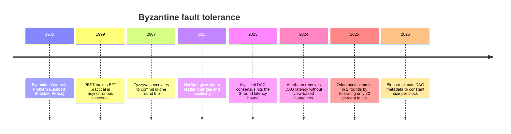
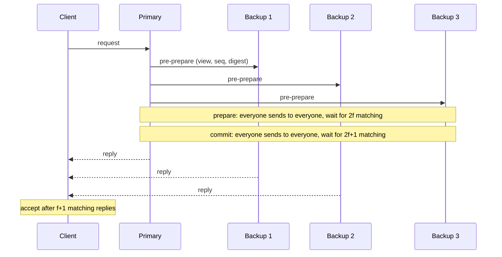

---
tags:
  - distributed-systems
  - consensus
  - byzantine
  - replication
status: draft
sources:
  - https://www.cs.cornell.edu/courses/cs614/1999sp/notes99/byzantine.html
  - https://www.andrew.cmu.edu/course/15-440-sp15/assets/READINGS/lamport1982.pdf
  - https://pmg.csail.mit.edu/bft/castro99practical-abstract.html
  - https://muratbuffalo.blogspot.com/2020/01/practical-byzantine-fault-tolerance.html
  - https://www.cs.utexas.edu/~lorenzo/papers/Kotla08Zyzzyva.pdf
  - https://weblab.ing.unimore.it/people/turoldo/papers/ladis2008.pdf
  - https://arxiv.org/abs/1803.05069
  - https://pdos.csail.mit.edu/6.824/papers/hotstuff.pdf
  - https://docs.cosmos.network/cometbft/next/docs/introduction/intro
  - https://www.cs.cornell.edu/lorenzo/papers/Suri24Autobahn.pdf
  - https://arxiv.org/abs/2310.14821
  - https://eprint.iacr.org/2026/898
  - https://www.arxiv.org/pdf/2510.01216
  - https://brooker.co.za/blog/2020/10/05/consensus/
created: 2026-11-26
updated: 2026-11-26
---

## Table Of Contents

---

- [[#TL;DR|TL;DR]]
- [[#The Problem|The Problem]]
- [[#Foundations|Foundations]]
    - [[#The Byzantine Generals|The Byzantine Generals]]
    - [[#Why 3f+1: Quorums That Must Share an Honest Node|Why 3f+1: Quorums That Must Share an Honest Node]]
- [[#How We Got Here|How We Got Here]]
- [[#How It Works|How It Works]]
    - [[#PBFT: Three Phases and a View Change|PBFT: Three Phases and a View Change]]
    - [[#Zyzzyva: Speculate First|Zyzzyva: Speculate First]]
    - [[#HotStuff: Linear and Pipelined|HotStuff: Linear and Pipelined]]
    - [[#DAG-Based BFT|DAG-Based BFT]]
    - [[#Cost Compared|Cost Compared]]
- [[#Where It Is Now|Where It Is Now]]
- [[#Trade-offs & Open Problems|Trade-offs & Open Problems]]
- [[#Resources|Resources]]
- [[#Related Notes|Related Notes]]

## ***TL;DR***

---

*Byzantine fault tolerance (BFT) is consensus that keeps working when some nodes lie, send conflicting messages or act maliciously, not just when they crash. It costs more replicas (3f+1 instead of 2f+1) and more messages, which is why it thrives in blockchains, where nobody trusts anybody, and stays rare inside a single company's datacenter.*

- **Fault model:** a Byzantine node can do anything: stay silent, send different answers to different peers, or replay old messages. See [[Failure Models]].
- **Replica count:** tolerating $f$ Byzantine nodes needs at least $3f+1$ replicas; [[Paxos]] and [[Raft]] need $2f+1$ for crash faults ([Murat Demirbas on PBFT](https://muratbuffalo.blogspot.com/2020/01/practical-byzantine-fault-tolerance.html)).
- **Lineage:** Byzantine Generals (1982) proved what is possible; PBFT (1999) made it practical; HotStuff (2018) made leader changes linear and became the template for blockchain consensus; DAG protocols like Mysticeti (2023) push throughput and latency for large validator sets.
- **Reality check:** BFT protects against *independent* misbehavior. Correlated failures, like the same bug in every replica, can break the one-third assumption ([Murat Demirbas](https://muratbuffalo.blogspot.com/2020/01/practical-byzantine-fault-tolerance.html)).

## ***The Problem***

---

*Crash-tolerant consensus assumes a failed node simply stops. Real nodes can be buggy, corrupted or controlled by an attacker, and a single such node can break a crash-fault protocol.*

[[Raft]] and [[Paxos]] trust every message they receive. If a node claims to have voted for a value, or claims its log has an entry, the protocol believes it. That is fine when the worst a node can do is stop. It is not fine when a node can lie.

CometBFT's docs put it bluntly: systems like etcd, ZooKeeper and Consul are built on crash-fault consensus and tolerate crash failures in fewer than half their machines, but "a single Byzantine fault can jeopardize the whole system" ([CometBFT docs](https://docs.cosmos.network/cometbft/next/docs/introduction/intro)).

Byzantine behavior is not only malice. Clement and colleagues point to disks that do not fail cleanly, file system recovery bugs, human errors and hardware soft errors, plus a single faulty network card at LAX that reportedly stalled immigration processing for over 12 hours ([Clement et al., "BFT: the Time is Now"](https://weblab.ing.unimore.it/people/turoldo/papers/ladis2008.pdf)). Those overlap with [[Silent Data Corruption]] and [[Gray and Fail-Slow Failures]].

## ***Foundations***

---

*Two results anchor the field: Lamport, Shostak and Pease's proof that unsigned messages need more than three times as many honest nodes as traitors, and the quorum-intersection argument that explains 3f+1 in modern protocols.*

### The Byzantine Generals

Lamport, Shostak and Pease (1982) framed the problem as generals deciding whether to attack, some of whom are traitors. Two conditions must hold: all loyal lieutenants obey the same order, and if the commander is loyal, every loyal lieutenant obeys the order the commander sent ([Cornell CS614 notes](https://www.cs.cornell.edu/courses/cs614/1999sp/notes99/byzantine.html); [paper](https://www.andrew.cmu.edu/course/15-440-sp15/assets/READINGS/lamport1982.pdf)).

| Setting | Result |
|---|---|
| 3 generals, 1 traitor, oral messages | **Impossible**: a loyal lieutenant cannot tell whether the commander or the other lieutenant is lying |
| Oral (unsigned) messages | Solvable only if $n > 3m$ for $m$ traitors, so $n \ge 3m+1$ |
| Signed (unforgeable) messages | Solvable with any number of traitors, if the maximum is known |

The oral-messages algorithm needs up to $m+1$ rounds and its message count grows factorially, so it was a proof of possibility rather than something to run ([Cornell CS614 notes](https://www.cs.cornell.edu/courses/cs614/1999sp/notes99/byzantine.html)).

### Why 3f+1: Quorums That Must Share an Honest Node

A replica can never wait for more than $n - f$ replies, because $f$ faulty replicas might stay silent. Among the replies it does get, up to $f$ may still be from liars, so honest replies must outnumber them ([Murat Demirbas](https://muratbuffalo.blogspot.com/2020/01/practical-byzantine-fault-tolerance.html)):

$$n - 2f > f \quad\Longrightarrow\quad n \ge 3f + 1$$

With $n = 3f+1$, a quorum is $2f+1$. Any two quorums overlap in at least

$$|Q_1 \cap Q_2| \ge 2(2f+1) - (3f+1) = f + 1$$

*In words:* any two quorums share at least $f+1$ nodes, and since at most $f$ are faulty, at least one shared node is honest. That honest node will never vote for two conflicting values, so two conflicting decisions cannot both gather a quorum.

**Worked example.** Tolerate $f = 1$ liar. You need $n = 4$ replicas and quorums of 3. Two quorums, say {A, B, C} and {B, C, D}, share B and C. Even if B lies, C is honest and blocks a conflicting decision. Compare crash faults with [[Raft]]: $f = 1$ needs only 3 nodes and majorities of 2, because overlapping in one node is enough when nodes never lie.

## ***How We Got Here***

---

*BFT went from a theoretical curiosity in 1982 to a practical protocol in 1999, through a decade of speed-ups and skepticism, and then exploded once blockchains needed consensus among strangers.*

- **1999, PBFT:** Castro and Liskov showed BFT working in asynchronous networks like the Internet, with response times more than an order of magnitude better than earlier algorithms. A BFT NFS service built on it was only about 3% slower than unreplicated NFS ([MIT PMG](https://pmg.csail.mit.edu/bft/castro99practical-abstract.html)).
- **2007, Zyzzyva:** replicas execute speculatively and let clients detect divergence, reaching about 86K requests per second with batching ([Kotla et al.](https://www.cs.utexas.edu/~lorenzo/papers/Kotla08Zyzzyva.pdf)).
- **Late 2000s, skepticism:** Clement and colleagues showed PBFT and Zyzzyva dropping to zero throughput under a malformed-message attack, and argued BFT systems "can safely survive Byzantine faults, but can hardly be said to tolerate them" ([Clement et al.](https://weblab.ing.unimore.it/people/turoldo/papers/ladis2008.pdf)). Murat Demirbas notes BFT drew growing criticism around 2010, then blockchains revived it ([Murat Demirbas](https://muratbuffalo.blogspot.com/2020/01/practical-byzantine-fault-tolerance.html)).
- **2018, HotStuff:** Yin, Malkhi, Reiter, Golan Gueta and Abraham made leader failover linear in messages while staying responsive ([arXiv](https://arxiv.org/abs/1803.05069)).
- **2020s, DAG era:** Narwhal and Bullshark split data dissemination from ordering; Mysticeti and successors cut latency further ([Autobahn paper](https://www.cs.cornell.edu/lorenzo/papers/Suri24Autobahn.pdf); [Mysticeti](https://arxiv.org/abs/2310.14821)).

## ***How It Works***

---

*The protocols below are all state machine replication with signed or authenticated votes, quorums of 2f+1, and a way to replace a bad leader. They differ in how many message rounds a commit takes and how much each leader change costs.*

### PBFT: Three Phases and a View Change

Drawn from [Murat Demirbas's summary](https://muratbuffalo.blogspot.com/2020/01/practical-byzantine-fault-tolerance.html):

1. **Pre-prepare:** the primary assigns a sequence number and multicasts the request tagged with its view.
2. **Prepare:** each backup multicasts a prepare. A replica is "prepared" once it has the pre-prepare plus 2f matching prepares. This fixes the order within a view.
3. **Commit:** each replica multicasts a commit and waits for 2f+1 matching commits. This makes the order survive a change of leader.
4. **Reply:** the client accepts once it has f+1 matching replies, since at least one must be honest.

The primary of view $v$ is replica $v \bmod n$. If backups time out waiting on the primary, they run a **view change** to the next one; timeouts protect liveness, never safety. Periodic **checkpoints** (for example every 100 requests) let replicas trim their logs and help lagging replicas catch up ([Murat Demirbas](https://muratbuffalo.blogspot.com/2020/01/practical-byzantine-fault-tolerance.html)). The all-to-all prepare and commit rounds are PBFT's main cost.

### Zyzzyva: Speculate First

Zyzzyva skips agreement in the common case. Replicas execute in the order the primary proposes and reply directly to the client ([Kotla et al.](https://www.cs.utexas.edu/~lorenzo/papers/Kotla08Zyzzyva.pdf)):

- **All $3f+1$ replies match:** done in three one-way message delays.
- **Only $2f+1$ to $3f$ match:** the client builds a commit certificate from $2f+1$ replies and sends it back; done once $2f+1$ replicas acknowledge it.

The catch, shown by Clement and colleagues, is that heavy common-case optimization opens "performance trapdoors" when something goes wrong ([Clement et al.](https://weblab.ing.unimore.it/people/turoldo/papers/ladis2008.pdf)).

### HotStuff: Linear and Pipelined

HotStuff routes all votes through the leader and compresses $2f+1$ votes into one **quorum certificate** with a threshold signature, so each phase costs $O(n)$ messages instead of $O(n^2)$ ([HotStuff paper](https://pdos.csail.mit.edu/6.824/papers/hotstuff.pdf)).

| Phase | Leader sends | Replicas do |
|---|---|---|
| Prepare | Proposal extending the highest certificate it collected from $n - f$ new-view messages | Vote if safe |
| Pre-commit | prepareQC | Vote |
| Commit | precommitQC | **Lock** on it, then vote |
| Decide | commitQC | Execute |

The third phase is the clever part. It lets replicas safely change their minds after voting without the new leader carrying a big proof, which keeps view changes linear and lets the leader move as soon as it hears from $n - f$ replicas. Two-phase protocols like Tendermint and Casper have to wait out a maximum network delay instead ([HotStuff paper](https://pdos.csail.mit.edu/6.824/papers/hotstuff.pdf)).

**Chained HotStuff** overlaps phases: each new proposal's certificate also advances the three before it, so a block commits after a chain of three certificates and leaders can rotate every block ([HotStuff paper](https://pdos.csail.mit.edu/6.824/papers/hotstuff.pdf)).

### DAG-Based BFT

Instead of one leader proposing one block at a time, every validator proposes blocks that reference earlier blocks, forming a directed acyclic graph. Ordering is then read off the graph.

- **Narwhal and Bullshark:** separate data dissemination from ordering for throughput, but Bullshark can need up to 12 message delays to commit ([Autobahn paper](https://www.cs.cornell.edu/lorenzo/papers/Suri24Autobahn.pdf)).
- **Mysticeti (2023):** skips certifying each DAG block and reaches the 3-round latency lower bound, about 0.5 s across a wide-area network at over 200K transactions per second; integrating it into the Sui blockchain cut latency by over 4x ([Mysticeti](https://arxiv.org/abs/2310.14821)).
- **Autobahn (SOSP 2024):** per-replica data "lanes" keep data flowing during network blips, while a PBFT-style consensus layer commits a whole cut of lanes at once. That avoids the "hangovers" where view-based protocols stay slow after a blip. At $n=4$ it matched Bullshark's throughput while cutting latency from 592 ms to 280 ms ([Autobahn paper](https://www.cs.cornell.edu/lorenzo/papers/Suri24Autobahn.pdf)).

### Cost Compared

Authenticator complexity after the network stabilizes, from the HotStuff paper ([HotStuff paper](https://pdos.csail.mit.edu/6.824/papers/hotstuff.pdf)):

| Protocol | Correct leader | One leader failure | Responsive |
|---|---|---|---|
| PBFT | $O(n^2)$ | $O(n^3)$ | No |
| Tendermint / Casper | $O(n^2)$ | $O(n^2)$ | No |
| HotStuff | $O(n)$ | $O(n)$ | Yes |

## ***Where It Is Now***

---

*As of November 2026, BFT research is driven almost entirely by blockchains with hundreds of validators. The live questions are how to commit in fewer rounds and how to shrink the metadata each block carries.*

- **Production engines:** CometBFT, which grew out of Tendermint, replicates any application through its ABCI socket interface and stays correct while less than one-third of voting power is faulty ([CometBFT docs](https://docs.cosmos.network/cometbft/next/docs/introduction/intro)). Mysticeti runs in Sui ([Mysticeti](https://arxiv.org/abs/2310.14821)).
- **Fewer rounds by tolerating fewer faults:** Odontoceti (2025) commits in two rounds by using $n = 5f+1$ validators, so it tolerates 20% Byzantine nodes instead of 33%. It cites a lower bound that two-round Byzantine consensus needs at least $5f+1$ participants, and reports 15 to 25% lower median latency than Mysticeti in the authors' own tests ([Odontoceti](https://www.arxiv.org/pdf/2510.01216)).
- **Less metadata:** Bluestreak (revised October 2026) caps most blocks at two references, so per-block metadata stays constant. At 400 validators across ten emulated regions, average block metadata dropped from about 13 KB to about 320 bytes while matching or beating Mysticeti's median latency ([Bluestreak](https://eprint.iacr.org/2026/898)).
- **Inside companies:** the common coordination stores, etcd, ZooKeeper and Consul, run crash-fault consensus on 3 to 5 machines ([CometBFT docs](https://docs.cosmos.network/cometbft/next/docs/introduction/intro)). Marc Brooker mentions BFT only to wave off the claim that it fixes nondeterminism problems in replicated state machines ([Brooker](https://brooker.co.za/blog/2020/10/05/consensus/)).

## ***Trade-offs & Open Problems***

---

*BFT buys protection from lying nodes with more replicas, more messages and more complexity, and that protection holds only if failures are independent.*

| Choice | Gain | Cost |
|---|---|---|
| BFT vs crash-fault consensus | Survives lying or corrupted nodes | $3f+1$ replicas instead of $2f+1$, plus signatures or MACs |
| All-to-all (PBFT) vs leader-collected votes (HotStuff) | Fewer message delays | $O(n^2)$ messages, worse at scale |
| Optimistic fast paths (Zyzzyva) | One round trip when all is well | Fragile when something goes wrong ([Clement et al.](https://weblab.ing.unimore.it/people/turoldo/papers/ladis2008.pdf)) |
| Two-round commits (Odontoceti) | Lower latency | Tolerates 20% faults, not 33% ([Odontoceti](https://www.arxiv.org/pdf/2510.01216)) |
| DAG vs single-leader | Throughput and graceful recovery from blips | Historically higher latency and metadata ([Autobahn](https://www.cs.cornell.edu/lorenzo/papers/Suri24Autobahn.pdf); [Bluestreak](https://eprint.iacr.org/2026/898)) |

Open problems:

- **Correlated failures.** Software bugs, operator mistakes and attackers reusing one technique tend to hit many replicas at once, which breaks the one-third assumption. Running diverse implementations helps in theory, but developers tend to make the same mistakes in the same tricky places ([Murat Demirbas](https://muratbuffalo.blogspot.com/2020/01/practical-byzantine-fault-tolerance.html)).
- **Robustness vs best case.** Protocols tuned for the happy path can collapse under one faulty client or replica ([Clement et al.](https://weblab.ing.unimore.it/people/turoldo/papers/ladis2008.pdf)).
- **Latency floor.** Three rounds is the bound at one-third fault tolerance; going to two costs fault tolerance ([Mysticeti](https://arxiv.org/abs/2310.14821); [Odontoceti](https://www.arxiv.org/pdf/2510.01216)).
- **Testing.** BFT implementations are hard to get right; see [[Deterministic Simulation Testing]] and [[Formal Methods in Practice]].

## ***Resources***

---

*Read the Byzantine Generals paper for the impossibility, PBFT for the practical protocol, and HotStuff for the modern template. Murat's PBFT summary is the gentlest entry point.*

- [Lamport, Shostak, Pease, The Byzantine Generals Problem (1982)](https://www.andrew.cmu.edu/course/15-440-sp15/assets/READINGS/lamport1982.pdf) and [Cornell CS614 notes](https://www.cs.cornell.edu/courses/cs614/1999sp/notes99/byzantine.html).
- [Castro and Liskov, Practical Byzantine Fault Tolerance (1999)](https://pmg.csail.mit.edu/bft/castro99practical-abstract.html).
- [Murat Demirbas, PBFT summary and critique](https://muratbuffalo.blogspot.com/2020/01/practical-byzantine-fault-tolerance.html).
- [Kotla et al., Zyzzyva](https://www.cs.utexas.edu/~lorenzo/papers/Kotla08Zyzzyva.pdf).
- [Clement et al., BFT: the Time is Now](https://weblab.ing.unimore.it/people/turoldo/papers/ladis2008.pdf).
- [Yin et al., HotStuff](https://pdos.csail.mit.edu/6.824/papers/hotstuff.pdf), as taught in MIT 6.5840.
- [Autobahn (SOSP 2024)](https://www.cs.cornell.edu/lorenzo/papers/Suri24Autobahn.pdf), [Mysticeti](https://arxiv.org/abs/2310.14821), [Odontoceti](https://www.arxiv.org/pdf/2510.01216), [Bluestreak](https://eprint.iacr.org/2026/898).
- [CometBFT introduction](https://docs.cosmos.network/cometbft/next/docs/introduction/intro).

## Related Notes

- [[Failure Models]] — Byzantine is the most general failure model
- [[Paxos]] — the crash-fault counterpart, with 2f+1 replicas
- [[Raft]] — crash-fault consensus used in etcd and Consul, which one Byzantine node can break
- [[Consistency Models]] — BFT state machine replication aims for linearizable order despite liars
- [[Silent Data Corruption]] — corruption is one non-malicious source of Byzantine behavior
- [[Gray and Fail-Slow Failures]] — partial failures that blur the line between crash and Byzantine
- [[Leaderless Consensus]] — DAG protocols share the idea of not funneling everything through one leader
- [[Clock-Assisted Consensus]] — Aspen uses synchronized clocks to make leaderless BFT fast paths succeed
- [[Deterministic Simulation Testing]] — how teams find bugs in consensus implementations
- [[Formal Methods in Practice]] — proving BFT protocols safe before coding them
- [[Coordination Services]] — ZooKeeper and etcd use crash-fault consensus, not BFT
