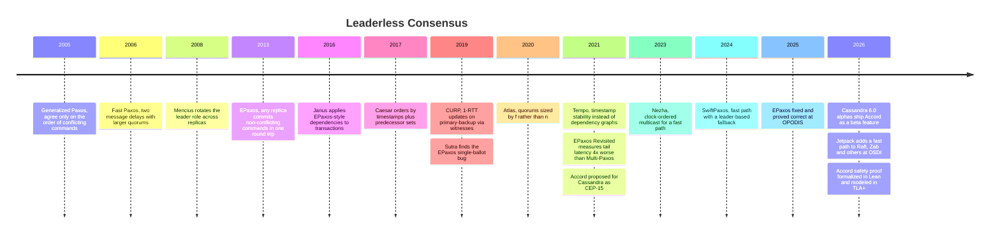
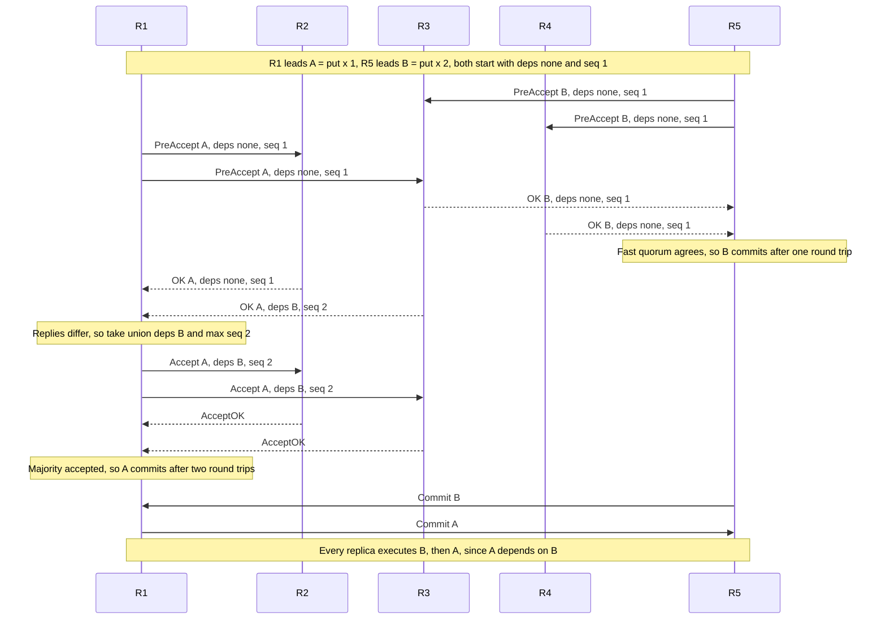
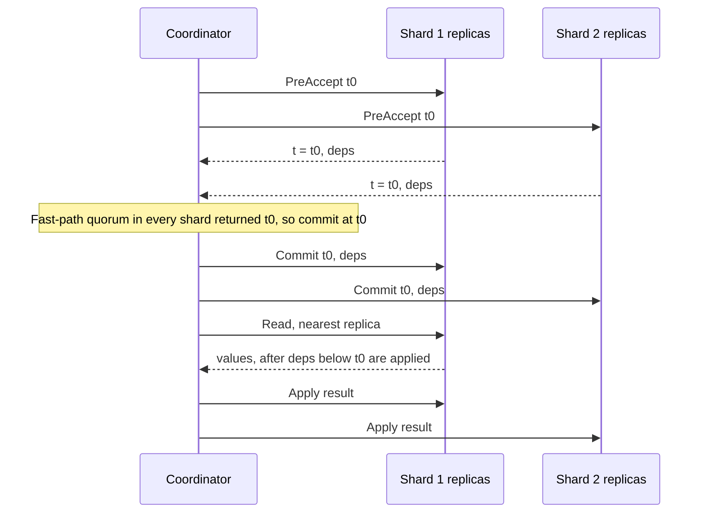

---
tags:
  - distributed-systems
  - consensus
  - leaderless
  - epaxos
  - accord
status: draft
sources:
  - https://www.cs.princeton.edu/courses/archive/spr25/cos418/papers/epaxos.pdf
  - https://web.eecs.umich.edu/~manosk/assets/papers/fast_paxos.pdf
  - https://www.microsoft.com/en-us/research/publication/generalized-consensus-and-paxos/
  - https://www.usenix.org/legacy/events/osdi08/tech/full_papers/mao/mao_html/index.html
  - https://www.cs.princeton.edu/~wlloyd/papers/janus-osdi16.pdf
  - https://ar5iv.labs.arxiv.org/html/1704.03319
  - https://arxiv.org/pdf/2003.11789
  - https://software.imdea.org/~gotsman/papers/tempo-eurosys21.pdf
  - https://ar5iv.arxiv.org/html/1906.10917
  - https://www.usenix.org/conference/nsdi21/presentation/tollman
  - https://arxiv.org/pdf/2511.02743
  - https://drops.dagstuhl.de/entities/document/10.4230/LIPIcs.OPODIS.2025.22
  - https://cwiki.apache.org/confluence/spaces/CASSANDRA/pages/188744725/CEP-15+General+Purpose+Transactions
  - https://cwiki-test.apache.org/confluence/download/attachments/188744725/Accord.pdf?api=v2
  - https://www.usenix.org/conference/nsdi19/presentation/park
  - https://arxiv.org/pdf/1710.09921
  - https://www.usenix.org/conference/osdi26/presentation/tang
  - https://www.usenix.org/system/files/osdi26-tang.pdf
  - https://muratbuffalo.blogspot.com/2026/09/jetpack-consensus-made-generally-fast.html
  - https://usenix.org/conference/nsdi24/presentation/ryabinin
  - https://arxiv.org/abs/2206.03285
  - https://arxiv.org/pdf/2609.31302
  - https://arxiv.org/pdf/2610.30114
  - https://digitalis.io/post/apache-cassandra-6-0-everything-that-changed-in-one-page
  - https://axonops.com/blog/apache-cassandra-6-0-accord-transactions/
  - https://software.imdea.org/news/2026/10-28-accord/
  - https://go.mail-archive.com/dev@cassandra.apache.org/msg27951.html
  - https://cassandra.apache.org/_/download.html
  - https://www.instaclustr.com/blog/apache-cassandra-6-accord-transactions-what-you-need-to-know/
created: 2026-11-26
updated: 2026-11-27
---

## Table Of Contents

---

- [[#TL;DR|TL;DR]]
- [[#The Problem|The Problem]]
- [[#Foundations|Foundations]]
    - [[#Message Delays and Round Trips|Message Delays and Round Trips]]
    - [[#Conflicts and Commutativity|Conflicts and Commutativity]]
    - [[#Fast Quorums|Fast Quorums]]
- [[#How We Got Here|How We Got Here]]
- [[#How It Works|How It Works]]
    - [[#Mencius, Rotating Leaders|Mencius, Rotating Leaders]]
    - [[#Fast Paxos|Fast Paxos]]
    - [[#Generalized Paxos|Generalized Paxos]]
    - [[#EPaxos|EPaxos]]
    - [[#EPaxos, a Worked Example|EPaxos, a Worked Example]]
    - [[#Fast Quorum Sizes Side by Side|Fast Quorum Sizes Side by Side]]
    - [[#Timestamp Protocols, Caesar, Atlas and Tempo|Timestamp Protocols, Caesar, Atlas and Tempo]]
    - [[#Leaderless Transactions, Janus and Accord|Leaderless Transactions, Janus and Accord]]
    - [[#One-RTT Fast Paths on a Leader, CURP and Jetpack|One-RTT Fast Paths on a Leader, CURP and Jetpack]]
- [[#Where It Is Now|Where It Is Now]]
    - [[#The Bugs, and the Fix|The Bugs, and the Fix]]
    - [[#Accord in Cassandra 6.0|Accord in Cassandra 6.0]]
    - [[#The Research Frontier|The Research Frontier]]
- [[#Trade-offs & Open Problems|Trade-offs & Open Problems]]
- [[#Resources|Resources]]
- [[#Related Notes|Related Notes]]

## ***TL;DR***
---
*Leaderless consensus lets any replica order a command, instead of funneling every command through one leader. When commands don't conflict, it commits in one wide-area round trip from the nearest replica; the price is bigger quorums, dependency tracking, and recovery logic that has repeatedly turned out to be wrong.*

- **Why bother:** a single [[Paxos]] or [[Raft]] leader adds a wide-area hop for distant clients, carries all the load, and stops the system while a replacement is elected ([Moraru et al., 2013](https://www.cs.princeton.edu/courses/archive/spr25/cos418/papers/epaxos.pdf)).
- **Two tricks:** *fast quorums* (larger quorums that let a command commit in one round when replicas agree, from Fast Paxos) and *commutativity* (commands on different keys don't need ordering, from Generalized Paxos).
- **EPaxos (2013)** combines them: each command gets a dependency set; if a fast quorum reports identical dependencies, it commits in one round trip, otherwise it takes one more. Execution follows the dependency graph.
- **Quorum math (5 nodes, 2 failures):** a majority is 3; Fast Paxos's fast quorum is 4; optimized EPaxos's fast quorum is 3, including the proposer.
- **Successors** replace dependency graphs with timestamps (Caesar, Tempo, Accord), extend the idea to transactions (Janus, Accord), or bolt a 1-RTT fast path onto a leader (CURP, Jetpack).
- **Now (Nov 2026):** EPaxos's bugs were fixed with a proof at OPODIS 2025. Accord ships in Cassandra 6.0 as a beta feature, off by default, and 6.0 was still pre-release (alpha3 as of September 2026). Research has moved to synthesizing and machine-checking fast paths.

## ***The Problem***
---
*Multi-Paxos and Raft are fast in one data center, but across regions the leader becomes the problem: every client pays a trip to it, it does most of the work, and its failure halts writes. Leaderless protocols try to keep consensus safety while removing that one special node.*

The EPaxos paper lists the costs of a stable leader ([Moraru et al., §1](https://www.cs.princeton.edu/courses/archive/spr25/cos418/papers/epaxos.pdf)):

| Cost | What happens | Who feels it |
|---|---|---|
| **Wide-area latency** | A client in Tokyo with a leader in Virginia pays Tokyo → Virginia, then Virginia → a majority, then back | Every client not near the leader |
| **Load** | The leader sends and receives every message for every command; in EPaxos's experiments, "the MultiPaxos leader becomes bottlenecked by its CPU" | Throughput of the whole group |
| **Failover** | "If the master fails, the system cannot service requests until a new master is elected" | Everyone, for the election timeout plus recovery |
| **Slow leader** | A leader that is slow but not dead drags every command; see [[Gray and Fail-Slow Failures]] | Everyone |

Each fix has its own catch:

| Approach | Where it breaks |
|---|---|
| Move the leader near the busiest clients | Helps one region and hurts the others; still one bottleneck |
| Shard into many groups with different leaders ([[Partitioning]]) | Helps load, but a transaction across shards now needs [[Distributed Transactions|two-phase commit]] on top |
| Let every replica lead some slots (Mencius) | The log advances at the speed of the slowest replica |
| Let any replica propose any command at any time | Two replicas propose different commands for the same slot at once; that collision is the problem leaderless protocols solve |

The bar, as in [[Paxos]]: safety (never disagree) must hold under any timing, and liveness can depend on the network calming down ([[Failure Models]]).

## ***Foundations***
---
*Three ideas carry the whole family: count latency in message delays, not "rounds"; only conflicting commands need ordering; and a bigger quorum lets you skip a round because any later recovery is sure to see the decision.*

### Message Delays and Round Trips

*Papers count one-way message delays. Across regions each delay is tens of milliseconds, so saving one or two is the whole point.*

| Protocol | Path for one command | One-way delays to commit |
|---|---|---|
| Multi-Paxos, client far from leader | client → leader → majority → leader → client | 4, two of them wide-area to reach the leader |
| Classic Paxos counted from proposal | proposer → leader → acceptors → learners | 3 ([Lamport, 2006](https://web.eecs.umich.edu/~manosk/assets/papers/fast_paxos.pdf)) |
| Fast Paxos, no collision | proposer → acceptors → learners | 2 ([Lamport, 2006](https://web.eecs.umich.edu/~manosk/assets/papers/fast_paxos.pdf)) |
| EPaxos fast path | client → local replica → fast quorum → local replica → client | 1 wide-area round trip, plus a local hop |

*Worked example:* replicas in Virginia, Ohio, Oregon, Ireland and Tokyo, leader in Virginia. A Tokyo client under Multi-Paxos waits for Tokyo ↔ Virginia plus Virginia ↔ its second-nearest replica. Under EPaxos, the Tokyo replica coordinates the command itself, so the client waits for Tokyo ↔ the nearest replicas that complete its fast quorum.

### Conflicts and Commutativity

*Two commands conflict (EPaxos says "interfere") when running them in different orders gives different results. Only conflicting commands need an agreed order.*

`put(x, 1)` and `put(y, 2)` commute: any order gives the same state. `put(x, 1)` and `put(x, 2)` don't. Lamport's Generalized Paxos starts from this: ordering two proposals "is necessary only if the two proposed commands do not commute" ([Lamport, 2005](https://www.microsoft.com/en-us/research/publication/generalized-consensus-and-paxos/)). Replicas then agree on a *partial* order (conflicting pairs ordered, others free) instead of one total log.

For a key-value store, "conflict" usually means "touch the same key, and at least one writes." Workloads with few conflicts are where leaderless protocols shine; hot keys are where they struggle.

### Fast Quorums

*A classic quorum is a majority. A fast quorum is larger, so that a value chosen in one round can always be recognized later from any majority, even when concurrent proposals collided.*

Fast Paxos defines both quorums by size. With $N$ acceptors, tolerating $F$ crashes for classic rounds and $E$ crashes for fast rounds, any set of at least $N - F$ is a classic quorum and any set of at least $N - E$ is a fast quorum. Safety needs ([Lamport, 2006](https://web.eecs.umich.edu/~manosk/assets/papers/fast_paxos.pdf)):

$$
N > 2F \qquad \text{and} \qquad N > 2E + F
$$

*In words:* the first is the usual majority rule. The second says any two fast quorums and any classic quorum share at least one acceptor, which is the same as $(N-E) + (N-E) + (N-F) > 2N$. A recovering leader reads a classic quorum and must be able to tell which value, if any, a fast quorum chose; that's only possible if two different fast quorums can't both look plausible.

*Worked example, $N = 5$:* tolerate $F = 2$ for classic rounds. Then $5 > 2E + 2$ allows $E = 1$, so the fast quorum is $5 - 1 = 4$.
- Suppose fast quorums were only 3. Value X is chosen by {A, B, C}. A recovering leader hears from the classic quorum {C, D, E}: C says X, D and E say Y. Was X chosen (by A, B, C)? Or Y (by, say, A, D, E)? Both fit what it sees, so it can't decide safely.
- With fast quorums of 4, a chosen value is missing from at most one acceptor, so it appears at least twice in any 3 replies; two different values can't both do that. The leader picks the value seen at least twice, or is free to choose if none is.

Lamport's two named settings: $E = F = N/3 - 1$ (maximize fast-path fault tolerance) or $F = N/2 - 1$ and $E = N/4$ (maximize classic fault tolerance), which makes the fast quorum about $3N/4$. The conclusion phrases it as fast learning works "if at least 3/4 of the acceptors are nonfaulty."

## ***How We Got Here***
---
*The ingredients came from Lamport in 2005–2006. EPaxos (2013) made them practical without a leader, a decade of follow-ups swapped dependency graphs for timestamps and extended the idea to transactions, and the 2020s were spent finding and fixing the bugs.*

**The ingredients (2005–2008).** Lamport's Generalized Paxos (Microsoft tech report, March 2005) showed that replicas only need to agree on a partial order of non-commuting commands ([Lamport, 2005](https://www.microsoft.com/en-us/research/publication/generalized-consensus-and-paxos/)). Fast Paxos (*Distributed Computing*, 2006) showed how to skip the leader with bigger quorums ([Lamport, 2006](https://web.eecs.umich.edu/~manosk/assets/papers/fast_paxos.pdf)). Mencius (OSDI 2008) took a different route: keep Paxos but give each replica its own slots ([Mao, Junqueira, Marzullo, 2008](https://www.usenix.org/legacy/events/osdi08/tech/full_papers/mao/mao_html/index.html)).

**EPaxos (2013).** Moraru, Andersen and Kaminsky at CMU combined both ideas and added a smaller fast quorum by always including the proposer ([SOSP 2013](https://www.cs.princeton.edu/courses/archive/spr25/cos418/papers/epaxos.pdf)). It became the reference leaderless protocol.

**Timestamps and transactions (2016–2021).** Janus (OSDI 2016) used EPaxos-style dependencies to commit transactions across shards ([Mu et al.](https://www.cs.princeton.edu/~wlloyd/papers/janus-osdi16.pdf)). Caesar (DSN 2017), Atlas (EuroSys 2020) and Tempo (EuroSys 2021) attacked EPaxos's slow paths and tail latency, mostly by ordering with timestamps ([Arun et al.](https://ar5iv.labs.arxiv.org/html/1704.03319), [Enes et al., 2020](https://arxiv.org/pdf/2003.11789), [Enes et al., 2021](https://software.imdea.org/~gotsman/papers/tempo-eurosys21.pdf)). Accord, proposed for Cassandra in 2021, borrowed from all of them ([CEP-15](https://cwiki.apache.org/confluence/spaces/CASSANDRA/pages/188744725/CEP-15+General+Purpose+Transactions)).

**Re-examination (2019–2026).** Sutra found a safety bug in EPaxos's TLA+ spec and code ([Sutra, IPL 2020](https://ar5iv.arxiv.org/html/1906.10917)); Tollman, Park and Ousterhout found its tail latency far worse than reported ([NSDI 2021](https://www.usenix.org/conference/nsdi21/presentation/tollman)); Ryabinin, Gotsman and Sutra fixed and proved it ([OPODIS 2025](https://arxiv.org/pdf/2511.02743)); Jetpack found a data-loss bug in CURP's Raft extension ([Tang et al., OSDI 2026](https://www.usenix.org/system/files/osdi26-tang.pdf)).

## ***How It Works***
---
*The protocols differ in three choices: how a command gets a position (fixed slots, dependency sets or timestamps), how large the fast quorum is, and what happens when the fast path fails.*

### Mencius, Rotating Leaders

*Pre-assign log slots round-robin, so every replica leads its own slots and clients use their local replica. Simple and balanced, but the log moves at the pace of the slowest replica.*

Mencius "partition[s] the sequence of consensus protocol instances among the servers": with 3 servers, server 0 owns slots 0, 3, 6…, server 1 owns 1, 4, 7…, and so on ([Mao et al., 2008](https://www.usenix.org/legacy/events/osdi08/tech/full_papers/mao/mao_html/index.html)).

- **Proposing:** a server puts its local clients' commands in its own slots, so no proposer ever collides with another.
- **Skipping:** a server with nothing to propose *skips* its turn, filling its slot with a no-op. Skips piggyback on other messages, so idle servers cost little.
- **Executing:** slots execute in order, so slot 7 waits for slots 5 and 6 from the other servers to be decided or skipped.
- **Failure:** "a crashed server does not broadcast skip messages, and such a server can prevent others from committing" until the others revoke its slots.

On a three-site testbed with 50 ms one-way delays, Mencius reached about 1,550 ops/s when network-bound against about 540 for Paxos, because load and bandwidth are spread across sites instead of piling on one leader. The EPaxos authors' summary of the weakness: Mencius "fundamentally runs at the speed of the slowest replica" ([Moraru et al.](https://www.cs.princeton.edu/courses/archive/spr25/cos418/papers/epaxos.pdf)).

### Fast Paxos

*Clients send commands straight to the acceptors. If a fast quorum accepts the same value, it's chosen in two message delays; if concurrent proposals collide, a recovery step picks one.*

1. The coordinator runs phase 1 once for a *fast round* and tells acceptors "any value."
2. Proposers send their values directly to acceptors, which accept the first one they get.
3. If a fast quorum ($N - E$) accepted the same value, it's chosen. Learners know after two message delays.
4. **Collision:** two proposers sent at about the same time and acceptors split. The round "can fail if two or more different proposers send proposals at about the same time" ([Lamport, 2006](https://web.eecs.umich.edu/~manosk/assets/papers/fast_paxos.pdf)).

Recovery comes in two flavors:

| Recovery | How | Cost |
|---|---|---|
| **Coordinated** | Acceptors also send their votes to the coordinator, which treats them as phase 1 replies for the next round and picks a value | Adds a phase 2, two more message delays |
| **Uncoordinated** | Acceptors send their votes to each other and each picks a value for the next round by the same rule | "normally adds only one message delay," but may collide again |

Fast Paxos is still a single-value protocol: if two commands for the same slot collide, one loses even if they touch different keys. That's the gap Generalized Paxos and EPaxos fill. It's used where agreement is rare and contention low, such as membership changes in Rapid; see [[Gossip and Membership]].

### Generalized Paxos

*Agree on a growing partial order of commands (a "c-struct") instead of a single value per slot, so commuting commands never collide.*

Lamport generalized consensus from one value to "dynamically changing agreement on a growing partially ordered set of commands" ([Lamport, 2005](https://www.microsoft.com/en-us/research/publication/generalized-consensus-and-paxos/)). Fast rounds work as in Fast Paxos, but two acceptors that received `put(x)` and `put(y)` in different orders still agree, because the order doesn't matter. Only a real conflict needs the leader to resolve it.

It kept a leader for conflict resolution, and in EPaxos's experiments it ran at "less than 1/4 the speed of EPaxos" with a median of 341 ms at 100% conflicts in a three-replica wide-area setup ([Moraru et al.](https://www.cs.princeton.edu/courses/archive/spr25/cos418/papers/epaxos.pdf)).

### EPaxos

*Every replica is a command leader for the commands its clients send. It collects each command's dependencies from a fast quorum; matching answers commit in one round trip, mismatches take a Paxos-Accept round, and execution follows the dependency graph.*

Each command $\gamma$ gets an *instance* owned by the replica that received it, plus two attributes ([Moraru et al., §4](https://www.cs.princeton.edu/courses/archive/spr25/cos418/papers/epaxos.pdf)):
- **deps:** the instances of commands that interfere with $\gamma$ that the replica knows about.
- **seq:** one more than the largest seq among those interfering commands; it breaks cycles at execution time.

**Commit protocol:**

| Phase | Message | Rule |
|---|---|---|
| **PreAccept** | Leader → fast quorum: `PreAccept(γ, deps, seq)` | Each replica adds any interfering instances it knows to deps, raises seq if needed, logs the result and replies |
| **Fast path** | Leader → all: `Commit` | If a fast quorum replied "and all the updated attributes are the same, it commits the command." One round trip |
| **Slow path** | Leader → majority: `Accept(γ, union deps, max seq)` | Take the union of deps and the max seq, run a Paxos-Accept with $F + 1$ replicas, then commit. Two round trips |

The leader replies to the client after commit and sends `Commit` to everyone asynchronously.

**Quorum sizes.** With $N = 2F + 1$, the slow-path quorum is $F + 1$. The basic protocol's fast quorum is $2F$; the optimized protocol's is

$$
|Q_{fast}| = F + \left\lfloor \frac{F+1}{2} \right\rfloor \quad \text{(including the command leader)}
$$

*In words:* the leader plus just over half of the remaining majority must agree. It can be smaller than Fast Paxos's because each instance has exactly one proposer, its leader, and the leader is always in its own fast quorum; two different proposals can't race for the same instance ([KCensus, 2026](https://arxiv.org/pdf/2609.31302)). Recovery then only needs $\lfloor (F+1)/2 \rfloor$ matching pre-accepts among the survivors.

*Example:* $N = 3$, $F = 1$: fast quorum $1 + 1 = 2$, the leader and one peer, so "an EPaxos replica can always commit after one round trip to its nearest peer," even with conflicts. $N = 5$, $F = 2$: fast quorum $2 + 1 = 3$, against 4 for the basic protocol and 4 for Fast Paxos.

**Execution.** Committing a command fixes its deps but doesn't run it. To execute $\gamma$, a replica ([§4.3.2](https://www.cs.princeton.edu/courses/archive/spr25/cos418/papers/epaxos.pdf)):
1. waits until $\gamma$ and, recursively, all its dependencies are committed;
2. builds the dependency graph and finds its strongly connected components (cycles), sorting them topologically;
3. executes components in inverse topological order, and within a component, in increasing seq order.

Every replica commits the same deps for every instance, so every replica builds the same graph and executes conflicting commands in the same order. Non-conflicting commands may run in different orders on different replicas, which is fine because they commute.

**Recovery.** If a command leader stalls, another replica runs *Explicit Prepare* with a higher ballot on that instance: if some replica committed or accepted the command it finishes it, if enough replicas pre-accepted identical attributes it re-proposes them, and if nobody saw the command it commits a no-op. This is the part later found to be underspecified and buggy; see [[#The Bugs, and the Fix|The Bugs, and the Fix]].

### EPaxos, a Worked Example

*Five replicas, two conflicting writes proposed at once at opposite ends. One commits on the fast path, the other on the slow path, and every replica still executes them in the same order.*

Replicas R1 to R5, $F = 2$, fast quorum 3. R1 receives A = `put(x, 1)`; at the same moment R5 receives B = `put(x, 2)`. R1's fast quorum is {R1, R2, R3}; R5's is {R5, R4, R3}. B reaches R3 before A does.

1. **B, fast path.** R3 and R4 know no conflicting command when B arrives, so both return B's attributes unchanged. Three matching answers: B commits with deps = none.
2. **A, slow path.** R2 returns A unchanged, but R3 already holds B, so it reports deps = {B}, seq 2. The answers differ, so R1 runs Accept with the union, deps = {B}, seq 2, on a majority, then commits.
3. **Execution.** A depends on B, B depends on nothing. Every replica runs B then A, so x ends at 1 everywhere.

**When there's a cycle.** If R3 had seen B first while some replica in B's quorum had seen A first, the slow paths would commit A with deps {B} and B with deps {A}. The two form one strongly connected component, and every replica orders it the same way, by seq. The trouble is that under constant conflicts, these components can keep growing, and a command waits until its entire component is committed. That is the root of EPaxos's tail latency ([Enes et al., 2021](https://software.imdea.org/~gotsman/papers/tempo-eurosys21.pdf)).

### Fast Quorum Sizes Side by Side

*Every fast path needs more agreeing replicas than a majority. How many more depends on whether proposers can collide on the same decision.*

| Protocol | Fast quorum rule | $N = 3$ | $N = 5$ | $N = 7$ | Source |
|---|---|---|---|---|---|
| Majority (Multi-Paxos, Raft) | $F + 1$ | 2 | 3 | 4 | [[Paxos]] |
| Fast Paxos, $F = \lfloor (N-1)/2 \rfloor$, largest $E$ with $N > 2E + F$ | $N - E$ | 3 | 4 | 6 | [Lamport, 2006](https://web.eecs.umich.edu/~manosk/assets/papers/fast_paxos.pdf) |
| EPaxos, basic | $2F$ | 2 | 4 | 6 | [Moraru et al.](https://www.cs.princeton.edu/courses/archive/spr25/cos418/papers/epaxos.pdf) |
| EPaxos, optimized | $F + \lfloor (F+1)/2 \rfloor$ | 2 | 3 | 5 | [Moraru et al.](https://www.cs.princeton.edu/courses/archive/spr25/cos418/papers/epaxos.pdf) |
| Caesar | $\lceil 3N/4 \rceil$ | 3 | 4 | 6 | [Arun et al.](https://ar5iv.labs.arxiv.org/html/1704.03319) |
| Atlas, Tempo ($f$ chosen freely) | $\lfloor N/2 \rfloor + f$ | 2 ($f = 1$) | 3 ($f = 1$), 4 ($f = 2$) | 4 ($f = 1$) | [Enes et al., 2020](https://arxiv.org/pdf/2003.11789) |
| Accord, full electorate $E = N$ | $\lceil (\lvert E \rvert + f + 1)/2 \rceil$ | 3 | 4 | 6 | [Accord whitepaper](https://cwiki-test.apache.org/confluence/download/attachments/188744725/Accord.pdf?api=v2) |
| CURP-on-Raft, Jetpack superquorum | $f + \lceil f/2 \rceil + 1$ | 3 | 4 | 6 | [Tang et al.](https://www.usenix.org/system/files/osdi26-tang.pdf) |
| Janus | all $N$ replicas | 3 | 5 | 7 | [Mu et al.](https://www.cs.princeton.edu/~wlloyd/papers/janus-osdi16.pdf) |

*Reading the table for 5 nodes:* a leader-based protocol needs 3 of 5 replies but pays an extra hop to the leader. Fast Paxos, Caesar, Accord's full electorate and the Jetpack superquorum need 4 of 5, so the fast path dies as soon as two replicas are slow or down, though the slow path still works with 3. Optimized EPaxos needs 3 including the proposer, which is why it looked so good, and why getting its recovery right was so hard.

Two parameters change the picture:
- **Atlas and Tempo** let you pick $f$ (concurrent site failures) separately from $N$. With $N = 5$ and $f = 1$, the fast quorum is a plain majority of 3 and the slow quorum just $f + 1 = 2$, betting that two data centers rarely fail at once ([Enes et al., 2020](https://arxiv.org/pdf/2003.11789)).
- **Accord's fast-path electorate** lets operators drop distant or flaky replicas from fast-path voting. From Eq. 2 in the whitepaper, with $N = 5$, $f = 2$ and an electorate of 3, the fast quorum is $\lceil (3 + 2 + 1)/2 \rceil = 3$, all of the electorate. The whitepaper's own example: 9 replicas with $f = 4$ and electorates of 9, 7 or 5 need fast quorums of 7, 6 or 5.

### Timestamp Protocols, Caesar, Atlas and Tempo

*Instead of agreeing on dependency sets that must match exactly, agree on a timestamp per command and execute in timestamp order. Disagreement about who came first no longer forces a slow path as often.*

| Protocol | Ordering | Fast path when | Execution | Claimed result |
|---|---|---|---|---|
| **Caesar** (DSN 2017) | Logical timestamp per command, plus predecessor sets | A fast quorum ($\lceil 3N/4 \rceil$) accepts the proposed timestamp; differing predecessor sets don't by themselves force the slow path | Timestamp order, no graph analysis | Up to 1.7x over EPaxos and 3.5x over Multi-Paxos at 30% conflicts on 5 EC2 sites ([Arun et al.](https://ar5iv.labs.arxiv.org/html/1704.03319)) |
| **Atlas** (EuroSys 2020) | EPaxos-style dependencies | Every dependency reported by some fast-quorum member is reported by at least $f$ of them; always true when $f = 1$ | Batches of committed commands, ordered by ID within a batch | Up to 2x faster than Flexible Paxos; 1.5–2.3x EPaxos on YCSB ([Enes et al., 2020](https://arxiv.org/pdf/2003.11789)) |
| **Tempo** (EuroSys 2021) | Timestamps, no explicit dependencies | The highest proposed timestamp is proposed by at least $f$ processes | A command runs once its timestamp is *stable*: no lower timestamp can still appear | 1.8–5.1x throughput over prior protocols; tail latency 1.4–8x better than Atlas, EPaxos and Caesar ([Enes et al., 2021](https://software.imdea.org/~gotsman/papers/tempo-eurosys21.pdf)) |

**Tempo's stability rule.** Each process proposes a timestamp above its own clock; the coordinator takes the maximum. Processes also issue *promises* ("process $j$ will never propose timestamp $u$ for any command"). A replica sorts the highest contiguous promise it has from each replica and takes the value at index $\lfloor r/2 \rfloor$ as the highest stable timestamp; committed commands at or below it execute in timestamp order.

*Worked example ($r = 5$):* the highest contiguous promises received from R1..R5 are 12, 9, 15, 10, 11. Sorted: 9, 10, 11, 12, 15. Index 2 (zero-based) is 11, so every committed command with timestamp ≤ 11 can run now, in timestamp order. A majority has promised never to use a timestamp ≤ 11 again, so no unknown command can slip in below it.

Tempo's argument against dependency graphs is that a command can be delayed by an unbounded chain of later conflicting commands; ordering by a stable timestamp bounds that wait. With $f = 1$ and 256 clients per site, Atlas's 99th and 99.9th percentiles were 385 ms and 1.3 s (586 ms and 2.4 s at 512 clients), while Tempo's 99th, 99.9th and 99.99th percentiles were 280, 361 and 386 ms; the authors put Tempo's tail at 1.4–8x better than Atlas, EPaxos and Caesar at that load ([Enes et al., 2021](https://software.imdea.org/~gotsman/papers/tempo-eurosys21.pdf)).

### Leaderless Transactions, Janus and Accord

*Apply the same machinery to multi-key, multi-shard transactions, so one protocol does both [[Distributed Transactions|concurrency control]] and replication. Accord is the version going into production.*

Both are deterministic databases without a global log: once the order of conflicting transactions is agreed, every replica executes them the same way and no shard can veto. [[Deterministic Transactions]] compares them with Calvin, SLOG and Detock.

**Janus (OSDI 2016)** noticed that concurrency control and consensus both need conflicting operations ordered the same way everywhere, so one dependency graph can do both ([Mu et al.](https://www.cs.princeton.edu/~wlloyd/papers/janus-osdi16.pdf)). "EPaxos's use of dependency graphs … inspired Janus's dependency tracking." It commits in one wide-area round trip without contention and "always commits with at most two cross-data-center roundtrips in the face of contention," without aborts, for one-shot stored-procedure transactions. The price: its fast quorum "contains all r replica servers," so one slow replica blocks every fast path.

**Accord (Cassandra CEP-15)** is "a new leaderless timestamp protocol" by Benedict Elliott Smith and colleagues, aimed at strict-serializable transactions in one wide-area round trip while tolerating any minority of failures ([CEP-15](https://cwiki.apache.org/confluence/spaces/CASSANDRA/pages/188744725/CEP-15+General+Purpose+Transactions)). From the whitepaper ([Elliott Smith, Zhang, Eggleston, Andreas](https://cwiki-test.apache.org/confluence/download/attachments/188744725/Accord.pdf?api=v2)):

1. **PreAccept.** The coordinator picks $t_0$ from its [[Time and Clocks|hybrid logical clock]] (with its node ID appended, so timestamps are unique) and sends `PreAccept(τ, t0)` to the fast-path electorate of every shard the transaction touches.
2. **Replica vote.** If $t_0$ is higher than any timestamp it has seen for a conflicting transaction, a replica accepts $t = t_0$; otherwise it proposes a higher $t$. It replies with $t$ and its *deps*: conflicting transactions with a lower $t_0$.
3. **Fast path.** If a fast-path quorum all returned $t_0$, commit at $t_0$ with the union of deps. One round trip.
4. **Slow path.** Otherwise take $t = \max$ of the proposals and run `Accept` on a simple majority, then commit. Two round trips.
5. **Execute.** Reads go to a nearby replica per shard, which waits until the deps are committed and any with a lower $t$ are applied. The coordinator then sends `Apply`, and replicas apply in timestamp order.

Two details set it apart:
- **Deps only need to be a superset.** Unlike EPaxos, different coordinators may see different dependency sets; each must just cover every conflict that could commit at a lower timestamp. Timestamps, not the graph, decide order.
- **Reorder buffer.** Replicas hold each PreAccept until $t_0 + \text{SkewMax} + (\text{max latency from any coordinator}) - (\text{latency from this coordinator})$, then process in $t_0$ order. If clocks and latencies stay within the assumed bounds, conflicting transactions reach every replica in timestamp order and the fast path succeeds even under contention. That uses clocks for speed only, never for safety; see [[Clock-Assisted Consensus]] and [[Clock Synchronization]].

The CEP page contrasts Accord with its ancestors: EPaxos's fast path is disabled "once a quarter of replicas are unreachable" and suffers under contention; Janus's failure properties are "terrible" since every replica must vote for the fast path; Caesar can livelock with a worst case of three round trips; Tempo has a read-scalability bottleneck. These are the proposers' claims, not independent measurements.

### One-RTT Fast Paths on a Leader, CURP and Jetpack

*A different route to one round trip: keep the leader for ordering, but let clients make a command durable in parallel, so the client can stop waiting before the leader finishes replicating.*

**CURP (NSDI 2019).** Park and Ousterhout separated durability from ordering ([Park and Ousterhout, 2019](https://www.usenix.org/conference/nsdi19/presentation/park)):
- The client sends an update to the master and, in parallel, to $f$ *witnesses*. A witness "only accepts and saves an operation if it is commutative with every other operation" it holds ([§3](https://arxiv.org/pdf/1710.09921)).
- The master executes and replies before syncing to backups. Once all witnesses accept, the update survives a master crash: 1 RTT.
- On a conflict, the master syncs to backups first (2 RTT). Recovery restores a backup and replays one witness's requests, in any order, since they commute.
- In RAMCloud, write latency fell from 14 µs to 7.1 µs. Applied to [[Raft]], each of $2f + 1$ replicas also runs a witness, and a 1-RTT completion needs a *superquorum* of $f + \lceil f/2 \rceil + 1$ witnesses. That's the same structure as a [[Witness Replicas|witness]], used for latency rather than cost.

**Jetpack (OSDI 2026).** Tang, Zhang, Shen, Shi and Mu built "a plugin framework that adds a 1-RTT fast path to existing consensus protocols with minimal modifications" ([Tang et al., 2026](https://www.usenix.org/conference/osdi26/presentation/tang)):
- Clients broadcast fast-path commands to all replicas; the command also goes through the original protocol. A replica that sees no conflicting command *promises* not to propose a conflicting command ahead of it.
- A superquorum of $f + \lceil f/2 \rceil + 1$ promises (4 of 5) commits the command in 1 RTT; otherwise the original 2-RTT path decides.
- The hard part was the *view change hazard*: promises made in one leader's term can be invalid after an election. In Xline's CURP-on-Raft, a lagging witness could ack a fast-path command and a delayed cleanup message from a new leader could then erase it, losing an acknowledged write ([Demirbas, Sep 2026](https://muratbuffalo.blogspot.com/2026/09/jetpack-consensus-made-generally-fast.html)).
- The fixes: the fast path keeps its own view, and a new leader commits a *stability marker* that recovers the previous view's fast-committed commands before anything else.
- Evaluated on Raft, Mencius, Copilot, MongoDB, etcd and ZooKeeper across 10 AWS regions, it cut average commit latency by up to about 60% ([osdi26-tang.pdf](https://www.usenix.org/system/files/osdi26-tang.pdf)). Demirbas's caveats: commands cross the network twice, execution still waits for the slow log, and a read right after a write to the same key falls back to 2 RTT.

**Others in the same space:**

| Protocol | Idea | Source |
|---|---|---|
| **SwiftPaxos** (NSDI 2024) | Replicas vote on order, and may vote a second time to follow the leader instead of restarting; 2 message delays without contention, 3 with | [Ryabinin, Gotsman, Sutra](https://usenix.org/conference/nsdi24/presentation/ryabinin) |
| **Nezha** (VLDB 2023) | [[Clock-Assisted Consensus|Deadline-ordered multicast]]: "Senders tag messages with deadlines in synchronized time," so replicas usually receive requests in the same order | [Geng et al.](https://arxiv.org/abs/2206.03285) |
| **EPaxos Revisited** (NSDI 2021) | Delays message processing using synchronized clocks to reduce conflicts in EPaxos by at least 50% | [Tollman, Park, Ousterhout](https://www.usenix.org/conference/nsdi21/presentation/tollman) |

## ***Where It Is Now***
---
*As of November 2026, EPaxos has a corrected and proved version, Accord is the leaderless protocol closest to wide production use but is still pre-release in Cassandra 6.0, and research has shifted to verifying fast paths and generating them automatically.*

### The Bugs, and the Fix

*EPaxos is a case study in how a one-round-trip fast path hides its complexity in recovery. It took over a decade to get a version with a proof.*

- **2019–2020, the ballot bug.** EPaxos's TLA+ spec and Go code "use a single variable at each replica to track progress across ballots," where Paxos uses two; Sutra gave an execution where "replicas disagree on the dependencies of a command, breaking consistency" ([Sutra, 2019](https://ar5iv.arxiv.org/html/1906.10917); Information Processing Letters vol. 156, 2020).
- **2021, the tail.** Tollman, Park and Ousterhout confirmed EPaxos has the best median wide-area commit latency, but found the original evaluation "does not trigger or measure the full impact of conflict behavior," and measured tail latency "more than 4x worse than Multi-Paxos" ([NSDI 2021](https://www.usenix.org/conference/nsdi21/presentation/tollman)).
- **2025, the fix.** *Making Democracy Work: Fixing and Simplifying Egalitarian Paxos* by Ryabinin, Gotsman and Sutra (OPODIS 2025; arXiv November 2025) reports more problems: recovery "can get deadlocked even during executions with finitely many submitted commands," the original proofs argue "without referring to the actual pseudocode," and the non-thrifty variant was "never proved." Their **EPaxos\*** adds the missing second ballot variable and a new *validation phase* in recovery, keeps the failure-free path essentially unchanged, and comes with a rigorous proof ([Ryabinin et al.](https://arxiv.org/pdf/2511.02743); [LIPIcs](https://drops.dagstuhl.de/entities/document/10.4230/LIPIcs.OPODIS.2025.22)).

EPaxos\* separates two failure thresholds: $f$, crashes tolerated at all, and $e$, crashes tolerated while still committing on the fast path. The fast quorum is $n - e$, and the protocol works whenever

$$
n \ge \max\{2e + f - 1,\ 2f + 1\}
$$

which the authors show is optimal. *In words:* the first term bounds how fast the fast path can be, the second is the usual majority rule. *Example:* $n = 5$, $f = 2$: $2e + 1 \le 5$ allows $e = 2$, so the fast quorum is $5 - 2 = 3$, matching what optimized EPaxos aimed for, now with a proof. Lamport's earlier lower bound for this setting was $2e + f + 1$, which would give $e = 1$ and a fast quorum of 4. This is consistent with the bound quoted in [[Paxos]].

### Accord in Cassandra 6.0

*Accord is in Cassandra 6.0 as a beta, disabled by default and opt-in per table, and 6.0 had not reached a stable release as of the latest sources (October–November 2026).*

- **Release status.** Apache announced 6.0-alpha1 on April 3, 2026 ([dev list](https://go.mail-archive.com/dev@cassandra.apache.org/msg27951.html)). A September 14, 2026 survey found "The line is at 6.0-alpha3 with no beta or release candidate, and Cassandra 5.0.9 remains the current GA release" ([Digitalis](https://digitalis.io/post/apache-cassandra-6-0-everything-that-changed-in-one-page)). As of late November 2026 the official download page still lists 5.0.9 (August 7, 2026) as the latest GA and no 6.0 release ([cassandra.apache.org](https://cassandra.apache.org/_/download.html)).
- **Default off.** Accord "ships beta-designated and disabled, via `accord.enabled: false`," and a table opts in with `transactional_mode = 'full'` or `'mixed_reads'` ([Digitalis, Sep 2026](https://digitalis.io/post/apache-cassandra-6-0-everything-that-changed-in-one-page)).
- **Operational caveats** (as of 6.0-alpha3, [AxonOps, updated Sep 2026](https://axonops.com/blog/apache-cassandra-6-0-accord-transactions/)): no counter tables; `LOCAL_QUORUM`, `TWO` and `THREE` are rejected; migrating an existing table needs full repair plus Paxos repair, and the first access to each key during migration pays a Paxos repair round trip; once migrated, the client's consistency level is ignored.
- **Coexistence.** Existing Paxos-based lightweight transactions keep working, and developers opt in to Accord with `BEGIN TRANSACTION` ([Instaclustr, Apr 2026](https://www.instaclustr.com/blog/apache-cassandra-6-accord-transactions-what-you-need-to-know/); see [[Paxos]] and [[Distributed Transactions]]).
- **Verification (October 2026).** IMDEA reports that Fedor Ryabinin wrote a hand proof that Accord is safe, which "the team then used AI to automatically formalize … in the Lean proof assistant," and Alexandre Siret built a TLA+ model, presented at Community over Code 2026 in Glasgow. The announcement still describes 6.0 as "upcoming" ([IMDEA, Oct 28, 2026](https://software.imdea.org/news/2026/10-28-accord/)). See [[Formal Methods in Practice]].

No public benchmark of Accord's wide-area latency in 6.0 appeared in the sources above; AxonOps lists metrics to watch but gives no numbers.

### The Research Frontier

*Three threads in 2026: bolt fast paths onto proven protocols instead of redesigning them, derive fast paths automatically for a given deployment, and machine-check them because humans keep getting recovery wrong.*

- **Fast paths as add-ons (OSDI 2026).** Jetpack's view change hazard and its two principles turn the CURP-on-Raft bug into a checklist for any fast-path layer ([Tang et al.](https://www.usenix.org/system/files/osdi26-tang.pdf)).
- **Synthesized fast paths (Sep 2026).** KCensus from EPFL and NVIDIA treats a fast path as a way of spreading knowledge about proposals, gives conditions it calls "both necessary and sufficient" for that to be safe, and searches for the latency-optimal combination per deployment. It reads Paxos, Fast Paxos, SwiftPaxos and EPaxos as special cases and reports up to 16% lower average latency on AWS. Its general rule for Fast-Paxos-style quorums is $q > (n + f)/2$, so 6 of 7 when $f = 3$, against EPaxos's 5 ([Burgelin et al., to appear EuroSys 2027](https://arxiv.org/pdf/2609.31302)).
- **[[AI-Assisted Protocol Design|AI-assisted protocol design]] (Oct 2026).** *The End of Consensus Research?* describes a coding-agent harness that designed a geo-replication protocol, A-GREEMENT, borrowing SwiftPaxos's fast path for cold keys; its Lean formalization found four previously unreported vulnerabilities, two in EPaxos Revisited that "allow replicas to execute conflicting commands in opposite orders." The authors conclude that "agents reshape the researcher's role rather than end consensus research" ([Burgelin et al., arXiv Oct 2026](https://arxiv.org/pdf/2610.30114)).
- **Testing.** The pattern across EPaxos, CURP and EPaxos Revisited is the same: the steady-state path was fine, and the bugs were in recovery (EPaxos, CURP) or in an optimization around the fast path (EPaxos Revisited's dependency pruning, not its clock-based delays). That's the argument for [[Deterministic Simulation Testing]] and model checking before shipping a fast path.

## ***Trade-offs & Open Problems***
---
*Leaderless protocols trade a simple, slow, centralized order for a fast common case that degrades with conflicts and stragglers, plus a recovery path that is hard to get right. They pay off across regions with low-conflict workloads, and much less inside one data center.*

| Choice | You get | You pay |
|---|---|---|
| Stable leader (Multi-Paxos, Raft) | Simple order; a majority of $F + 1$ | Extra wide-area hop for distant clients; leader CPU bottleneck; election pause |
| Rotating leaders (Mencius) | Local proposer; balanced load | Runs at the speed of the slowest replica; a crashed replica blocks the log until revoked |
| Fast quorums (Fast Paxos, Caesar, Accord, Jetpack) | One round trip when replicas agree | About $3N/4$ replicas must answer; two slow replicas out of 5 lose the fast path |
| Proposer-inclusive fast quorum (EPaxos) | Smaller fast quorum, $F + \lfloor (F+1)/2 \rfloor$ | Hard recovery; original protocol had safety and liveness bugs |
| Dependency graphs (EPaxos, Janus, Atlas) | No clock assumptions; partial order | Execution waits on whole cycles; heavy tail under contention |
| Timestamps (Tempo, Accord) | Bounded execution wait; fewer slow paths with a reorder buffer | Fast path depends on clock skew and latency bounds; stability tracking or deps still needed |
| $f$ smaller than a minority (Atlas, Tempo) | Majority-size fast quorums, tiny slow quorums | Safety assumes no more than $f$ concurrent site failures |
| Fast path layered on a leader (CURP, Jetpack) | Keeps a proven protocol; 1 RTT for writes | Commands sent twice; execution and reads after writes still follow the slow log |

Open problems worth tracking:
- **Correct recovery.** Every major fast-path protocol here has had a recovery or optimization bug found years after publication ([Sutra](https://ar5iv.arxiv.org/html/1906.10917), [Ryabinin et al.](https://arxiv.org/pdf/2511.02743), [Tang et al.](https://www.usenix.org/system/files/osdi26-tang.pdf), [Burgelin et al.](https://arxiv.org/pdf/2610.30114)). Proofs and model checking are becoming the entry fee; see [[Formal Methods in Practice]].
- **Tail latency under contention.** Median wins are real; the 99.9th percentile is where dependency-based protocols lose to Multi-Paxos ([Tollman et al.](https://www.usenix.org/conference/nsdi21/presentation/tollman), [Enes et al., 2021](https://software.imdea.org/~gotsman/papers/tempo-eurosys21.pdf)). Hot keys make every leaderless protocol behave like a slow leader-based one.
- **Reads.** Linearizable reads in a leaderless protocol must be ordered like writes or wait for conflicting writes to execute; KCensus notes EPaxos reads degrade under Zipfian contention ([KCensus](https://arxiv.org/pdf/2609.31302)). Leader-based systems answer this with leases instead; see [[Leases and Fencing]].
- **Clocks as a performance crutch.** Accord, Nezha, Tiga and EPaxos Revisited all use synchronized clocks to make the fast path likely. Safety mustn't depend on them, and the gains depend on how tight [[Clock Synchronization]] is in practice ([[Time and Clocks]]); the mechanisms are compared in [[Clock-Assisted Consensus]].
- **Gray failures.** A fast quorum of 4 out of 5 means two slow replicas silently push everything onto the slow path; see [[Gray and Fail-Slow Failures]].
- **Production evidence.** Accord in Cassandra 6.0 will be the first large-scale test of a leaderless consensus protocol in a widely deployed open-source database; as of November 2026 it was still a disabled-by-default beta in a pre-release line.

## ***Resources***
---
*Read the EPaxos paper first, then the OPODIS 2025 fix to see what it got wrong. Fast Paxos explains the quorum math; the Accord whitepaper shows where the ideas ended up; Jetpack and Murat Demirbas's review cover the 1-RTT-on-a-leader route.*

**Primary papers**
- [There Is More Consensus in Egalitarian Parliaments](https://www.cs.princeton.edu/courses/archive/spr25/cos418/papers/epaxos.pdf): Moraru, Andersen, Kaminsky, SOSP 2013. EPaxos.
- [Fast Paxos](https://web.eecs.umich.edu/~manosk/assets/papers/fast_paxos.pdf): Leslie Lamport, *Distributed Computing* 19, 2006. Fast and classic quorums, collision recovery.
- [Generalized Consensus and Paxos](https://www.microsoft.com/en-us/research/publication/generalized-consensus-and-paxos/): Leslie Lamport, MSR-TR-2005-33, March 2005. Commuting commands and c-structs.
- [Mencius: Building Efficient Replicated State Machines for WANs](https://www.usenix.org/legacy/events/osdi08/tech/full_papers/mao/mao_html/index.html): Mao, Junqueira, Marzullo, OSDI 2008. Rotating leaders.
- [Consolidating Concurrency Control and Consensus for Commits under Conflicts](https://www.cs.princeton.edu/~wlloyd/papers/janus-osdi16.pdf): Mu, Nelson, Lloyd, Li, OSDI 2016. Janus.
- [Speeding up Consensus by Chasing Fast Decisions](https://ar5iv.labs.arxiv.org/html/1704.03319): Arun, Peluso, Palmieri, Losa, Ravindran, DSN 2017. Caesar.
- [State-Machine Replication for Planet-Scale Systems](https://arxiv.org/pdf/2003.11789): Enes, Baquero, Rezende, Gotsman, Perrin, Sutra, EuroSys 2020. Atlas.
- [Efficient Replication via Timestamp Stability](https://software.imdea.org/~gotsman/papers/tempo-eurosys21.pdf): Enes, Baquero, Gotsman, Sutra, EuroSys 2021. Tempo.
- [Exploiting Commutativity For Practical Fast Replication](https://www.usenix.org/conference/nsdi19/presentation/park): Park and Ousterhout, NSDI 2019. CURP ([extended version](https://arxiv.org/pdf/1710.09921)).
- [On the Correctness of Egalitarian Paxos](https://ar5iv.arxiv.org/html/1906.10917): Pierre Sutra, Information Processing Letters 2020. The single-ballot bug.
- [EPaxos Revisited](https://www.usenix.org/conference/nsdi21/presentation/tollman): Tollman, Park, Ousterhout, NSDI 2021. Tail latency and clock-delayed processing.
- [Making Democracy Work: Fixing and Simplifying Egalitarian Paxos](https://arxiv.org/pdf/2511.02743): Ryabinin, Gotsman, Sutra, OPODIS 2025 ([LIPIcs](https://drops.dagstuhl.de/entities/document/10.4230/LIPIcs.OPODIS.2025.22)). EPaxos\* with proof.
- [SwiftPaxos: Fast Geo-Replicated State Machines](https://usenix.org/conference/nsdi24/presentation/ryabinin): Ryabinin, Gotsman, Sutra, NSDI 2024.
- [Nezha: Deployable and High-Performance Consensus Using Synchronized Clocks](https://arxiv.org/abs/2206.03285): Geng, Sivaraman, Prabhakar, Rosenblum, VLDB 2023.
- [Jetpack: Consensus Made Generally Fast](https://www.usenix.org/conference/osdi26/presentation/tang): Tang, Zhang, Shen, Shi, Mu, OSDI 2026 ([PDF](https://www.usenix.org/system/files/osdi26-tang.pdf)).
- [KCensus: Synthesizing Latency-Optimal Consensus Fast Paths](https://arxiv.org/pdf/2609.31302): Burgelin, Murat, Sela, Aguilera, Guerraoui, arXiv Sep 2026, to appear at EuroSys 2027.
- [The End of Consensus Research?](https://arxiv.org/pdf/2610.30114): Burgelin et al., arXiv Oct 2026. AI-designed protocols and Lean-found bugs.

**Accord and Cassandra**
- [CEP-15: General Purpose Transactions](https://cwiki.apache.org/confluence/spaces/CASSANDRA/pages/188744725/CEP-15+General+Purpose+Transactions): Benedict Elliott Smith et al. The proposal and comparison with EPaxos, Janus, Caesar and Tempo.
- [Accord whitepaper (draft)](https://cwiki-test.apache.org/confluence/download/attachments/188744725/Accord.pdf?api=v2): Elliott Smith, Zhang, Eggleston, Andreas. Protocol, quorum formulas, reorder buffer, recovery.
- [IMDEA on Accord's verification](https://software.imdea.org/news/2026/10-28-accord/): Oct 28, 2026. Hand proof, Lean formalization, TLA+ model.
- [Cassandra 6.0-alpha1 announcement](https://go.mail-archive.com/dev@cassandra.apache.org/msg27951.html): dev list, Apr 3, 2026.
- [Cassandra downloads](https://cassandra.apache.org/_/download.html): current GA releases.
- [Apache Cassandra 6 Accord transactions](https://www.instaclustr.com/blog/apache-cassandra-6-accord-transactions-what-you-need-to-know/): Instaclustr, Apr 2026. Opting in with `BEGIN TRANSACTION`.

**Analysis**
- [Jetpack: Consensus Made Generally Fast (OSDI '26)](https://muratbuffalo.blogspot.com/2026/09/jetpack-consensus-made-generally-fast.html): Murat Demirbas, Sep 2026. Costs and recovery doubts.
- [Apache Cassandra 6.0: everything that changed](https://digitalis.io/post/apache-cassandra-6-0-everything-that-changed-in-one-page): Digitalis, Sep 2026. Release status and Accord defaults.
- [Apache Cassandra 6.0 Part 2: Accord Transactions](https://axonops.com/blog/apache-cassandra-6-0-accord-transactions/): Hayato Shimizu, AxonOps, Jun 2026, updated Sep 2026. Operational caveats.

## Related Notes

- [[Paxos]] — Fast Paxos, Generalized Paxos and EPaxos are Paxos variants; the EPaxos\* bound here matches the one quoted there.
- [[Raft]] — The leader-based baseline; CURP and Jetpack add fast paths on top of it.
- [[Replication]] — Where leaderless consensus sits next to Dynamo-style leaderless replication, which gives up consensus entirely.
- [[Distributed Transactions]] — Janus and Accord fold concurrency control into consensus instead of layering 2PC over it.
- [[Deterministic Transactions]] — Calvin-style ordering before execution, the database lineage Janus and Accord belong to.
- [[Time and Clocks]] — Hybrid logical clocks order Accord transactions; Tempo uses logical timestamps.
- [[Clock Synchronization]] — How tight clocks must be for Accord's reorder buffer, Nezha and EPaxos Revisited to pay off.
- [[Clock-Assisted Consensus]] — Deadline-ordered multicast, Tiga, Domino and Clock-RSM: clocks for speed, not safety.
- [[Failure Models]] — Crash faults, FLP, and why fast paths tolerate fewer failures than slow paths.
- [[CAP and PACELC]] — The latency side of PACELC is what leaderless protocols try to shrink.
- [[Consistency Models]] — EPaxos gives linearizability; Accord targets strict serializability.
- [[Formal Methods in Practice]] — TLA+ and Lean proofs for EPaxos\* and Accord.
- [[Deterministic Simulation Testing]] — How to find recovery bugs before users do.
- [[Witness Replicas]] — CURP's witnesses are a latency variant of the same idea.
- [[Gossip and Membership]] — Rapid uses Fast Paxos to agree on membership changes.
- [[Partitioning]] — Sharding is the other way to spread leader load; Accord and Janus span shards.
- [[Leases and Fencing]] — Leader leases give cheap reads that leaderless protocols lack.
- [[Gray and Fail-Slow Failures]] — Slow replicas knock fast quorums onto the slow path.
- [[Byzantine Fault Tolerance]] — DAG-based BFT protocols share the goal of not funneling through one leader.
- [[Distributed SQL]] — The per-range leader designs that Accord's authors argue against.
- [[AI-Assisted Protocol Design]] — KCensus synthesis, the agent-designed A-GREEMENT and the Lean proofs that found bugs in EPaxos Revisited.
