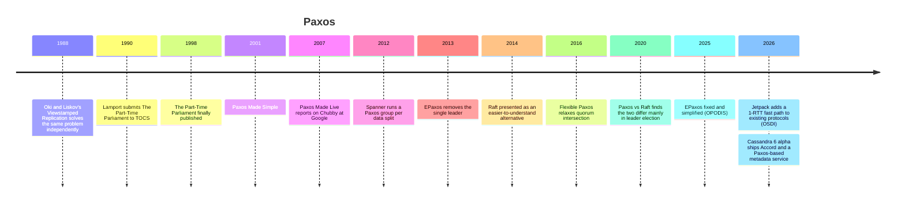
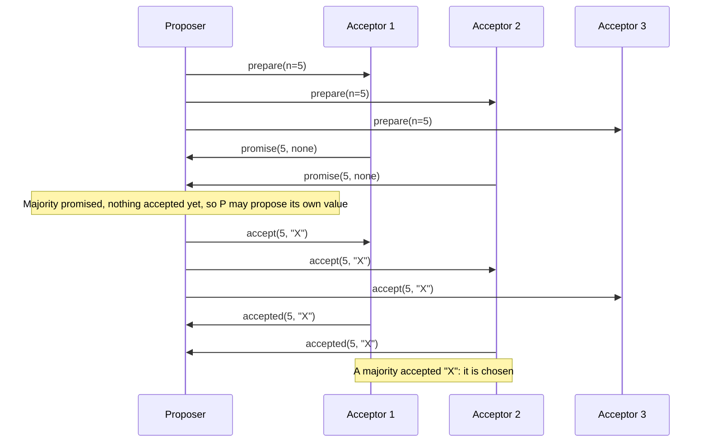

---
tags:
  - distributed-systems
  - consensus
  - paxos
status: draft
sources:
  - https://www.microsoft.com/en-us/research/publication/part-time-parliament/
  - https://pdos.csail.mit.edu/archive/6.824-2012/papers/paxos-simple.pdf
  - https://www.andrew.cmu.edu/course/15-440/assets/READINGS/paxos-made-live.pdf
  - https://arxiv.org/abs/1608.06696v1
  - https://ar5iv.labs.arxiv.org/html/2004.05074
  - https://drops.dagstuhl.de/entities/document/10.4230/LIPIcs.OPODIS.2025.22
  - https://muratbuffalo.blogspot.com/2026/09/jetpack-consensus-made-generally-fast.html
  - https://www.instaclustr.com/blog/apache-cassandra-6-accord-transactions-what-you-need-to-know/
  - https://www.scs.stanford.edu/26wi-cs244c/notes/spanner.txt
  - https://www.cs.princeton.edu/courses/archive/fall15/cos518/papers/spanner.pdf
created: 2026-11-26
updated: 2026-11-26
---

## Table Of Contents

---

- [[#TL;DR|TL;DR]]
- [[#The Problem|The Problem]]
- [[#Foundations|Foundations]]
    - [[#Consensus, Precisely|Consensus, Precisely]]
    - [[#Why Majorities|Why Majorities]]
- [[#How We Got Here|How We Got Here]]
- [[#How It Works|How It Works]]
    - [[#Basic Paxos|Basic Paxos]]
    - [[#Basic Paxos, a Worked Example|Basic Paxos, a Worked Example]]
    - [[#Dueling Proposers|Dueling Proposers]]
    - [[#Multi-Paxos|Multi-Paxos]]
    - [[#Flexible Paxos|Flexible Paxos]]
    - [[#The Paxos Family|The Paxos Family]]
    - [[#From Algorithm to System|From Algorithm to System]]
- [[#Where It Is Now|Where It Is Now]]
    - [[#Paxos in Production|Paxos in Production]]
    - [[#Fast Paths and Leaderless Protocols|Fast Paths and Leaderless Protocols]]
    - [[#Paxos vs Raft|Paxos vs Raft]]
- [[#Trade-offs & Open Problems|Trade-offs & Open Problems]]
- [[#Resources|Resources]]
- [[#Related Notes|Related Notes]]

## ***TL;DR***
---
*Paxos lets a group of machines agree on a value even when some of them crash and messages are lost or delayed. Run it once per log slot and you get a replicated log, which is how most strongly consistent systems stay consistent.*

- **What it guarantees:** only one value is ever chosen, and only a value someone proposed. It never breaks this, however slow or lossy the network. It makes progress only when a single leader can reach a majority for long enough ([Lamport, 2001](https://pdos.csail.mit.edu/archive/6.824-2012/papers/paxos-simple.pdf)).
- **How:** two phases. *Prepare* claims a ballot number and learns what may already be chosen; *accept* gets a majority to store the value. Any two majorities share a member, and that shared member carries the earlier choice forward.
- **Multi-Paxos:** a stable leader runs prepare once for all future slots, then pays one round trip to a majority per command. This is what real systems run.
- **Flexible Paxos:** only the prepare quorum and the accept quorum need to overlap, not two quorums of the same phase, so you can trade a smaller accept quorum for a bigger prepare quorum ([Howard, Malkhi, Spiegelman, 2016](https://arxiv.org/abs/1608.06696v1)).
- **Now (Nov 2026):** Paxos runs inside Spanner, Chubby and Cassandra's cluster metadata service; [[Raft]] is the same idea with a different leader election. Current research is about one-round-trip fast paths and leaderless variants, and about fixing the bugs those keep turning up.

## ***The Problem***
---
*To build one reliable service from many unreliable machines, every replica must apply the same commands in the same order. Agreeing on even one value is hard when any machine can stop and any message can vanish.*

Replicating a database means each replica runs the same deterministic state machine. If all replicas apply the same commands in the same order, they end in the same state. So the hard part is agreeing on the order: for log slot 1, which command? For slot 2? That's one consensus decision per slot.

Simple approaches break under the faults in [[Failure Models]]:

| Approach | Where it breaks |
|---|---|
| One fixed primary decides | Primary crashes; nobody else may decide, so the system stops |
| Primary plus failover on timeout | A slow primary looks dead; two primaries decide different things (split brain) |
| Everyone votes, majority wins | Votes split three ways; a voter crashes after voting and forgets; a delayed vote arrives after the decision |
| Two-phase commit | Coordinator crash leaves participants blocked; see [[Distributed Transactions]] |

FLP tells us no deterministic protocol can *guarantee* agreement in a fully asynchronous system with even one crash ([[Failure Models]]). Paxos's answer is to split the goal: safety (never disagree) always holds, and liveness (eventually decide) holds once the network behaves well enough for one leader to get through.

## ***Foundations***
---
*Consensus has a precise definition, and Paxos meets it with one idea: any two majorities overlap. Everything else in the protocol exists to make the overlapping node pass on what it knows.*

### Consensus, Precisely

Lamport's three safety rules ([Paxos Made Simple](https://pdos.csail.mit.edu/archive/6.824-2012/papers/paxos-simple.pdf)):
1. Only a value that has been proposed may be chosen.
2. Only a single value is chosen.
3. A process never learns that a value was chosen unless it actually was.

The model: crash faults, not Byzantine ones (see [[Byzantine Fault Tolerance]] for that). Processes can stop, restart and run at any speed. Messages can be delayed, duplicated or lost, but not corrupted. Processes keep some state on stable storage across restarts.

There are three roles, and one process usually plays all of them:

| Role | Job |
|---|---|
| **Proposer** | Picks a ballot number and tries to get a value chosen |
| **Acceptor** | Votes; remembers its promises and accepted values on disk |
| **Learner** | Finds out which value was chosen and acts on it |

### Why Majorities

A value is *chosen* once a majority of acceptors have accepted it. With $n = 2f + 1$ acceptors, any two majorities of size $f + 1$ share at least one acceptor:

$$
(f + 1) + (f + 1) = 2f + 2 > 2f + 1 = n
$$

So if a value was chosen by one majority, any later proposer that talks to any other majority will reach at least one acceptor that knows about it. Paxos's rules force the later proposer to adopt that value. This is the same quorum-intersection argument behind the resilience bounds in [[Failure Models]]: tolerating $f$ crashes needs $2f + 1$ acceptors.

## ***How We Got Here***
---
*Paxos was submitted in 1990, rejected as too whimsical, published eight years later, re-explained in plain language in 2001, and found to be much harder to build than to describe in 2007. Raft and the fast-path variants followed.*

**The parliament (1990 to 1998).** Lamport described the algorithm as the procedures of a parliament on the Greek island of Paxos, whose legislators kept wandering in and out of the chamber. He submitted it to TOCS in 1990; the referees found it "mildly interesting, though not very important" and wanted the Paxos framing removed. He set it aside, and it was published in 1998, "setting a personal record for publication delay" ([Lamport's note](https://www.microsoft.com/en-us/research/publication/part-time-parliament/)). It won the SIGOPS Hall of Fame Award in 2012.

**Plain English (2001).** Because almost nobody understood the parliament story, Lamport rewrote it as *Paxos Made Simple*, which opens by deriving the algorithm from the safety requirements ([Lamport, 2001](https://pdos.csail.mit.edu/archive/6.824-2012/papers/paxos-simple.pdf)). Its last section sketches Multi-Paxos for state machine replication.

**The engineering gap (2007).** Google's Chubby team replaced a commercial replicated database with Multi-Paxos and found that a page of pseudocode became several thousand lines of C++, with leases, snapshots, membership changes and disk corruption all left unspecified by the papers ([Chandra, Griesemer, Redstone, 2007](https://www.andrew.cmu.edu/course/15-440/assets/READINGS/paxos-made-live.pdf)).

**Variants (2005 to 2016).** Researchers attacked each cost: Fast Paxos and Generalized Paxos cut round trips, EPaxos removed the leader bottleneck, and Flexible Paxos showed the quorums could be resized. [[Raft]] (2014) repackaged leader-based consensus around understandability and became the common choice for new open-source systems.

**Re-examination (2020 to now).** Howard and Mortier showed Paxos and Raft differ mainly in leader election ([Paxos vs Raft](https://ar5iv.labs.arxiv.org/html/2004.05074)). Work since then mostly fixes and generalizes earlier protocols rather than inventing new ones.

## ***How It Works***
---
*Basic Paxos chooses one value in two phases. Multi-Paxos repeats that for every log slot with a stable leader, and Flexible Paxos shows how to size the quorums for each phase.*

### Basic Paxos

*Phase 1 reserves a ballot number and finds out whether some value may already be chosen. Phase 2 asks a majority to accept the value, which must be the one phase 1 surfaced, if any.*

Ballot numbers are unique and totally ordered; each proposer draws from its own disjoint set (for example, round number plus proposer ID).

| Step | Message | Rule |
|---|---|---|
| **1a Prepare** | Proposer → acceptors: `prepare(n)` | Pick a ballot $n$ higher than any it has used |
| **1b Promise** | Acceptor → proposer: `promise(n, last_accepted)` | Reply only if $n$ is higher than any prepare it has answered. Promise to ignore anything lower than $n$, and report the highest-numbered proposal it has accepted, if any |
| **2a Accept** | Proposer → acceptors: `accept(n, v)` | After promises from a majority: $v$ is the value of the highest-numbered accepted proposal among the replies. If none reported one, the proposer may pick its own value |
| **2b Accepted** | Acceptor → learners: `accepted(n, v)` | Accept unless it has since promised a higher ballot |

Acceptors write their promised ballot and their accepted proposal to stable storage *before* replying. A restarted acceptor that forgot a promise could break safety.

The value rule in 2a is the heart of the algorithm. Lamport's invariant **P2c** says: when a proposal $(n, v)$ is issued, some majority $S$ either has accepted nothing below $n$, or $v$ is the value of the highest-numbered proposal below $n$ accepted in $S$ ([Paxos Made Simple](https://pdos.csail.mit.edu/archive/6.824-2012/papers/paxos-simple.pdf)). Following this rule means a chosen value is never replaced.

### Basic Paxos, a Worked Example

*Three acceptors, two proposers. The second proposer wants "Y" but is forced to propose "X", because "X" might already be chosen.*

Acceptors A1, A2, A3; a majority is 2.

1. **P1, ballot 1.** P1 sends `prepare(1)`. A1 and A2 promise; neither has accepted anything.
2. **P1 proposes "X".** P1 sends `accept(1, "X")`. A1 and A2 accept. "X" is now chosen, but P1 crashes before telling anyone.
3. **P2, ballot 2.** P2 wants "Y". It sends `prepare(2)` and hears back from A2 and A3:
   - A2: `promise(2, accepted (1, "X"))`
   - A3: `promise(2, none)`
4. **P2 must propose "X".** The highest-numbered accepted proposal among the replies is (1, "X"), so P2 sends `accept(2, "X")`. "Y" is never proposed.
5. **Outcome.** Whichever majority P2 had reached, it would include A1 or A2, because any two of three overlap. The chosen value survives P1's crash.

Now change step 2: P1's accept reaches only A1 before P1 crashes. "X" is *not* chosen (one acceptor is not a majority). If P2's prepare reaches A2 and A3, neither reports anything, so P2 is free to propose "Y", and "Y" gets chosen. That's safe: "X" was never chosen, so nobody could have learned it. A1's stale acceptance of (1, "X") is simply outvoted.

### Dueling Proposers

*Two proposers can keep pre-empting each other forever, so Paxos alone doesn't guarantee progress. A single leader, chosen with timeouts or randomness, fixes this in practice.*

1. P1 prepares ballot 1 and gets promises.
2. Before P1's accept arrives, P2 prepares ballot 2. Acceptors now reject ballot 1.
3. P1 retries with ballot 3, which pre-empts P2's accept for ballot 2.
4. Repeat forever. Nothing is ever chosen, though nothing unsafe happens either.

Lamport's fix is a *distinguished proposer* (a leader): only it proposes. Electing one reliably needs timeouts or randomness, which is FLP's escape hatch, and safety doesn't depend on the election being right. Two leaders at once can stall progress but can't cause disagreement ([Paxos Made Simple](https://pdos.csail.mit.edu/archive/6.824-2012/papers/paxos-simple.pdf)).

### Multi-Paxos

*Run one Paxos instance per log slot, but let a stable leader do phase 1 once for all slots. After that, each command costs one round trip to a majority.*

A replicated log is a sequence of Paxos instances: instance $i$ chooses command $i$. Doing both phases per command would be wasteful, so a new leader runs **phase 1 once for every slot it doesn't know about**, in one short message. Acceptors reply with details only for slots where they've already accepted something ([Paxos Made Simple](https://pdos.csail.mit.edu/archive/6.824-2012/papers/paxos-simple.pdf)).

Lamport's example of a new leader taking over:

| Slots | What the new leader knows | What it does |
|---|---|---|
| 1 to 134 | Chosen | Nothing |
| 135 | Some acceptor reported an accepted value | Re-proposes that value |
| 136, 137 | Nothing reported | Proposes a **no-op** to fill the gap |
| 138, 139 | Chosen | Nothing |
| 140 | Reported an accepted value | Re-proposes it |
| 141 onward | Free | Assigns new client commands |

Gaps happen because a leader may have up to $\alpha$ commands in flight at once; if it crashes, some later slots may be chosen while earlier ones aren't. The no-ops let the log be executed in order. In steady state only phase 2 runs, which Lamport calls essentially optimal: client → leader → majority → leader → client.

Reads need care. A leader that answers reads from its own state might have been replaced without knowing. Options are to put reads through the log (a full round), confirm leadership with a majority, or use **leader leases**: acceptors promise not to support another leader for a period, so the leaseholder can read locally. Spanner's leases default to 10 seconds and rely on [[Time and Clocks|TrueTime]] to keep successive leases disjoint ([Spanner paper](https://www.cs.princeton.edu/courses/archive/fall15/cos518/papers/spanner.pdf)). See [[Leases and Fencing]].

### Flexible Paxos

*Majorities are sufficient but not necessary. Only phase 1 and phase 2 quorums must overlap, so you can shrink the quorum you use on every command and pay for it with a bigger quorum during rare leader changes.*

Howard, Malkhi and Spiegelman showed that "intersection is required only across phases": every phase 1 quorum must overlap every phase 2 quorum, but two phase 2 quorums need not overlap ([Flexible Paxos, 2016](https://arxiv.org/abs/1608.06696v1)). For simple counting quorums over $N$ acceptors:

$$
|Q_1| + |Q_2| > N
$$

| $N$ | Classic (majorities) | One flexible choice | Effect |
|---|---|---|---|
| 4 | $Q_1 = 3,\ Q_2 = 3$ | $Q_1 = 3,\ Q_2 = 2$ | Every command now survives losing 2 of 4 acceptors; leader change still needs 3 |
| 6 | $Q_1 = 4,\ Q_2 = 4$ | $Q_1 = 4,\ Q_2 = 3$ | Steady state waits for 3 acks, not 4 |
| 10 | $Q_1 = 6,\ Q_2 = 6$ | $Q_1 = 8,\ Q_2 = 3$ | Commands need only 3 nearby acceptors; a leader change must reach 8 |

Why it's safe: a value chosen by any phase 2 quorum is seen by every future phase 1 quorum, which is all the worked example above needed. Since phase 1 runs only on leader change in Multi-Paxos, making it more expensive is a good trade when leaders are stable. The paper's examples include shrinking phase 2 quorums by one when $N$ is even, and using small disjoint phase 2 quorums to speed up steady state. The catch: if more than $N - |Q_1|$ acceptors are down, no new leader can be elected, even though the current leader could keep going.

### The Paxos Family

*Most named variants change one thing: the number of round trips, who leads, or the quorum shape.*

| Variant | Changes | Cost |
|---|---|---|
| Multi-Paxos | Stable leader; phase 1 once | Leader is a throughput bottleneck and a single point of slowness |
| Fast Paxos (2006) | Clients send straight to acceptors; 1 round trip when there's no conflict | Needs a larger fast quorum, about three quarters of the nodes; conflicts fall back to a slower recovery |
| EPaxos (2013) | No leader; any replica commits commands that don't conflict in 1 round trip | Complex dependency tracking and recovery; the original had bugs (see below) |
| Flexible Paxos (2016) | Different quorum sizes for phase 1 and phase 2 | Harder leader change |
| [[Raft]] (2014) | Leader must already have an up-to-date log; strong leader | Elections can stall on split votes; randomized timeouts |
| Viewstamped Replication (1988) | Same core ideas, framed as primary-backup with view changes | Developed independently of Paxos |

### From Algorithm to System

*The Chubby team's lesson: Paxos fits on a page, but a production implementation needs leases, snapshots, membership changes, corruption handling and a lot of testing that the papers don't cover.*

From [Paxos Made Live](https://www.andrew.cmu.edu/course/15-440/assets/READINGS/paxos-made-live.pdf) (Google, 2007):
- **Size.** About a page of pseudocode became several thousand lines of C++. "There are significant gaps between the description of the Paxos algorithm and the needs of a real-world system."
- **Leases.** The master serves reads locally under a lease, with a shorter timeout than the replicas to allow for clock drift.
- **Disk corruption.** A replica whose disk was corrupted or wiped could break promises it no longer remembers. Theirs rejoins as a non-voter and waits for one full Paxos instance started after its recovery before voting again.
- **Snapshots and membership.** Neither was specified in the literature; both had to be designed, and the snapshot records Paxos state so log truncation stays consistent.
- **Testing.** Seeded, single-threaded randomized tests inject crashes, partitions, delays and file corruption so failures replay exactly. A master-failover test found five Chubby bugs in its first two weeks. This is the ancestor of [[Deterministic Simulation Testing]].
- **Production surprises.** Restoring an old snapshot lost 15 hours of data, and too many worker threads caused cascading master failovers.

## ***Where It Is Now***
---
*As of November 2026, Paxos is the engine under some of the largest strongly consistent systems, Raft dominates new open-source projects, and research is focused on one-round-trip fast paths and on proving leaderless protocols correct.*

### Paxos in Production

*Paxos runs where a team wanted fine control over quorums, leases or many independent groups.*

- **Google Chubby:** a five-replica Multi-Paxos log under the lock service ([Paxos Made Live](https://www.andrew.cmu.edu/course/15-440/assets/READINGS/paxos-made-live.pdf)).
- **Google Spanner:** every tablet is its own Paxos group, replicated across zones (for example "replicated 5 ways with 1 witness"); leaders hold leases and assign transaction timestamps, and [[Distributed Transactions|two-phase commit]] runs across groups ([Stanford CS244c notes](https://www.scs.stanford.edu/26wi-cs244c/notes/spanner.txt), [Spanner paper](https://www.cs.princeton.edu/courses/archive/fall15/cos518/papers/spanner.pdf)).
- **Apache Cassandra:** single-partition lightweight transactions (`IF NOT EXISTS`, conditional updates) run Paxos. Cassandra 6, in alpha as of April 2026, adds a cluster metadata service that uses Paxos internally and needs at least three nodes ([Instaclustr, Apr 2026](https://www.instaclustr.com/blog/apache-cassandra-6-accord-transactions-what-you-need-to-know/)).

### Fast Paths and Leaderless Protocols

*The research frontier is cutting the second round trip in wide-area deployments without making the protocol unverifiable. The recurring problem is that the fast-path recovery logic is where the bugs live.*

- **Accord (Cassandra 6).** A leaderless transaction protocol: any node can coordinate any transaction, it commits in one round trip under normal conditions, and it orders conflicting transactions by [[Time and Clocks|hybrid logical clock]] timestamps with a short reorder buffer to absorb clock skew. Existing Paxos-based lightweight transactions keep working; developers opt in with `BEGIN TRANSACTION` ([Instaclustr, Apr 2026](https://www.instaclustr.com/blog/apache-cassandra-6-accord-transactions-what-you-need-to-know/)).
- **EPaxos, fixed (OPODIS 2025).** Ryabinin, Gotsman and Sutra found the original EPaxos hard to follow, underspecified and buggy. Their EPaxos* has a simpler recovery algorithm with a proof, and works for any $n \ge \max(2e + f - 1,\ 2f + 1)$, which they show is optimal ([Ryabinin et al., Jan 2026](https://drops.dagstuhl.de/entities/document/10.4230/LIPIcs.OPODIS.2025.22)).
- **Jetpack (OSDI 2026).** A shim that adds a one-round-trip fast path to an existing leader-based protocol (Paxos, Raft, Zab) without changing it: the fast path commits when there are no key conflicts and a supermajority agrees, and the original protocol stays as the slow path. Across six systems on 10 AWS data centers it cut client latency by up to 60%, mainly for write-heavy workloads. Along the way the authors found a data-loss bug in CURP's Raft extension. Murat Demirbas's review notes the costs: commands cross the network twice, execution still follows the slow log, and a read right after a write falls back to two round trips ([Demirbas, Sep 2026](https://muratbuffalo.blogspot.com/2026/09/jetpack-consensus-made-generally-fast.html)).

### Paxos vs Raft

*They are the same algorithm with different leader elections. Raft's reputation for simplicity comes mostly from how its paper is written.*

Howard and Mortier rewrote Paxos in Raft's terms and compared them ([Paxos vs Raft, 2020](https://ar5iv.labs.arxiv.org/html/2004.05074)):
- **The main difference is election.** Raft lets only a candidate with an up-to-date log become leader. Paxos lets any server become leader, then has it catch up from the promises it collects.
- **Raft's election is lighter.** It exchanges no log entries, but its randomized timeouts can make elections slower and more variable.
- **Understandability.** They find "the two algorithms are not significantly different in understandability," and that "much of the understandability of Raft comes from the paper's clear presentation."

## ***Trade-offs & Open Problems***
---
*Paxos buys unbreakable agreement with a majority round trip on every write and a leader that every request funnels through. Most open work is about shrinking those costs without losing the proof.*

| Choice | You get | You pay |
|---|---|---|
| Majority quorums ($2f + 1$) | Tolerate $f$ crashes; simple reasoning | Each write waits for the $(f+1)$th fastest acceptor |
| Stable leader (Multi-Paxos) | One round trip per command | Leader is a bottleneck; leader failure means an election pause |
| Leader leases | Local reads without a round trip | Depends on bounded clock drift ([[Time and Clocks]]) |
| Flexible quorums | Smaller steady-state quorums | Harder or impossible leader change when many nodes are down |
| Leaderless / fast path | One round trip, no leader hotspot | Complex recovery; history of bugs |

Open problems worth tracking:
- **Correct fast paths.** EPaxos and CURP both shipped with recovery bugs that took years to find ([Ryabinin et al.](https://drops.dagstuhl.de/entities/document/10.4230/LIPIcs.OPODIS.2025.22), [Demirbas](https://muratbuffalo.blogspot.com/2026/09/jetpack-consensus-made-generally-fast.html)). Model checking and proofs are becoming the price of entry; see [[Formal Methods in Practice]].
- **The engineering gap.** Membership changes, snapshots, disk corruption and gray failures are still where real implementations break ([Paxos Made Live](https://www.andrew.cmu.edu/course/15-440/assets/READINGS/paxos-made-live.pdf); see [[Failure Models]]).
- **Wide-area latency.** A majority across regions means a cross-region round trip per write. Witness replicas, flexible quorums and fast paths each shave some of it; see [[CAP and PACELC]].
- **Byzantine faults.** Paxos assumes nodes fail by stopping. Silent data corruption on modern hardware blurs that line; see [[Byzantine Fault Tolerance]] and [[Silent Data Corruption]].

## ***Resources***
---
*Read Paxos Made Simple first; it's short. Then Paxos Made Live for what building it takes, Flexible Paxos for the quorum insight, and Paxos vs Raft to connect it to the protocol you'll most likely run.*

**Primary papers**
- [The Part-Time Parliament](https://www.microsoft.com/en-us/research/publication/part-time-parliament/): Leslie Lamport, TOCS, May 1998 (submitted 1990). The original, with Lamport's history of it.
- [Paxos Made Simple](https://pdos.csail.mit.edu/archive/6.824-2012/papers/paxos-simple.pdf): Leslie Lamport, Nov 2001.
- [Paxos Made Live: An Engineering Perspective](https://www.andrew.cmu.edu/course/15-440/assets/READINGS/paxos-made-live.pdf): Chandra, Griesemer, Redstone, PODC 2007.
- [Spanner: Google's Globally-Distributed Database](https://www.cs.princeton.edu/courses/archive/fall15/cos518/papers/spanner.pdf): Corbett et al., OSDI 2012. Paxos groups with leases.
- [Flexible Paxos: Quorum Intersection Revisited](https://arxiv.org/abs/1608.06696v1): Howard, Malkhi, Spiegelman, OPODIS 2016.
- [Paxos vs Raft: Have We Reached Consensus on Distributed Consensus?](https://ar5iv.labs.arxiv.org/html/2004.05074): Howard and Mortier, PaPoC 2020.
- [Making Democracy Work: Fixing and Simplifying Egalitarian Paxos](https://drops.dagstuhl.de/entities/document/10.4230/LIPIcs.OPODIS.2025.22): Ryabinin, Gotsman, Sutra, OPODIS 2025.

**Practitioner writing**
- [Jetpack: Consensus Made Generally Fast (OSDI '26)](https://muratbuffalo.blogspot.com/2026/09/jetpack-consensus-made-generally-fast.html): Murat Demirbas's review, Sep 2026.
- [Apache Cassandra 6 Accord transactions](https://www.instaclustr.com/blog/apache-cassandra-6-accord-transactions-what-you-need-to-know/): Instaclustr, Apr 2026.
- [Stanford CS244c Spanner notes](https://www.scs.stanford.edu/26wi-cs244c/notes/spanner.txt): Winter 2026. How Spanner uses Paxos and leases.

## Related Notes

- [[Failure Models]] — FLP, crash faults and why $2f + 1$ nodes tolerate $f$ crashes.
- [[Time and Clocks]] — Leases depend on bounded clock drift; TrueTime and hybrid logical clocks in Spanner and Accord.
- [[Consistency Models]] — A Paxos log gives you linearizability.
- [[CAP and PACELC]] — Why the minority side of a Paxos group can't serve writes, and the latency cost of quorums.
- [[Raft]] — The same idea with a different leader election.
- [[Replication]] — Where consensus fits among primary-backup, chain and leaderless replication.
- [[Byzantine Fault Tolerance]] — Consensus when nodes can lie, not just stop.
- [[Leases and Fencing]] — How leaders serve local reads safely.
- [[Distributed Transactions]] — Two-phase commit across Paxos groups in Spanner.
- [[Distributed SQL]] — The databases built on top of consensus groups.
- [[Coordination Services]] — Chubby, ZooKeeper and etcd, consensus as a service.
- [[Deterministic Simulation Testing]] — Paxos Made Live's randomized testing, grown up.
- [[Formal Methods in Practice]] — TLA+ and proofs for consensus protocols.
