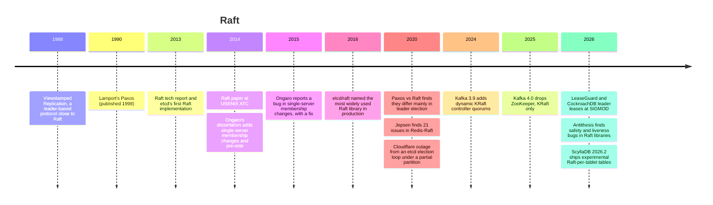
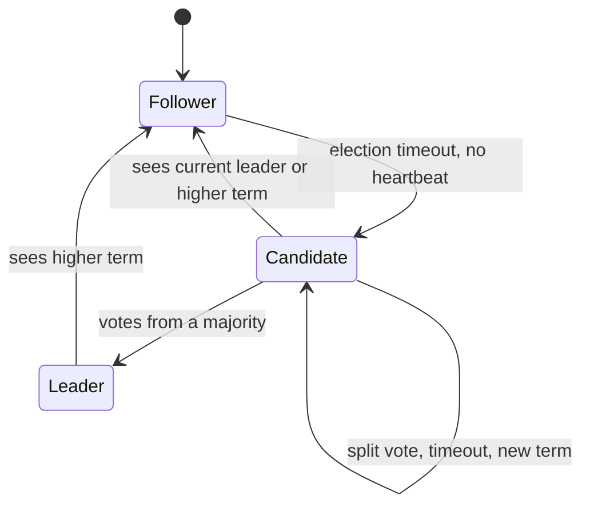
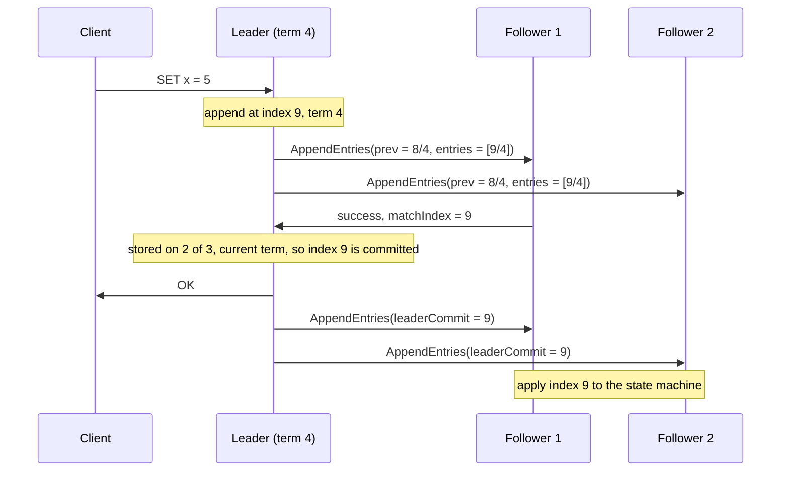

---
tags:
  - distributed-systems
  - consensus
  - raft
status: draft
sources:
  - https://www.cs.bu.edu/~jappavoo/jappavoo.github.com/451/papers/raft-extended.pdf
  - https://ar5iv.labs.arxiv.org/html/2004.05074
  - https://pkg.go.dev/go.etcd.io/raft/v3
  - https://groups.google.com/g/raft-dev/c/t4xj6dJTP6E
  - https://will62794.github.io/distributed-systems/2024/02/09/note-on-raft-reconfig-bug.html
  - https://blog.cloudflare.com/a-byzantine-failure-in-the-real-world
  - https://kafka.apache.org/blog/2024/11/06/apache-kafka-3.9.0-release-announcement/
  - https://kafka.apache.org/blog/2025/03/18/apache-kafka-4.0.0-release-announcement/
  - https://tikv.org/deep-dive/scalability/multi-raft/
  - https://cockroachlabs.com/blog/distributed-database-leader-leases
  - https://arxiv.org/html/2512.15659v2
  - https://www.scylladb.com/2026/06/24/raft-strong-consistency/
  - https://antithesis.com/blog/2026/finding-bugs-in-raft-implementations/
  - https://jepsen.io/analyses/redis-raft-1b3fbf6
  - https://muratbuffalo.blogspot.com/2026/09/jetpack-consensus-made-generally-fast.html
created: 2026-11-26
updated: 2026-11-26
---

## Table Of Contents

---

- [[#TL;DR|TL;DR]]
- [[#The Problem|The Problem]]
- [[#Foundations|Foundations]]
    - [[#Replicated State Machines|Replicated State Machines]]
    - [[#Terms|Terms]]
    - [[#The Five Safety Properties|The Five Safety Properties]]
- [[#How We Got Here|How We Got Here]]
- [[#How It Works|How It Works]]
    - [[#Leader Election|Leader Election]]
    - [[#Log Replication|Log Replication]]
    - [[#Safety: Who May Lead|Safety: Who May Lead]]
    - [[#Safety: When an Entry Is Committed|Safety: When an Entry Is Committed]]
    - [[#A Worked Example: Figure 8|A Worked Example: Figure 8]]
    - [[#Membership Changes|Membership Changes]]
    - [[#Log Compaction and Snapshots|Log Compaction and Snapshots]]
    - [[#Read Paths|Read Paths]]
    - [[#Production Extensions|Production Extensions]]
- [[#Where It Is Now|Where It Is Now]]
    - [[#Raft in Production|Raft in Production]]
    - [[#Leases Are Being Redone|Leases Are Being Redone]]
    - [[#Implementations Still Ship Bugs|Implementations Still Ship Bugs]]
    - [[#Raft vs Paxos|Raft vs Paxos]]
- [[#Trade-offs & Open Problems|Trade-offs & Open Problems]]
- [[#Resources|Resources]]
- [[#Related Notes|Related Notes]]

## ***TL;DR***
---
*Raft is leader-based consensus designed to be easy to understand and implement. It solves the same problem as Multi-Paxos with the same quorum math, but it splits the job into leader election, log replication and safety, and it only lets a server with an up-to-date log become leader.*

- **What it guarantees:** every server applies the same commands in the same order, and a committed entry is never lost or replaced, as long as a majority of servers is up and can talk. It never breaks this however slow or lossy the network is; it only stalls ([Ongaro and Ousterhout, 2014](https://www.cs.bu.edu/~jappavoo/jappavoo.github.com/451/papers/raft-extended.pdf)).
- **How:** time is cut into numbered *terms*, each with at most one leader. The leader appends client commands to its log and copies them to followers with `AppendEntries`. An entry is committed once a majority stores it and it's from the leader's current term.
- **The key restriction:** a server only votes for a candidate whose log is at least as up to date as its own. So a new leader already has every committed entry, and data only ever flows from leader to followers.
- **Only two RPCs** (`RequestVote`, `AppendEntries`), plus `InstallSnapshot` for laggards.
- **Now (Nov 2026):** Raft is the default consensus protocol for new systems: etcd (and so Kubernetes), Kafka's KRaft controllers (ZooKeeper removed in Kafka 4.0, March 2025), TiKV, CockroachDB, and ScyllaDB's metadata and, experimentally, its tables. Current work is about cheaper, correct leader leases and about the bugs implementations keep shipping.

## ***The Problem***
---
*Raft solves the same problem as [[Paxos]]: keep a replicated log consistent across crashes and lost messages. Its specific target was the gap between Paxos as published and the systems people actually needed to build.*

To make one reliable service from several machines, each machine runs the same deterministic state machine and applies the same log of commands. The hard part is agreeing on that log while machines crash and messages vanish, under the faults in [[Failure Models]]. That's consensus, and [[Paxos]] had solved it since 1990.

Ongaro and Ousterhout's complaint was about what Paxos left people to do ([Raft paper §2–3](https://www.cs.bu.edu/~jappavoo/jappavoo.github.com/451/papers/raft-extended.pdf)):

| Pain with Paxos | What Raft does instead |
|---|---|
| Hard to understand; the single-decree core is subtle, and Multi-Paxos was only sketched | Decomposes into election, replication and safety, each explainable on its own |
| No agreed design for a full system; every implementation invents its own Multi-Paxos | Specifies the whole thing, including membership changes, snapshots and client interaction |
| Peer-to-peer core; any proposer can fill any slot, leaving holes | Strong leader; logs only flow leader → follower, and logs never have holes |
| A new leader must learn and re-propose others' accepted values | A new leader already holds every committed entry, guaranteed by who may be elected |

The goal was a protocol that students and engineers could get right, not one that was faster than Multi-Paxos. In normal operation the two cost the same: one round trip from the leader to a majority per command.

## ***Foundations***
---
*Three ideas carry the whole protocol: a replicated state machine driven by a log, terms as a logical clock that fences off stale leaders, and five safety properties that together mean "every server applies the same log."*

### Replicated State Machines

Each server holds a log of commands and a state machine (say, a key-value store). If every server applies the same commands in the same order, every state machine ends in the same state. Consensus keeps the logs identical; the state machine is the application's business.

The cluster has $n = 2f + 1$ servers and tolerates $f$ failures, using the same majority-overlap argument as Paxos:

$$
(f + 1) + (f + 1) = 2f + 2 > 2f + 1 = n
$$

*In words:* any two majorities share at least one server, and that server carries what the earlier majority decided into the later one. A five-server cluster keeps working with any two down; a three-server cluster with one down. See [[Failure Models]] for why $2f + 1$ is the minimum for crash faults.

### Terms

*Terms are Raft's logical clock. Every message carries one, and any server that sees a higher term than its own steps down and catches up.*

Time is split into terms numbered 1, 2, 3, and so on. Each term starts with an election; if a candidate wins, it leads for the rest of the term. If the vote splits, the term ends with no leader and a new term begins. Each server stores `currentTerm` on disk.

Rules that follow from this ([Raft paper §5.1](https://www.cs.bu.edu/~jappavoo/jappavoo.github.com/451/papers/raft-extended.pdf)):
- A server that sees a higher term in any message updates its own term and becomes a follower. A deposed leader learns it was deposed the moment it hears from anyone newer.
- A server rejects any request carrying a stale (lower) term.

This plays the role of Paxos's ballot numbers, and it's the reason a slow old leader can't overwrite a newer one's work. It's the same idea as a fencing token; see [[Leases and Fencing]] and [[Time and Clocks]] for logical clocks in general.

### The Five Safety Properties

*Raft is correct because these five properties always hold. The last one is the goal; the first four are how it's reached.*

From the paper's Figure 3:

| Property | Statement |
|---|---|
| **Election Safety** | At most one leader can be elected in a given term |
| **Leader Append-Only** | A leader never overwrites or deletes entries in its own log; it only appends |
| **Log Matching** | If two logs contain an entry with the same index and term, the logs are identical in all entries up through that index |
| **Leader Completeness** | If an entry is committed in a term, it is present in the logs of the leaders of all higher-numbered terms |
| **State Machine Safety** | If a server has applied an entry at an index, no other server will ever apply a different entry for that index |

Log Matching as an invariant, for any two servers $A$ and $B$ and index $i$:

$$
\text{term}_A(i) = \text{term}_B(i) \implies \text{log}_A[1..i] = \text{log}_B[1..i]
$$

*In words:* if two logs agree on the term at one position, they agree on everything before it too. That lets the leader check a follower's whole history by comparing a single (index, term) pair. *Example:* the leader and follower both have term 3 at index 7. Then indices 1 to 6 match as well, so the leader only needs to send entries from index 8 on.

## ***How We Got Here***
---
*Raft came out of a Stanford PhD in 2013–2014, explicitly as a teachable alternative to Paxos. Its production story is etcd, then CockroachDB and TiKV, then Kafka replacing ZooKeeper with it.*

**The understandability bet (2013–2014).** Diego Ongaro and John Ousterhout designed Raft with understandability as the main goal and tested it: in a study of 43 students at Stanford and Berkeley, the mean quiz score was 25.7 out of 60 for Raft against 20.8 for Paxos, 33 of 43 did better on Raft, and 33 of 41 said Raft would be easier to implement or explain ([Raft paper §9.1](https://www.cs.bu.edu/~jappavoo/jappavoo.github.com/451/papers/raft-extended.pdf)). Ongaro's dissertation filled in the parts the paper left short, including one-server-at-a-time membership changes.

**The membership bug (2015).** Ongaro found that the dissertation's single-server change could lose committed entries when two leaders in different terms each started a change from the same old configuration. The fix: a leader may not append a configuration entry until it has committed an entry from its current term ([raft-dev post](https://groups.google.com/g/raft-dev/c/t4xj6dJTP6E); [Schultz's notes](https://will62794.github.io/distributed-systems/2024/02/09/note-on-raft-reconfig-bug.html)).

**Adoption.** etcd's Go library became the standard; its README lists etcd, Kubernetes, Docker Swarm, CockroachDB, TiDB and others, and calls it the most widely used Raft library in production as of 2016 ([etcd/raft](https://pkg.go.dev/go.etcd.io/raft/v3)). Kafka spent several releases replacing ZooKeeper with its own Raft-based controller quorum, KRaft, finishing in Kafka 4.0 ([Kafka 4.0 announcement](https://kafka.apache.org/blog/2025/03/18/apache-kafka-4.0.0-release-announcement/)).

**Re-examination (2020 to now).** Howard and Mortier showed Raft and Paxos are nearly the same algorithm ([Paxos vs Raft](https://ar5iv.labs.arxiv.org/html/2004.05074)). Field experience showed that what the paper specifies is safe, but what implementations add (leases, transfers, snapshots, partial-partition handling) is where things break.

## ***How It Works***
---
*A follower that stops hearing from a leader starts an election; the winner replicates its log to everyone else. Two rules on who may win and when an entry counts as committed make that safe, and membership changes, snapshots and reads are built on top.*

### Leader Election

*Each server is a follower, a candidate or the leader. Randomized timeouts make it likely that one server times out first and wins before anyone else tries.*

1. The leader sends `AppendEntries` heartbeats (possibly empty) to every follower.
2. A follower that hears nothing for its *election timeout* increments `currentTerm`, votes for itself, becomes a candidate and sends `RequestVote(term, candidateId, lastLogIndex, lastLogTerm)` to every server.
3. Each server votes for at most one candidate per term, first come first served, and saves its vote to disk before replying. It refuses if the candidate's log is less up to date than its own (see [[#Safety: Who May Lead|Safety: Who May Lead]]).
4. A candidate with votes from a majority becomes leader and starts sending heartbeats. If it hears from a leader with an equal or higher term, it steps down.
5. If nobody wins, candidates time out and try again in a new term.

**Randomized timeouts** are what make step 5 rare. Each server picks its timeout at random, the paper suggests 150 to 300 ms, so usually one server times out, wins and sends heartbeats before the others time out. This is Raft's way out of [[Failure Models|FLP]]: safety never depends on timing, but progress does. The paper states the timing requirement as:

$$
\text{broadcastTime} \ll \text{electionTimeout} \ll \text{MTBF}
$$

*In words:* a round of messages must be much faster than the election timeout, so leaders can keep their followers quiet, and the timeout must be much shorter than the typical time between server failures, so the cluster spends little time leaderless. *Example:* with 5 ms round trips, a 150–300 ms timeout and servers that fail once a month, an election takes a few hundred milliseconds and happens rarely.

### Log Replication

*The leader appends each command to its log and copies it to followers. Every `AppendEntries` carries the (index, term) of the entry just before the new ones, so a follower only accepts entries that extend a history matching the leader's.*

`AppendEntries(term, leaderId, prevLogIndex, prevLogTerm, entries[], leaderCommit)` ([Raft paper Figure 2](https://www.cs.bu.edu/~jappavoo/jappavoo.github.com/451/papers/raft-extended.pdf)):

- **Consistency check.** The follower rejects the call unless its log has an entry at `prevLogIndex` with term `prevLogTerm`. By induction this enforces Log Matching.
- **Repair.** The leader keeps `nextIndex` for each follower, starting at its own last index + 1. On a rejection it decrements `nextIndex` and retries until the check passes. The follower then deletes any conflicting entries after that point and appends the leader's. The leader never changes its own log.
- **Commit.** The leader tracks `matchIndex` per follower. Once an entry from the current term is stored on a majority, it is committed; the leader applies it, answers the client, and tells followers through `leaderCommit` so they apply it too.

**A repair example.** The leader's log ends at index 10 (term 6). A follower that was partitioned has entries 1 to 8, with index 7 and 8 written in term 4 by an old leader that never committed them; the leader's 7 and 8 are term 5. The leader sends `prev = 10/6`: rejected (no index 10). Then `prev = 9/5`: rejected. Then `prev = 8/5`: rejected, because the follower's index 8 is term 4. Then `prev = 6/3`: accepted. The follower drops its term-4 entries 7 and 8 and takes the leader's 7 to 10. Those dropped entries were never committed, so nothing a client was told succeeded is lost. Real implementations skip back a whole term at a time instead of one index at a time; the paper notes this optimization but says it's rarely needed.

### Safety: Who May Lead

*A candidate wins only if its log is at least as up to date as a majority's. Since every committed entry is on a majority, the winner has every committed entry.*

**Up to date** is defined by the last entry ([Raft paper §5.4.1](https://www.cs.bu.edu/~jappavoo/jappavoo.github.com/451/papers/raft-extended.pdf)):
1. The log whose last entry has the higher term is more up to date.
2. If the last terms are equal, the longer log is more up to date.

A voter refuses a candidate whose log is less up to date than its own. Any majority of voters overlaps the majority that stored a committed entry, so the candidate must have that entry to collect enough votes. This gives Leader Completeness, and it's the main difference from Paxos, where any server can become leader and then catches up from the replies it gets ([Paxos vs Raft](https://ar5iv.labs.arxiv.org/html/2004.05074)).

| Voter's last entry | Candidate's last entry | Vote? | Why |
|---|---|---|---|
| index 7, term 3 | index 5, term 4 | Yes | Candidate's last term is higher |
| index 7, term 4 | index 9, term 3 | No | Voter's last term is higher, even though the candidate's log is longer |
| index 7, term 4 | index 6, term 4 | No | Same term, voter's log is longer |
| index 7, term 4 | index 7, term 4 | Yes | Equal is good enough |

### Safety: When an Entry Is Committed

*A leader may only count replicas for entries from its own term. Older entries become committed indirectly, when a later current-term entry commits after them.*

The commit rule as the leader applies it:

$$
\text{commitIndex} \leftarrow N \quad \text{if} \quad N > \text{commitIndex},\ \ \big|\{i : \text{matchIndex}_i \ge N\}\big| \ge f + 1,\ \ \text{term}(N) = \text{currentTerm}
$$

*In words:* the leader can move the commit point to index $N$ once a majority (counting itself) holds $N$, but only if the entry at $N$ was created in the leader's current term. Everything before $N$ is then committed too, by Log Matching. The last condition looks like a detail and is the subtle part of Raft; the next example shows why it's there.

### A Worked Example: Figure 8

*This is the scenario from the paper's Figure 8. It shows an entry stored on a majority being overwritten, which is safe only because no leader ever called it committed.*

Five servers, S1 to S5. Entries are written as index/term.

1. **Term 2.** S1 is leader. It appends 2/2 and copies it to S2 only, then crashes.
2. **Term 3.** S5 wins with votes from S3, S4 and itself (their logs end at 1/1, so S5's log is as up to date as theirs). S5 appends a different entry, 2/3, locally, then crashes.
3. **Term 4.** S1 restarts and wins with votes from S1, S2, S3. It continues copying 2/2, which reaches S3. Now 2/2 sits on S1, S2, S3, a majority.
4. **The danger.** If S1 committed 2/2 now, because a majority holds it, and then crashed, S5 could win term 5: its last entry has term 3, higher than the term 2 on S2, S3 and S4, so they'd vote for it. S5 would then overwrite index 2 on everyone with 2/3, erasing an entry clients were told was committed.
5. **What Raft does.** S1 does not count replicas for 2/2, because that entry is from term 2 and S1 leads term 4. It first gets a term-4 entry, 3/4, onto a majority. That commits 3/4 and, by Log Matching, 2/2 under it. Now S5 can't win: its last term, 3, is lower than the 4 at the end of a majority of logs.

This is why a new leader in practice commits a blank **no-op** entry at the start of its term: it settles everything before it right away ([Raft paper §8](https://www.cs.bu.edu/~jappavoo/jappavoo.github.com/451/papers/raft-extended.pdf)). Paxos has the same issue in a different shape; its new leader re-proposes old values under its own ballot ([[Paxos#Multi-Paxos|Multi-Paxos]]).

### Membership Changes

*Switching straight from one set of servers to another can create two disjoint majorities and two leaders in one term. Raft's answer is to pass through a configuration that needs both majorities, or to change one server at a time.*

Going straight from 3 servers to 5, some servers learn the new configuration before others. For a moment, two servers on the old configuration and three on the new one could each form their own majority and elect separate leaders in the same term.

**Joint consensus** ([Raft paper §6](https://www.cs.bu.edu/~jappavoo/jappavoo.github.com/451/papers/raft-extended.pdf)):
1. The leader appends a special entry $C_{old,new}$. Servers use a configuration as soon as it's in their log, committed or not.
2. While $C_{old,new}$ is in force, elections and commits need **a majority of the old set and a majority of the new set**, separately.
3. Once $C_{old,new}$ commits, the leader appends $C_{new}$. When that commits, servers not in $C_{new}$ can shut down.

Two refinements from the paper: new servers first join as **non-voting members** (now usually called *learners*) until they've caught up, so they don't stall commits; and a leader that isn't in $C_{new}$ steps down once $C_{new}$ commits.

**Single-server changes** (Ongaro's dissertation): add or remove one server at a time. With one change, any majority of the old set and any majority of the new set always overlap, so no joint phase is needed. This is what most implementations use, *plus* the 2015 rule that a new leader must commit an entry from its own term before it may start a change ([raft-dev](https://groups.google.com/g/raft-dev/c/t4xj6dJTP6E)). Without it, two concurrent changes started from the same configuration in different terms (say one adds S4 and the other removes S3) yield configurations whose majorities need not overlap, and a committed entry can be lost ([Schultz](https://will62794.github.io/distributed-systems/2024/02/09/note-on-raft-reconfig-bug.html)).

etcd/raft supports both: one-at-a-time changes, and `ConfChangeV2` for joint consensus when replacing a voter. It applies a change when the entry is applied, not when it's appended, and rejects a new change while one is still uncommitted. It also warns against two-node clusters: if one fails before the other learns the change committed, the cluster can neither progress nor remove the dead member ([etcd/raft](https://pkg.go.dev/go.etcd.io/raft/v3)).

### Log Compaction and Snapshots

*Logs grow forever unless trimmed. Each server snapshots its state machine on its own, and the leader ships a snapshot to any follower that has fallen behind the trimmed point.*

- Each server takes a snapshot of its committed state when its log gets large, records the **last included index and term** and the **latest configuration**, and deletes the log up to that point ([Raft paper §7](https://www.cs.bu.edu/~jappavoo/jappavoo.github.com/451/papers/raft-extended.pdf)).
- Snapshots are taken independently, not by the leader, which keeps data flowing leader → follower only in the normal path.
- When a follower needs entries the leader has already discarded, the leader sends `InstallSnapshot(term, lastIncludedIndex, lastIncludedTerm, offset, data[], done)`. The follower discards its log, unless it holds entries past the snapshot, in which case it keeps those.

That discard rule is easy to get wrong: in 2026 Antithesis found HashiCorp Raft not discarding the old log on snapshot install, so the follower kept rejecting `AppendEntries` and the leader kept resending snapshots forever ([Antithesis, Jul 2026](https://antithesis.com/blog/2026/finding-bugs-in-raft-implementations/)).

### Read Paths

*Writes are linearizable by construction; reads are not unless the leader proves it's still the leader. The options trade a round trip against trust in clocks.*

A leader that's been cut off may not know a new leader exists, and answering a read from its own state could return stale data. That breaks [[Consistency Models|linearizability]].

| Read path | How it works | Cost | Depends on |
|---|---|---|---|
| **Through the log** | Append the read as a command; answer when it commits | A full write: disk and a majority round trip | Nothing extra |
| **ReadIndex** (the paper's method) | Leader notes its commit index, confirms it's still leader with one heartbeat round to a majority, then answers once that index is applied | One round trip, no disk write | A no-op committed in the current term first ([Raft paper §8](https://www.cs.bu.edu/~jappavoo/jappavoo.github.com/451/papers/raft-extended.pdf)) |
| **Follower read** | A follower asks the leader for a safe read index, waits to apply up to it, answers locally | Round trip to the leader; spreads load | Same as ReadIndex ([etcd/raft](https://pkg.go.dev/go.etcd.io/raft/v3)) |
| **Lease read** | Followers' heartbeat acks give the leader a time window in which no one else can be elected; reads in that window are local | No round trip | Bounded clock drift; etcd requires CheckQuorum with it and warns a paused or backward clock can make it unsafe ([etcd/raft](https://pkg.go.dev/go.etcd.io/raft/v3)) |

etcd's default is the clock-free ReadIndex (`ReadOnlySafe`). Lease reads (`ReadOnlyLeaseBased`) are faster but are only as safe as the clocks; see [[Time and Clocks]] and [[Leases and Fencing]].

### Production Extensions

*The paper's Raft is safe but can be knocked over by flaky networks. Every serious implementation adds a few extensions, mostly to protect liveness.*

| Extension | Problem it fixes | How |
|---|---|---|
| **PreVote** | A server cut off from the leader keeps timing out and raising its term; when it reconnects, its higher term forces the healthy leader to step down | Run a trial election first; raise the term only if a majority would vote yes ([etcd/raft](https://pkg.go.dev/go.etcd.io/raft/v3); Kafka [KIP-996](https://cwiki.apache.org/confluence/display/KAFKA/KIP-996:+Pre-Vote)) |
| **CheckQuorum** | A leader cut off from the majority keeps thinking it leads | Leader steps down if it hasn't heard from a majority within an election timeout ([etcd/raft](https://pkg.go.dev/go.etcd.io/raft/v3)) |
| **Leadership transfer** | Planned maintenance or moving the leader closer to clients | Leader brings a chosen follower fully up to date, then tells it to start an election at once |
| **Learners** | A new server catching up would slow commits or hurt availability | Joins as non-voting; promoted once caught up |
| **Batching and pipelining** | One round trip per command caps throughput | Send many entries per `AppendEntries`; don't wait for one batch's acks before sending the next |
| **Multi-Raft** | One log is one leader's throughput | Split data into ranges, each its own Raft group, many groups per server (TiKV "Regions", CockroachDB "ranges"); split and merge as ranges grow and shrink ([TiKV](https://tikv.org/deep-dive/scalability/multi-raft/)); see [[Partitioning]] |

Why this matters in practice: in November 2020 a switch at Cloudflare failed partially, dropping traffic between one etcd node and the leader while that node's other links worked. That node kept starting elections and the cluster spent a long stretch without a stable leader, unable to take writes, which set off database failovers and a roughly six-and-a-half-hour incident ([Cloudflare, Nov 2020](https://blog.cloudflare.com/a-byzantine-failure-in-the-real-world)). Cloudflare's write-up doesn't name a Raft-level fix; this pattern of a partially connected node disrupting elections is, though, exactly what PreVote and CheckQuorum are designed to contain (my reading, not theirs). See [[Gray and Fail-Slow Failures]].

## ***Where It Is Now***
---
*As of November 2026, Raft is the consensus protocol most new strongly consistent systems pick. The active work is making leader leases cheap and safe, and finding the bugs that implementations add on top of the paper.*

### Raft in Production

*Raft runs coordination stores, message-broker metadata and the per-range replication of distributed SQL and key-value databases.*

| System | How it uses Raft |
|---|---|
| **etcd** (and so Kubernetes) | One Raft group for the whole store; its Go library is also used by CockroachDB, TiKV, Dgraph and Swarmkit ([etcd/raft](https://pkg.go.dev/go.etcd.io/raft/v3)). See [[Coordination Services]] |
| **Apache Kafka (KRaft)** | A Raft-based controller quorum stores cluster metadata. Kafka 3.9 (Nov 2024) made the quorum's membership dynamic (KIP-853) and was the last release with ZooKeeper mode; Kafka 4.0 (Mar 2025) runs only on KRaft and adds Pre-Vote (KIP-996) ([3.9](https://kafka.apache.org/blog/2024/11/06/apache-kafka-3.9.0-release-announcement/), [4.0](https://kafka.apache.org/blog/2025/03/18/apache-kafka-4.0.0-release-announcement/)). See [[Logs and Streaming]] |
| **TiKV / TiDB** | Multi-Raft: every Region (key range) is its own Raft group, split and merged as it grows ([TiKV](https://tikv.org/deep-dive/scalability/multi-raft/)) |
| **CockroachDB** | A Raft group per range, potentially millions per cluster; leader leases (below) ([Cockroach Labs, May 2026](https://cockroachlabs.com/blog/distributed-database-leader-leases)). See [[Distributed SQL]] |
| **ScyllaDB** | Raft group 0 for topology and schema; ScyllaDB 2026.2 adds experimental strongly consistent tables with one Raft group per tablet, reads via a leader read barrier for now, leases planned ([ScyllaDB, Jun 2026](https://www.scylladb.com/2026/06/24/raft-strong-consistency/)) |
| **MongoDB** | Its replication protocol is Raft-like; on reconfiguration it uses a fix similar to Ongaro's, rewriting the config term on election ([Schultz](https://will62794.github.io/distributed-systems/2024/02/09/note-on-raft-reconfig-bug.html)) |

### Leases Are Being Redone

*Two SIGMOD 2026 papers rework leader leases, the piece the Raft paper only mentions in passing, to get local reads without the cost and availability problems of earlier designs.*

- **LeaseGuard (MongoDB, SIGMOD 2026).** Davis, Demirbas and Deng argue earlier Raft lease designs were loosely specified, often buggy or skipped, and made a new leader wait out the old lease before serving anything. Their idea is that **the log is the lease**: a leader gets its lease by committing an entry, relying on Leader Completeness, with no new messages. A new leader can accept writes while waiting for the old lease to run out (committing them after) and serve reads the old lease allowed. In LogCabin, consistent reads go from one round trip to zero, write throughput rises from about 1,000 to about 10,000 per second, and a new leader serves 99% of reads immediately. Checked with TLA+, a simulator and a linearizability checker ([Davis et al., Dec 2025](https://arxiv.org/html/2512.15659v2)).
- **CockroachDB leader leases (SIGMOD 2026).** With per-range leases across hundreds of thousands of ranges, renewals ate CPU and slowed recovery. Cockroach Labs added a node-level failure detector (the "Liveness Fabric", verified in TLA+), **leader fortification** so Raft leaders don't lose leadership unexpectedly, and leases held by the Raft leader itself. They report up to 85% less lease-maintenance CPU and recovery within seconds from crashes, partitions and disk stalls ([Cockroach Labs, May 2026](https://cockroachlabs.com/blog/distributed-database-leader-leases)).

### Implementations Still Ship Bugs

*The algorithm is proven; implementations keep breaking it, usually in the parts around the core: heartbeats, snapshots, transfers and membership.*

- **Antithesis (Jul 2026)** tested HashiCorp Raft, Aeron Cluster, OpenRaft and MicroRaft under deterministic simulation and found bugs in all of them. In HashiCorp Raft: heartbeats handled off the main loop let a node grant two votes in one term, breaking four of the five safety properties; a leadership transfer could deadlock commits until reboot; and the snapshot livelock above. Partitions and network turbulence alone were enough; it took about an hour of testing ([Antithesis](https://antithesis.com/blog/2026/finding-bugs-in-raft-implementations/)). See [[Deterministic Simulation Testing]].
- **Jepsen, Redis-Raft (Jun 2020):** 21 issues in development builds, including newly elected leaders starting empty (losing committed data), split brain during membership changes and stale reads ([Jepsen](https://jepsen.io/analyses/redis-raft-1b3fbf6)).
- **Fast paths:** the Jetpack authors (OSDI 2026) found a data-loss bug in CURP's Raft extension while building a one-round-trip fast path that works over Raft, Paxos or Zab ([Demirbas, Sep 2026](https://muratbuffalo.blogspot.com/2026/09/jetpack-consensus-made-generally-fast.html)). See [[Leaderless Consensus]].

### Raft vs Paxos

*They're the same protocol with a different leader election. Pick on implementation quality and ecosystem, not on the algorithm.*

Howard and Mortier restated Paxos in Raft's terms ([Paxos vs Raft, 2020](https://ar5iv.labs.arxiv.org/html/2004.05074)):

| | Raft | Multi-Paxos |
|---|---|---|
| Who can become leader | Only a candidate with an up-to-date log | Anyone; catches up from promises |
| Election messages | No log entries exchanged; lighter | Phase 1 carries accepted values |
| Election timing | Randomized timeouts; can be slower and more variable | Varies by implementation |
| Log holes | Never | Possible; filled with no-ops |
| Steady state | One round trip to a majority | One round trip to a majority |
| Understandability | "Not significantly different"; much of Raft's advantage is the paper's presentation | |

Ideas move both ways: Flexible Paxos's quorum sizing applies to Raft too, and the fast paths and lease designs above target both.

## ***Trade-offs & Open Problems***
---
*Raft trades raw performance and flexibility for a design people can implement correctly. Its weak spots are the single leader, elections under messy networks, and everything the paper leaves to the implementer.*

| Choice | You get | You pay |
|---|---|---|
| Strong leader | Simple reasoning; logs flow one way | Every write goes through one server; leader failure means an election pause |
| Up-to-date-log election rule | New leader already complete; no catch-up phase | A server with a stale log can't lead even if it's the only one reachable from clients |
| Randomized timeouts | Simple election without extra coordination | Slower, more variable failover; tuning against network latency |
| Majority quorums ($2f+1$) | Tolerates $f$ crashes | Each write waits for the $(f+1)$th fastest server; cross-region writes pay a cross-region round trip ([[CAP and PACELC]]) |
| ReadIndex vs lease reads | Clock-free safety vs local reads | A round trip per read vs trusting bounded clock drift |
| Many Raft groups (Multi-Raft) | Horizontal scale | Heartbeat and lease overhead per group; cross-group [[Distributed Transactions]] |

Open problems worth tracking:
- **Partial and gray failures.** Raft assumes a link either works or doesn't. Partial partitions and fail-slow nodes cause election storms and stuck leaders ([Cloudflare](https://blog.cloudflare.com/a-byzantine-failure-in-the-real-world)); PreVote and CheckQuorum help but aren't a full answer. See [[Gray and Fail-Slow Failures]] and [[Failure Models]].
- **Correct leases.** LeaseGuard and CockroachDB's leader leases are 2026 answers to a part of Raft that was underspecified for a decade ([Davis et al.](https://arxiv.org/html/2512.15659v2)).
- **The implementation gap.** Snapshots, transfers, membership changes and async I/O paths keep breaking safety in real libraries ([Antithesis](https://antithesis.com/blog/2026/finding-bugs-in-raft-implementations/)). Simulation testing and TLA+ are becoming standard practice; see [[Formal Methods in Practice]].
- **Wide-area latency and leader bottlenecks.** One leader and a majority round trip per write are costly across regions; witness replicas, flexible quorums and fast paths each attack part of it. See [[Witness Replicas]] and [[Leaderless Consensus]].
- **Crash faults only.** Raft trusts every message. Silent data corruption or a buggy node can break it; see [[Byzantine Fault Tolerance]] and [[Silent Data Corruption]].

## ***Resources***
---
*Read the extended Raft paper first; it's complete enough to implement from. Then Paxos vs Raft to see how close it is to Paxos, the etcd/raft docs for what production adds, and the 2026 lease and bug-hunting work for where it's going.*

**Primary papers**
- [In Search of an Understandable Consensus Algorithm (Extended Version)](https://www.cs.bu.edu/~jappavoo/jappavoo.github.com/451/papers/raft-extended.pdf): Diego Ongaro and John Ousterhout, USENIX ATC 2014.
- [Paxos vs Raft: Have We Reached Consensus on Distributed Consensus?](https://ar5iv.labs.arxiv.org/html/2004.05074): Heidi Howard and Richard Mortier, PaPoC 2020.
- [LeaseGuard: Raft Leases Done Right](https://arxiv.org/html/2512.15659v2): Davis, Demirbas, Deng (MongoDB), SIGMOD 2026.
- [Scalable Leader Leases for Multi Consensus Groups in CockroachDB](https://cockroachlabs.com/blog/distributed-database-leader-leases): Cockroach Labs blog on their SIGMOD 2026 paper, May 2026.

**Specification notes and bugs**
- [Bug in single-server membership changes](https://groups.google.com/g/raft-dev/c/t4xj6dJTP6E): Diego Ongaro, raft-dev mailing list.
- [Notes on Raft's Reconfiguration Bug](https://will62794.github.io/distributed-systems/2024/02/09/note-on-raft-reconfig-bug.html): Will Schultz, Feb 2024.
- [Finding bugs in Raft implementations](https://antithesis.com/blog/2026/finding-bugs-in-raft-implementations/): Antithesis, Jul 2026.
- [Jepsen: Redis-Raft 1b3fbf6](https://jepsen.io/analyses/redis-raft-1b3fbf6): Kyle Kingsbury, Jun 2020.

**Production systems**
- [etcd/raft package docs](https://pkg.go.dev/go.etcd.io/raft/v3): PreVote, CheckQuorum, ReadIndex, lease reads, ConfChangeV2.
- [Apache Kafka 3.9.0](https://kafka.apache.org/blog/2024/11/06/apache-kafka-3.9.0-release-announcement/) and [4.0.0](https://kafka.apache.org/blog/2025/03/18/apache-kafka-4.0.0-release-announcement/) release announcements: KRaft dynamic quorums and the end of ZooKeeper.
- [TiKV Multi-Raft deep dive](https://tikv.org/deep-dive/scalability/multi-raft/).
- [ScyllaDB: Raft-based strong consistency](https://www.scylladb.com/2026/06/24/raft-strong-consistency/): Jun 2026.
- [A Byzantine failure in the real world](https://blog.cloudflare.com/a-byzantine-failure-in-the-real-world): Cloudflare's etcd incident, Nov 2020.

## Related Notes

- [[Paxos]] — The same quorum idea with a different leader election; Raft's ancestor in all but name.
- [[Failure Models]] — Crash faults, FLP, and why randomized timeouts are the escape hatch.
- [[Time and Clocks]] — Terms as a logical clock; lease reads depend on bounded clock drift.
- [[Consistency Models]] — A Raft log gives linearizable writes; reads need ReadIndex or leases.
- [[CAP and PACELC]] — Why the minority side of a Raft group can't serve writes, and the latency cost of a majority.
- [[Replication]] — Where consensus fits among primary-backup, chain and leaderless replication.
- [[Leaderless Consensus]] — EPaxos, Accord and fast paths that remove the single leader or a round trip.
- [[Witness Replicas]] — Cheaper majorities across regions.
- [[Leases and Fencing]] — Leader leases, fencing tokens and why terms work like one.
- [[Coordination Services]] — etcd, ZooKeeper and Chubby, consensus as a service.
- [[Logs and Streaming]] — Kafka and its KRaft controller quorum.
- [[Partitioning]] — Multi-Raft splits data into many small Raft groups.
- [[Distributed SQL]] — CockroachDB, TiDB and others built on per-range Raft groups.
- [[Distributed Transactions]] — Coordinating writes across Raft groups.
- [[Gray and Fail-Slow Failures]] — Partial partitions and the election storms they cause.
- [[Deterministic Simulation Testing]] — How the 2026 Raft library bugs were found.
- [[Formal Methods in Practice]] — TLA+ for Raft, leases and reconfiguration.
- [[Byzantine Fault Tolerance]] — Consensus when nodes can lie, not just stop.
- [[Silent Data Corruption]] — Faults that break Raft's crash-only assumption.
