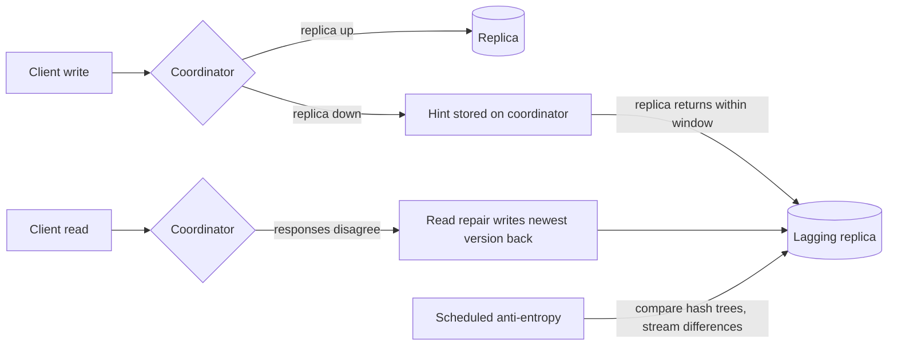
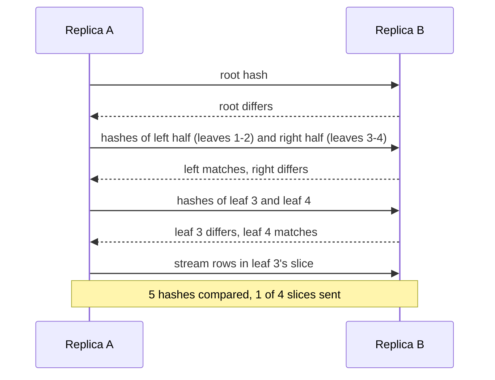
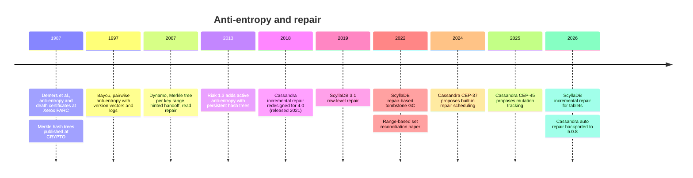
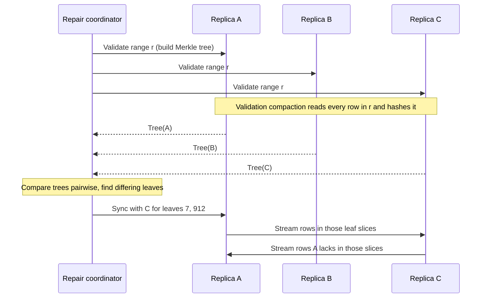

---
tags:
  - distributed-systems
  - replication
  - anti-entropy
  - repair
  - eventual-consistency
status: draft
sources:
  - https://ftp.mirrorservice.org/sites/www.bitsavers.org/pdf/xerox/parc/techReports/CSL-89-1_Epidemic_Algorithms_for_Replicated_Database_Maintenance.pdf
  - https://www.doi.org/10.1007/3-540-48184-2_32
  - https://www.cs.princeton.edu/courses/archive/fall16/cos418/papers/flexible.pdf
  - https://www.cs.princeton.edu/courses/archive/fall15/cos518/papers/dynamo.pdf
  - https://research.google/pubs/whats-the-difference-efficient-set-reconciliation-without-prior-context/
  - https://arxiv.org/abs/2212.13567
  - https://github.com/hoytech/negentropy
  - https://cassandra.apache.org/doc/4.0/cassandra/operating/hints.html
  - https://cassandra.apache.org/doc/4.0/cassandra/operating/read_repair.html
  - https://cassandra.apache.org/doc/latest/cassandra/managing/operating/repair.html
  - https://cassandra.apache.org/doc/stable/cassandra/managing/operating/auto_repair.html
  - https://cassandra.apache.org/doc/latest/configuration/cass_yaml_file.html
  - https://cassandra.apache.org/doc/4.1/cassandra/operating/compaction/index.html
  - https://docs.datastax.com/en/hyper-converged-database/2.0/architecture/database-architecture/anti-entropy-repair.html
  - https://thelastpickle.com/blog/2018/09/10/incremental-repair-improvements-in-cassandra-4.html
  - https://cwiki.apache.org/confluence/display/CASSANDRA/CEP-45%3A+Mutation+Tracking
  - https://cwiki.apache.org/confluence/spaces/CASSANDRA/pages/272927365/CEP-37+Apache+Cassandra+Unified+Repair+Solution
  - https://www.instaclustr.com/blog/whats-coming-in-cassandra-key-apache-cassandra-ceps-to-watch/
  - https://digitalis.io/post/apache-cassandra-6-0-everything-that-changed-in-one-page
  - https://docs.riak.com/riak/kv/2.1.3/learn/concepts/active-anti-entropy
  - https://riak.com/introducing-riak-1-3
  - https://www.tiot.jp/riak-docs/riak/kv/3.2.3/using/cluster-operations/tictac-active-anti-entropy
  - https://www.scylladb.com/2019/08/13/scylla-open-source-3-1-efficiently-maintaining-consistency-with-row-level-repair/
  - https://www.scylladb.com/2022/06/30/preventing-data-resurrection-with-repair-based-tombstone-garbage-collection/
  - https://www.scylladb.com/2026/04/07/incremental-repair-faster/
  - https://docs.scylladb.com/manual/stable/features/incremental-repair.html
  - https://docs.scylladb.com/manual/stable/features/automatic-repair.html
  - https://forum.scylladb.com/t/release-scylladb-2026-1/5327
  - https://release-catalog.apache.org/cassandra/5.0.8/index.html
created: 2026-11-26
updated: 2026-11-26
---

## Table Of Contents

---

- [[#TL;DR|TL;DR]]
- [[#The Problem|The Problem]]
- [[#Foundations|Foundations]]
    - [[#Three Layers of Convergence|Three Layers of Convergence]]
    - [[#Merkle Trees|Merkle Trees]]
    - [[#Deletes Need Death Certificates|Deletes Need Death Certificates]]
- [[#How We Got Here|How We Got Here]]
- [[#How It Works|How It Works]]
    - [[#Hinted Handoff|Hinted Handoff]]
    - [[#Read Repair|Read Repair]]
    - [[#Merkle-Tree Repair|Merkle-Tree Repair]]
    - [[#Overstreaming|Overstreaming]]
    - [[#Incremental Repair|Incremental Repair]]
    - [[#Repair and Tombstones|Repair and Tombstones]]
    - [[#Log-Based Reconciliation|Log-Based Reconciliation]]
    - [[#Set Reconciliation Without Trees|Set Reconciliation Without Trees]]
- [[#Where It Is Now|Where It Is Now]]
    - [[#Cassandra|Cassandra]]
    - [[#ScyllaDB|ScyllaDB]]
    - [[#Elsewhere|Elsewhere]]
- [[#Trade-offs & Open Problems|Trade-offs & Open Problems]]
- [[#Resources|Resources]]
- [[#Related Notes|Related Notes]]

## ***TL;DR***
---
*Replicas that accept writes independently drift apart. Anti-entropy is the background work that finds the differences and copies the missing data, so "eventually consistent" actually becomes consistent and deletes stay deleted.*

- **Three layers.** Leaderless stores in the Dynamo family repair in three places: on the write path (**hinted handoff**), on the read path (**read repair**) and in the background (**anti-entropy repair**, usually by comparing Merkle trees). Only the background layer covers data nobody reads and failures longer than the hint window ([[Replication]]).
- **Merkle trees make comparison cheap.** Two replicas compare a hash tree of a key range top-down and only descend where hashes differ, so finding a small difference costs a few hashes, not a full scan ([DeCandia et al., §4.7](https://www.cs.princeton.edu/courses/archive/fall15/cos518/papers/dynamo.pdf)).
- **The cost is in the fix, not the find.** A tree leaf covers many rows, so one bad row ships the whole leaf: *overstreaming*. Row-level and incremental repair, and log-based reconciliation, all exist to shrink what gets sent.
- **Repair is a correctness duty, not just hygiene.** A delete is a tombstone that must reach every replica before it is purged. If repair doesn't run within `gc_grace_seconds` (10 days by default in Cassandra), deleted data can come back ([[LSM Trees]]).
- **Where it is now (Nov 2026):** repair is moving inside the database. Cassandra's built-in scheduler (CEP-37) is in 6.0 (still pre-release) and backported to 5.0.8 behind a flag; Cassandra's accepted mutation tracking (CEP-45) would replace Merkle-tree incremental repair with reconciliation by write ID. ScyllaDB makes incremental repair the default for tablet tables and has a built-in repair scheduler.

## ***The Problem***
---
*In a leaderless or multi-leader store, a write can succeed while some replicas miss it. Nothing in the write path guarantees those replicas ever catch up, so a separate mechanism has to.*

A Dynamo-style store with $N = 3$ replicas and $W = 2$ acknowledges a write once two replicas have it ([[Replication]]). The third may have been down, partitioned, overloaded or simply dropped the message. Over time, many small misses add up:

| Cause | What the lagging replica is missing | Who notices |
|---|---|---|
| Node down for minutes or hours | Every write in that window | Hints, if the outage is shorter than the hint window |
| Dropped or timed-out mutations under load | Scattered individual writes | Nobody, unless that key is read or repaired |
| Node down longer than the hint window | Everything after the window closed | Only background repair |
| Disk loss, rebuild, bad bootstrap | Whole ranges | Only background repair or streaming |
| Silent corruption on disk | Rows that are present but wrong | Repair, if checksums or hashes catch it ([[Silent Data Corruption]]) |

Two things make this more than a staleness problem:

1. **Cold data never heals by itself.** Read repair only fixes what clients read. Riak's docs put it plainly: before active anti-entropy, Riak relied on read repair alone, which only "heals object conflicts" when a read reaches it ([Riak AAE docs](https://docs.riak.com/riak/kv/2.1.3/learn/concepts/active-anti-entropy)).
2. **Deletes can be undone.** If a replica misses a delete and the others later purge their tombstones, the next comparison sees the stale replica holding data the others "lack" and copies it back. The deleted row reappears ([[LSM Trees]] has a day-by-day example).

So the question is: how do $N$ machines, each holding millions of rows, find the handful that differ without shipping everything to each other?

## ***Foundations***
---
*Anti-entropy is a pairwise "compare and copy what's missing" exchange. Hash trees make the comparison cheap, and timestamped tombstones make deletes survive it.*

### Three Layers of Convergence

*Each layer is cheaper and narrower than the one below it. Systems run all three because each catches what the others miss.*

| Layer | When it runs | What it fixes | Gap it leaves |
|---|---|---|---|
| **Hinted handoff** | On write, when a replica is unreachable | Writes missed during short outages | Outages longer than the hint window; hints lost with the coordinator |
| **Read repair** | On read, when replicas disagree | Keys that clients actually read | Data nobody reads; only the part of the row the query touched |
| **Anti-entropy repair** | In the background, on a schedule | Everything in a key range | Expensive; must finish within the tombstone grace period |

Demers et al. coined the term in 1987, contrasting **anti-entropy** ("each site regularly chooses another site at random and ... resolves any differences") with cheaper **rumor mongering**. Anti-entropy is "extremely reliable but requires examining the contents of the database" ([Demers et al.](https://ftp.mirrorservice.org/sites/www.bitsavers.org/pdf/xerox/parc/techReports/CSL-89-1_Epidemic_Algorithms_for_Replicated_Database_Maintenance.pdf)). The convergence math for push, pull and push-pull exchanges is in [[Gossip and Membership]]; this note is about making each exchange cheap and correct.

### Merkle Trees

*A Merkle tree hashes data in blocks, then hashes the hashes, up to one root. Equal roots mean (with overwhelming probability) equal data; unequal roots tell you which half to look in next.*

Ralph Merkle introduced hash trees for digital signatures ([Merkle, CRYPTO 1987](https://www.doi.org/10.1007/3-540-48184-2_32)). For replication, each replica builds a tree over a key range: leaves hash a slice of the range, each parent hashes its children.

$$
h(\text{node}) =
\begin{cases}
H(\text{rows in this slice}) & \text{leaf}\\
H\big(h(\text{left}) \,\|\, h(\text{right})\big) & \text{inner node}
\end{cases}
$$

*In plain English:* every node summarizes everything below it, so two replicas can compare a whole range by comparing one hash, and walk down only the branches that differ.

For a tree of depth $h$ with $d$ differing leaves, the walk compares at most about $d \cdot h$ pairs of hashes (fewer when differing leaves share ancestors), instead of the $2^h$ leaves a flat list would need.

*Worked example:* replicas A and B hold the same key range split into 4 leaves (depth 2). B missed one write that falls in leaf 3.

Dynamo used exactly this: "Each node maintains a separate Merkle tree for each key range ... it hosts", and two nodes "exchange the root of the Merkle tree corresponding to the key ranges that they host in common" ([DeCandia et al., §4.7](https://www.cs.princeton.edu/courses/archive/fall15/cos518/papers/dynamo.pdf)). The catch it named: "many key ranges change when a node joins or leaves the system", forcing trees to be recalculated, which its later fixed-partition scheme (§6.2) makes less disruptive ([[Partitioning]]).

### Deletes Need Death Certificates

*You can't delete by removing data, because the next anti-entropy round would copy the old value back from a replica that still has it. You delete by writing a marker, and you can only forget the marker once every replica has seen it.*

Demers et al. called the marker a **death certificate**: a timestamped record that spreads like any update and cancels older copies. Keeping certificates forever costs space; dropping them too early risks resurrection. Their compromise was **dormant death certificates**: after a threshold $\tau_1$ most sites drop them, a few retention sites keep dormant copies until $\tau_1 + \tau_2$, and a dormant certificate wakes up if it meets an obsolete copy of the item ([Demers et al.](https://ftp.mirrorservice.org/sites/www.bitsavers.org/pdf/xerox/parc/techReports/CSL-89-1_Epidemic_Algorithms_for_Replicated_Database_Maintenance.pdf)).

Modern stores call them **tombstones**, and the same rule applies: a tombstone may be purged only after every replica has it. That ties repair frequency to the tombstone grace period (see [[#Repair and Tombstones|Repair and Tombstones]]), and ties both to how versions are ordered ([[Time and Clocks]]).

## ***How We Got Here***
---
*The ideas are from the late 1980s; the engineering since has been about doing the same comparison with less I/O, less streaming and less operator effort.*

- **Xerox Clearinghouse (1987).** Anti-entropy ran nightly between name servers and often couldn't finish under network load; remailing updates to a domain stored at 300 sites could mean 90,000 messages a night. The paper's fixes, checksums plus a recent-update list, and preferring nearby partners, cut traffic on the transatlantic link from 75.7 to 2.4 comparisons per cycle in simulation ([Demers et al.](https://ftp.mirrorservice.org/sites/www.bitsavers.org/pdf/xerox/parc/techReports/CSL-89-1_Epidemic_Algorithms_for_Replicated_Database_Maintenance.pdf)).
- **Bayou (1997).** Instead of comparing data, replicas compare *logs*. The receiver sends its version vector; the sender ships every write the vector doesn't cover, in order. The *prefix property* (if you have a server's write, you have all its earlier ones) keeps the vector compact. When a server has truncated its log, "a full database transfer has to occur" ([Petersen et al., SOSP 1997](https://www.cs.princeton.edu/courses/archive/fall16/cos418/papers/flexible.pdf)). This is the ancestor of today's log-based reconciliation, and of how [[CRDTs]] sync.
- **Dynamo (2007)** packaged the three layers: sloppy quorums with hinted handoff (§4.6), read repair (§5) and Merkle-tree anti-entropy (§4.7) ([DeCandia et al.](https://www.cs.princeton.edu/courses/archive/fall15/cos518/papers/dynamo.pdf)). Cassandra, Riak and ScyllaDB inherited the design.
- **Riak AAE (2013).** Riak 1.3 ([Feb 2013](https://riak.com/introducing-riak-1-3)) moved from read-repair-only to background anti-entropy with "persistent, on-disk hash trees" updated as writes arrive and rebuilt weekly by default, which also surfaces silent corruption ([Riak docs](https://docs.riak.com/riak/kv/2.1.3/learn/concepts/active-anti-entropy)).
- **Incremental repair (Cassandra 2.1 to 4.0).** Repairing only data written since the last repair saves work, but the first version marked data repaired after streaming, so failures or compactions left replicas disagreeing about what was repaired, causing more overstreaming. Cassandra 4.0 fixed it with a "pending repair" phase ([The Last Pickle, 2018](https://thelastpickle.com/blog/2018/09/10/incremental-repair-improvements-in-cassandra-4.html)).
- **Row-level repair (ScyllaDB 3.1, 2019).** Compare per-row hashes instead of per-range ones, and send only mismatched rows ([ScyllaDB, 2019](https://www.scylladb.com/2019/08/13/scylla-open-source-3-1-efficiently-maintaining-consistency-with-row-level-repair/)).
- **Repair goes inside the database (2024 to 2026).** CEP-37 calls it "an operational oversight that there is no repair scheduling mechanism offered out of the box"; operators had relied on external orchestration tools such as Reaper. CEP-37 (by Jaydeepkumar Chovatia, building on earlier proposals from Netflix and others) was committed to trunk ([CEP-37](https://cwiki.apache.org/confluence/spaces/CASSANDRA/pages/272927365/CEP-37+Apache+Cassandra+Unified+Repair+Solution)), and ScyllaDB added its own scheduler for tablets.

## ***How It Works***
---
*This section walks through each mechanism using Cassandra and ScyllaDB as the reference implementations, since they document repair in the most detail.*

### Hinted Handoff

*When a replica is down, the coordinator keeps the write as a "hint" and replays it later. It's a fast path for short outages, not a guarantee.*

- The coordinator stores hints for an unreachable replica "in flat files in the coordinator node's `$CASSANDRA_HOME/data/hints` directory" and streams them to the replica when it returns, a segment at a time, throttled per delivery thread ([Cassandra hints docs](https://cassandra.apache.org/doc/4.0/cassandra/operating/hints.html)).
- Hints are written only for the first `max_hint_window`, **3 hours** by default ([cassandra.yaml](https://cassandra.apache.org/doc/latest/configuration/cass_yaml_file.html)). After that, "the destination replica will be permanently out of sync" until read repair or anti-entropy repair fixes it.
- The docs are blunt: "Hints are best effort, however, and do not guarantee eventual consistency." They don't replace repair.

*Worked example:* replica C goes down at 12:00. Writes keep arriving.

| C is down for | Hints cover | C is missing after hint replay |
|---|---|---|
| 2 hours | 12:00 to 14:00 | Nothing (if no coordinator lost its hints) |
| 5 hours | 12:00 to 15:00 | Writes from 15:00 to 17:00, until read repair or repair |

In Dynamo's original design the hint lives on a *stand-in* replica that joined the sloppy quorum (§4.6); in Cassandra it lives on the coordinator. Either way, if the node holding hints dies, they're gone.

### Read Repair

*When a quorum read sees replicas disagree, the coordinator writes the newest version back to the stale ones. It fixes hot data for free but has subtle effects on what clients can observe.*

- The coordinator sends one full read and, to the other replicas it needs, **digest reads**: "A digest read request is not a full read and only returns the hash value of the data." If digests disagree, it fetches full data, reconciles by timestamp, and writes the result back ([Cassandra read repair docs](https://cassandra.apache.org/doc/4.0/cassandra/operating/read_repair.html)).
- Cassandra 4.0 removed *background* read repair (`read_repair_chance`, `dclocal_read_repair_chance`), which repaired a random fraction of reads at CL ONE. What remains is a per-table `read_repair` option:

| `read_repair` | Behavior | Guarantees | Breaks |
|---|---|---|---|
| `BLOCKING` (default) | Read waits until repair writes reach the consistency level | Monotonic quorum reads | Partition-level write atomicity |
| `NONE` | Coordinator reconciles the response but writes nothing back | Partition-level write atomicity | Monotonic quorum reads |

**Why blocking matters (monotonic reads).** Suppose a `QUORUM` write of `x = 2` reaches only replica A before failing. A `QUORUM` read from A and B returns `x = 2` (newest timestamp wins). Without write-back, the next read might hit B and C and return `x = 1`, so the value goes backwards. Blocking read repair writes `x = 2` to B before answering, so any later quorum overlaps a replica that has it ([[Consistency Models]]).

**Why blocking can break atomicity.** Read repair only writes back what the query read. If a client wrote two columns in one mutation and a later query reads only one, read repair can make a replica hold half the mutation: it "can break write atomicity when data is read at a more granular level than it is written" ([Cassandra docs](https://cassandra.apache.org/doc/4.0/cassandra/operating/read_repair.html)).

### Merkle-Tree Repair

*Scheduled repair builds a Merkle tree per token range on each replica, compares them, and streams the slices that differ. Building the trees means reading all the data, which is why repair is I/O-heavy.*

- **Validation compaction.** To build the tree, peers run "a major compaction, also known as a validation compaction", a full read of the range ([DataStax HCD docs](https://docs.datastax.com/en/hyper-converged-database/2.0/architecture/database-architecture/anti-entropy-repair.html)).
- **Tree size.** The classic Cassandra tree has depth 15, so $2^{15} = 32{,}768$ leaves (same source). Newer Cassandra versions size trees from a memory budget, `repair_session_space`, defaulting to 1/16 of the heap: "smaller trees have less resolution, which can lead to over-streaming data. If you see lots of over-streaming, consider raising this or using subrange repair" ([cassandra.yaml](https://cassandra.apache.org/doc/latest/configuration/cass_yaml_file.html)).
- **Scope.** `nodetool repair -pr` restricts a node to its *primary* ranges so that running it on every node repairs each range once ([Cassandra repair docs](https://cassandra.apache.org/doc/latest/cassandra/managing/operating/repair.html)). **Subrange** repair splits ranges further so each tree covers less data, which raises resolution.
- **Preview.** `-prv` builds trees and reports how much would stream without streaming anything; `-vd` checks that *repaired* data agrees across replicas.

### Overstreaming

*A leaf is the smallest unit repair can send. If one row in a leaf differs, the whole leaf's slice is sent.*

$$
\text{partitions streamed} \;\approx\; d \cdot \frac{P}{2^{h}}
$$

where $P$ is the number of partitions in the range, $h$ the tree depth and $d$ the number of differing leaves.

*In plain English:* the coarser the tree compared with the data, the more good data rides along with each bad row.

*Worked example:* a node holds $P = 1{,}000{,}000$ partitions in a range and the tree has depth 15. Each leaf covers about $10^6 / 32{,}768 \approx 30$ partitions, so one damaged partition makes repair stream about 30, which matches DataStax's own example ([DataStax HCD docs](https://docs.datastax.com/en/hyper-converged-database/2.0/architecture/database-architecture/anti-entropy-repair.html)). If those partitions average 100 MB (wide partitions), one bad row ships about 3 GB (our arithmetic). Ten damaged partitions scattered over ten leaves ship about 300 partitions.

ScyllaDB saw the same thing with its original partition-level repair: "a mismatch of a single row in any of the 100 partitions causes 100 partitions to be transferred", and "A difference of just a single byte can easily cause 10GB of data to be streamed." Its row-level repair hashes each row and exchanges only mismatched rows, reading data once instead of twice ([ScyllaDB, 2019](https://www.scylladb.com/2019/08/13/scylla-open-source-3-1-efficiently-maintaining-consistency-with-row-level-repair/)):

| 3-node test, 1 TB, 1 KB rows | ScyllaDB 3.0 | ScyllaDB 3.1 (row-level) | Speedup |
|---|---|---|---|
| 0% in sync | 49.0 min | 37.07 min | 1.32x |
| 100% in sync | 47.6 min | 9.8 min | 4.85x |
| 99.9% in sync | 96.4 min | 14.2 min | 6.78x |

In the 99.9% case, data sent fell from 120.52 GiB to 4.28 GiB. ScyllaDB credits part of the speedup to running 16 ranges in parallel and using a fast 64-bit non-cryptographic hash instead of SHA-256, not only to row granularity.

### Incremental Repair

*If data was already proven consistent, don't compare it again. Incremental repair splits each table into repaired and unrepaired files and only repairs the unrepaired set.*

Cassandra marks SSTables as repaired once a repair has covered them; incremental repair (Cassandra's default `nodetool repair` mode) only builds trees over unrepaired data ([Cassandra repair docs](https://cassandra.apache.org/doc/latest/cassandra/managing/operating/repair.html)). Doing this safely took a redesign:

- **Before 4.0:** anticompaction (splitting SSTables into repaired and unrepaired parts) happened *after* streaming. Normal compaction could merge the SSTables away first, and a failed session could leave data marked repaired on some replicas but not others, so the next run found false differences and overstreamed ([The Last Pickle](https://thelastpickle.com/blog/2018/09/10/incremental-repair-improvements-in-cassandra-4.html)).
- **4.0 onward:** repair runs like a transaction. Anticompaction happens first, in a *prepare* phase; candidate SSTables are marked **pending** and "are only eligible to be compacted with other tables marked as pending". Only after success does the coordinator tell replicas to mark them repaired; on failure they are released.

ScyllaDB's tablet version uses the same two-phase idea: `repaired_at` is written into SSTable metadata in the prepare phase, but the data only counts as repaired once `sstables_repaired_at` is committed in system tables after all nodes confirm. Repaired and unrepaired SSTables never compact together; "The only bridge between these sets is repair" ([ScyllaDB, Apr 2026](https://www.scylladb.com/2026/04/07/incremental-repair-faster/)).

The saving is the share of data that is new:

$$
\frac{\text{work(incremental)}}{\text{work(full)}} \approx \frac{n}{E + n}
$$

where $n$ is unrepaired (new) data and $E$ is already-repaired data.

*Worked example (ScyllaDB's):* a node with $E = 10$ TB repaired and $n = 100$ GB written since the last run repairs $100 / 10{,}100 \approx 1\%$ of the data. In their test, the first round (mostly new data) took about as long as full repair, the second took half, and the third 35%. Update-heavy workloads gain less, because new writes keep invalidating repaired files; append-heavy ones like IoT or logs gain most.

Incremental repair trusts the "repaired" mark. If disk loss or a bug corrupts repaired data, incremental runs won't look at it, so both projects still recommend occasional full repairs. Cassandra's docs suggest, as a starting point, "running an incremental repair every 1-3 days, and a full repair every 1-3 weeks."

### Repair and Tombstones

*Repair has a deadline: the tombstone grace period. Miss it and deletes can be undone.*

Cassandra drops tombstones after `gc_grace_seconds` (default 10 days). The rule for operators:

$$
I_{\text{repair}} < G
$$

where $I_{\text{repair}}$ is the longest time between successful repairs of any range and $G$ is `gc_grace_seconds`.

*In plain English:* every replica must have been repaired, and so have received every tombstone, before any replica is allowed to forget one. Cassandra's docs say that with the 10-day default, repairing every node "at least once every 7 days" prevents resurrection ([Cassandra repair docs](https://cassandra.apache.org/doc/latest/cassandra/managing/operating/repair.html)). The 3 days of slack cover a repair that runs long or fails.

Two systems tie tombstone removal to repair directly instead of to a timer:

- **Cassandra `only_purge_repaired_tombstones`** (compaction option, default `false`): "tombstones are only removed if the data has also been repaired" ([Cassandra compaction docs](https://cassandra.apache.org/doc/4.1/cassandra/operating/compaction/index.html)).
- **ScyllaDB `tombstone_gc = {'mode': 'repair'}`**: tombstones are collected only after a repair has synced them, so correctness no longer depends on finishing repair inside a timer, and frequent repair lets tombstones go sooner. Introduced as experimental in ScyllaDB Open Source 5.0 (2022), with `timeout` (the old behavior) as the default then ([ScyllaDB, 2022](https://www.scylladb.com/2022/06/30/preventing-data-resurrection-with-repair-based-tombstone-garbage-collection/)).

The storage-engine side of this, why tombstones are expensive to keep, is in [[LSM Trees]] and [[MVCC and Version Garbage Collection]].

### Log-Based Reconciliation

*Instead of hashing data to find differences, give every write an ID and have replicas compare which IDs they have. Missing writes are sent individually, so nothing overstreams.*

This is Bayou's idea applied to a Dynamo-style store. Cassandra's CEP-45 (mutation tracking, by Blake Eggleston) proposes:

- The coordinator gives each write "a globally unique id"; replicas record the IDs they've applied.
- On a read, one replica returns data plus a summary of applied IDs and the others return only summaries; if they differ, missing mutations are exchanged before the response. The summaries are hashes and probabilistic structures, not full ID lists.
- A background process "will continuously poll replicas for mutation ids they've received", delivers missing ones, and raises a low-water mark. This *log reconciliation* replaces incremental repair; full repair still compares data on disk.
- Goals include eliminating Merkle-tree disk load and overstreaming, eliminating hints, fixing the read-repair atomicity problem (a mutation is never half-applied), and making [[Witness Replicas]] workable, since without it "to guarantee read monotonicity we'd have to read repair nearly every read" ([CEP-45](https://cwiki.apache.org/confluence/display/CASSANDRA/CEP-45%3A+Mutation+Tracking)).

Consensus-replicated systems ([[Raft]], [[Paxos]]) already work this way: a lagging follower catches up from the leader's log or a snapshot, so they don't need Merkle-tree repair for replication. They still need scrubbing to catch data that was stored correctly and later rotted ([[Silent Data Corruption]]).

### Set Reconciliation Without Trees

*Merkle trees are one answer to "what's in your set that isn't in mine?" Newer techniques answer it in fewer rounds or with less state, and are spreading in peer-to-peer and sync systems.*

| Technique | Idea | Cost |
|---|---|---|
| Merkle tree | Fixed tree of hashes, walk down mismatches | About one round trip per level; tree must be built or maintained |
| Difference digest (IBLT) | Each side sends a small invertible Bloom-filter sketch; subtracting them and "peeling" recovers the differing keys | One round; size proportional to the difference times $\log$ of the keyspace ([Eppstein et al., SIGCOMM 2011](https://research.google/pubs/whats-the-difference-efficient-set-reconciliation-without-prior-context/)) |
| Range-based reconciliation | Recursively split a sorted key range and compare fingerprints of the halves, sending small ranges as raw ID lists | Several rounds; no persistent tree needed if fingerprints can be computed over ranges ([Meyer, 2022](https://arxiv.org/abs/2212.13567)) |

Range-based reconciliation is what **negentropy** implements; it is used to sync Nostr events in the strfry relay and in Waku Sync ([negentropy](https://github.com/hoytech/negentropy)). Riak's later **TicTac AAE** went the other way: keep a Merkle tree but build it incrementally as writes arrive, so no full rebuild scan is needed; it shipped as a prototype in Riak 2.9 with full integration planned for 3.0 ([Riak TicTac AAE docs](https://www.tiot.jp/riak-docs/riak/kv/3.2.3/using/cluster-operations/tictac-active-anti-entropy)).

## ***Where It Is Now***
---
*As of November 2026, the trend is clear: repair is becoming a built-in, scheduled, incremental service, and the leading Dynamo descendant is designing its way past Merkle trees altogether.*

### Cassandra

*Built-in repair scheduling is real but opt-in, and still waiting on the 6.0 release. Mutation tracking is accepted but not yet shipped.*

- **Built-in repair (CEP-37).** "Auto Repair was introduced in Cassandra 6.0 via CEP-37 and backported to 5.0.8" (5.0.8 is dated April 10, 2026 in the [ASF release catalog](https://release-catalog.apache.org/cassandra/5.0.8/index.html)). In 5.0.8 it needs the JVM flag `-Dcassandra.autorepair.enable=true`, which "is non-reversible". It supports full, incremental and preview repair, keeps history in `system_distributed.auto_repair_history`, and splits work into assignments of at most 50 GiB of compressed data by default, repairing up to 3 nodes at once with a 24-hour minimum interval per node. It is off by default ([Cassandra Auto Repair docs](https://cassandra.apache.org/doc/stable/cassandra/managing/operating/auto_repair.html)). In 6.0, `auto_repair` "ships commented out", and the scheduler holds back when compaction or disk headroom is unsafe ([Digitalis, Sep 2026](https://digitalis.io/post/apache-cassandra-6-0-everything-that-changed-in-one-page)).
- **6.0 status.** As of September 14, 2026, 6.0 was at alpha3 with no beta or release candidate, and 5.0.9 was the current GA release ([Digitalis](https://digitalis.io/post/apache-cassandra-6-0-everything-that-changed-in-one-page)).
- **Mutation tracking (CEP-45).** Accepted, enabled per keyspace or table through a new replication type, and reusing Accord's addressable commit log; Instaclustr (July 2026) lists it among accepted CEPs without naming a release ([Instaclustr](https://www.instaclustr.com/blog/whats-coming-in-cassandra-key-apache-cassandra-ceps-to-watch/)). Its link to Accord is why it shows up alongside [[Leaderless Consensus]] work.
- **Witnesses (CEP-46)** depend on mutation tracking; see [[Witness Replicas]].

### ScyllaDB

*ScyllaDB has gone furthest: incremental repair is the default for tablet tables and repair can be scheduled inside the database.*

- **Incremental repair** is "the default and recommended mode" for tables that use tablets; it isn't available for vnode tables ([ScyllaDB docs, 2026.3](https://docs.scylladb.com/manual/stable/features/incremental-repair.html)). The ScyllaDB 2026.1 release notes (March 2026) describe it as processing "only the data changes introduced since the last repair" and credit it with "faster purging of expired tombstones" ([release notes](https://forum.scylladb.com/t/release-scylladb-2026-1/5327)).
- **Automatic repair** "offers built-in scheduling in ScyllaDB itself", relies on incremental repair and so "only works with tablet tables", and starts a repair when time since the last one exceeds a threshold (one day in the docs' example) ([ScyllaDB docs](https://docs.scylladb.com/manual/stable/features/automatic-repair.html)). In April 2026 ScyllaDB said it was working on triggering repair when the unrepaired set grows too large rather than on a timer ([ScyllaDB blog](https://www.scylladb.com/2026/04/07/incremental-repair-faster/)).

### Elsewhere

*Outside the Cassandra family, anti-entropy lives on in object stores, sync protocols and CRDT systems, usually under other names.*

- **Object storage and erasure coding.** Large blob stores continuously scan for missing or corrupt fragments and rebuild them from parity, which is anti-entropy over chunks rather than rows ([[Object Storage]], [[Erasure Coding]]).
- **Sync protocols.** Range-based set reconciliation (negentropy) is how Nostr relays and Waku nodes catch up after downtime ([negentropy](https://github.com/hoytech/negentropy)); [[CRDTs]] systems use version-vector exchange in Bayou's style.
- **Consensus systems** rarely run data-level anti-entropy for replication, but scrub for corruption ([[Silent Data Corruption]], [[End-to-End Data Integrity]]).

## ***Trade-offs & Open Problems***
---
*Every repair design trades I/O and network now against staleness and resurrection risk later. The open problems are making repair cheap enough to run constantly, and making its guarantees something operators don't have to babysit.*

| Choice | You get | You pay |
|---|---|---|
| Long hint window | Short outages heal without repair | Hint storage on coordinators; replay load spikes when a node returns |
| Blocking read repair | Monotonic quorum reads | Slower reads when replicas disagree; can split a multi-column mutation |
| No read repair | Partition-level write atomicity | Reads can go back in time after a failed write |
| Coarse Merkle trees | Less memory, faster comparison | Overstreaming |
| Fine trees or row-level hashes | Precise streaming | More memory and CPU per repair |
| Incremental repair | Work proportional to new data | Trusts the repaired mark; compaction split into two pools; occasional full repair still needed |
| Mutation tracking | No tree building, no overstreaming, atomic reconciliation | Per-write IDs and logs to store and garbage-collect; new code paths |
| Short `gc_grace_seconds` | Fewer tombstones, faster reads | Repair must run more often or deletes can resurrect |

Open problems worth tracking:
- **Repair as a hidden SLO.** The $I_{\text{repair}} < G$ invariant is a correctness requirement enforced by operations. Built-in schedulers help, but a cluster that falls behind (slow disks, compaction backlog) silently loses the guarantee; see [[Gray and Fail-Slow Failures]].
- **Repair load competes with traffic.** Validation compaction reads whole ranges; streaming plus anticompaction rewrites data. CEP-37 backs off when headroom is unsafe, which means repair can fall behind exactly when the cluster is busiest ([Digitalis](https://digitalis.io/post/apache-cassandra-6-0-everything-that-changed-in-one-page)).
- **Who wins a conflict.** Repair copies the "newest" version by timestamp. With last-writer-wins, repair faithfully spreads whichever write had the higher clock, which may not be the one the application wanted ([[Time and Clocks]], [[Replication]]). Version vectors or [[CRDTs]] avoid silent loss at the cost of merge logic.
- **Membership and range changes.** Dynamo noted that range changes force tree rebuilds; any repair scheme has to reason about ownership changing mid-repair. Cassandra's move of ownership into a consensus log (transactional cluster metadata) is meant to make that tractable ([[Gossip and Membership]], [[Partitioning]]).
- **Testing.** Repair bugs show up as rare resurrection or overstreaming under specific failure timings, the kind of thing [[Deterministic Simulation Testing]] and [[Formal Methods in Practice]] target.
- **Beyond trees.** Set reconciliation sketches (IBLTs, range-based fingerprints) could replace Merkle trees in databases too; how they interact with LSM compaction and tombstones is mostly unexplored in production databases (our reading).

## ***Resources***
---
*Start with Dynamo §4.6 to §4.7 and the Cassandra repair, hints and read-repair pages for the mechanics. Demers et al. and Bayou explain where the ideas came from; CEP-45 and ScyllaDB's 2026 post show where they are going.*

**Primary papers**
- [Epidemic Algorithms for Replicated Database Maintenance](https://ftp.mirrorservice.org/sites/www.bitsavers.org/pdf/xerox/parc/techReports/CSL-89-1_Epidemic_Algorithms_for_Replicated_Database_Maintenance.pdf): Demers et al., PODC 1987 (Xerox PARC report CSL-89-1).
- [A Digital Signature Based on a Conventional Encryption Function](https://www.doi.org/10.1007/3-540-48184-2_32): Ralph Merkle, CRYPTO 1987. Hash trees.
- [Flexible Update Propagation for Weakly Consistent Replication](https://www.cs.princeton.edu/courses/archive/fall16/cos418/papers/flexible.pdf): Petersen et al., SOSP 1997. Bayou's log-based anti-entropy.
- [Dynamo: Amazon's Highly Available Key-value Store](https://www.cs.princeton.edu/courses/archive/fall15/cos518/papers/dynamo.pdf): DeCandia et al., SOSP 2007. §4.6, §4.7, §5.
- [What's the Difference? Efficient Set Reconciliation without Prior Context](https://research.google/pubs/whats-the-difference-efficient-set-reconciliation-without-prior-context/): Eppstein, Goodrich, Uyeda, Varghese, SIGCOMM 2011.
- [Range-Based Set Reconciliation](https://arxiv.org/abs/2212.13567): Aljoscha Meyer, 2022.

**Practitioners and teams**
- [Incremental Repair Improvements in Cassandra 4](https://thelastpickle.com/blog/2018/09/10/incremental-repair-improvements-in-cassandra-4.html): Alex Dejanovski, The Last Pickle, Sep 2018.
- [Efficiently Maintaining Consistency with Row-Level Repair](https://www.scylladb.com/2019/08/13/scylla-open-source-3-1-efficiently-maintaining-consistency-with-row-level-repair/): ScyllaDB, Aug 2019.
- [Preventing Data Resurrection with Repair Based Tombstone Garbage Collection](https://www.scylladb.com/2022/06/30/preventing-data-resurrection-with-repair-based-tombstone-garbage-collection/): ScyllaDB, Jun 2022.
- [Why We Changed ScyllaDB's Approach to Repair](https://www.scylladb.com/2026/04/07/incremental-repair-faster/): Asias He, ScyllaDB, Apr 2026.
- [Apache Cassandra 6.0: everything that changed](https://digitalis.io/post/apache-cassandra-6-0-everything-that-changed-in-one-page): Digitalis, Sep 2026.
- [What's coming in Cassandra: key CEPs to watch](https://www.instaclustr.com/blog/whats-coming-in-cassandra-key-apache-cassandra-ceps-to-watch/): Instaclustr, Jul 2026.
- [negentropy](https://github.com/hoytech/negentropy): range-based set reconciliation implementation and spec.

**Docs and proposals**
- Cassandra: [repair](https://cassandra.apache.org/doc/latest/cassandra/managing/operating/repair.html), [auto repair](https://cassandra.apache.org/doc/stable/cassandra/managing/operating/auto_repair.html), [hints](https://cassandra.apache.org/doc/4.0/cassandra/operating/hints.html), [read repair](https://cassandra.apache.org/doc/4.0/cassandra/operating/read_repair.html), [cassandra.yaml](https://cassandra.apache.org/doc/latest/configuration/cass_yaml_file.html), [compaction](https://cassandra.apache.org/doc/4.1/cassandra/operating/compaction/index.html).
- [CEP-37: Unified Repair Solution](https://cwiki.apache.org/confluence/spaces/CASSANDRA/pages/272927365/CEP-37+Apache+Cassandra+Unified+Repair+Solution) and [CEP-45: Mutation Tracking](https://cwiki.apache.org/confluence/display/CASSANDRA/CEP-45%3A+Mutation+Tracking).
- [DataStax HCD anti-entropy repair](https://docs.datastax.com/en/hyper-converged-database/2.0/architecture/database-architecture/anti-entropy-repair.html): tree depth and validation compaction.
- ScyllaDB: [incremental repair](https://docs.scylladb.com/manual/stable/features/incremental-repair.html), [automatic repair](https://docs.scylladb.com/manual/stable/features/automatic-repair.html), [2026.1 release notes](https://forum.scylladb.com/t/release-scylladb-2026-1/5327).
- Riak: [active anti-entropy](https://docs.riak.com/riak/kv/2.1.3/learn/concepts/active-anti-entropy), [TicTac AAE](https://www.tiot.jp/riak-docs/riak/kv/3.2.3/using/cluster-operations/tictac-active-anti-entropy).

## Related Notes

- [[Replication]] — Dynamo-style quorums, sloppy quorums and why replicas diverge in the first place.
- [[Gossip and Membership]] — Demers' anti-entropy and rumor mongering, and their convergence math.
- [[CRDTs]] — Merges that make anti-entropy lossless; state sync by exchange.
- [[LSM Trees]] — Tombstones, compaction and the zombie-data example.
- [[MVCC and Version Garbage Collection]] — When old versions and tombstones can be dropped.
- [[Witness Replicas]] — Cassandra witnesses depend on mutation tracking.
- [[Silent Data Corruption]] — Repair and scrubbing as the fix after a checksum mismatch.
- [[End-to-End Data Integrity]] — Checksums and scrubbing across the storage stack.
- [[Object Storage]] — Background repair of lost fragments and replicas.
- [[Erasure Coding]] — Rebuilding chunks from parity instead of copies.
- [[Partitioning]] — Token ranges, vnodes and why range changes make repair expensive.
- [[Consistency Models]] — Monotonic reads and what read repair does to them.
- [[Time and Clocks]] — Timestamps decide which version repair keeps.
- [[Leaderless Consensus]] — Accord, whose log mutation tracking reuses.
- [[Raft]] — Log catch-up, the consensus world's answer to divergence.
- [[Gray and Fail-Slow Failures]] — Slow nodes that make repair fall behind.
- [[Deterministic Simulation Testing]] — Finding repair bugs that need rare timings.
