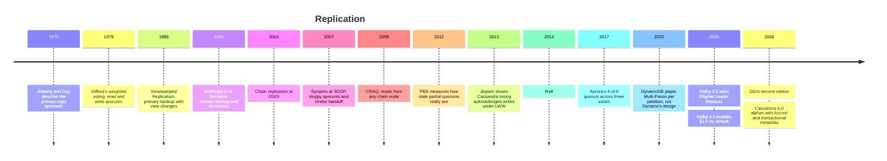
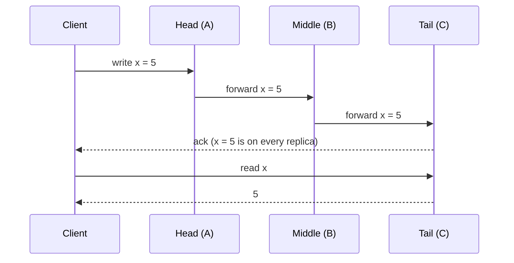
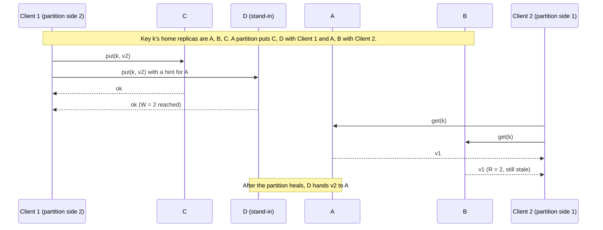

---
tags:
  - distributed-systems
  - replication
  - quorums
  - consensus
status: draft
sources:
  - https://web.eecs.umich.edu/~manosk/assets/papers/PrimaryBackup.pdf
  - https://pages.cs.wisc.edu/~remzi/Classes/739/Fall2015/Papers/92-1265.pdf
  - https://www.andrew.cmu.edu/course/15-440-sp15/assets/READINGS/gifford79.pdf
  - https://pdos.csail.mit.edu/6.824/papers/cr-osdi04.pdf
  - https://www.cs.princeton.edu/~mfreed/docs/craq-usenix09.pdf
  - https://www.cs.princeton.edu/courses/archive/fall15/cos518/papers/dynamo.pdf
  - https://arxiv.org/pdf/1204.6082
  - https://pdos.csail.mit.edu/6.824/papers/aurora.pdf
  - https://usenix.org/system/files/atc22-elhemali.pdf
  - https://aphyr.com/posts/294-jepsen-cassandra
  - https://www.postgresql.org/docs/14/runtime-config-replication.html
  - https://www.mongodb.com/docs/current/reference/mongodb-defaults/
  - https://kafka.apache.org/44/operations/eligible-leader-replicas/
  - https://kafka.apache.org/blog/2025/09/04/apache-kafka-4.1.0-release-announcement/
  - https://jack-vanlightly.com/blog/2023/8/17/kafka-kip-966-fixing-the-last-replica-standing-issue
  - https://digitalis.io/post/apache-cassandra-6-0-everything-that-changed-in-one-page
  - https://software.imdea.org/news/2026/10-28-accord/
  - https://cwiki.apache.org/confluence/display/CASSANDRA/CEP-45%3A+Mutation+Tracking
  - https://martin.kleppmann.com/2026/03/24/designing-data-intensive-applications-2e.html
created: 2026-11-26
updated: 2026-11-26
---

## Table Of Contents

---

- [[#TL;DR|TL;DR]]
- [[#The Problem|The Problem]]
- [[#Foundations|Foundations]]
    - [[#Synchronous vs Asynchronous|Synchronous vs Asynchronous]]
    - [[#Quorum Intersection|Quorum Intersection]]
    - [[#Who Orders the Writes|Who Orders the Writes]]
- [[#How We Got Here|How We Got Here]]
- [[#How It Works|How It Works]]
    - [[#Primary-Backup|Primary-Backup]]
    - [[#Chain Replication|Chain Replication]]
    - [[#Quorum Replication|Quorum Replication]]
    - [[#Leaderless, Dynamo-Style Replication|Leaderless, Dynamo-Style Replication]]
    - [[#Consensus-Based Replication|Consensus-Based Replication]]
    - [[#The Families Side by Side|The Families Side by Side]]
- [[#Where It Is Now|Where It Is Now]]
    - [[#Strong Systems Converged on Replicated Logs|Strong Systems Converged on Replicated Logs]]
    - [[#Leaderless Stores Are Adding Coordination|Leaderless Stores Are Adding Coordination]]
    - [[#Safer Defaults in Leader-Based Systems|Safer Defaults in Leader-Based Systems]]
- [[#Trade-offs & Open Problems|Trade-offs & Open Problems]]
- [[#Resources|Resources]]
- [[#Related Notes|Related Notes]]

## ***TL;DR***
---
*Replication keeps copies of the same data on several machines so the system survives failures and serves more reads. The design choices are who orders the writes, how many copies must confirm a write before it counts, and where reads may go; every replicated system is some answer to those three questions.*

- **Four families.** *Primary-backup* (one leader orders writes and ships them to backups), *chain replication* (writes flow down a line of servers, reads come from the end), *quorum replication* (each operation contacts enough replicas that any read overlaps any write), and *leaderless, Dynamo-style* replication (any replica takes writes; conflicts and stale copies are fixed afterwards).
- **The one inequality:** with $N$ copies, a write quorum $W$ and a read quorum $R$, reads see the latest write when $R + W > N$ ([Gifford, 1979](https://www.andrew.cmu.edu/course/15-440-sp15/assets/READINGS/gifford79.pdf)). That overlap is necessary, but on its own it isn't sufficient for linearizability.
- **Sync vs async** is the durability dial: a write acknowledged before the copies have it can vanish on failover.
- **Consensus is replication done carefully.** [[Raft]] and [[Paxos]] are leader-based replication plus rules for safely picking a new leader; that's what plain primary-backup leaves to an outside party.
- **Now (Nov 2026):** strongly consistent systems (DynamoDB, Spanner-style [[Distributed SQL]], Kafka's KRaft) replicate each shard with a consensus or quorum log. Leaderless Cassandra is adding coordination in 6.0 (Accord transactions and a log for cluster metadata), still pre-release as of October 2026, and since Kafka 4.1 (September 2025) Eligible Leader Replicas are on by default, closing a data-loss edge case.

## ***The Problem***
---
*One copy of data is one failure away from an outage or loss. More copies fix that, but now the copies can disagree, and every replication scheme is a way of keeping that disagreement from reaching clients, or bounding it when it does.*

Replication has three jobs:

| Goal | What it buys | Example |
|---|---|---|
| **Durability** | A write survives disks, machines and data centers dying | Aurora keeps six copies across three zones ([Verbitski et al., 2017](https://pdos.csail.mit.edu/6.824/papers/aurora.pdf)) |
| **Availability** | Service continues while some replicas are down or unreachable | Dynamo accepts writes during failures with sloppy quorums ([DeCandia et al., 2007](https://www.cs.princeton.edu/courses/archive/fall15/cos518/papers/dynamo.pdf)) |
| **Read scaling and locality** | Reads spread over many copies, or served from a nearby one | CRAQ reads from any replica in a chain ([Terrace and Freedman, 2009](https://www.cs.princeton.edu/~mfreed/docs/craq-usenix09.pdf)) |

The trouble is that copies drift. A message is lost, a replica is slow, a network partition splits the cluster (see [[Failure Models]]). Then a client can read an old value, two clients can write different values to different copies, or a write the client was told succeeded can disappear when a new leader takes over. Which of those a system allows is its [[Consistency Models|consistency model]], and [[CAP and PACELC]] says the price: during a partition you choose between refusing some requests and letting copies diverge; in normal operation you choose between waiting for more copies and answering sooner.

## ***Foundations***
---
*Three ideas explain every design below: when a write counts as done (sync vs async), why overlapping groups of replicas guarantee a read sees a write (quorum intersection), and who decides the order of concurrent writes (a leader, or no one).*

### Synchronous vs Asynchronous

*The single biggest knob. Waiting for copies costs latency; not waiting risks losing acknowledged writes when the leader dies.*

- **Synchronous:** the leader acknowledges the client only after the backups (or some number of them) have the write. A failover can't lose it, but every write waits for the slowest required copy.
- **Asynchronous:** the leader acknowledges as soon as its own copy is safe and ships the write later. Fast, but there's a window in which the only copy of an acknowledged write is on the leader.
- **Semi-synchronous / quorum-synchronous:** wait for *some* copies. PostgreSQL's `synchronous_standby_names = 'ANY 2 (s1, s2, s3)'` lets a commit proceed once any two of the three standbys reply, and `synchronous_commit` chooses whether "reply" means written, flushed or applied ([PostgreSQL docs](https://www.postgresql.org/docs/14/runtime-config-replication.html)).

*Worked example, async loss:* the primary commits `x = 7` at $t = 0$ and acknowledges the client. It would ship the change at $t = 5$ ms, but it crashes at $t = 2$ ms. The backup is promoted with `x` still at its old value. The client was told `x = 7` succeeded, and it's gone. With synchronous replication the acknowledgment would have waited until the backup had it.

### Quorum Intersection

*If every write reaches $W$ replicas and every read asks $R$ of them, and $R + W > N$, then every read set contains at least one replica that saw the latest completed write. This is the core of quorum systems and of consensus.*

Gifford's weighted voting gives each copy some votes and requires that a read quorum $r$ and a write quorum $w$ together exceed the total votes $V$, so "there is a non-null intersection between every read quorum and every write quorum"; version numbers then pick out the newest copy in the read set ([Gifford, 1979](https://www.andrew.cmu.edu/course/15-440-sp15/assets/READINGS/gifford79.pdf)). With one vote per copy:

$$
R + W > N
$$

*In words:* a read group and a write group can't both fit in the cluster without sharing a member. *Example:* $N = 3$, $W = 2$, $R = 2$. A write of version 2 lands on A and B; C still has version 1. Any two replicas a reader picks (A+B, A+C or B+C) include A or B, so the reader sees version 2 and keeps the highest version. With $R = 1$ the reader might ask only C and get version 1.

A second rule stops two concurrent writes from both succeeding on disjoint groups:

$$
W > \frac{N}{2}
$$

*In words:* any two write quorums overlap, so a replica in both can order them. Aurora states both rules for its 6-copy design ($V_r + V_w > V$ and $V_w > V/2$) ([Verbitski et al., §2.1](https://pdos.csail.mit.edu/6.824/papers/aurora.pdf)). Gifford's paper only requires the first; his version numbers assume writers are already serialized by a lock.

**Overlap is not linearizability.** A quorum read can still see a write that is half done (on one replica of the read set but not yet on $W$), then a later read can miss it. Getting [[Consistency Models|linearizable]] behavior needs more: a leader that orders writes, a read that writes back what it saw to a write quorum before returning, or consensus. That gap is one reason leaderless stores with $R + W > N$ still return anomalies.

### Who Orders the Writes

*Concurrent writes to the same key need a single order, or a rule for merging them. Systems either pick one leader to impose the order or let replicas accept writes freely and reconcile later.*

| Approach | Ordering | Typical consequence |
|---|---|---|
| **Single leader** (primary-backup, chain head, Raft leader) | The leader assigns each write a position in a log | Clean order; the leader is a bottleneck and needs safe failover |
| **Multi-leader** | Each leader orders its own writes; leaders exchange them | Conflicts between leaders must be detected and resolved |
| **Leaderless** | No one; each replica applies writes as they arrive | Concurrent writes produce conflicting versions, resolved by timestamps, version vectors or [[CRDTs]] |

Resolution by timestamp is *last-writer-wins* (LWW): keep the write with the larger timestamp, discard the other. It's simple and loses data silently whenever clocks skew or writes really are concurrent ([[Time and Clocks]]). Version vectors detect concurrency instead of hiding it, and leave the merge to the application or to a CRDT.

## ***How We Got Here***
---
*Primary-backup and quorum voting were worked out in the 1970s. Chain replication (2004) and Dynamo (2007) defined two opposite ends of the design space; since the mid-2010s, strongly consistent systems have mostly settled on consensus-replicated logs, while leaderless systems keep adding coordination back.*

**Primary-backup (1976–1993).** Budhiraja, Marzullo, Schneider and Toueg credit Alsberg and Day (1976) with the "primary-copy approach": clients talk only to the primary, and "if the primary fails, then a failover occurs and one of the backups takes over" ([Budhiraja et al.](https://pages.cs.wisc.edu/~remzi/Classes/739/Fall2015/Papers/92-1265.pdf)). Their paper pinned down what such a protocol must guarantee, including that at most one server believes it is primary at a time, and gave lower bounds on replicas and failover time. Viewstamped Replication (1988) added the view changes that make failover safe; see [[Paxos]] for how close that is to Multi-Paxos.

**Quorums (1979).** Gifford's weighted voting showed that a read only needs to contact enough copies to overlap the last write, not all of them. Every quorum system since, Dynamo's $N, R, W$ and Aurora's 4-of-6 included, is a version of it.

**Chain replication (2004).** Van Renesse and Schneider split the primary's job between a *head* that orders updates and a *tail* that answers queries, which gave strong consistency with high throughput ([OSDI 2004](https://pdos.csail.mit.edu/6.824/papers/cr-osdi04.pdf)). CRAQ (2009) let every node in the chain serve reads.

**Dynamo (2007).** Amazon's shopping cart needed writes to succeed even during failures. Dynamo gave up a fixed quorum membership, accepted conflicting versions, and repaired replicas in the background ([DeCandia et al.](https://www.cs.princeton.edu/courses/archive/fall15/cos518/papers/dynamo.pdf)). Cassandra and Riak copied the design, and with it the anomalies: Jepsen's 2013 Cassandra tests lost acknowledged writes to last-writer-wins ([Kingsbury](https://aphyr.com/posts/294-jepsen-cassandra)).

**Consensus everywhere (2014 on).** [[Raft]] made a leader-based log with safe elections easy to build, and per-shard consensus groups became the default for strong systems. Amazon's own DynamoDB, as described in a 2022 paper, "shared most of the name of the previous Dynamo system but little of its architecture": each partition is a Multi-Paxos group ([Elhemali et al., 2022](https://usenix.org/system/files/atc22-elhemali.pdf)).

## ***How It Works***
---
*Each family below answers the same questions differently: where a write goes first, when it counts as committed, where reads may go, and what happens when a replica fails.*

### Primary-Backup

*One primary receives every write, applies it, forwards it to the backups and replies. Simple and fast, but only safe if exactly one server acts as primary at a time, and that takes something outside the replicas to decide.*

1. The client sends a write to the primary.
2. The primary applies it locally, assigns it the next position in its log and sends it to every backup (in parallel).
3. Synchronous: it waits for the required backups to acknowledge, then replies. Asynchronous: it replies at once.
4. Reads go to the primary for up-to-date answers; reads from backups may be stale by however far that backup lags.
5. If the primary fails, a backup is promoted and clients are redirected.

**The hard part is step 5.** Promoting a backup while the old primary is merely slow, not dead, gives two primaries: *split brain*. Budhiraja et al. list "at most one site is primary at any time" as a required property ([Budhiraja et al.](https://pages.cs.wisc.edu/~remzi/Classes/739/Fall2015/Papers/92-1265.pdf)), and in practice that needs a lease or a fencing token issued by a [[Coordination Services|coordination service]] that itself runs consensus; see [[Leases and Fencing]]. With an outside service deciding membership, $f + 1$ replicas tolerate $f$ crashes; without one, the replicas must vote among themselves and need $2f + 1$, which is what Raft and Paxos do.

**In production.** PostgreSQL streaming replication is primary-backup, synchronous or asynchronous per configuration ([PostgreSQL docs](https://www.postgresql.org/docs/14/runtime-config-replication.html)). MongoDB replica sets have one primary that takes all writes, and the current default write concern is `w: "majority"`, except in some replica sets with arbiters where it falls back to `w: 1` ([MongoDB docs](https://www.mongodb.com/docs/current/reference/mongodb-defaults/)).

### Chain Replication

*Replicas form a line. Writes enter at the head and flow down; reads and replies come from the tail. Because the tail only has writes that every replica already has, a read at the tail is never a value that could later be lost.*

- **Updates** go to the head, which computes the new state once and forwards it; each server passes updates to its successor in FIFO order. **Queries** go to the tail, so "processed serially at a single server (the tail)" makes the whole thing behave like one server ([van Renesse and Schneider, §3](https://pdos.csail.mit.edu/6.824/papers/cr-osdi04.pdf)).
- **Fault tolerance:** a chain of $t$ servers survives $t - 1$ failures. A separate *master* (replicated with Paxos in their prototype) detects failures and relinks the chain.
- **Failures:** head fails → its successor becomes head (updates pause about 2 message delays). Tail fails → its predecessor becomes tail (about 2 delays). A middle server fails → the master relinks around it, and the predecessor resends recent updates from its "Sent" list (about 4 delays) (§3.1).
- **Versus primary-backup (§4):** reads don't wait on the other replicas, and the worst-case outage is shorter (tail failure, ~2 delays, against ~5 for a primary). The cost is write latency that grows with chain length, because updates travel serially instead of in parallel.

*Worked example:* chain A → B → C holds `x = 1`. A client writes `x = 5`; A and B have it, C doesn't yet. A reader at the tail still sees `x = 1`, which is correct, because the write hasn't been acknowledged. If A crashes now, B becomes head and forwards `x = 5` to C, then C acknowledges. No reader ever saw a value that disappeared.

**CRAQ** removes the tail as a read bottleneck. Each node keeps versions marked *dirty* (received, not yet committed) or *clean* (the tail has acknowledged). A node with only a clean version answers locally; a node holding a dirty version asks the tail for the latest committed version number and returns that. On read-mostly workloads, a three-node CRAQ chain read about three times as fast as plain chain replication (59,882 vs 20,552 reads/s), and about twice as fast under heavy write contention ([Terrace and Freedman, 2009](https://www.cs.princeton.edu/~mfreed/docs/craq-usenix09.pdf)).

### Quorum Replication

*No replica is special for durability: a write is done when $W$ replicas have it, and a read asks $R$ replicas and keeps the newest. Tuning $W$ and $R$ trades read cost, write cost and fault tolerance.*

| Setting ($N = 3$) | Writes survive | Reads survive | Behavior |
|---|---|---|---|
| $W = 3, R = 1$ | 0 failures | 2 failures | Cheap reads, writes block on any failure |
| $W = 2, R = 2$ | 1 failure | 1 failure | Balanced; Dynamo's common (3, 2, 2) ([DeCandia et al., §6](https://www.cs.princeton.edu/courses/archive/fall15/cos518/papers/dynamo.pdf)) |
| $W = 1, R = 1$ | 2 failures | 2 failures | Fastest; $R + W = 2 \le 3$, so reads can be stale |

**Aurora's 4-of-6.** Aurora keeps six copies, two in each of three availability zones, with $V_w = 4$ and $V_r = 3$. The goal was "AZ+1": lose a whole zone *and* one more node without losing data, and lose a whole zone and still accept writes. With the simpler 2-of-3, a zone outage on top of one background failure elsewhere breaks quorum ([Verbitski et al., §2.1](https://pdos.csail.mit.edu/6.824/papers/aurora.pdf)).

*Worked example:* six copies A1, A2 (zone A), B1, B2 (zone B), C1, C2 (zone C). Zone A goes down: four copies remain, so writes ($V_w = 4$) continue. Then B1 fails too: three remain. Writes stop, but reads ($V_r = 3$) still work, which is enough to rebuild the lost copies and restore the write quorum.

Aurora pairs that with fast repair: data is cut into 10 GB segments, and "a 10GB segment can be repaired in 10 seconds on a 10Gbps network link", which keeps the window for a second failure short (§2.2). Only redo log records cross the network, and a write is durable once 4 of 6 storage nodes acknowledge it (§3.2). The ordering itself comes from a single writer instance, so Aurora is quorum storage under a primary, not a leaderless system.

### Leaderless, Dynamo-Style Replication

*Any of the $N$ replicas for a key accepts reads and writes. The system stays writable through failures by bending the quorum rule, and fixes the resulting divergence afterwards with read repair, anti-entropy and conflict resolution.*

Dynamo's mechanisms ([DeCandia et al.](https://www.cs.princeton.edu/courses/archive/fall15/cos518/papers/dynamo.pdf)):

| Mechanism | What it does | Section |
|---|---|---|
| **Preference list** | The $N$ distinct nodes after the key's position on a [[Partitioning|consistent-hashing ring]] | §4.3 |
| **$N$, $R$, $W$** | Per-store settings; "setting $R$ and $W$ such that $R + W > N$ yields a quorum-like system" | §4.5 |
| **Sloppy quorum** | Operations go to "the first $N$ healthy nodes from the preference list", which may not be the key's home nodes | §4.6 |
| **Hinted handoff** | A stand-in node keeps the write with a hint naming the intended owner and delivers it when the owner recovers | §4.6 |
| **Vector clocks** | Detect concurrent versions; the client merges siblings on its next write (the shopping cart unions them) | §4.4 |
| **Read repair** | During a read, the coordinator writes the newest version back to replicas that returned stale ones | §5 |
| **Merkle-tree anti-entropy** | Replicas compare hash trees and only exchange the key ranges that differ | §4.7 |

**Why sloppy quorums break the overlap.** $R + W > N$ only helps if both quorums come from the same $N$ nodes. Sloppy quorums drop that, so they buy write availability at the cost of read-your-latest-write.

*Worked example:* $N = 3$, $R = W = 2$, so $R + W = 4 > 3$. The write of `v2` succeeds on C plus stand-in D; the read on A and B returns `v1`. Both quorums were met and they didn't overlap, because D isn't one of the key's home replicas. Hinted handoff and anti-entropy make the copies converge later.

**How stale is "eventually"?** Bailis et al.'s PBS model put numbers on partial quorums ($N = 3$, $R = W = 1$) using production latency distributions from LinkedIn and Yammer. On LinkedIn's SSD setup, reads were about 97.4% consistent immediately after a write and over 99.999% after 5 ms; on Yammer's Riak, 89.3% immediately and 1,364 ms to reach 99.9% ([Bailis et al., VLDB 2012](https://arxiv.org/pdf/1204.6082)). These are simulations from fitted latencies, validated against Cassandra, not direct measurements. The practical point: staleness is usually short, but nothing bounds it during failures.

**Conflict handling decides whether you lose data.** In Dynamo's shopping cart, 99.94% of requests over 24 hours saw exactly one version; divergence came mostly from concurrent automated writers, not failures ([DeCandia et al., §6.3](https://www.cs.princeton.edu/courses/archive/fall15/cos518/papers/dynamo.pdf)). Systems that resolve with last-writer-wins instead of siblings drop the loser silently. Jepsen's Cassandra tests lost 285 of 1,009 acknowledged writes (about 28%) in a lock-protected update test at `QUORUM` during a partition, because LWW timestamps, not the quorum, decided which write survived ([Kingsbury, 2013](https://aphyr.com/posts/294-jepsen-cassandra)). See [[CRDTs]] for merges that never lose writes.

### Consensus-Based Replication

*A replicated log driven by [[Raft]] or [[Paxos]] is primary-backup with the missing piece built in: the replicas themselves agree on who leads, with majority quorums so an old and a new leader can't both commit.*

- **Commit** = a majority of $2f + 1$ replicas has the log entry; that's quorum replication with $W = f + 1$.
- **Failover** = an election among the replicas; the quorum overlap guarantees the new leader can learn (Paxos) or already has (Raft) every committed entry.
- **Reads** go through the leader, with a lease or a quorum check, for linearizability; follower reads are stale unless they confirm with the leader first.

**DynamoDB** is the clearest example of a system that kept a name and changed the model. Each partition has replicas in three availability zones forming a Multi-Paxos group; "a healthy write quorum ... consists of two out of the three replicas from different AZs", only the leader serves writes and strongly consistent reads, and any replica serves eventually consistent reads. A new leader waits for the old leader's lease to expire first. When a storage replica fails, the leader adds a *log replica*, which holds only recent log entries, acts like a Paxos acceptor and takes seconds to add instead of minutes ([Elhemali et al., 2022](https://usenix.org/system/files/atc22-elhemali.pdf)). That's the same idea as the witnesses in [[Witness Replicas]].

**Kafka's ISR** is a leader-based scheme with its own quorum rule. The leader tracks an *in-sync replica* set; with `acks=all` a write is acknowledged once the ISR has it, and the high watermark (what consumers may read) doesn't advance while the ISR is smaller than `min.insync.replicas`. The ISR is kept by the KRaft controller quorum, itself a Raft group ([[Logs and Streaming]]). The known gap was the "last replica standing": if the only ISR member lost unflushed data in an unclean shutdown, followers would truncate to match it and lose committed records ([Vanlightly, 2023](https://jack-vanlightly.com/blog/2023/8/17/kafka-kip-966-fixing-the-last-replica-standing-issue)). KIP-966's Eligible Leader Replicas keep replicas that dropped out of the ISR but still hold every committed record electable, and eject a replica that shut down uncleanly until it is proven safe ([Kafka docs](https://kafka.apache.org/44/operations/eligible-leader-replicas/)).

### The Families Side by Side

*There's no best family. Each picks a different point between write latency, read cost, availability under partition and how strong a guarantee clients get.*

| | Primary-backup | Chain | Quorum (strict) | Leaderless (sloppy) | Consensus log |
|---|---|---|---|---|---|
| Who orders writes | Primary | Head | A leader or a lock (otherwise conflicts) | Nobody | Elected leader |
| Write latency | 1 parallel round to backups (sync) | Sum of hops down the chain | Slowest of $W$ | Slowest of $W$ healthy nodes | Slowest of a majority |
| Strong reads from | Primary | Tail (any node with CRAQ) | $R$ replicas, if writes are serialized | Not guaranteed | Leader with lease or ReadIndex |
| Replicas for $f$ crashes | $f + 1$ plus an outside arbiter | $f + 1$ plus a master | $2f + 1$ for $R = W$ majorities | $N$ with sloppy membership | $2f + 1$ |
| Writable in a minority partition | Only the side holding the primary (both, after an unsafe failover) | No | No | Yes | No |
| Example | PostgreSQL streaming replication | The chain paper's prototype, CRAQ | Aurora storage | Cassandra, Riak, original Dynamo | etcd, CockroachDB, DynamoDB |

## ***Where It Is Now***
---
*As of November 2026: strong systems replicate each shard with a consensus or quorum log and spend their effort on cheaper replicas and faster failover; leaderless systems are adding coordination where users kept needing it; and leader-based systems keep closing old edge cases with safer defaults.*

### Strong Systems Converged on Replicated Logs

- **Per-shard consensus is the default.** DynamoDB (Multi-Paxos per [[Partitioning|partition]]), Spanner-style [[Distributed SQL]] (Paxos or Raft per range) and Kafka's metadata (KRaft) all replicate a log through a majority ([Elhemali et al.](https://usenix.org/system/files/atc22-elhemali.pdf); see [[Raft]] and [[Paxos]]). The open engineering is around the edges: leader leases ([[Leases and Fencing]]), and replicas that vote but store little.
- **Cheap voters.** DynamoDB's log replicas and the witness regions in DynamoDB multi-region strong consistency and Aurora DSQL keep a majority without a full third copy ([[CAP and PACELC]], [[Witness Replicas]]).
- **Quorum storage under a single writer.** Aurora's 4-of-6 storage quorum, with ordering from one writer, remains the template for disaggregated databases ([Verbitski et al.](https://pdos.csail.mit.edu/6.824/papers/aurora.pdf); [[Disaggregated Systems]]).

### Leaderless Stores Are Adding Coordination

*Cassandra, the main Dynamo descendant, is spending its 6.0 release on coordination: strict-serializable transactions, a consensus-backed log for cluster metadata, and built-in repair.*

- **Status:** as of a September 2026 survey, 6.0 was at alpha3 with no beta or release candidate, and 5.0.9 was the current GA release ([Digitalis, Sep 2026](https://digitalis.io/post/apache-cassandra-6-0-everything-that-changed-in-one-page)). An October 2026 IMDEA announcement still described 6.0 as upcoming ([IMDEA, Oct 2026](https://software.imdea.org/news/2026/10-28-accord/)).
- **Accord (CEP-15):** leaderless multi-partition transactions with strict serializability, beta and off by default in 6.0, and requiring tables to opt in with a `transactional_mode` ([Digitalis](https://digitalis.io/post/apache-cassandra-6-0-everything-that-changed-in-one-page)). IMDEA reports a hand-written safety proof, formalized in Lean with AI help, plus a TLA+ model ([IMDEA](https://software.imdea.org/news/2026/10-28-accord/)). See [[Leaderless Consensus]] and [[Formal Methods in Practice]].
- **Transactional Cluster Metadata (CEP-21):** schema and token ownership move out of gossip into "a linearized log of epochs committed by a small quorum of Cassandra nodes"; coordinators stamp messages with their epoch so stale replica plans are caught. It's always on in 6.0 ([Digitalis](https://digitalis.io/post/apache-cassandra-6-0-everything-that-changed-in-one-page)). That fixes a long-standing class of bugs where nodes disagreed about who owned a key; see [[Gossip and Membership]].
- **Built-in repair (CEP-37):** anti-entropy repair scheduled inside Cassandra instead of by external cron jobs ([Digitalis](https://digitalis.io/post/apache-cassandra-6-0-everything-that-changed-in-one-page)).
- **Proposed next:** mutation tracking (CEP-45) would give each write an ID and reconcile replicas by exchanging missing mutations instead of streaming whole partitions after a Merkle-tree mismatch, which also makes witness replicas workable. The CEP page doesn't give a target release ([CEP-45](https://cwiki.apache.org/confluence/display/CASSANDRA/CEP-45%3A+Mutation+Tracking)).

### Safer Defaults in Leader-Based Systems

- **Kafka:** ELR shipped in 4.0 and is on by default for new clusters from 4.1 ([4.1.0 announcement](https://kafka.apache.org/blog/2025/09/04/apache-kafka-4.1.0-release-announcement/), September 2025), which closes the "last replica standing" loss case ([Kafka docs](https://kafka.apache.org/44/operations/eligible-leader-replicas/); [Vanlightly](https://jack-vanlightly.com/blog/2023/8/17/kafka-kip-966-fixing-the-last-replica-standing-issue)).
- **MongoDB:** the default write concern is `w: "majority"` with journaling, so a default write survives failover. Reads still default to `"local"`, which "can return data that may be rolled back" ([MongoDB docs](https://www.mongodb.com/docs/current/reference/mongodb-defaults/)).
- **The textbook caught up.** The second edition of Kleppmann's *Designing Data-Intensive Applications*, with Chris Riccomini, came out in March 2026 ([Kleppmann](https://martin.kleppmann.com/2026/03/24/designing-data-intensive-applications-2e.html)); its replication chapter remains the standard practitioner introduction.

## ***Trade-offs & Open Problems***
---
*Every replication choice moves cost between write latency, read latency, availability during partitions and the anomalies clients can see. The open problems are mostly about the failures the classic models don't describe.*

| Choice | You get | You pay |
|---|---|---|
| Synchronous replication | No acknowledged write lost on failover | Write latency of the slowest required copy; a dead standby can block commits |
| Asynchronous replication | Fast writes, cheap cross-region copies | A window where acknowledged writes can be lost |
| Single leader | One clean order, simple reasoning | Leader bottleneck; failover needs elections or an outside arbiter |
| Chain | High throughput, reads at the tail, short outages | Write latency grows with chain length; relies on a master for membership |
| Strict quorums | Reads overlap writes; no single point of failure | Each read and write contacts several replicas; minority side can't serve |
| Sloppy quorums | Writable through partitions | No overlap guarantee; anomalies; conflict resolution needed |
| Last-writer-wins | No conflicts to surface | Silent loss of concurrent writes; depends on clocks ([[Time and Clocks]]) |
| Version vectors and [[CRDTs]] | Nothing lost | Siblings or merge semantics the application must accept |

Open problems worth tracking:
- **Gray failures.** Most protocols assume a replica is up or down. A slow disk or a half-broken link makes a primary or chain node slow without failing it, which stalls synchronous writes; see [[Gray and Fail-Slow Failures]] and [[Reliability Patterns]].
- **Correlated failures.** Quorum math assumes independent failures. Aurora's AZ+1 design and short repair windows are an answer for zones; software bugs and bad deploys that hit every replica at once have no quorum answer ([Verbitski et al.](https://pdos.csail.mit.edu/6.824/papers/aurora.pdf); [[Failure Models]]).
- **Repair cost.** Merkle-tree repair streams whole partitions when anything differs, which is why Cassandra is proposing mutation-level reconciliation ([CEP-45](https://cwiki.apache.org/confluence/display/CASSANDRA/CEP-45%3A+Mutation+Tracking)).
- **Cheaper majorities.** Log replicas and witnesses cut storage cost, but they complicate recovery and read paths; see [[Witness Replicas]].
- **Wide-area writes.** A majority round trip across regions is expensive; leaderless consensus and fast paths try to shave it ([[Leaderless Consensus]], [[CAP and PACELC]]).
- **Corruption.** Replication copies whatever the leader writes, including silently corrupted data; see [[Silent Data Corruption]] and [[Byzantine Fault Tolerance]].

## ***Resources***
---
*Start with Gifford for quorums, the chain replication paper for the cleanest strong design, and the Dynamo paper for the opposite end. Then the DynamoDB and Aurora papers for how AWS does it today, and Jepsen and PBS for what the guarantees mean in practice.*

**Primary papers**
- [Weighted Voting for Replicated Data](https://www.andrew.cmu.edu/course/15-440-sp15/assets/READINGS/gifford79.pdf): David Gifford, SOSP 1979.
- [The Primary-Backup Approach](https://pages.cs.wisc.edu/~remzi/Classes/739/Fall2015/Papers/92-1265.pdf): Budhiraja, Marzullo, Schneider and Toueg, Cornell TR 1992.
- [Chain Replication for Supporting High Throughput and Availability](https://pdos.csail.mit.edu/6.824/papers/cr-osdi04.pdf): Robbert van Renesse and Fred Schneider, OSDI 2004.
- [Object Storage on CRAQ](https://www.cs.princeton.edu/~mfreed/docs/craq-usenix09.pdf): Jeff Terrace and Michael Freedman, USENIX ATC 2009.
- [Dynamo: Amazon's Highly Available Key-value Store](https://www.cs.princeton.edu/courses/archive/fall15/cos518/papers/dynamo.pdf): DeCandia et al., SOSP 2007.
- [Probabilistically Bounded Staleness for Practical Partial Quorums](https://arxiv.org/pdf/1204.6082): Bailis et al., VLDB 2012.
- [Amazon Aurora: Design Considerations for High Throughput Cloud-Native Relational Databases](https://pdos.csail.mit.edu/6.824/papers/aurora.pdf): Verbitski et al., SIGMOD 2017.
- [Amazon DynamoDB: A Scalable, Predictably Performant, and Fully Managed NoSQL Database Service](https://usenix.org/system/files/atc22-elhemali.pdf): Elhemali et al., USENIX ATC 2022.

**Analysis**
- [Jepsen: Cassandra](https://aphyr.com/posts/294-jepsen-cassandra): Kyle Kingsbury, 2013. LWW and lost acknowledged writes.
- [Kafka KIP-966: fixing the last replica standing issue](https://jack-vanlightly.com/blog/2023/8/17/kafka-kip-966-fixing-the-last-replica-standing-issue): Jack Vanlightly, Aug 2023.
- [Apache Cassandra 6.0: everything that changed](https://digitalis.io/post/apache-cassandra-6-0-everything-that-changed-in-one-page): Digitalis, Sep 2026.
- [Designing Data-Intensive Applications, 2nd edition](https://martin.kleppmann.com/2026/03/24/designing-data-intensive-applications-2e.html): Martin Kleppmann and Chris Riccomini, Mar 2026.

**Docs and project pages**
- [PostgreSQL replication settings](https://www.postgresql.org/docs/14/runtime-config-replication.html): `synchronous_standby_names` with FIRST and ANY.
- [MongoDB default read and write concerns](https://www.mongodb.com/docs/current/reference/mongodb-defaults/).
- [Kafka Eligible Leader Replicas](https://kafka.apache.org/44/operations/eligible-leader-replicas/).
- [CEP-45: Mutation Tracking](https://cwiki.apache.org/confluence/display/CASSANDRA/CEP-45%3A+Mutation+Tracking): Cassandra proposal, 2025.
- [IMDEA on Accord in Cassandra 6.0](https://software.imdea.org/news/2026/10-28-accord/): Oct 2026.

## Related Notes

- [[Raft]] — Leader-based replication with elections built in; the default replicated log.
- [[Paxos]] — Multi-Paxos and Viewstamped Replication, primary-backup with safe view changes.
- [[Consistency Models]] — What clients may observe from each replication scheme.
- [[CAP and PACELC]] — Why sync replication costs latency and leaderless replication costs consistency.
- [[Failure Models]] — Where $2f + 1$ and $f + 1$ replica counts come from.
- [[Time and Clocks]] — Last-writer-wins, version vectors and clock skew.
- [[CRDTs]] — Merging concurrent writes in multi-leader and leaderless systems without loss.
- [[Leases and Fencing]] — Keeping exactly one primary during failover.
- [[Coordination Services]] — The outside arbiter primary-backup and chain replication rely on.
- [[Gossip and Membership]] — How Dynamo-style rings learn membership, and why Cassandra is moving metadata to a log.
- [[Partitioning]] — Consistent hashing and preference lists; each partition is replicated on its own.
- [[Witness Replicas]] — Voters that store little, like DynamoDB's log replicas.
- [[Leaderless Consensus]] — Accord, EPaxos and fast paths for leaderless strong consistency.
- [[Logs and Streaming]] — Kafka's ISR, high watermark and ELR.
- [[Distributed SQL]] — Per-range consensus groups in CockroachDB, TiDB and Spanner.
- [[Distributed Transactions]] — Coordinating writes across separately replicated shards.
- [[Disaggregated Systems]] — Aurora-style quorum storage under compute.
- [[Gray and Fail-Slow Failures]] — Slow replicas that stall synchronous writes.
- [[Silent Data Corruption]] — Faults that replication faithfully copies.
- [[Byzantine Fault Tolerance]] — Replication when replicas can lie.
- [[Reliability Patterns]] — Timeouts, retries and backpressure around replicated services.
- [[Formal Methods in Practice]] — TLA+ and proofs for replication protocols like Accord.
