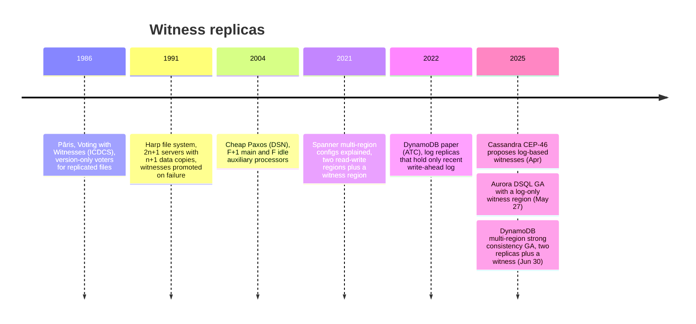
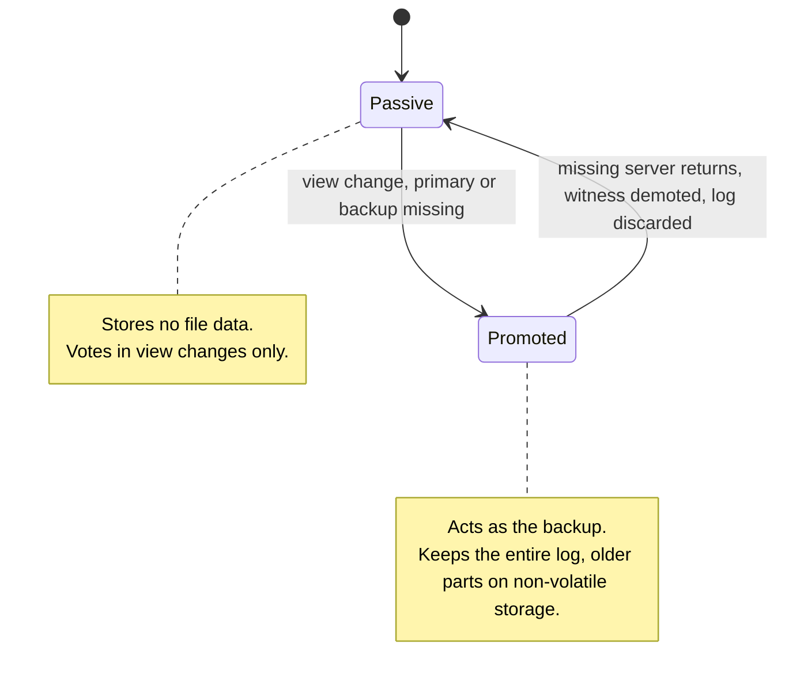
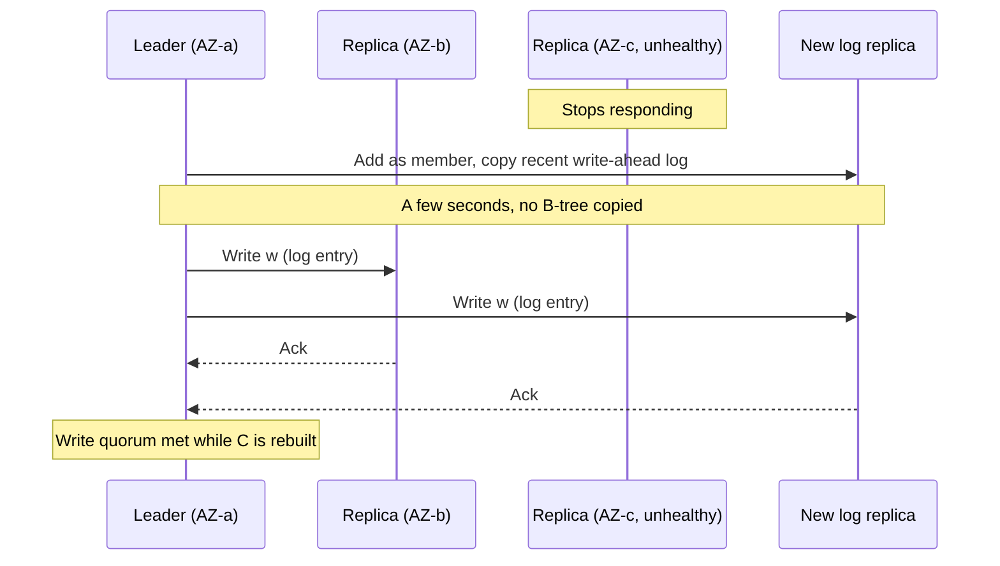
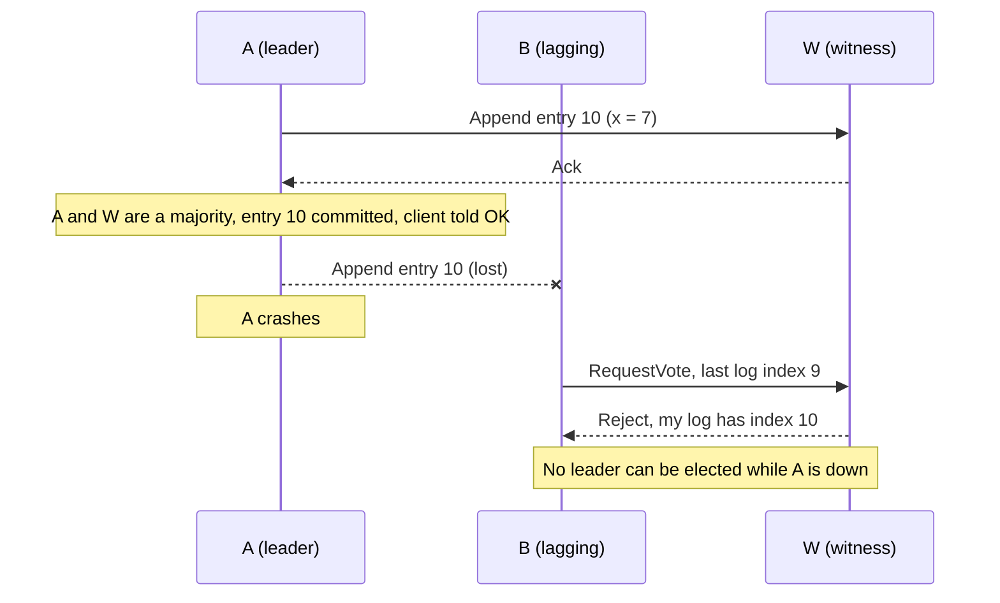

---
tags:
  - distributed-systems
  - replication
  - consensus
  - quorums
  - witness-replicas
status: draft
sources:
  - https://escholarship.org/content/qt2h92b7bf/qt2h92b7bf.pdf
  - https://www2.cs.uh.edu/~paris/MYPAPERS/DCS89.pdf
  - https://www2.cs.uh.edu/~paris/MYPAPERS/sndp00.pdf
  - https://users.soe.ucsc.edu/~sbrandt/221/Papers/FT/liskov-sosp91.pdf
  - https://www.microsoft.com/en-us/research/wp-content/uploads/2016/02/web-dsn-submission.pdf
  - https://usenix.org/system/files/atc22-elhemali.pdf
  - https://docs.cloud.google.com/spanner/docs/replication
  - https://docs.cloud.google.com/spanner/docs/region-types
  - https://cloud.google.com/blog/topics/developers-practitioners/demystifying-cloud-spanner-multi-region-configurations
  - https://docs.aws.amazon.com/amazondynamodb/latest/developerguide/V2globaltables_HowItWorks.html
  - https://aws.amazon.com/blogs/aws/build-the-highest-resilience-apps-with-multi-region-strong-consistency-in-amazon-dynamodb-global-tables
  - https://docs.aws.amazon.com/aurora-dsql/latest/userguide/disaster-recovery-resiliency.html
  - https://aws.amazon.com/blogs/aws/amazon-aurora-dsql-is-now-generally-available
  - https://brooker.co.za/blog/2024/12/06/inside-dsql-cap/
  - https://www.mongodb.com/docs/manual/core/replica-set-arbiter/
  - https://www.mongodb.com/docs/current/reference/mongodb-defaults/
  - https://www.mongodb.com/docs/manual/tutorial/mitigate-psa-performance-issues/
  - https://cwiki.apache.org/confluence/display/CASSANDRA/CEP-45%3A+Mutation+Tracking
  - https://www.mail-archive.com/dev@cassandra.apache.org/msg25622.html
  - https://www.mail-archive.com/dev@cassandra.apache.org/msg27531.html
  - https://digitalis.io/post/apache-cassandra-6-0-everything-that-changed-in-one-page
  - https://github.com/etcd-io/etcd/issues/20696
  - https://ask.pingcap.com/t/questions-about-tikv-witness/5125
  - https://learn.microsoft.com/en-us/windows-server/failover-clustering/what-is-quorum-witness
created: 2026-11-26
updated: 2026-11-26
---

## Table Of Contents

---

- [[#TL;DR|TL;DR]]
- [[#The Problem|The Problem]]
- [[#Foundations|Foundations]]
    - [[#Voting Is Not Storing|Voting Is Not Storing]]
    - [[#Commit Votes vs Election Votes|Commit Votes vs Election Votes]]
    - [[#How Many Copies a Commit Leaves Behind|How Many Copies a Commit Leaves Behind]]
- [[#How We Got Here|How We Got Here]]
- [[#How It Works|How It Works]]
    - [[#The Roles Side by Side|The Roles Side by Side]]
    - [[#Version-Only Witnesses (Pâris, 1986)|Version-Only Witnesses (Pâris, 1986)]]
    - [[#Promotable Witnesses (Harp, 1991)|Promotable Witnesses (Harp, 1991)]]
    - [[#Idle Auxiliaries (Cheap Paxos, 2004)|Idle Auxiliaries (Cheap Paxos, 2004)]]
    - [[#Log Replicas (DynamoDB)|Log Replicas (DynamoDB)]]
    - [[#Election-Only Voters (MongoDB Arbiters)|Election-Only Voters (MongoDB Arbiters)]]
    - [[#The Witness Hazard in a Raft-Style Group|The Witness Hazard in a Raft-Style Group]]
- [[#Where It Is Now|Where It Is Now]]
    - [[#Witness Regions in the Cloud|Witness Regions in the Cloud]]
    - [[#Open-Source Systems|Open-Source Systems]]
- [[#Trade-offs & Open Problems|Trade-offs & Open Problems]]
- [[#Resources|Resources]]
- [[#Related Notes|Related Notes]]

## ***TL;DR***
---
*A witness is a group member that votes but doesn't keep a full copy of the data. It lets a system keep a majority, and so survive a failure, without paying for another full replica; the price is paid in durability, read capacity or recovery, depending on what the witness does store.*

- **The idea.** Majority quorums need $2f + 1$ voters to survive $f$ failures, but surviving $f$ failures only needs $f + 1$ copies of the data. Witnesses fill the gap: $f + 1$ full replicas plus $f$ cheap voters ([[Failure Models]], [[Paxos]]).
- **What a witness keeps decides what it's worth.** It ranges from nothing but a version number (Pâris, 1986), through cluster metadata (a Windows quorum witness), to the recent [[Write-Ahead Logging|write-ahead log]] (DynamoDB log replicas, Aurora DSQL witness regions). A witness that stores the log keeps a committed write on two machines; one that stores nothing can leave it on one.
- **Two kinds of vote.** Some witnesses count toward write commits *and* leader elections (Spanner). Others vote only in elections (MongoDB arbiters), so a majority write still needs most of the data-bearing members.
- **Where it is now (Nov 2026):** witness *regions* are how the big clouds sell three-region strong consistency at two-region cost: Spanner's multi- and dual-region configurations, DynamoDB multi-region strong consistency (GA June 30, 2025) and Aurora DSQL multi-region clusters (GA May 27, 2025). In open source, Cassandra's log-based witnesses (CEP-46) are still being finished, and etcd has an open proposal.

## ***The Problem***
---
*Consensus needs a majority to make progress, so surviving one failure takes three voters. Three full copies of a large database, spread across three regions, cost three times the storage and compute, even though two copies would be enough to keep the data safe.*

Every majority-quorum protocol ([[Raft]], [[Paxos]], quorum [[Replication]]) asks two things of a group:

| Need | Why | Members required for $f$ failures |
|---|---|---|
| **Progress** (elect a leader, commit writes) | Any two majorities must overlap so they can't decide different things | $2f + 1$ voters |
| **Durability** (don't lose committed data) | At least one copy must survive $f$ crashes | $f + 1$ copies |

For $f = 1$ that's three voters but only two copies. The third full replica mostly exists to *break ties*. In a single data center that's tolerable. Across regions it is expensive: the third region holds a full copy, runs query servers, and adds a third place to pay egress and storage. The same squeeze shows up at the small end, where a two-node cluster can't tell "my peer crashed" from "the network between us broke" without a third vote ([[Failure Models]], [[Leases and Fencing]]).

The question a witness answers: **can the third voter be much cheaper than the other two without weakening safety?** Yes, but only if you're careful about which votes it casts and what it remembers.

## ***Foundations***
---
*Three ideas explain every witness design: a vote and a copy of the data are separable, some votes commit writes while others only pick leaders, and the number of copies a committed write is guaranteed to have depends on what the witnesses in its quorum store.*

### Voting Is Not Storing

*Quorum intersection only needs the voters to overlap. It doesn't say every voter must hold the data, only that the overlap must be able to tell which copy is newest.*

Gifford's weighted voting already separated the two: votes decide who may proceed, version numbers pick the newest copy ([[Replication]]). Pâris pushed it to the extreme: replace some replicas with "very small entities that hold no data but maintain enough metadata" to identify the most recent version, such as a timestamp or a version number ([Martínez-Vélez and Pâris, c. 2000](https://www2.cs.uh.edu/~paris/MYPAPERS/sndp00.pdf)). A witness that says "version 7 is current" can't *supply* version 7, but it can stop a stale replica from pretending to be current.

### Commit Votes vs Election Votes

*A member can count toward the quorum that commits writes, the quorum that elects a leader, or both. Which ones it joins changes what failures the group survives.*

| Votes in | Example | Consequence |
|---|---|---|
| Commits and elections | Spanner witness replicas ([Spanner docs](https://docs.cloud.google.com/spanner/docs/replication)) | One full replica plus the witness can commit; the witness must be able to vouch for (or supply) what it acknowledged |
| Elections only | MongoDB arbiters ([MongoDB docs](https://www.mongodb.com/docs/manual/core/replica-set-arbiter/)) | Leader election survives a lost data node, but a majority write needs two data-bearing members |
| Write quorum while healing | DynamoDB log replicas ([Elhemali et al., 2022](https://usenix.org/system/files/atc22-elhemali.pdf)) | Added only when a replica is unhealthy, so the write quorum stays reachable |
| Reconfiguration only | Cheap Paxos auxiliaries ([Lamport and Massa, 2004](https://www.microsoft.com/en-us/research/wp-content/uploads/2016/02/web-dsn-submission.pdf)) | Idle in normal operation; join only to remove a failed main processor |

The opposite role, a full copy with *no* vote, is a learner or read-only replica. Spanner's read-only replicas keep a full copy and serve reads but don't vote, so their location never adds to write latency ([Spanner docs](https://docs.cloud.google.com/spanner/docs/replication)). Witnesses add votes without data; read-only replicas add data without votes.

### How Many Copies a Commit Leaves Behind

*With majority quorums, a committed write is on at least a majority of voters. Subtract every witness in that majority that keeps nothing durable, and what's left is how many real copies the write is guaranteed to have.*

With $n$ voters the commit quorum is

$$
q = \left\lfloor \frac{n}{2} \right\rfloor + 1
$$

If $w_0$ of the voters are witnesses that store nothing durable about the write (no log entry, no data), then in the worst case all of them are in the commit quorum, and

$$
\text{durable copies of a committed write} \;\ge\; q - w_0
$$

*In words:* the guarantee is the quorum size minus the forgetful witnesses that could have stood in for real replicas.

*Worked example, 3 voters:* $n = 3$, so $q = 2$. Replicas A and B hold data; W is a witness.
- **W stores nothing:** a write acknowledged by $\{A, W\}$ has $2 - 1 = 1$ durable copy, on A. If A's disk dies before B catches up, the write is gone, even though the client was told it committed.
- **W stores the log entry:** the same write is on A's disk and in W's log, two durable copies. B can be caught up from W. This is why DynamoDB's log replicas, Aurora DSQL's witness region and a promoted Harp witness all keep the log.

*Worked example, 5 voters:* Spanner's nam3 layout has 4 read-write replicas and 1 witness ([Google Cloud, Mar 2021](https://cloud.google.com/blog/topics/developers-practitioners/demystifying-cloud-spanner-multi-region-configurations)). $q = 3$; even if the witness is in the quorum, at least $3 - 1 = 2$ full replicas hold every committed write, whatever the witness keeps.

## ***How We Got Here***
---
*Witnesses were invented for replicated files in 1986, became a building block of primary-backup systems by 1991, and got a consensus-theory treatment in Cheap Paxos (2004). The cloud era turned them into whole witness regions, the standard way to sell multi-region strong consistency.*

- **1986, files.** Pâris's *Voting with Witnesses* (ICDCS, Cambridge MA) replaced some copies of a replicated file with records of its status that hold no data ([Pâris, Voting with Bystanders](https://www2.cs.uh.edu/~paris/MYPAPERS/DCS89.pdf)). His later papers note the limits: witnesses cut storage but not communication, and a failed witness may go unnoticed for "days or even weeks" because it isn't on the normal read and write path ([Martínez-Vélez and Pâris](https://www2.cs.uh.edu/~paris/MYPAPERS/sndp00.pdf)).
- **1991, primary-backup.** Harp (Liskov et al.) used groups of $2n + 1$ servers but only $n + 1$ file copies; the witness stepped in for a missing primary or backup and kept a log until demoted ([Liskov et al., 1991](https://users.soe.ucsc.edu/~sbrandt/221/Papers/FT/liskov-sosp91.pdf)).
- **2004, consensus.** Cheap Paxos made the auxiliaries idle in normal operation and limited their job to reconfiguration ([Lamport and Massa](https://www.microsoft.com/en-us/research/wp-content/uploads/2016/02/web-dsn-submission.pdf)).
- **2020s, regions.** Google described Spanner multi-region configurations as two read-write regions plus a witness region in 2021. DynamoDB's 2022 paper described log replicas. AWS then shipped witness regions in Aurora DSQL and DynamoDB MRSC in 2025 ([[Distributed SQL]], [[CAP and PACELC]]).

## ***How It Works***
---
*Every witness design answers the same three questions: what it stores, which quorums it joins, and what happens when a full replica fails and the witness is suddenly holding up the majority. The designs below are the main answers, oldest first.*

### The Roles Side by Side

*One table for the whole design space. Read across a row to see what a role costs and what it can do; the "stores" column predicts how safe it is.*

| Role | Stores | Votes on commits | Votes in elections | Serves reads | Can lead |
|---|---|---|---|---|---|
| Full voting replica | Everything | Yes | Yes | Yes | Yes |
| Spanner witness replica | Not a full copy | Yes | Yes | No | No |
| DynamoDB log replica | Recent write-ahead log only, no key-value data | Counts toward the write quorum | Not stated | No | Not stated |
| Aurora DSQL witness region | Encrypted transaction log, no keys | Yes (2-of-3 commit) | — | No endpoint | No |
| DynamoDB MRSC witness | "Only replicated change data" | Supports MRSC's availability architecture | — | No reads or writes | No |
| MongoDB arbiter | Nothing | No | Yes | No | No |
| Harp witness | Nothing until promoted, then the log | When promoted | Yes | No | No |
| Cheap Paxos auxiliary | Only what reconfiguration needs | Only during reconfiguration | — | No | No |
| Windows quorum witness | Cluster metadata or a blob, no user data | — | Tie-breaker vote | No | No |
| Spanner read-only replica | Full copy | No | No | Yes | No |

Sources: [Spanner](https://docs.cloud.google.com/spanner/docs/replication), [DynamoDB paper](https://usenix.org/system/files/atc22-elhemali.pdf), [DSQL docs](https://docs.aws.amazon.com/aurora-dsql/latest/userguide/disaster-recovery-resiliency.html), [Brooker](https://brooker.co.za/blog/2024/12/06/inside-dsql-cap/), [DynamoDB MRSC](https://aws.amazon.com/blogs/aws/build-the-highest-resilience-apps-with-multi-region-strong-consistency-in-amazon-dynamodb-global-tables), [MongoDB](https://www.mongodb.com/docs/manual/core/replica-set-arbiter/), [Harp](https://users.soe.ucsc.edu/~sbrandt/221/Papers/FT/liskov-sosp91.pdf), [Cheap Paxos](https://www.microsoft.com/en-us/research/wp-content/uploads/2016/02/web-dsn-submission.pdf), [Microsoft](https://learn.microsoft.com/en-us/windows-server/failover-clustering/what-is-quorum-witness). "—" means the role has no separate election, or the source doesn't describe one.

### Version-Only Witnesses (Pâris, 1986)

*The minimal witness: a version number and a vote. It keeps stale copies from winning a vote but can't save a write the only up-to-date replica lost.*

- A replicated file has some full copies and some witnesses. All of them vote; a read or write needs a majority of votes.
- A witness records only enough to name the current version. If a quorum contains one full copy at version 7 and a witness that says "7", the full copy is known to be current.
- **Limit:** if the only full copy at version 7 is lost, the witness can prove that version 7 existed but can't produce it. Durability rests on the full copies alone.
- **Practical gap:** witnesses aren't on the normal read and write path, so their failures are noticed late; Pâris and Martínez-Vélez suggest periodic probes ([sndp00](https://www2.cs.uh.edu/~paris/MYPAPERS/sndp00.pdf)). That's a [[Gray and Fail-Slow Failures|gray failure]] built into the design.

### Promotable Witnesses (Harp, 1991)

*Harp's witness is passive until a data server goes missing, then acts as the backup and keeps a log so every committed operation is still on two machines.*

- A Harp group is a primary, a backup and a witness: $2n + 1$ servers with $n + 1$ file copies, for $n = 1$ ([Liskov et al., 1991](https://users.soe.ucsc.edu/~sbrandt/221/Papers/FT/liskov-sosp91.pdf)).
- The witness "never starts view changes"; it takes part only so that a single new view forms during a partition.
- Once promoted it never discards log entries until demoted, so each committed operation is recorded at two servers. The authors planned to spill old log to tape.
- *Lesson:* the moment a witness becomes part of the commit quorum, it has to store the log, or the $q - w_0$ bound drops to one copy.

### Idle Auxiliaries (Cheap Paxos, 2004)

*Cheap Paxos commits with the main processors alone and calls the auxiliaries only to reconfigure after a failure, so in normal operation the auxiliaries do nothing at all.*

- $F + 1$ main processors "actually execute the system"; $F$ auxiliary processors "perform actions only in the event of the failure of a main processor" ([Lamport and Massa, DSN 2004](https://www.microsoft.com/en-us/research/wp-content/uploads/2016/02/web-dsn-submission.pdf)).
- *Why it's safe (reading of the design):* with $2F + 1$ acceptors, a majority is $F + 1$, which is exactly the set of mains. So while all mains are up, every committed value is on all $F + 1$ of them, and the auxiliaries never needed to store it.
- When a main fails, the auxiliaries join long enough to form a majority that reconfigures the system without the failed main, then go idle again.
- *Example,* $F = 1$: mains M1, M2 and auxiliary X. M1 and M2 commit together. M2 crashes; M1 and X form a majority of 3, agree on a new configuration $\{M1, M1'\}$ with a fresh main, and X goes back to sleep. Liveness needs the set of working processors not to change too fast.

### Log Replicas (DynamoDB)

*DynamoDB uses log-only members to heal a replication group in seconds, because copying recent log is far faster than copying a B-tree.*

Each DynamoDB partition is a Multi-Paxos group with replicas in three availability zones ([[Replication]]). Some members of a group can be *log replicas* that "only persist recent write-ahead log entries" and "do not store key-value data" ([Elhemali et al., §3](https://usenix.org/system/files/atc22-elhemali.pdf)).

- When the leader detects an unhealthy storage replica, it adds a log replica; "Adding a log replica takes only a few seconds because the system has to copy only the recent write-ahead logs ... without the B-tree" (§5.1).
- It is "the fastest way to ensure that the write quorum of the group is always met" (§6.1), and it keeps recent writes durable while a full replica is rebuilt in the background.
- A log replica is a *temporary* witness: it exists to cover the window between a failure and a full repair.

### Election-Only Voters (MongoDB Arbiters)

*An arbiter breaks election ties but can't acknowledge writes. In a primary-secondary-arbiter set, losing the secondary leaves elections working and majority writes stuck.*

- An arbiter "participates in elections for primary but ... does not have a copy of the data set and cannot become a primary"; it has exactly one vote ([MongoDB docs](https://www.mongodb.com/docs/manual/core/replica-set-arbiter/)).
- In a three-member PSA set, a `"majority"` write needs both data-bearing members. If the secondary goes down, "writes with write concern `"majority"` cannot succeed and the commit point starts to lag"; the storage engine then keeps every change after the commit point, raising I/O and cache pressure, and the oplog grows past its limit ([MongoDB, PSA mitigation](https://www.mongodb.com/docs/manual/tutorial/mitigate-psa-performance-issues/)). The documented fix is to set the missing secondary to `votes: 0, priority: 0` until it catches up.
- Because of that, MongoDB's implicit default write concern is `{ w: 1 }` when "the number of data-bearing voting members is not greater than the voting majority" (2 data nodes + 1 arbiter: majority is 2, so `w: 1`), and `{ w: "majority" }` otherwise ([MongoDB defaults](https://www.mongodb.com/docs/current/reference/mongodb-defaults/)). So by default a PSA set acknowledges a write once the primary has it, and a failover before the secondary catches up can lose it (our reading; [[Replication]] covers async loss).
- Multiple arbiters are worse: votes from several arbiters can elect a secondary that had fallen behind, and "The result is data loss". Since 5.3 adding more than one arbiter is an error unless explicitly allowed.

### The Witness Hazard in a Raft-Style Group

*If a witness counts toward commits but can't hand over what it acknowledged, the group can get stuck or lose data after a single crash. Leader election rules keep it safe; keeping the log keeps it available.*

This is a worked example using standard [[Raft]] rules, not a description of any one product. Group: A (leader), B, W (witness). $n = 3$, $q = 2$.

- **Safety holds** if W keeps at least the term and index of what it acknowledged: Raft's up-to-date check makes W refuse to vote for B, whose log ends at 9, so B can't become leader and silently drop `x = 7`.
- **Availability suffers** if that's all W keeps: the only copy of entry 10's *content* is on crashed A. The group waits for A; if A's disk is gone, the write is lost despite being committed. This is the $q - w_0 = 1$ case.
- **The fix is to keep the log.** If W stores entry 10 itself, B can fetch it from W, become up to date, and win the election. Log-keeping witnesses (DynamoDB log replicas, DSQL's witness region, Harp's promoted witness, Cassandra's planned log-based witnesses) exist for exactly this.
- **Don't confuse** this with CURP's "witnesses", which hold commutative operations to cut latency rather than cost ([[Leaderless Consensus]]), or with S3's cache-coherence "witness" ([[Object Storage]]).

## ***Where It Is Now***
---
*As of November 2026, witness regions are a standard product feature for multi-region strong consistency at Google and AWS. In open source the idea is still landing: Cassandra is finishing log-based witnesses, etcd has a proposal, and TiKV's witness work stalled before GA.*

### Witness Regions in the Cloud

*All three big strongly consistent cloud databases use the same shape: two full regions and a third region that votes and stores little. That's how a one-region outage is survived without a third full copy.*

| | Google Spanner | Amazon DynamoDB MRSC | Amazon Aurora DSQL |
|---|---|---|---|
| Layout | Multi-region: two read-write regions with 2 replicas each, plus a witness region (nam3: us-east4, us-east1, witness in us-central1). Dual-region: two regions, each with 2 read-write replicas and 1 witness | Exactly three Regions: three replicas, or two replicas plus a witness | Two peered Regions with endpoints, plus a witness Region |
| Witness stores | Not a full copy of the data | "Only replicated change data"; can't be read or written | Encrypted transaction log, no encryption keys |
| Witness visible to you | Part of the instance configuration | No, owned by DynamoDB; shown by `DescribeTable` | No endpoint or cluster resource |
| If the witness fails | Read-write regions still form a quorum | Not described in the docs | "No impact to cluster availability"; writes may see higher latency |
| Generally available | Explained in a Mar 2021 post; docs updated Oct 2026 | June 30, 2025 | May 27, 2025 |

Sources: [Spanner replication](https://docs.cloud.google.com/spanner/docs/replication), [Spanner region types](https://docs.cloud.google.com/spanner/docs/region-types), [Google Cloud blog](https://cloud.google.com/blog/topics/developers-practitioners/demystifying-cloud-spanner-multi-region-configurations), [DynamoDB global tables](https://docs.aws.amazon.com/amazondynamodb/latest/developerguide/V2globaltables_HowItWorks.html), [MRSC launch](https://aws.amazon.com/blogs/aws/build-the-highest-resilience-apps-with-multi-region-strong-consistency-in-amazon-dynamodb-global-tables), [DSQL resilience](https://docs.aws.amazon.com/aurora-dsql/latest/userguide/disaster-recovery-resiliency.html), [DSQL GA](https://aws.amazon.com/blogs/aws/amazon-aurora-dsql-is-now-generally-available).

- **Why a third region at all.** Google puts it plainly: with replicas in only two regions "you cannot construct a majority quorum that could survive the loss of either region", so a witness goes in a third. It is typically placed close to one read-write region so that region plus the witness can commit quickly.
- **Spanner dual-region is different.** Its quorum "requires two replicas from both regions", so there the witnesses add votes inside each region rather than breaking a tie between them (our reading of the docs, which don't spell out region-loss behavior for dual-region).
- **DSQL in a partition.** Normal commits are a 2-of-3 quorum across regions; if the witness is cut off, "nothing customer-observable happens (except a small increase in `COMMIT` latency for some configurations)"; after losing a region it's 2-of-2, so every commit waits for the slowest remaining link ([Brooker, Dec 2024](https://brooker.co.za/blog/2024/12/06/inside-dsql-cap/), [[CAP and PACELC]]).
- **What MRSC gives up** (not because of the witness, but alongside it): no transactions, no TTL, no local [[Secondary Indexes|secondary indexes]], and the replica set can't be changed after creation ([DynamoDB docs](https://docs.aws.amazon.com/amazondynamodb/latest/developerguide/V2globaltables_HowItWorks.html)).

### Open-Source Systems

*Open-source systems mostly still use the older forms (arbiters, tie-breaker witnesses). Log-based witnesses are arriving slowly because they need the replication layer to track exactly which writes each member has.*

- **Cassandra: transient replication becoming witnesses.** Cassandra's existing transient replicas only hold unrepaired data and delete it when incremental repair runs. CEP-45 (mutation tracking) says such witnesses "never match the full replicas" and give no monotonic reads without read repair on nearly every read; it lists "enable completion of witness replicas" as a goal ([CEP-45](https://cwiki.apache.org/confluence/display/CASSANDRA/CEP-45%3A+Mutation+Tracking)). CEP-46 (Ariel Weisberg, Apr 2025) proposes renaming transient replication to witnesses: nodes materialize mutations only for ranges where they are full replicas and keep a log for witness ranges, targeting "a 10x improvement in write throughput" and resource needs of roughly "write rate * recovery/reconfiguration time" ([dev list, Apr 2025](https://www.mail-archive.com/dev@cassandra.apache.org/msg25622.html)). The project's 2025 year-in-review listed "Finishing Transient Replication/Witnesses (CEP-46)" as work in progress ([dev list, Dec 2025](https://www.mail-archive.com/dev@cassandra.apache.org/msg27531.html)). As of September 2026, Cassandra 6.0 was at alpha3 with no beta, and a summary of its changes didn't mention witnesses ([Digitalis, Sep 2026](https://digitalis.io/post/apache-cassandra-6-0-everything-that-changed-in-one-page)); whether they ship in 6.0 is unconfirmed. See [[Anti-Entropy and Repair]].
- **MongoDB:** arbiters remain supported with cautions: at most one, not on hosts that run data members, and PSA shards can lose availability when a secondary is down ([MongoDB docs](https://www.mongodb.com/docs/manual/core/replica-set-arbiter/)).
- **etcd:** an open proposal (issue #20696) to add a witness that "participates in leader election and quorum decisions" but "does not store the full key-value dataset", aimed at small, edge and resource-constrained clusters; it doesn't yet say whether the witness keeps log entries ([GitHub](https://github.com/etcd-io/etcd/issues/20696)). See [[Coordination Services]].
- **TiKV:** a witness feature was built, but per a PingCAP forum answer its development was "temporarily suspended" and it never reached GA, though an `enable-witness` setting appears in PD's configuration ([AskTUG](https://ask.pingcap.com/t/questions-about-tikv-witness/5125)).
- **Classic clustering:** Windows Server failover clusters add a disk, file share or cloud (Azure Blob) witness as an extra vote; the cloud witness "doesn't store a copy of the cluster database" ([Microsoft](https://learn.microsoft.com/en-us/windows-server/failover-clustering/what-is-quorum-witness)).

## ***Trade-offs & Open Problems***
---
*A witness saves a full copy of storage and compute, and it moves the cost somewhere else: durability, read capacity after a failure, recovery time or operational complexity. Which one depends on what it stores.*

| Witness stores | Saves | Costs |
|---|---|---|
| Nothing or a version | Almost all of a replica | Committed writes can have one durable copy; the group can stall waiting for a crashed replica |
| Cluster metadata only | Almost all of a replica | Only usable as a tie-breaker, not in the data commit path |
| Recent log | Storage of the full data set and query compute | Log retention sized to recovery time; catch-up traffic when a replica rebuilds from it |

- **Reads after a failure.** A witness serves no reads. With two full regions plus a witness, losing a full region leaves one region serving everything, and in DSQL's case every commit becomes 2-of-2 ([Brooker](https://brooker.co.za/blog/2024/12/06/inside-dsql-cap/)).
- **Correlated placement.** Google places the witness near one read-write region for fast commits. Nearby means faster, but also more likely to share a failure with that region ([[Failure Models]]).
- **Unnoticed witness failures.** Members that aren't on the normal path fail silently, as Pâris noted in the 1980s. Health checks have to probe them on purpose ([[Gray and Fail-Slow Failures]]).
- **Monotonic reads with partial data.** Cassandra's experience is that witnesses which hold only some data break read monotonicity unless the system knows which writes reached a quorum; mutation tracking is the fix under way ([CEP-45](https://cwiki.apache.org/confluence/display/CASSANDRA/CEP-45%3A+Mutation+Tracking)).
- **Protocol subtlety.** Adding a member that votes but can't lead changes election and reconfiguration rules, the places consensus bugs tend to live. Witness designs are good targets for TLA+ models and simulation ([[Formal Methods in Practice]], [[Deterministic Simulation Testing]]).
- **Beyond majorities.** Flexible quorums (commit and election quorums that only need to intersect each other) and leaderless fast paths attack the same wide-area cost from another angle ([[Paxos]], [[Leaderless Consensus]]).

## ***Resources***
---
*Read the Spanner replication page and Brooker's DSQL post for how witness regions work today, the DynamoDB paper for log replicas, then Harp and Cheap Paxos for why the log matters. The MongoDB PSA pages are the clearest write-up of what goes wrong with an election-only voter.*

**Primary papers**
- [Voting with Witnesses: A Consistency Scheme for Replicated Files](https://escholarship.org/content/qt2h92b7bf/qt2h92b7bf.pdf): Jehan-François Pâris, ICDCS 1986, pp. 606-612 (linked PDF is a later paper that cites it; the original isn't openly hosted).
- [Voting with Bystanders](https://www2.cs.uh.edu/~paris/MYPAPERS/DCS89.pdf): Pâris, late 1980s. Summarizes witnesses and extends them.
- [A New Voting Approach to Fault-Tolerant CORBA](https://www2.cs.uh.edu/~paris/MYPAPERS/sndp00.pdf): Martínez-Vélez and Pâris, c. 2000. Witness metadata and the unnoticed-failure problem.
- [Replication in the Harp File System](https://users.soe.ucsc.edu/~sbrandt/221/Papers/FT/liskov-sosp91.pdf): Liskov et al., SOSP 1991.
- [Cheap Paxos](https://www.microsoft.com/en-us/research/wp-content/uploads/2016/02/web-dsn-submission.pdf): Leslie Lamport and Mike Massa, DSN 2004.
- [Amazon DynamoDB: A Scalable, Predictably Performant, and Fully Managed NoSQL Database Service](https://usenix.org/system/files/atc22-elhemali.pdf): Elhemali et al., USENIX ATC 2022. Log replicas in §3, §5.1, §6.1.

**Practitioners and teams**
- [Demystifying Cloud Spanner multi-region configurations](https://cloud.google.com/blog/topics/developers-practitioners/demystifying-cloud-spanner-multi-region-configurations): Google Cloud, Mar 2021.
- [DSQL and the CAP theorem](https://brooker.co.za/blog/2024/12/06/inside-dsql-cap/): Marc Brooker, Dec 2024.
- [DynamoDB multi-region strong consistency launch](https://aws.amazon.com/blogs/aws/build-the-highest-resilience-apps-with-multi-region-strong-consistency-in-amazon-dynamodb-global-tables): AWS, Jun 2025.
- [Aurora DSQL GA](https://aws.amazon.com/blogs/aws/amazon-aurora-dsql-is-now-generally-available): AWS, May 2025.
- [CEP-46 discussion: Finish Transient Replication/Witnesses](https://www.mail-archive.com/dev@cassandra.apache.org/msg25622.html): Ariel Weisberg, Apr 2025.

**Docs**
- [Spanner replication](https://docs.cloud.google.com/spanner/docs/replication) and [region types](https://docs.cloud.google.com/spanner/docs/region-types).
- [DynamoDB global tables, how they work](https://docs.aws.amazon.com/amazondynamodb/latest/developerguide/V2globaltables_HowItWorks.html).
- [Aurora DSQL resilience](https://docs.aws.amazon.com/aurora-dsql/latest/userguide/disaster-recovery-resiliency.html).
- [MongoDB arbiters](https://www.mongodb.com/docs/manual/core/replica-set-arbiter/), [default write concern](https://www.mongodb.com/docs/current/reference/mongodb-defaults/), [PSA performance](https://www.mongodb.com/docs/manual/tutorial/mitigate-psa-performance-issues/).
- [CEP-45: Mutation Tracking](https://cwiki.apache.org/confluence/display/CASSANDRA/CEP-45%3A+Mutation+Tracking).
- [Windows Server quorum witness](https://learn.microsoft.com/en-us/windows-server/failover-clustering/what-is-quorum-witness).

## Related Notes

- [[Replication]] — Quorum intersection and why $2f + 1$ voters but $f + 1$ copies.
- [[Paxos]] — Acceptors, Multi-Paxos in Spanner and DynamoDB, where Cheap Paxos comes from.
- [[Raft]] — The up-to-date voting rule that keeps a witness from electing a stale leader.
- [[Leaderless Consensus]] — CURP's latency witnesses and other ways to cut wide-area cost.
- [[Failure Models]] — Crash-stop failures and the $f$ in every replica count here.
- [[CAP and PACELC]] — DSQL's 2-of-3 and 2-of-2 commits, DynamoDB MREC vs MRSC.
- [[Distributed SQL]] — Spanner and Aurora DSQL, the main users of witness regions.
- [[Coordination Services]] — etcd and small clusters that want a cheap third vote.
- [[Leases and Fencing]] — Two-node clusters and the tie-breaker problem.
- [[Object Storage]] — S3's cache "witness", a different idea with the same name.
- [[Anti-Entropy and Repair]] — Cassandra repair and mutation tracking, which log-based witnesses depend on.
- [[Gray and Fail-Slow Failures]] — Witnesses that fail without anyone noticing.
- [[Formal Methods in Practice]] — Checking election and reconfiguration rules with extra roles.
- [[Deterministic Simulation Testing]] — Exercising failover paths a witness only sees during failures.
- [[Write-Ahead Logging]] — What a log replica stores, and why a log is enough to rebuild state.
