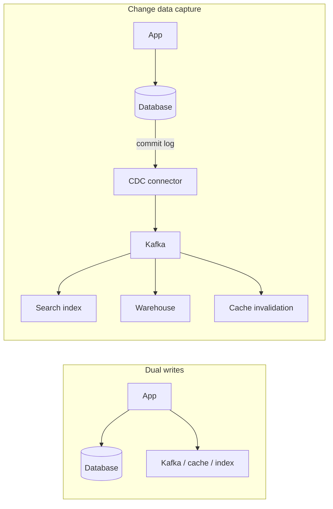
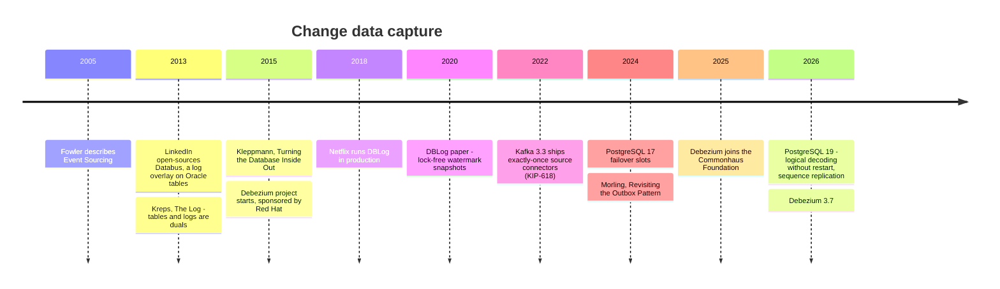
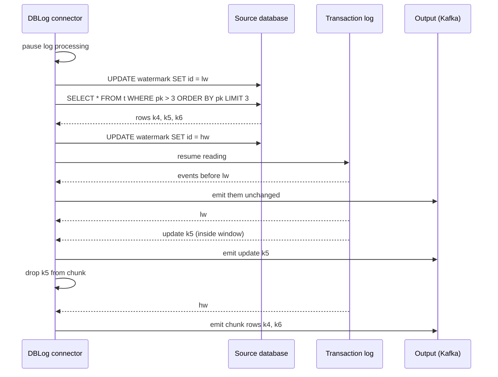
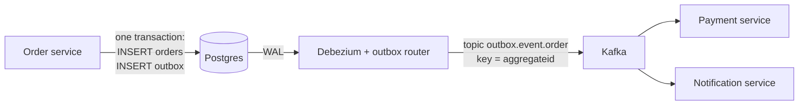

---
tags:
  - distributed-systems
  - change-data-capture
  - cdc
  - outbox
  - event-sourcing
  - debezium
  - logical-replication
status: complete
sources:
  - https://engineering.linkedin.com/distributed-systems/log-what-every-software-engineer-should-know-about-real-time-datas-unifying
  - https://martin.kleppmann.com/2015/03/04/turning-the-database-inside-out.html
  - https://martinfowler.com/eaaDev/EventSourcing.html
  - https://arxiv.org/pdf/2010.12597
  - https://engineering.linkedin.com/data-replication/open-sourcing-databus-linkedins-low-latency-change-data-capture-system
  - https://microservices.io/patterns/data/transactional-outbox
  - https://microservices.io/patterns/data/transaction-log-tailing.html
  - https://microservices.io/patterns/data/polling-publisher.html
  - https://www.morling.dev/blog/revisiting-the-outbox-pattern/
  - https://morling.dev/blog/mastering-postgres-replication-slots
  - https://www.postgresql.org/docs/19/logicaldecoding-explanation.html
  - https://www.postgresql.org/docs/17/logical-replication-failover.html
  - https://www.postgresql.org/docs/19/release-19.html
  - https://postgresql.org/about/news/postgresql-19-released-3449
  - https://debezium.io/documentation/reference/2.2/connectors/postgresql.html
  - https://debezium.io/documentation/reference/2.4/transformations/outbox-event-router.html
  - https://debezium.io/releases/3.6/
  - https://debezium.io/releases/3.7/
  - https://debezium.io/releases/3.8/
  - https://www.infoq.com/news/2025/02/debezium-joins-commonhaus
  - https://cwiki.apache.org/confluence/display/KAFKA/KIP-618:+Exactly-Once+Support+for+Source+Connectors
  - https://www.confluent.io/blog/apache-kafka-3-3-0-new-features-and-updates
  - https://cwiki.apache.org/confluence/spaces/KAFKA/pages/255071659/KIP-939+Support+Participation+in+2PC
  - https://archive.apache.org/dist/kafka/4.2.0/RELEASE_NOTES.html
  - https://docs.aws.amazon.com/amazondynamodb/latest/developerguide/Streams.html
  - https://docs.cloud.google.com/spanner/docs/change-streams
  - https://docs.cockroachlabs.com/docs/v26.1/changefeed-messages
  - https://flink.apache.org/2026/03/30/apache-flink-cdc-3.6.0-release-announcement/
  - https://confluent.io/blog/tableflow-is-now-generally-available
  - https://opensource.googleblog.com/2025/08/whats-new-in-iceberg-v3.html
created: 2026-11-26
updated: 2026-11-26
---

## Table Of Contents

---

- [[#TL;DR|TL;DR]]
- [[#The Problem|The Problem]]
- [[#Foundations|Foundations]]
    - [[#The Table/Log Duality|The Table/Log Duality]]
    - [[#Three Ways to Capture Changes|Three Ways to Capture Changes]]
    - [[#Snapshot Plus Stream|Snapshot Plus Stream]]
    - [[#CDC, Outbox and Event Sourcing|CDC, Outbox and Event Sourcing]]
- [[#How We Got Here|How We Got Here]]
- [[#How It Works|How It Works]]
    - [[#Reading the Log: Postgres Logical Decoding|Reading the Log: Postgres Logical Decoding]]
    - [[#Anatomy of a Change Event|Anatomy of a Change Event]]
    - [[#Backfills Without Locks: DBLog Watermarks|Backfills Without Locks: DBLog Watermarks]]
    - [[#Delivery Into Kafka|Delivery Into Kafka]]
    - [[#The Transactional Outbox|The Transactional Outbox]]
    - [[#Event Sourcing|Event Sourcing]]
    - [[#Built-In Change Streams|Built-In Change Streams]]
- [[#Where It Is Now|Where It Is Now]]
- [[#Trade-offs & Open Problems|Trade-offs & Open Problems]]
- [[#Resources|Resources]]
- [[#Related Notes|Related Notes]]

## ***TL;DR***
---
*Change data capture (CDC) turns a database's own commit log into a stream of row-level change events that other systems can follow. It is the standard answer to "how do I keep a search index, cache, warehouse or another service in sync with my database without writing to both?"*

- **The problem is dual writes.** An application that writes to its database and then to Kafka, a cache or a search index will, sooner or later, crash between the two writes or apply them in different orders, and the copies diverge for good ([Kleppmann, 2015](https://martin.kleppmann.com/2015/03/04/turning-the-database-inside-out.html)).
- **The idea is the table/log duality.** "Tables support data at rest and logs capture change" ([Kreps, 2013](https://engineering.linkedin.com/distributed-systems/log-what-every-software-engineer-should-know-about-real-time-datas-unifying)). The database already writes an ordered log of every committed change for its own [[Replication]]; CDC reads that log and republishes it.
- **Log-based CDC** (Debezium, Netflix's DBLog, Postgres logical decoding, MySQL binlog readers) emits changes in commit order with no extra load on the write path. It needs two things done carefully: an initial **snapshot** stitched consistently onto the stream, and **at-least-once** delivery handled by idempotent consumers.
- **Three patterns share the machinery.** Plain CDC publishes table rows. The **transactional outbox** writes an explicit event into the same transaction as the business change and lets CDC relay it. **Event sourcing** makes the event log itself the source of truth and derives tables from it.
- **Now (Nov 2026):** Debezium 3.7.1 (Nov 6, 2026) is the latest stable release, with 3.8 in alpha; the project moved from Red Hat to the Commonhaus Foundation in 2025. PostgreSQL 19 (Nov 19, 2026) can switch logical decoding on without a restart and replicates sequences. Kafka's KIP-939, which would let Kafka join a two-phase commit with a database, had its client APIs pulled from Kafka 4.2 and has not shipped, so the outbox remains the default way to publish events atomically with a database write.

## ***The Problem***
---
*Almost every system keeps the same data in more than one place: a database, a cache, a search index, a warehouse, other services. Keeping those copies correct when any process can crash at any point is the problem CDC exists to solve.*

The naive design writes twice:

```text
BEGIN; UPDATE users SET email='b@x' WHERE id=42; COMMIT;   -- write 1: database
kafka.send("users", key=42, value={email:'b@x'})            -- write 2: everything else
```

Two things go wrong.

**Partial failure.** If the process dies between the commit and the send, the database has the change and nobody else ever hears of it. Sending first is no better: the transaction may roll back after the event went out. The outbox pattern write-up states the requirement exactly: a message must be sent "if and only if the database transaction commits" ([microservices.io](https://microservices.io/patterns/data/transactional-outbox)). Wrapping both in a [[Distributed Transactions|two-phase commit]] would solve it, but most brokers and many databases don't support being a 2PC participant, and it couples the service's availability to both systems.

**Reordering.** Even with no crash, two concurrent requests can interleave differently on each system. Kleppmann's example: clients "might update the database in one order, and the cache in the other order, and now the two are inconsistent" ([Kleppmann, 2015](https://martin.kleppmann.com/2015/03/04/turning-the-database-inside-out.html)).

*Worked example (user 42, two requests).*

| Step | Request A (email = a@x) | Request B (email = b@x) | Database | Cache |
|---|---|---|---|---|
| 1 | writes DB | | a@x | (old) |
| 2 | | writes DB | **b@x** | (old) |
| 3 | | writes cache | b@x | b@x |
| 4 | writes cache | | b@x | **a@x** |

The database says b@x and the cache says a@x, and nothing will ever fix it. No retry or timeout helps, because each write individually succeeded. This is a [[Consistency Models|consistency]] failure caused purely by the lack of a single order.

**The CDC answer.** Write only to the database, and let every other copy follow the database's own commit log. The log gives one order for all followers: "The log squeezes the non-determinism of concurrency out of the stream of writes" ([Kleppmann, 2015](https://martin.kleppmann.com/2015/03/04/turning-the-database-inside-out.html)).



## ***Foundations***
---
*Four ideas carry the topic: a table is the result of replaying a log, there are three ways to see a table's changes, a copy needs a snapshot glued exactly onto the stream, and CDC, outbox and event sourcing are three choices about what the log contains.*

### The Table/Log Duality

*A table is a compressed view of a log of changes; the log is the full history behind the table. Anything that can read the log can rebuild the table or keep a copy of it current.*

Kreps' analogy: "The log is similar to the list of all credits and debits and bank processes; a table is all the current account balances" ([Kreps, 2013](https://engineering.linkedin.com/distributed-systems/log-what-every-software-engineer-should-know-about-real-time-datas-unifying)). The same essay notes that this changelog "is exactly what you need to support near-real-time replicas". [[Logs and Streaming]] covers the log itself; here what matters is the equation.

Write the log as events $e_1, e_2, \dots$ with increasing log positions (in Postgres, LSNs), and let $\mathrm{apply}$ turn one table state plus one change into the next. Then

$$
T_n = \mathrm{apply}(T_{n-1},\, e_n), \qquad T_0 = \emptyset
$$

and, for any position $s$ where you hold a copy $T_s$,

$$
T_{\text{now}} = \mathrm{apply}^{*}\big(T_s,\ \langle e_i : \mathrm{lsn}(e_i) > s \rangle\big)
$$

*In words:* a copy taken at log position $s$, plus every change after $s$ applied in order, equals the current table. Miss one change after $s$ and the copy is wrong; apply one from before $s$ twice and it may also be wrong. All of CDC's engineering is about getting that boundary right.

*Worked example.* Table `accounts`, snapshot at LSN 100: `{1: 50, 2: 70}`. Log after 100: `(lsn 101, update 1 → 40)`, `(lsn 102, insert 3 → 10)`, `(lsn 103, delete 2)`. Applying them gives `{1: 40, 3: 10}`, which is the table now.

### Three Ways to Capture Changes

*You can ask the table what changed, have the database tell you through triggers, or read the log the database already writes. Only the last sees every change, in commit order, without touching the write path.*

| Method | How it works | Sees deletes? | Order | Cost on source |
|---|---|---|---|---|
| **Query-based (polling)** | Periodically `SELECT ... WHERE updated_at > last_seen` | No, unless soft-deleted | By timestamp column, which may not match commit order | Repeated scans |
| **Trigger-based** | Triggers copy each change into a shadow table | Yes | Roughly by trigger execution | Extra write on every transaction |
| **Log-based** | Read the WAL, binlog or redo log through a replication interface | Yes | Exact commit order | Low; reuses the replication log |

The microservices.io pattern catalog names the relay options the same way: a **polling publisher** that queries a table, and **transaction log tailing** that reads the database log ([polling](https://microservices.io/patterns/data/polling-publisher.html); [log tailing](https://microservices.io/patterns/data/transaction-log-tailing.html)). Polling has a subtle ordering hole: a transaction that started earlier can commit later with a smaller timestamp or ID than rows already read, so a poller can skip it. Morling's 2024 review makes this point and prefers log-based capture because "events are emitted in the exact same order as transactions were committed to the database" ([Morling, 2024](https://www.morling.dev/blog/revisiting-the-outbox-pattern/)).

### Snapshot Plus Stream

*A transaction log is not kept forever, so a new consumer needs a full copy first and then the changes after it. Joining the two without a gap or an overlap is the core correctness problem of CDC.*

Logs have limited retention, so DBLog's authors note that a full-state dump is always needed alongside the log, and it must be combined with log events without corrupting the order of changes ([Andreakis and Papapanagiotou, 2020](https://arxiv.org/pdf/2010.12597)). There are two classic approaches:

- **Exported snapshot (Postgres).** When a logical slot is created, Postgres exports a snapshot "which will show exactly the state of the database after which all changes will be included in the change stream" ([Postgres docs](https://www.postgresql.org/docs/19/logicaldecoding-explanation.html)). A reader dumps the tables inside that snapshot, then consumes the slot. This gives the exact boundary $s$ from the equation above, but the dump is one long transaction and can't easily be paused or redone for a single table later.
- **Lock and read.** Older tools briefly locked tables or paused log reading to take a consistent dump. DBLog's survey found Debezium (at the time) and Maxwell used locks or paused the log ([DBLog](https://arxiv.org/pdf/2010.12597)).

The modern answer, watermark-based chunked snapshots, is in [[#Backfills Without Locks: DBLog Watermarks|How It Works]].

**Delivery is at-least-once.** Postgres says a logical slot emits each change once in normal operation, but its position "is persisted only at checkpoint, so in the case of a crash the slot might return to an earlier LSN", and "Logical decoding clients are responsible for avoiding ill effects from handling the same message more than once" ([Postgres docs](https://www.postgresql.org/docs/19/logicaldecoding-explanation.html)). Every CDC consumer has to be idempotent ([[Reliability Patterns]]).

### CDC, Outbox and Event Sourcing

*The three patterns differ in what is written to the log and what counts as the truth. That choice decides how coupled consumers are to the producer's schema and how hard it is to replay history.*

| | Plain CDC | Transactional outbox | Event sourcing |
|---|---|---|---|
| **Source of truth** | Tables | Tables | The event log |
| **What consumers see** | Row changes (`before`/`after`) | Explicit domain events written by the app | Domain events |
| **Coupling** | Consumers depend on the table schema | Consumers depend on an event contract | Consumers depend on an event contract |
| **Needs app changes?** | No | Yes: insert an outbox row per event | Yes: whole design |
| **Replay from start** | Only as far as log retention (plus snapshots) | Same | Yes, by design |
| **Typical use** | Replicas, search, caches, warehouses | Service-to-service events | Domains needing full history and audit |

Plain CDC exposes internal table structure to every consumer; the outbox exists mainly to put a stable, intentional event contract between them, while still using CDC as the transport. Fowler's definition of event sourcing is that "all changes to application state are stored as a sequence of events" ([Fowler, 2005](https://martinfowler.com/eaaDev/EventSourcing.html)); microservices.io lists it as the alternative to an outbox ([microservices.io](https://microservices.io/patterns/data/transactional-outbox)).

## ***How We Got Here***
---
*CDC started as internal plumbing at large web companies that needed search indexes and caches to follow their databases, became a named architecture through the "log" essays of 2013 to 2015, and settled on open-source log readers feeding Kafka.*



- **Databus (LinkedIn).** Kreps describes it as "a log caching abstraction on top of our early Oracle tables", built so search indexes and the social graph could subscribe to database changes ([Kreps, 2013](https://engineering.linkedin.com/distributed-systems/log-what-every-software-engineer-should-know-about-real-time-datas-unifying)). LinkedIn open-sourced it in February 2013 with the Oracle adapter, saying it captured changes from "multiple sources including Oracle and MySQL" ([LinkedIn, 2013](https://engineering.linkedin.com/data-replication/open-sourcing-databus-linkedins-low-latency-change-data-capture-system)). The same essay calls log extraction "the most log-friendly style of data extraction".
- **"Turning the database inside out" (2014-15).** Kleppmann argued the replication stream, which is "not part of the public interface" of a database, should become "a first-class citizen in our data architecture", with caches and indexes rebuilt as materialized views: "A materialized view is just a cached subset of the log." He called splitting the database into a log plus derived views "unbundling" ([Kleppmann, 2015](https://martin.kleppmann.com/2015/03/04/turning-the-database-inside-out.html)). This is also the root of [[Stream Processing#Streams, Tables and Incremental Views|incremental view maintenance]].
- **Debezium (2015 onward).** Red Hat sponsored the open-source project from its start in 2015 ([InfoQ, 2025](https://www.infoq.com/news/2025/02/debezium-joins-commonhaus)); it became the de facto set of Kafka Connect source connectors for MySQL, Postgres, MongoDB, SQL Server, Oracle and others.
- **DBLog (Netflix).** In production since 2018 and published in 2020, it solved snapshots without locks and was used for Elasticsearch-backed search, database activity logging and Flink-based schema migrations ([DBLog](https://arxiv.org/pdf/2010.12597)). Debezium's later incremental snapshots use the same chunk-and-watermark approach ([Debezium docs](https://debezium.io/documentation/reference/2.2/connectors/postgresql.html); [Morling, 2024](https://www.morling.dev/blog/revisiting-the-outbox-pattern/)).
- **Exactly-once into Kafka (2022).** KIP-618, shipped in Kafka 3.3 (October 2022), let Kafka Connect write source records and their offsets in one Kafka transaction ([Confluent, 2022](https://www.confluent.io/blog/apache-kafka-3-3-0-new-features-and-updates); [KIP-618](https://cwiki.apache.org/confluence/display/KAFKA/KIP-618:+Exactly-Once+Support+for+Source+Connectors)).

## ***How It Works***
---
*A CDC pipeline has five parts: a replication interface on the database, a connector that turns log records into events, a way to snapshot existing data, a transport (usually Kafka) that keeps per-key order, and idempotent consumers. The outbox and event sourcing reuse the same parts with different payloads.*

### Reading the Log: Postgres Logical Decoding

*Postgres exposes its WAL to outside readers through logical decoding and replication slots. A slot is a durable cursor that makes the database keep WAL until the reader confirms it, which is both the feature and the main operational hazard.*

- **Logical decoding** is "the process of extracting all persistent changes to a database's tables into a coherent, easy to understand format which can be interpreted without detailed knowledge of the database's internal state" ([Postgres docs](https://www.postgresql.org/docs/19/logicaldecoding-explanation.html)).
- A **replication slot** "represents a stream of changes that can be replayed to a client in the order they were made on the origin server. Each slot streams a sequence of changes from a single database."
- An **output plugin** turns the internal WAL format into what the consumer wants. `pgoutput` "is the standard logical decoding output plug-in in PostgreSQL 10+" and ships with the server ([Debezium docs](https://debezium.io/documentation/reference/2.2/connectors/postgresql.html)). DBLog used `wal2json`.

**The hazard.** Slots "persist across crashes and know nothing about the state of their consumer(s). They will prevent removal of required resources even when there is no connection using them": WAL piles up on disk and `VACUUM` can't clean catalog rows, and "in extreme cases this could cause the database to shut down to prevent transaction ID wraparound" ([Postgres docs](https://www.postgresql.org/docs/19/logicaldecoding-explanation.html)). This links CDC to [[MVCC and Version Garbage Collection]]: an abandoned reader stops garbage collection on the source.

Morling's 2025 field guide lists the usual fixes ([Morling, 2025](https://morling.dev/blog/mastering-postgres-replication-slots)):

| Problem | Why it happens | Fix |
|---|---|---|
| WAL grows while the CDC'd database is idle | WAL is shared by all databases on an instance, but a slot only advances when *its* database changes | Heartbeats: write to the WAL periodically, e.g. `pg_logical_emit_message()` (Postgres 14+) via Debezium's `heartbeat.action.query` |
| A dead consumer fills the disk | The slot holds WAL forever | `max_slot_wal_keep_size` (Postgres 13+) invalidates the slot past a size cap; the consumer must re-snapshot, which is "definitely preferable" to a full disk |
| Failover loses the slot | Slots lived only on the primary | Failover slots (Postgres 17), below |

**Failover slots (Postgres 17).** A slot created with `failover = true` is synchronized to a standby, so after promotion consumers "can continue subscribing to publications on the new primary server". Sync is asynchronous, so "the standby server must be ahead of the subscriber", which `synchronized_standby_slots` enforces by holding back what logical consumers may see until the listed standbys have it ([Postgres 17 docs](https://www.postgresql.org/docs/17/logical-replication-failover.html)). The standby side needs `sync_replication_slots`, `hot_standby_feedback` and the database name in `primary_conninfo`; Debezium supports it with `slot.failover` from 3.0.5 ([Morling, 2025](https://morling.dev/blog/mastering-postgres-replication-slots)). This is the same rule as in [[Replication]]: a follower must never be told about a write the new leader won't have.

*Worked example (primary P, standby S, Debezium D).* P commits LSN 500. Without `synchronized_standby_slots`, D could read 500 before S's copy of the slot reaches 500; P fails, S is promoted with the slot at 480, and D asks for "after 500" from a server whose history after 480 may differ. With the setting, P doesn't send LSN 500 to D until S confirms it has it, so D's position is always one S can serve.

MySQL plays the same role with its row-based binlog read over the replication protocol (DBLog used the MySQL Binary Log Connector), and Oracle, SQL Server and Db2 have their own log readers.

### Anatomy of a Change Event

*A change event is a row image plus metadata: what the row looked like before and after, what kind of change it was, and where in the source log it came from. The log position is what makes deduplication and ordering possible downstream.*

Debezium's envelope is the de facto shape ([Debezium docs](https://debezium.io/documentation/reference/2.2/connectors/postgresql.html)):

| Field | Meaning |
|---|---|
| `before` | Row state before the change (null for inserts) |
| `after` | Row state after the change (null for deletes) |
| `op` | `c` create, `u` update, `d` delete, `r` read (snapshot), `t` truncate |
| `source` | Origin metadata: database, table, transaction, log position (LSN) |
| `ts_ms` | When the connector processed the event |

What goes in `before` depends on the source. In Postgres it is set by `REPLICA IDENTITY`: with `DEFAULT`, updates and deletes carry only the old primary key; with `FULL`, "the previous values of all columns" at the cost of more WAL. A consumer that needs to know which column changed, or to retract an old value from an aggregate ([[Stream Processing#Streams, Tables and Incremental Views|DBSP-style retractions]]), needs `FULL`.

**Idempotent apply by position.** Because the log position only grows, a consumer can drop duplicates by remembering the highest position applied per key instead of storing every event ID, which Morling recommends ([Morling, 2024](https://www.morling.dev/blog/revisiting-the-outbox-pattern/)):

$$
\text{apply } e \iff \mathrm{lsn}(e) > \mathrm{applied}[\mathrm{key}(e)]
$$

*Worked example.* The sink has `applied[42] = 1007`. After a crash, the connector rewinds to its last checkpoint and resends events at LSNs 1003, 1007 and 1012 for key 42. The first two are skipped; 1012 is applied and `applied[42]` becomes 1012. The same rule makes a re-run snapshot (`op = r`) safe, as long as snapshot rows carry the position they were read at.

### Backfills Without Locks: DBLog Watermarks

*DBLog reads the table in small primary-key chunks while the log keeps flowing, and uses two marker writes to find exactly which log events overlap each chunk. Any chunk row that was changed in that window is dropped, because the log already has a newer value.*

DBLog's requirements were to trigger a dump at any time, pause and resume it, never stall log processing, never "time-travel" (emit an older value after a newer one), take no locks and use no vendor-specific features ([DBLog](https://arxiv.org/pdf/2010.12597)). The trick is a one-row **watermark table** the connector writes to; each write shows up as an event in the log, marking a known position.

Steps for one chunk:

1. Pause log processing; generate UUIDs for a low watermark `lw` and a high watermark `hw`.
2. Write `lw` to the watermark table.
3. `SELECT` the next chunk (rows with primary key after the last chunk's end, `LIMIT n`) and hold it in memory.
4. Write `hw` to the watermark table.
5. Resume log processing. Events before `lw` go straight to output. Between `lw` and `hw`, each log event also deletes the row with the same key from the in-memory chunk.
6. When `hw` arrives, emit the remaining chunk rows, then carry on.

The paper's key sentence: the goal is to "determine a window on the transaction log which guarantees to contain the chunk selection." The connector doesn't know where in the window the `SELECT` actually read, so any key also touched inside the window is resolved in favour of the log, which is guaranteed at least as new. The `SELECT` needs only read committed isolation ("non-stale reads"). Progress (the last key of each chunk) is kept in ZooKeeper, so a dump can stop and resume.



*Worked example.* Chunk keys k4, k5, k6, read with k5 = "v1". A user updates k5 to "v2" at about the same moment, and the log shows `lw, (k5 → v2), hw`. The `SELECT` might have seen v1 or v2; DBLog can't tell. Emitting the chunk's k5 after the log's k5 → v2 would overwrite v2 with possibly-stale v1 downstream (time travel). Dropping k5 from the chunk leaves output `k5 → v2, k4, k6`: every key ends at its latest value, and no older value follows a newer one.

Debezium's **incremental snapshots** do the same thing: a SQL `INSERT` into a signal table triggers them, Debezium "sorts each table by primary key and then splits the table into chunks", "uses watermarks to track its progress", and runs them "in parallel with streamed data capture", resolving collisions in a buffered snapshot window ([Debezium docs](https://debezium.io/documentation/reference/2.2/connectors/postgresql.html)). The approach needs a primary key and an efficient key-range scan on each table.

### Delivery Into Kafka

*Kafka keeps order only within a partition, so CDC keys each event by the row's primary key. That gives per-row order, which is what most consumers need, but not transaction order across rows.*

- **Per-key order.** Using the primary key as the message key routes every change to one row to the same partition ([[Partitioning]]), so a consumer sees that row's changes in commit order. Changes to different rows in one transaction can land in different partitions and be seen in a different order or partially.
- **Exactly-once into Kafka.** With KIP-618, a Connect worker writes source records "and their offsets in a Kafka transaction" and fences old task instances, so a restarted connector doesn't publish the same change twice into Kafka. It requires distributed mode, the Connect offset API, at most one task per source partition, and a source that can resume from a stored offset ([KIP-618](https://cwiki.apache.org/confluence/display/KAFKA/KIP-618:+Exactly-Once+Support+for+Source+Connectors)). This covers Kafka only; sinks still need the idempotent apply above. Fencing old tasks is the same idea as [[Leases and Fencing]].
- **Schema changes.** Each event's shape follows the table, so `ALTER TABLE` becomes a schema change in the stream; Debezium records schema history and typically pairs with a schema registry, and Flink CDC's pipelines propagate schema evolution to sinks ([Flink CDC 3.6](https://flink.apache.org/2026/03/30/apache-flink-cdc-3.6.0-release-announcement/)).

### The Transactional Outbox

*The service writes its business change and an event row in one local transaction; CDC relays the event row. You get "send if and only if commit" without two-phase commit, at the price of at-least-once delivery.*

The pattern, per microservices.io: store each message "in an outbox as part of the same transaction that updates business entities", and have a separate relay forward it; benefits are that "2PC is not used", messages are sent "if and only if the database transaction commits", and in the order the application produced them. The cost is that the relay can publish twice, so consumers must be idempotent ([microservices.io](https://microservices.io/patterns/data/transactional-outbox)).



Debezium's **outbox event router** expects a table with `id` (event UUID, emitted as a header for deduplication), `aggregatetype` (used to pick the topic, e.g. `Order` → `outbox.event.order`), `aggregateid` (the message key, "important for maintaining correct order in Kafka partitions"), `type` and `payload` ([Debezium docs](https://debezium.io/documentation/reference/2.4/transformations/outbox-event-router.html)).

Two refinements from Morling's 2024 review ([Morling, 2024](https://www.morling.dev/blog/revisiting-the-outbox-pattern/)):

- **Delete right after insert.** With log-based CDC the outbox row can be deleted in the same transaction; the `INSERT` is still in the log, so "the removal can actually be done right away after inserting a message into the outbox table" and the table stays empty.
- **No table at all on Postgres.** `pg_logical_emit_message()` writes a message straight into the WAL inside the transaction; "These messages never materialize in any tables". He recommends this log-only approach on Postgres.

He also argues against the alternative "listen to yourself" design (write only to Kafka, build local state from it), because "there are no synchronous read-your-own-write guarantees", which makes uniqueness checks and UX hard. His conclusion: the outbox "continues to deserve a very central spot in the toolbox of development teams".

*Worked example (order placed).*

```sql
BEGIN;
INSERT INTO orders(id, user_id, total) VALUES (981, 42, 30.00);
INSERT INTO outbox(id, aggregatetype, aggregateid, type, payload)
  VALUES ('e7c1…', 'Order', '981', 'OrderPlaced', '{"orderId":981,"total":30.00}');
DELETE FROM outbox WHERE id = 'e7c1…';
COMMIT;   -- LSN 2040
```

If the transaction aborts, neither the order nor the event exists. If it commits, the WAL at LSN 2040 holds both, and Debezium publishes `OrderPlaced` to `outbox.event.order` with key `981`. If Debezium crashes after publishing but before saving its offset, it republishes; the payment service sees event `e7c1…` twice and skips the second by its `id`. This is the cross-service piece of [[Distributed Transactions#Sagas|sagas]]: each saga step's "next message" goes through an outbox.

### Event Sourcing

*In event sourcing the event log is the database: current state is a fold over the events, and tables are disposable projections. It gives full history and replay, and pushes the hard problems into replay and schema evolution.*

Fowler's 2005 write-up lists what you gain ([Fowler, 2005](https://martinfowler.com/eaaDev/EventSourcing.html)):

- **Complete rebuild:** "We can discard the application state completely and rebuild it by re-running the events."
- **Temporal query:** "We can determine the application state at any point in time."
- **Event replay:** "If we find a past event was incorrect, we can compute the consequences by reversing it" and replaying.

And the main traps:

- **External updates during replay.** Replaying events would resend emails or payments, because "those external systems don't know the difference between real processing and replays". Fowler's fix is gateways that are switched off during replay; today the same concern appears as exactly-once's boundary in [[Logs and Streaming]].
- **External queries during replay.** If handling an event read an exchange rate, a replay may get a different answer, because "the data that they return has an effect on the results on handling an event". The fix is to record query results as events too.

The relationship to CDC is the table/log equation run in the other direction: CDC derives a log from tables, event sourcing derives tables (projections) from a log. Both need idempotent, ordered consumers, and both turn every read model into a materialized view.

### Built-In Change Streams

*Distributed and cloud databases increasingly ship CDC as a first-class API rather than a log you parse. Their guarantees differ in ordering scope, duplicates and retention, and those differences decide how consumers are written.*

| System | Ordering | Duplicates | Retention | Notes |
|---|---|---|---|---|
| **DynamoDB Streams** | Per item: records "appear in the same sequence as the actual modifications to the item", not across a partition | "Each stream record appears exactly once in the stream" | "up to 24 hours" | View types `KEYS_ONLY`, `NEW_IMAGE`, `OLD_IMAGE`, `NEW_AND_OLD_IMAGES` ([AWS docs](https://docs.aws.amazon.com/amazondynamodb/latest/developerguide/Streams.html)) |
| **Spanner change streams** | Records carry a commit timestamp and record sequence number | Not stated in the overview | 1 to 30 days, default 7 | API readers track partition tokens; read via Beam/Dataflow, a Kafka connector, the API or Datastream ([Google docs](https://docs.cloud.google.com/spanner/docs/change-streams)) |
| **CockroachDB changefeeds** | Per row: never emits "previously unseen versions of that row with a lower timestamp"; no transactional ordering | At least once: "Under some infrequent conditions a changefeed will emit duplicate messages" | — | **Resolved timestamps** mark that no unseen row with a lower timestamp will follow ([Cockroach docs](https://docs.cockroachlabs.com/docs/v26.1/changefeed-messages)) |

**Resolved timestamps** are the interesting idea. A resolved timestamp $r$ is "the high-water mark that guarantees that no previously unseen rows" with a lower update timestamp will be emitted. A consumer that buffers events and releases everything with $\mathrm{updated} \le r$ gets a consistent cut across rows and tables, ordered by [[Time and Clocks|HLC]] commit timestamps. It is the CDC version of a stream processor's [[Stream Processing#Watermarks and Completeness|watermark]], except that here it is exact rather than a guess.

*Worked example.* A changefeed on `orders` and `payments` emits `(order 7, updated 10.2)`, `(payment 3, updated 10.5)`, `(order 8, updated 10.9)`, then `resolved 10.6`. The consumer applies order 7 and payment 3 (both ≤ 10.6) together and keeps order 8 buffered until a later resolved timestamp passes 10.9. A query on the sink never sees payment 3 without the order 7 that came before it in commit-timestamp order.

## ***Where It Is Now***
---
*As of late November 2026, log-based CDC is mature infrastructure: Debezium is on a steady release train under a neutral foundation, Postgres keeps making logical decoding easier to run, CDC increasingly lands in lakehouse tables rather than only Kafka, and the one change that could have displaced the outbox (Kafka joining 2PC) has stalled.*

**Debezium (dated releases).** 3.6.0.Final shipped July 1, 2026 (latest patch 3.6.4, Nov 10, 2026), with a Debezium Platform monitoring UI, a Debezium CLI, Spanner Omni compatibility and an Apache Fluss sink in Debezium Server ([3.6 releases](https://debezium.io/releases/3.6/)). 3.7.0.Final shipped September 29, 2026 and 3.7.1.Final on November 6, 2026, the latest stable release; the 3.7 series added an incubating TiDB connector, dead-letter queues for the JDBC sink, incremental snapshots on Postgres read replicas, a Databricks ingest sink, a "PyDebeziumAI" integration for LangChain and LangGraph, and removed the Cassandra 3 connector. Connectors need Java 17+; Debezium Server and the outbox extension need Java 21+ ([3.7 releases](https://debezium.io/releases/3.7/)). 3.8.0.Alpha2 came out November 19, 2026 ([3.8 releases](https://debezium.io/releases/3.8/)).

**Governance.** After being sponsored by Red Hat alone since 2015, Debezium moved to the Commonhaus Foundation, completed by early 2025, to make outside contribution easier and keep the project independent ([InfoQ, Feb 2025](https://www.infoq.com/news/2025/02/debezium-joins-commonhaus)).

**PostgreSQL 19 (released November 19, 2026).** The CDC-relevant changes ([release notes](https://www.postgresql.org/docs/19/release-19.html); [announcement](https://postgresql.org/about/news/postgresql-19-released-3449)):

- Logical decoding no longer needs a restart: with `wal_level = replica`, the server raises the effective WAL level to `logical` when the first logical slot is created, reported in a new `effective_wal_level`.
- Sequence values can be published (`FOR ALL SEQUENCES`) and synchronized to subscribers, closing a long-standing gap in logical-replication-based migrations ([[Sharded Postgres]] cutovers rely on this kind of stream).
- `EXCEPT` for publications of `ALL TABLES`; `retain_dead_tuples` to detect updates that conflict with concurrent deletes; `pg_sync_replication_slots()` now waits for synchronization; new slot-sync skip columns and a `mem_exceeded_count` for `logical_decoding_work_mem` overflows in `pg_stat_replication_slots`.

**Flink CDC.** Flink CDC 3.6.0 (March 30, 2026) supports Flink 1.20 and 2.2, adds an Oracle pipeline source, a Hudi pipeline sink, schema changes in the Postgres pipeline connector, lenient schema evolution for the Fluss sink and AWS Glue for the Iceberg sink ([Flink CDC 3.6](https://flink.apache.org/2026/03/30/apache-flink-cdc-3.6.0-release-announcement/)). It reads databases directly into Flink jobs, skipping Kafka.

**CDC into lakehouse tables.** A common destination is now an Iceberg or Delta table rather than a topic. Iceberg v3 adds **deletion vectors** (a per-file bitmap of deleted rows) that speed up workloads with frequent row-level updates or CDC, and **row lineage**, which tracks when each row was added or last changed ([Google Open Source Blog, Aug 2025](https://opensource.googleblog.com/2025/08/whats-new-in-iceberg-v3.html)); see [[Lakehouse Table Formats]]. Confluent's Tableflow, GA March 19, 2025, materializes Kafka topics as Iceberg (and, in preview at launch, Delta) tables; at GA, upsert-by-primary-key was listed as a roadmap item rather than shipped ([Confluent, 2025](https://confluent.io/blog/tableflow-is-now-generally-available)).

**Kafka and 2PC (KIP-939).** KIP-939 would let Kafka act as a participant in an externally coordinated two-phase commit, so a database transaction and a Kafka transaction could commit atomically, framed as fixing "the atomicity of the failures cases" in dual writes ([KIP-939](https://cwiki.apache.org/confluence/spaces/KAFKA/pages/255071659/KIP-939+Support+Participation+in+2PC)). It was accepted in 2024, but Kafka 4.2's release notes include "Revert KIP-939 API's and Client Code for 4.2" (KAFKA-19848) ([4.2.0 release notes](https://archive.apache.org/dist/kafka/4.2.0/RELEASE_NOTES.html)), and it does not appear in the 4.3 or 4.4 notes. Morling's view in 2024 was that even when it lands it won't make the outbox obsolete, because 2PC lowers availability by needing two resources up ([Morling, 2024](https://www.morling.dev/blog/revisiting-the-outbox-pattern/)).

## ***Trade-offs & Open Problems***
---
*CDC trades a simpler write path for a more complex read path: consumers must handle duplicates, schema coupling, partial transaction visibility and a source database that now has a stake in their health. A few problems remain open across every tool.*

| Choice | You gain | You pay |
|---|---|---|
| **Plain row CDC** | No application change; every table available | Consumers coupled to internal schemas; leaking columns |
| **Outbox** | Stable event contract; send iff commit | App writes events explicitly; at-least-once |
| **Outbox via `pg_logical_emit_message`** | No table growth or cleanup | Postgres-specific; events invisible to SQL |
| **Event sourcing** | Full history, replay, audit | Replay side effects; event schema evolution; projections to build |
| **Polling relay** | Works anywhere | Misses deletes; ordering holes; load on source |
| **`REPLICA IDENTITY FULL`** | Full `before` images | More WAL and replication traffic |
| **Large `max_slot_wal_keep_size` (or none)** | Slow consumers survive | Disk risk on the primary |
| **Small cap** | Primary protected | Slot invalidated; full re-snapshot |
| **Exactly-once source (KIP-618)** | No duplicates *into* Kafka | Distributed Connect only; sinks still need idempotence |

**Open problems:**

- **Transaction boundaries.** Most pipelines key by primary key and lose the fact that rows changed together. Consumers that need a consistent multi-row view must rebuild it from transaction metadata or, where available, resolved timestamps; CockroachDB states plainly that changefeeds "do not support transactional ordering" ([Cockroach docs](https://docs.cockroachlabs.com/docs/v26.1/changefeed-messages)).
- **The source pays for slow readers.** A stuck slot holds WAL and blocks vacuum on the primary. Caps and timeouts trade that for forced re-snapshots; there is no free option.
- **Schema evolution end to end.** A column rename upstream can silently break a dashboard three systems downstream. Schema registries and pipeline schema-evolution modes help, but contract ownership between the team that owns the table and the teams that read its CDC stream is an organizational problem as much as a technical one.
- **Snapshots on tables without primary keys.** DBLog and Debezium's incremental snapshots need a primary key and a key-range scan ([DBLog](https://arxiv.org/pdf/2010.12597)); keyless tables fall back to blocking snapshots.
- **Atomic database-plus-broker writes.** Until something like KIP-939 ships and is trusted, the outbox remains the portable answer, and it is at-least-once by construction.
- **Deletes and privacy.** A delete in the source becomes a tombstone in Kafka and a deletion vector in a lakehouse, but copies in long-retention topics and derived tables have to be purged too; CDC multiplies the places a "right to be forgotten" request must reach.

## ***Resources***
---
*Start with Kreps and Kleppmann for why logs matter, read the DBLog paper for the snapshot problem, Morling's 2024 and 2025 posts for practical outbox and Postgres advice, and the Postgres logical decoding chapter for the primitives everything else uses.*

**Essays and papers**
- [The Log: What every software engineer should know about real-time data's unifying abstraction](https://engineering.linkedin.com/distributed-systems/log-what-every-software-engineer-should-know-about-real-time-datas-unifying): Jay Kreps, Dec 2013.
- [Turning the Database Inside-Out with Apache Samza](https://martin.kleppmann.com/2015/03/04/turning-the-database-inside-out.html): Martin Kleppmann, 2015 (talk transcript).
- [Event Sourcing](https://martinfowler.com/eaaDev/EventSourcing.html): Martin Fowler, Dec 2005.
- [DBLog: A Watermark Based Change-Data-Capture Framework](https://arxiv.org/pdf/2010.12597): Andreakis and Papapanagiotou (Netflix), 2020.
- [Open sourcing Databus](https://engineering.linkedin.com/data-replication/open-sourcing-databus-linkedins-low-latency-change-data-capture-system): LinkedIn Engineering, Feb 2013.

**Patterns and practitioners**
- [Pattern: Transactional outbox](https://microservices.io/patterns/data/transactional-outbox), [Transaction log tailing](https://microservices.io/patterns/data/transaction-log-tailing.html), [Polling publisher](https://microservices.io/patterns/data/polling-publisher.html): Chris Richardson, microservices.io.
- [Revisiting the Outbox Pattern](https://www.morling.dev/blog/revisiting-the-outbox-pattern/): Gunnar Morling, Oct 2024.
- [Mastering Postgres Replication Slots](https://morling.dev/blog/mastering-postgres-replication-slots): Gunnar Morling, Jul 2025.

**Docs**
- [Postgres: Logical Decoding Concepts](https://www.postgresql.org/docs/19/logicaldecoding-explanation.html) and [Logical Replication Failover](https://www.postgresql.org/docs/17/logical-replication-failover.html)
- [Debezium PostgreSQL connector](https://debezium.io/documentation/reference/2.2/connectors/postgresql.html) (event envelope, replica identity, incremental snapshots) and [Outbox Event Router](https://debezium.io/documentation/reference/2.4/transformations/outbox-event-router.html)
- [KIP-618: Exactly-Once Support for Source Connectors](https://cwiki.apache.org/confluence/display/KAFKA/KIP-618:+Exactly-Once+Support+for+Source+Connectors); [KIP-939: Support Participation in 2PC](https://cwiki.apache.org/confluence/spaces/KAFKA/pages/255071659/KIP-939+Support+Participation+in+2PC)
- [DynamoDB Streams](https://docs.aws.amazon.com/amazondynamodb/latest/developerguide/Streams.html), [Spanner change streams](https://docs.cloud.google.com/spanner/docs/change-streams), [CockroachDB changefeed messages](https://docs.cockroachlabs.com/docs/v26.1/changefeed-messages)

**Releases and news (dated)**
- [PostgreSQL 19 release notes](https://www.postgresql.org/docs/19/release-19.html) and [announcement](https://postgresql.org/about/news/postgresql-19-released-3449) (Nov 19, 2026)
- Debezium [3.6](https://debezium.io/releases/3.6/), [3.7](https://debezium.io/releases/3.7/), [3.8](https://debezium.io/releases/3.8/) release pages
- [Debezium joins Commonhaus](https://www.infoq.com/news/2025/02/debezium-joins-commonhaus) (InfoQ, Feb 2025)
- [Apache Flink CDC 3.6.0](https://flink.apache.org/2026/03/30/apache-flink-cdc-3.6.0-release-announcement/) (Mar 2026)
- [What's new in Kafka 3.3](https://www.confluent.io/blog/apache-kafka-3-3-0-new-features-and-updates) (Oct 2022); [Kafka 4.2.0 release notes](https://archive.apache.org/dist/kafka/4.2.0/RELEASE_NOTES.html)
- [Tableflow is GA](https://confluent.io/blog/tableflow-is-now-generally-available) (Mar 2025); [What's new in Iceberg v3](https://opensource.googleblog.com/2025/08/whats-new-in-iceberg-v3.html) (Aug 2025)

## ***Related Notes***
---
*CDC sits between the database's internals (its log, replication and garbage collection) and everything downstream (logs, stream processors, indexes, caches and other services); these notes cover each side.*

- [[Logs and Streaming]] — The log abstraction, Kafka transactions and the table/stream duality CDC builds on.
- [[Stream Processing]] — The main consumer of CDC streams; watermarks and incremental views.
- [[Replication]] — CDC reuses the database's replication log; failover slots follow the same safety rule.
- [[Distributed Transactions]] — Why 2PC is avoided, and how sagas use outboxes.
- [[Reliability Patterns]] — Idempotent consumers and retries for at-least-once delivery.
- [[Partitioning]] — Keying events by primary key for per-row order.
- [[Secondary Indexes]] — Deriving indexes from a change stream instead of the write path.
- [[Hot Keys and Cache Stampedes]] — Binlog-driven cache invalidation.
- [[Sharded Postgres]] — WAL-based catch-up streams during resharding.
- [[Leases and Fencing]] — Fencing zombie connector tasks.
- [[Consistency Models]] — What consumers of a CDC stream actually observe.
- [[Time and Clocks]] — HLC timestamps behind resolved timestamps.
- [[Distributed SQL]] — Spanner and CockroachDB, which ship built-in change streams.
- [[LSM Trees]] — Where many sinks and stream processors keep derived state.
- [[Write-Ahead Logging]] — Planned: the log CDC reads.
- [[MVCC and Version Garbage Collection]] — Planned: why a stalled slot blocks vacuum.
- [[Message Queues]] — Queues versus logs as CDC transports; the inbox table on the consuming side.
- [[Lakehouse Table Formats]] — Planned: Iceberg and Delta as CDC destinations.
- [[Incremental View Maintenance]] — Planned: materialized views derived from change streams.
