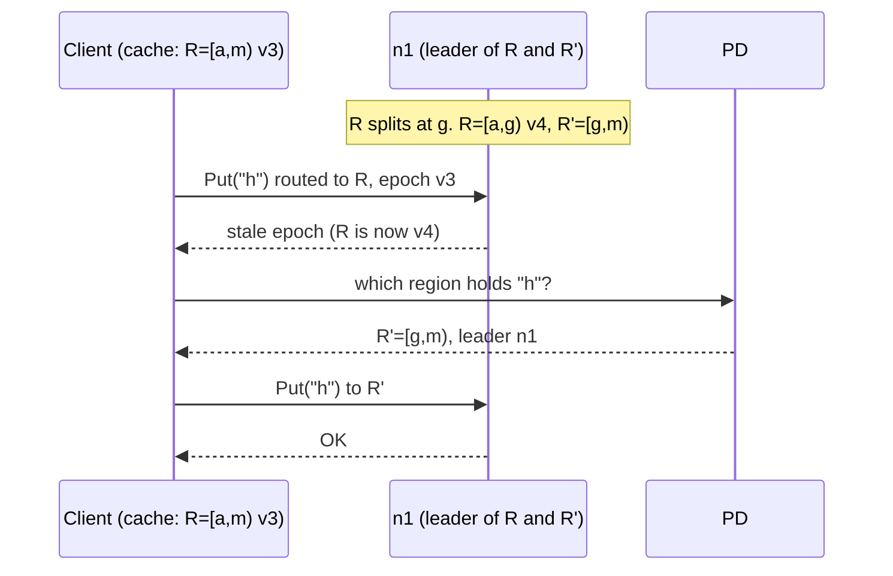
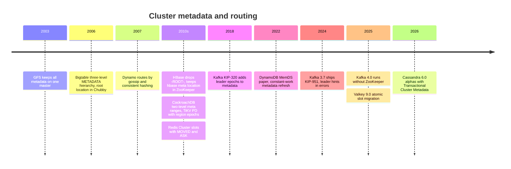
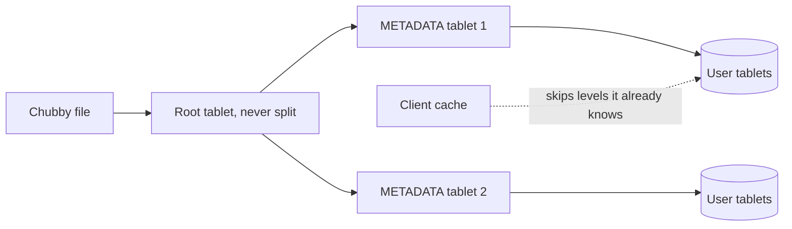
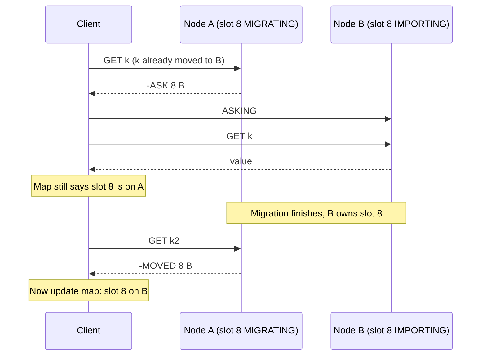

---
tags:
  - distributed-systems
  - cluster-metadata
  - routing
  - service-discovery
  - control-plane
  - coordination
status: draft
sources:
  - https://static.usenix.org/event/osdi06/tech/chang/chang_html/index.html
  - https://docs.cockroachlabs.com/docs/stable/architecture/distribution-layer.md
  - https://gh.r-mj.com/tikv/pd/wiki/Metadata-Management
  - https://hbase.apache.org/docs/architecture/catalog-tables/
  - https://hbase.apache.org/docs/architecture/client/
  - https://issues.apache.org/jira/browse/HBASE-3171
  - https://www.mongodb.com/docs/manual/core/sharded-cluster-metadata/
  - https://vitess.io/docs/reference/features/topology-service/
  - https://redis.io/docs/latest/operate/oss_and_stack/reference/cluster-spec/
  - https://valkey.io/blog/introducing-valkey-9/
  - https://www.infoq.com/news/2025/11/valkey-9-atomic-migration
  - https://developer.confluent.io/courses/architecture/control-plane
  - https://cwiki.apache.org/confluence/display/KAFKA/KIP-320:+Allow+fetchers+to+detect+and+handle+log+truncation
  - https://cwiki.apache.org/confluence/spaces/KAFKA/pages/263424791/KIP-951+Leader+discovery+optimizations+for+the+client
  - https://kafka.apache.org/blog/2024/02/27/apache-kafka-3.7.0-release-announcement/
  - https://kafka.apache.org/blog/2025/03/18/apache-kafka-4.0.0-release-announcement/
  - https://cwiki.apache.org/confluence/spaces/CASSANDRA/pages/217391203/CEP-21+Transactional+Cluster+Metadata
  - https://digitalis.io/post/apache-cassandra-6-0-everything-that-changed-in-one-page
  - https://go.mail-archive.com/dev@cassandra.apache.org/msg27951.html
  - https://www.instaclustr.com/blog/whats-new-in-cassandra-6-a-roundup-of-features-for-users-and-operators/
  - https://www.elastic.co/docs/deploy-manage/distributed-architecture/discovery-cluster-formation/cluster-state-overview
  - https://usenix.org/system/files/atc22-elhemali.pdf
  - https://aws.amazon.com/message/101925
  - https://status.cloud.google.com/incidents/ow5i3PPK96RduMcb1SsW
created: 2026-11-26
updated: 2026-11-28
---

## Table Of Contents

- [[#TL;DR|TL;DR]]
- [[#The Problem|The Problem]]
- [[#Foundations|Foundations]]
    - [[#Three Questions Every Request Asks|Three Questions Every Request Asks]]
    - [[#A Cache Plus a Check|A Cache Plus a Check]]
    - [[#Epochs Turn Staleness Into an Error|Epochs Turn Staleness Into an Error]]
- [[#How We Got Here|How We Got Here]]
- [[#How It Works|How It Works]]
    - [[#Four Ways to Keep the Map|Four Ways to Keep the Map]]
    - [[#The Map Stored Inside the System|The Map Stored Inside the System]]
    - [[#A Placement Service Beside the Data|A Placement Service Beside the Data]]
    - [[#Metadata as a Replicated Log|Metadata as a Replicated Log]]
    - [[#Gossip Plus Redirects|Gossip Plus Redirects]]
    - [[#How Each System Says You Are Wrong|How Each System Says You Are Wrong]]
    - [[#Changing Ownership Safely|Changing Ownership Safely]]
    - [[#Keeping the Metadata Store Off the Hot Path|Keeping the Metadata Store Off the Hot Path]]
- [[#Where It Is Now|Where It Is Now]]
    - [[#Gossip and ZooKeeper Give Way to Logs|Gossip and ZooKeeper Give Way to Logs]]
    - [[#Migrations Get Atomic|Migrations Get Atomic]]
    - [[#Metadata Is the Blast Radius|Metadata Is the Blast Radius]]
- [[#Trade-offs & Open Problems|Trade-offs & Open Problems]]
- [[#Resources|Resources]]
- [[#Related Notes|Related Notes]]

## ***TL;DR***
---
*Every sharded system keeps a map from keys to the nodes that serve them, and every request needs that map. The working pattern everywhere is the same: a small, strongly consistent source of truth, cheap caches near the request, and an owner that rejects any request routed by a stale map, so a wrong cache costs a retry instead of a wrong answer.*

- **What the metadata is.** Which key range lives in which shard, which nodes hold copies of that shard, and which copy currently leads. Plus membership, schema and settings. [[Partitioning]] decides how keys are split; this note is about how everyone learns the current split.
- **Where it lives.** Four designs: inside the system as a lookup tree (Bigtable's METADATA table, HBase's `hbase:meta`, CockroachDB's meta ranges); in a placement service beside the data (TiKV's PD, MongoDB config servers, Vitess's topology service); in a replicated metadata log (Kafka's KRaft, Cassandra's Transactional Cluster Metadata); or spread by gossip with redirects (Redis Cluster).
- **The one rule that makes caches safe.** Every piece of routing state carries a version (an *epoch*). Requests carry the version they were routed with; the owner compares and refuses a mismatch. TiKV calls this a region epoch, Kafka a leader epoch, MongoDB a shard version, Cassandra an epoch, Redis a `configEpoch`.
- **The hard part is change.** Moving ownership safely means staging it: copy first, let writes reach both sides, switch reads, then stop writing to the old owner. Cassandra's CEP-21 turns each stage into a committed epoch; Valkey 9.0 (Oct 2025) moved whole slots atomically instead of key by key.
- **Late 2026.** Kafka 4.0 (Mar 2025) runs with no ZooKeeper; Cassandra 6.0's metadata log is in alpha (6.0-alpha3 as of Sep 2026); and the two biggest cloud outages of 2025, AWS us-east-1 in October and Google Cloud in June, both started with bad routing or policy metadata spreading quickly.

## ***The Problem***
---
*A client holding the key "user:42" has to reach the one node that can serve it, now, through splits, moves, failovers and restarts. Asking a central authority every time is too slow and makes the authority the bottleneck; trusting a cached answer risks sending writes to a node that no longer owns them.*

Splitting data across machines ([[Partitioning]]) creates a lookup problem. The map changes constantly: ranges split when they grow, move when a node is hot or drained, and change leaders whenever a [[Raft]] or [[Paxos]] group re-elects. A system has three bad options and has to combine them well:

- **Ask the authority every time.** Correct, but every request pays an extra round trip, and the metadata store sees the full request rate. Bigtable's designers avoided this by having clients cache tablet locations and talk to tablet servers directly ([Chang et al., OSDI 2006](https://static.usenix.org/event/osdi06/tech/chang/chang_html/index.html)).
- **Cache and hope.** Fast, but a cached map goes stale silently. Bigtable notes that stale entries "are only discovered upon misses", so a stale cache can cost up to six round trips.
- **Let nodes agree among themselves.** Gossip spreads the map with no central store, but Cassandra's CEP-21 lists what that costs: gossip is "(by definition) unreliable and, since there is no strict order for changes propagated through gossip, there can be no universal 'reference' state", and that there is "no guaranteed upper bound" on how far two coordinators may diverge. Its sharpest consequence: "a problem with disagreeing read/write sets is a transient data loss" ([CEP-21](https://cwiki.apache.org/confluence/spaces/CASSANDRA/pages/217391203/CEP-21+Transactional+Cluster+Metadata)).

There is a second, quieter problem: the metadata store itself is a dependency of everything. If it's slow, every cold cache stalls; if it serves bad data, every router acts on it at once. That is what the [[#Metadata Is the Blast Radius|2025 outages]] showed.

## ***Foundations***
---
*Three ideas carry the whole topic: routing is a chain of lookups that change at different rates; caches are fine as long as the owner can tell a request was routed by an old map; and a version number on every map is how it tells.*

### Three Questions Every Request Asks

*Separate the questions, because each changes at a different speed and can live in a different place.*

| Question | Example answer | How often it changes | Typical home |
|---|---|---|---|
| **Which shard holds this key?** | Key `user:42` is in range `[user:4, user:5)` | On splits and merges (minutes to hours) | Metadata table or log; cached by clients |
| **Which nodes hold that shard?** | Replicas on n2, n5, n7 | On rebalancing, node loss, drains | Same store; cached |
| **Which of them leads right now?** | n5 holds the lease | On every election or lease transfer (seconds) | Often learned from the replicas themselves |
| **Is this node part of the cluster at all?** | n9 joined, n3 is down | On joins, failures, restarts | Membership service, gossip, or log ([[Gossip and Membership]]) |

The last row is the slowest-moving in a healthy cluster and the noisiest in an unhealthy one. Many systems answer the third question lazily: the replica you reached tells you who the leader is. TiKV returns the new leader inside a `NotLeader` error ([PD wiki](https://gh.r-mj.com/tikv/pd/wiki/Metadata-Management)), and Kafka since KIP-951 returns it inside `NOT_LEADER_OR_FOLLOWER` ([KIP-951](https://cwiki.apache.org/confluence/spaces/KAFKA/pages/263424791/KIP-951+Leader+discovery+optimizations+for+the+client)).

### A Cache Plus a Check

*No production system makes routing caches strictly consistent. They make the owner authoritative instead, so a stale cache produces a redirect, never a wrong result.*

The pattern has three parts:

1. **A source of truth** that is linearizable for writes: Chubby or ZooKeeper ([[Coordination Services]]), a [[Raft]] group (PD's embedded etcd, Kafka's controller quorum), or a Paxos-replicated range (CockroachDB's meta ranges).
2. **Caches** in clients, routers or gateway nodes, filled on demand and allowed to be stale.
3. **An authoritative owner** that knows what it owns and refuses anything else. In DynamoDB, "storage nodes are the authoritative source for partition membership"; a router acting on stale data gets either the latest membership or an error that "triggers another MemDS lookup" ([Elhemali et al., ATC 2022](https://usenix.org/system/files/atc22-elhemali.pdf)).

This is the same shape as [[Leases and Fencing]]: the node that can do damage (a storage owner accepting a write) does the checking, not the node that might be confused.

### Epochs Turn Staleness Into an Error

*Attach a counter to the map that only goes up. Comparing two counters tells either side who is behind, without comparing the maps themselves.*

Each system names its counter differently, but the comparison is the same. For a request routed with epoch $e_r$ arriving at an owner whose current epoch is $e_o$:

$$
\text{outcome}(e_r, e_o) =
\begin{cases}
\text{serve} & e_r = e_o \\
\text{reject: client refreshes its map} & e_r < e_o \\
\text{owner catches up, or retry later} & e_r > e_o
\end{cases}
$$

**In plain English:** if the request was routed with the same version the owner has, serve it. If the request's version is older, the client's map is stale, so refuse and tell it to refresh. If the request's version is newer, the *owner* is the stale one; it must learn the newer map before deciding.

Real systems map onto the three cases:

| System | Counter | Older request | Newer request |
|---|---|---|---|
| TiKV | Region epoch: `conf_ver` (bumped on peer changes) and `version` (bumped on split or merge) | Rejected as illegal; client refreshes from PD | Same check, since the epoch must match |
| Kafka | Leader epoch per partition | `FENCED_LEADER_EPOCH` | `UNKNOWN_LEADER_EPOCH`, "a retriable error code" |
| Cassandra 6.0 | Cluster-wide metadata epoch | Coordinator catches up, re-checks its replica plan | Replica catches up "before processing" |
| MongoDB | Version of the chunk metadata | `StaleConfig`, then a metadata refresh | Docs only say router and shard "must have the same version"; any mismatch fails with `StaleConfig` and triggers a refresh |

Sources: [PD wiki](https://gh.r-mj.com/tikv/pd/wiki/Metadata-Management), [KIP-320](https://cwiki.apache.org/confluence/display/KAFKA/KIP-320:+Allow+fetchers+to+detect+and+handle+log+truncation), [CEP-21](https://cwiki.apache.org/confluence/spaces/CASSANDRA/pages/217391203/CEP-21+Transactional+Cluster+Metadata), [MongoDB docs](https://www.mongodb.com/docs/manual/core/sharded-cluster-metadata/).

**Worked example (TiKV-style, three nodes).** Region R covers keys `[a, m)` with replicas on n1, n2, n3, leader n1, epoch `(conf_ver=5, version=3)`. A client caches that.

1. t=0: R splits at `g`. R now covers `[a, g)` with epoch `(5, 4)`; a new region R′ covers `[g, m)`, also led by n1.
2. t=1: the client, still holding `(5, 3)`, sends `Put("h")` to n1 for region R.
3. n1 compares: request `version=3`, region `version=4`. Older, so it rejects with a stale-epoch error.
4. The client asks PD for the region covering `h`, gets R′, caches it, and resends. One extra round trip; no write landed in the wrong range.

Two counters, not one, because the two kinds of change break different things: a split changes *which keys* the region owns, a membership change changes *which nodes* must acknowledge. The PD wiki says TiKV "checks a request's epoch before processing it", and PD itself writes to etcd only when "the epoch changes or a new Region is inserted".

## ***How We Got Here***
---
*The directory-in-the-data design came from Bigtable in 2006; Dynamo took the opposite path with gossip in 2007. The decade since has been a slow convergence: gossip systems adding consensus-backed metadata, and ZooKeeper-backed systems pulling the metadata into a log they run themselves.*

**Single master (2003).** GFS kept all file and chunk metadata in one master's memory; clients asked the master for chunk locations and then talked to chunkservers directly. Nicholas's own notes cover it in [[4. Master Operation]] and [[2. Design Overview]]. The limit was one machine's memory and request rate.

**Metadata as data (2006).** Bigtable stored tablet locations in an ordinary table, METADATA, so the map scales like the data does. Only the root of the tree sits in Chubby. "The client library caches tablet locations", and the master holds a Chubby lock to keep assignment single-writer ([Chang et al.](https://static.usenix.org/event/osdi06/tech/chang/chang_html/index.html)). HBase copied the design, then dropped its `-ROOT-` table and stored the meta location directly in ZooKeeper, because HBase only ever had one meta region ([HBASE-3171](https://issues.apache.org/jira/browse/HBASE-3171)).

**No directory at all (2007).** Dynamo and its descendants computed ownership from a hash ring and spread ring changes by gossip ([[Gossip and Membership]]). No metadata server, but no single answer either. Cassandra lived with that for over a decade before CEP-21.

**Epochs everywhere (2010s).** As systems added automatic splitting and leader leases, they needed cheap staleness detection, and a version number on each range became standard: TiKV's region epoch, MongoDB's chunk versions, Redis Cluster's `configEpoch`, and Kafka's leader epoch in metadata responses (KIP-320, motivated by a broker whose "leader metadata became stale" after it lost its ZooKeeper registration).

**Logs replace external coordinators (2019 to 2026).** Kafka's KIP-500 moved metadata out of ZooKeeper into a Raft-replicated log the brokers run themselves; Kafka 4.0 is "the first major release to operate entirely without Apache ZooKeeper" ([Kafka, Mar 2025](https://kafka.apache.org/blog/2025/03/18/apache-kafka-4.0.0-release-announcement/)). Cassandra's CEP-21 did the same for a gossip system, with "No external ZooKeeper or etcd" required ([Digitalis, Sep 2026](https://digitalis.io/post/apache-cassandra-6-0-everything-that-changed-in-one-page)).

## ***How It Works***
---
*Pick where the source of truth lives, how changes reach the caches, how a stale cache is caught, and how ownership moves without a window where two nodes both accept writes or neither does.*

### Four Ways to Keep the Map

*The designs differ mainly in where the truth lives and who pushes changes; all four still cache aggressively and rely on the owner to reject stale routes.*

| Design | Source of truth | How changes spread | Examples |
|---|---|---|---|
| **Directory stored in the system** | A special table or range, replicated like user data; root pointer in a coordination service or gossip | Pulled on cache miss or stale error | Bigtable METADATA, HBase `hbase:meta`, CockroachDB `meta1`/`meta2` |
| **Placement service beside the data** | A separate Raft or replica-set store that also decides placement | Pulled on miss; heartbeats from data nodes keep it current; watches | TiKV PD, MongoDB config servers, Vitess topology service |
| **Replicated metadata log** | An ordered log committed by a small quorum | Nodes fetch the log tail and replay it | Kafka KRaft `__cluster_metadata`, Cassandra 6.0 CMS |
| **Gossip plus redirects** | No central store; highest version wins | Gossip between nodes; clients corrected by redirects | Redis Cluster, pre-6.0 Cassandra |

Where the router sits (client library, proxy tier, or any node) is a separate choice, covered in the [[Partitioning#Routing Requests|Partitioning note]].

### The Map Stored Inside the System

*Store the map as rows in the database itself, split it like any other table, and keep only the root somewhere special. It scales with the data and needs no new storage system.*

**Bigtable.** A three-level tree, "analogous to that of a B+-tree": a Chubby file holds the root tablet's location; the root tablet, which is "never split", holds the locations of METADATA tablets; METADATA tablets hold user tablet locations, keyed by "an encoding of the tablet's table identifier and its end row" ([Chang et al.](https://static.usenix.org/event/osdi06/tech/chang/chang_html/index.html)).

$$
\underbrace{\frac{2^{27}\ \text{B per METADATA tablet}}{2^{10}\ \text{B per row}}}_{2^{17}\ \text{rows}}
\times \underbrace{2^{17}}_{\text{METADATA tablets the root can list}} = 2^{34}\ \text{tablets}
$$

**In plain English:** a 128 MB METADATA tablet with roughly 1 KB per row lists about 131,000 tablets. The root tablet, the same size, lists about 131,000 METADATA tablets. Two levels below Chubby therefore address about 17 billion tablets, which is the paper's $2^{34}$.

**Worked example (lookup cost).** A client with an empty cache wants row `r` in table T:

1. Read the Chubby file: root tablet is on server s1.
2. Ask s1's root tablet: the METADATA tablet covering `(T, r)` is on s4.
3. Ask s4: T's tablet covering `r` is on s9.
4. Send the read to s9.

That is the paper's three round trips before the data request. If all three cached entries are stale, each is discovered only when it fails, and the paper counts up to six. Bigtable softens both with prefetching: each METADATA read returns entries for more than one tablet.

**CockroachDB.** Two levels of *meta ranges* at the start of the keyspace: "the first level (`meta1`) addresses the second, and the second (`meta2`) addresses data in the cluster." `meta1` is never split, and its location is "distributed among all the nodes in the cluster using a gossip protocol". Each range descriptor holds the RangeID, its key span and its replica addresses; each node caches the `meta2` entries it has read ([CockroachDB docs](https://docs.cockroachlabs.com/docs/stable/architecture/distribution-layer.md)). The docs' capacity math: $2^{18} \times 2^{18} = 2^{36}$ ranges, each addressing $2^{26}$ B, for $2^{62}$ B or 4 EiB. (The $2^{26}$ B figure is the old 64 MiB range size; current ranges are larger, per the [[Partitioning]] note, which only raises the ceiling.) Requests that reach a replica that isn't the leaseholder fail "with an error pointing at the replica's last known leaseholder", and the gateway retries "transparently ... and never reach the client".

**HBase.** `hbase:meta` "keeps a list of all regions in the system", one row per region keyed `[table],[region start key],[region id]`, with `info:server` naming the hosting RegionServer. Its own location is in ZooKeeper. Clients cache locations and, when a region is reassigned, "requery the catalog tables" ([HBase catalog](https://hbase.apache.org/docs/architecture/catalog-tables/); [HBase client](https://hbase.apache.org/docs/architecture/client/)).

### A Placement Service Beside the Data

*Run a small, separate consensus group that both stores the map and decides placement. Data nodes report to it; clients read from it on a miss.*

**TiKV's PD (Placement Driver).** PD keeps region metadata in an embedded etcd (Raft-replicated), one key per region holding start key, end key, epoch and peers. Each region's leader heartbeats PD "every 60 seconds" with its peers, traffic, size and raft term; PD keeps this in an in-memory BTree for scheduling and persists only on epoch change. TiDB checks its local region cache first, asks PD on a miss, and gives cache entries "a default 10 minute TTL" ([PD wiki](https://gh.r-mj.com/tikv/pd/wiki/Metadata-Management)). PD is also TiDB's timestamp oracle, covered in [[Distributed SQL]].

**MongoDB config servers.** A replica set that holds "the list of chunks on every shard and the ranges that define the chunks", written with `"majority"` write concern and read with `"majority"` read concern. `mongos` routers cache it; "the shard and the router issuing the request must have the same version of the chunks metadata", or the operation fails with `StaleConfig` and triggers a refresh. If the config replica set loses its primary, metadata goes read-only: data reads and writes continue, but "no chunk migration or chunk splits will occur" ([MongoDB docs](https://www.mongodb.com/docs/manual/core/sharded-cluster-metadata/)). That is the property you want: losing the metadata writer freezes change, not traffic.

**Vitess topology service.** Split by how often data changes. A global instance (etcd, ZooKeeper or Consul) holds keyspaces, shard records and the VSchema, data that "doesn't change very often"; a local instance per cell holds tablet records and rolled-up serving data (`SrvKeyspace`, `SrvVSchema`). Critically, "Vitess will not use the global or local topology service as part of serving individual queries": losing the global instance leaves cells serving "for a while", though reparenting may not work ([Vitess docs](https://vitess.io/docs/reference/features/topology-service/)). The [[Sharded Postgres]] note covers the Postgres systems that copy this layout.

### Metadata as a Replicated Log

*Instead of a store you read, make the metadata an ordered log every node replays. Each entry is a numbered epoch, so "how stale am I?" becomes "what offset am I at?"*

**Kafka KRaft.** Cluster state lives "in a single partition Kafka topic called `__cluster_metadata`". A quorum of controllers replicates it with Raft ("there is no ISR involved in metadata replication"); "the active controller is the leader of this internal metadata topic's single partition". Brokers don't receive pushes: "rather than the controller broadcasting metadata changes ... they each fetch the changes", as observers of the log. Snapshots bound the log, and a restarting broker "loads its most recent snapshot into memory" then fetches the tail. Confluent reports this lifts the practical partition limit from "tens of thousands" under ZooKeeper to "millions of partitions in a single cluster", with recovery "an order of magnitude faster" ([Confluent](https://developer.confluent.io/courses/architecture/control-plane)). Clients still learn leaders from metadata requests and, since Kafka 3.7, from leader hints in errors (below).

**Cassandra Transactional Cluster Metadata (CEP-21).** A *Cluster Metadata Service* (CMS), a subset of nodes, "enforces a serial order for accepted events and proactively disseminates them to the rest of the cluster". Each event gets an epoch, "a monotonically increasing counter", and log appends use Paxos. The CEP proposed sizing the CMS at 3 nodes for clusters up to 5, 5 for up to 100, and 10 beyond. Every internode message carries the sender's epoch, so the coordinator and replicas compare versions on every write; a replica that is behind catches up first, and a coordinator whose replica plan no longer meets the consistency level fails the request rather than silently writing to the wrong set ([CEP-21](https://cwiki.apache.org/confluence/spaces/CASSANDRA/pages/217391203/CEP-21+Transactional+Cluster+Metadata)). Because the log is immutable and totally ordered, any peer can serve catch-up, not just the CMS.

**Elasticsearch cluster state** sits between a log and a store. The elected master changes the state one batch at a time and publishes it in two phases: nodes acknowledge receipt, the state is committed once enough master-eligible nodes acknowledge, then nodes apply it. Updates "are typically published as diffs to the previous cluster state". If commit takes longer than `cluster.publish.timeout` (30 s) the master steps down; nodes that still haven't applied it after `cluster.follower_lag.timeout` (90 s) are removed ([Elastic docs](https://www.elastic.co/docs/deploy-manage/distributed-architecture/discovery-cluster-formation/cluster-state-overview)). Removing laggards is how it bounds staleness.

### Gossip Plus Redirects

*With no central store, nodes agree by a "highest version wins" rule and clients learn from being redirected. Simple to run; weaker guarantees during changes.*

**Redis Cluster.** The keyspace is 16,384 slots, `HASH_SLOT = CRC16(key) mod 16384`; hash tags (`{user1000}.followers`) pin related keys to one slot. Nodes form "a full mesh" over a cluster bus and gossip slot ownership. Conflicts resolve by `configEpoch`: "eventually all nodes in the cluster will agree that the owner of a slot is the one with the greatest `configEpoch` among the nodes advertising it" ([Redis spec](https://redis.io/docs/latest/operate/oss_and_stack/reference/cluster-spec/)).

Clients are corrected two ways, and the difference matters:

| Reply | Meaning | Client action |
|---|---|---|
| `-MOVED 3999 host:port` | "We think the hash slot is permanently served by a different node" | Update the map; the spec recommends re-fetching the whole map with `CLUSTER SHARDS` |
| `-ASK 3999 host:port` | Slot is mid-migration; this key may already be on the target | Send *only this* query to the target, prefixed with `ASKING`; "don't yet update local client tables" |

`ASKING` sets "a one-time flag" that lets B serve a slot it doesn't own yet; without it, B answers `MOVED` back to A. That guards against clients that update their map too early.

### How Each System Says You Are Wrong

*Every system needs a reply that means "your map is stale, here is where to look". The better ones include the answer in the error, so the client skips a metadata round trip.*

| System | Error | Carries the new location? | Next step |
|---|---|---|---|
| TiKV | `NotLeader` | Yes, the new leader | Update cached leader directly |
| TiKV | Stale epoch | No | Refresh region from PD |
| Kafka ≥ 3.7 | `NOT_LEADER_OR_FOLLOWER`, `FENCED_LEADER_EPOCH` | Yes, `CurrentLeader` and `NodeEndpoints` fields | Retry at new leader without a metadata request |
| CockroachDB | Not-leaseholder | Last known leaseholder | Gateway retries, client never sees it |
| Redis Cluster | `MOVED` / `ASK` | Yes, slot and node | Update map, or one-shot redirect |
| MongoDB | `StaleConfig` | No | Router refreshes from config servers |
| Cassandra 6.0 | Epoch mismatch on internode messages | Peers serve the missing log entries | Catch up, re-validate replica plan |

Sources: [PD wiki](https://gh.r-mj.com/tikv/pd/wiki/Metadata-Management), [KIP-951](https://cwiki.apache.org/confluence/spaces/KAFKA/pages/263424791/KIP-951+Leader+discovery+optimizations+for+the+client), [CockroachDB docs](https://docs.cockroachlabs.com/docs/stable/architecture/distribution-layer.md), [Redis spec](https://redis.io/docs/latest/operate/oss_and_stack/reference/cluster-spec/), [MongoDB docs](https://www.mongodb.com/docs/manual/core/sharded-cluster-metadata/), [CEP-21](https://cwiki.apache.org/confluence/spaces/CASSANDRA/pages/217391203/CEP-21+Transactional+Cluster+Metadata).

The hint matters more than it looks. KIP-951's motivation: after a leader change, "the end-to-end latency of produce or fetch client request can increase significantly as a result of the work required to discover the new leader". In a 100-partition reassignment benchmark with `acks=all`, returning the leader in the error cut p99.9 produce latency by 88%, "from 1675ms to 215ms"; a rolling-restart simulation improved end-to-end latency by up to 5% ([KIP-951](https://cwiki.apache.org/confluence/spaces/KAFKA/pages/263424791/KIP-951+Leader+discovery+optimizations+for+the+client)). It shipped in Kafka 3.7 ([Kafka, Feb 2024](https://kafka.apache.org/blog/2024/02/27/apache-kafka-3.7.0-release-announcement/)).

### Changing Ownership Safely

*Moving a range is where routing bugs lose data. The safe order is always: let writes reach the new owner before any reads do, and stop writes to the old owner only after nobody can still read from it.*

The [[Partitioning]] note gives the general copy, catch up, cut over, fence sequence. CEP-21 shows the routing side in detail, with each step a committed epoch and "a majority of participants" learning each epoch before the next step starts.

**Worked example (Cassandra node join, from CEP-21's setup).** Ring of A (token 100), B (200), C (300), replication factor 2. The range (100, 200] is owned by B and C. Node X joins at token 150, so (100, 150] will move to {X, B} and C gives it up.

| Epoch | Step | Writes for (100,150] go to | Reads for (100,150] go to |
|---|---|---|---|
| 100 | Split (100,200] at 150; ownership unchanged | B, C | B, C |
| 101 | Add X as a write replica | X, B, C | B, C |
| (stream) | X copies existing data from B or C | X, B, C | B, C |
| 102 | Add X as a read replica; drop C from reads | X, B, C | X, B |
| 103 | Stop writing to C | X, B | X, B |

Why this order: between 101 and 102 every new write lands on X, so when reads switch at 102, X has both streamed and new data. C keeps receiving writes until 103 because some coordinator might still be routing reads with epoch 101, where C is a read replica; the CEP says that last step "must wait until no coordinator might still read from it". Under gossip there was no epoch to wait on, which is how streaming could start "before there's a guarantee that any coordinator will make a write towards the bootstrapping replica" ([CEP-21](https://cwiki.apache.org/confluence/spaces/CASSANDRA/pages/217391203/CEP-21+Transactional+Cluster+Metadata)).

Redis took the other route to the same safety: instead of staging, move the whole unit at once. Before Valkey 9.0, slots moved key by key, so mid-migration "the client may not know if the key resides on the original node or the new node" (hence `ASK`). Valkey 9.0 moves entire slots "atomically ... using the AOF format", and "the original node still retains all the keys and data until the entire slot migration is complete" ([Valkey, Oct 2025](https://valkey.io/blog/introducing-valkey-9/); [InfoQ](https://www.infoq.com/news/2025/11/valkey-9-atomic-migration)).

### Keeping the Metadata Store Off the Hot Path

*A routing cache that works 99.75% of the time is dangerous, because the metadata store gets sized for the 0.25%. When caches go cold together, that store sees the full load at once.*

DynamoDB's request routers originally cached a table's routing information after the first request, with a hit rate of "approximately 99.75 percent". But when routers started with empty caches, metadata traffic "would spike up to 75 percent" of request volume, and adding routers could destabilize the system. The fix inverts the usual cache logic: routers send "an asynchronous refresh call to MemDS on each cache hit", keeping MemDS "always serving a constant volume of traffic regardless of cache hit ratio" ([Elhemali et al., ATC 2022](https://usenix.org/system/files/atc22-elhemali.pdf)). MemDS itself is an in-memory store built on a Perkle tree, "a hybrid of a Patricia tree and a Merkle tree", supporting prefix, range, floor and ceiling lookups, exactly what routing a key to a partition needs.

**Worked example (why constant work).** A fleet of 1,000 routers handles 1,000,000 requests per second.

| Mode | Metadata QPS, warm caches | Metadata QPS, all caches cold |
|---|---|---|
| Fetch on miss, 99.75% hits | 2,500 | up to 1,000,000 |
| Refresh on every hit (asynchronous) | 1,000,000 | 1,000,000 |

The second design costs more on a good day, but its load never changes, so a fleet restart can't overload it. That is the constant-work idea from [[Reliability Patterns]], and it's the same failure shape as a cache stampede ([[Hot Keys and Cache Stampedes]]).

Other ways systems keep metadata cheap, from above: Bigtable prefetches several METADATA entries per read; Kafka and TiKV put the new leader in the error; Vitess serves queries from local rolled-up data and never touches the topology service on the request path; MongoDB lets traffic continue when the config server can't elect a primary.

## ***Where It Is Now***
---
*As of November 2026: external coordinators are being pulled into systems' own metadata logs (Kafka done, Cassandra in alpha); migration protocols are getting atomic; and the industry's largest recent outages were metadata spreading too far, too fast, which is pushing designs toward versioned, staged rollout of the map itself.*

### Gossip and ZooKeeper Give Way to Logs

- **Kafka:** 4.0 (Mar 18, 2025) is ZooKeeper-free, "running in KRaft mode by default" ([Kafka](https://kafka.apache.org/blog/2025/03/18/apache-kafka-4.0.0-release-announcement/)). Metadata is a log every broker replays; leader hints in errors (KIP-951) are standard in current clients.
- **Cassandra 6.0:** TCM is the headline change, called "the largest architectural change in Cassandra 6.0" in the draft docs, and it is mandatory: after the last node is on 6.0, operators run `nodetool cms initialize`, then `nodetool cms reconfigure` to grow the CMS from one member to at least three across failure domains. Until then, schema changes, bootstrap, decommission, moves and replacements are prohibited ([Digitalis, Sep 14, 2026](https://digitalis.io/post/apache-cassandra-6-0-everything-that-changed-in-one-page)). Status: 6.0-alpha1 came out April 3, 2026 as "a quarterly alpha release" for testing ([dev list](https://go.mail-archive.com/dev@cassandra.apache.org/msg27951.html)); as of the September survey "the line is at 6.0-alpha3 with no beta or release candidate", with 5.0.9 the current GA release. Gossip doesn't disappear entirely ([Instaclustr, May 2026](https://www.instaclustr.com/blog/whats-new-in-cassandra-6-a-roundup-of-features-for-users-and-operators/)); it stops being the source of truth for ownership and schema. The proposed next step, Flexible Placements (CEP-60), is in [[Partitioning]].
- **HBase:** the client's *connection registry* moved off ZooKeeper: HBase 2.3.0 added a master-based registry, 2.5.0 a generic RPC registry that can bootstrap from any master or RegionServer, and in 3.0.0 the RPC registry is the default ([HBase client docs](https://hbase.apache.org/docs/architecture/client/)).
- **MongoDB 8.0:** a *config shard* lets the config server replica set also store application data, cutting the number of replica sets a small cluster needs; a dedicated config server is still the choice when you want metadata isolated from application load ([MongoDB docs](https://www.mongodb.com/docs/manual/core/sharded-cluster-metadata/)).

### Migrations Get Atomic

- **Valkey 9.0 (Oct 21, 2025):** atomic slot migration replaces the key-by-key move-then-delete sequence, so clients no longer see the routing ambiguity that `ASK` existed to paper over; the release also reports scaling to 2,000 nodes and over a billion requests per second ([Valkey](https://valkey.io/blog/introducing-valkey-9/); [InfoQ](https://www.infoq.com/news/2025/11/valkey-9-atomic-migration)).
- **The general direction:** fewer, larger, versioned changes to the map, each a single committed step that routers either see entirely or not at all. Cassandra's epochs and Valkey's whole-slot moves arrive at the same property from opposite ends.

### Metadata Is the Blast Radius

Two 2025 incidents show what happens when routing or policy metadata is wrong and spreads well.

**AWS us-east-1, Oct 19 to 20, 2025.** DynamoDB's DNS for `dynamodb.us-east-1.amazonaws.com` is managed by a *DNS Planner*, which produces plans of load balancers and weights, and three *DNS Enactors* in separate Availability Zones that apply plans to Route 53. One Enactor was delayed; meanwhile another applied a much newer plan and its cleanup deleted old plans. The delayed Enactor then applied its much older plan over the newer one, because its start-of-process check "was stale by then", and cleanup deleted that plan, so "all IP addresses for the regional endpoint were immediately removed". DynamoDB saw errors from 11:48 PM to 2:40 AM PDT; EC2's DropletWorkflow Manager, which depends on DynamoDB for lease state, "had entered a state of congestive collapse" after recovery, and EC2 launches weren't fully normal until 1:50 PM ([AWS post-event summary](https://aws.amazon.com/message/101925)).

My reading, not AWS's wording: this is the epoch rule failing at the front door. An older version of the routing map overwrote a newer one because the write wasn't conditioned on the version still being current. The fix in every system above is a compare-and-set on the map's version, the same guard [[Leases and Fencing]] puts on storage writes.

**Google Cloud, Jun 12, 2025.** Service Control, the regional binary that checks API policy and quota, reads policy metadata from regional Spanner tables. A policy change with "unintended blank fields" was written, "this metadata was replicated globally within seconds", and a code path added on May 29 without error handling or a feature flag hit a null pointer, putting every regional deployment into a crash loop. The red-button rollout finished within about 40 minutes, but restarting tasks created "a herd effect" on the Spanner table in us-central1, which lacked randomized exponential backoff, stretching recovery there to about 2 h 40 min ([Google incident report](https://status.cloud.google.com/incidents/ow5i3PPK96RduMcb1SsW)).

The lesson both write-ups point toward: the fast, global propagation that makes a metadata system good at routing also makes it good at spreading a bad entry. Staged rollout of metadata (by cell or region), validation before acceptance, and backoff on cold-start reads are now treated as part of the routing design, not ops hygiene. See [[Reliability Patterns]] for the metastable-failure side and [[Gray and Fail-Slow Failures]] for slow-propagation cousins.

## ***Trade-offs & Open Problems***
---
*Every design picks a point between freshness, cost of the metadata tier, and blast radius. The open problems are about change: staging it, bounding how stale a router can be, and keeping one bad entry from reaching every router at once.*

| Choice | Gain | Cost |
|---|---|---|
| Directory inside the system (Bigtable, CockroachDB) | Scales with data; one storage engine | Bootstrapping is subtle (root via Chubby or gossip); a hot meta range hurts everyone |
| Separate placement service (PD, config servers) | Placement decisions and map in one place | Another consensus group to run; can become a throughput bottleneck |
| Metadata log (KRaft, TCM) | Total order, "how stale am I" is an offset, any peer serves catch-up | Log size and snapshotting; upgrades from gossip or ZooKeeper are one-way and gated |
| Gossip plus redirects (Redis Cluster) | No coordinator; simple | No reference state; migration windows need special cases like `ASK` |
| Fetch on miss | Cheap when warm | Bimodal load; cold fleets stampede the metadata tier |
| Constant-work refresh (MemDS) | Load never changes with hit rate | Pays full metadata cost every day |
| Error carries new location | Saves a round trip on every leader change | Owner must know the answer; hints can themselves be stale |

**Open problems.**

- **Bounding router staleness.** Cassandra waits for "a majority of participants" before the next epoch, but a partitioned coordinator may still hold an old epoch; the final "stop writing" step depends on knowing nobody can still read from the old owner. Proving that for arbitrary routers (client libraries in other teams' processes) is hard. [[Formal Methods in Practice]] and [[Deterministic Simulation Testing]] are where such protocols get checked.
- **Staged rollout of the map itself.** Routing data is usually pushed globally because consistency demands one answer. The 2025 outages argue for cells and canaries even for metadata, which conflicts with having a single current map. See [[Zonal Isolation and Cell-Based Architecture]].
- **Cold-start load.** Constant work solves it at a price; prefetching and hints reduce it. Choosing per system remains guesswork; [[Queueing Theory for Systems]] has the math (Little's Law, Erlang C, recovery at spare capacity) for sizing it.
- **Metadata as a scaling ceiling.** KRaft moved Kafka from tens of thousands to millions of partitions; the next limits are snapshot size and how long a new broker takes to load state. [[Diskless Streaming]] designs add a new routing question: which coordinator assigns offsets for data in [[Object Storage]].
- **Control loops over the map.** Placement services are reconcilers: desired map vs actual. How they avoid oscillation and fight with each other (PD scheduling vs an operator's manual move) belongs to [[Reconciliation and Control Loops]].

## ***Resources***
---
*Start with Bigtable §5 for the directory design, CEP-21 for the clearest account of why gossip-based metadata breaks and how epochs fix it, and the DynamoDB paper's §6.6 for metadata load. The two 2025 incident reports are the best short case studies of metadata going wrong.*

**Primary papers and design docs**
- [Bigtable: A Distributed Storage System for Structured Data](https://static.usenix.org/event/osdi06/tech/chang/chang_html/index.html): Chang et al., OSDI 2006. §5.1 tablet location, §5.2 assignment with Chubby.
- [Amazon DynamoDB: A Scalable, Predictably Performant, and Fully Managed NoSQL Database Service](https://usenix.org/system/files/atc22-elhemali.pdf): Elhemali et al., USENIX ATC 2022. §6.6 metadata availability and MemDS.
- [CEP-21: Transactional Cluster Metadata](https://cwiki.apache.org/confluence/spaces/CASSANDRA/pages/217391203/CEP-21+Transactional+Cluster+Metadata): Apache Cassandra.
- [KIP-320: Allow fetchers to detect and handle log truncation](https://cwiki.apache.org/confluence/display/KAFKA/KIP-320:+Allow+fetchers+to+detect+and+handle+log+truncation): leader epochs in Kafka metadata.
- [KIP-951: Leader discovery optimizations for the client](https://cwiki.apache.org/confluence/spaces/KAFKA/pages/263424791/KIP-951+Leader+discovery+optimizations+for+the+client): leader hints in errors, with benchmarks.
- [HBASE-3171: Drop ROOT and instead store META location(s) directly in ZooKeeper](https://issues.apache.org/jira/browse/HBASE-3171).

**Docs**
- [CockroachDB distribution layer](https://docs.cockroachlabs.com/docs/stable/architecture/distribution-layer.md): meta ranges, range descriptor cache, leaseholder routing.
- [PD metadata management](https://gh.r-mj.com/tikv/pd/wiki/Metadata-Management): region epochs, heartbeats, region cache.
- [MongoDB sharded cluster config servers](https://www.mongodb.com/docs/manual/core/sharded-cluster-metadata/): `StaleConfig`, read-only metadata, config shards.
- [Vitess topology service](https://vitess.io/docs/reference/features/topology-service/): global vs local topology.
- [Redis Cluster specification](https://redis.io/docs/latest/operate/oss_and_stack/reference/cluster-spec/): slots, `MOVED`/`ASK`, `configEpoch`.
- [HBase catalog tables](https://hbase.apache.org/docs/architecture/catalog-tables/) and [HBase client](https://hbase.apache.org/docs/architecture/client/).
- [Elasticsearch cluster state](https://www.elastic.co/docs/deploy-manage/distributed-architecture/discovery-cluster-formation/cluster-state-overview): two-phase publication.

**Practitioners and teams**
- [Kafka control plane](https://developer.confluent.io/courses/architecture/control-plane): Confluent, KRaft internals.
- [Apache Kafka 4.0.0 release announcement](https://kafka.apache.org/blog/2025/03/18/apache-kafka-4.0.0-release-announcement/), Mar 2025; [3.7.0 announcement](https://kafka.apache.org/blog/2024/02/27/apache-kafka-3.7.0-release-announcement/), Feb 2024.
- [Every change in Apache Cassandra 6.0](https://digitalis.io/post/apache-cassandra-6-0-everything-that-changed-in-one-page): Digitalis, Sep 2026.
- [What's new in Cassandra 6](https://www.instaclustr.com/blog/whats-new-in-cassandra-6-a-roundup-of-features-for-users-and-operators/): Instaclustr, May 2026.
- [Introducing Valkey 9.0](https://valkey.io/blog/introducing-valkey-9/), Oct 2025; [InfoQ coverage](https://www.infoq.com/news/2025/11/valkey-9-atomic-migration), Nov 2025.

**Incident reports**
- [Summary of the Amazon DynamoDB service disruption in us-east-1](https://aws.amazon.com/message/101925): AWS, Oct 2025.
- [Google Cloud incident report, June 12, 2025](https://status.cloud.google.com/incidents/ow5i3PPK96RduMcb1SsW).

## ***Related Notes***
---
*The map's contents come from Partitioning and Auto-Sharding; its storage comes from Coordination Services, Raft and Paxos; its safety comes from the fencing ideas in Leases and Fencing.*

- [[Partitioning]] — How keys are split, where routers sit, and the copy, catch up, cut over, fence sequence.
- [[Auto-Sharding]] — Controllers that compute the shard-to-server map this note distributes.
- [[Coordination Services]] — Chubby, ZooKeeper and etcd as the root of many metadata hierarchies.
- [[Leases and Fencing]] — The owner-checks-the-version idea that makes stale routing safe.
- [[Gossip and Membership]] — What metadata logs replace, and what gossip still does.
- [[Raft]] — The consensus behind PD's etcd and Kafka's controller quorum.
- [[Paxos]] — The consensus behind Cassandra's CMS and CockroachDB's ranges.
- [[Logs and Streaming]] — Kafka, whose own metadata became a log.
- [[Distributed SQL]] — CockroachDB and TiDB, whose routing caches sit in every gateway.
- [[Sharded Postgres]] — Vitess-style topology services for Postgres.
- [[Replication]] — Replica sets per range and how Cassandra's ownership change affects them.
- [[Anti-Entropy and Repair]] — Repair that has to reason about ownership changing mid-repair.
- [[Consistency Models]] — Why routing caches can be stale while data stays linearizable.
- [[Reliability Patterns]] — Constant work, backoff and metastable failures in metadata tiers.
- [[Hot Keys and Cache Stampedes]] — The cold-cache stampede, applied to routing caches.
- [[Gray and Fail-Slow Failures]] — Slow metadata propagation and lagging nodes.
- [[Formal Methods in Practice]] — Checking ownership-transfer protocols.
- [[Deterministic Simulation Testing]] — Testing epoch races and stale routers.
- [[Object Storage]] — Where diskless designs move data, adding new routing questions.
- [[Reconciliation and Control Loops]] — Placement services as reconcilers; level triggering and controllers that fight.
- [[Zonal Isolation and Cell-Based Architecture]] — The cell router as a cached map; staging metadata and config changes by cell.
- [[Queueing Theory for Systems]] — The math for sizing metadata tiers for cold starts.
- [[Diskless Streaming]] — Offset-assigning coordinators over object storage.
