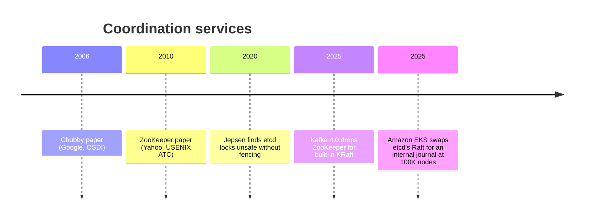
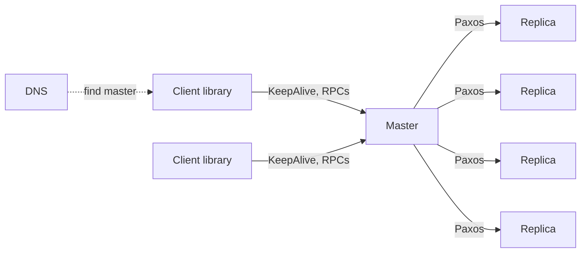

---
tags:
  - distributed-systems
  - coordination
  - locks
  - consensus
status: draft
sources:
  - https://static.usenix.org/event/osdi06/tech/full_papers/burrows/burrows_html/index.html
  - https://pdos.csail.mit.edu/6.824/papers/zookeeper.pdf
  - https://etcd.io/docs/next/learning/why
  - https://jepsen.io/analyses/etcd-3.4.3
  - https://kafka.apache.org/blog/2025/03/18/apache-kafka-4.0.0-release-announcement/
  - https://aws.amazon.com/blogs/containers/under-the-hood-amazon-eks-ultra-scale-clusters
  - https://muratbuffalo.blogspot.com/2020/05/stable-and-consistent-membership-at.html
created: 2026-11-26
updated: 2026-11-26
---

## Table Of Contents

---

- [[#TL;DR|TL;DR]]
- [[#The Problem|The Problem]]
- [[#Foundations|Foundations]]
    - [[#Why a Service and Not a Library|Why a Service and Not a Library]]
    - [[#Sessions: Liveness Tied to a Lease|Sessions: Liveness Tied to a Lease]]
- [[#How We Got Here|How We Got Here]]
- [[#How It Works|How It Works]]
    - [[#Chubby|Chubby]]
    - [[#ZooKeeper|ZooKeeper]]
    - [[#etcd|etcd]]
    - [[#Recipes: Locks Without a Stampede|Recipes: Locks Without a Stampede]]
    - [[#Side by Side|Side by Side]]
- [[#Where It Is Now|Where It Is Now]]
- [[#Trade-offs & Open Problems|Trade-offs & Open Problems]]
- [[#Resources|Resources]]
- [[#Related Notes|Related Notes]]

## ***TL;DR***

---

*A coordination service is a small, strongly consistent store, replicated with consensus, that other systems use to elect leaders, hold locks, store configuration and track membership. Chubby, ZooKeeper and etcd are the canonical three, and the big lesson from two decades of using them is that a lock from one of them is a hint, not a guarantee, unless the protected resource checks a fencing token.*

- **What they are:** a handful of replicas (typically 3 or 5) running [[Paxos]], Zab or [[Raft]], exposing a tiny file-system or key-value API with sessions, ephemeral entries and change notifications.
- **Chubby (Google, 2006):** coarse-grained locks and small files; GFS and Bigtable use it to elect masters, and it became Google's main internal name service ([Chubby paper](https://static.usenix.org/event/osdi06/tech/full_papers/burrows/burrows_html/index.html)).
- **ZooKeeper (Yahoo, 2010):** a wait-free API of znodes and watches from which clients build their own locks and elections ([ZooKeeper paper](https://pdos.csail.mit.edu/6.824/papers/zookeeper.pdf)).
- **etcd:** Raft-backed key-value store with revisions, leases and watches, holding all of Kubernetes' cluster state, which its scheduler and controllers read and write ([[Cluster Scheduling]]) ([etcd docs](https://etcd.io/docs/next/learning/why)).
- **Watch out:** Jepsen found etcd's locks let two clients hold the same lock and calls distributed locks "a fundamentally unsafe concept in asynchronous systems" without fencing ([Jepsen](https://jepsen.io/analyses/etcd-3.4.3)). See [[Leases and Fencing]].

## ***The Problem***

---

*Many distributed systems need exactly one of something, one master, one owner of a shard, one writer, plus a reliable place to store small bits of shared configuration. Each of those needs consensus, and consensus is hard to get right.*

GFS and Bigtable each need a single master, which they elect through Chubby ([Chubby paper](https://static.usenix.org/event/osdi06/tech/full_papers/burrows/burrows_html/index.html)). Any system like that must answer the same questions: who is in charge right now, how do the others find out, and what happens when the leader stops responding? Answering them correctly means solving consensus, with all the subtleties covered in [[Paxos]] and [[Raft]].

Building that into every system means every team re-implements consensus and gets it subtly wrong. A coordination service solves it once, in one carefully built component, and every other system leans on it.

## ***Foundations***

---

*Two design ideas define the category: offer coordination as a separate service rather than a library, and tie a client's claims to a session that expires if the client goes quiet.*

### Why a Service and Not a Library

Burrows explains why Google built Chubby as a lock service rather than handing teams a Paxos library ([Chubby paper](https://static.usenix.org/event/osdi06/tech/full_papers/burrows/burrows_html/index.html)):

| Lock service | Consensus library |
|---|---|
| Existing systems add high availability with few code changes | Every system must restructure around replicated state |
| Also serves small files, so the elected leader can be advertised | Leader discovery needs a separate mechanism |
| Client systems rely on fewer servers of their own | Each system needs its own quorum of replicas |
| Locks are a familiar interface | Consensus is unfamiliar to most programmers |

### Sessions: Liveness Tied to a Lease

Every client holds a **session** with the service, kept alive by periodic heartbeats. Locks and ephemeral entries belong to the session. If the client goes quiet past the session timeout, the service ends the session and releases everything it held. In Chubby, the default lease is 12 seconds, with a 45-second grace period so sessions survive a master failover ([Chubby paper](https://static.usenix.org/event/osdi06/tech/full_papers/burrows/burrows_html/index.html)). ZooKeeper's ephemeral znodes and etcd's leases follow the same pattern ([ZooKeeper paper](https://pdos.csail.mit.edu/6.824/papers/zookeeper.pdf); [etcd docs](https://etcd.io/docs/next/learning/why)).

This is the root of both their power and their danger: the service decides a client is gone based on *time*, but the client may still be running, merely paused or partitioned. That gap is the subject of [[Leases and Fencing]] and leans on everything in [[Time and Clocks]] and [[Failure Models]].

## ***How We Got Here***

---

*Google's Chubby showed that one shared lock service could anchor a whole infrastructure. Yahoo's ZooKeeper made the idea open source and more flexible. etcd brought Raft and became Kubernetes' brain. Now the biggest users are starting to build coordination in instead.*

- **2006, Chubby:** five-replica cells, a Paxos-elected master and a file-system-like interface ([Chubby paper](https://static.usenix.org/event/osdi06/tech/full_papers/burrows/burrows_html/index.html)).
- **2010, ZooKeeper:** instead of locks, a wait-free API with which applications build their own primitives; in production at Yahoo in systems like its Fetching Service and Message Broker ([ZooKeeper paper](https://pdos.csail.mit.edu/6.824/papers/zookeeper.pdf)).
- **etcd:** adds linearizable reads, MVCC revisions, leases and reliable watches; Kubernetes' API server stores all cluster state in it ([etcd docs](https://etcd.io/docs/next/learning/why)).
- **2020:** Jepsen confirms etcd's key-value operations are strict serializable but its locks are not safe on their own ([Jepsen](https://jepsen.io/analyses/etcd-3.4.3)).
- **2025:** Kafka 4.0 becomes the first major release to run "entirely without Apache ZooKeeper" ([Apache Kafka](https://kafka.apache.org/blog/2025/03/18/apache-kafka-4.0.0-release-announcement/)).

## ***How It Works***

---

*All three replicate a small database with consensus and add the same building blocks on top: sessions, ephemeral entries, ordering, and notifications when something changes. They differ in how much they hand you ready-made and how consistent reads are.*

### Chubby

Details from the [Chubby paper](https://static.usenix.org/event/osdi06/tech/full_papers/burrows/burrows_html/index.html):

- **Cell:** usually five replicas that elect a master with Paxos and master leases. Writes go to a majority; reads are served by the master alone.
- **Interface:** a simple file system with whole-file reads and writes, advisory reader and writer locks, ephemeral files and access control lists.
- **Caching:** clients keep write-through caches; the master invalidates every cached copy *before* applying a change, so clients never read stale data.
- **Sequencers:** a lock holder can get a sequencer carrying the lock's generation number and pass it to servers, which reject requests with an old one. For servers that cannot check sequencers, a **lock-delay** of up to a minute stops anyone else taking a lock right after its holder vanished.
- **Scale:** one master has served about 90,000 clients directly.

### ZooKeeper

ZooKeeper deliberately avoids offering locks. It gives a tree of **znodes** and lets clients build what they need ([ZooKeeper paper](https://pdos.csail.mit.edu/6.824/papers/zookeeper.pdf)):

| Building block | Meaning |
|---|---|
| **Regular znode** | Stays until deleted |
| **Ephemeral znode** | Deleted when the creating session ends |
| **Sequential flag** | Server appends an increasing counter to the name |
| **Watch** | One-time notification that something changed (without the new data) |

Its guarantees are precise and a bit unusual: **writes are linearizable**, each client's requests run in FIFO order, but **reads are served by whichever replica the client is connected to and may be stale**. A `sync` call lets a client catch up before a read that must be fresh. Writes are ordered by the Zab atomic broadcast protocol. Because reads are local, read throughput grows as servers are added while write throughput drops ([ZooKeeper paper](https://pdos.csail.mit.edu/6.824/papers/zookeeper.pdf)). See [[Consistency Models]] for why stale reads matter.

### etcd

etcd is a Raft-replicated key-value store aimed at systems that must never split-brain, even at the cost of availability ([etcd docs](https://etcd.io/docs/next/learning/why)):

- **Linearizable reads** by default, unlike ZooKeeper.
- **MVCC revisions:** every change bumps a global revision number, and older versions stay readable until compacted.
- **Watches** can replay history from a revision, so a client that reconnects does not silently miss events.
- **Leases** with TTLs, plus built-in lock and election RPCs.
- **Size:** a maximum reliable database of several gigabytes, versus hundreds of megabytes for ZooKeeper and Consul.

### Recipes: Locks Without a Stampede

ZooKeeper's paper shows how to build a lock from znodes, and why the naive way is bad ([ZooKeeper paper](https://pdos.csail.mit.edu/6.824/papers/zookeeper.pdf)).

**Naive:** everyone tries to create `/lock`; losers watch it; when it is deleted, all of them wake up and race again. With $N$ waiting clients, each release wakes every remaining waiter, so getting all $N$ through costs

$$\sum_{i=1}^{N} i = \frac{N(N+1)}{2} \text{ notifications}$$

**Herd-free:** each client creates an *ephemeral sequential* znode under `/lock`, and watches only the one just before its own. The lowest number holds the lock. A release wakes exactly one client, so all $N$ get through with about $N$ notifications.

*In words:* line up and watch the person in front of you, instead of everyone staring at the door.

**Worked example.** With 1,000 workers contending for one lock, the naive recipe fires about 500,500 notifications to serve them all; the herd-free one fires about 1,000. Ephemeral nodes also mean a crashed holder's znode disappears when its session expires, so the lock frees itself.

The same pieces give **leader election** (lowest sequence number leads), **group membership** (ephemeral children under a group node) and **configuration** (a znode plus a watch) ([ZooKeeper paper](https://pdos.csail.mit.edu/6.824/papers/zookeeper.pdf)).

### Side by Side

| | Chubby | ZooKeeper | etcd |
|---|---|---|---|
| Consensus | Paxos | Zab | Raft |
| API | Files plus locks | Znodes plus watches | Keys plus revisions, leases, watches |
| Reads | From master, consistent | Local replica, may be stale | Linearizable by default |
| Locks | Built in, with sequencers | Recipe | Built in RPC |
| Best-known user | GFS, Bigtable | Yahoo services; Kafka until 4.0 | Kubernetes |

Sources: [Chubby paper](https://static.usenix.org/event/osdi06/tech/full_papers/burrows/burrows_html/index.html), [ZooKeeper paper](https://pdos.csail.mit.edu/6.824/papers/zookeeper.pdf), [etcd docs](https://etcd.io/docs/next/learning/why), [Apache Kafka](https://kafka.apache.org/blog/2025/03/18/apache-kafka-4.0.0-release-announcement/).

## ***Where It Is Now***

---

*As of November 2026, etcd is the most visible coordination service because of Kubernetes, and in 2025 two of the largest users changed course: Kafka built consensus in, and AWS rebuilt etcd's internals.*

- **Kafka without ZooKeeper (March 2025):** [[Logs and Streaming|Kafka]] 4.0 runs in KRaft mode by default, managing its own metadata with a built-in Raft quorum, which the project says lowers operational overhead and simplifies administration ([Apache Kafka](https://kafka.apache.org/blog/2025/03/18/apache-kafka-4.0.0-release-announcement/)).
- **etcd at 100,000 nodes (July 2025):** to support 100K-node EKS clusters, AWS replaced etcd's Raft consensus with an internal component called "journal", moved etcd's BoltDB storage onto in-memory tmpfs, doubled the supported database size to 20 GB, and split busy resource types into separate etcd clusters for up to five times the write throughput, while keeping etcd's API semantics ([AWS](https://aws.amazon.com/blogs/containers/under-the-hood-amazon-eks-ultra-scale-clusters)).
- **Locks for performance, not safety:** Jepsen's advice stands: use the lock key's etcd revision as a fencing token and have the protected resource reject lower ones ([Jepsen](https://jepsen.io/analyses/etcd-3.4.3)).

## ***Trade-offs & Open Problems***

---

*Coordination services buy correctness by being small, strongly consistent and few. Their weak points are scale, misuse, and the gap between "the service thinks you hold the lock" and "you actually still hold it".*

| Choice | Gain | Cost |
|---|---|---|
| Shared service (Chubby) | One correct consensus for everyone | Becomes critical shared infrastructure that teams abuse ([Chubby paper](https://static.usenix.org/event/osdi06/tech/full_papers/burrows/burrows_html/index.html)) |
| Primitives, not locks (ZooKeeper) | Flexible recipes | Every team must build recipes correctly |
| Local reads (ZooKeeper) | Read throughput scales with servers | Reads may be stale without `sync` ([ZooKeeper paper](https://pdos.csail.mit.edu/6.824/papers/zookeeper.pdf)) |
| Linearizable reads (etcd) | No stale reads | Locks still need fencing to be safe ([Jepsen](https://jepsen.io/analyses/etcd-3.4.3)) |
| Built-in consensus (Kafka KRaft) | One fewer system to run ([Apache Kafka](https://kafka.apache.org/blog/2025/03/18/apache-kafka-4.0.0-release-announcement/)) | The system must run its own quorum |

Open problems and lessons:

- **Locks are not safe on their own.** A paused or partitioned client can keep acting after its lease expired. In Jepsen's test with two-second TTLs and process pauses, about 18% of acknowledged updates were lost ([Jepsen](https://jepsen.io/analyses/etcd-3.4.3)). The fix is fencing, covered in [[Leases and Fencing]].
- **Developers ignore failure.** Chubby's authors found teams that did not handle failover, built retry loops that hammered the service, or crashed on failover events; KeepAlives even had to move to UDP because TCP backoff caused lost sessions ([Chubby paper](https://static.usenix.org/event/osdi06/tech/full_papers/burrows/burrows_html/index.html)). See [[Reliability Patterns]].
- **Scale.** Coordination stores hold gigabytes, not terabytes ([etcd docs](https://etcd.io/docs/next/learning/why)), and ZooKeeper's watch-based membership slowed badly at 2,000 clients in the Rapid paper's tests ([Murat Demirbas on Rapid](https://muratbuffalo.blogspot.com/2020/05/stable-and-consistent-membership-at.html)). At extreme scale, operators partition or rebuild the store ([AWS](https://aws.amazon.com/blogs/containers/under-the-hood-amazon-eks-ultra-scale-clusters)).

## ***Resources***

---

*Read the Chubby paper for the design philosophy and its candid lessons, the ZooKeeper paper for the primitives and recipes, and Jepsen's etcd analysis for why locks need fencing.*

- [Burrows, The Chubby lock service (OSDI 2006)](https://static.usenix.org/event/osdi06/tech/full_papers/burrows/burrows_html/index.html).
- [Hunt et al., ZooKeeper: Wait-free coordination (USENIX ATC 2010)](https://pdos.csail.mit.edu/6.824/papers/zookeeper.pdf), taught in MIT 6.5840.
- [etcd, why etcd and how it compares](https://etcd.io/docs/next/learning/why).
- [Jepsen, etcd 3.4.3](https://jepsen.io/analyses/etcd-3.4.3).
- [Apache Kafka 4.0 announcement](https://kafka.apache.org/blog/2025/03/18/apache-kafka-4.0.0-release-announcement/).
- [AWS, Under the hood: Amazon EKS ultra scale clusters](https://aws.amazon.com/blogs/containers/under-the-hood-amazon-eks-ultra-scale-clusters).

## Related Notes

- [[Leases and Fencing]] — why a lock from a coordination service needs a fencing token
- [[Raft]] — etcd's consensus, and Kafka's KRaft
- [[Paxos]] — Chubby's consensus
- [[Consistency Models]] — ZooKeeper's linearizable writes with possibly stale reads
- [[Gossip and Membership]] — the decentralized alternative for tracking who is alive
- [[Time and Clocks]] — sessions and leases depend on timing
- [[Failure Models]] — a paused client looks dead but is not
- [[Byzantine Fault Tolerance]] — coordination services assume crash faults only
- [[Reliability Patterns]] — retry storms and failover handling the Chubby team saw
- [[Distributed SQL]] — the larger NewSQL stores etcd compares itself against
- [[Auto-Sharding]] — Slicer holds its ownership leases in Chubby locks; Shard Manager keeps state in ZooKeeper
- [[Hot Keys and Cache Stampedes]] — the same herd problem in caches, solved with leases and request coalescing
- [[Cluster Metadata and Routing]] — Chubby, ZooKeeper and etcd as the root of routing hierarchies, and the systems replacing them with their own metadata logs
