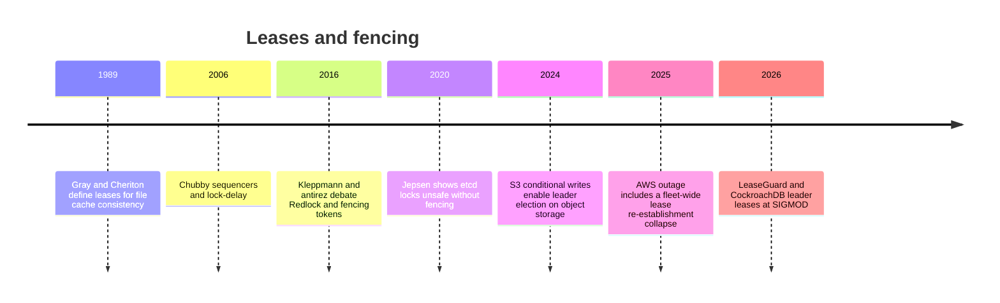
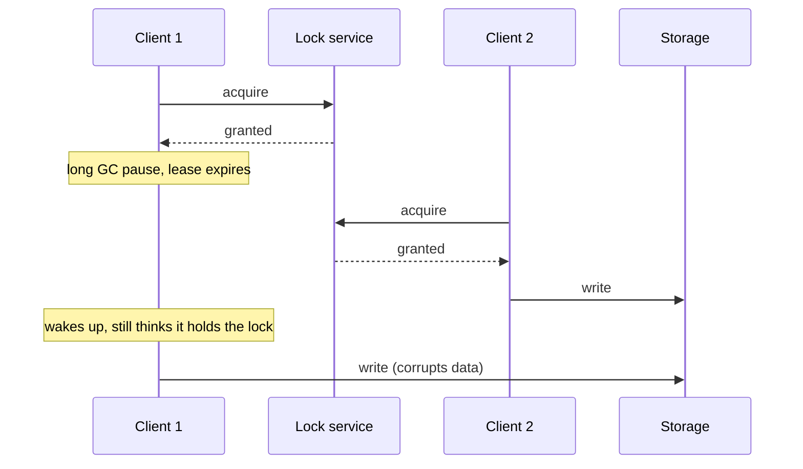
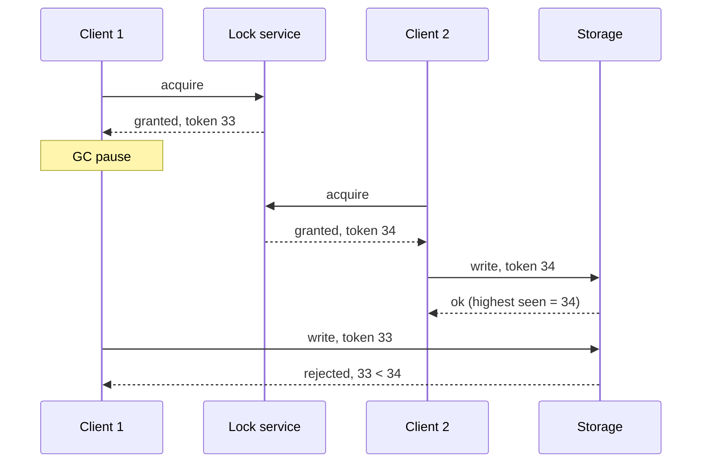

---
tags:
  - distributed-systems
  - leases
  - fencing
  - locks
  - coordination
status: draft
sources:
  - https://emptysqua.re/blog/review-leases-for-distributed-file-cache-consistency/
  - https://brooker.co.za/blog/2023/11/27/about-time.html
  - https://martin.kleppmann.com/2016/02/08/how-to-do-distributed-locking.html
  - https://www.antirez.com/news/101
  - https://static.usenix.org/event/osdi06/tech/full_papers/burrows/burrows_html/index.html
  - https://jepsen.io/analyses/etcd-3.4.3
  - https://muratbuffalo.blogspot.com/2025/01/use-of-time-in-distributed-databases_14.html
  - https://arxiv.org/html/2512.15659v2
  - https://cockroachlabs.com/blog/distributed-database-leader-leases
  - https://www.simonwillison.net/2024/Aug/30/leader-election-with-s3-conditional-writes
  - https://aws.amazon.com/message/101925
created: 2026-11-26
updated: 2026-11-26
---

## Table Of Contents

---

- [[#TL;DR|TL;DR]]
- [[#The Problem|The Problem]]
- [[#Foundations|Foundations]]
    - [[#What a Lease Promises|What a Lease Promises]]
    - [[#Leases Depend on Clock Rate|Leases Depend on Clock Rate]]
- [[#How We Got Here|How We Got Here]]
- [[#How It Works|How It Works]]
    - [[#The Pause That Breaks Every Lease|The Pause That Breaks Every Lease]]
    - [[#Fencing Tokens|Fencing Tokens]]
    - [[#The Redlock Debate|The Redlock Debate]]
    - [[#Where Fencing Shows Up|Where Fencing Shows Up]]
- [[#Where It Is Now|Where It Is Now]]
- [[#Trade-offs & Open Problems|Trade-offs & Open Problems]]
- [[#Resources|Resources]]
- [[#Related Notes|Related Notes]]

## ***TL;DR***

---

*A lease is a lock with an expiry date: it lets one node act alone for a while and frees itself if that node dies. Leases alone are not safe, because a paused node can wake up and keep acting after its lease ran out. The fix is a fencing token, an ever-increasing number the protected resource checks so it can reject the stale node's writes.*

- **Lease:** a time-bounded grant; while it lasts, nobody else may act on the resource without the holder's say ([Gray and Cheriton 1989, reviewed by Davis](https://emptysqua.re/blog/review-leases-for-distributed-file-cache-consistency/)).
- **Clock rate matters, not clock value:** leases assume the parties "mostly agree on how long a second is" ([Brooker](https://brooker.co.za/blog/2023/11/27/about-time.html)).
- **Pauses break leases:** a garbage-collection pause can outlast the lease, and the holder never notices ([Kleppmann](https://martin.kleppmann.com/2016/02/08/how-to-do-distributed-locking.html)).
- **Fencing tokens fix it:** the lock service hands out 33, then 34; storage that has seen 34 rejects a late write carrying 33 ([Kleppmann](https://martin.kleppmann.com/2016/02/08/how-to-do-distributed-locking.html)). Chubby called these sequencers ([Chubby paper](https://static.usenix.org/event/osdi06/tech/full_papers/burrows/burrows_html/index.html)); Jepsen recommends etcd's revision for the job ([Jepsen](https://jepsen.io/analyses/etcd-3.4.3)).

## ***The Problem***

---

*Distributed systems need one node at a time to own something, a file, a shard, a leader role, and they need ownership to move on if that node dies. Time is the only tool for noticing death, and time is exactly what a paused process cannot see passing.*

Plain locks have a fatal flaw in a distributed system: if the holder crashes, the lock is held forever. So locks get a timeout, which makes them leases. Now a new problem appears. The service decides the holder is gone because time passed, but the holder may still be alive, merely paused by garbage collection, a page fault or a delayed packet ([Kleppmann](https://martin.kleppmann.com/2016/02/08/how-to-do-distributed-locking.html)). When it resumes, it still believes it holds the lease. Two nodes now act as owner.

Jepsen measured how bad this gets: with etcd locks, two-second TTLs and process pauses, about 18% of acknowledged updates were lost ([Jepsen](https://jepsen.io/analyses/etcd-3.4.3)). This is the gap between [[Failure Models]] (a slow node looks dead) and [[Time and Clocks]] (no shared notion of now).

## ***Foundations***

---

*Gray and Cheriton defined the lease in 1989 and spelled out its clock assumption. The modern refinement is that what must be bounded is how fast clocks run relative to each other, and that the bound must cover the provider's side.*

### What a Lease Promises

From Gray and Cheriton's SOSP 1989 paper, as reviewed by A. Jesse Jiryu Davis ([review](https://emptysqua.re/blog/review-leases-for-distributed-file-cache-consistency/)):

- A cache needs a valid lease on a piece of data to read or modify it. While the lease lasts, the server promises nobody else writes that data without the holder's approval.
- A write waits until every lease holder approves or its lease expires.
- If a client is partitioned away, the server just waits out its lease before granting a conflicting one; no communication needed.
- After a crash, the server only needs to have saved the *latest* expiry time it ever granted, and waits until then before granting new leases.
- **Short leases** recover faster after failures; **long leases** cut renewal traffic.
- **Assumption:** all clocks advance at nearly the same rate, within a small known bound. Lost or delayed messages are fine.

### Leases Depend on Clock Rate

Brooker's point is that a lease does not need clocks to agree on the time of day, only on how long a second is ([Brooker](https://brooker.co.za/blog/2023/11/27/about-time.html)):

| Whose clock is off | Effect |
|---|---|
| Holder's clock runs fast | Harmless: it just renews too often |
| Provider's clock runs fast | Dangerous: the provider thinks the lease is over and grants it to someone else while the holder still acts |

So robust implementations make the provider wait past expiry by a safety margin, and the holder renew comfortably early. A simple way to size the margin: if clock rates can differ by at most a fraction $\rho$, a lease of length $L$ measured on one clock can look as short as $L/(1+\rho)$ on the other, so the provider should wait

$$L_{provider} \ge L\,(1+\rho) \quad\text{i.e. a safety margin } \Delta \approx \rho L$$

*In words:* stretch the provider's wait by the worst-case drift over the lease's length. The holder should also start counting *before* it sends its request, so message delay only makes it more conservative.

**Worked example.** A 10-second lease with clocks that can drift 200 parts per million apart needs a margin of $\Delta = 0.0002 \times 10\,\text{s} = 2\,\text{ms}$. That is tiny. Now compare a 15-second garbage-collection pause: no drift margin covers it. Drift bounds protect against clocks running at different *speeds*; they do nothing about a process that is not running at all. That is why the next section exists.

## ***How We Got Here***

---

*Leases came from distributed file caching in 1989, became the backbone of lock services like Chubby, and then a 2016 argument about Redis made fencing tokens common knowledge among engineers. The current wave is about making leader leases cheaper and moving fencing into storage itself.*

- **1989:** Gray and Cheriton introduce leases; Davis credits the paper as the origin of the term ([review](https://emptysqua.re/blog/review-leases-for-distributed-file-cache-consistency/)).
- **2006:** Chubby adds sequencers carrying the lock's generation number, and a lock-delay of up to a minute for servers that cannot check them ([Chubby paper](https://static.usenix.org/event/osdi06/tech/full_papers/burrows/burrows_html/index.html)).
- **2016:** Kleppmann argues Redlock is unsafe for correctness; antirez rebuts the next day ([Kleppmann](https://martin.kleppmann.com/2016/02/08/how-to-do-distributed-locking.html); [antirez](https://www.antirez.com/news/101)).
- **2020:** Jepsen recommends etcd's lock-key revision as a fencing token ([Jepsen](https://jepsen.io/analyses/etcd-3.4.3)).

## ***How It Works***

---

*A lease tells a node when it may act. A fencing token lets the resource check whether it should still listen. Safety comes from the resource enforcing order, not from the node trusting its own clock.*

### The Pause That Breaks Every Lease

Kleppmann's example ([Kleppmann](https://martin.kleppmann.com/2016/02/08/how-to-do-distributed-locking.html)):

Checking the lease right before writing does not help: the pause can happen *between* the check and the write ([Kleppmann](https://martin.kleppmann.com/2016/02/08/how-to-do-distributed-locking.html)). Antirez argues Redlock's clock check after acquiring covers delays during acquisition, but a pause after any check is still possible ([antirez](https://www.antirez.com/news/101)).

### Fencing Tokens

Every time the lock service grants the lock, it also returns a number that increases with each grant. The client sends that number with every write, and the storage remembers the highest number it has seen and rejects anything lower ([Kleppmann](https://martin.kleppmann.com/2016/02/08/how-to-do-distributed-locking.html)):

The key shift: correctness no longer depends on the paused client knowing it lost the lease. The storage enforces it. [[Raft]]'s terms and [[Paxos]]'s ballot numbers play the same role inside consensus: a newer number silences an older leader.

### The Redlock Debate

| Claim | Kleppmann | antirez |
|---|---|---|
| What locks are for | Efficiency locks (avoid duplicate work) need little; correctness locks need fencing | Redlock is fine where mutual exclusion matters |
| Fencing tokens | Required; Redlock cannot generate them | Only help if storage is already linearizable, in which case storage could do the locking |
| Alternative | A consensus system like ZooKeeper plus fencing | A large random value per lock plus check-and-set on the resource |
| Clocks | Clock jumps can expire a lock early | Needs only similar clock *rates*; jumps are admin errors; agrees to use monotonic clocks |
| Verdict | "Please don't use Redlock" for correctness | Asks for expert review and Jepsen testing |

Sources: [Kleppmann](https://martin.kleppmann.com/2016/02/08/how-to-do-distributed-locking.html), [antirez](https://www.antirez.com/news/101).

The one point both sides agree on is that a lock service by itself cannot stop a paused client; something at the resource has to check.

### Where Fencing Shows Up

| System | Lease | Fence |
|---|---|---|
| Chubby | Session lease, 12 s default | Sequencer with lock generation number; lock-delay as fallback ([Chubby paper](https://static.usenix.org/event/osdi06/tech/full_papers/burrows/burrows_html/index.html)) |
| etcd | Lease with TTL | Lock key's revision, if the resource checks it ([Jepsen](https://jepsen.io/analyses/etcd-3.4.3)) |
| Aurora Limitless | Consistency leases of a few seconds | A node with an expired lease stops serving reads ([Murat Demirbas](https://muratbuffalo.blogspot.com/2025/01/use-of-time-in-distributed-databases_14.html)) |
| Aurora DSQL adjudicators | Time ranges of authority over key ranges | A new adjudicator sets a time-based fence that blocks older ones, instead of Paxos leader election ([Murat Demirbas](https://muratbuffalo.blogspot.com/2025/01/use-of-time-in-distributed-databases_14.html)) |
| [[Object Storage\|S3]] conditional writes | Lock files with validity timeouts | Increasing lock IDs; create only succeeds if the file does not exist (`If-None-Match`) ([Willison on Morling](https://www.simonwillison.net/2024/Aug/30/leader-election-with-s3-conditional-writes)) |

DSQL leans on bounded clocks: correctness breaks only if a clock goes wrong *and* the ClockBound API keeps reporting high confidence instead of widening its bounds ([Murat Demirbas](https://muratbuffalo.blogspot.com/2025/01/use-of-time-in-distributed-databases_14.html)). See [[Time and Clocks]] and [[Clock Synchronization]].

## ***Where It Is Now***

---

*As of November 2026, the big change is leader leases built into consensus rather than bolted on, plus a hard lesson that re-establishing leases after an outage can itself become the outage.*

- **LeaseGuard (MongoDB, SIGMOD 2026):** "the log is the lease": a [[Raft]] leader gets its lease by committing a log entry, with no extra messages. A new leader can accept and replicate writes while the old lease runs out, and acknowledges them once it expires. In LogCabin, consistent reads drop from one round trip to zero and write throughput rises from about 1,000 to about 10,000 per second ([Davis et al.](https://arxiv.org/html/2512.15659v2)).
- **CockroachDB leader leases (SIGMOD 2026):** a node-level failure detector, leader fortification so Raft leaders do not lose leadership unexpectedly, and leases held by the Raft leader itself cut lease-maintenance CPU by up to 85% ([Cockroach Labs](https://cockroachlabs.com/blog/distributed-database-leader-leases)).
- **Leases in an outage (October 2025):** after DynamoDB recovered in AWS's US-EAST-1 event, EC2's DropletWorkflow Manager had to re-establish leases across the whole fleet. The work took so long that attempts timed out and queued retries, and AWS says it entered "a state of congestive collapse" until engineers throttled work and restarted hosts ([AWS](https://aws.amazon.com/message/101925)). See [[Reliability Patterns]].

## ***Trade-offs & Open Problems***

---

*Leases trade a window of unavailability for safety without communication. Fencing moves the safety check to the resource, which only works if the resource can check.*

| Choice | Gain | Cost |
|---|---|---|
| Short lease | Fast takeover after a crash | More renewals; more false expiries under load ([Gray and Cheriton](https://emptysqua.re/blog/review-leases-for-distributed-file-cache-consistency/)) |
| Long lease | Less traffic | Longer outage when a holder dies |
| Lease without fencing | Simple | Unsafe under pauses ([Jepsen](https://jepsen.io/analyses/etcd-3.4.3)) |
| Fencing tokens | Safe even if the holder is paused | Every protected resource must check tokens ([Kleppmann](https://martin.kleppmann.com/2016/02/08/how-to-do-distributed-locking.html)) |
| Lock-delay (Chubby) | Works with resources that cannot check | Resource sits idle up to a minute ([Chubby paper](https://static.usenix.org/event/osdi06/tech/full_papers/burrows/burrows_html/index.html)) |
| Time-based fences (DSQL) | No leader election round | Depends on trustworthy clock bounds ([Murat Demirbas](https://muratbuffalo.blogspot.com/2025/01/use-of-time-in-distributed-databases_14.html)) |

Open problems:

- **Resources that cannot fence.** Many external systems will not check a token, which is antirez's point that fencing presumes a capable resource ([antirez](https://www.antirez.com/news/101)).
- **Leases at scale.** Per-range leases across hundreds of thousands of ranges cost real CPU ([Cockroach Labs](https://cockroachlabs.com/blog/distributed-database-leader-leases)), and mass re-acquisition after an outage can collapse ([AWS](https://aws.amazon.com/message/101925)).
- **Specifying leases precisely.** The LeaseGuard authors argue earlier Raft lease designs were loosely specified and often buggy ([Davis et al.](https://arxiv.org/html/2512.15659v2)); see [[Formal Methods in Practice]].

## ***Resources***

---

*Read Kleppmann's post and antirez's reply together; they are the clearest statement of why fencing matters and where it gets hard.*

- [Davis's review of Gray and Cheriton, Leases (SOSP 1989)](https://emptysqua.re/blog/review-leases-for-distributed-file-cache-consistency/).
- [Kleppmann, How to do distributed locking (2016)](https://martin.kleppmann.com/2016/02/08/how-to-do-distributed-locking.html) and [antirez, Is Redlock safe?](https://www.antirez.com/news/101).
- [Brooker, It's About Time!](https://brooker.co.za/blog/2023/11/27/about-time.html).
- [Jepsen, etcd 3.4.3](https://jepsen.io/analyses/etcd-3.4.3).
- [Burrows, Chubby (OSDI 2006)](https://static.usenix.org/event/osdi06/tech/full_papers/burrows/burrows_html/index.html).
- [Davis, Demirbas, Deng, LeaseGuard](https://arxiv.org/html/2512.15659v2) and [Cockroach Labs on leader leases](https://cockroachlabs.com/blog/distributed-database-leader-leases).
- [Murat Demirbas on time in distributed databases](https://muratbuffalo.blogspot.com/2025/01/use-of-time-in-distributed-databases_14.html).

## Related Notes

- [[Coordination Services]] — the lock services that hand out leases
- [[Time and Clocks]] — why lease safety depends on clock rate and bounded uncertainty
- [[Clock Synchronization]] — where the clock-rate and error bounds behind leases come from
- [[Failure Models]] — a paused process looks dead but is not
- [[Raft]] — terms work like fencing tokens; LeaseGuard builds leases into the log
- [[Paxos]] — ballot numbers are fencing for proposers
- [[Gossip and Membership]] — membership guesses need fencing before acting on them
- [[Reliability Patterns]] — mass lease re-acquisition in the 2025 AWS outage
- [[Distributed SQL]] — CockroachDB and Aurora DSQL lease and fence designs
- [[Formal Methods in Practice]] — lease protocols are a classic place for subtle bugs
- [[Replication]] — primary-backup failover needs exactly one primary, which leases and fencing provide
- [[3. System Interactions|GFS: System Interactions]] — GFS's master grants chunk leases
- [[Auto-Sharding]] — Centrifuge and Slicer lease key ranges to the servers that own them
- [[Hot Keys and Cache Stampedes]] — memcache leases, a different kind: permission to refill a cache slot, where a lost token only costs a miss
- [[Cluster Metadata and Routing]] — the same owner-checks-the-version idea applied to routing caches: epochs that turn a stale route into a retry
- [[Message Queues]] — the visibility timeout is a lease on one message, with the same slow-holder problem and lease IDs as fencing tokens
