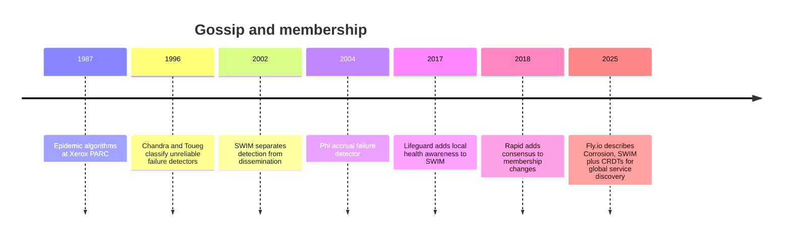
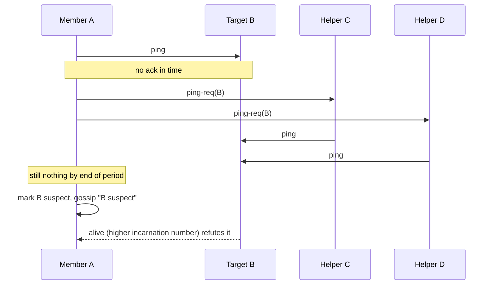

---
tags:
  - distributed-systems
  - gossip
  - membership
  - failure-detection
status: draft
sources:
  - https://courses.grainger.illinois.edu/cs525/sp2016/EpidemicReplicated.pdf
  - https://www.cs.cornell.edu/courses/cs6410/2025fa/slides/02-gossip.pdf
  - https://courses.grainger.illinois.edu/cs425/fa2022/dsn02-SWIM.pdf
  - https://cs.yale.edu/homes/aspnes/pinewiki/FailureDetectors.html
  - https://dspace02.jaist.ac.jp/dspace/bitstream/10119/4784/1/IS-RR-2004-010.pdf
  - https://docs.datastax.com/en/cassandra-oss/3.0/cassandra/architecture/archDataDistributeFailDetect.html
  - https://arxiv.org/pdf/1707.00788
  - https://muratbuffalo.blogspot.com/2020/05/stable-and-consistent-membership-at.html
  - https://arxiv.org/abs/1803.03620
  - https://fly.io/blog/corrosion
created: 2026-11-26
updated: 2026-11-26
---

## Table Of Contents

---

- [[#TL;DR|TL;DR]]
- [[#The Problem|The Problem]]
- [[#Foundations|Foundations]]
    - [[#Epidemics: How Rumors Spread|Epidemics: How Rumors Spread]]
    - [[#Failure Detectors Can Only Guess|Failure Detectors Can Only Guess]]
- [[#How We Got Here|How We Got Here]]
- [[#How It Works|How It Works]]
    - [[#SWIM: Probe, Ask Others, Then Suspect|SWIM: Probe, Ask Others, Then Suspect]]
    - [[#Phi Accrual: A Suspicion Level Instead of Yes or No|Phi Accrual: A Suspicion Level Instead of Yes or No]]
    - [[#Lifeguard: Am I the Slow One?|Lifeguard: Am I the Slow One?]]
    - [[#Rapid: Agree on the Membership|Rapid: Agree on the Membership]]
- [[#Where It Is Now|Where It Is Now]]
- [[#Trade-offs & Open Problems|Trade-offs & Open Problems]]
- [[#Resources|Resources]]
- [[#Related Notes|Related Notes]]

## ***TL;DR***

---

*Gossip protocols spread information by having each node talk to a few random peers, so news reaches everyone in a handful of rounds with no central server. Membership protocols use the same trick to answer "who is alive right now", which is really a guess, because a slow node and a dead node look identical from outside.*

- **Gossip** came from Xerox PARC's epidemic algorithms (1987): random pairwise exchanges make every replica eventually see every update ([Demers et al.](https://courses.grainger.illinois.edu/cs525/sp2016/EpidemicReplicated.pdf)).
- **SWIM** (2002) splits failure detection from dissemination, keeps per-node load constant as the cluster grows, and adds a "suspect" state before declaring a node dead ([SWIM paper](https://courses.grainger.illinois.edu/cs425/fa2022/dsn02-SWIM.pdf)).
- **Phi accrual** (2004) outputs a continuous suspicion level, which Cassandra uses ([Hayashibara et al.](https://dspace02.jaist.ac.jp/dspace/bitstream/10119/4784/1/IS-RR-2004-010.pdf); [Cassandra docs](https://docs.datastax.com/en/cassandra-oss/3.0/cassandra/architecture/archDataDistributeFailDetect.html)).
- **The hard part is false positives.** Lifeguard (HashiCorp, 2017) cut them about 50x by having each node check its own health first ([Lifeguard](https://arxiv.org/pdf/1707.00788)); Rapid (2018) runs consensus on membership changes to stop flapping ([Rapid](https://arxiv.org/abs/1803.03620)).

## ***The Problem***

---

*A large cluster needs every node to know which other nodes exist and which are alive, without a central server that becomes a bottleneck or single point of failure.*

The obvious approach, every node heartbeating every other node, generates network load that grows with the square of the cluster size. Sending heartbeats to one central server instead creates a hot spot ([SWIM paper](https://courses.grainger.illinois.edu/cs425/fa2022/dsn02-SWIM.pdf)).

There is a deeper problem too. In an asynchronous network, you cannot tell a crashed node from a slow one or one behind a lossy link (see [[Failure Models]]). So every failure detector makes mistakes, and the design question is which mistakes to make and how often. Marking a healthy node dead, then alive, then dead again (flapping) can trigger costly failover ([Lifeguard](https://arxiv.org/pdf/1707.00788)); missing a dead node keeps sending it traffic it will never answer. Partial failures make this worse: in Rapid's test, 80% packet loss on just 1% of nodes made healthy nodes accuse each other ([Murat Demirbas on Rapid](https://muratbuffalo.blogspot.com/2020/05/stable-and-consistent-membership-at.html)). That is the territory of [[Gray and Fail-Slow Failures]].

## ***Foundations***

---

*Gossip rests on the math of epidemics: each round, the fraction of nodes that have not heard the news shrinks fast. Failure detection rests on Chandra and Toueg's insight that a detector can be wrong, as long as it is eventually right enough.*

### Epidemics: How Rumors Spread

Demers and colleagues at Xerox PARC needed to keep a database replicated across hundreds to thousands of sites. They compared three ways to spread an update ([Cornell CS6410 slides](https://www.cs.cornell.edu/courses/cs6410/2025fa/slides/02-gossip.pdf)):

| Method | How | Strength | Weakness |
|---|---|---|---|
| **Direct mail** | Sender mails every site | Fast | Messages get lost; heavy load |
| **Anti-entropy** | Each site periodically picks a random partner and reconciles everything | Guarantees eventual delivery | Expensive comparisons |
| **Rumor mongering** | Sites push a "hot" update and lose interest once peers already know it | Cheap and fast | Some sites may miss it |

Let $p_i$ be the fraction of sites still *not* updated after round $i$. With anti-entropy:

$$\text{pull: } p_{i+1} = p_i^2 \qquad\qquad \text{push: } p_{i+1} \approx p_i \, e^{-1}$$

*In words:* with pull, an uninformed site stays uninformed only if the random partner it asks is also uninformed, so the uninformed fraction squares each round. With push, it shrinks by a constant factor. Near the end, pull wins by a mile ([Cornell CS6410 slides](https://www.cs.cornell.edu/courses/cs6410/2025fa/slides/02-gossip.pdf)).

**Worked example.** Start with half the sites updated, $p_0 = 0.5$.

| Round | Pull | Push |
|---|---|---|
| 1 | 0.25 | 0.18 |
| 2 | 0.0625 | 0.068 |
| 3 | 0.0039 | 0.025 |
| 4 | 0.000015 | 0.0092 |

After four rounds, pull leaves about 15 sites per million uninformed; push still leaves about 9,200.

Rumor mongering trades completeness for traffic. If a site loses interest with probability $1/k$ each time it contacts an already-informed site, about 20% of sites miss the rumor at $k=1$ and about 6% at $k=2$, which is why it is usually backed by occasional anti-entropy. Deletes need **death certificates**, or a stale copy will gossip the deleted item back to life ([Cornell CS6410 slides](https://www.cs.cornell.edu/courses/cs6410/2025fa/slides/02-gossip.pdf)). This is the same tombstone problem [[CRDTs]] face.

### Failure Detectors Can Only Guess

Chandra and Toueg (1996) described failure detectors by two properties ([Yale notes](https://cs.yale.edu/homes/aspnes/pinewiki/FailureDetectors.html)):

- **Completeness:** every crashed node is eventually suspected by every correct node.
- **Accuracy:** correct nodes are not suspected, either never (strong), or never for at least one correct node (weak), possibly only after some initial period (eventual).

| Class | Completeness | Accuracy |
|---|---|---|
| P (perfect) | Strong | Strong; needs a synchronous system |
| ◇P (eventually perfect) | Strong | Eventually strong |
| ◇S (eventually strong) | Strong | Eventually weak |

◇S is weak, yet it is enough to solve consensus when fewer than half the nodes fail, and any detector that can solve consensus can simulate it ([Yale notes](https://cs.yale.edu/homes/aspnes/pinewiki/FailureDetectors.html)). That is the theoretical license for the timeouts inside [[Raft]] and [[Paxos]]: they may be wrong for a while, and safety does not depend on them.

## ***How We Got Here***

---

*Gossip started as a way to replicate a database at Xerox, became a membership protocol at Cornell, picked up adaptive failure detection, and then ran into its limits at cloud scale, where false positives and flapping became the real enemy.*

- **1987:** Demers et al. replace complex deterministic replication with randomized epidemics ([Cornell CS6410 slides](https://www.cs.cornell.edu/courses/cs6410/2025fa/slides/02-gossip.pdf)).
- **2002:** Das, Gupta and Motivala publish SWIM at DSN ([SWIM paper](https://courses.grainger.illinois.edu/cs425/fa2022/dsn02-SWIM.pdf)).
- **2004:** Hayashibara, Défago, Yared and Katayama propose the phi accrual detector ([JAIST report](https://dspace02.jaist.ac.jp/dspace/bitstream/10119/4784/1/IS-RR-2004-010.pdf)).
- **2017:** HashiCorp's Lifeguard ships in the memberlist library behind Consul and Nomad ([Lifeguard](https://arxiv.org/pdf/1707.00788)).
- **2018:** Rapid, at USENIX ATC, makes membership changes consistent ([Rapid](https://arxiv.org/abs/1803.03620)).
- **2025:** Fly.io writes up Corrosion and the outages that taught it gossip's blast radius ([Fly.io](https://fly.io/blog/corrosion)).

## ***How It Works***

---

*Modern membership protocols combine three pieces: a probe-based failure detector, a suspicion step that lets falsely accused nodes defend themselves, and gossip that piggybacks membership changes on the probe traffic.*

### SWIM: Probe, Ask Others, Then Suspect

Each protocol period, every member does this ([SWIM paper](https://courses.grainger.illinois.edu/cs425/fa2022/dsn02-SWIM.pdf)):

- **Direct probe:** ping one member, chosen in a shuffled round-robin order so every member gets probed within a bounded time.
- **Indirect probe:** if no ack, ask $k$ other members to ping the target. This routes around a single bad link between A and B.
- **Suspicion:** instead of declaring B dead, mark it *suspect*. B can refute by gossiping an *alive* message with a higher **incarnation number**; if the suspicion times out, a *confirm* message removes it.
- **Dissemination:** membership updates ride on the pings, ping-reqs and acks, spreading epidemically with no extra messages.

The result is constant load per member and an expected time to first detection of at most $e/(e-1) \approx 1.58$ protocol periods, regardless of cluster size. In the paper's tests, load stayed around 2 messages per member per period up to 55 members ([SWIM paper](https://courses.grainger.illinois.edu/cs425/fa2022/dsn02-SWIM.pdf)).

### Phi Accrual: A Suspicion Level Instead of Yes or No

A binary detector picks one timeout and says "dead" or "alive". An accrual detector reports *how suspicious* it is, and each application picks its own threshold, for example stop routing to a node at a low level and evict it at a high one ([JAIST report](https://dspace02.jaist.ac.jp/dspace/bitstream/10119/4784/1/IS-RR-2004-010.pdf)).

$$\varphi(t_{now}) = -\log_{10}\Big(P_{later}\big(t_{now} - T_{last}\big)\Big)$$

*In words:* look at how long it has been since the last heartbeat. Using the recent heartbeat gaps (modeled as a normal distribution over a sliding window), estimate the probability that a live node would have stayed silent this long. Phi is how many zeros that probability has. $\varphi = 1$ means about a 10% chance the suspicion is wrong, $\varphi = 2$ about 1%, $\varphi = 3$ about 0.1% ([JAIST report](https://dspace02.jaist.ac.jp/dspace/bitstream/10119/4784/1/IS-RR-2004-010.pdf)).

**Worked example.** Heartbeats arrive every 1.0 s on average with a standard deviation of 0.1 s. It has been 1.3 s since the last one, which is 3 standard deviations late. The chance a live node is that late is about 0.00135, so $\varphi \approx 2.87$. If the network gets jittery and the deviation grows to 0.3 s, the same 1.3 s gap is only 1 standard deviation late, the probability is about 0.16, and $\varphi \approx 0.8$. The detector automatically relaxes when the network is noisy.

Cassandra uses this through `phi_convict_threshold`. DataStax recommends raising it to 10 or 12 on congested networks like Amazon EC2 and never going above 12 or below 5. A node marked down is not removed; others keep retrying, missed writes come back via hinted handoff or repair, and permanent membership changes need an operator ([Cassandra docs](https://docs.datastax.com/en/cassandra-oss/3.0/cassandra/architecture/archDataDistributeFailDetect.html)).

### Lifeguard: Am I the Slow One?

HashiCorp found that SWIM marks healthy members as failed when the *prober* is the slow one, for example an overloaded node that cannot process acks in time. Lifeguard adds three fixes ([Lifeguard](https://arxiv.org/pdf/1707.00788)):

| Extension | What it does |
|---|---|
| **Local Health Aware Probe** | Keeps a local health score (0 to 8) that rises on failed probes and refuted suspicions; a node with a bad score probes less often and waits longer |
| **Local Health Aware Suspicion** | Starts with a long suspicion timeout that shrinks as independent members raise the same suspicion |
| **Buddy System** | Tells a suspected member about the suspicion first, so it can refute sooner |

False positives fell to about 1.5% of plain SWIM, roughly 50x fewer, with median detection latency nearly unchanged and the 99th percentile about a second slower ([Lifeguard](https://arxiv.org/pdf/1707.00788)).

### Rapid: Agree on the Membership

Gossip gives each node its own view, and under gray failures those views can flip-flop. In Rapid's tests, Akka Cluster removed healthy processes while Memberlist and ZooKeeper stayed unstable for long periods. Rapid adds structure ([Murat Demirbas on Rapid](https://muratbuffalo.blogspot.com/2020/05/stable-and-consistent-membership-at.html)):

1. **K-ring monitoring:** each node is watched by $K$ observers on overlaid rings, so no single observer's bad link condemns it.
2. **Multi-process cut detection:** a node is only proposed for removal once enough observers report it (above a high watermark), and Rapid waits until no node sits in the ambiguous zone between the low and high watermarks.
3. **Consensus on the change:** a leaderless [[Leaderless Consensus|Fast Paxos]] round commits the whole batch of changes when about three-quarters agree, falling back to classic [[Paxos]] otherwise.

Everyone moves through the same sequence of membership views, which gossip alone cannot promise.

## ***Where It Is Now***

---

*As of November 2026, SWIM with Lifeguard runs inside HashiCorp's widely used memberlist library, phi accrual remains in Cassandra, and the newest lessons are about blast radius: gossip spreads bad data as fast as good data.*

- **HashiCorp memberlist:** SWIM plus Lifeguard underpins Consul, Nomad and Serf ([Lifeguard](https://arxiv.org/pdf/1707.00788)).
- **Cassandra:** gossip plus phi accrual, with operators adding nodes one at a time; Murat's reading group noted bootstrapping 100 nodes this way can take hours ([Murat Demirbas on Rapid](https://muratbuffalo.blogspot.com/2020/05/stable-and-consistent-membership-at.html)).
- **Fly.io Corrosion (October 2025 write-up):** SWIM membership plus [[CRDTs]] in SQLite (cr-sqlite) for global service discovery across thousands of workers, with no consensus and state converging in seconds. The cautionary tale: in September 2024 a bad update triggered a deadlock bug in Fly.io's proxies, and Corrosion spread it to every proxy within seconds, causing what Fly.io calls its worst outage. Fixes included watchdogs, Antithesis testing, checkpoint backups and splitting into regional clusters to limit blast radius ([Fly.io](https://fly.io/blog/corrosion)).

## ***Trade-offs & Open Problems***

---

*Every membership protocol trades detection speed against false positives, and scalability against agreement. The hardest failures are partial ones, where nodes disagree about who is reachable.*

| Choice | Gain | Cost |
|---|---|---|
| Short timeouts / low phi threshold | Fast detection | More healthy nodes declared dead ([JAIST report](https://dspace02.jaist.ac.jp/dspace/bitstream/10119/4784/1/IS-RR-2004-010.pdf)) |
| Suspicion step (SWIM) | Fewer false positives | Slower confirmation ([SWIM paper](https://courses.grainger.illinois.edu/cs425/fa2022/dsn02-SWIM.pdf)) |
| Local health checks (Lifeguard) | ~50x fewer false positives | Slower tail detection ([Lifeguard](https://arxiv.org/pdf/1707.00788)) |
| Consensus on views (Rapid) | Same view everywhere, no flapping | Needs a Paxos round per change ([Rapid](https://arxiv.org/abs/1803.03620)) |
| Pure gossip, no consensus (Corrosion) | Fast, no central coordination | Bad updates spread fleet-wide in seconds ([Fly.io](https://fly.io/blog/corrosion)) |

Open problems:

- **Gray failures.** One-way reachability and partial packet loss still make nodes accuse each other ([Murat Demirbas on Rapid](https://muratbuffalo.blogspot.com/2020/05/stable-and-consistent-membership-at.html)).
- **Specifying "stable".** Murat's group notes speed and stability conflict and the right balance depends on the application, which makes the problem hard to even state precisely ([Murat Demirbas](https://muratbuffalo.blogspot.com/2020/05/stable-and-consistent-membership-at.html)).
- **Blast radius.** Fast propagation is the point of gossip and also its danger; regional partitioning is one answer ([Fly.io](https://fly.io/blog/corrosion)). See [[Reliability Patterns]].
- **Membership vs leadership.** Gossip tells you who is probably alive; deciding who *owns* something still needs [[Coordination Services]] or [[Leases and Fencing]].

## ***Resources***

---

*Read SWIM first, it is short and practical. Then Lifeguard for what broke in production and Rapid for the consistency argument.*

- [Demers et al., Epidemic Algorithms for Replicated Database Maintenance](https://courses.grainger.illinois.edu/cs525/sp2016/EpidemicReplicated.pdf) and [Cornell CS6410 gossip slides](https://www.cs.cornell.edu/courses/cs6410/2025fa/slides/02-gossip.pdf).
- [Das, Gupta, Motivala, SWIM (DSN 2002)](https://courses.grainger.illinois.edu/cs425/fa2022/dsn02-SWIM.pdf).
- [Hayashibara et al., The φ Accrual Failure Detector](https://dspace02.jaist.ac.jp/dspace/bitstream/10119/4784/1/IS-RR-2004-010.pdf).
- [Yale notes on Chandra-Toueg failure detectors](https://cs.yale.edu/homes/aspnes/pinewiki/FailureDetectors.html).
- [Dadgar, Phillips, Currey, Lifeguard](https://arxiv.org/pdf/1707.00788).
- [Suresh et al., Rapid (ATC 2018)](https://arxiv.org/abs/1803.03620) and [Murat Demirbas's review](https://muratbuffalo.blogspot.com/2020/05/stable-and-consistent-membership-at.html).
- [Fly.io, Corrosion](https://fly.io/blog/corrosion).
- [Cassandra failure detection docs](https://docs.datastax.com/en/cassandra-oss/3.0/cassandra/architecture/archDataDistributeFailDetect.html).

## Related Notes

- [[Failure Models]] — why a slow node and a dead node look the same
- [[Gray and Fail-Slow Failures]] — the partial failures that make membership flap
- [[CRDTs]] — Corrosion pairs gossip with CRDTs; both need tombstones for deletes
- [[Raft]] — timeouts in Raft are failure detectors that may be wrong
- [[Paxos]] — Rapid uses Fast Paxos to agree on membership changes
- [[Coordination Services]] — the consensus-backed alternative for membership and ownership
- [[Leases and Fencing]] — how to act safely on a membership guess
- [[Reliability Patterns]] — retries, backoff and blast-radius limits
- [[Consistency Models]] — gossip gives eventual consistency of the membership view
- [[Time and Clocks]] — heartbeat timing and timeouts depend on local clocks
- [[Replication]] — Dynamo-style rings, anti-entropy, and Cassandra moving metadata from gossip to a log
