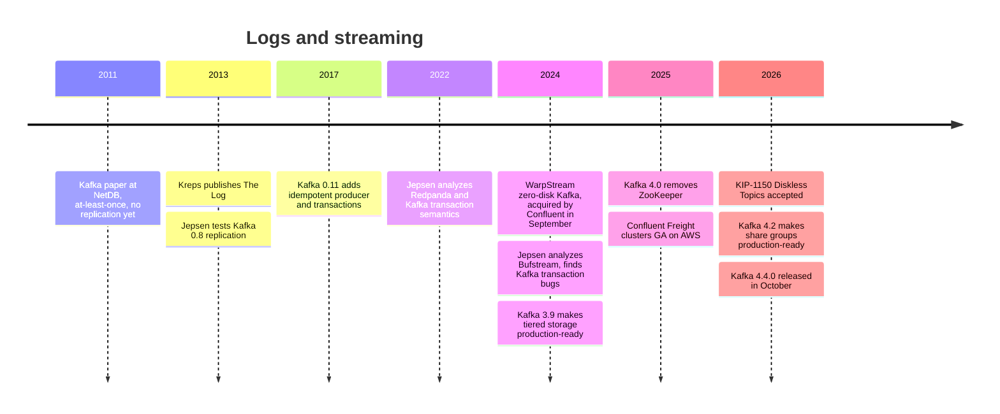
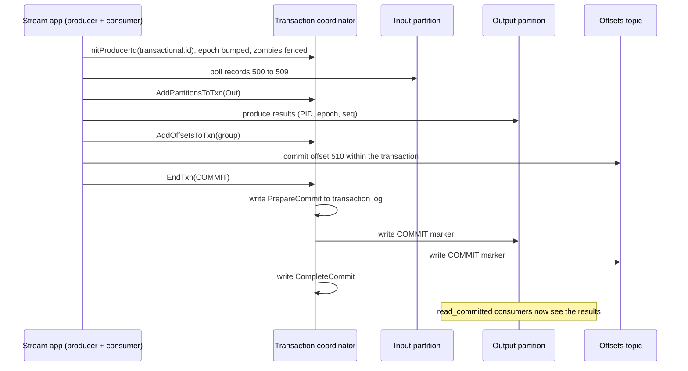
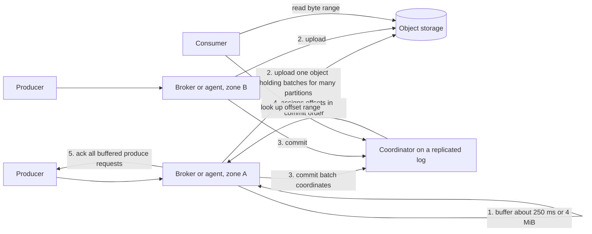

---
tags:
  - distributed-systems
  - logs
  - streaming
  - kafka
  - messaging
status: draft
sources:
  - https://engineering.linkedin.com/distributed-systems/log-what-every-software-engineer-should-know-about-real-time-datas-unifying
  - https://people.csail.mit.edu/matei/courses/2015/6.S897/readings/kafka.pdf
  - https://kafka.apache.org/44/design/design/
  - https://kafka.apache.org/44/operations/eligible-leader-replicas/
  - https://cwiki.apache.org/confluence/display/KAFKA/KIP-966%3A+Eligible+Leader+Replicas
  - https://cwiki.apache.org/confluence/display/KAFKA/KIP-98+-+Exactly+Once+Delivery+and+Transactional+Messaging
  - https://www.confluent.io/blog/transactions-apache-kafka/
  - https://cwiki.apache.org/confluence/display/KAFKA/KIP-932%3A+Queues+for+Kafka
  - https://cwiki.apache.org/confluence/display/KAFKA/KIP-1150%3A+Diskless+Topics
  - https://cwiki.apache.org/confluence/display/KAFKA/KIP-1163:+Diskless+Core
  - https://cwiki.apache.org/confluence/display/KAFKA/KIP-1164:+Diskless+Coordinator
  - https://kafka.apache.org/blog/
  - https://kafka.apache.org/blog/2024/11/06/apache-kafka-3.9.0-release-announcement/
  - https://kafka.apache.org/blog/2025/03/18/apache-kafka-4.0.0-release-announcement/
  - https://kafka.apache.org/blog/2025/09/04/apache-kafka-4.1.0-release-announcement/
  - https://kafka.apache.org/blog/2026/02/17/apache-kafka-4.2.0-release-announcement/
  - https://kafka.apache.org/blog/2026/05/22/apache-kafka-4.3.0-release-announcement/
  - https://kafka.apache.org/blog/2026/10/22/apache-kafka-4.4.0-release-announcement/
  - https://pulsar.apache.org/docs/next/concepts-architecture-overview/
  - https://bookkeeper.apache.org/docs/development/protocol/
  - https://docs.redpanda.com/24.3/get-started/architecture
  - https://www.redpanda.com/blog/26-1-r1-cloud-topics
  - https://docs.warpstream.com/warpstream/overview/architecture
  - https://warpstream.com/blog/zero-disks-is-better-for-kafka
  - https://aws.amazon.com/blogs/storage/how-warpstream-enables-cost-effective-low-latency-streaming-with-amazon-s3-express-one-zone
  - https://confluent.io/press-release/confluent-acquires-warpstream-to-advance-next-gen-byoc-data-streaming
  - https://master.www.confluent.io/blog/freight-clusters-are-generally-available/
  - https://newsroom.ibm.com/2026-03-17-ibm-completes-acquisition-of-confluent,-making-real-time-data-the-engine-of-enterprise-ai-and-agents
  - https://aiven.io/blog/kip-1150-accepted-and-the-road-ahead
  - https://docs.automq.com/automq/architecture/overview
  - https://github.com/AutoMQ/automq
  - https://buf.build/blog/coreweave-acquires-bufstream
  - https://s2.dev/blog/intro
  - https://s2.dev/blog/ga
  - https://jepsen.io/analyses/bufstream-0.1.0
  - https://jepsen.io/analyses/redpanda-21.10.1
  - https://aphyr.com/posts/293-jepsen-kafka
  - https://jack-vanlightly.com/blog/2023/4/24/why-apache-kafka-doesnt-need-fsync-to-be-safe
  - https://jack-vanlightly.com/blog/2023/8/17/kafka-kip-966-fixing-the-last-replica-standing-issue
created: 2026-11-26
updated: 2026-11-26
---

## Table Of Contents

---

- [[#TL;DR|TL;DR]]
- [[#The Problem|The Problem]]
- [[#Foundations|Foundations]]
    - [[#The Log as an Abstraction|The Log as an Abstraction]]
    - [[#Logs and State Machine Replication|Logs and State Machine Replication]]
    - [[#Delivery Semantics|Delivery Semantics]]
- [[#How We Got Here|How We Got Here]]
- [[#How It Works|How It Works]]
    - [[#Kafka's Data Model: Topics, Partitions, Offsets, Segments|Kafka's Data Model: Topics, Partitions, Offsets, Segments]]
    - [[#Consumer Groups and Share Groups|Consumer Groups and Share Groups]]
    - [[#Replication: ISR, High Watermark, acks|Replication: ISR, High Watermark, acks]]
    - [[#Idempotent Producer and Transactions|Idempotent Producer and Transactions]]
    - [[#KRaft: Metadata as a Log|KRaft: Metadata as a Log]]
    - [[#Pulsar and BookKeeper: Segment-Centric Storage|Pulsar and BookKeeper: Segment-Centric Storage]]
    - [[#Redpanda: Raft per Partition|Redpanda: Raft per Partition]]
    - [[#Tiered Storage and Diskless Kafka|Tiered Storage and Diskless Kafka]]
    - [[#The Designs Side by Side|The Designs Side by Side]]
- [[#Where It Is Now|Where It Is Now]]
    - [[#Apache Kafka 4.x Releases|Apache Kafka 4.x Releases]]
    - [[#Object Storage Became the Battleground|Object Storage Became the Battleground]]
    - [[#Correctness: What Jepsen Found|Correctness: What Jepsen Found]]
- [[#Trade-offs & Open Problems|Trade-offs & Open Problems]]
- [[#Resources|Resources]]
- [[#Related Notes|Related Notes]]

## ***TL;DR***
---
*A log is an append-only, totally ordered sequence of records. Put one in the middle of a system and it becomes the shared source of truth that databases replicate from, services integrate through, and [[Stream Processing|stream processors]] read; Kafka made that idea the default way companies move data, and most of the field's recent work is about making the log cheaper and its guarantees sharper.*

- **The idea:** Jay Kreps (2013) argued the log is "real-time data's unifying abstraction": the same structure that [[Replication|replicates]] a database (state machine replication) can integrate every system in a company ([Kreps, 2013](https://engineering.linkedin.com/distributed-systems/log-what-every-software-engineer-should-know-about-real-time-datas-unifying)).
- **Kafka's design:** a topic is split into partitions; each partition is a replicated log addressed by offsets and stored as segment files. A record is committed once every in-sync replica (ISR) has it; the high watermark marks how far consumers may read; `acks=all` plus `min.insync.replicas` sets durability ([Kafka docs](https://kafka.apache.org/44/design/design/)).
- **Exactly-once** is an idempotent producer (sequence numbers per partition) plus transactions (atomic writes across partitions, with consumer offsets committed in the same transaction) ([KIP-98](https://cwiki.apache.org/confluence/display/KAFKA/KIP-98+-+Exactly+Once+Delivery+and+Transactional+Messaging)). It holds inside Kafka, for read-process-write loops, and has had real bugs.
- **Other designs:** Pulsar separates stateless brokers from BookKeeper storage; Redpanda runs a [[Raft]] group per partition; WarpStream, AutoMQ, Bufstream and Confluent Freight drop local disks and write to [[Object Storage]].
- **Now (Nov 2026):** Kafka 4.0 (March 2025) removed ZooKeeper; share groups (queues) became production-ready in 4.2 (February 2026); 4.4.0 is the latest feature release (October 2026). KIP-1150 "Diskless Topics" was accepted in March 2026, but its implementation KIPs are still under discussion. IBM completed its acquisition of Confluent in March 2026.

## ***The Problem***
---
*Every company ends up with many systems that need the same data: databases, caches, search indexes, warehouses, services. Copying data between each pair doesn't scale and gets the order wrong; a shared, ordered, durable log fixes both, but only if the log itself is fast, cheap and correct under failures.*

Kreps described LinkedIn's situation: with $N$ systems that each produce and consume data, point-to-point pipelines grow like $O(N^2)$, often two per pair because data flows both ways. His fix was one central log that every system writes to and reads from, so each system needs one connection ([Kreps, 2013](https://engineering.linkedin.com/distributed-systems/log-what-every-software-engineer-should-know-about-real-time-datas-unifying)). At the time LinkedIn was running "over 60 billion unique message writes through Kafka per day."

That pushes three hard requirements onto the log:

| Requirement | Why it is hard | Where it shows up below |
|---|---|---|
| **Throughput and retention** | Billions of records a day, kept for days or forever | Partitions, segments, page cache, tiered storage, object storage |
| **Durability and order under failure** | Brokers crash, disks lose unflushed data, networks partition ([[Failure Models]]) | ISR, high watermark, ELR, BookKeeper quorums, Raft |
| **Processing semantics** | Retries duplicate records; crashes leave half-done work | Idempotent producer, transactions, exactly-once |

In the cloud a fourth one appeared: **cost**. Replicating every byte across availability zones is billed per GiB, which is the motivation for the diskless designs in [[#Tiered Storage and Diskless Kafka|Tiered Storage and Diskless Kafka]].

## ***Foundations***
---
*Three ideas carry the topic: what a log is and why it unifies tables and streams, why a log is the core of state machine replication, and what "at-most-once", "at-least-once" and "exactly-once" actually promise.*

### The Log as an Abstraction

*A log is the simplest storage structure that still has a total order. That order is what lets many readers, at their own pace, reach the same state.*

Kreps' definition: a log "is an append-only, totally-ordered sequence of records ordered by time" ([Kreps, 2013](https://engineering.linkedin.com/distributed-systems/log-what-every-software-engineer-should-know-about-real-time-datas-unifying)). Each record gets the next position (an offset, or log sequence number). Records are never changed in place; readers remember how far they have read.

Two consequences matter:

- **Tables and streams are duals.** A table is the current state; the log is the history of changes that produced it. "Tables support data at rest and logs capture change." Replay the changelog and you rebuild the table; publish a table's changelog and anyone can maintain a copy ([Kreps, 2013](https://engineering.linkedin.com/distributed-systems/log-what-every-software-engineer-should-know-about-real-time-datas-unifying)). [[Change Data Capture]], event sourcing and Kafka Streams' state stores ([[Stream Processing]]) all use this.
- **Readers are decoupled.** Because readers track their own position, a slow warehouse load and a real-time service can read the same log at different speeds, and a new reader can start from the beginning.

### Logs and State Machine Replication

*If deterministic replicas apply the same log in the same order, they end in the same state. That is why consensus protocols are, underneath, log replication protocols.*

Kreps calls this the state machine replication principle: "if you feed two deterministic pieces of code the same input log, they will produce the same output" ([Kreps, 2013](https://engineering.linkedin.com/distributed-systems/log-what-every-software-engineer-should-know-about-real-time-datas-unifying)). [[Paxos]] and [[Raft]] agree on the contents of a log; the database on top is just a state machine applying it ([[Replication]]).

A streaming platform is the same pattern turned inside out: the log is exposed to applications rather than hidden inside one database. Kafka partitions are replicated logs; Kafka's own cluster metadata (KRaft) is a Raft log; Pulsar's ledgers and Redpanda's partitions are replicated logs. What changes between systems is *how* the log is replicated and *where* its bytes live.

### Delivery Semantics

*Every messaging system picks what happens when a send or a process step fails partway. Kafka's docs define three levels; the third needs cooperation from both producer and consumer.*

From the Kafka design docs ([Kafka docs](https://kafka.apache.org/44/design/design/)):

| Semantics | Definition | How you get it |
|---|---|---|
| **At-most-once** | "Messages may be lost but are never redelivered." | Commit the consumer offset before processing; don't retry sends |
| **At-least-once** | "Messages are never lost but may be redelivered." | Retry sends; commit the offset after processing |
| **Exactly-once** | "Each message is processed once and only once." | Idempotent producer plus transactions that commit outputs and input offsets together |

Exactly-once in Kafka means the *effects inside Kafka* happen once: output records and the consumer's progress commit atomically. An external side effect (an email, a payment API call) is not covered; that needs the idempotency keys and outbox patterns of [[Reliability Patterns]] and [[Distributed Transactions]].

## ***How We Got Here***
---
*Kafka started in 2010–2011 as LinkedIn's log aggregation system, gained replication in 0.8 and exactly-once in 0.11, and then spent five years replacing ZooKeeper with its own Raft log. Since 2023 the action has moved to storage: tiered storage, then systems that keep no data on local disks at all.*

**Kafka at LinkedIn (2011).** Kreps, Narkhede and Rao described a broker that stores each partition as a log of segment files, addresses messages only by their offset, leaves consumption state to consumers, and leans on the OS page cache and `sendfile` for speed. It guaranteed only at-least-once delivery, used ZooKeeper for membership and offsets, and had no replication yet ("we plan to add built-in replication in Kafka") ([Kreps, Narkhede and Rao, NetDB 2011](https://people.csail.mit.edu/matei/courses/2015/6.S897/readings/kafka.pdf)).

**Replication (0.8) and its first Jepsen test.** Kafka chose an in-sync-replica design instead of majority quorums. Kyle Kingsbury's test of the pre-release 0.8 design showed that if the ISR shrank to the leader alone and that leader was then isolated, an out-of-date replica could be promoted and acknowledged writes discarded: 520 of 987 acknowledged writes were lost in his run. He recommended never letting the ISR fall below a floor and blocking rather than silently losing data ([Kingsbury, Jepsen: Kafka](https://aphyr.com/posts/293-jepsen-kafka)). Kafka later added `min.insync.replicas` as exactly such a floor, and from 0.11 it disables unclean leader election by default ([Kafka docs](https://kafka.apache.org/44/design/design/)).

**The Log (2013).** Kreps' essay recast Kafka as infrastructure for the whole company, not a log aggregation pipe ([Kreps, 2013](https://engineering.linkedin.com/distributed-systems/log-what-every-software-engineer-should-know-about-real-time-datas-unifying)).

**Exactly-once (0.11, 2017).** KIP-98 added producer IDs with per-partition sequence numbers, and a transaction coordinator with commit markers ([KIP-98](https://cwiki.apache.org/confluence/display/KAFKA/KIP-98+-+Exactly+Once+Delivery+and+Transactional+Messaging); [Mehta and Gustafson, 2017](https://www.confluent.io/blog/transactions-apache-kafka/)).

**Removing ZooKeeper (2019–2025).** KRaft moved cluster metadata into a Raft log run by Kafka's own controllers. Kafka 3.9 (November 2024) was the last release with ZooKeeper mode, and 4.0 (March 2025) runs only on KRaft ([3.9](https://kafka.apache.org/blog/2024/11/06/apache-kafka-3.9.0-release-announcement/), [4.0](https://kafka.apache.org/blog/2025/03/18/apache-kafka-4.0.0-release-announcement/)). See [[Raft]] and [[Coordination Services]].

**Storage moves to the object store (2023–2026).** Tiered storage (KIP-405) became production-ready in 3.9 ([3.9 announcement](https://kafka.apache.org/blog/2024/11/06/apache-kafka-3.9.0-release-announcement/)). WarpStream went further with no local disks at all ([Artoul, May 2024](https://warpstream.com/blog/zero-disks-is-better-for-kafka)) and was bought by Confluent in September 2024 ([Confluent](https://confluent.io/press-release/confluent-acquires-warpstream-to-advance-next-gen-byoc-data-streaming)). Apache Kafka itself accepted the diskless direction in March 2026 ([Aiven, Mar 2026](https://aiven.io/blog/kip-1150-accepted-and-the-road-ahead)).

## ***How It Works***
---
*Kafka is the reference design, so most of this section is Kafka: how a partition is laid out, how consumers share it, how replicas decide what is committed, and how producers get exactly-once. Then three alternative layouts: Pulsar's separated storage, Redpanda's Raft-per-partition, and diskless logs on object storage.*

### Kafka's Data Model: Topics, Partitions, Offsets, Segments

*A topic is a name; a partition is the actual log. Order is guaranteed only within a partition, and partitions are the unit of parallelism, replication and placement.*

- **Topic → partitions.** A producer picks a partition per record, usually by hashing the key, so all records for one key land in one partition and stay ordered ([[Partitioning]]).
- **Offsets.** Messages have no IDs: "each message is addressed by its logical offset in the log" ([Kreps et al., 2011](https://people.csail.mit.edu/matei/courses/2015/6.S897/readings/kafka.pdf)). "The offset for a message never changes. It is the permanent identifier for a position in the log" ([Kafka docs](https://kafka.apache.org/44/design/design/)).
- **Segments.** Each partition is stored as "a set of segment files of approximately the same size (e.g., 1GB)" ([Kreps et al., 2011](https://people.csail.mit.edu/matei/courses/2015/6.S897/readings/kafka.pdf)). Only the newest (active) segment is appended to; retention deletes whole old segments, which is cheap.
- **Pull consumers and the page cache.** Consumers pull; brokers serve reads from the OS page cache and use `sendfile` to copy bytes to the socket without passing through the application.
- **Log compaction.** Instead of deleting by age, a compacted topic keeps at least the latest record per key. Compaction "will never re-order messages, just remove some," and a reader that starts from the beginning "will see at least the final state of all records in the order they were written" ([Kafka docs](https://kafka.apache.org/44/design/design/)). This is the table/changelog duality made concrete.

### Consumer Groups and Share Groups

*Consumer groups give each partition to exactly one member, which preserves order but caps parallelism at the partition count. Share groups (KIP-932) let many consumers take records from the same partition, queue-style, with per-record acknowledgement.*

**Consumer groups.** Members of a group split the partitions among themselves; each partition is read by one member at a time, which tracks its position as a committed offset. Kafka 4.0 made the new rebalance protocol (KIP-848) generally available, which removes "stop-the-world" rebalances; consumers opt in with `group.protocol=consumer` ([4.0 announcement](https://kafka.apache.org/blog/2025/03/18/apache-kafka-4.0.0-release-announcement/)).

**Share groups (Queues for Kafka, KIP-932).** A share group consumes the same topics, but ([KIP-932](https://cwiki.apache.org/confluence/display/KAFKA/KIP-932%3A+Queues+for+Kafka)):

- "The number of consumers in a share group can exceed the number of partitions in a topic."
- A fetched record is locked to one consumer for an acquisition lock ("By default, the lock duration is 30s"); when the lock expires the record becomes available again.
- Each record is acknowledged individually: **accept** (done), **release** (try again elsewhere) or **reject** (unprocessable, don't redeliver).
- Each acquisition increments a delivery count; after the "share delivery attempt limit (5 by default)" a failing record is archived. Kafka 4.4 adds dead-letter queues for those records (KIP-1191) ([4.4 announcement](https://kafka.apache.org/blog/2026/10/22/apache-kafka-4.4.0-release-announcement/)).
- The broker tracks the in-flight window between the share-partition start offset (SPSO) and end offset (SPEO).
- Delivery is at-least-once, and order is only guaranteed within one fetched batch; redeliveries can arrive out of offset order.

It "does not add the concept of a 'queue' to Kafka per se" ([4.0 announcement](https://kafka.apache.org/blog/2025/03/18/apache-kafka-4.0.0-release-announcement/)): records still live in an ordinary partitioned log, and a share group is a different way of reading it. [[Message Queues]] compares share groups with SQS, RabbitMQ quorum queues, Pulsar and NATS.

### Replication: ISR, High Watermark, acks

*Kafka replicates each partition leader-to-followers and commits a record once every member of the in-sync replica set has it. The ISR shrinks and grows with follower health, so Kafka tolerates $f$ failures with $f + 1$ replicas instead of a majority quorum's $2f + 1$. The [[Replication]] note covers ISR and ELR basics; this section adds the arithmetic.*

**Definitions** ([Kafka docs](https://kafka.apache.org/44/design/design/)):

- A follower is **in sync** if it is alive and caught up; one that can't reach the end of the leader's log within `replica.lag.time.max.ms` is removed from the ISR.
- "A message is considered committed only when all replicas in the in-sync replicas (ISR) for that partition" have it, and only committed messages are served to consumers.
- With `acks=all`, "acknowledgement happens as soon as all the current in-sync replicas have received the message."
- With `min.insync.replicas`, "the partition will only accept writes if the size of the ISR is above a certain minimum"; under KIP-966's strict rule, the "High Watermark can only advance if the ISR size is larger or equal to min.insync.replicas" ([KIP-966](https://cwiki.apache.org/confluence/display/KAFKA/KIP-966%3A+Eligible+Leader+Replicas)).
- **Why not majorities?** "To tolerate one failure requires three copies of the data, and to tolerate two failures requires five copies"; with the ISR model "and f+1 replicas, a Kafka topic can tolerate f failures without losing committed messages" ([Kafka docs](https://kafka.apache.org/44/design/design/)). The price is that someone outside the partition (the controller) must track the ISR consistently.

**The high watermark.** Each replica's *log end offset* (LEO) is the offset its next record would get. Since a record counts as committed only once every ISR member has it, the committed prefix ends at the lowest LEO among ISR members. That boundary is the high watermark (HW):

$$
HW = \min_{r \,\in\, \text{ISR}} \text{LEO}_r \qquad \text{and HW only advances while } |\text{ISR}| \ge \texttt{min.insync.replicas}
$$

*In words:* consumers may read every offset below the slowest in-sync replica's log end, and nothing beyond it; if too few replicas are in sync, the boundary freezes.

*Worked example (replication factor 3, `min.insync.replicas = 2`, `acks=all`):*

| Step | Leader A LEO | B LEO | C LEO | ISR | HW | What happens |
|---|---|---|---|---|---|---|
| 1 | 105 | 103 | 100 | {A, B, C} | 100 | Consumers see offsets 0 to 99; producers of offsets 100 to 104 wait |
| 2 | 105 | 105 | 100 | {A, B, C} | 100 | B caught up, but C still holds HW at 100 |
| 3 | 105 | 105 | 100 | {A, B} | 105 | C exceeded `replica.lag.time.max.ms` and was dropped; HW jumps; offsets 100 to 104 are acknowledged |
| 4 | 105 | down | 100 | {A} | 105 | B fails too; ISR size 1 < 2, so HW freezes and new `acks=all` writes are rejected |

**Durability invariant.** With `acks=all`, an acknowledged record is on every ISR member at the moment of acknowledgment, and the ISR had at least `min.insync.replicas` members:

$$
\text{acked}(m) \implies \big|\{ r : r \text{ stores } m \}\big| \;\ge\; \texttt{min.insync.replicas}
$$

*In words:* as long as fewer than `min.insync.replicas` of those replicas lose the record, a clean leader still has it. *Example:* with RF = 3 and `min.insync.replicas = 2`, any acknowledged record survives one broker losing its data; the partition stays writable with one broker down and becomes read-only (for `acks=all`) with two down. With `min.insync.replicas = 1` the same RF = 3 topic can acknowledge a write held by only the leader, which is the Jepsen 0.8 loss scenario.

**fsync and unclean shutdowns.** Kafka doesn't fsync before acknowledging by default; its protocol "was designed to be safe without fsyncs" because a broker that lost unflushed data refetches it from the leader and "cannot be a candidate for leadership until it has at least recovered the data it previously lost" ([Vanlightly, Apr 2023](https://jack-vanlightly.com/blog/2023/4/24/why-apache-kafka-doesnt-need-fsync-to-be-safe)). The gap was the *last replica standing*: when the ISR is just one replica and that replica loses unflushed data in an OS crash, followers would truncate to it. Eligible Leader Replicas (KIP-966) keep replicas "that are not in ISR but guarantee to have the data at least to High Watermark" electable, and remove a replica that reports an unclean shutdown from the ELR ([KIP-966](https://cwiki.apache.org/confluence/display/KAFKA/KIP-966%3A+Eligible+Leader+Replicas); [Vanlightly, Aug 2023](https://jack-vanlightly.com/blog/2023/8/17/kafka-kip-966-fixing-the-last-replica-standing-issue)). ELR shipped as a preview in 4.0 and is "enabled by default on new clusters starting 4.1" ([Kafka docs](https://kafka.apache.org/44/operations/eligible-leader-replicas/)). Vanlightly checked the design with a TLA+ model ([kafka-tlaplus](https://github.com/Vanlightly/kafka-tlaplus/blob/main/kafka_data_replication/kraft/v_elr/README.md)); see [[Formal Methods in Practice]].

**Unclean leader election** (electing an out-of-sync replica) trades committed data for availability; it has been off by default since 0.11 and is controlled by `unclean.leader.election.enable` ([Kafka docs](https://kafka.apache.org/44/design/design/)). That is the [[CAP and PACELC]] choice made per topic.

### Idempotent Producer and Transactions

*Retries create duplicates; crashes create half-finished work. Kafka fixes the first with per-partition sequence numbers and the second with a two-phase commit run by a transaction coordinator, so a consume-transform-produce loop can commit its outputs and its input offsets as one unit.*

**Idempotent producer.** "Every new producer will be assigned a unique PID during initialization," and for each partition its sequence numbers "start from zero and be monotonically increasing" ([KIP-98](https://cwiki.apache.org/confluence/display/KAFKA/KIP-98+-+Exactly+Once+Delivery+and+Transactional+Messaging)). The broker keeps the last sequence it appended per (PID, partition) and accepts a batch only if:

$$
\text{seq}_{\text{new}} = \text{seq}_{\text{last}}(\text{PID}, p) + 1
$$

*In words:* the next batch must be exactly the next number. Lower means it's a duplicate (ignored); higher means something was lost in between (a fatal out-of-sequence error). *Example:* producer 42 sends batches 7 and 8 to partition 3. The ack for 7 is lost, so it resends 7. The broker's last sequence is already 8, so the resent 7 is recognized as a duplicate and not appended again. Idempotent delivery "guarantees that resending will not result in duplicate entries in the log" ([Kafka docs](https://kafka.apache.org/44/design/design/)). This is the idempotency-token pattern from [[Reliability Patterns]], built into the protocol.

**Transactions.** Designed "primarily for applications that exhibit a 'read-process-write' pattern" ([Mehta and Gustafson, 2017](https://www.confluent.io/blog/transactions-apache-kafka/)):

- Each transactional producer has a stable `transactional.id`. The coordinator stores an *epoch* per ID; when a new instance registers, the epoch is bumped and "any producers with same transactional.id and an older epoch are considered zombies" and fenced ([[Leases and Fencing]]).
- The **transaction coordinator**, "a module running inside every Kafka broker," records transaction state (not the records themselves) in an internal topic, the transaction log.
- To commit, the coordinator writes the decision to its log, then "writes transaction commit markers to the topic-partitions" involved. That is two-phase commit with the coordinator's log as the decision record ([[Distributed Transactions]]).
- Consumer offsets are sent to the offsets topic inside the same transaction, so outputs and progress commit "as an atomic unit."
- A `read_committed` consumer "will withhold messages from open transactions and filter out messages from aborted transactions." It reads up to the *last stable offset* (LSO), the point before the earliest still-open transaction, rather than up to the high watermark ([KIP-98](https://cwiki.apache.org/confluence/display/KAFKA/KIP-98+-+Exactly+Once+Delivery+and+Transactional+Messaging)).
- Cost: for 1 KB records, "committing messages every 100ms results in only a 3% degradation in throughput"; longer transactions mean longer end-to-end latency, since `read_committed` readers wait for the commit ([Mehta and Gustafson](https://www.confluent.io/blog/transactions-apache-kafka/)).

*Worked example:* the app crashes after producing the results but before `EndTxn`. Its replacement calls `InitProducerId` with the same `transactional.id`; the coordinator bumps the epoch and aborts the open transaction. The partial results get an ABORT marker, `read_committed` readers skip them, and the committed input offset is still 500, so records 500 to 509 are processed again, once, in the new transaction.

**Where it went wrong.** The protocol assumed requests from one client arrive in order, but they can travel over different connections. Jepsen found that a delayed `EndTxn` could commit or abort a *later* transaction, giving aborted reads, lost writes and torn transactions (KAFKA-17754), and called the protocol "fundamentally broken" until it numbers transactions ([Jepsen, Nov 2024](https://jepsen.io/analyses/bufstream-0.1.0)). KIP-890 bumps the producer epoch on every transaction so stale commits are rejected; its server-side defense shipped as phase two in Kafka 4.0, described as reducing "the chances of 'zombie transactions'" ([4.0 announcement](https://kafka.apache.org/blog/2025/03/18/apache-kafka-4.0.0-release-announcement/)), and 4.2 added "stricter epoch validation for Transaction Version 2 markers" (KIP-1228) ([4.2 announcement](https://kafka.apache.org/blog/2026/02/17/apache-kafka-4.2.0-release-announcement/)).

### KRaft: Metadata as a Log

*Kafka's own metadata (topics, partitions, ISR, ELR, leaders) now lives in a Raft-replicated log run by a small controller quorum. Brokers replay that log, so the cluster's control plane is the log idea applied to itself. [[Cluster Metadata and Routing]] compares it with other metadata designs.*

- A small quorum of controllers runs Raft; one is the active controller. Brokers fetch the metadata log and apply it, so each holds a consistent, versioned view of the cluster ([[Raft]]).
- ISR and ELR changes are records in this log; the ELR page notes "the KRaft controller stores such replicas in the PartitionRecord field called Eligible Leader Replicas" ([Kafka docs](https://kafka.apache.org/44/operations/eligible-leader-replicas/)).
- Milestones: dynamic controller membership (KIP-853) in 3.9; ZooKeeper removed and Pre-Vote (KIP-996) added in 4.0 ([3.9](https://kafka.apache.org/blog/2024/11/06/apache-kafka-3.9.0-release-announcement/), [4.0](https://kafka.apache.org/blog/2025/03/18/apache-kafka-4.0.0-release-announcement/)); controllers can be unregistered from cluster metadata in 4.4 (KIP-1312) ([4.4](https://kafka.apache.org/blog/2026/10/22/apache-kafka-4.4.0-release-announcement/)).
- Why it matters: one fewer system to run, and metadata changes become ordered log entries instead of ZooKeeper writes plus controller caches that could disagree ([[Coordination Services]]).

### Pulsar and BookKeeper: Segment-Centric Storage

*Pulsar splits serving from storing: stateless brokers own topics, while a separate BookKeeper cluster stores each topic as a chain of short-lived ledgers. A topic's data is spread across many storage nodes instead of pinned to its replicas.*

- **Brokers are stateless**; "a BookKeeper cluster consisting of one or more bookies handles persistent storage of messages" ([Pulsar docs](https://pulsar.apache.org/docs/next/concepts-architecture-overview/)).
- **Ledgers.** "A ledger is an append-only data structure with a single writer that is assigned to multiple BookKeeper storage nodes." A topic is a *managed ledger*, which "uses multiple BookKeeper ledgers to store the data"; ledgers roll over and old ones are deleted once all cursors have passed them. So a topic is a sequence of segments, each of which can be placed on whichever bookies are free when it is created. Moving a topic to another broker moves no data.
- **Metadata** lives in a metadata store; current docs list Oxia (recommended), ZooKeeper, and RocksDB for standalone ([Pulsar docs](https://pulsar.apache.org/docs/next/concepts-architecture-overview/)).

BookKeeper's quorum parameters ([BookKeeper protocol](https://bookkeeper.apache.org/docs/development/protocol/)):

$$
E \;\ge\; Q_w \;\ge\; Q_a
$$

- $E$, the **ensemble size**: "the number of nodes the ledger is stored on."
- $Q_w$, the **write quorum**: "the number of nodes each entry is written to. In effect, the max replication for the entry."
- $Q_a$, the **ack quorum**: "the number of nodes an entry must be acknowledged on. In effect, the minimum replication for the entry."

*In words:* a ledger is spread over $E$ bookies, each entry is sent to $Q_w$ of them, and the writer counts it as written once $Q_a$ reply. *Example:* $E = 5$, $Q_w = 3$, $Q_a = 2$. Entry 17 goes to bookies 2, 3 and 4 and is acknowledged after any two respond; entry 18 goes to a different set of three. Read bandwidth for the ledger spreads over five machines, and losing one bookie leaves every entry with at least one other acknowledged copy. If a bookie fails mid-ledger, the writer replaces it and starts a new *fragment*; "changes in the ensemble involve a new fragment being added to the ledger."

**Fencing.** Because a ledger has a single writer, recovery after a writer failure first marks the ledger IN_RECOVERY, then "send[s] a fence message to all the bookies in the last fragment," so the old writer can no longer add entries; then it finds the last entry and closes the ledger ([BookKeeper protocol](https://bookkeeper.apache.org/docs/development/protocol/)). This is the fencing pattern from [[Leases and Fencing]], applied to storage nodes.

### Redpanda: Raft per Partition

*Redpanda reimplements the Kafka protocol in C++ with a thread-per-core runtime and replaces the ISR scheme with a Raft group for every partition, so each partition commits on a majority like a consensus log.*

- "Redpanda implements a thread-per-core programming model through its use of the Seastar library," pinning threads to cores to avoid context switches ([Redpanda docs](https://docs.redpanda.com/24.3/get-started/architecture)).
- "Every topic partition forms a Raft group consisting of a single elected leader and zero or more followers." With `acks=all`, a majority must have written the record before the leader acknowledges.
- Cluster metadata is in "a system partition called the controller partition," also replicated with Raft, so there's no ZooKeeper.
- Jepsen notes Redpanda acknowledges writes only after fsync on a majority, whereas Kafka's defaults can acknowledge before fsync ([Jepsen, Apr 2022](https://jepsen.io/analyses/redpanda-21.10.1)).

The trade against Kafka's ISR: a majority quorum needs $2f + 1$ replicas for $f$ failures, but never depends on a separate controller tracking an ISR, and a slow minority replica doesn't stall commits ([[Gray and Fail-Slow Failures]]).

### Tiered Storage and Diskless Kafka

*Kafka's classic design keeps every byte on local disks of three brokers in three zones, which makes storage expensive and scaling slow and bills cross-zone traffic. Tiered storage moves old segments to object storage; diskless designs move everything there and keep only metadata on a consensus-replicated log.*

**Tiered storage (KIP-405).** Closed segments are copied to [[Object Storage]] and deleted locally after a shorter local retention; reads of old data come from the object store. Production-ready since Kafka 3.9 ([3.9 announcement](https://kafka.apache.org/blog/2024/11/06/apache-kafka-3.9.0-release-announcement/)). The active segment is still replicated broker-to-broker, so cross-zone replication traffic is unchanged. Recent additions: new followers can bootstrap from the last tiered offset (KIP-1023, off by default) in 4.3 ([4.3](https://kafka.apache.org/blog/2026/05/22/apache-kafka-4.3.0-release-announcement/)), and delayed upload settings to reduce redundancy (KIP-1241) in 4.4 ([4.4](https://kafka.apache.org/blog/2026/10/22/apache-kafka-4.4.0-release-announcement/)).

**Diskless (zero-disk) designs.** The pattern, from WarpStream and now in KIP-1163:

The KIP-1163 write path ([KIP-1163](https://cwiki.apache.org/confluence/display/KAFKA/KIP-1163:+Diskless+Core)): a broker buffers produce requests up to a size or time limit, builds one shared object holding all the buffered batches plus their locations, uploads it, commits the batch coordinates to the Diskless Coordinator, which "assigns offsets, persists the batch coordinates," and then answers all the produce requests. Brokers upload in parallel without coordinating but commit in sequence. The coordinator (KIP-1164) keeps its state in an internal `__diskless_metadata` topic, partitioned so each partition coordinates a shard of user partitions ([KIP-1164](https://cwiki.apache.org/confluence/display/KAFKA/KIP-1164:+Diskless+Coordinator)).

**The latency budget.** KIP-1163's estimates show where the time goes:

| Stage | P50 | P99 |
|---|---|---|
| Buffering | up to 250 ms (or 4 MiB) | up to 250 ms |
| Object upload | ~100 ms | ~200 to 400 ms |
| Coordinate commit | ~10 ms | ~20 to 50 ms |
| **Produce request total (target)** | **~500 ms** | **~1 to 2 s** |

*Worked example of why people accept that:* KIP-1150 cites cross-zone transfer at \$0.02 per GiB on AWS and \$0.01 on Google Cloud ([KIP-1150](https://cwiki.apache.org/confluence/display/KAFKA/KIP-1150%3A+Diskless+Topics)). A topic ingesting 1 GiB/s with RF = 3 across three zones sends each byte to two other-zone followers, roughly 2 GiB/s of cross-zone replication, or about $2 \times 86{,}400 \times \$0.02 \approx \$3{,}456$ a day on AWS before any cross-zone consumer or producer traffic. Writing to a regional object store removes that replication term; object storage requests cost money too, which is why everyone batches. (Illustrative arithmetic from the cited per-GiB price, not a quoted figure.)

**Systems in this family:**

| System | Storage path | Metadata / ordering | Notes |
|---|---|---|---|
| **WarpStream** | Stateless agents write files to object storage, each file holding many partitions; "does not require local disks at all" ([docs](https://docs.warpstream.com/warpstream/overview/architecture)) | Virtual Cluster in WarpStream's cloud maps files to offset ranges; operations journaled to a strongly consistent log | BYOC: data stays in the customer's VPC. With S3 Standard, ~400 to 600 ms p99 write and under 1.5 s p99 end-to-end; S3 Express One Zone with a quorum of three zone buckets for lower latency ([AWS, Jun 2024](https://aws.amazon.com/blogs/storage/how-warpstream-enables-cost-effective-low-latency-streaming-with-amazon-s3-express-one-zone)) |
| **Confluent Freight** | Kora engine in "direct write" mode: "data is written directly to object storage services like S3, bypassing local storage" | Confluent Cloud | GA on AWS Jan 2025; latency "up to a second or two" vs sub-100 ms for other clusters ([Confluent, Jan 2025](https://master.www.confluent.io/blog/freight-clusters-are-generally-available/)) |
| **AutoMQ** | Kafka fork; "replaces Apache Kafka's native Log storage with S3Stream" with a WAL in front of object storage ([docs](https://docs.automq.com/automq/architecture/overview)) | Kafka's KRaft | Apache 2.0; open-source edition uses S3 as WAL (hundreds of ms); enterprise claims single-digit ms with other WAL options ([GitHub](https://github.com/AutoMQ/automq)) |
| **Bufstream** | Stateless agents, records in object storage | A coordination service (etcd at Jepsen's test) decides which chunks are committed and their order ([Jepsen](https://jepsen.io/analyses/bufstream-0.1.0)) | Acquired by CoreWeave from Buf in May 2026 ([Buf](https://buf.build/blog/coreweave-acquires-bufstream)) |
| **Redpanda Cloud Topics** | Payloads stream directly to S3 or GCS, per topic | Metadata and Raft stay on local NVMe | GA in Redpanda 26.1 (Mar 2026); topics toggle between low-latency and object-storage modes in one cluster ([Redpanda, Mar 2026](https://www.redpanda.com/blog/26-1-r1-cloud-topics)) |
| **S2** | Diskless stream store; writes durable in S3 before acknowledgment | Own API (append, read, check tail), not the Kafka protocol | Standard class under 500 ms p99, Express under 50 ms on three S3 Express One Zone buckets ([S2, Dec 2024](https://s2.dev/blog/intro)); GA Feb 2026 ([S2](https://s2.dev/blog/ga)) |
| **Apache Kafka diskless topics** | KIP-1163 shared WAL objects, then tiered storage | KIP-1164 coordinator on an internal topic | KIP-1150 accepted Mar 2026; implementation KIPs under discussion |

### The Designs Side by Side

*The same log abstraction, four ways to make it durable. Each choice moves cost between latency, replica count, cloud bill and operational complexity.*

| | Kafka (classic) | Pulsar + BookKeeper | Redpanda | Diskless (WarpStream, KIP-1150) |
|---|---|---|---|---|
| Unit of replication | Partition, leader + ISR followers | Ledger (segment) on $Q_w$ of $E$ bookies | Partition, Raft group | Object in object storage |
| Commit rule | All ISR members, ISR $\ge$ min ISR | $Q_a$ bookie acks | Majority of the Raft group | Object uploaded and coordinates committed |
| Replicas for $f$ failures | $f + 1$ (controller tracks ISR) | $Q_a = f + 1$ per entry | $2f + 1$ | Delegated to the object store |
| fsync before ack | Not by default; recovery via peers | Not covered here | Yes, on a majority (per Jepsen) | Object store durability |
| Brokers hold data | Yes | No | Yes | No (cache only) |
| Typical produce latency | Milliseconds | Milliseconds | Milliseconds | Hundreds of ms to ~2 s on standard object storage |
| Cross-zone replication traffic | Yes | Yes (bookie writes) | Yes | No (object store handles it) |

## ***Where It Is Now***
---
*As of November 2026: Kafka is on its 4.x line without ZooKeeper, with queues production-ready and diskless topics accepted in principle but not yet implemented upstream; vendors have converged on object storage as the main storage layer; and Jepsen's work keeps showing that transaction semantics, not replication, are where streaming systems still break.*

### Apache Kafka 4.x Releases

*Two to three feature releases a year, all dated from the Kafka project's own blog ([Kafka blog](https://kafka.apache.org/blog/)).*

| Release | Date | Headline changes |
|---|---|---|
| **4.0.0** | Mar 2025 | First release without ZooKeeper; KIP-848 consumer protocol GA; Queues (KIP-932) early access; KIP-890 phase two; ELR preview; Pre-Vote; message formats v0/v1 removed; brokers need Java 17, clients Java 11 ([4.0](https://kafka.apache.org/blog/2025/03/18/apache-kafka-4.0.0-release-announcement/)) |
| **4.1.0** | Sep 2025 | Queues in preview, "still not ready for production"; Streams rebalance protocol (KIP-1071) early access; transactional error handling cleanup (KIP-1050) ([4.1](https://kafka.apache.org/blog/2025/09/04/apache-kafka-4.1.0-release-announcement/)); ELR on by default for new clusters ([docs](https://kafka.apache.org/44/operations/eligible-leader-replicas/)) |
| **4.2.0** | Feb 2026 | "Kafka Queues (Share Groups) is now production-ready"; Streams server-side rebalance GA with a limited feature set; Streams DLQ in exception handlers (KIP-1034); Java 25 support ([4.2](https://kafka.apache.org/blog/2026/02/17/apache-kafka-4.2.0-release-announcement/)) |
| **4.3.0** | May 2026 | More share group configs (KIP-1240); followers can start from the last tiered offset (KIP-1023); log directory cordoning (KIP-1066); classic rebalance protocol headed for deprecation ([4.3](https://kafka.apache.org/blog/2026/05/22/apache-kafka-4.3.0-release-announcement/)) |
| **4.4.0** | Oct 2026 | Share group DLQs (KIP-1191); transactional state stores in Streams, off by default (KIP-892); delayed tiered upload (KIP-1241); unregistering controllers (KIP-1312); `broker.id` deprecated ([4.4](https://kafka.apache.org/blog/2026/10/22/apache-kafka-4.4.0-release-announcement/)) |

Bug-fix releases in the period: 4.0.1 (Oct 2025), 4.1.1 (Nov 2025), 3.9.2 (Feb 2026), 4.0.2 and 4.1.2 (Mar 2026), 4.2.1 (May 2026), 4.3.1 (Jun 2026), 4.2.2 (Sep 2026) and 4.3.2 (Oct 2026) ([Kafka blog](https://kafka.apache.org/blog/)). Several 4.3 and 4.4 deprecations are marked for removal in **5.0**; the announcements give no date for it.

### Object Storage Became the Battleground

- **KIP-1150 accepted (March 2, 2026)** with 9 binding votes, after Slack's competing KIP-1183 was withdrawn in its favor ([Aiven, Mar 2026](https://aiven.io/blog/kip-1150-accepted-and-the-road-ahead)). KIP-1150 sets requirements only: diskless topics run alongside classic topics, keep the same semantics (ordering, idempotence, transactions, consumer groups), and use local disks only as caches ([KIP-1150](https://cwiki.apache.org/confluence/display/KAFKA/KIP-1150%3A+Diskless+Topics)). The implementation KIPs were still "Under Discussion" as of their latest wiki edits: KIP-1163 (October 15, 2026) and KIP-1164 (September 30, 2026). No Kafka release through 4.4.0 mentions diskless topics. Aiven's "Inkless" fork carries the implementation meanwhile; "the whole purpose of our Inkless fork is to be deleted once Diskless topics are merged upstream."
- **Consolidation.** Confluent bought WarpStream (September 2024), and IBM completed its roughly \$11 billion acquisition of Confluent on March 17, 2026 ([IBM](https://newsroom.ibm.com/2026-03-17-ibm-completes-acquisition-of-confluent,-making-real-time-data-the-engine-of-enterprise-ai-and-agents)). CoreWeave acquired Bufstream from Buf in May 2026 ([Buf](https://buf.build/blog/coreweave-acquires-bufstream)).
- **Every vendor now has an object-storage mode:** Confluent Freight (GA January 2025), Redpanda Cloud Topics (GA March 2026), AutoMQ, WarpStream, Bufstream. The common shape is a per-topic choice between millisecond latency on replicated disks and sub-second-to-seconds latency on object storage at much lower cost.
- **Streams as a primitive.** S2 sells the log itself as a cloud storage primitive with its own API, aimed at many small streams rather than Kafka compatibility; GA February 25, 2026 ([S2](https://s2.dev/blog/ga)). S2 also runs [[Deterministic Simulation Testing]] on its codebase ([S2, Dec 2024](https://s2.dev/blog/intro)).

### Correctness: What Jepsen Found

*The replication layer of mature systems mostly holds up; transactions, client libraries and documentation are where Jepsen keeps finding problems.*

- **Bufstream 0.1.0 (November 2024).** Jepsen found five Bufstream bugs, including lost transactional writes, stuck consumers after etcd lease expiry (metastable unavailability) and spurious zero offsets, all fixed by 0.1.3. It also found Kafka problems: KAFKA-17754 (a delayed `EndTxn` commits or aborts the wrong transaction, causing aborted reads, lost writes and torn transactions, triggerable by process pauses alone), KAFKA-17582 (unpredictable consumer offsets after an aborted transaction), KAFKA-17734 (`Consumer.close()` can hang indefinitely), and missing authoritative transaction semantics in the docs (KAFKA-17671) ([Jepsen](https://jepsen.io/analyses/bufstream-0.1.0)). The fix for the root cause is KIP-890's per-transaction epoch bump; Jepsen treated it as unverified at the time. This note hasn't found a later Jepsen re-test confirming it.
- **Redpanda 21.10.1 (April 2022).** Duplicate writes with idempotence enabled, inconsistent offsets from a Raft bug applying uncommitted entries, aborted reads and lost transactional writes, mostly fixed in 21.10.x and 21.11.x; some acknowledged messages that never appeared in any poll remained unresolved. Jepsen also concluded that Kafka-style transactions as implemented allow write cycles (G0), and called parts of Kafka's transaction documentation "absent, incomplete, vague, byzantine, or simply wrong" ([Jepsen](https://jepsen.io/analyses/redpanda-21.10.1)). See [[Isolation Testing]] and [[Consistency Models]] for G0 and G1.
- **The practical reading.** `acks=all`, `min.insync.replicas` of at least 2 with RF 3, idempotence on, unclean election off, ELR on: that configuration protects against single-broker loss. Treat transactions as correct only for the read-process-write pattern they were designed for, on current versions, and test the failure paths you rely on.

## ***Trade-offs & Open Problems***
---
*Every log design trades latency, cost, replica count and how much of the system's correctness depends on some other component (a controller, a coordinator, an object store). The open problems are about making diskless logs fast enough, making transaction semantics precise, and stretching the log to queue-like workloads.*

| Choice | You get | You pay |
|---|---|---|
| ISR replication ($f + 1$) | Fewer copies for the same fault tolerance | Correctness depends on the controller's ISR bookkeeping; last-replica-standing edge cases (ELR) |
| Majority quorums per partition (Redpanda, Raft) | Self-contained commits; slow minority replica doesn't block | $2f + 1$ copies |
| No fsync before ack (Kafka default) | Throughput; relies on peers for recovery | Correlated crashes (a whole zone losing power) can lose acknowledged data ([[Failure Models]]) |
| Separated storage (BookKeeper) | Stateless brokers; no data movement on rebalance; storage scales on its own | Two clusters to run; extra network hop |
| Tiered storage | Long retention cheaply | Hot path unchanged; cold reads slower |
| Diskless / object storage | No cross-zone replication bill, stateless brokers, elastic scaling | Hundreds of ms to seconds of produce latency; correctness rests on the metadata coordinator ([[Disaggregated Systems]]) |
| Exactly-once transactions | Atomic read-process-write inside Kafka | Latency (wait for commit), complex protocol with a history of bugs; no help for external side effects |
| Share groups | Queue semantics, consumers beyond partition count | At-least-once only; no ordering across batches |

Open problems worth tracking:
- **Diskless upstream.** Whether KIP-1163/1164 land, in which 4.x or 5.x release, and how transactions and idempotence behave when a coordinator, not a partition leader, assigns offsets.
- **Low-latency object storage.** Zone-local object tiers (S3 Express One Zone) need writes to several zones for durability, which brings back a quorum, just one level down ([AWS](https://aws.amazon.com/blogs/storage/how-warpstream-enables-cost-effective-low-latency-streaming-with-amazon-s3-express-one-zone)).
- **Specified transaction semantics.** Jepsen's 2022 and 2024 reports both found Kafka's transaction guarantees under-documented; a precise isolation model (and tests against it) is still missing from the official docs.
- **Fail-slow brokers.** A slow follower stays in the ISR until `replica.lag.time.max.ms` expires, and every `acks=all` write waits for it in the meantime ([[Gray and Fail-Slow Failures]]).
- **Metastability.** Bufstream's stuck agents after brief etcd pauses are a reminder that lease-based coordinators can wedge a whole cluster ([[Leases and Fencing]], [[Reliability Patterns]]).
- **Corruption.** Replication and object storage copy whatever was written; end-to-end checksums matter ([[Silent Data Corruption]]).

## ***Resources***
---
*Read Kreps' "The Log" first, then the Kafka design docs for ISR and delivery semantics, then KIP-98 and the Confluent transactions post. For the frontier, read KIP-1150 and KIP-1163 and the two Jepsen reports.*

**Primary papers and essays**
- [Kafka: a Distributed Messaging System for Log Processing](https://people.csail.mit.edu/matei/courses/2015/6.S897/readings/kafka.pdf): Jay Kreps, Neha Narkhede, Jun Rao, NetDB 2011. The original design.
- [The Log: What every software engineer should know about real-time data's unifying abstraction](https://engineering.linkedin.com/distributed-systems/log-what-every-software-engineer-should-know-about-real-time-datas-unifying): Jay Kreps, LinkedIn Engineering, Dec 2013.
- [The BookKeeper protocol](https://bookkeeper.apache.org/docs/development/protocol/): Apache BookKeeper. Ensembles, quorums, fragments, fencing.

**Kafka proposals (KIPs)**
- [KIP-98: Exactly Once Delivery and Transactional Messaging](https://cwiki.apache.org/confluence/display/KAFKA/KIP-98+-+Exactly+Once+Delivery+and+Transactional+Messaging): Gustafson, Junqueira, Mehta, Wang and others.
- [KIP-966: Eligible Leader Replicas](https://cwiki.apache.org/confluence/display/KAFKA/KIP-966%3A+Eligible+Leader+Replicas): strict min ISR and ELR.
- [KIP-932: Queues for Kafka](https://cwiki.apache.org/confluence/display/KAFKA/KIP-932%3A+Queues+for+Kafka): share groups.
- [KIP-1150: Diskless Topics](https://cwiki.apache.org/confluence/display/KAFKA/KIP-1150%3A+Diskless+Topics): accepted Mar 2026; requirements.
- [KIP-1163: Diskless Core](https://cwiki.apache.org/confluence/display/KAFKA/KIP-1163:+Diskless+Core) and [KIP-1164: Diskless Coordinator](https://cwiki.apache.org/confluence/display/KAFKA/KIP-1164:+Diskless+Coordinator): implementation designs, under discussion.

**Analysis**
- [Jepsen: Bufstream 0.1.0](https://jepsen.io/analyses/bufstream-0.1.0): Kyle Kingsbury, Nov 2024. Object-storage Kafka, plus Kafka transaction bugs.
- [Jepsen: Redpanda 21.10.1](https://jepsen.io/analyses/redpanda-21.10.1): Kyle Kingsbury, Apr 2022. Raft-per-partition Kafka, transaction semantics.
- [Jepsen: Kafka](https://aphyr.com/posts/293-jepsen-kafka): Kyle Kingsbury. The 0.8 ISR data-loss scenario.
- [Why Apache Kafka doesn't need fsync to be safe](https://jack-vanlightly.com/blog/2023/4/24/why-apache-kafka-doesnt-need-fsync-to-be-safe): Jack Vanlightly, Apr 2023.
- [Kafka KIP-966: fixing the last replica standing issue](https://jack-vanlightly.com/blog/2023/8/17/kafka-kip-966-fixing-the-last-replica-standing-issue): Jack Vanlightly, Aug 2023.
- [Transactions in Apache Kafka](https://www.confluent.io/blog/transactions-apache-kafka/): Apurva Mehta and Jason Gustafson, Confluent, Nov 2017.
- [KIP-1150 accepted and the road ahead](https://aiven.io/blog/kip-1150-accepted-and-the-road-ahead): Aiven, Mar 2026.

**Docs and project pages**
- [Kafka design](https://kafka.apache.org/44/design/design/) and [Eligible Leader Replicas](https://kafka.apache.org/44/operations/eligible-leader-replicas/): Apache Kafka 4.4 docs.
- Kafka release announcements: [3.9](https://kafka.apache.org/blog/2024/11/06/apache-kafka-3.9.0-release-announcement/), [4.0](https://kafka.apache.org/blog/2025/03/18/apache-kafka-4.0.0-release-announcement/), [4.1](https://kafka.apache.org/blog/2025/09/04/apache-kafka-4.1.0-release-announcement/), [4.2](https://kafka.apache.org/blog/2026/02/17/apache-kafka-4.2.0-release-announcement/), [4.3](https://kafka.apache.org/blog/2026/05/22/apache-kafka-4.3.0-release-announcement/), [4.4](https://kafka.apache.org/blog/2026/10/22/apache-kafka-4.4.0-release-announcement/).
- [Pulsar architecture overview](https://pulsar.apache.org/docs/next/concepts-architecture-overview/).
- [How Redpanda works](https://docs.redpanda.com/24.3/get-started/architecture) and [Redpanda 26.1 Cloud Topics](https://www.redpanda.com/blog/26-1-r1-cloud-topics): Mar 2026.
- [WarpStream architecture](https://docs.warpstream.com/warpstream/overview/architecture) and [Zero disks is better for Kafka](https://warpstream.com/blog/zero-disks-is-better-for-kafka): Richard Artoul, May 2024.
- [WarpStream on S3 Express One Zone](https://aws.amazon.com/blogs/storage/how-warpstream-enables-cost-effective-low-latency-streaming-with-amazon-s3-express-one-zone): AWS Storage Blog, Jun 2024.
- [Freight clusters GA](https://master.www.confluent.io/blog/freight-clusters-are-generally-available/): Confluent, Jan 2025.
- [AutoMQ architecture](https://docs.automq.com/automq/architecture/overview) and [repository](https://github.com/AutoMQ/automq).
- [Introducing S2](https://s2.dev/blog/intro) (Dec 2024) and [S2 GA](https://s2.dev/blog/ga) (Feb 2026).

**Industry**
- [Confluent acquires WarpStream](https://confluent.io/press-release/confluent-acquires-warpstream-to-advance-next-gen-byoc-data-streaming): Sep 2024.
- [IBM completes acquisition of Confluent](https://newsroom.ibm.com/2026-03-17-ibm-completes-acquisition-of-confluent,-making-real-time-data-the-engine-of-enterprise-ai-and-agents): Mar 2026.
- [CoreWeave acquires Bufstream](https://buf.build/blog/coreweave-acquires-bufstream): Buf, May 2026.

## Related Notes

- [[Replication]] — ISR, ELR and how Kafka's scheme compares with primary-backup, chain and quorum replication.
- [[Raft]] — KRaft's controller quorum and Redpanda's per-partition groups.
- [[Paxos]] — State machine replication, the log underneath consensus.
- [[Coordination Services]] — ZooKeeper's role in Kafka until 4.0, and etcd under Bufstream.
- [[Leases and Fencing]] — Producer epochs, BookKeeper ledger fencing, coordinator leases.
- [[Distributed Transactions]] — Kafka transactions as two-phase commit with a coordinator log.
- [[Reliability Patterns]] — Idempotency tokens, retries and outboxes around a log.
- [[Change Data Capture]] — Database changelogs published into a log; outbox and event sourcing.
- [[Consistency Models]] — What read_committed and Kafka transactions actually guarantee.
- [[Isolation Testing]] — Jepsen-style checking for G0, G1 and aborted reads.
- [[Partitioning]] — Key-hashed partitions as the unit of order and parallelism.
- [[Object Storage]] — The storage layer of diskless logs.
- [[Disaggregated Systems]] — Separating compute from storage, as Pulsar and diskless Kafka do.
- [[CAP and PACELC]] — Unclean leader election and `min.insync.replicas` as availability versus durability.
- [[Failure Models]] — Unclean shutdowns, lost page cache, correlated failures.
- [[Gray and Fail-Slow Failures]] — Slow followers that stall `acks=all`.
- [[Silent Data Corruption]] — Bad bytes that replication copies faithfully.
- [[Formal Methods in Practice]] — TLA+ models of Kafka replication and ELR.
- [[Deterministic Simulation Testing]] — How S2 and WarpStream test their storage engines.
- [[LSM Trees]] — Another append-then-compact storage design, for comparison with log compaction.
- [[Cluster Metadata and Routing]] — KRaft beside other metadata designs, plus leader epochs and KIP-951 leader hints.
- [[Stream Processing]] — Flink, Kafka Streams and Spark on top of the log: watermarks, checkpoints and exactly-once processing.
- [[Message Queues]] — Per-message-ack queues (SQS, RabbitMQ, share groups) versus offset-tracking logs.
