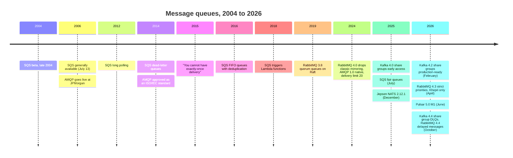
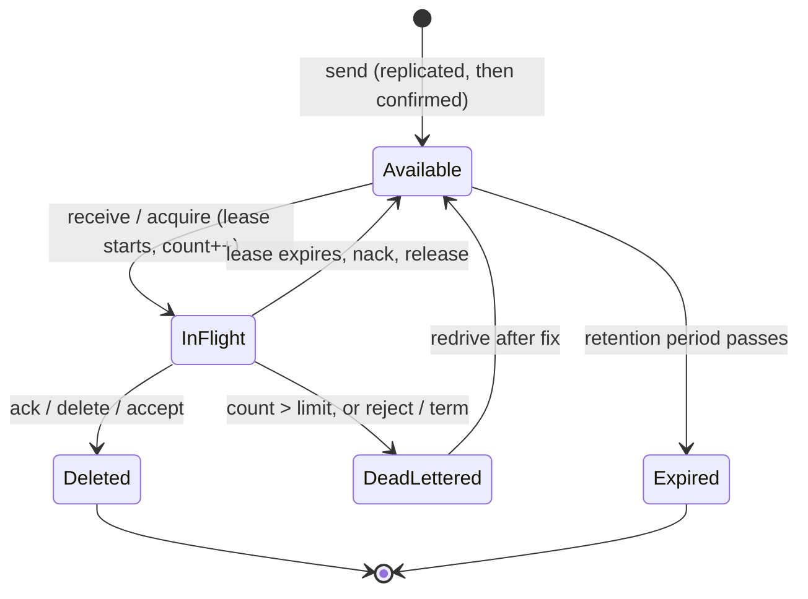
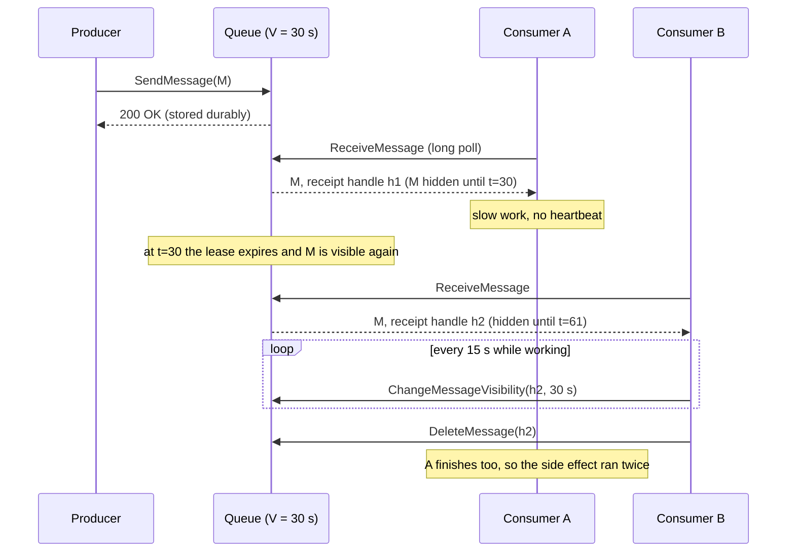

---
tags:
  - distributed-systems
  - message-queues
  - sqs
  - rabbitmq
  - kafka-share-groups
  - dead-letter-queues
  - at-least-once
status: complete
sources:
  - https://docs.aws.amazon.com/en_us/AWSSimpleQueueService/latest/SQSDeveloperGuide/sqs-visibility-timeout.html
  - https://docs.aws.amazon.com/AWSSimpleQueueService/latest/SQSDeveloperGuide/FIFO-queues-exactly-once-processing.html
  - https://docs.aws.amazon.com/AWSSimpleQueueService/latest/SQSDeveloperGuide/FIFO-key-terms.html
  - https://docs.aws.amazon.com/AWSSimpleQueueService/latest/SQSDeveloperGuide/sqs-dead-letter-queues.html
  - https://docs.aws.amazon.com/en_gb/AWSSimpleQueueService/latest/SQSDeveloperGuide/sqs-fair-queues.html
  - https://aws.amazon.com/about-aws/whats-new/2025/07/amazon-sqs-introduces-fair
  - https://aws.amazon.com/about-aws/whats-new/2025/11/amazon-eventbridge-sqs-fair-queue-targets
  - https://aws.amazon.com/blogs/aws/amazon-sqs-15-years-and-still-queueing
  - https://aws.amazon.com/blogs/aws/amazon-sqs-turns-20-two-decades-of-reliable-messaging-at-scale/
  - https://builder.aws.com/content/3EuRcgkTP1MI0c7zM8W6HL3WIqA/avoiding-insurmountable-queue-backlogs
  - https://bravenewgeek.com/you-cannot-have-exactly-once-delivery/
  - https://brooker.co.za/blog/2014/11/15/exactly-once/
  - https://redmonk.com/blog/2025/04/07/rmc-john-ohara-inventor-of-amqp-on-why-standards-are-worth-persevering-with/
  - https://www.infoq.com/news/2025/04/origin-advanced-message-queuing/
  - https://www.rabbitmq.com/blog/2019/11/11/rabbitmq-3-8-release-overview
  - https://www.rabbitmq.com/blog/2024/08/05/native-amqp
  - https://rabbitmq.com/blog/2024/08/28/quorum-queues-in-4.0
  - https://www.rabbitmq.com/docs/quorum-queues
  - https://www.rabbitmq.com/blog/2026/04/23/rabbitmq-4.3-release
  - https://www.rabbitmq.com/blog/2026/10/20/rabbitmq-4.4-release
  - https://cwiki.apache.org/confluence/display/KAFKA/KIP-932%3A+Queues+for+Kafka
  - https://kafka.apache.org/blog/2025/03/18/apache-kafka-4.0.0-release-announcement/
  - https://kafka.apache.org/blog/2026/10/22/apache-kafka-4.4.0-release-announcement/
  - https://pulsar.apache.org/docs/concepts-messaging
  - https://pulsar.apache.org/blog/2026/06/23/announcing-apache-pulsar-5-0-m1/
  - https://docs.nats.io/learn/jetstream/acknowledgment
  - https://jepsen.io/analyses/nats-2.12.1
  - https://encore.dev/articles/postgres-job-queue-skip-locked
  - https://dbos.dev/blog/making-postgres-queues-scale
created: 2026-11-26
updated: 2026-11-26
---

## Table Of Contents

---

- [[#TL;DR|TL;DR]]
- [[#The Problem|The Problem]]
- [[#Foundations|Foundations]]
    - [[#Queues Versus Logs|Queues Versus Logs]]
    - [[#Delivery Guarantees|Delivery Guarantees]]
    - [[#Acknowledgement Is a Lease|Acknowledgement Is a Lease]]
    - [[#Poison Messages and Dead-Letter Queues|Poison Messages and Dead-Letter Queues]]
    - [[#Ordering Versus Parallelism|Ordering Versus Parallelism]]
    - [[#Backlogs and Little's Law|Backlogs and Little's Law]]
- [[#How We Got Here|How We Got Here]]
- [[#How It Works|How It Works]]
    - [[#The Message Lifecycle|The Message Lifecycle]]
    - [[#Amazon SQS|Amazon SQS]]
    - [[#RabbitMQ Quorum Queues|RabbitMQ Quorum Queues]]
    - [[#Kafka Share Groups|Kafka Share Groups]]
    - [[#Pulsar Subscriptions|Pulsar Subscriptions]]
    - [[#NATS JetStream|NATS JetStream]]
    - [[#Queues in Postgres|Queues in Postgres]]
    - [[#Exactly-Once Processing on Top|Exactly-Once Processing on Top]]
    - [[#Side by Side|Side by Side]]
- [[#Where It Is Now|Where It Is Now]]
- [[#Trade-offs & Open Problems|Trade-offs & Open Problems]]
- [[#Resources|Resources]]
- [[#Related Notes|Related Notes]]

## ***TL;DR***
---
*A message queue hands each unit of work to one consumer, waits for that consumer to say it is done, and gives the work to someone else if it does not hear back in time. Almost everything interesting about queues follows from that timeout.*

- **A queue is a work dispenser, a log is a history.** In a [[Logs and Streaming|log]] every reader sees every record in order and tracks its own position. In a queue each message goes to one of many competing consumers and is deleted once acknowledged. Logs are for replay and fan-out; queues are for spreading work.
- **Acknowledgement is a lease.** A received message is hidden for a timeout (SQS calls it the *visibility timeout*, 30 seconds by default; Kafka share groups call it an *acquisition lock*, also 30 s; NATS calls it *AckWait*, also 30 s). Ack in time and it is gone; crash or run late and it reappears for another consumer ([SQS docs](https://docs.aws.amazon.com/en_us/AWSSimpleQueueService/latest/SQSDeveloperGuide/sqs-visibility-timeout.html), [KIP-932](https://cwiki.apache.org/confluence/display/KAFKA/KIP-932%3A+Queues+for+Kafka), [NATS docs](https://docs.nats.io/learn/jetstream/acknowledgment)). This is the same idea as [[Leases and Fencing|a lease]], and it has the same failure: a slow holder that outlives its lease.
- **So delivery is at-least-once.** Exactly-once *delivery* is impossible for the same reason as the Two Generals problem; what systems offer is exactly-once *processing*, built from deduplication and idempotent consumers ([Treat, 2015](https://bravenewgeek.com/you-cannot-have-exactly-once-delivery/); [Brooker, 2014](https://brooker.co.za/blog/2014/11/15/exactly-once/)).
- **Poison messages need a limit and a dead-letter queue (DLQ).** Every system counts deliveries and, past a limit, sets the message aside: SQS `maxReceiveCount`, RabbitMQ quorum queues' `delivery-limit` (20 by default since 4.0), Kafka share groups' attempt limit (5 by default, with DLQs since 4.4).
- **Now (Nov 2026):** SQS turned 20 in July 2026 and added fair queues for multi-tenant backlogs (July 2025); RabbitMQ 4.3 (April 2026) and 4.4 (October 2026) gave quorum queues strict priorities, delayed and deferred messages; Kafka 4.4 (October 2026) added DLQs to share groups; Pulsar 5.0 is in milestone with a new Queue consumer; Jepsen found NATS JetStream 2.12.1 losing acknowledged messages under its default lazy fsync (December 2025). Postgres-backed queues using `SKIP LOCKED` keep gaining ground for transactional job queues.

## ***The Problem***
---
*Services that call each other directly fail together and must run at the same speed. A queue between them lets the producer finish now and the consumer catch up later, but it moves the hard problems (duplicates, lost work, ordering, backlogs) into the queue's contract.*

A web request that resizes an image, sends an email and charges a card can do all three before replying, or it can drop three messages on queues and reply at once. The queue buys three things:

- **Decoupling in time.** The producer does not need the consumer to be up. If the email service is down for ten minutes, messages wait.
- **Load leveling.** A burst of 10,000 requests per second can be absorbed and drained at the consumers' pace instead of overloading them.
- **Work distribution.** Adding consumers adds throughput, with no coordination between them beyond the queue.

What it costs is a contract that is weaker than a function call. The producer cannot know when, or how many times, its message will be processed. The consumer can be handed the same message twice, or a message it cannot ever process. And a queue that absorbs a long outage turns into a backlog that may take hours to drain, during which every message is stale. The AWS Builders' Library puts it bluntly: "queueing that is meant to improve availability can backfire" ([Builders' Library](https://builder.aws.com/content/3EuRcgkTP1MI0c7zM8W6HL3WIqA/avoiding-insurmountable-queue-backlogs)).

## ***Foundations***
---
*Six ideas cover nearly every queue: queue versus log, delivery guarantees, the ack-as-lease, poison messages, the ordering/parallelism trade, and the arithmetic of backlogs.*

### Queues Versus Logs

*The two look alike from the producer's side. They differ in who owns the read position and when data is deleted.*

| | Queue (SQS, RabbitMQ classic and quorum queues) | Log ([[Logs and Streaming|Kafka, Pulsar topics]]) |
|---|---|---|
| A message goes to | one of the competing consumers | every subscriber group |
| Read position | the broker tracks each message's state | each reader tracks one offset |
| Deleted when | acknowledged (or retention expires) | retention expires; ack does not delete |
| Replay | no (once deleted, gone) | yes, rewind the offset |
| Parallelism | any number of consumers | at most one consumer per partition per group |
| Natural unit of ack | one message | an offset (everything before it) |

The line has blurred. Kafka share groups read an ordinary partitioned log with queue semantics ([[Logs and Streaming#Consumer Groups and Share Groups|see Logs and Streaming]]); RabbitMQ added log-style streams beside its queues; Pulsar has always offered both through subscription types. The useful question is no longer "queue or log product?" but "per-message ack or offset ack?" for each consumer.

### Delivery Guarantees

*There are three promises a messaging system can make, and only two can be kept over an unreliable network.*

- **At-most-once:** ack (or delete) before processing. A crash mid-processing loses the message.
- **At-least-once:** ack after processing. A crash after processing but before the ack causes a redelivery and the work runs twice.
- **Exactly-once delivery:** not achievable. The consumer's ack can always be lost or delayed, and the broker cannot tell a dead consumer from a slow one. Treat calls these "impossibility results, not engineering difficulties", tying them to the Two Generals problem and FLP ([Treat, 2015](https://bravenewgeek.com/you-cannot-have-exactly-once-delivery/)). See [[Failure Models]] and [[Time and Clocks]] for why "slow" and "dead" are indistinguishable.

What people actually want, Brooker argues, "is actually exactly-once processing", the side effect happening once, and "the simplest [way] is idempotence" ([Brooker, 2014](https://brooker.co.za/blog/2014/11/15/exactly-once/)). Every queue in this note is at-least-once at the consumer; the systems that advertise "exactly-once" scope it narrowly (SQS FIFO deduplicates *sends* within a 5-minute window; see below).

### Acknowledgement Is a Lease

*When a consumer receives a message, the broker lends it the message for a fixed time. The consumer must finish and ack before the loan expires, or extend it.*

The safety condition is the same as for any [[Leases and Fencing|lease]]:

$$
t_{\text{ack}} - t_{\text{receive}} < V
$$

where $V$ is the visibility timeout (or acquisition lock, or AckWait). In words: the consumer must ack before the broker gives up on it. If it does not, the broker assumes the consumer died and hands the message to someone else, and if the first consumer was merely slow, the work happens twice.

**Worked example (3 consumers, $V = 30$ s).**

1. $t = 0$: consumer A receives message M (resize image 42). M becomes invisible.
2. A's database call hangs. At $t = 30$ the lease expires and M is visible again.
3. $t = 31$: consumer B receives M, resizes the image, acks at $t = 38$. M is deleted.
4. $t = 45$: A's call returns; A also writes the resized image and tries to ack.

The image was resized twice. Harmless here because the operation is idempotent (same input, same output file); harmful if M were "charge card $20". Two fixes, used together: **heartbeat** the lease while working (the Builders' Library describes consumers that "continue to heartbeat that message to remind SQS that we're still working on it"; in SQS that is `ChangeMessageVisibility`), and make the handler **idempotent** so the duplicate costs nothing.

Choosing $V$ is a trade-off. Too short and slow-but-alive consumers cause duplicates; too long and a crashed consumer's messages sit invisible for the whole timeout before anyone retries them. Heartbeating lets $V$ be short (fast recovery) while long jobs keep extending it. SQS caps the total at 12 hours from first receipt ([SQS docs](https://docs.aws.amazon.com/en_us/AWSSimpleQueueService/latest/SQSDeveloperGuide/sqs-visibility-timeout.html)).

### Poison Messages and Dead-Letter Queues

*A message that crashes every consumer will be redelivered forever, burning capacity and, in an ordered queue, blocking everything behind it. Brokers count deliveries and move such messages to a dead-letter queue (DLQ) after a limit.*

The limit $k$ trades two errors. A **poison** message costs $k$ wasted attempts before it is set aside. A **good** message that hits transient failures ends up in the DLQ by mistake if it fails $k$ times in a row. If each attempt fails independently with probability $p$:

$$
P(\text{good message dead-lettered}) = p^{k}
$$

**Worked example.** During a flaky downstream outage, $p = 0.2$.

| Limit $k$ | $p^k$ | Good messages misrouted per 1M | Cost per poison message |
|---|---|---|---|
| 1 | 0.2 | 200,000 | 1 attempt |
| 5 (Kafka share group default) | 0.00032 | 320 | 5 attempts |
| 20 (RabbitMQ quorum default) | $\approx 10^{-14}$ | $\approx 0$ | 20 attempts |

Real failures are correlated (an outage fails every attempt), so the table is optimistic; pairing the limit with backoff between attempts matters as much as the number. AWS gives no fixed number and advises setting `maxReceiveCount` "high enough to allow for sufficient retries" ([SQS DLQ docs](https://docs.aws.amazon.com/AWSSimpleQueueService/latest/SQSDeveloperGuide/sqs-dead-letter-queues.html)).

A DLQ is only useful if someone drains it: inspect, fix the bug, then **redrive** the messages back to the source queue. SQS added console redrive in December 2021 and SDK/CLI redrive in June 2023 ([SQS at 20](https://aws.amazon.com/blogs/aws/amazon-sqs-turns-20-two-decades-of-reliable-messaging-at-scale/)).

### Ordering Versus Parallelism

*A single strictly ordered queue can only be processed by one consumer at a time. Every system that offers order and parallelism does it the same way: order within a key, parallelism across keys.*

- **SQS FIFO:** messages with the same `MessageGroupId` "are always processed one at a time, in strict order"; different groups proceed in parallel ([SQS FIFO terms](https://docs.aws.amazon.com/AWSSimpleQueueService/latest/SQSDeveloperGuide/FIFO-key-terms.html)).
- **Pulsar Key_Shared:** many consumers share a subscription, but each key is routed to one consumer ([Pulsar docs](https://pulsar.apache.org/docs/concepts-messaging)).
- **Kafka consumer groups:** order per [[Partitioning|partition]], one consumer per partition. Share groups drop the ordering to gain parallelism: order is only kept within one fetched batch ([KIP-932](https://cwiki.apache.org/confluence/display/KAFKA/KIP-932%3A+Queues+for+Kafka)).

Redelivery breaks order in all of them. If message 1 times out and message 2 is processed meanwhile, message 1 now comes after 2. A DLQ breaks it permanently: AWS warns "Don't use a dead-letter queue with a FIFO queue if you don't want to break the exact order of messages or operations" ([SQS DLQ docs](https://docs.aws.amazon.com/AWSSimpleQueueService/latest/SQSDeveloperGuide/sqs-dead-letter-queues.html)).

### Backlogs and Little's Law

*A queue holds messages only when arrivals outpace processing. How long the backlog takes to drain is simple arithmetic, and the answer is often much longer than the outage that caused it.*

Little's law relates queue length $L$, arrival rate $\lambda$ and time in queue $W$:

$$
L = \lambda W
$$

And a backlog $B$ drains only at the *spare* capacity, consumer throughput $\mu$ minus arrivals:

$$
T_{\text{drain}} = \frac{B}{\mu - \lambda} \qquad (\mu > \lambda)
$$

In words: the queue shrinks only as fast as consumers outrun new work. If $\mu \le \lambda$ it never drains.

**Worked example.** Arrivals $\lambda = 1{,}000$ msg/s. Consumers were down for 30 minutes, leaving $B = 1{,}000 \times 1{,}800 = 1.8\text{M}$ messages.

- Consumers at $\mu = 1{,}500$ msg/s: $T_{\text{drain}} = 1.8\text{M} / 500 = 3{,}600$ s. A 30-minute outage costs an hour of recovery.
- Consumers at $\mu = 1{,}050$ msg/s: $1.8\text{M} / 50 = 36{,}000$ s, ten hours.
- The first message processed after recovery waited $W = L / \lambda = 1{,}800$ s (30 minutes); in a FIFO queue every new message also waits behind the backlog.

This is the Builders' Library's "bimodal behavior": a queue-based system is either near-empty and fast or backlogged and slow, with little in between ([Builders' Library](https://builder.aws.com/content/3EuRcgkTP1MI0c7zM8W6HL3WIqA/avoiding-insurmountable-queue-backlogs)). The remedies it lists are all ways to avoid processing stale work first: prefer "LIFO-ish behavior" for real-time work, drop messages too old to matter ("Some systems can tolerate very old messages being dropped"), move excess into "separate spillover queues", and give tenants separate queues or shuffle-shard them so one tenant's backlog does not delay everyone. [[Queueing Theory for Systems]] will cover the theory; [[Reliability Patterns]] covers backpressure and admission control.

## ***How We Got Here***
---
*Message queues started as enterprise middleware with proprietary protocols, became an open standard (AMQP) and a cloud API (SQS), and then partly merged with the replicated log.*



**Proprietary middleware to AMQP (late 1990s to 2014).** Banks ran on commercial messaging middleware with no common protocol. John O'Hara, who designed AMQP at JPMorgan, describes how "the temptation to write your own was really, really high" because middleware was costly and unstandardized, and how a licensing dispute in which the vendor "basically pointed the gun at the firm's head" made the business case for an open protocol. AMQP went live in 2006 ("2006 was a huge year because we put the thing live"); its working group reorganized into an OASIS member section in 2011, and in 2014 OASIS AMQP was approved as an ISO/IEC standard ([RedMonk interview, 2025](https://redmonk.com/blog/2025/04/07/rmc-john-ohara-inventor-of-amqp-on-why-standards-are-worth-persevering-with/)). RabbitMQ became the most widely deployed AMQP implementation ([InfoQ, 2025](https://www.infoq.com/news/2025/04/origin-advanced-message-queuing/)).

**Queues as a cloud primitive (2004 to 2018).** SQS was "announced with little fanfare in late 2004" as a beta and launched for production on July 13, 2006, among the first three AWS services ([Barr, 2021](https://aws.amazon.com/blogs/aws/amazon-sqs-15-years-and-still-queueing); [SQS at 20](https://aws.amazon.com/blogs/aws/amazon-sqs-turns-20-two-decades-of-reliable-messaging-at-scale/)). Its API made the visibility timeout the standard mental model. Long polling followed in 2012, dead-letter queues in 2014, FIFO queues "with exactly-once processing and deduplication" in 2016, and Lambda triggers in 2018 ([Barr, 2021](https://aws.amazon.com/blogs/aws/amazon-sqs-15-years-and-still-queueing)).

**The exactly-once argument (2014 to 2015).** As Kafka and others began advertising exactly-once, Brooker (2014) and Treat (2015) set out the distinction this note relies on: delivery can only be at-most-once or at-least-once, and "exactly-once" is achieved "by faking it" with idempotence or deduplication ([Treat](https://bravenewgeek.com/you-cannot-have-exactly-once-delivery/); [Brooker](https://brooker.co.za/blog/2014/11/15/exactly-once/)). Kafka's own transactional exactly-once is covered in [[Logs and Streaming]].

**Queues adopt consensus (2019 to 2024).** RabbitMQ's original replicated queues mirrored messages without a consensus protocol. RabbitMQ 3.8 (November 2019) introduced quorum queues, "the next generation of replicated queue", built on "the well established Raft protocol" ([RabbitMQ 3.8](https://www.rabbitmq.com/blog/2019/11/11/rabbitmq-3-8-release-overview)). RabbitMQ 4.0 (2024) removed classic queue mirroring, made AMQP 1.0 a core protocol, and set a default delivery limit of 20 on quorum queues ([quorum queues in 4.0](https://rabbitmq.com/blog/2024/08/28/quorum-queues-in-4.0); [native AMQP 1.0](https://www.rabbitmq.com/blog/2024/08/05/native-amqp)). See [[Raft]].

**Logs learn to be queues (2025 to 2026).** Kafka 4.0 (March 2025) shipped share groups in early access, saying the feature "does not add the concept of a 'queue' to Kafka per se" but reads a log with queue semantics; 4.2 (February 2026) made it production-ready and 4.4 (October 2026) added DLQs ([4.0](https://kafka.apache.org/blog/2025/03/18/apache-kafka-4.0.0-release-announcement/); [4.4](https://kafka.apache.org/blog/2026/10/22/apache-kafka-4.4.0-release-announcement/)). Pulsar, which always had shared subscriptions, is adding a dedicated Queue consumer in 5.0 ([Pulsar 5.0 M1](https://pulsar.apache.org/blog/2026/06/23/announcing-apache-pulsar-5-0-m1/)).

## ***How It Works***
---
*The lifecycle is shared by every system; what differs is where the message state lives, how it is replicated, and the defaults for timeouts and limits.*

### The Message Lifecycle

*Every queue in this note implements roughly the same state machine per message. The names change; the shape does not.*



The sequence below is the SQS version of the worked example in [[#Acknowledgement Is a Lease|Acknowledgement Is a Lease]], with heartbeating added for the consumer that knows it will be slow.



### Amazon SQS

*SQS hides the replication and partitioning entirely; the user sees a URL, a visibility timeout and two queue types.*

- **Visibility timeout:** default 30 s, extendable or cut to 0 with `ChangeMessageVisibility`, capped at 12 hours from first receipt. On expiry "the message becomes visible again in the queue and can be retrieved by another consumer." Standard queues allow "approximately 120,000 in-flight messages" ([SQS docs](https://docs.aws.amazon.com/en_us/AWSSimpleQueueService/latest/SQSDeveloperGuide/sqs-visibility-timeout.html)).
- **Standard queues** are at-least-once with best-effort order: "there's no absolute guarantee that a message won't be delivered more than once during the visibility timeout period."
- **FIFO queues** order messages per `MessageGroupId` and deduplicate sends: "If you retry the `SendMessage` action within the 5-minute deduplication interval, Amazon SQS doesn't introduce any duplicates into the queue." The deduplication ID is either given or, with content-based deduplication, "a SHA-256 hash ... of the message ... body" ([FIFO exactly-once](https://docs.aws.amazon.com/AWSSimpleQueueService/latest/SQSDeveloperGuide/FIFO-queues-exactly-once-processing.html)). This protects against producer retries; it does not stop a consumer from processing a redelivered message twice.
- **DLQs** use a redrive policy with `maxReceiveCount`. In standard queues the enqueue timestamp survives the move to the DLQ, so retention counts from the original send; in FIFO queues it resets ([SQS DLQ docs](https://docs.aws.amazon.com/AWSSimpleQueueService/latest/SQSDeveloperGuide/sqs-dead-letter-queues.html)).
- **Fair queues** (July 2025) reuse `MessageGroupId` on *standard* queues as a tenant ID. When one tenant "has a disproportionately large number of in-flight messages compared to others", SQS "prioritizes message delivery for other tenants", so a noisy tenant's backlog raises its own dwell time rather than everyone's. It needs no consumer change and adds a metric, `ApproximateNumberOfMessagesVisibleInQuietGroups` ([fair queues docs](https://docs.aws.amazon.com/en_gb/AWSSimpleQueueService/latest/SQSDeveloperGuide/sqs-fair-queues.html)). This is the managed version of the Builders' Library advice to isolate tenants; see also [[Hot Keys and Cache Stampedes]] and the planned [[Resource Fairness]].

### RabbitMQ Quorum Queues

*RabbitMQ routes messages through exchanges into queues; the quorum queue type replicates each queue with Raft so a confirmed message survives the loss of a minority of nodes.*

- **Replication:** "a durable, replicated queue based on the Raft consensus algorithm." A publisher confirm is sent only once the message is on a majority, $\lfloor N/2 \rfloor + 1$ members ([quorum queue docs, 4.4](https://www.rabbitmq.com/docs/quorum-queues)). With 3 members, 2 must have it; one node can fail with no confirmed message lost. See [[Raft]] and [[Replication]].
- **Consumer acks and leases:** consumers ack, nack or requeue each delivery. Unlike SQS there is no default lease: `consumer_timeout` is undefined unless set per consumer, queue, policy or globally. A consumer that holds messages on an open connection keeps them until it acks or disconnects.
- **Poison messages:** `delivery-limit` defaults to 20 (since 4.0); redeliveries are reported in `x-delivery-count`; past the limit the message is dropped, or dead-lettered if a dead-letter exchange is set. Since 4.3 only *failed* deliveries count toward the limit, so a consumer can return messages it chose not to process without pushing them toward the DLQ ([4.3 release](https://www.rabbitmq.com/blog/2026/04/23/rabbitmq-4.3-release)).
- **Dead-lettering is at-most-once by default.** At-least-once dead-lettering requires `dead-letter-strategy: at-least-once` with `overflow: reject-publish`, costs memory and CPU, and can duplicate at the target ([quorum queue docs](https://www.rabbitmq.com/docs/quorum-queues)). A DLQ that silently loses the messages it was meant to keep is a common surprise.
- **When not to use them:** the docs steer temporary or high-churn queues, lowest-latency workloads and very long backlogs (5M+ messages) or large fan-outs elsewhere, the last to RabbitMQ streams.

### Kafka Share Groups

*Share groups read an ordinary Kafka topic but lock and acknowledge records one at a time, so consumers can outnumber partitions.* The full mechanism is in [[Logs and Streaming#Consumer Groups and Share Groups|Logs and Streaming]]; the queue-relevant points are:

- Records are acquired under a lock ("By default, the lock duration is 30s") and acknowledged individually as **accept**, **release** (try again) or **reject** (do not redeliver) ([KIP-932](https://cwiki.apache.org/confluence/display/KAFKA/KIP-932%3A+Queues+for+Kafka)).
- Each acquisition counts a delivery; after the "share delivery attempt limit (5 by default)" the record is archived.
- Kafka 4.4 (October 2026, KIP-1191): records "released beyond the max delivery count, or rejected by the share consumer" can go to a DLQ topic once `share.version` is 2, configured through `errors.deadletterqueue.*` settings. KIP-1323 lets a share group start from a consumer group's committed offsets, which eases migrating a consumer group to queue semantics ([4.4 announcement](https://kafka.apache.org/blog/2026/10/22/apache-kafka-4.4.0-release-announcement/)).
- Because the data is still a log, retention, not acknowledgement, deletes records; another consumer group can still replay them.

### Pulsar Subscriptions

*Pulsar separates storage (topics in BookKeeper) from consumption (subscriptions), and the subscription type decides whether a topic behaves as a queue or a log.*

- **Exclusive** allows "only ... a single consumer"; **Failover** lets several attach with one active; **Shared** lets several consumers attach and spreads messages among them, which is queue behavior; **Key_Shared** spreads them while keeping each key on one consumer ([Pulsar docs, 5.0.x](https://pulsar.apache.org/docs/concepts-messaging)).
- Failed messages can be **negatively acknowledged** for redelivery; an **ack timeout** redelivers unacked messages but "By default, the acknowledge timeout is disabled"; a **dead letter topic** and a **retry letter topic** (with delayed redelivery) handle poison and transient failures.
- Pulsar 5.0's V5 Java client adds a Queue consumer for "parallel, individually-acknowledged work-queue consumption with dead-letter support" ([5.0 M1](https://pulsar.apache.org/blog/2026/06/23/announcing-apache-pulsar-5-0-m1/)).

### NATS JetStream

*JetStream stores messages in replicated streams and lets consumers ack each one; with work-queue retention, an acked message is removed, which makes the stream a queue.*

- Acks are **Ack**, **Nak** (redeliver, optionally after a delay), **Term** ("This message can never be handled, so don't deliver it again to anyone") and **In-progress** (resets the timer). AckWait "defaults to 30 seconds" ([NATS docs](https://docs.nats.io/learn/jetstream/acknowledgment)).
- **MaxDeliver defaults to -1**, so "A message can be redelivered forever", and JetStream has no built-in DLQ: it publishes advisories (max deliveries, nak, terminated) that an application can turn into one. This is the opposite default to RabbitMQ and Kafka, and an unbounded poison loop is the default failure.
- **Durability depends on fsync.** JetStream flushes to disk on a timer, two minutes by default, and relies on replication to survive an OS crash. Jepsen's December 2025 analysis of 2.12.1 lost 131,418 of 930,005 acknowledged messages (about 14%, roughly 30 seconds of writes) in simulated power failures, and found that a single OS crash plus a pause or partition could leave the cluster in a persistent split-brain. Jepsen recommended defaulting `fsync` to `always` or documenting the risk; NATS added documentation ([Jepsen](https://jepsen.io/analyses/nats-2.12.1)). See [[Failure Models]] and [[Isolation Testing]] for how Jepsen tests.

### Queues in Postgres

*For jobs created inside a database transaction, the simplest queue is a table in that database. `SELECT ... FOR UPDATE SKIP LOCKED` lets many workers claim different rows without blocking each other.*

The pattern ([Encore, Nov 2026](https://encore.dev/articles/postgres-job-queue-skip-locked)):

```sql
UPDATE jobs
SET status = 'running', lease_id = gen_random_uuid(),
    lease_expires_at = now() + interval '30 seconds'
WHERE id IN (
  SELECT id FROM jobs
  WHERE status = 'ready' AND run_at <= now()
  ORDER BY run_at
  FOR UPDATE SKIP LOCKED
  LIMIT 10)
RETURNING id, payload, lease_id;
```

It is the same lease protocol by hand: the claim commits at once so the job is not held in an open transaction while it runs; completion is scoped to the worker's `lease_id` so a stale worker cannot mark a reclaimed job done (a [[Leases and Fencing|fencing token]] in all but name); expired leases are reclaimed. The big advantage is atomicity: the job row commits or rolls back with the business write, with no [[Change Data Capture|outbox]] needed.

The costs are Postgres's own. Every claim and completion is an UPDATE that "writes a new row version", so a busy queue makes dead tuples fast ([[MVCC and Version Garbage Collection]]); if autovacuum falls behind, "the partial index and the table grow and the claim query slows down", and long transactions elsewhere block vacuum and hurt the queue first. DBOS reports that without `SKIP LOCKED`, worker contention capped them at about 100 workflows per second; with it, plus READ COMMITTED isolation (REPEATABLE READ caused mostly serialization failures above about 1,000 dequeues per second) and partial indexes, they reached over 30,000 per second ([DBOS, June 2026](https://dbos.dev/blog/making-postgres-queues-scale)). Libraries such as River (Go), pg-boss and Graphile Worker (Node.js) package the pattern.

### Exactly-Once Processing on Top

*Since every queue redelivers, exactly-once effects come from the consumer. There are three standard ways.*

1. **Naturally idempotent operations.** "Set status to shipped" or "write thumbnail 42" can run twice safely. Prefer designing messages this way.
2. **An inbox (deduplication) table.** In the same database transaction as the side effect, insert the message ID into a `processed_messages` table with a unique constraint. A redelivery hits the constraint and is skipped. This works only when the side effect is in that database.
3. **Idempotency keys at the downstream API.** For effects outside the database (payments, emails), pass the message ID as an idempotency key so the downstream service deduplicates.

On the producer side, the mirror problem (writing to the database and the queue atomically) is solved by the transactional outbox, covered in [[Change Data Capture]], or by putting the queue in the database as above. Across services, the saga pattern in [[Distributed Transactions]] chains these steps.

**Worked example (inbox table, 2 deliveries).** Message M (id `m-17`, "credit account 9 with $20") is delivered to A, which runs `BEGIN; INSERT INTO processed(id) VALUES ('m-17'); UPDATE accounts SET balance = balance + 20 WHERE id = 9; COMMIT;` and crashes before acking. The lease expires; B receives M and runs the same transaction. The INSERT fails on the unique key, B rolls back, acks, and the balance was credited once.

### Side by Side

*Defaults decide most production behavior, because most teams never change them.*

| System | Lease name, default | Redelivery limit, default | DLQ | Ordering |
|---|---|---|---|---|
| SQS standard | visibility timeout, 30 s (max 12 h total) | `maxReceiveCount`, set with DLQ | yes, redrive policy | best effort |
| SQS FIFO | visibility timeout, 30 s | `maxReceiveCount` | yes (breaks order) | strict per message group |
| RabbitMQ quorum queue | none by default (`consumer_timeout` unset) | `delivery-limit`, 20 | dead-letter exchange; at-most-once unless configured | queue order until requeue |
| Kafka share group | acquisition lock, 30 s | delivery attempts, 5 | yes since 4.4 (KIP-1191) | within a fetched batch only |
| Pulsar shared subscription | ack timeout, disabled | set on DLQ policy | dead letter topic, retry topic | none (Key_Shared: per key) |
| NATS JetStream | AckWait, 30 s | MaxDeliver, unlimited | none built in (advisories) | per stream; redeliveries reorder |
| Postgres `SKIP LOCKED` | your lease column | your code | your code | your `ORDER BY` |

## ***Where It Is Now***
---
*As of November 26, 2026: the managed queues are adding multi-tenant fairness and larger payloads, the open-source brokers are filling feature gaps (priorities, delays, DLQs), and correctness testing keeps finding that durability defaults are weaker than users assume.*

**Amazon SQS (dated).**
- July 13, 2026: 20 years in production. Recent changes listed in AWS's anniversary post: FIFO in-flight limit raised from 20,000 to 120,000 (November 2024), fair queues (July 2025), maximum payload raised from 256 KiB to 1 MiB (August 2025) ([SQS at 20](https://aws.amazon.com/blogs/aws/amazon-sqs-turns-20-two-decades-of-reliable-messaging-at-scale/)).
- July 21, 2025: fair queues, "a new feature that mitigates noisy neighbor impact in multi-tenant standard queues" ([announcement](https://aws.amazon.com/about-aws/whats-new/2025/07/amazon-sqs-introduces-fair)); EventBridge can target fair queues since November 2025 ([announcement](https://aws.amazon.com/about-aws/whats-new/2025/11/amazon-eventbridge-sqs-fair-queue-targets)).

**RabbitMQ (dated).**
- 4.3, April 23, 2026: quorum queues get 32 strict priority levels ("Messages with a higher priority are now delivered to consumers strictly before those with a lower priority"), replacing 4.0's two-level scheme; Khepri "is now the only supported metadata store", ending Mnesia and its partition-handling modes; only failed deliveries count toward the delivery limit ([4.3](https://www.rabbitmq.com/blog/2026/04/23/rabbitmq-4.3-release)).
- 4.4, October 20, 2026: quorum queues gain **delayed messages** (a producer "can set a future delivery time"), **deferred messages** (a consumer sets a message aside under a token and fetches it later), and availability-zone-aware member placement ([4.4](https://www.rabbitmq.com/blog/2026/10/20/rabbitmq-4.4-release)). Delayed delivery, long a plugin, is now native to the replicated queue type.

**Kafka (dated).** Share groups production-ready in 4.2 (February 2026); 4.4 (October 22, 2026) adds share group DLQs (KIP-1191) and initializing a share group from a consumer group's offsets (KIP-1323) ([4.4](https://kafka.apache.org/blog/2026/10/22/apache-kafka-4.4.0-release-announcement/)). With DLQs, the main gap between share groups and a classic broker queue is closed; what remains different is retention-based deletion and the absence of per-message delays.

**Pulsar (dated).** 5.0.0-M1 (June 23, 2026) is a milestone "not meant for production", headlined by scalable topics that split and merge by key range, plus the Queue consumer in the V5 client ([5.0 M1](https://pulsar.apache.org/blog/2026/06/23/announcing-apache-pulsar-5-0-m1/)). I found no 5.0 GA release as of this note.

**Correctness (dated).** Jepsen's NATS 2.12.1 report (December 8, 2025): lazy fsync lost about 14% of acknowledged writes in power-failure simulations, file corruption on a minority of nodes lost up to about half, and some failures led to persistent split-brain ([Jepsen](https://jepsen.io/analyses/nats-2.12.1)). The lesson generalizes: ask whether a broker's "acknowledged" means *on a majority of disks* or only *in a majority of memories*.

**Postgres as the queue (2026).** Practitioner writing through 2026 (DBOS in June, Encore in November) argues that for transactional job queues "just use Postgres" scales far further than its reputation, provided indexes are partial, isolation is READ COMMITTED and vacuum keeps up ([DBOS](https://dbos.dev/blog/making-postgres-queues-scale); [Encore](https://encore.dev/articles/postgres-job-queue-skip-locked)). Dedicated brokers keep the edge for fan-out, cross-service delivery and very high churn.

## ***Trade-offs & Open Problems***
---
*Most queue incidents come from four places: lease timing, poison messages, backlogs, and durability defaults. None of them has a setting that is right for every workload.*

| Choice | Gains | Costs |
|---|---|---|
| Short lease (visibility timeout) | Fast retry after a crash | Duplicates from slow-but-alive consumers unless they heartbeat |
| Long lease | Few duplicates | A crashed consumer's messages wait the whole lease |
| Low delivery limit | Poison messages cost little | Good messages land in the DLQ during transient outages |
| High or unlimited limit | Rides out outages | Poison messages loop; NATS's default is unlimited |
| Strict order (FIFO, message groups) | Simple reasoning per key | Parallelism capped by key count; a stuck message blocks its group; DLQ breaks order |
| Queue (delete on ack) | Simple, cheap storage | No replay, single consumer per message |
| Log with queue reads (share groups) | Replay and fan-out kept | Retention, not ack, frees space; weaker ordering |
| Queue in the app database | Atomic with business writes | Vacuum pressure and dead tuples; limited fan-out |
| Lazy fsync | Throughput | Acked messages lost when nodes fail together ([Jepsen](https://jepsen.io/analyses/nats-2.12.1)) |

**Open problems.**
- **Exactly-once stays an application problem.** SQS FIFO's deduplication is a 5-minute window on sends; Kafka's transactions cover Kafka-to-Kafka. Effects in other systems still need idempotency keys or an inbox table, and there is no standard for carrying them end to end.
- **DLQs are operationally manual.** Moving a message aside is automated; deciding whether to fix, redrive or discard it is not, and DLQs are often unmonitored until they fill. RabbitMQ's at-most-once default dead-lettering can even lose what it set aside.
- **Backlog recovery.** Little's law makes long recoveries inevitable after long outages. Dropping stale work, LIFO-ish processing and per-tenant isolation help ([Builders' Library](https://builder.aws.com/content/3EuRcgkTP1MI0c7zM8W6HL3WIqA/avoiding-insurmountable-queue-backlogs)), but retry storms from producers can turn a backlog into a metastable failure ([[Failure Models]], [[Reliability Patterns]]). Fair queues tackle the multi-tenant case but are, so far, SQS-specific.
- **Gray failures of consumers.** A consumer that is alive but very slow keeps renewing its lease (if it heartbeats) or causes repeated duplicates (if it does not). Neither the broker nor the lease can tell slow from stuck; see [[Gray and Fail-Slow Failures]].
- **Queues on object storage.** Logs are moving onto object storage ([[Diskless Streaming]], [[Object Storage]]); whether per-message-ack queues, which mutate state on every delivery, can follow cheaply is still open.

## ***Resources***
---
*Primary docs for the systems, the two essays that settle the exactly-once question, the Builders' Library on backlogs, and Jepsen for what actually breaks.*

**Concepts and practice**
- [Treat, "You Cannot Have Exactly-Once Delivery" (2015)](https://bravenewgeek.com/you-cannot-have-exactly-once-delivery/): the impossibility argument and "faking it" with idempotence.
- [Brooker, "Exactly-Once Delivery May Not Be What You Want" (2014)](https://brooker.co.za/blog/2014/11/15/exactly-once/): exactly-once processing via idempotence.
- [Avoiding insurmountable queue backlogs (AWS Builders' Library)](https://builder.aws.com/content/3EuRcgkTP1MI0c7zM8W6HL3WIqA/avoiding-insurmountable-queue-backlogs): bimodal behavior, LIFO, spillover queues, shuffle-sharded queues, heartbeating.
- [RedMonk interview with John O'Hara (2025)](https://redmonk.com/blog/2025/04/07/rmc-john-ohara-inventor-of-amqp-on-why-standards-are-worth-persevering-with/): why AMQP was created.

**Amazon SQS**
- [Visibility timeout](https://docs.aws.amazon.com/en_us/AWSSimpleQueueService/latest/SQSDeveloperGuide/sqs-visibility-timeout.html), [FIFO exactly-once processing](https://docs.aws.amazon.com/AWSSimpleQueueService/latest/SQSDeveloperGuide/FIFO-queues-exactly-once-processing.html), [FIFO key terms](https://docs.aws.amazon.com/AWSSimpleQueueService/latest/SQSDeveloperGuide/FIFO-key-terms.html), [dead-letter queues](https://docs.aws.amazon.com/AWSSimpleQueueService/latest/SQSDeveloperGuide/sqs-dead-letter-queues.html), [fair queues](https://docs.aws.amazon.com/en_gb/AWSSimpleQueueService/latest/SQSDeveloperGuide/sqs-fair-queues.html).
- [SQS at 15 (2021)](https://aws.amazon.com/blogs/aws/amazon-sqs-15-years-and-still-queueing) and [SQS at 20 (2026)](https://aws.amazon.com/blogs/aws/amazon-sqs-turns-20-two-decades-of-reliable-messaging-at-scale/): dated history.
- [Fair queues announcement (July 2025)](https://aws.amazon.com/about-aws/whats-new/2025/07/amazon-sqs-introduces-fair); [EventBridge fair queue targets (November 2025)](https://aws.amazon.com/about-aws/whats-new/2025/11/amazon-eventbridge-sqs-fair-queue-targets).

**RabbitMQ**
- [Quorum queues docs (4.4)](https://www.rabbitmq.com/docs/quorum-queues); [3.8 release overview (2019)](https://www.rabbitmq.com/blog/2019/11/11/rabbitmq-3-8-release-overview); [quorum queues in 4.0](https://rabbitmq.com/blog/2024/08/28/quorum-queues-in-4.0); [native AMQP 1.0](https://www.rabbitmq.com/blog/2024/08/05/native-amqp); [4.3 release](https://www.rabbitmq.com/blog/2026/04/23/rabbitmq-4.3-release); [4.4 release](https://www.rabbitmq.com/blog/2026/10/20/rabbitmq-4.4-release).

**Kafka, Pulsar, NATS**
- [KIP-932: Queues for Kafka](https://cwiki.apache.org/confluence/display/KAFKA/KIP-932%3A+Queues+for+Kafka); [Kafka 4.0 announcement](https://kafka.apache.org/blog/2025/03/18/apache-kafka-4.0.0-release-announcement/); [Kafka 4.4 announcement](https://kafka.apache.org/blog/2026/10/22/apache-kafka-4.4.0-release-announcement/).
- [Pulsar messaging concepts](https://pulsar.apache.org/docs/concepts-messaging); [Pulsar 5.0 M1](https://pulsar.apache.org/blog/2026/06/23/announcing-apache-pulsar-5-0-m1/).
- [NATS JetStream acknowledgements](https://docs.nats.io/learn/jetstream/acknowledgment); [Jepsen: NATS 2.12.1 (2025)](https://jepsen.io/analyses/nats-2.12.1).

**Postgres queues**
- [Encore, Postgres as a Job Queue (Nov 2026)](https://encore.dev/articles/postgres-job-queue-skip-locked); [DBOS, Postgres Queues Actually Scale (June 2026)](https://dbos.dev/blog/making-postgres-queues-scale).

## ***Related Notes***
---
*Queues sit between logs (the other way to move messages), leases (the mechanism behind acks), and the reliability patterns that keep consumers and producers from overloading each other.*

- [[Logs and Streaming]] — The log abstraction, consumer groups and the full share group mechanism.
- [[Change Data Capture]] — The transactional outbox for publishing to a queue atomically with a database write.
- [[Stream Processing]] — Consumers that need ordered, replayable input use logs rather than queues.
- [[Leases and Fencing]] — The visibility timeout is a lease; lease IDs on job rows are fencing tokens.
- [[Reliability Patterns]] — Retries with backoff, idempotency and backpressure around queue consumers.
- [[Failure Models]] — Why a slow consumer looks dead, and metastable retry storms.
- [[Gray and Fail-Slow Failures]] — Slow-but-alive consumers and lease renewal.
- [[Raft]] — The consensus protocol behind RabbitMQ quorum queues.
- [[Replication]] — Majority confirms and what "acknowledged" means.
- [[Partitioning]] — Keys, partitions and per-key ordering.
- [[Hot Keys and Cache Stampedes]] — Noisy tenants and hot keys, the problem fair queues address.
- [[Distributed Transactions]] — Sagas built from queues and outboxes.
- [[Isolation Testing]] — Jepsen-style testing that found NATS's durability gaps.
- [[Object Storage]] — Where logs, and perhaps queues, are moving.
- [[Queueing Theory for Systems]] — Planned: Little's law, Erlang-C and admission control in depth.
- [[Tail Latency and Hedging]] — Planned: how queueing delay shows up in tail latency.
- [[Resource Fairness]] — Planned: fair sharing between tenants.
- [[Diskless Streaming]] — Logs built on object storage.
- [[Zonal Isolation and Cell-Based Architecture]] — Planned: per-cell queues as an isolation boundary.
- [[MVCC and Version Garbage Collection]] — Dead tuples, the xmin horizon and why long transactions starve a Postgres queue.
