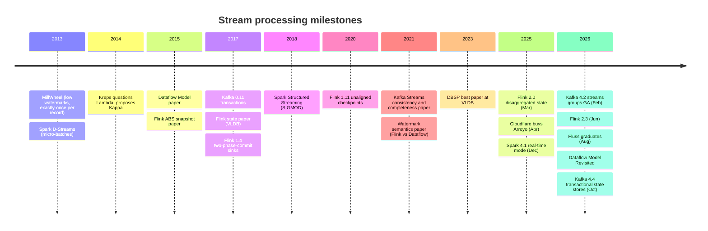
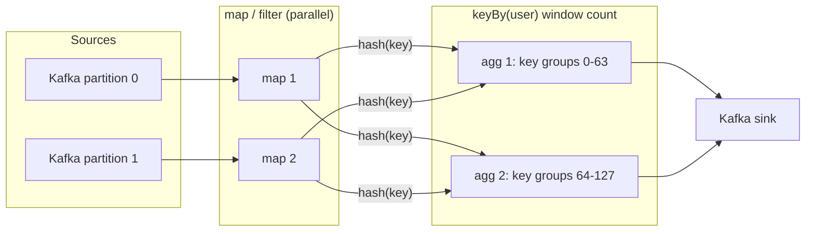
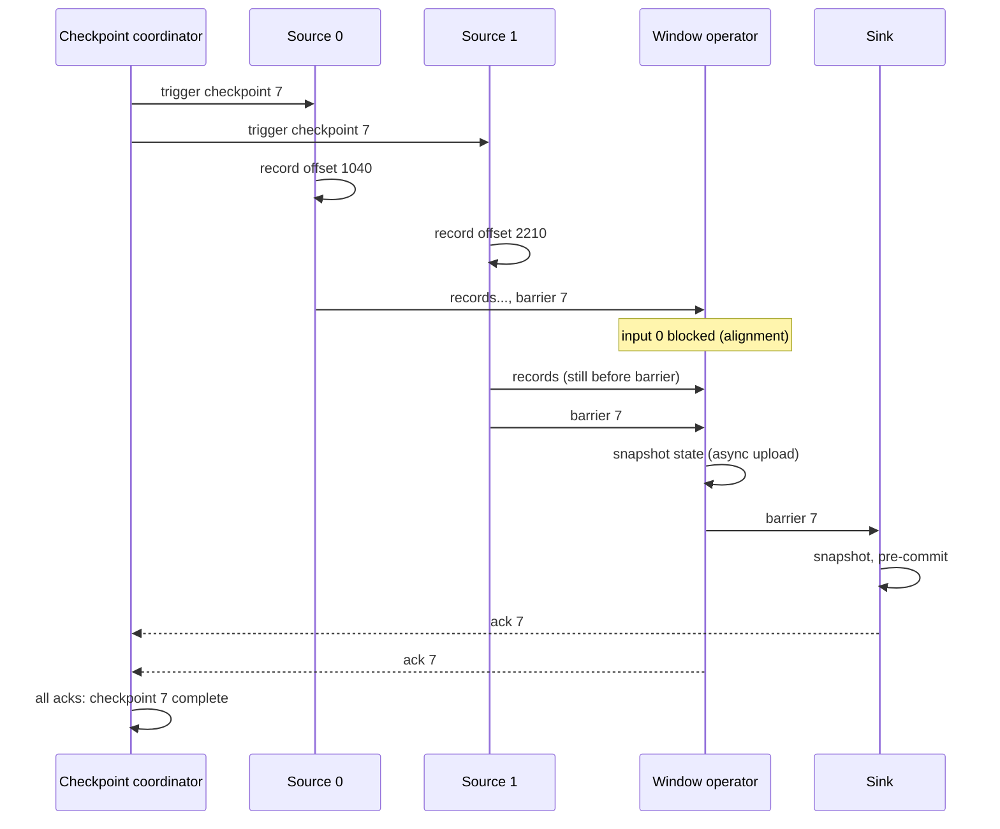
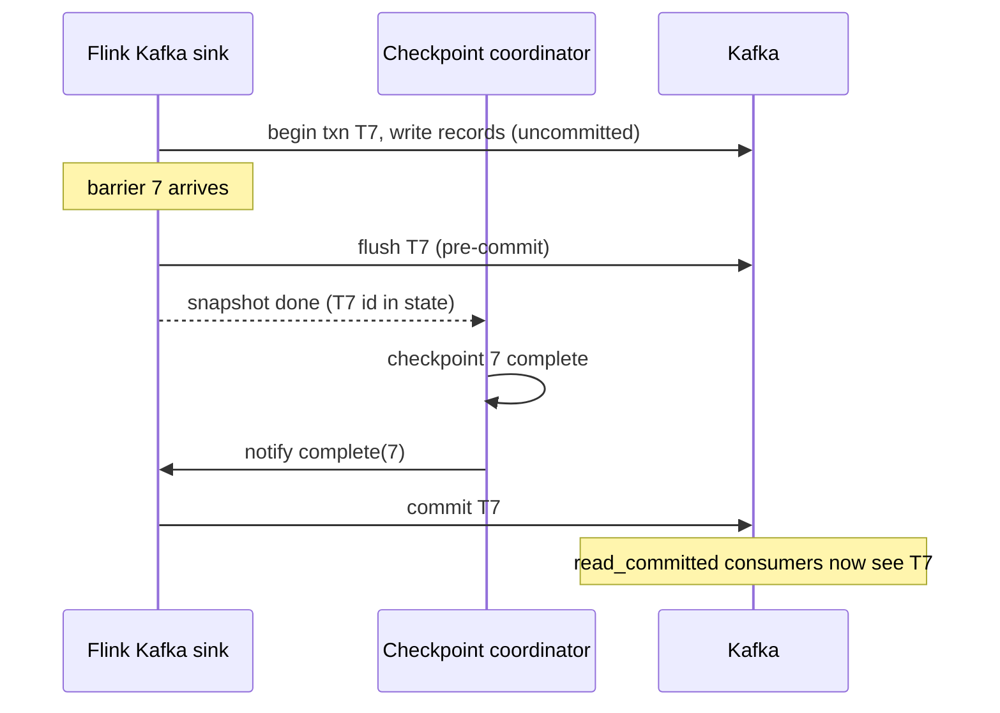

---
tags:
  - distributed-systems
  - stream-processing
  - flink
  - kafka-streams
  - watermarks
  - exactly-once
status: draft
sources:
  - https://www.cl.cam.ac.uk/~ey204/teaching/ACS/R212_2015_2016/papers/akidau_vldb_2013.pdf
  - https://www.vldb.org/pvldb/vol8/p1792-Akidau.pdf
  - https://www.vldb.org/pvldb/vol19/p4953-fernandez-moctezuma.pdf
  - https://vldb.org/pvldb/vol14/p3135-begoli.pdf
  - https://arxiv.org/abs/1506.08603
  - https://www.vldb.org/pvldb/vol10/p1718-carbone.pdf
  - https://www.vldb.org/pvldb/vol18/p4846-mei.pdf
  - https://www.vldb.org/pvldb/vol16/p1601-budiu.pdf
  - https://www.cs.berkeley.edu/%7Ehaoyuan/papers/2013_sosp_spark_streaming.pdf
  - https://databricks.com/jp/wp-content/uploads/2018/12/sigmod_structured_streaming.pdf
  - https://www.oreilly.com/radar/questioning-the-lambda-architecture/
  - https://www.confluent.io/es-mx/blog/rethinking-distributed-stream-processing-in-kafka/
  - https://www.confluent.io/ko-kr/blog/kafka-streams-take-on-watermarks-and-triggers/
  - https://kafka.apache.org/44/streams/architecture/
  - https://kafka.apache.org/44/streams/developer-guide/streams-rebalance-protocol/
  - https://kafka.apache.org/blog/2026/02/17/apache-kafka-4.2.0-release-announcement/
  - https://kafka.apache.org/blog/2026/10/22/apache-kafka-4.4.0-release-announcement/
  - https://ci.apache.org/projects/flink/flink-docs-stable/docs/dev/datastream/event-time/generating_watermarks/
  - https://nightlies.apache.org/flink/flink-docs-master/docs/ops/state/checkpointing_under_backpressure
  - https://flink.apache.org/2020/10/15/from-aligned-to-unaligned-checkpoints-part-1-checkpoints-alignment-and-backpressure/
  - https://flink.apache.org/2018/02/28/an-overview-of-end-to-end-exactly-once-processing-in-apache-flink-with-apache-kafka-too/
  - https://go.mail-archive.com/dev@flink.apache.org/msg80784.html
  - https://flink.apache.org/2025/12/04/apache-flink-2.2.0-advancing-real-time-data--ai-and-empowering-stream-processing-for-the-ai-era/
  - https://flink.apache.org/2026/06/25/apache-flink-2.3.0-release-announcement/
  - https://flink.apache.org/2025/10/15/apache-flink-agents-0.1.0-release-announcement/
  - https://flink.apache.org/2026/06/19/apache-flink-agents-0.3.0-release-announcement/
  - https://spark.apache.org/releases/spark-release-4.1.0.html
  - https://release-catalog.apache.org/spark/4.1.0/index.html
  - https://www.databricks.com/blog/breaking-microbatch-barrier-architecture-apache-spark-real-time-mode
  - https://fluss.apache.org/blog/apache-fluss-graduates-to-top-level-project/
  - https://blog.cloudflare.com/cloudflare-acquires-arroyo-pipelines-streaming-ingestion-beta/
  - https://risingwave.com/blog/data-streaming-landscape-2026-risingwave/
created: 2026-11-26
updated: 2026-11-26
---

## Table Of Contents

---

- [[#TL;DR|TL;DR]]
- [[#The Problem|The Problem]]
- [[#Foundations|Foundations]]
    - [[#Event Time and Processing Time|Event Time and Processing Time]]
    - [[#Windows|Windows]]
    - [[#Watermarks and Completeness|Watermarks and Completeness]]
    - [[#Consistent Snapshots|Consistent Snapshots]]
    - [[#Streams, Tables and Incremental Views|Streams, Tables and Incremental Views]]
- [[#How We Got Here|How We Got Here]]
- [[#How It Works|How It Works]]
    - [[#The Dataflow Graph and Keyed State|The Dataflow Graph and Keyed State]]
    - [[#State Backends|State Backends]]
    - [[#Checkpoints: Aligned and Unaligned|Checkpoints: Aligned and Unaligned]]
    - [[#End-to-End Exactly-Once|End-to-End Exactly-Once]]
    - [[#Watermarks in Practice|Watermarks in Practice]]
    - [[#Kafka Streams: A Library on the Log|Kafka Streams: A Library on the Log]]
    - [[#Spark: Micro-Batches and Real-Time Mode|Spark: Micro-Batches and Real-Time Mode]]
    - [[#The Designs Side by Side|The Designs Side by Side]]
- [[#Where It Is Now|Where It Is Now]]
    - [[#Flink 2.x: State Leaves the Machine|Flink 2.x: State Leaves the Machine]]
    - [[#Kafka Streams 4.x|Kafka Streams 4.x]]
    - [[#Spark Real-Time Mode|Spark Real-Time Mode]]
    - [[#Streaming Becomes Materialized Views|Streaming Becomes Materialized Views]]
    - [[#Streaming Storage and AI|Streaming Storage and AI]]
- [[#Trade-offs & Open Problems|Trade-offs & Open Problems]]
- [[#Resources|Resources]]
- [[#Related Notes|Related Notes]]

## ***TL;DR***
---
*A stream processor runs a long-lived program over an endless, out-of-order flow of events, keeping state that must survive crashes. Everything hard about it comes down to two questions: when do I have enough data to answer (completeness), and how do I recover without losing or double-counting anything (consistency).*

- **Two clocks.** Every event has an *event time* (when it happened) and a *processing time* (when the system sees it). They drift apart, sometimes by hours, so correct results must be computed in event time ([Dataflow Model, 2015](https://www.vldb.org/pvldb/vol8/p1792-Akidau.pdf)).
- **Watermarks** estimate how far event time has progressed: "a watermark represents the temporal completeness of an out-of-order data stream" ([Begoli et al., 2021](https://vldb.org/pvldb/vol14/p3135-begoli.pdf)). A window fires when the watermark passes its end. Watermarks are a heuristic; data can still arrive late.
- **Exactly-once** in Flink is a consistent snapshot of all operator state, taken by barriers flowing through the graph (an adaptation of Chandy-Lamport), plus replayable sources and two-phase-commit sinks ([Carbone et al., 2017](https://www.vldb.org/pvldb/vol10/p1718-carbone.pdf)). Kafka Streams gets the same effect from [[Logs and Streaming|Kafka transactions]] and changelog topics.
- **State is the hard part.** Operator state lives in RocksDB ([[LSM Trees]]) on local disk, which caps size and slows recovery. Flink 2.0 (March 2025) moved the primary copy to remote storage (ForSt), with recovery up to 16× and scale-out up to 49× faster in Alibaba's tests ([Mei et al., 2025](https://www.vldb.org/pvldb/vol18/p4846-mei.pdf)).
- **Now (Nov 2026):** Flink 2.3 (June 2026) is the latest feature release; Kafka 4.2 made broker-side Kafka Streams assignment GA and 4.4 (October 2026) added transactional state stores; Spark 4.1 added a sub-second "real-time mode". The original Dataflow authors' 2026 retrospective argues the field's analytic goals were met by *materialized views with declared freshness*, and that streaming may fade as a separate concept ([Akidau et al., 2026](https://www.vldb.org/pvldb/vol19/p4953-fernandez-moctezuma.pdf)).

## ***The Problem***
---
*A batch job sees all of its input, runs once and can be rerun. A streaming job never sees all of its input, never finishes, and keeps state for months; it has to give answers early, fix them when late data arrives, and survive machine failures without corrupting that state.*

The 2015 Dataflow Model paper names the tension in its subtitle: "balancing correctness, latency, and cost in massive-scale, unbounded, out-of-order data processing" ([Akidau et al., 2015](https://www.vldb.org/pvldb/vol8/p1792-Akidau.pdf)). Each word is a separate problem:

| Property of the input | Why it hurts | What answers it |
|---|---|---|
| **Unbounded** | There is no "end" at which to compute a total | Windows; incremental computation |
| **Out-of-order** | A 9:00 event can arrive after a 9:05 event, or a phone can upload yesterday's events today | Event time, watermarks, allowed lateness |
| **Massive-scale** | One machine can't hold the state or the throughput | Key partitioning, parallel operators ([[Partitioning]]) |
| **Long-running and stateful** | Counts, joins and sessions live for days; machines fail in that time ([[Failure Models]]) | Consistent snapshots, changelogs, replayable sources |

There is also an architectural problem. Before 2014 many teams ran the **Lambda architecture**: a batch system computes the correct answer slowly, a stream system computes an approximate one quickly, and a serving layer merges them. Jay Kreps argued that running the same logic in two distributed systems is hard to maintain and that the problem can't be fixed by abstraction layers ([Kreps, 2014](https://www.oreilly.com/radar/questioning-the-lambda-architecture/)). His alternative (later called **Kappa**) is to keep the input in a replayable log and make the stream processor good enough to be the only system. Most of this note is about what "good enough" required.

## ***Foundations***
---
*Five ideas carry the topic: the two notions of time, windows, watermarks as a completeness estimate, consistent snapshots of a running dataflow, and the duality of streams and tables that turns streaming into incremental view maintenance.*

### Event Time and Processing Time

*The gap between when something happened and when you learn about it is not a constant; it varies by source and by minute. Correct results depend only on event time, so the system has to reason about a clock it can't read directly.*

The Dataflow Model distinguishes **event time**, "the time at which the event itself actually occurred", from **processing time**, "the time at which an event is observed at any given point during processing within the pipeline" ([Akidau et al., 2015](https://www.vldb.org/pvldb/vol8/p1792-Akidau.pdf)). The difference is the **skew**, and it is what breaks naive streaming:

| Event | Event time | Arrives (processing time) | Skew |
|---|---|---|---|
| e1 | 09:00:01 | 09:00:02 | 1 s |
| e2 | 09:00:03 | 09:00:04 | 1 s |
| e3 (phone was offline) | 09:00:02 | 09:07:30 | 7 min 28 s |

A count of events in the minute 09:00 to 09:01, computed by processing time, would put e3 in the 09:07 minute. Computed by event time it belongs to 09:00, but the system has to decide how long to wait for stragglers like e3. Note that event time comes from the *source's* clock, so everything in [[Time and Clocks]] and [[Clock Synchronization]] about skewed device clocks applies.

### Windows

*Windows cut an infinite stream into finite pieces you can aggregate. The three common shapes differ in whether windows overlap and whether their boundaries depend on the data.*

| Window | Shape | Example |
|---|---|---|
| **Tumbling (fixed)** | Non-overlapping, equal length | Count per minute |
| **Sliding (hopping)** | Length $L$, starting every $s < L$, so each event is in $L/s$ windows | 10-minute average every minute |
| **Session** | Per key, closed after a gap of inactivity | A user's visit, ending after 30 minutes idle |

Sessions are the interesting case: their boundaries are not aligned to the clock and differ per key, and a late event can merge two sessions into one. The Dataflow Model's contribution was to express all of these with two operations, `AssignWindows` (put each element in zero or more windows) and `MergeWindows` (merge windows per key at grouping time), which works in both batch and streaming ([Akidau et al., 2015](https://www.vldb.org/pvldb/vol8/p1792-Akidau.pdf)). Its 2026 retrospective still lists "unaligned (session) windows" among the ideas worth keeping ([Akidau et al., 2026](https://www.vldb.org/pvldb/vol19/p4953-fernandez-moctezuma.pdf)).

### Watermarks and Completeness

*A watermark is the system's running claim that "no more events older than time $t$ are coming". It lets a window close and emit, but it is an estimate, and a good design says what happens when the estimate is wrong.*

**Definition.** "A watermark represents the temporal completeness of an out-of-order data stream" ([Begoli et al., 2021](https://vldb.org/pvldb/vol14/p3135-begoli.pdf)). That paper lists three properties:

- **Monotonicity:** a watermark "must never 'move backwards'".
- **Conformance:** a watermark is *conformant* if no later event has an earlier timestamp. Conformant and non-conformant watermarks are "sometimes referred to as 'perfect' and 'heuristic' watermarks". Almost all real watermarks are heuristic.
- **Liveness:** it must keep advancing, though its lag can be unbounded.

**How a watermark flows.** Google's MillWheel (2013) defined the low watermark of a computation $A$ recursively ([Akidau et al., 2013](https://www.cl.cam.ac.uk/~ey204/teaching/ACS/R212_2015_2016/papers/akidau_vldb_2013.pdf)):

$$
\mathrm{lowWatermark}(A) = \min\Big(\mathrm{oldestWork}(A),\ \min_{C \to A} \mathrm{lowWatermark}(C)\Big)
$$

*In words:* a stage can't claim more progress than its own oldest unfinished record, or than any stage that feeds it. Progress is therefore set by the slowest path. Flink applies the same rule at every operator: "the current watermark of the operator is defined as the minimum of both of its inputs" ([Flink docs](https://ci.apache.org/projects/flink/flink-docs-stable/docs/dev/datastream/event-time/generating_watermarks/)).

**How a source makes one.** The simplest heuristic is *bounded out-of-orderness*: assume no event arrives more than $B$ later than the newest one seen. Flink's example generator emits

$$
W = \max(\text{event times seen}) - B - 1\ \text{ms}
$$

*Worked example (3 Kafka partitions, $B$ = 5 s).*

| Partition | Max event time seen | Its watermark |
|---|---|---|
| P0 | 09:00:20 | 09:00:14.999 |
| P1 | 09:00:12 | 09:00:06.999 |
| P2 | 09:00:31 | 09:00:25.999 |

The source operator's watermark is the minimum, **09:00:06.999**. A tumbling window [09:00:00, 09:00:10) can't fire yet, even though P2 is 20 seconds ahead. When P1 sees an event at 09:00:16, its watermark moves to 09:00:10.999, the minimum becomes 09:00:10.999 and the window fires. If P1 goes completely silent, the minimum is stuck forever; that is why Flink has `withIdleness`, which marks a silent input idle so the others can advance ([Flink docs](https://ci.apache.org/projects/flink/flink-docs-stable/docs/dev/datastream/event-time/generating_watermarks/)).

**What happens to late data.** If an event for an already-fired window arrives (the heuristic was wrong), the system can drop it, update the result and emit a correction, or send it to a side output. MillWheel's Zeitgeist pipeline dropped late records, which "empirically affects about 0.001% of records" ([Akidau et al., 2013](https://www.cl.cam.ac.uk/~ey204/teaching/ACS/R212_2015_2016/papers/akidau_vldb_2013.pdf)). The Dataflow Model's stance was to "live and breathe under the assumption that we will never know if or when we have seen all of our data", and its retrospective sums it up as "completeness is a thing to estimate, never to await" ([Akidau et al., 2026](https://www.vldb.org/pvldb/vol19/p4953-fernandez-moctezuma.pdf)).

### Consistent Snapshots

*To recover a running dataflow you need a snapshot of every operator's state that corresponds to one cut through the stream: every record is either fully reflected before the cut or fully after it. Chandy and Lamport solved this for message-passing systems in 1985; stream processors adapted it.*

**The idea.** Inject a marker into every input. When an operator has seen the marker on an input, everything before it belongs to the snapshot and everything after it doesn't. Chandy-Lamport records operator state *and* in-flight messages on each channel. Flink's **Asynchronous Barrier Snapshotting** (ABS) noticed that for acyclic dataflows the in-flight records don't need saving: if each operator waits until the marker has arrived on all inputs (**alignment**) before snapshotting, no record is "in the channel" at the cut. ABS "persists only operator state" for acyclic graphs and keeps "a minimal record log" only for cycles ([Carbone et al., 2015](https://arxiv.org/abs/1506.08603)).

The 2017 Flink paper lists three differences from Chandy-Lamport: it targets weakly connected dataflow graphs rather than strongly connected ones, it avoids logging in-transit records except inside cycles, and alignment is local and "doesn't halt global progress" ([Carbone et al., 2017](https://www.vldb.org/pvldb/vol10/p1718-carbone.pdf)). Recovery is then simple: reset every operator to the snapshot and rewind every source to the offsets recorded in it. Because the sources are replayable logs ([[Logs and Streaming]]), the job re-reads exactly the records that came after the cut.

### Streams, Tables and Incremental Views

*A stream of changes and a table of current values are two views of one object. Seen that way, a streaming query is a materialized view kept up to date, a problem databases have studied for decades.*

Kreps' log essay already said a table is the result of replaying a changelog ([[Logs and Streaming#The Log as an Abstraction|The Log as an Abstraction]]). The 2026 Dataflow retrospective puts it more strongly: streams and tables are "two representations of the same object with different access semantics", and the core problem was always materialized view maintenance ([Akidau et al., 2026](https://www.vldb.org/pvldb/vol19/p4953-fernandez-moctezuma.pdf)).

**DBSP** (VLDB 2023 best paper) makes this precise ([Budiu et al., 2023](https://www.vldb.org/pvldb/vol16/p1601-budiu.pdf)). Data are **Z-sets**: "functions with finite support from $A$ to $\mathbb{Z}$", i.e. multisets where a row can have weight $+1$ (insert) or $-1$ (delete). Streams have two operators, differentiation $\mathcal{D}$ (current value minus previous) and integration $\mathcal{I}$ (running sum). The incremental version of any query $Q$ is

$$
Q^{\Delta} = \mathcal{D} \circ Q \circ \mathcal{I}
$$

*In words:* add up the changes to get the full input, run the query, and take the difference of successive outputs. That definition is slow, but DBSP proves rules that make it fast: $(Q_1 \circ Q_2)^{\Delta} = Q_1^{\Delta} \circ Q_2^{\Delta}$ (incrementalize piece by piece), linear time-invariant operators such as filter and projection are their own incremental versions, and a join (bilinear) needs only

$$
\Delta(a \bowtie b) = \Delta a \bowtie \Delta b + a \bowtie \Delta b + \Delta a \bowtie b
$$

where $a$ and $b$ are the accumulated inputs before this step.

*Worked example.* Orders $a = \{(o1, \text{alice})\}$, users $b = \{(\text{alice}, \text{US})\}$, joined on user. A new order arrives: $\Delta a = \{(o2, \text{alice}) : +1\}$, $\Delta b = \emptyset$. Only the last term is non-empty: $\Delta a \bowtie b = \{(o2, \text{alice}, \text{US}) : +1\}$. If alice then moves, $\Delta b = \{(\text{alice}, \text{US}) : -1, (\text{alice}, \text{CA}) : +1\}$, and $a \bowtie \Delta b$ retracts both old output rows and inserts two new ones. The work done is proportional to the change, not to the size of the tables. This is the model behind Feldera, and the same idea (via Differential Dataflow) behind Materialize.

## ***How We Got Here***
---
*Research systems in 2013 (MillWheel, Spark Streaming, Naiad) established the three approaches still in use: record-at-a-time with fine-grained checkpoints, micro-batches, and timely dataflow. Flink and Kafka Streams brought exactly-once to open source in 2015 to 2017. Since 2023 the work has been on cheap state, and on hiding streaming behind SQL tables.*

**MillWheel (2013).** Google's system processed records one at a time with per-key state in a replicated store ("e.g. Bigtable or Spanner"). It got exactly-once by giving each record an ID, checking it against stored IDs (with a Bloom filter as a fast path), and committing state changes, dedup IDs and outgoing records ("strong productions") in one atomic write before acknowledging ([Akidau et al., 2013](https://www.cl.cam.ac.uk/~ey204/teaching/ACS/R212_2015_2016/papers/akidau_vldb_2013.pdf)). The cost was visible: in a 200-CPU single-stage test, turning on strong productions and exactly-once raised median latency from 3.6 ms to 33.7 ms.

**Spark Streaming (2013).** Discretized Streams took the opposite approach: chop the stream into small deterministic batch jobs and reuse Spark's lineage-based recovery ([Zaharia et al., 2013](https://www.cs.berkeley.edu/%7Ehaoyuan/papers/2013_sosp_spark_streaming.pdf)). Fault tolerance came cheaply, but latency could not drop below the batch interval. Structured Streaming (2018) kept micro-batches as one execution mode but moved to a "purely declarative API based on automatically incrementalizing a static relational query": each input is a table of everything received so far ([Armbrust et al., 2018](https://databricks.com/jp/wp-content/uploads/2018/12/sigmod_structured_streaming.pdf)).

**The Dataflow Model and Flink (2015).** Google published the event-time model behind Cloud Dataflow (later Apache Beam): windows, watermarks, triggers and accumulation modes ([Akidau et al., 2015](https://www.vldb.org/pvldb/vol8/p1792-Akidau.pdf)). The same summer, the Flink team published ABS ([Carbone et al., 2015](https://arxiv.org/abs/1506.08603)). Flink combined event-time windows with cheap global snapshots, which is the combination most engines now copy.

**Exactly-once to external systems (2017).** Kafka 0.11 added transactions ([[Logs and Streaming#Idempotent Producer and Transactions|Idempotent Producer and Transactions]]), and Flink 1.4 (December 2017) added `TwoPhaseCommitSinkFunction`, tying a sink's transaction to Flink's checkpoint ([Flink blog, 2018](https://flink.apache.org/2018/02/28/an-overview-of-end-to-end-exactly-once-processing-in-apache-flink-with-apache-kafka-too/)). Kafka Streams built its exactly-once mode on the same transactions ([Wang et al., 2021](https://www.confluent.io/es-mx/blog/rethinking-distributed-stream-processing-in-kafka/)).

**State gets big (2020 onward).** Under backpressure, aligned barriers queue behind data and checkpoints time out; Flink 1.11 introduced unaligned checkpoints to fix that ([Flink blog, 2020](https://flink.apache.org/2020/10/15/from-aligned-to-unaligned-checkpoints-part-1-checkpoints-alignment-and-backpressure/)). Local-disk RocksDB state hit limits in size, checkpoint time and rescaling time, which led to Flink 2.0's disaggregated state ([Mei et al., 2025](https://www.vldb.org/pvldb/vol18/p4846-mei.pdf)).

## ***How It Works***
---
*Flink is the reference design, so most of this section follows it: how keys map to parallel tasks, where state lives, how barriers produce a snapshot, how a sink joins the snapshot in a two-phase commit, and how watermarks move. Kafka Streams and Spark are then shown as the two main alternatives.*

### The Dataflow Graph and Keyed State

*A job is a graph of operators. Records are routed between parallel instances by key, and all state for a key lives with exactly one instance, so no two instances ever touch the same key.*

Flink has two kinds of managed state ([Carbone et al., 2017](https://www.vldb.org/pvldb/vol10/p1718-carbone.pdf)):

- **Keyed state** is scoped to a key (ValueState, ListState, MapState and so on). Every keyed operator's state is a map from key to value, split across instances.
- **Operator state** belongs to a parallel instance, for things that aren't keyed, such as which Kafka offsets a source instance has read.

**Key groups.** Rescaling must move keyed state between instances. Flink hashes keys into a fixed number of **key groups** (set by the job's maximum parallelism), "the atomic unit for re-allocation", and gives each instance a contiguous range of them so that rescaling reads contiguous data rather than seeking per key ([Carbone et al., 2017](https://www.vldb.org/pvldb/vol10/p1718-carbone.pdf)). With 128 key groups and parallelism 2, instance 1 owns groups 0 to 63 and instance 2 owns 64 to 127; scale to 4 and each owns 32 contiguous groups, so each new instance reads one half of an old instance's state. This is the same idea as fixed-slot schemes in [[Partitioning]].

### State Backends

*Where the per-key state physically lives decides how big it can get, how fast it can be read, and how long recovery takes.*

| Backend | Where state lives | Snapshot | Limits |
|---|---|---|---|
| **Heap** | Java objects in memory | Copy-on-write tables, materialized asynchronously | Memory size; garbage collection |
| **RocksDB** | An embedded [[LSM Trees|LSM tree]] on local disk | Incremental: upload only new SST files | Local disk size; recovery must download state |
| **ForSt (Flink 2.0+)** | Remote file system or [[Object Storage]] as primary, local disk as cache | Checkpoints reference the same files, so they are metadata updates | Remote read latency; extra CPU |

The RocksDB backend's snapshot is cheap because LSM files are immutable: the snapshot marks a version synchronously and a background thread uploads only the changed files ([Carbone et al., 2017](https://www.vldb.org/pvldb/vol10/p1718-carbone.pdf)). Its weakness showed at Alibaba: about 20 GB of disk per CPU core, 35% of logistics jobs bound by disk, and rescaling a 290 GB state took over five minutes ([Mei et al., 2025](https://www.vldb.org/pvldb/vol18/p4846-mei.pdf)). ForSt, described under [[#Flink 2.x: State Leaves the Machine|Where It Is Now]], is the [[Disaggregated Systems|disaggregation]] answer.

### Checkpoints: Aligned and Unaligned

*A checkpoint is a consistent snapshot of every operator plus every source's position. Barriers carry the cut through the graph; alignment keeps it consistent; unaligned checkpoints trade more stored data for not waiting behind backpressure.*

**Aligned (exactly-once).** The coordinator injects barrier $n$ into each source. "When an operator receives the first barrier at the head of an input queue, it starts an alignment phase": it stops reading that input until barrier $n$ has arrived on all inputs, then snapshots its state, forwards the barrier and resumes ([Flink blog, 2020](https://flink.apache.org/2020/10/15/from-aligned-to-unaligned-checkpoints-part-1-checkpoints-alignment-and-backpressure/)).

*Worked example.* A job with checkpoint 7 completes with sources at offsets 1040 and 2210. The machine running the window operator dies after the sources have read up to 1100 and 2300. On restart every operator loads checkpoint 7's state and the sources seek back to 1040 and 2210. Records 1040 to 1099 and 2210 to 2299 are processed again, but the state they update is the state from before they were first processed, so each record affects the state exactly once.

**Relaxed mode.** Skipping alignment gives at-least-once with little latency cost ([Carbone et al., 2017](https://www.vldb.org/pvldb/vol10/p1718-carbone.pdf)): records after the barrier leak into the snapshot and get replayed.

**The backpressure problem.** "If the events flow slowly under backpressure, so will the barriers" ([Flink blog, 2020](https://flink.apache.org/2020/10/15/from-aligned-to-unaligned-checkpoints-part-1-checkpoints-alignment-and-backpressure/)). A job that is falling behind is exactly the one that most needs a recent checkpoint, and it is the one least able to take one.

**Unaligned checkpoints (Flink 1.11).** Barriers are allowed to overtake buffered records, and those in-flight buffers are saved as part of the checkpoint, so "the checkpoint duration becomes independent of the current throughput" ([Flink docs](https://nightlies.apache.org/flink/flink-docs-master/docs/ops/state/checkpointing_under_backpressure)). This is Chandy-Lamport's channel-state recording coming back. Costs and limits from the docs:

- More I/O to checkpoint storage, so it hurts when that storage is the bottleneck.
- Watermarks are regenerated after in-flight data is restored, so watermark-dependent operators may behave differently on recovery.
- A barrier still waits behind one long-running record ("Flink can not interrupt processing of a single input record").
- Not used on pointwise and broadcast connections.

A middle path is the **aligned checkpoint timeout**: start aligned, and switch to unaligned only if the checkpoint takes too long. **Buffer debloating** shrinks the in-flight buffers, which speeds up aligned checkpoints and makes unaligned ones smaller ([Flink docs](https://nightlies.apache.org/flink/flink-docs-master/docs/ops/state/checkpointing_under_backpressure)).

### End-to-End Exactly-Once

*A snapshot makes internal state exactly-once. The outside world sees it only if the source can rewind and the sink either writes idempotently or commits its writes in step with the snapshot.*

Three conditions together give end-to-end exactly-once:

1. **Replayable source:** a log with offsets that are stored in the checkpoint.
2. **Consistent state:** the checkpoint above.
3. **Idempotent or transactional sink.** The Flink paper describes both: idempotent sinks that re-apply writes after a failure, and transactional sinks that commit with two-phase commit once a snapshot completes ([Carbone et al., 2017](https://www.vldb.org/pvldb/vol10/p1718-carbone.pdf)).

The Kafka sink is the common case ([Flink blog, 2018](https://flink.apache.org/2018/02/28/an-overview-of-end-to-end-exactly-once-processing-in-apache-flink-with-apache-kafka-too/)):

This is [[Distributed Transactions|two-phase commit]] with the checkpoint coordinator as coordinator. The failure cases matter:

- If any pre-commit fails, the checkpoint fails and the job rolls back to the last successful checkpoint.
- If the job crashes after pre-commit but before the commit notification, the restored sink commits the pre-committed transaction, so commits must be idempotent.
- If a commit keeps failing, data is lost; "the commit must eventually succeed".

Two practical consequences follow. Output becomes visible only once per checkpoint, so end-to-end latency for `read_committed` consumers is at least the checkpoint interval. And because each Kafka transaction stays open for a whole checkpoint interval, a slow checkpoint risks the broker timing the transaction out before the sink can commit it. Side effects outside such sinks (an email, a payment call) are not covered; they need the idempotency keys of [[Reliability Patterns]].

### Watermarks in Practice

*Engines differ in how watermarks travel and how they handle a source that runs far ahead. Both choices affect latency, and the second also affects how much state piles up.*

**In-band vs out-of-band.** Flink sends watermarks in the data stream; each node takes the minimum over its inputs and does not persist them, so after a restart a node's watermark starts low until new ones arrive. Google Cloud Dataflow sends them out-of-band: workers report local watermarks to a central aggregator, which computes each stage's minimum and persists progress ([Begoli et al., 2021](https://vldb.org/pvldb/vol14/p3135-begoli.pdf)). In that paper's benchmark (Flink 1.12.1 vs Dataflow with Beam 2.27), Flink added about 100 ms of median latency per shuffle stage, against about 500 to 1,000 ms for Dataflow; Dataflow's latency did not grow with pipeline depth, while Flink's did.

**Watermark alignment.** When one source runs ahead (say, reading a backlog), the operators downstream must buffer its events until the slow sources' watermarks catch up, and state grows. Alignment pauses sources whose watermark is more than a set drift ahead of the slowest ([Flink docs](https://ci.apache.org/projects/flink/flink-docs-stable/docs/dev/datastream/event-time/generating_watermarks/)). Flink 2.3 redesigned it with a buffer, because the old announcement delay effectively capped backlog processing: with a 30 s drift limit and about 1 s updates, a job could only advance about 30 event-time seconds per wall-clock second ([Flink 2.3 announcement](https://flink.apache.org/2026/06/25/apache-flink-2.3.0-release-announcement/)).

### Kafka Streams: A Library on the Log

*Kafka Streams is not a cluster; it is a library inside your service that uses Kafka itself for partitioning, state backup and transactions. It also rejects watermarks, preferring to emit updates continuously and close windows after a grace period.*

**Architecture** ([Kafka Streams docs](https://kafka.apache.org/44/streams/architecture/)):

- "Kafka Streams creates a fixed number of tasks based on the input stream partitions", so parallelism is capped by the input topic's partition count.
- Each instance runs threads, each thread runs tasks, and "there is no shared state amongst the threads".
- Each local state store (RocksDB by default) is backed by "a replicated changelog Kafka topic", log-compacted and partitioned like the tasks. A failed task restarts elsewhere and replays its changelog before processing; **standby replicas** keep a warm copy to shorten that.

**Exactly-once.** Every read-process-write step is a set of appends to Kafka logs: output records, changelog updates and the consumer offsets. A Kafka transaction makes them atomic ([Wang et al., 2021](https://www.confluent.io/es-mx/blog/rethinking-distributed-stream-processing-in-kafka/)). There is no global snapshot; each task commits independently.

**Completeness without watermarks.** Kafka Streams "emits new results whenever records are updated" and treats emission frequency as tuning, not semantics. Time is **stream time**, "the maximum timestamp your program has observed in the stream so far", which only advances when records arrive. A window accepts late records until its **grace period** expires: "once the grace period expires, the window is closed". For consumers that can't handle updates, `suppress` holds results until the window closes, after which "its result can never change again" ([Roesler, 2019](https://www.confluent.io/ko-kr/blog/kafka-streams-take-on-watermarks-and-triggers/)). The SIGMOD paper calls this speculative processing with revisions, applied only to order-sensitive operators ([Wang et al., 2021](https://www.confluent.io/es-mx/blog/rethinking-distributed-stream-processing-in-kafka/)).

*Worked example.* A 1-minute window [09:00, 09:01) with a 30 s grace. Records arrive with timestamps 09:00:10, 09:00:50, 09:01:05 (stream time is now 09:01:05), 09:00:40 (late but accepted; stream time stays 09:01:05; the window's count updates from 2 to 3), then 09:01:31 (stream time passes 09:01:30, so the window closes). A record at 09:00:55 arriving after that is dropped. Without `suppress`, downstream saw counts 1, 2, 3; with it, downstream saw only 3.

### Spark: Micro-Batches and Real-Time Mode

*Spark processes a stream as a series of small batch jobs, which makes recovery and exactly-once simple but puts a floor under latency. Spark 4.1 added a mode that keeps the batch boundaries for checkpoints but lets records flow continuously within them.*

In micro-batch mode each batch is bounded by start and end offsets, and every batch pays fixed costs: logging offsets to object storage before and after, uploading state at batch end, and planning and scheduling ([Databricks, 2026](https://www.databricks.com/blog/breaking-microbatch-barrier-architecture-apache-spark-real-time-mode)). **Real-time mode** keeps checkpointing per epoch but makes epochs long, so barriers only mark epoch boundaries; operators like shuffle were reworked to emit continuously, and reducers start reading shuffle output before all mappers finish. Spark 4.1 ships it as "first official support" for "continuous, sub-second latency processing", with single-digit-millisecond latency possible for stateless tasks; the initial scope (SPARK-53736) is stateless Scala queries ([Spark 4.1 release notes](https://spark.apache.org/releases/spark-release-4.1.0.html)). In effect Spark converged on Flink's model: continuous flow, with epoch markers for consistency.

### The Designs Side by Side

*The engines agree on the goals and differ on where state lives, what the unit of recovery is, and how completeness is signalled.*

| | Flink | Kafka Streams | Spark Structured Streaming | MillWheel / Dataflow |
|---|---|---|---|---|
| **Deployment** | Cluster (JobManager, TaskManagers) | Library inside your app | Cluster (driver, executors) | Managed service |
| **Processing** | Record at a time | Record at a time | Micro-batch; real-time mode since 4.1 | Record at a time |
| **State** | Heap, RocksDB, ForSt (remote) | RocksDB plus changelog topic | RocksDB or memory state store, uploaded per batch | Replicated external store (Bigtable or Spanner in MillWheel) |
| **Recovery unit** | Global checkpoint (barriers) | Per task, replay changelog | Per batch / epoch | Per record (dedup IDs, atomic commits) |
| **Exactly-once to outside** | Two-phase-commit sinks | Kafka transactions | Idempotent or transactional sinks | Strong productions plus dedup |
| **Completeness** | Watermarks, allowed lateness | Stream time, grace, suppress | Watermarks | Watermarks (out-of-band) |
| **Rescaling** | Key groups from checkpoint or savepoint | Bounded by input partitions; reassign tasks | Re-plan per batch | Dynamic load balancing over key ranges |

## ***Where It Is Now***
---
*As of November 2026: Flink 2.x has moved state to object storage and is adding SQL and AI features; Kafka Streams moved assignment onto the broker and fixed state-store rebuilds; Spark has a low-latency mode; and the most influential argument of the year is that, for analytics, users should declare tables with freshness bounds and never see streaming at all.*

### Flink 2.x: State Leaves the Machine

*Flink 2.0 made remote storage the primary home of state, and the 2.x releases since then have been about SQL, changelogs and operability.*

- **Flink 2.0.0** was announced on March 24, 2025 as "the first formal release for the Apache Flink 2.x series" ([announcement](https://go.mail-archive.com/dev@flink.apache.org/msg80784.html)).
- **ForSt and asynchronous state** ([Mei et al., VLDB 2025](https://www.vldb.org/pvldb/vol18/p4846-mei.pdf)). The remote file system holds the primary copy of state; local disk is an optional cache. ForSt is an LSM tree whose active files and checkpoint files are shared by reference, so a checkpoint is a metadata update; compaction can run on separate stateless compactor services. An asynchronous execution controller lets an operator keep processing other keys while it waits on remote reads, keeping one in-flight computation per key to preserve per-key order. Measured against Flink 1.20: checkpoint duration down by up to 94% (all checkpoints under 3 s, where 19.7% of 1.20's took over 30 s), recovery 16× faster, scale-out 49× faster, minimum compute units halved. Without a cache, remote state cut I/O-heavy throughput by 48%; a 1 GB cache recovered it and slightly beat local storage. Stateful operators paid about 30% more CPU. Alibaba had run the design in production for over two years by publication.
- **Flink 2.2.0** (December 4, 2025, 73 contributors): `ML_PREDICT` for model inference and `VECTOR_SEARCH` in SQL, materialized table improvements, and broader delta join support, including Apache Fluss tables as sources ([announcement](https://flink.apache.org/2025/12/04/apache-flink-2.2.0-advancing-real-time-data--ai-and-empowering-stream-processing-for-the-ai-era/)).
- **Flink 2.3.0** (June 25, 2026) is the latest feature release as of this note: `FROM_CHANGELOG` and `TO_CHANGELOG` to convert between append streams and changelog tables, explicit `ON CONFLICT` handling for upsert sinks (plans now fail when upsert and primary keys differ unless you choose a behavior), checkpoints that can complete while recovering from an unaligned checkpoint (off by default), the watermark alignment redesign above, and an experimental native S3 filesystem ([announcement](https://flink.apache.org/2026/06/25/apache-flink-2.3.0-release-announcement/)).

### Kafka Streams 4.x

*Kafka Streams' two long-standing pain points, client-side rebalancing and rebuilding state after an exactly-once failure, both got fixes in 2026.*

- **Streams rebalance protocol (KIP-1071).** Applications join a broker-managed *streams group*, and the broker computes task assignments continuously, extending the KIP-848 consumer protocol to Streams. Kafka 4.2.0 (February 2026) brought it to GA "with a limited feature set", and it is enabled by default on new 4.2+ clusters for applications that set `group.protocol=streams` ([4.2.0 announcement](https://kafka.apache.org/blog/2026/02/17/apache-kafka-4.2.0-release-announcement/); [docs](https://kafka.apache.org/44/streams/developer-guide/streams-rebalance-protocol/)). Current limits per the docs: only offline migration from the classic protocol, no warmup tasks, no regex subscriptions, the sticky assignor has no rack awareness, and migrating on 4.2.0 is not recommended because of KAFKA-20254 (fixed in 4.2.1).
- **4.2.0 also added** dead-letter-queue support in exception handlers (KIP-1034) and wall-clock-anchored punctuation (KIP-1146).
- **Kafka 4.4.0** (October 22, 2026) added **transactional state stores** (KIP-892, off by default): under exactly-once, a store is no longer wiped and rebuilt from the changelog after an error; only uncommitted writes are lost and replayed ([4.4.0 announcement](https://kafka.apache.org/blog/2026/10/22/apache-kafka-4.4.0-release-announcement/)). It also added broker-side custom assignors (KIP-1357) and topology descriptions stored on the broker (KIP-1331).

### Spark Real-Time Mode

*Spark's answer to Flink on latency shipped in open source at the end of 2025.*

Spark 4.1.0 is dated December 11, 2025 in the Apache release catalog ([release catalog](https://release-catalog.apache.org/spark/4.1.0/index.html)). Its real-time mode is stateless Scala only in that release ([release notes](https://spark.apache.org/releases/spark-release-4.1.0.html)). Databricks' March 2026 architecture post claims sub-100 ms latency for uses like fraud detection and says it beats Flink on feature-engineering workloads, without publishing the numbers in the text ([Databricks, 2026](https://www.databricks.com/blog/breaking-microbatch-barrier-architecture-apache-spark-real-time-mode)); treat that as a vendor claim.

### Streaming Becomes Materialized Views

*The most cited stream-processing paper of 2026 is a retrospective arguing that streaming won by disappearing into tables.*

"The Dataflow Model Revisited" (PVLDB 19(12), 2026), by three of the original authors plus Rafael Fernández-Moctezuma, marks the original paper's VLDB Test of Time award ([Akidau et al., 2026](https://www.vldb.org/pvldb/vol19/p4953-fernandez-moctezuma.pdf)). Its verdict:

| Keep | Drop | Push harder |
|---|---|---|
| Event time, strong consistency, estimating completeness rather than waiting, session windows, engine independence | Most of the trigger language ("an over-engineered answer to a question users should never have faced"); user-facing retractions (keep them internal) | Cycles and iteration ("we missed cycles"); exposing state and timers |

The authors argue the analytic goals were met by database techniques: users declare a result, and the engine keeps it current within "a single declared bound on staleness". They cite the trail of freshness knobs: BigQuery `max_staleness` (2022), Snowflake Dynamic Tables' `TARGET_LAG` (2023), Flink Materialized Tables' `FRESHNESS` (2024). They group engines as stream-centric (Dataflow, Flink, Beam, Kafka Streams, Spark, RisingWave) and table-centric (Materialize, Snowflake Dynamic Tables, BigQuery Continuous Queries, Delta Live Tables, Feldera, Flink Materialized Tables), and speculate that streaming "may eventually disappear as a distinct concept" outside analytics.

Streaming databases embody the table-centric view. RisingWave positions itself as a PostgreSQL-compatible system that both processes and serves, with state stored in S3 ([RisingWave, March 2026](https://risingwave.com/blog/data-streaming-landscape-2026-risingwave/)); Feldera runs DBSP; Materialize runs Differential Dataflow.

### Streaming Storage and AI

*Two more shifts: state and streams moving onto object storage, and stream processors being pitched as the runtime for AI agents.*

- **Apache Fluss** ("Flink Unified Streaming Storage"), a columnar streaming store with primary-key tables that tiers into Paimon and Iceberg, entered the Apache Incubator in June 2025 and graduated to a top-level project on August 6, 2026 ([Fluss blog](https://fluss.apache.org/blog/apache-fluss-graduates-to-top-level-project/)). Flink's delta joins can read from it.
- **Arroyo**, a Rust SQL stream processor with an object-storage-native state backend, was bought by Cloudflare in April 2025 to power Cloudflare Pipelines, which ingests into R2 and Iceberg ([Cloudflare, 2025](https://blog.cloudflare.com/cloudflare-acquires-arroyo-pipelines-streaming-ingestion-beta/)).
- **Flink Agents**, a framework for event-driven AI agents on Flink, released 0.1.0 in October 2025 and 0.3.0 in June 2026 ([0.1.0](https://flink.apache.org/2025/10/15/apache-flink-agents-0.1.0-release-announcement/); [0.3.0](https://flink.apache.org/2026/06/19/apache-flink-agents-0.3.0-release-announcement/)). The pitch is that an agent reacting to events needs the same durable state, replay and exactly-once a stream job has.

## ***Trade-offs & Open Problems***
---
*Each engine sits at a different point on latency versus completeness versus cost, and a few problems remain unsolved in all of them: choosing watermarks, exactly-once beyond Kafka-like sinks, changing a running job, and the cost of huge state.*

| Choice | You gain | You pay |
|---|---|---|
| **Tight watermark (small $B$)** | Low latency | More late data dropped or corrected |
| **Loose watermark / long grace** | Fewer late records | Latency and state held longer |
| **Emit early and revise** (Kafka Streams default) | Fresh results | Downstream must handle updates and retractions |
| **Emit final only** (suppress, watermark trigger) | Simple downstream | Latency of the whole window plus lateness |
| **Short checkpoint interval** | Less replay after failure; lower latency for transactional sinks | More checkpoint I/O and Kafka transactions |
| **Aligned checkpoints** | Small snapshots | Stall under backpressure |
| **Unaligned checkpoints** | Bounded checkpoint time | Larger snapshots; watermark quirks on recovery |
| **Local state** | Fastest access | Size cap, slow recovery and rescaling |
| **Remote state (ForSt)** | Unbounded size, fast recovery | Remote read latency (needs cache), about 30% more CPU |
| **Library (Kafka Streams)** | No cluster to run | Parallelism capped by partitions; Kafka-only I/O |

**Open problems:**

- **Watermarks are still guesses.** No engine can know a source is complete; idle and skewed partitions either stall progress or are declared idle and risk dropped data. The 2026 retrospective suggests declaring completeness as a constraint where the source can promise it ([Akidau et al., 2026](https://www.vldb.org/pvldb/vol19/p4953-fernandez-moctezuma.pdf)).
- **Exactly-once has edges.** It covers state and transactional or idempotent sinks; external calls (an LLM call in an agent, a payment API) are at-least-once unless the callee deduplicates. Transaction timeouts, zombie producers and slow commits are recurring operational issues ([[Logs and Streaming#Correctness: What Jepsen Found|Jepsen's Kafka findings]] apply to anything built on Kafka transactions).
- **Changing a running job.** Changing a query's logic usually means either restoring state into a compatible operator graph or reprocessing from the log (Kreps' Kappa recipe). Flink 2.3's `START_MODE` for materialized tables tries to resume from previous source offsets when a query changes ([Flink 2.3 announcement](https://flink.apache.org/2026/06/25/apache-flink-2.3.0-release-announcement/)), but there is no general answer for joins and aggregates.
- **Cycles and iteration.** The Dataflow authors admit "we missed cycles"; iterative and feedback workloads remain awkward in mainstream engines.
- **Skew.** All state for one key lives on one instance, so a hot key ([[Hot Keys and Cache Stampedes]]) caps a whole job.
- **Is streaming a separate system at all?** Spark's real-time mode, streaming databases and warehouse dynamic tables all compete with Flink. Whether "stream processor" survives as its own category is, per the retrospective, an open bet.

## ***Resources***
---
*Read MillWheel and the Dataflow Model for the concepts, the 2017 Flink paper for state and snapshots, and the 2026 Dataflow retrospective for where the field ended up. The Flink 2.0 VLDB paper is the best account of modern state management.*

**Primary papers**
- [MillWheel: Fault-Tolerant Stream Processing at Internet Scale](https://www.cl.cam.ac.uk/~ey204/teaching/ACS/R212_2015_2016/papers/akidau_vldb_2013.pdf): Akidau et al., VLDB 2013. §4.5 low watermarks, §6 exactly-once and strong productions.
- [The Dataflow Model](https://www.vldb.org/pvldb/vol8/p1792-Akidau.pdf): Akidau et al., VLDB 2015. Event time, windows, watermarks, triggers.
- [The Dataflow Model Revisited](https://www.vldb.org/pvldb/vol19/p4953-fernandez-moctezuma.pdf): Akidau, Fernández-Moctezuma, Lax, Mills, PVLDB 19(12), 2026.
- [Watermarks in Stream Processing Systems](https://vldb.org/pvldb/vol14/p3135-begoli.pdf): Begoli et al., PVLDB 14(12), 2021. Formal properties; Flink vs Dataflow.
- [Lightweight Asynchronous Snapshots for Distributed Dataflows](https://arxiv.org/abs/1506.08603): Carbone et al., 2015. ABS.
- [State Management in Apache Flink](https://www.vldb.org/pvldb/vol10/p1718-carbone.pdf): Carbone et al., PVLDB 10(12), 2017. Keyed state, key groups, snapshots, sinks.
- [Disaggregated State Management in Apache Flink 2.0](https://www.vldb.org/pvldb/vol18/p4846-mei.pdf): Mei et al., PVLDB 18(12), 2025. ForSt.
- [DBSP: Automatic Incremental View Maintenance for Rich Query Languages](https://www.vldb.org/pvldb/vol16/p1601-budiu.pdf): Budiu, McSherry, Ryzhyk, Tannen, VLDB 2023.
- [Discretized Streams](https://www.cs.berkeley.edu/%7Ehaoyuan/papers/2013_sosp_spark_streaming.pdf): Zaharia et al., SOSP 2013.
- [Structured Streaming](https://databricks.com/jp/wp-content/uploads/2018/12/sigmod_structured_streaming.pdf): Armbrust et al., SIGMOD 2018.
- [Consistency and Completeness: Rethinking Distributed Stream Processing in Apache Kafka](https://www.confluent.io/es-mx/blog/rethinking-distributed-stream-processing-in-kafka/): Wang et al., SIGMOD 2021 (blog summary with white paper link).

**Docs**
- [Flink: Generating Watermarks](https://ci.apache.org/projects/flink/flink-docs-stable/docs/dev/datastream/event-time/generating_watermarks/)
- [Flink: Checkpointing under backpressure](https://nightlies.apache.org/flink/flink-docs-master/docs/ops/state/checkpointing_under_backpressure)
- [Kafka Streams architecture](https://kafka.apache.org/44/streams/architecture/) and [Streams Rebalance Protocol](https://kafka.apache.org/44/streams/developer-guide/streams-rebalance-protocol/)
- [Spark 4.1.0 release notes](https://spark.apache.org/releases/spark-release-4.1.0.html)

**Practitioners and teams**
- [Questioning the Lambda Architecture](https://www.oreilly.com/radar/questioning-the-lambda-architecture/): Jay Kreps, July 2014.
- [From Aligned to Unaligned Checkpoints, Part 1](https://flink.apache.org/2020/10/15/from-aligned-to-unaligned-checkpoints-part-1-checkpoints-alignment-and-backpressure/): Heise and Ewen, Oct 2020.
- [End-to-End Exactly-Once Processing in Apache Flink](https://flink.apache.org/2018/02/28/an-overview-of-end-to-end-exactly-once-processing-in-apache-flink-with-apache-kafka-too/): Flink blog, Feb 2018.
- [Kafka Streams' Take on Watermarks and Triggers](https://www.confluent.io/ko-kr/blog/kafka-streams-take-on-watermarks-and-triggers/): John Roesler, Mar 2019.
- [Breaking the Microbatch Barrier](https://www.databricks.com/blog/breaking-microbatch-barrier-architecture-apache-spark-real-time-mode): Databricks, Mar 2026.

**Release announcements (dated)**
- [Flink 2.0.0](https://go.mail-archive.com/dev@flink.apache.org/msg80784.html) (Mar 2025), [Flink 2.2.0](https://flink.apache.org/2025/12/04/apache-flink-2.2.0-advancing-real-time-data--ai-and-empowering-stream-processing-for-the-ai-era/) (Dec 2025), [Flink 2.3.0](https://flink.apache.org/2026/06/25/apache-flink-2.3.0-release-announcement/) (Jun 2026)
- [Kafka 4.2.0](https://kafka.apache.org/blog/2026/02/17/apache-kafka-4.2.0-release-announcement/) (Feb 2026), [Kafka 4.4.0](https://kafka.apache.org/blog/2026/10/22/apache-kafka-4.4.0-release-announcement/) (Oct 2026)
- [Flink Agents 0.1.0](https://flink.apache.org/2025/10/15/apache-flink-agents-0.1.0-release-announcement/) (Oct 2025), [0.3.0](https://flink.apache.org/2026/06/19/apache-flink-agents-0.3.0-release-announcement/) (Jun 2026)
- [Apache Fluss graduates](https://fluss.apache.org/blog/apache-fluss-graduates-to-top-level-project/) (Aug 2026); [Cloudflare acquires Arroyo](https://blog.cloudflare.com/cloudflare-acquires-arroyo-pipelines-streaming-ingestion-beta/) (Apr 2025); [RisingWave on the 2026 landscape](https://risingwave.com/blog/data-streaming-landscape-2026-risingwave/) (Mar 2026)

## ***Related Notes***
---
*The input is a log, the state is an LSM tree, the snapshot is a distributed-systems classic, and the sinks are two-phase commit; these notes cover each piece.*

- [[Logs and Streaming]] — The replayable logs stream processors read and write, Kafka transactions, and the table/stream duality.
- [[LSM Trees]] — RocksDB and ForSt, where operator state lives.
- [[Distributed Transactions]] — Two-phase commit, the protocol behind transactional sinks.
- [[Time and Clocks]] — Event time comes from source clocks; causality and cuts.
- [[Clock Synchronization]] — Why device and server timestamps disagree.
- [[Partitioning]] — Key hashing and fixed slots, the basis of key groups.
- [[Hot Keys and Cache Stampedes]] — Skewed keys that bottleneck keyed operators.
- [[Reliability Patterns]] — Idempotency keys for side effects exactly-once can't cover; backpressure.
- [[Failure Models]] — Crash-recovery assumptions behind checkpoint and replay.
- [[Object Storage]] — Where checkpoints and, since Flink 2.0, primary state live.
- [[Disaggregated Systems]] — Separating compute from state, as ForSt does.
- [[Consistency Models]] — What read_committed output and exactly-once actually guarantee.
- [[Deterministic Simulation Testing]] — Testing replay and recovery paths.
- [[Change Data Capture]] — Database changelogs as stream input; snapshots, outbox and resolved timestamps.
- [[Message Queues]] — Queues versus logs as inputs.
- [[Diskless Streaming]] — Planned: object-storage logs under stream processors.
- [[Lakehouse Table Formats]] — Planned: Iceberg and Paimon as streaming sinks.
- [[Checkpointing]] — Planned: checkpoint intervals and costs in training clusters, the same trade-off.
- [[Incremental View Maintenance]] — Planned: DBSP, Differential Dataflow and streaming databases.
- [[Watermarks and Late Data]] — Planned: watermark generation, idleness and lateness policies in depth.
