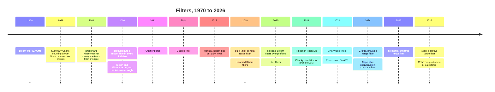
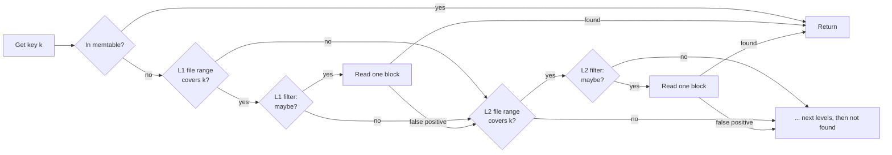
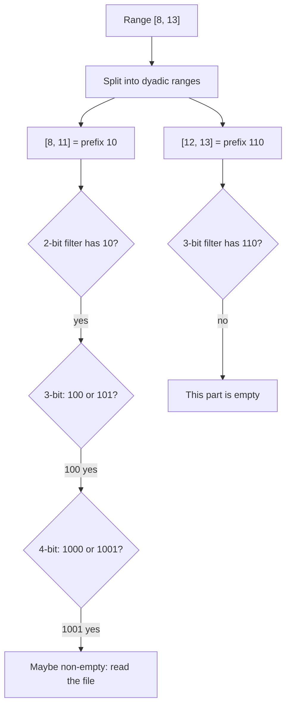
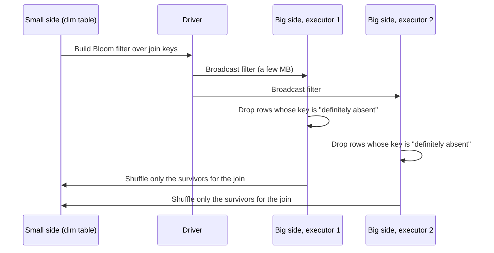

---
tags:
  - distributed-systems
  - data-and-storage
  - probabilistic-data-structures
  - bloom-filter
  - range-filter
  - lsm-tree
  - storage-engines
status: complete
sources:
  - https://cacm.acm.org/research/space-time-trade-offs-in-hash-coding-with-allowable-errors
  - https://homes.cs.washington.edu/~jrl/teaching/cseP521wi17/reading/bloom-filters-survey.pdf
  - https://www.eecs.harvard.edu/~michaelm/postscripts/rsa2008.pdf
  - https://pages.cs.wisc.edu/~cao/papers/summarycache.html
  - https://www.fsl.cs.stonybrook.edu/docs/vldb12qfflash/vldb12qfflash.pdf
  - https://www.pdl.cmu.edu/ftp/FS/cuckoo-conext2014.pdf
  - https://arxiv.org/abs/2201.01174
  - https://arxiv.org/abs/2103.02515v2
  - https://rocksdb.org/blog/2021/12/29/ribbon-filter.html
  - https://github.com/facebook/rocksdb/wiki/RocksDB-Bloom-Filter
  - https://cs-people.bu.edu/mathan/publications/sigmod17-dayan.pdf
  - https://nivdayan.github.io/chucky.pdf
  - https://www.pdl.cmu.edu/PDL-FTP/Storage/surf_sigmod18.pdf
  - https://scholar.harvard.edu/files/stratos/files/rosetta.pdf
  - https://arxiv.org/abs/2207.01503
  - https://www.vldb.org/pvldb/vol15/p1632-vaidya.pdf
  - https://www.vldb.org/pvldb/vol17/p1911-luo.pdf
  - https://arxiv.org/abs/2311.15380v2
  - https://arxiv.org/abs/2408.05625
  - https://arxiv.org/html/2404.04703v5
  - https://prashantpandey.github.io/uploads/sigmod26_aeris.pdf
  - https://arxiv.org/abs/2602.13484v1
  - https://arxiv.org/abs/1712.01208
  - https://www.vldb.org/cidrdb/papers/2026/p28-arora.pdf
  - https://cassandra.apache.org/doc/4.0/cassandra/operating/bloom_filters.html
  - https://parquet.apache.org/docs/file-format/bloomfilter
  - https://duckdb.org/2025/03/07/parquet-bloom-filters-in-duckdb.html
  - https://dev.to/polliog/timescaledb-227-added-bloom-filters-to-update-and-delete-your-explain-wont-tell-you-if-they-work-1c8n
  - https://issues.apache.org/jira/browse/SPARK-32268
  - https://issues.apache.org/jira/browse/SPARK-38841
  - https://dist.apache.org/repos/dist/release/spark/docs/3.4.1/generated-runtime-sql-config-table.html
  - https://www.waitingforcode.com/apache-spark-sql/what-new-apache-spark-3.3-joins/read
  - https://people.cs.umass.edu/%7Eramesh/Site/HOME_files/CCRpaper_1.pdf
  - https://bitcoinops.org/en/topics/compact-block-filters/
created: 2026-11-26
updated: 2026-11-26
---

## Table Of Contents

- [[#TL;DR|TL;DR]]
- [[#The Problem|The Problem]]
- [[#Foundations|Foundations]]
    - [[#One-Sided Errors|One-Sided Errors]]
    - [[#The Bloom Filter|The Bloom Filter]]
    - [[#The Lower Bound|The Lower Bound]]
    - [[#Point Filters vs Range Filters|Point Filters vs Range Filters]]
- [[#How We Got Here|How We Got Here]]
- [[#How It Works|How It Works]]
    - [[#Making Bloom Filters Fast|Making Bloom Filters Fast]]
    - [[#Fingerprint Filters: Quotient and Cuckoo|Fingerprint Filters: Quotient and Cuckoo]]
    - [[#Static Filters: Xor, Binary Fuse and Ribbon|Static Filters: Xor, Binary Fuse and Ribbon]]
    - [[#Filters Inside an LSM Tree|Filters Inside an LSM Tree]]
    - [[#Range Filters: Prefixes and Tries|Range Filters: Prefixes and Tries]]
    - [[#Range Filters: Learned and Provable|Range Filters: Learned and Provable]]
    - [[#Filters Across Machines|Filters Across Machines]]
- [[#Where It Is Now|Where It Is Now]]
- [[#Trade-offs & Open Problems|Trade-offs & Open Problems]]
- [[#Resources|Resources]]
- [[#Related Notes|Related Notes]]

## ***TL;DR***
---
*A filter is a small in-memory summary of a set that answers "definitely not here" or "maybe here." Distributed storage uses filters everywhere to avoid the expensive thing (a disk read, an object-store GET, a network hop, a shuffle) when the answer is no. Point filters are a solved problem with many good options; range filters, which answer "is anything between A and B?", are still an active research area.*

- **The contract.** A filter never says "no" for a key that is present (no false negatives), and says "maybe" for an absent key with some small probability $\varepsilon$ (a false positive). The cost of a false positive is one wasted lookup; the cost of a false negative would be wrong answers, so filters are only allowed the first kind of error.
- **Bloom filters (1970)** set $k$ bits per key in an $m$-bit array. At about 10 bits per key they give roughly 1% false positives. They are simple and fast but use about 44% more space than the theoretical minimum and can't delete or grow.
- **Newer point filters** close that gap. Cuckoo and quotient filters store short fingerprints, so they support deletes; xor, binary fuse and Ribbon filters are static but within about 1% to 13% of the minimum. RocksDB's Ribbon filter gives the same 1% rate as Bloom with about 7 bits per key instead of about 10.
- **Range filters** answer "is the range $[a, b]$ empty?" Prefix Bloom filters, SuRF (a succinct trie), Rosetta (Bloom filters over binary prefixes), learned filters (SNARF, Oasis), Grafite (a provable bound) and Memento (dynamic) each trade space, speed, robustness to tricky queries, and whether the set can change.
- **Where filters live in distributed systems:** one per SSTable in [[LSM Trees]] (Bigtable, Cassandra, RocksDB, HBase), one per Parquet column chunk in [[Lakehouse Table Formats|lakehouse]] files on [[Object Storage]], built on the fly to shrink the probe side of a distributed join (Spark), shipped between caches (Summary Cache), and in set reconciliation for [[Anti-Entropy and Repair|anti-entropy]].
- **Where it is now (Nov 2026).** Ribbon is RocksDB's recommended filter for long-lived data; DuckDB (1.2, 2025) reads and writes Parquet Bloom filters; TimescaleDB 2.27 (May 2026) uses Bloom filters to prune writes, not only reads; Salesforce reported a production range filter (CRaFT, CIDR 2026) that filters 86% of scans; and research has moved to range filters that are dynamic (Memento, SIGMOD 2025) and adaptive to adversarial queries (Aeris, SIGMOD 2026).

## ***The Problem***
---
*In a distributed store, the data you need is usually in one of many places, and checking each place costs a disk read, a network round trip or a paid request. A filter lets you rule most places out from memory.*

Three examples of the same problem:

| Setting | Where the key could be | Cost of checking one place | What a filter saves |
|---|---|---|---|
| [[LSM Trees|LSM tree]] point lookup | Memtable plus one SSTable per level (more with tiering) | A random disk or object-store read | Every read of a file that doesn't hold the key |
| Query over [[Object Storage|object storage]] | Thousands of Parquet row groups | A GET request and its latency | Every row group with no matching value |
| Distributed join | Every row of a big table on every node | Shuffling those rows across the network | Every row whose join key has no partner |

A lookup for a key that doesn't exist is the worst case. Without a filter, an LSM with 7 levels has to read 7 files to prove a key is absent. With a 1% filter per file, it reads $7 \times 0.01 = 0.07$ files on average.

The catch is range queries. "Give me every order between 10:00 and 10:05" doesn't name a key, so it can't be hashed, and a plain Bloom filter can't help. The [[LSM Trees]] note says it directly: range scans "can't use Bloom filters," so scan cost grows with the number of sorted runs. Range filters exist to close that gap.

## ***Foundations***
---
*Four ideas carry the rest of the note: why filters only err in one direction, how a Bloom filter works and what its error rate is, what the best possible filter would cost, and why ranges are so much harder than points.*

### One-Sided Errors

*A filter trades a small, tunable chance of a wasted check for a large saving in memory. That trade only works because a false "maybe" is safe and a false "no" is not.*

Burton Bloom's 1970 paper framed it as a trade between three things: the space of the hash area, the time to reject a non-member, and an "allowable error frequency." Allowing a few non-members to be "falsely identified as members of the given set will permit a much smaller hash area to be used without increasing reject time" ([Bloom, CACM 1970](https://cacm.acm.org/research/space-time-trade-offs-in-hash-coding-with-allowable-errors)). A slower, exact check then catches those errors.

Broder and Mitzenmacher's survey turned this into a rule of thumb they called the Bloom filter principle: "Wherever a list or set is used, and space is at a premium, consider using a Bloom filter if the effect of false positives can be mitigated" ([Broder and Mitzenmacher, Internet Mathematics 2004](https://homes.cs.washington.edu/~jrl/teaching/cseP521wi17/reading/bloom-filters-survey.pdf)).

In storage the exact check is the read itself: if the filter says "maybe" and the file doesn't hold the key, you just paid one read you didn't need.

### The Bloom Filter

*An array of $m$ bits, all zero to start, and $k$ hash functions. Inserting a key sets $k$ bits; a query checks whether all $k$ are set.*

- **Insert $x$:** set bits $h_1(x), \dots, h_k(x)$ to 1.
- **Query $y$:** if any of $h_1(y), \dots, h_k(y)$ is 0, $y$ was never inserted. If all are 1, $y$ is *probably* in the set.
- **No deletes:** clearing a bit might erase evidence of another key, which would create a false negative.

*Worked example.* $m = 16$ bits, $k = 2$.

| Step | Hash positions | Bits set afterwards |
|---|---|---|
| Insert `a` | 3, 11 | {3, 11} |
| Insert `b` | 6, 11 | {3, 6, 11} |
| Insert `c` | 1, 14 | {1, 3, 6, 11, 14} |
| Query `e` | 6, 9 | Bit 9 is 0, so `e` is **definitely absent** |
| Query `d` | 3, 6 | Both set (by `a` and `b`), so "maybe": a **false positive** |

With $n$ keys, $m$ bits and $k$ hashes, the false-positive probability is approximately ([Broder and Mitzenmacher](https://homes.cs.washington.edu/~jrl/teaching/cseP521wi17/reading/bloom-filters-survey.pdf)):

$$
\varepsilon \approx \left(1 - e^{-kn/m}\right)^k, \qquad k_{\text{opt}} = \frac{m}{n} \ln 2, \qquad \varepsilon_{\text{opt}} \approx e^{-\frac{m}{n}(\ln 2)^2} \approx 0.6185^{\,m/n}
$$

*In words:* each bit is 1 with probability $1 - e^{-kn/m}$, and a false positive needs all $k$ probed bits to be 1. The best $k$ leaves about half the bits set. Every extra bit per key multiplies the false-positive rate by about 0.62.

*Example:* 1 million keys, target $\varepsilon = 1\%$. Solving gives $m/n = \log_2(1/0.01) \times 1.44 \approx 9.6$ bits per key, so about 1.2 MB, with $k \approx 9.6 \times 0.693 \approx 7$ hashes. At 5 bits per key the rate rises to about 9%.

### The Lower Bound

*Any filter with false-positive rate $\varepsilon$ needs at least $\log_2(1/\varepsilon)$ bits per key. Bloom filters use about 1.44 times that, which is the gap every newer design attacks.*

$$
\text{bits per key} \ge \log_2 \frac{1}{\varepsilon} \qquad\text{vs. Bloom: } \; \log_2 e \cdot \log_2 \frac{1}{\varepsilon} \approx 1.44 \log_2 \frac{1}{\varepsilon}
$$

*In words:* to get a 1-in-$2^f$ error rate, you need at least $f$ bits per key. Bloom filters are "within a factor of $\log_2 e \approx 1.44$ of the (asymptotic) lower bound" ([Broder and Mitzenmacher](https://homes.cs.washington.edu/~jrl/teaching/cseP521wi17/reading/bloom-filters-survey.pdf)).

| Target $\varepsilon$ | Lower bound (bits/key) | Bloom (bits/key) | Cuckoo, semi-sorted, 95% full | Parquet's split-block Bloom (spec table) |
|---|---|---|---|---|
| 10% | 3.3 | 4.8 | 5.6 | 6.0 |
| 1% | 6.6 | 9.6 | 9.1 | 10.5 |
| 0.1% | 10.0 | 14.4 | 12.6 | 16.9 |
| 0.01% | 13.3 | 19.1 | 16.1 | 26.4 |

The cuckoo column uses the paper's $(\log_2(1/\varepsilon) + 2)/\alpha$ with $\alpha = 0.95$ ([Fan et al., CoNEXT 2014](https://www.pdl.cmu.edu/ftp/FS/cuckoo-conext2014.pdf)); the Parquet column is from its spec ([Parquet Bloom filter spec](https://parquet.apache.org/docs/file-format/bloomfilter)). Cache-friendly Bloom variants like Parquet's pay extra bits for speed, which shows at low error rates.

### Point Filters vs Range Filters

*A point filter hashes keys, which destroys their order. A range filter has to keep enough order to answer "is anything between $a$ and $b$?", and that is much harder to do in a few bits per key.*

- **Point query:** "is key 42 present?" Hash 42, check bits.
- **Range query:** "is any key in $[40, 47]$ present?" Hashing loses the fact that 41 sits between 40 and 42. You could ask a point filter about every value in the range, but a range of length $\ell$ then costs $\ell$ probes and its false-positive rate grows to about $\ell \cdot \varepsilon$.
- **The two families of answers:** keep the *prefixes* of keys (all keys in $[40, 47]$ share the binary prefix `101`), or *learn the key distribution* and map keys into a bit array in order.

A range filter's false-positive rate depends on the query, not only the data. A range that sits just next to a stored key (a *correlated* query) is much harder to reject than a random one. Most of the research since 2018 is about that.

## ***How We Got Here***
---
*Bloom's 1970 idea went unchanged for decades, then spread through networking in the late 1990s, became standard in storage engines with Bigtable, and since 2012 has been challenged by fingerprint and static filters that get close to the lower bound. Range filters start in 2018.*

**Networking first (1998–2004).** Summary Cache had cooperating web proxies send each other compact summaries of what they cached, so a proxy could ask only the neighbor likely to have an object. It used *counting* Bloom filters (small counters instead of bits) so entries could be removed as caches evicted them ([Fan, Cao, Almeida and Broder, SIGCOMM 1998](https://pages.cs.wisc.edu/~cao/papers/summarycache.html)). The Broder and Mitzenmacher survey (2004) collected dozens of such network uses.

**Storage engines (2006).** Bigtable added per-SSTable Bloom filters so that "most lookups for non-existent rows or columns do not need to touch disk" (see [[LSM Trees]]). Every LSM since, including Cassandra, HBase, LevelDB and RocksDB, does the same. The same year Kirsch and Mitzenmacher showed "only two hash functions are necessary to effectively implement a Bloom filter," by using $g_i(x) = h_1(x) + i \cdot h_2(x)$ with no loss in asymptotic false-positive rate ([Kirsch and Mitzenmacher, ESA 2006 / RSA 2008](https://www.eecs.harvard.edu/~michaelm/postscripts/rsa2008.pdf)). That trick is in nearly every implementation.

**Closing the space gap (2012–2022).** Quotient filters (2012) and cuckoo filters (2014) store a short fingerprint per key, which supports deletes and beats Bloom below about 3% error. Xor (2020), binary fuse (2022) and Ribbon (2021) filters solve a system of equations at build time, so they can't change after construction but come within about 1% to 13% of the lower bound.

**LSM-aware filters (2017–2021).** Monkey showed equal bits per level is wrong and skewed them toward small levels; Chucky replaced a filter per file with one filter for the whole tree (both below).

**Range filters (2018–2026).** SuRF (2018) was the first practical general range filter. Rosetta, Proteus, SNARF, REncoder and Oasis followed, each better on some workloads. Grafite (2024) gave a provable bound, Memento (2025) made range filters dynamic, and Aeris (2026) made them adapt after each false positive.

## ***How It Works***
---
*Point filters come in three shapes (bit arrays, fingerprint tables, and static equation-solved arrays); range filters come in three more (prefix-based, trie-based, and learned). Then there's the question of where filters sit in a distributed system.*

### Making Bloom Filters Fast

*A textbook Bloom filter scatters $k$ probes across memory, so each query can cost $k$ cache misses. Production filters confine a key's bits to one cache line and pay a little extra space for it.*

- **Blocked (cache-local) Bloom:** hash once to pick a block the size of a cache line, then set all $k$ bits inside it. RocksDB's filter since `format_version=5` (release 6.6) works this way, with probe bits "all within the same CPU cache line" and a 64-bit hash; it reaches "below 0.1% FP rate with only 16 bits per key" ([RocksDB wiki](https://github.com/facebook/rocksdb/wiki/RocksDB-Bloom-Filter)).
- **Split block Bloom filter (Parquet):** 256-bit blocks split into eight 32-bit words; each insert sets one bit in each word, chosen with eight fixed odd "salt" constants. The block is picked with `((h >> 32) * z) >> 32` to avoid a modulo, and the hash is XXH64 with seed 0 ([Parquet spec](https://parquet.apache.org/docs/file-format/bloomfilter)). The eight-word layout fits SIMD instructions, so one probe is a handful of vector operations.
- **Two hashes, not $k$:** derive the $k$ positions from two hash values ([Kirsch and Mitzenmacher](https://www.eecs.harvard.edu/~michaelm/postscripts/rsa2008.pdf)).
- **Fill the allocation:** RocksDB's `optimize_filters_for_memory` sizes each filter to the memory allocator's block, so 900 keys at 8 bits per key, which would otherwise waste about 124 bytes of a 1024-byte allocation, use those bytes to lower the false-positive rate for free ([RocksDB wiki](https://github.com/facebook/rocksdb/wiki/RocksDB-Bloom-Filter)).

| RocksDB Bloom bits per key | False-positive rate |
|---|---|
| 1.5 | 50% |
| 2.9 | 25% |
| 4.9 | 10% |
| 9.9 | 1% |
| 15.5 | 0.1% |

*(From the [RocksDB wiki](https://github.com/facebook/rocksdb/wiki/RocksDB-Bloom-Filter).)*

### Fingerprint Filters: Quotient and Cuckoo

*Instead of setting bits, store a short hash (a fingerprint) of each key in a compact hash table. Fingerprints can be found and removed, so these filters support deletes, and they get closer to the lower bound at low error rates.*

**Quotient filter (2012).** Split a key's hash into a *quotient* (which slot) and a *remainder* (what to store there). Collisions are stored in nearby slots, so a lookup scans one short contiguous run, which suits flash and caches ([Bender et al., VLDB 2012](https://www.fsl.cs.stonybrook.edu/docs/vldb12qfflash/vldb12qfflash.pdf)). Quotient filters can be merged and resized, which matters later for expandable and range filters (InfiniFilter, Aleph and Memento are all built on them).

**Cuckoo filter (2014).** A cuckoo hash table of fingerprints, with buckets of 4 entries. Each key has two candidate buckets; the second is the first XOR a hash of the fingerprint ("partial-key cuckoo hashing"), so an entry can be moved to its other bucket without knowing the original key ([Fan, Andersen, Kaminsky and Mitzenmacher, CoNEXT 2014](https://www.pdl.cmu.edu/ftp/FS/cuckoo-conext2014.pdf)).

- **Space:** about $(\log_2(1/\varepsilon) + 3)/\alpha$ bits per key, or $+2$ with semi-sorted buckets, at load factor $\alpha \approx 95\%$. That beats a space-optimal Bloom filter when $\varepsilon$ is below about 3%.
- **Speed:** a lookup reads at most two buckets, so at most two cache lines.
- **Deletes:** remove the fingerprint. But deleting a key that was never inserted can remove a different key with the same fingerprint, which creates a false negative.
- **Limits:** inserts can fail when the table is too full (the paper gives up after 500 displacements), and the same key can only be inserted $2b$ times (8 with $b = 4$).

*Example:* $\varepsilon = 1\%$ gives $\log_2 100 \approx 6.6$, so a semi-sorted cuckoo filter needs $(6.6 + 2)/0.95 \approx 9.1$ bits per key, against 9.6 for a Bloom filter. At $\varepsilon = 0.01\%$ it's 16.1 against 19.1.

### Static Filters: Xor, Binary Fuse and Ribbon

*If the set never changes after it's built, as with an immutable SSTable or Parquet file, you can solve for a compact array at build time. Lookups XOR a few cells together and compare the result to the key's fingerprint.*

The idea: give each key a fingerprint $f(x)$ of $r$ bits and three positions $h_0(x), h_1(x), h_2(x)$. Build an array $B$ so that

$$
B[h_0(x)] \oplus B[h_1(x)] \oplus B[h_2(x)] = f(x) \quad \text{for every key } x \text{ in the set}
$$

*In words:* every stored key's three cells XOR to its fingerprint. A key not in the set lands on three cells whose XOR is effectively random, so it matches its fingerprint with probability $2^{-r}$. *Example:* with 8-bit fingerprints, a missing key passes with probability $1/256 \approx 0.4\%$, and the array costs about $1.13 \times 8 \approx 9$ bits per key for a binary fuse filter.

- **Xor and binary fuse filters (Graf and Lemire).** Binary fuse filters use about 13% more space than the lower bound with fast queries, or about 8% with slightly slower queries, and build more than twice as fast as xor filters ([Graf and Lemire, 2022](https://arxiv.org/abs/2201.01174)).
- **Ribbon filters (Dillinger and Walzer, 2021).** Solve the same kind of linear system over a narrow band ("ribbon") of the array, which is faster to build. Overhead is configurable: below 10% with some extra CPU, and an experimental balanced variant gets "below 1%" ([Dillinger and Walzer](https://arxiv.org/abs/2103.02515v2)).

**Ribbon in RocksDB.** Supported since 6.15. "`NewRibbonFilterPolicy(9.9)` has the same 1% FP rate as Bloom but only uses around 7 bits per key" ([RocksDB wiki](https://github.com/facebook/rocksdb/wiki/RocksDB-Bloom-Filter)). The price is CPU: about 3 to 4 times as much, mostly at build time (about 140 ns per key against 32 ns for Bloom) and about 230 bits per key of temporary memory during construction against about 75. RocksDB's guidance from its cost model: "filters that live in memory for more than an hour should be Ribbon" ([RocksDB blog, Dec 2021](https://rocksdb.org/blog/2021/12/29/ribbon-filter.html)). Since 6.24 you can keep Bloom for flushes and the small, short-lived levels and use Ribbon for the rest.

### Filters Inside an LSM Tree

*An LSM has one filter per file, and a point lookup checks a filter per level. That raises three design questions: how to split memory across levels, what to do at the last level, and whether checking many filters is itself the bottleneck.*

- **Skew bits toward small levels (Monkey).** With equal bits everywhere, each level contributes the same false-positive rate, so a missing-key lookup's expected wasted reads grow with the number of levels $L$. Monkey sets each level's rate proportional to its size, which "shaves a factor of O(L) from the worst-case lookup cost" ([Dayan, Athanassoulis and Idreos, SIGMOD 2017](https://cs-people.bu.edu/mathan/publications/sigmod17-dayan.pdf)). The [[LSM Trees]] note has the worked example.
- **Skip the last level.** If most lookups find their key, the last level's filter only confirms what the read would find anyway. RocksDB's `optimize_filters_for_hits` drops it, saving most filter memory since the last level holds most keys.
- **Partitioned filters.** One filter per SST file can be large. RocksDB can split it into many filter blocks by key range, so a lookup loads only the piece it needs into the block cache ([RocksDB wiki](https://github.com/facebook/rocksdb/wiki/RocksDB-Bloom-Filter)). This matters more when files sit on [[Object Storage|object storage]] and filter blocks are fetched lazily.
- **Per-table tuning.** Cassandra exposes `bloom_filter_fp_chance` per table: 0.01 by default, 0.1 for tables using leveled compaction. A 0.01 filter needs "about three times as much memory" as 0.1; filters are off-heap; and a change only applies to SSTables written afterwards, or after `nodetool upgradesstables -a` rewrites them ([Cassandra docs](https://cassandra.apache.org/doc/4.0/cassandra/operating/bloom_filters.html)).
- **One filter for the whole tree (Chucky).** As SSDs got faster, probing $L$ filters per lookup, each a memory access of about 100 ns, became a bottleneck: "the Bloom filters of LSM-tree are emerging as a memory I/O bottleneck." Chucky replaces them with a single cuckoo filter whose entries store a fingerprint plus a Huffman-coded level ID (most keys are at the last level, so the average code is short: 1.52 bits in the paper's example), so a lookup costs about two memory accesses however many levels there are ([Dayan and Twitto, SIGMOD 2021](https://nivdayan.github.io/chucky.pdf)).

*Example:* 7 levels at 10 bits per key with Bloom filters. A missing-key lookup touches 7 cache lines and expects $7 \times 0.008 \approx 0.06$ wasted disk reads. With Chucky it touches about 2 cache lines; with Monkey's allocation, the expected wasted reads fall to roughly the last level's rate alone.

### Range Filters: Prefixes and Tries

*Keep key prefixes, not hashes. A range $[a, b]$ can be covered by a few prefixes, and if none of them is present, the range is empty.*

**Prefix Bloom filters.** Insert a fixed-length prefix of each key (RocksDB's `prefix_extractor`, e.g. the first 4 bytes) as well as or instead of the whole key. A scan within one prefix ("all keys for user 42") checks one hash ([RocksDB wiki](https://github.com/facebook/rocksdb/wiki/RocksDB-Bloom-Filter)). It only helps queries that stay inside a single prefix, and changing the prefix length means rebuilding every file.

**SuRF (SIGMOD 2018).** A *Fast Succinct Trie* stores the shortest prefixes that tell keys apart, using a dense encoding at the top of the trie (one array lookup per step) and a sparse one lower down, at "10 bits per trie node, which is close to the information-theoretic lower bound." Variants append a few hashed suffix bits (better point queries; a point false-positive rate below $2^{-n}$ with $n$ hash bits) or real suffix bits (better range queries). In RocksDB on a 100 GB time-series dataset, equal-size SuRFs instead of Bloom filters sped up closed-range queries up to 5 times and open-range queries 1.5 times; empty point queries were up to 40% slower because SuRF's rate was 0.2% against Bloom's 0.1% ([Zhang et al., SIGMOD 2018](https://www.pdl.cmu.edu/PDL-FTP/Storage/surf_sigmod18.pdf)). SuRF is static and needs a full rebuild to add keys.

**Rosetta (SIGMOD 2020).** Insert every binary prefix of every key into a hierarchy of Bloom filters, one per prefix length, forming an implicit segment tree. A range query is split into at most $2 \log_2 R$ *dyadic* ranges (ranges that are exactly one prefix), each checked top-down, descending only where a filter says "maybe" ([Luo et al., SIGMOD 2020](https://scholar.harvard.edu/files/stratos/files/rosetta.pdf)). It's best for short ranges: in RocksDB at 22 bits per key, its mean false-positive rate for short ranges was 0.00012 against SuRF's 0.0242, and it reported 2 to 5 times better performance than SuRF and up to 40 times better than default RocksDB.

*Worked example (4-bit keys).* Stored keys: 9 (`1001`) and 14 (`1110`). Query $[12, 13]$ is the single dyadic range with prefix `110`. Rosetta's filter for 3-bit prefixes holds `100` and `111`, so `110` comes back "no" and the range is **empty** (barring a false positive). Query $[8, 11]$ is prefix `10`; the 2-bit filter holds `10` (from 9), so Rosetta descends to `100` (present) and then to `1000` and `1001`, and finds 9.

**Proteus (SIGMOD 2022)** unifies the trie and prefix-Bloom designs and picks the configuration from a sample of keys and queries using a model of prefix false-positive rates; it reported up to 5.3 times better end-to-end performance than SuRF and Rosetta in RocksDB ([Knorr et al.](https://arxiv.org/abs/2207.01503)).

### Range Filters: Learned and Provable

*Learned filters model where keys fall and map them, in order, into a sparse bit array. Provable filters give a false-positive bound that holds whatever the queries are. Dynamic and adaptive filters handle a changing set and an adversary.*

**SNARF (VLDB 2022).** Fit a monotone spline to the key distribution's CDF, map each key to a position in a bit array of about $n \cdot K$ bits, and compress that sparse array with Golomb or Elias-Fano coding. A range $[p, q]$ is "maybe" if any bit is set between $f(p)$ and $f(q)$. False-positive rate is about $1/K$ at about $2.4 + \log_2 K$ bits per key; it reported up to 50 times lower false-positive rates than SuRF at equal space, but slower queries (about 750 to 890 ns against 480 ns at the same rate) ([Vaidya et al., VLDB 2022](https://www.vldb.org/pvldb/vol15/p1632-vaidya.pdf)). **Oasis (VLDB 2024)** prunes large empty key ranges explicitly and segments the rest, reporting up to 1.4 times over learned and 6.2 times over non-learned filters in RocksDB ([Chen et al.](https://www.vldb.org/pvldb/vol17/p1911-luo.pdf)).

**Grafite (SIGMOD 2024).** With $B$ bits per key, the false-positive probability for a range of size $\ell$ is at most

$$
\varepsilon(\ell) \le \frac{\ell}{2^{B-2}}
$$

with $O(1)$ query time, and this holds "regardless of the input data and query distribution" ([Costa, Ferragina and Vinciguerra](https://arxiv.org/abs/2311.15380v2)). *In words:* the error grows linearly with the range length and halves with every extra bit, and no choice of queries can make it worse. *Example:* at $B = 20$ bits per key, a range covering 32 values has $\varepsilon \le 32 / 2^{18} \approx 0.012\%$; a point query has $\varepsilon \le 1/2^{18} \approx 0.0004\%$. The paper's point is that heuristic filters like SuRF can do far worse on correlated queries, ranges that end just short of a real key.

**Memento (SIGMOD 2025).** Earlier range filters were static: insert a key and you rebuild. Memento partitions the key space, stores a fingerprint per partition plus the keys' suffixes in a quotient-filter layout, and so supports inserts, deletes and growth with a robust false-positive guarantee. It is the first range filter usable inside a B-tree: in WiredTiger it doubled range-query throughput when half the queries were empty ([Eslami and Dayan](https://arxiv.org/abs/2408.05625)). It builds on expandable filters: InfiniFilter (SIGMOD 2023) and Aleph (VLDB 2024), which grows indefinitely with constant-time operations by giving newer entries longer fingerprints ([Dayan, Bercea and Pagh](https://arxiv.org/html/2404.04703v5)).

**Aeris (SIGMOD 2026).** An *adaptive* range filter: after a false positive, it extends the stored fingerprints (looking up the real keys through a reverse map on disk) so the same query never fails again (*monotonic*), and the false-positive rate stays at $\varepsilon$ even for an adversary who sees past answers (*strong*). It reported up to 10 times lower false-positive rates than non-adaptive range filters on skewed queries and 1.5 to 8 times higher throughput in WiredTiger under adversarial workloads, at one extra bit per slot over Memento ([Chesetti, Eslami, Zhang, Dayan and Pandey](https://prashantpandey.github.io/uploads/sigmod26_aeris.pdf)).

| Range filter | Year | Built on | Dynamic? | Guarantee | Best at |
|---|---|---|---|---|---|
| Prefix Bloom | (RocksDB) | Bloom over fixed prefixes | Per file | Only within one prefix | Scans inside one prefix |
| SuRF | 2018 | Succinct trie | No | Point only (hashed suffix) | Long ranges, ample memory |
| Rosetta | 2020 | Bloom filter per prefix length | No | Heuristic | Short ranges, correlated keys |
| Proteus | 2022 | Trie plus prefix Bloom, self-tuned | No | Modeled from samples | Known workloads |
| SNARF, Oasis | 2022, 2024 | Learned CDF plus compressed bits | Limited | Heuristic | Stable, learnable key distributions |
| Grafite | 2024 | Hashing that preserves locality | No | $\ell / 2^{B-2}$, any queries | Adversarial or correlated queries |
| Memento | 2025 | Quotient filter plus suffixes | Yes | Robust | Changing data, B-trees |
| Aeris | 2026 | Memento plus fingerprint extension | Yes | Adaptive, strong | Repeated or adversarial queries |

### Filters Across Machines

*Outside the storage engine, filters are a way to send a cheap summary of a set over the network instead of the set itself.*

- **Parquet and lakehouses.** Each Parquet column chunk can carry a split-block Bloom filter, located by `bloom_filter_offset` and `bloom_filter_length` in the column metadata ([Parquet spec](https://parquet.apache.org/docs/file-format/bloomfilter)). On [[Object Storage|object storage]] that turns "fetch the row group and scan it" into "fetch a few hundred bytes and skip it." Bloom filters complement min/max statistics: min/max prunes when data is sorted on the column, Bloom filters prune equality predicates on unsorted, high-cardinality columns. See [[Secondary Indexes]] for why lakehouses lean on per-file filters instead of global indexes.
- **Runtime filters in distributed joins.** Build a Bloom filter from the small side's join keys, broadcast it, and drop non-matching rows on the big side before the shuffle. Spark shipped this in 3.3 (`spark.sql.optimizer.runtime.bloomFilter.enabled`) and turned it on by default in 3.4. Its rule only fires when the side being filtered is large (10 GB by default) and the side building the filter is small (10 MB by default) ([SPARK-32268](https://issues.apache.org/jira/browse/SPARK-32268), [SPARK-38841](https://issues.apache.org/jira/browse/SPARK-38841), [Spark 3.4 config reference](https://dist.apache.org/repos/dist/release/spark/docs/3.4.1/generated-runtime-sql-config-table.html), [waitingforcode](https://www.waitingforcode.com/apache-spark-sql/what-new-apache-spark-3.3-joins/read)). On 5 TB TPC-DS, query 16 dropped from 84 s to 46 s.

- **Caches.** Summary Cache's proxies exchanged counting Bloom filters of their contents ([Fan et al.](https://pages.cs.wisc.edu/~cao/papers/summarycache.html)). Akamai found "nearly three-quarters of the objects were accessed only once" in one cluster, so it used a Bloom filter to cache an object only on its second request within a window; disk writes fell from 10,209 to 5,738 per second and byte hit rate rose from about 74% to 83% ([Maggs and Sitaraman, SIGCOMM CCR 2015](https://people.cs.umass.edu/%7Eramesh/Site/HOME_files/CCRpaper_1.pdf)). The same trick protects caches from scan pollution; see [[Hot Keys and Cache Stampedes]].
- **Set reconciliation.** Invertible Bloom lookup tables let two replicas find the keys they disagree on in one round, with a message proportional to the difference, not the data; see [[Anti-Entropy and Repair]].
- **Exactly-once dedup.** Google's MillWheel checked each record ID against stored IDs with a Bloom filter as the fast path ([[Stream Processing]]).
- **Light clients and privacy.** Bitcoin's original BIP 37 had a light client send a Bloom filter of its addresses to a full node, which leaked what it was interested in. BIP 157/158 reversed the direction: full nodes build a Golomb-coded set for each block and clients test them locally, trading more bandwidth for privacy ([Bitcoin Optech](https://bitcoinops.org/en/topics/compact-block-filters/)). A filter you send to someone else reveals the set it summarizes, to about the precision of its false-positive rate.

A filter shipped to another node is a snapshot. Keys added at the source after it was built are false negatives at the receiver until the next update, so shipped filters are safe only as hints (Summary Cache, joins built per query) or over immutable data (Parquet files, SSTables).

## ***Where It Is Now***
---
*As of November 2026, point filters are mature engineering: pick Bloom for speed and short-lived data, Ribbon or binary fuse for long-lived immutable data, cuckoo or quotient for deletes. Range filters are reaching production, and research has moved to filters that change with the data and adapt to the queries.*

- **RocksDB.** Ribbon (since 6.15) is the recommended choice for data that lives longer than about an hour, with Bloom for flushes and the top levels ([RocksDB blog](https://rocksdb.org/blog/2021/12/29/ribbon-filter.html)). TiDB's storage layer and YugabyteDB build on RocksDB and Kafka Streams and Flink keep state in it, so they inherit its filter options; CockroachDB's Pebble is a RocksDB-style engine written in Go with its own filter code. See [[Distributed SQL]] and [[Stream Processing]].
- **Analytics on object storage.** DuckDB 1.2 (2025) reads and writes Parquet Bloom filters, writing one whenever a column chunk is dictionary-encoded, at a default 1% false-positive ratio; in its example, each row group's filter was 47 bytes ([DuckDB, Mar 2025](https://duckdb.org/2025/03/07/parquet-bloom-filters-in-duckdb.html)). Spark's runtime Bloom join has been on by default since 3.4.
- **Bloom filters for writes, and their bugs.** TimescaleDB 2.27 (May 2026) uses per-batch Bloom filters on compressed data to skip decompressing batches during `UPDATE`, `DELETE` and `UPSERT`, reporting up to 160 times faster selective updates and deletes. The same release blocked upgrades for databases with Bloom-filter sparse indexes on `int2` columns, because those could make `SELECT` omit matching rows, a false negative from a bad filter ([DEV Community, 2026](https://dev.to/polliog/timescaledb-227-added-bloom-filters-to-update-and-delete-your-explain-wont-tell-you-if-they-work-1c8n)). That's the one error a filter must never make, and it came from the implementation, not the math.
- **A range filter in production.** Salesforce's multi-tenant OLTP database (CIDR 2026) keeps Bloom filter blocks in every LSM data file plus CRaFT, a SuRF-inspired trie range filter split into 64 KB blocks that load on demand. Across 417 billion scans in production, 86.45% were filtered, with a 4.17% false-positive rate; at L0, 95.34% of scans were empty and filtered ([Arora et al., CIDR 2026](https://www.vldb.org/cidrdb/papers/2026/p28-arora.pdf)).
- **Research.** The 2025–2026 range-filter line (Memento, Aeris) targets B-trees and WiredTiger as much as LSMs. A February 2026 comparison of learned, stacked and adaptive filters found learned filters cut false positives up to 100 times but can make queries up to 10,000 times slower and handle shifting workloads poorly; stacked filters need the query distribution in advance; adaptive filters cut false positives up to 1,000 times under adversarial queries without workload assumptions and were judged the most generally applicable ([Sabale, Gatterbauer and Pandey, arXiv 2026](https://arxiv.org/abs/2602.13484v1)). Learned Bloom filters date to [The Case for Learned Index Structures](https://arxiv.org/abs/1712.01208) (Kraska et al., SIGMOD 2018).

## ***Trade-offs & Open Problems***
---
*Every filter picks a point among space, query speed, build speed, whether the set can change, and how bad the worst-case query can be. The open problems are mostly about doing well on all of them at once, and about filters whose answers depend on the queries.*

| Choice | Gets you | Costs you |
|---|---|---|
| Bloom (cache-local) | Fastest build and query, trivially mergeable (OR the bits) | ~44% over the space bound, more when blocked; no deletes |
| Cuckoo / quotient | Deletes, near-bound space below ~3% error, resizable (quotient) | Inserts can fail when full; deleting a non-member corrupts it |
| Xor / binary fuse / Ribbon | 1–13% over the bound | Static; 3–4x CPU (Ribbon); more build memory |
| Prefix Bloom | Cheap scans within one prefix | Useless across prefixes; prefix fixed per file |
| Trie (SuRF) | Long ranges | Static; weaker on point queries per bit |
| Learned (SNARF, Oasis) | Low error on learnable data | Slow queries; degrades when the distribution shifts |
| Provable (Grafite) | Bound holds for any queries | Error grows with range length |
| Dynamic, adaptive (Memento, Aeris) | Inserts, growth, robustness | Newer, less battle-tested; Aeris needs a reverse map on disk |

**Open problems.**
- **Robustness vs space.** Heuristic range filters have great average-case numbers and bad worst cases on correlated queries. Grafite and Aeris fix that, but the space each pays relative to the best heuristic on easy queries is still being argued.
- **Memory bandwidth, not memory size.** On fast SSDs, probing a filter per level costs more than the I/O it saves (Chucky's argument). A single global filter conflicts with each file being self-contained and immutable, which is what makes LSM files easy to replicate and move.
- **Filters on object storage.** Every extra filter fetch is a GET. Partitioned filters, filters cached on compute nodes, and filters kept in the table's metadata layer (see [[Lakehouse Table Formats]] and [[Databases on Object Storage]]) are competing answers.
- **Adversaries and privacy.** A filter's false positives can be predicted by someone who knows the hash functions, and a filter you share reveals its set. Seeded or keyed hashes help the first; BIP 158's reversal shows the second is a protocol choice, not a data-structure fix.
- **Correctness of the implementation.** The TimescaleDB `int2` bug is a reminder that a filter's one hard guarantee (no false negatives) depends on hashing the same bytes at write and read time. Type coercion, collation and encoding changes break that silently; [[Deterministic Simulation Testing]] and differential testing are the tools that catch it.

## ***Resources***
---
*Read Broder and Mitzenmacher for the classic theory, the cuckoo filter and Ribbon papers for the modern point-filter picture, the RocksDB wiki for production knobs, then SuRF, Rosetta, Grafite and Memento for the range-filter line in order.*

**Foundations**
- [Space/time trade-offs in hash coding with allowable errors](https://cacm.acm.org/research/space-time-trade-offs-in-hash-coding-with-allowable-errors) — Burton H. Bloom, CACM 1970.
- [Network Applications of Bloom Filters: A Survey](https://homes.cs.washington.edu/~jrl/teaching/cseP521wi17/reading/bloom-filters-survey.pdf) — Broder and Mitzenmacher, Internet Mathematics 2004. The formulas and the Bloom filter principle.
- [Less Hashing, Same Performance: Building a Better Bloom Filter](https://www.eecs.harvard.edu/~michaelm/postscripts/rsa2008.pdf) — Kirsch and Mitzenmacher, ESA 2006 / RSA 2008.
- [Summary Cache: A Scalable Wide-Area Web Cache Sharing Protocol](https://pages.cs.wisc.edu/~cao/papers/summarycache.html) — Fan, Cao, Almeida and Broder, SIGCOMM 1998. Counting Bloom filters.

**Point filters**
- [Don't Thrash: How to Cache Your Hash on Flash](https://www.fsl.cs.stonybrook.edu/docs/vldb12qfflash/vldb12qfflash.pdf) — Bender et al., VLDB 2012. Quotient filters.
- [Cuckoo Filter: Practically Better Than Bloom](https://www.pdl.cmu.edu/ftp/FS/cuckoo-conext2014.pdf) — Fan, Andersen, Kaminsky and Mitzenmacher, CoNEXT 2014.
- [Binary Fuse Filters: Fast and Smaller Than Xor Filters](https://arxiv.org/abs/2201.01174) — Graf and Lemire, 2022.
- [Ribbon filter: practically smaller than Bloom and Xor](https://arxiv.org/abs/2103.02515v2) — Dillinger and Walzer, 2021.
- [Aleph Filter: To Infinity in Constant Time](https://arxiv.org/html/2404.04703v5) — Dayan, Bercea and Pagh, VLDB 2024. Expandable filters, with InfiniFilter as background.

**Filters in LSM trees**
- [Monkey: Optimal Navigable Key-Value Store](https://cs-people.bu.edu/mathan/publications/sigmod17-dayan.pdf) — Dayan, Athanassoulis and Idreos, SIGMOD 2017.
- [Chucky: A Succinct Cuckoo Filter for LSM-Tree](https://nivdayan.github.io/chucky.pdf) — Dayan and Twitto, SIGMOD 2021.
- [RocksDB Bloom Filter wiki](https://github.com/facebook/rocksdb/wiki/RocksDB-Bloom-Filter) and [Ribbon filter blog post](https://rocksdb.org/blog/2021/12/29/ribbon-filter.html) (Dec 2021).
- [Cassandra: Bloom filters](https://cassandra.apache.org/doc/4.0/cassandra/operating/bloom_filters.html).

**Range filters**
- [SuRF: Practical Range Query Filtering with Fast Succinct Tries](https://www.pdl.cmu.edu/PDL-FTP/Storage/surf_sigmod18.pdf) — Zhang et al., SIGMOD 2018.
- [Rosetta: A Robust Space-Time Optimized Range Filter for Key-Value Stores](https://scholar.harvard.edu/files/stratos/files/rosetta.pdf) — Luo et al., SIGMOD 2020.
- [Proteus: A Self-Designing Range Filter](https://arxiv.org/abs/2207.01503) — Knorr et al., SIGMOD 2022.
- [SNARF: A Learning-Enhanced Range Filter](https://www.vldb.org/pvldb/vol15/p1632-vaidya.pdf) — Vaidya et al., VLDB 2022.
- [Oasis: An Optimal Disjoint Segmented Learned Range Filter](https://www.vldb.org/pvldb/vol17/p1911-luo.pdf) — Chen, He, Li and Luo, VLDB 2024.
- [Grafite: Taming Adversarial Queries with Optimal Range Filters](https://arxiv.org/abs/2311.15380v2) — Costa, Ferragina and Vinciguerra, SIGMOD 2024.
- [Memento Filter: A Fast, Dynamic, and Robust Range Filter](https://arxiv.org/abs/2408.05625) — Eslami and Dayan, SIGMOD 2025.
- [Aeris Filter: A Strongly and Monotonically Adaptive Range Filter](https://prashantpandey.github.io/uploads/sigmod26_aeris.pdf) — Chesetti et al., SIGMOD 2026.
- [How to Train Your Filter: Should You Learn, Stack or Adapt?](https://arxiv.org/abs/2602.13484v1) — Sabale, Gatterbauer and Pandey, arXiv Feb 2026.

**Filters across machines**
- [Parquet Bloom filter spec](https://parquet.apache.org/docs/file-format/bloomfilter); [Parquet Bloom filters in DuckDB](https://duckdb.org/2025/03/07/parquet-bloom-filters-in-duckdb.html) (Mar 2025).
- [SPARK-32268: Bloom filter join](https://issues.apache.org/jira/browse/SPARK-32268); [SPARK-38841: on by default](https://issues.apache.org/jira/browse/SPARK-38841); [What's new in Spark 3.3: joins](https://www.waitingforcode.com/apache-spark-sql/what-new-apache-spark-3.3-joins/read).
- [Algorithmic Nuggets in Content Delivery](https://people.cs.umass.edu/%7Eramesh/Site/HOME_files/CCRpaper_1.pdf) — Maggs and Sitaraman, SIGCOMM CCR 2015. Akamai's one-hit wonders.
- [Compact block filters](https://bitcoinops.org/en/topics/compact-block-filters/) — Bitcoin Optech. BIP 37 vs BIP 157/158.
- [A Multi-tenant Relational OLTP Database at Salesforce](https://www.vldb.org/cidrdb/papers/2026/p28-arora.pdf) — Arora et al., CIDR 2026. CRaFT in production.
- [TimescaleDB 2.27 Bloom filters for UPDATE and DELETE](https://dev.to/polliog/timescaledb-227-added-bloom-filters-to-update-and-delete-your-explain-wont-tell-you-if-they-work-1c8n) — DEV Community, 2026.

## ***Related Notes***
---
*Where filters sit, what they save, and what they summarize.*

- [[LSM Trees]] — The read path that filters exist to shorten; Monkey's bit allocation in detail.
- [[Secondary Indexes]] — Filters as the lightweight alternative to indexes in LSMs and lakehouses.
- [[Object Storage]] — Where every skipped file or row group is a saved GET.
- [[Anti-Entropy and Repair]] — Invertible Bloom lookup tables for one-round set reconciliation.
- [[Stream Processing]] — MillWheel's Bloom-filtered dedup for exactly-once.
- [[Hot Keys and Cache Stampedes]] — Admission filters that keep one-hit wonders out of caches.
- [[Partitioning]] — Range-partitioned data, where range filters prune whole partitions.
- [[Distributed SQL]] — CockroachDB, TiDB and YugabyteDB, whose LSM engines carry these filters.
- [[Deterministic Simulation Testing]] — Catching the implementation bugs that turn into false negatives.
- [[Silent Data Corruption]] — A corrupted filter block is a silent false negative.
- [[Lakehouse Table Formats]] — Planned: Parquet and Iceberg file-level statistics and Bloom filters.
- [[Databases on Object Storage]] — Where filter placement decides GET counts.
- [[Write-Ahead Logging]] — The other half of an LSM's storage layout.
- [[Probabilistic Sketches]] — Planned: HyperLogLog, Count-Min and other approximate summaries.
