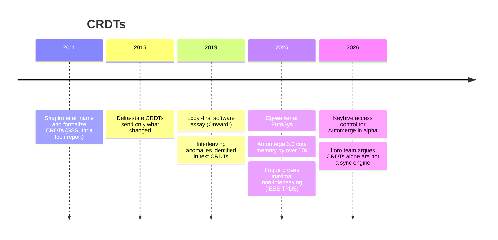

---
tags:
  - distributed-systems
  - crdt
  - replication
  - local-first
status: draft
sources:
  - https://www.cs.tufts.edu/~nr/cs257/archive/marc-shapiro/CRDTs_SSS-2011.pdf
  - https://www.csa.iisc.ac.in/~raghavan/CleanedPods2021/crdt-shapiro-2011-techreport.pdf
  - https://arxiv.org/abs/1603.01529
  - https://inkandswitch.com/essay/local-first/local-first.pdf
  - https://martin.kleppmann.com/2019/03/25/papoc-interleaving-anomalies.html
  - https://martin.kleppmann.com/2025/11/01/fugue-minimizing-interleaving.html
  - https://arxiv.org/pdf/2409.14252
  - https://automerge.org/blog/automerge-3/
  - https://automerge.org/blog/2026-august/
  - https://loro.dev/blog/crdt-is-not-enough
  - https://redis.io/docs/latest/operate/rs/databases/active-active/
  - https://redis.io/docs/latest/operate/rs/databases/active-active/develop/develop-for-aa/
created: 2026-11-26
updated: 2026-11-26
---

## Table Of Contents

---

- [[#TL;DR|TL;DR]]
- [[#The Problem|The Problem]]
- [[#Foundations|Foundations]]
    - [[#Strong Eventual Consistency|Strong Eventual Consistency]]
    - [[#Semilattices and Merge|Semilattices and Merge]]
    - [[#Causality and Concurrency|Causality and Concurrency]]
- [[#How We Got Here|How We Got Here]]
- [[#How It Works|How It Works]]
    - [[#State-Based vs Operation-Based|State-Based vs Operation-Based]]
    - [[#Counters|Counters]]
    - [[#Registers|Registers]]
    - [[#Sets|Sets]]
    - [[#Sequences and Text|Sequences and Text]]
    - [[#Tombstones and Metadata|Tombstones and Metadata]]
- [[#Where It Is Now|Where It Is Now]]
    - [[#Local-First Software|Local-First Software]]
    - [[#Text Editing After CRDTs: Eg-walker|Text Editing After CRDTs: Eg-walker]]
    - [[#Databases|Databases]]
- [[#Trade-offs & Open Problems|Trade-offs & Open Problems]]
- [[#Resources|Resources]]
- [[#Related Notes|Related Notes]]

## ***TL;DR***
---
*A CRDT (conflict-free replicated data type) is a data structure that every replica can update locally, with no coordination, and that is guaranteed to converge once replicas have seen the same updates. It's how you get availability through partitions and offline work without losing writes.*

- **What it guarantees:** *strong eventual consistency*. Any two replicas that have received the same set of updates are in the same state, without rollback or a tie-breaking round ([Shapiro et al., 2011](https://www.cs.tufts.edu/~nr/cs257/archive/marc-shapiro/CRDTs_SSS-2011.pdf)).
- **How:** either the state forms a *join semilattice* and merge takes the least upper bound (state-based), or all concurrent operations commute and are delivered in causal order (op-based). The two are equivalent in power.
- **The price:** you only get data types whose concurrent updates can be made to commute, you can't enforce invariants like "balance never below zero", and you carry extra metadata (version vectors, unique IDs, tombstones).
- **Where:** geo-replicated stores such as Redis Active-Active; local-first apps built on Automerge, Yjs and Loro; collaborative text editors.
- **Now (Nov 2026):** Automerge 3 (Jul 2025) cut memory use by over 10x; Eg-walker (EuroSys 2025) showed text editing can store plain operations and only build CRDT state while merging; the open problems have moved from convergence to sync, access control and encryption around it.

## ***The Problem***
---
*If every replica must accept writes while cut off from the others, concurrent writes will conflict. CRDTs make conflicts impossible by construction, instead of resolving them after the fact.*

[[CAP and PACELC]] says that during a partition you choose consistency or availability. [[Paxos]] and [[Raft]] choose consistency: the minority side stops taking writes. Many applications can't stop: a shopping cart, a phone that's offline, a document two people edit on a plane, a database replicated across continents where a cross-region round trip per write is too slow.

So replicas take writes independently and sync later. Then the question is what to do when two replicas changed the same thing.

| Approach | What happens | Problem |
|---|---|---|
| Last writer wins by timestamp | Keep the write with the larger timestamp | Silently drops the other write; depends on clocks ([[Time and Clocks]]) |
| Keep both, ask the app (siblings) | Return all concurrent versions; app merges | Every app reinvents merging, often wrongly |
| Operational transformation | Central server rewrites concurrent edits' positions | Needs a server to order things; slow on long-diverged branches |
| **CRDT** | Design the data type so any order of merging gives the same result | Limits which operations and invariants you can have |

The CRDT idea is to move the merge logic into the data type, once, with a proof, so applications don't have to get it right each time.

## ***Foundations***
---
*Three ideas underpin every CRDT: a precise convergence guarantee, the algebra that makes merge order irrelevant, and causality, which tells you which updates are concurrent and need merging at all.*

### Strong Eventual Consistency

Plain eventual consistency only promises replicas *eventually* agree if writes stop, and may roll back or arbitrate on the way. Shapiro et al. define **strong eventual consistency (SEC)** as eventual consistency plus *strong convergence*: "correct replicas that have delivered the same updates have equivalent state" ([SSS 2011](https://www.cs.tufts.edu/~nr/cs257/archive/marc-shapiro/CRDTs_SSS-2011.pdf)).

Consequences the paper spells out:
- A SEC replica is always available for reads and writes, whatever the network does.
- Any group of replicas that can talk converges, even while partitioned from the rest.
- It needs no consensus and tolerates up to $n - 1$ crashes.

SEC sits below [[Consistency Models|causal consistency]] in strength when combined with causal delivery. It does not give linearizability: two replicas can briefly show different values.

### Semilattices and Merge

*If merging is commutative, associative and idempotent, it doesn't matter in what order, how often, or through which path updates arrive.*

A state-based CRDT's states form a **join semilattice**: a partial order $\le$ where any two states $a, b$ have a least upper bound $a \sqcup b$, and merge computes it. That join satisfies:

$$
a \sqcup b = b \sqcup a \qquad (a \sqcup b) \sqcup c = a \sqcup (b \sqcup c) \qquad a \sqcup a = a
$$

*In words:* the order of merges doesn't matter (commutative), grouping doesn't matter (associative), and merging the same thing twice changes nothing (idempotent). Add the rule that every local update only moves state *up* the order, and any replicas that eventually exchange states end up equal ([SSS 2011, Theorem 1](https://www.cs.tufts.edu/~nr/cs257/archive/marc-shapiro/CRDTs_SSS-2011.pdf)).

*Example:* a grow-only set with union as merge. Replica A has $\{x\}$, B has $\{y\}$, C has $\{x, z\}$. Merge A with B, then with C: $\{x, y, z\}$. Merge C with A twice, then with B: still $\{x, y, z\}$. Lost or duplicated sync messages can't cause divergence, which is why state-based CRDTs tolerate unreliable networks.

### Causality and Concurrency

*CRDTs need to tell "happened before" from "concurrent", because only concurrent updates conflict. Version vectors are the standard tool.*

Update $a$ *happened before* $b$ if $b$'s replica had seen $a$ when it made $b$; if neither saw the other, they're **concurrent**. Sequential updates need no merging rule, since the later one simply wins; only concurrent ones do. Replicas track this with version vectors (one counter per replica), the same device described in [[Time and Clocks]]. Op-based CRDTs also rely on **causal delivery**: an operation is applied only after everything it depended on ([SSS 2011](https://www.cs.tufts.edu/~nr/cs257/archive/marc-shapiro/CRDTs_SSS-2011.pdf)).

## ***How We Got Here***
---
*Shapiro and colleagues named and formalized CRDTs in 2011, drawing on earlier collaborative editors and replicated databases; local-first software made them a product category; and since 2023 the work has been about memory, text quality and everything around the data type.*

**Naming it (2011).** Shapiro, Preguiça, Baquero and Zawirski defined state-based (convergent) and op-based (commutative) replicated data types, proved they're equivalent, and catalogued counters, registers, sets, graphs and sequences in an Inria report ([SSS 2011](https://www.cs.tufts.edu/~nr/cs257/archive/marc-shapiro/CRDTs_SSS-2011.pdf); [RR-7506](https://www.csa.iisc.ac.in/~raghavan/CleanedPods2021/crdt-shapiro-2011-techreport.pdf)).

**Making state-based cheap (2015).** Sending whole states is wasteful. Almeida, Shoker and Baquero's *delta-state* CRDTs ship only the part of the state an update changed, keeping the tolerance to lost and duplicated messages ([arXiv 1603.01529](https://arxiv.org/abs/1603.01529)).

**Local-first (2019).** Kleppmann, Wiggins, van Hardenberg and McGranaghan argued apps should keep the primary copy of data on the user's device and sync through CRDTs, with seven ideals: no spinners, not trapped on one device, network optional, seamless collaboration, the long now, security and privacy by default, and user ownership ([Onward! 2019](https://inkandswitch.com/essay/local-first/local-first.pdf)).

**Quality and cost (2019 to now).** The same year, Kleppmann and colleagues showed several text CRDTs could *interleave* two people's concurrent insertions character by character ([PaPoC 2019](https://martin.kleppmann.com/2019/03/25/papoc-interleaving-anomalies.html)). Later work fixed that (Fugue) and attacked the memory overhead that made CRDT documents slow to load (Automerge 3, Eg-walker).

## ***How It Works***
---
*Every CRDT is a small data structure plus a merge rule. The design work is choosing what "both concurrent updates happened" should mean for that type.*

### State-Based vs Operation-Based

| | State-based (CvRDT) | Operation-based (CmRDT) |
|---|---|---|
| What's sent | Whole state, or a delta | Each operation |
| Requirement | Merge is a semilattice join; updates are monotonic | Concurrent operations commute |
| Network needs | Any delivery: lost, duplicated, reordered messages are fine | Reliable, exactly-once, causally ordered delivery |
| Cost | Bandwidth (large states) | A reliable causal broadcast layer |
| Equivalence | Can emulate op-based | Can emulate state-based ([SSS 2011, Theorems 3–4](https://www.cs.tufts.edu/~nr/cs257/archive/marc-shapiro/CRDTs_SSS-2011.pdf)) |

Delta-state CRDTs sit in between: they send small state fragments that are still merged by join, so they keep state-based tolerance at near op-based bandwidth ([Almeida et al.](https://arxiv.org/abs/1603.01529)).

### Counters

*A counter that sums per-replica tallies never loses an increment.*

**G-Counter (grow only):** a vector with one entry per replica. Replica $i$ only increments entry $i$. Merge takes the element-wise max; the value is the sum ([RR-7506 §3.1.2](https://www.csa.iisc.ac.in/~raghavan/CleanedPods2021/crdt-shapiro-2011-techreport.pdf)).

$$
\text{merge}(P, Q)[i] = \max(P[i], Q[i]) \qquad \text{value}(P) = \sum_i P[i]
$$

*In words:* each replica owns its own slot, so taking the max per slot never undercounts or double counts. *Example:* three replicas start at $[0,0,0]$. A increments twice: $[2,0,0]$. B increments once: $[0,1,0]$. Merging gives $[2,1,0]$, value 3, whatever the order. A last-writer-wins integer would have ended at 2 or 1.

**PN-Counter:** two G-Counters, one for increments and one for decrements; value is their difference. Redis Active-Active counters behave this way: `INCRBY 7` on one region and `INCRBY 3` on another converge to 10 everywhere ([Redis docs](https://redis.io/docs/latest/operate/rs/databases/active-active/develop/develop-for-aa/)).

### Registers

*A register holds one value. Concurrent writes force a choice: pick one, or keep both.*

| Type | Concurrent writes resolve to | Use |
|---|---|---|
| **LWW-Register** | The write with the higher timestamp; the other is lost | Settings, caches, anything where losing a concurrent write is fine |
| **MV-Register** (multi-value) | All concurrent values, detected with version vectors; the next write replaces them | [[Replication|Dynamo-style]] siblings; the app or user picks |

The original paper notes that last-writer-wins gives a total order "at the cost of losing concurrent updates" ([SSS 2011](https://www.cs.tufts.edu/~nr/cs257/archive/marc-shapiro/CRDTs_SSS-2011.pdf)). LWW also depends on clocks, so skew decides the winner; see [[Time and Clocks]].

### Sets

*Sets show the core design question: if one replica adds an element while another removes it, is it in the set?*

| Set | Rule | Catch |
|---|---|---|
| **G-Set** | Add only; merge is union | No remove |
| **2P-Set** | An add set and a remove set (tombstones); present if added and not removed | "A removed element can never be added again" ([RR-7506 §3.3.2](https://www.csa.iisc.ac.in/~raghavan/CleanedPods2021/crdt-shapiro-2011-techreport.pdf)) |
| **LWW-Element-Set** | Each add and remove has a timestamp; latest wins | Clock-dependent |
| **OR-Set** (observed-remove) | Every add gets a unique tag; a remove deletes only the tags it has seen | Concurrent add wins; tags accumulate |

**OR-Set worked example** ([RR-7506 §3.3.5](https://www.csa.iisc.ac.in/~raghavan/CleanedPods2021/crdt-shapiro-2011-techreport.pdf)):
1. Alice adds "milk" on her phone: state `{(milk, a1)}`. This syncs to Bob.
2. Offline, Bob removes "milk". He has seen tag `a1`, so he removes `(milk, a1)`.
3. Concurrently, Alice adds "milk" again, creating `(milk, a2)`.
4. They sync. Bob's remove only covered `a1`; `a2` survives. "milk" is in the list.

That's **add-wins** semantics, usually what a shopping list or a set of tags wants. A **remove-wins** set makes the opposite choice. Neither is "correct"; the data type encodes the application's intent.

### Sequences and Text

*Collaborative text is the hardest common CRDT: every character needs a stable identity so concurrent inserts and deletes land in the right place, and the result has to read sensibly.*

Positions like "index 5" shift as others edit, so sequence CRDTs give every character a unique ID and define insertions relative to neighbors' IDs (for example "after character `alice:17`"). Deleted characters usually stay as tombstones so later edits can still reference them.

Two problems specific to text:
- **Interleaving.** If Alice types "Hello" and Bob types "World" at the same spot concurrently, some algorithms produce "HWeolrllod". Kleppmann et al. found this in several published algorithms ([PaPoC 2019](https://martin.kleppmann.com/2019/03/25/papoc-interleaving-anomalies.html)). Weidner and Kleppmann's FugueMax provably satisfies *maximal non-interleaving* ([IEEE TPDS, Nov 2025](https://martin.kleppmann.com/2025/11/01/fugue-minimizing-interleaving.html)).
- **Metadata size.** An ID per character, plus tombstones, plus history, can dwarf the text itself. Pasting *Moby-Dick* into an Automerge 2 document used about 700 MB of memory ([Automerge, Jul 2025](https://automerge.org/blog/automerge-3/)).

Rich text adds formatting spans whose boundaries must behave sensibly under concurrent edits, which is its own design problem.

### Tombstones and Metadata

*Removes don't shrink state, because a replica must remember what it removed in case an older add arrives later. Collecting that garbage safely needs every replica to have caught up.*

The 2P-Set's remove set is explicitly "the tombstone set" ([SSS 2011](https://www.cs.tufts.edu/~nr/cs257/archive/marc-shapiro/CRDTs_SSS-2011.pdf)). A tombstone can be discarded only once every replica has seen the removal; Shapiro et al. point to Wuu and Bernstein's scheme, which needs no consensus but stalls if a replica is down. A stalled collector wastes space but doesn't break correctness. Op-based designs with causal delivery can avoid some tombstones, because a remove can never arrive before the add it removes.

## ***Where It Is Now***
---
*As of November 2026, CRDTs are mature as data types and in production in local-first apps, collaborative editors and geo-replicated stores. The frontier has moved to memory efficiency, text quality, and the sync, security and access-control layers around them.*

### Local-First Software

*Automerge, Yjs and Loro are the main libraries. The 2025–2026 work is about making documents small and fast, and building access control and sync engines on top.*

- **Automerge 3.0 (Jul 2025)** keeps its compressed columnar format in memory at runtime, not just on disk, cutting memory by over 10x: the *Moby-Dick* paste went from about 700 MB to about 1.3 MB, and one long-history document that wouldn't load after 17 hours now loads in 9 seconds. Same file format as 2.x ([Automerge, Jul 2025](https://automerge.org/blog/automerge-3/)).
- **Automerge in 2026.** A new storage engine (Hexane, July 2026) sped up save and load 2 to 9x; Automerge 3.4.1 (JS) and 0.11.0 (Rust) shipped in August; Keyhive, its access control layer for identity and granting and revoking access to documents, has an alpha API and demo apps ([Automerge, Aug 2026](https://automerge.org/blog/2026-august/)).
- **"CRDTs are not enough" (Loro, Sep 2026).** The Loro team's experience building a local-first sync engine: CRDTs make one document converge, but apps also need consistency *across* documents (a message and the conversation list announcing it), discovery of which documents exist, on-demand loading, local storage and encrypted search, plus authentication, which stayed centralized. Their server is mostly an append-only log with snapshots ([Chen, Sep 2026](https://loro.dev/blog/crdt-is-not-enough)).

### Text Editing After CRDTs: Eg-walker

*Eg-walker keeps a log of plain index-based edits and builds CRDT state only while merging concurrent edits, then throws it away. It gets CRDT-style peer-to-peer merging with OT-style memory use.*

Gentle and Kleppmann's Eg-walker (EuroSys 2025) stores an *event graph*: each edit as the original `Insert(i, c)` or `Delete(i)` with the IDs of the edits it followed, plus the current text ([paper](https://arxiv.org/pdf/2409.14252)):
- To merge, it replays the events, using a temporary CRDT-like structure to translate indexes for concurrent edits.
- At *critical versions*, where everything before happened before everything after, that structure is discarded. Later merges only replay events since the last one.
- Loading a document just reads the text, so no CRDT metadata is loaded for normal editing.

Results from the paper: steady-state memory of roughly 73 KiB to 1 MiB across traces, one to two orders of magnitude below the best CRDT; loads in well under a millisecond from cache; and merging a long-diverged branch in about 24 ms where OT took about an hour. Worst-case merges are comparable to existing CRDTs ([Gentle and Kleppmann](https://arxiv.org/pdf/2409.14252)).

### Databases

*In databases, CRDTs give multi-region active-active writes for data types that fit.*

- **Redis Active-Active** uses only CRDTs, with vector clocks to track causality and an optional causal-consistency mode; replicas can briefly differ and then converge ([Redis docs](https://redis.io/docs/latest/operate/rs/databases/active-active/)). Counters merge by adding concurrent increments ([Redis develop guide](https://redis.io/docs/latest/operate/rs/databases/active-active/develop/develop-for-aa/)).
- The general pattern: CRDT types for data whose concurrent updates commute (counters, sets, flags, presence), and a consensus-backed path for data with invariants. That mixed design is the PA/EL vs PC/EC split in [[CAP and PACELC]].

## ***Trade-offs & Open Problems***
---
*CRDTs give always-on writes and guaranteed convergence, but convergence isn't the same as correctness. You give up global invariants and pay in metadata.*

| Choice | You get | You pay |
|---|---|---|
| CRDT instead of consensus | Writes during partitions and offline; no coordination latency | No linearizability; no invariants like uniqueness or "never negative" |
| State-based | Works over any unreliable network | Large states unless you use deltas |
| Op-based | Small messages | Needs reliable causal broadcast |
| Add-wins vs remove-wins vs LWW | A defined answer for every conflict | The answer may not be what users wanted |
| Per-element IDs and tombstones | Correct merges | Memory and storage growth; garbage collection needs everyone caught up |

Open problems worth tracking:
- **Invariants.** A CRDT bank account can go negative if two replicas both withdraw. The original paper lists "stronger global invariants" as future work, and its graph example concludes "there is no perfect choice" when an edge is added to a vertex being removed ([SSS 2011](https://www.cs.tufts.edu/~nr/cs257/archive/marc-shapiro/CRDTs_SSS-2011.pdf)). Systems combine CRDTs with occasional coordination; see [[Distributed Transactions]].
- **Semantic conflicts.** Two edits can merge cleanly and still be wrong together, such as two people fixing the same typo differently. Convergence says nothing about intent.
- **Everything around the data type.** Access control, revocation, end-to-end encryption, schema migration and cross-document consistency are where local-first projects now spend their effort ([Loro, Sep 2026](https://loro.dev/blog/crdt-is-not-enough); [Automerge, Aug 2026](https://automerge.org/blog/2026-august/)).
- **Metadata growth.** Automerge 3 and Eg-walker show large gains, but long-lived documents with heavy history still need compaction, and tombstone collection still needs replicas to agree on what everyone has seen.
- **Byzantine peers.** CRDTs assume replicas follow the rules. In open peer-to-peer settings, a malicious peer can send malformed updates; see [[Byzantine Fault Tolerance]].

## ***Resources***
---
*Start with the 2011 SSS paper for the theory and the Inria report for the catalogue of types. Then the local-first essay for why it matters, and Eg-walker and Automerge 3 for where text and documents stand now.*

**Primary papers**
- [Conflict-free Replicated Data Types](https://www.cs.tufts.edu/~nr/cs257/archive/marc-shapiro/CRDTs_SSS-2011.pdf): Shapiro, Preguiça, Baquero, Zawirski, SSS 2011.
- [A comprehensive study of Convergent and Commutative Replicated Data Types](https://www.csa.iisc.ac.in/~raghavan/CleanedPods2021/crdt-shapiro-2011-techreport.pdf): Inria RR-7506, Jan 2011. Counters, registers, sets, graphs, sequences.
- [Delta State Replicated Data Types](https://arxiv.org/abs/1603.01529): Almeida, Shoker, Baquero.
- [Local-first software: you own your data, in spite of the cloud](https://inkandswitch.com/essay/local-first/local-first.pdf): Kleppmann, Wiggins, van Hardenberg, McGranaghan, Onward! 2019.
- [Interleaving anomalies in collaborative text editors](https://martin.kleppmann.com/2019/03/25/papoc-interleaving-anomalies.html): Kleppmann et al., PaPoC 2019.
- [The Art of the Fugue: Minimizing Interleaving in Collaborative Text Editing](https://martin.kleppmann.com/2025/11/01/fugue-minimizing-interleaving.html): Weidner and Kleppmann, IEEE TPDS, Nov 2025.
- [Collaborative Text Editing with Eg-walker: Better, Faster, Smaller](https://arxiv.org/pdf/2409.14252): Gentle and Kleppmann, EuroSys 2025.

**Practitioner and project writing**
- [Automerge 3.0](https://automerge.org/blog/automerge-3/): Jul 2025.
- [This Month in Automerge: August '26](https://automerge.org/blog/2026-august/): Aug 2026.
- [CRDTs are not enough: From CRDTs to a local-first sync engine](https://loro.dev/blog/crdt-is-not-enough): Zixuan Chen (Loro), Sep 2026.
- [Redis Active-Active geo-distribution](https://redis.io/docs/latest/operate/rs/databases/active-active/) and its [developer guide](https://redis.io/docs/latest/operate/rs/databases/active-active/develop/develop-for-aa/).

## Related Notes

- [[Consistency Models]] — Strong eventual consistency and causal consistency, below linearizability.
- [[CAP and PACELC]] — CRDTs are the PA/EL answer: stay available, merge afterwards.
- [[Time and Clocks]] — Version vectors, causality and why last-writer-wins depends on clocks.
- [[Failure Models]] — Partitions and crashes that CRDTs keep working through.
- [[Replication]] — Leaderless and multi-leader replication, where CRDTs resolve conflicts.
- [[Paxos]] and [[Raft]] — The consensus alternative when you need invariants.
- [[Distributed Transactions]] — Coordination for the operations CRDTs can't express.
- [[Gossip and Membership]] — Anti-entropy and gossip, the usual way state-based CRDTs spread.
- [[Distributed SQL]] — Multi-region databases that choose consensus instead.
- [[Byzantine Fault Tolerance]] — When peers may send malicious updates.
