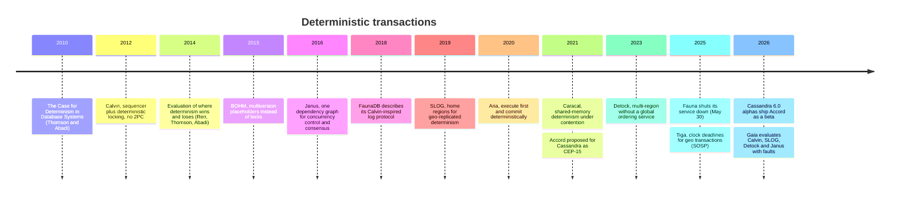
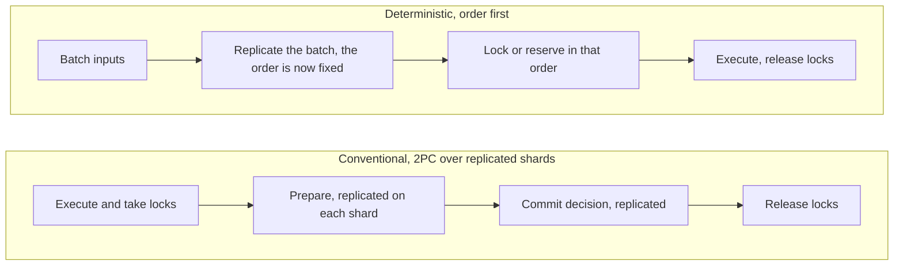
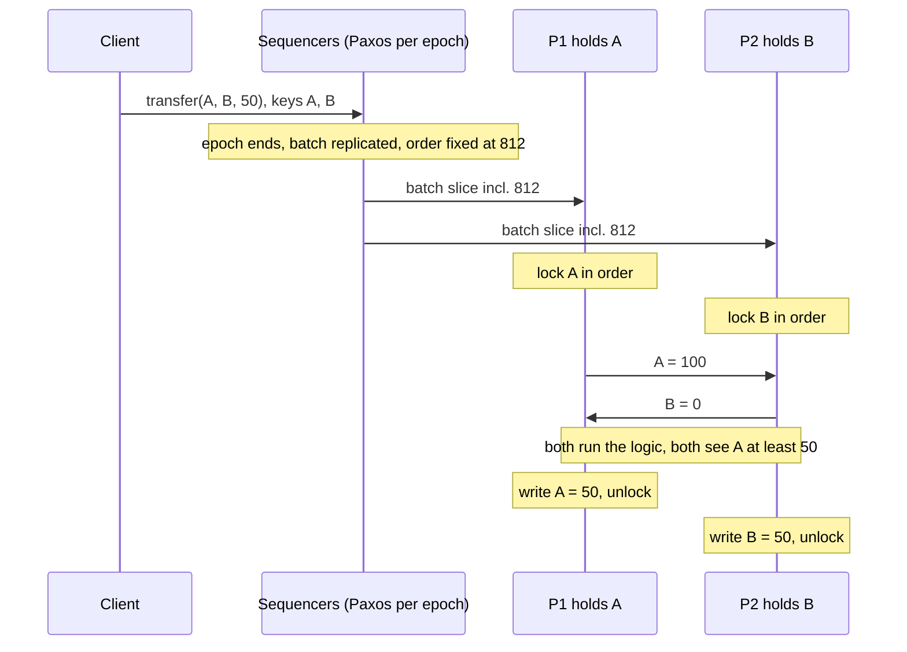

---
aliases:
  - Deterministic Databases
  - Deterministic Concurrency Control
  - Order-Then-Execute Transactions
tags:
  - distributed-systems
  - transactions
  - databases
  - determinism
  - calvin
  - accord
status: complete
sources:
  - https://www.cs.umd.edu/~abadi/papers/determinism-vldb10.pdf
  - https://www.cs.princeton.edu/courses/archive/fall19/cos418/papers/calvin.pdf
  - https://vldb.org/pvldb/vol7/p821-ren.pdf
  - https://arxiv.org/pdf/1412.2324
  - https://www.cs.princeton.edu/~wlloyd/papers/janus-osdi16.pdf
  - https://par.nsf.gov/servlets/purl/10126332
  - https://www2.cs.arizona.edu/~caolei/papers/Aria.pdf
  - https://www.eecg.utoronto.ca/~ashvin/publications/caracal.pdf
  - https://drum.lib.umd.edu/items/8c710897-0b8c-4693-9041-e75209e792d7/full
  - https://emptysqua.re/blog/review-detock/
  - https://dbmsmusings.blogspot.com/2019/01/its-time-to-move-on-from-two-phase.html
  - https://uwaterloo.ca/data-systems-group/blog/distributed-consistency-scale-spanner-vs-calvin
  - https://dev.to/fauna/consistency-without-clocks-the-faunadb-distributed-transaction-protocol-p46
  - https://fauna.evanweaver.com/the-future-of-fauna/
  - https://infoq.com/news/2025/03/fauna-shuts-down
  - https://awesome.ecosyste.ms/projects/github.com%2Ffauna%2Ffaunadb
  - https://cwiki.apache.org/confluence/spaces/CASSANDRA/pages/188744725/CEP-15+General+Purpose+Transactions
  - https://cwiki-test.apache.org/confluence/download/attachments/188744725/Accord.pdf?api=v2
  - https://www.ksolves.com/blog/big-data/apache-cassandra/whats-new-in-apache-cassandra-6
  - https://software.imdea.org/news/2026/10-28-accord/
  - https://arxiv.org/html/2509.05759v1
  - https://arxiv.org/pdf/2605.30156
  - https://arxiv.org/html/2611.05882
created: 2026-11-27
updated: 2026-11-27
---

## Table Of Contents

---

- [[#TL;DR|TL;DR]]
- [[#The Problem|The Problem]]
- [[#Foundations|Foundations]]
    - [[#What Deterministic Means|What Deterministic Means]]
    - [[#Two Kinds of Abort|Two Kinds of Abort]]
    - [[#Replicating Inputs Instead of Effects|Replicating Inputs Instead of Effects]]
    - [[#The Price, Knowing Your Keys First|The Price, Knowing Your Keys First]]
- [[#How We Got Here|How We Got Here]]
- [[#How It Works|How It Works]]
    - [[#The Common Shape|The Common Shape]]
    - [[#Calvin, a Global Sequencer|Calvin, a Global Sequencer]]
    - [[#Worked Example, a Transfer Across Two Partitions|Worked Example, a Transfer Across Two Partitions]]
    - [[#OLLP, Guessing the Keys and Checking Later|OLLP, Guessing the Keys and Checking Later]]
    - [[#Versions Instead of Locks, BOHM and Caracal|Versions Instead of Locks, BOHM and Caracal]]
    - [[#Execute First, Commit Deterministically, Aria and Fauna|Execute First, Commit Deterministically, Aria and Fauna]]
    - [[#Worked Example, Aria's Commit Rules|Worked Example, Aria's Commit Rules]]
    - [[#Going Geo, SLOG and Detock|Going Geo, SLOG and Detock]]
    - [[#No Global Log, Janus, Accord and Tiga|No Global Log, Janus, Accord and Tiga]]
    - [[#Who Fixes the Order, Side by Side|Who Fixes the Order, Side by Side]]
- [[#Where It Is Now|Where It Is Now]]
- [[#Trade-offs & Open Problems|Trade-offs & Open Problems]]
- [[#Resources|Resources]]
- [[#Related Notes|Related Notes]]

## ***TL;DR***
---
*A deterministic database agrees on the order of transactions first and then runs them so that every replica and every shard reaches the same result on its own. That removes two-phase commit and lets replicas copy inputs instead of effects, at the cost of knowing a transaction's keys up front and paying a batching or ordering delay.*

- **The idea:** if a transaction's outcome depends only on the starting state and a fixed, ordered list of transactions, nobody has to vote on the outcome. Every participant computes the same answer ([Thomson and Abadi, 2010](https://www.cs.umd.edu/~abadi/papers/determinism-vldb10.pdf)).
- **What it removes:** the commit protocol. Without system-induced aborts (deadlocks, crashes), no shard can veto, so [[Distributed Transactions#Two-Phase Commit|2PC]] is unnecessary and locks are held for about one extra message instead of two consensus rounds ([Calvin](https://www.cs.princeton.edu/courses/archive/fall19/cos418/papers/calvin.pdf), [Abadi, 2019](https://dbmsmusings.blogspot.com/2019/01/its-time-to-move-on-from-two-phase.html)).
- **What it costs:** classic designs need read and write sets before execution, which rules out interactive transactions; every transaction waits for an ordering step; and one slow node stalls everyone behind it ([Ren, Thomson, Abadi, 2014](https://vldb.org/pvldb/vol7/p821-ren.pdf)).
- **The family:** Calvin (global sequencer), BOHM and Caracal (versions instead of locks), Aria and Fauna (execute first, decide deterministically), SLOG and Detock (home regions for geo), and Janus and Accord, which fix order per conflict through [[Leaderless Consensus]] instead of a global log.
- **Now (Nov 2026):** Fauna, the main commercial Calvin-inspired database, shut its service down on May 30, 2025. The ordering-before-execution idea lives on in Accord, a beta feature, off by default, in pre-release Cassandra 6.0, and in research such as Tiga (SOSP 2025) and the 2026 Gaia evaluation of Calvin, SLOG, Detock and Janus.

## ***The Problem***
---
*Ordinary databases let the order of concurrent transactions emerge at runtime from thread timing, lock waits and failures. That freedom is why replicas can diverge and why every shard must vote before a distributed transaction commits.*

Classic concurrency control promises only that the result equals *some* serial order. Which order is decided by thread scheduling, cache misses, network delays and deadlock victims, so two replicas fed the same transactions can end in different states ([Thomson and Abadi, 2010](https://www.cs.umd.edu/~abadi/papers/determinism-vldb10.pdf)). Two consequences follow:

| Consequence | Why | What it costs |
|---|---|---|
| Replicas must copy **effects** | Re-running the same inputs could give a different result | Log shipping, with locks held until the log is replicated ([[Replication]]) |
| Shards must **vote** | Any shard might abort for its own reasons (a deadlock, a crash) | [[Distributed Transactions#Two-Phase Commit|Two-phase commit]], blocking on coordinator failure, and locks held across the protocol |

The lock-hold time is what hurts. In a geo-replicated system using 2PC over [[Paxos]] groups, a transaction holds its locks through a cross-region prepare and a cross-region commit. Every conflicting transaction queues behind it. Calvin's authors modeled a System R\*-style system with about 8 ms of lock time per distributed transaction and showed that its throughput ceiling, $1/(C \cdot D_{2PC})$ for contention index $C$, falls sharply as contention rises ([Calvin](https://www.cs.princeton.edu/courses/archive/fall19/cos418/papers/calvin.pdf)).

## ***Foundations***
---
*Four ideas carry everything else: what determinism means for a database, which aborts it removes, why it lets you replicate inputs, and why it needs the keys before it runs.*

### What Deterministic Means

*The state after $n$ transactions is a function of the starting state and the ordered list, nothing else.*

$$
S_n = T_n(S_{n-1}) \quad\Longrightarrow\quad S_n = (T_n \circ T_{n-1} \circ \cdots \circ T_1)(S_0)
$$

*In words:* each transaction is a pure function from one database state to the next, and the final state depends only on $S_0$ and the order $T_1, \dots, T_n$. Anything nondeterministic inside a transaction, like reading the clock or drawing a random number, is done once by a preprocessor and written into the input ([Thomson and Abadi, 2010](https://www.cs.umd.edu/~abadi/papers/determinism-vldb10.pdf)).

*Example:* start with A = 100, B = 0 on two replicas. $T_1$ moves 50 from A to B if A ≥ 50; $T_2$ moves 80 if A ≥ 80.

| Order | After first | After second | Final |
|---|---|---|---|
| $T_1, T_2$ | A = 50, B = 50 | $T_2$'s check fails, no change | A = 50, B = 50 |
| $T_2, T_1$ | A = 20, B = 80 | $T_1$'s check fails, no change | A = 20, B = 80 |

A conventional database could run $T_1$ first on replica 1 and $T_2$ first on replica 2, and the replicas disagree. A deterministic one gives both replicas the log $[T_1, T_2]$; both end at A = 50, B = 50, and both decide that $T_2$ does nothing, with no message exchanged.

### Two Kinds of Abort

*Only one kind of abort needs a vote. Remove it and the commit protocol goes with it.*

Daniel Abadi splits aborts in two ([Abadi, Jan 2019](https://dbmsmusings.blogspot.com/2019/01/its-time-to-move-on-from-two-phase.html)):

| Kind | Example | Deterministic? | Needs a vote? |
|---|---|---|---|
| **Logic-induced** | Stock would go below zero; balance too low | Yes: every shard sees the same data and can evaluate the same `if` | No |
| **System-induced** | Deadlock victim, crash, timeout | No: depends on timing and failures | Yes, today |

His argument: "if you can eliminate category (2) aborts, the commit protocol can be eliminated." Deterministic databases do that by acquiring locks in a fixed order (so no deadlocks) and by **restarting** a crashed node's transactions from their logged input rather than aborting them. With active replication, "Deterministic database systems ... only need to use a one-phase commit protocol," and transactions without conditional aborts need none ([Thomson and Abadi, 2010](https://www.cs.umd.edu/~abadi/papers/determinism-vldb10.pdf)).

### Replicating Inputs Instead of Effects

*If execution is deterministic, replicas only need to agree on the input log. Each replays it and reaches the same state.*

This is state machine replication applied to a whole database: agree on a log of transaction requests with [[Paxos]] or [[Raft]], then let every replica execute it ([[Replication]]). Calvin replicates transaction inputs rather than their effects. The consensus round happens *before* any lock is taken, so it adds latency but not contention ([Calvin](https://www.cs.princeton.edu/courses/archive/fall19/cos418/papers/calvin.pdf)). Aria goes further: replicas never talk to each other and need no undo or redo logging, because recovery is replaying the inputs ([Aria](https://www2.cs.arizona.edu/~caolei/papers/Aria.pdf)). Contrast [[Write-Ahead Logging]], which logs effects so they can be redone.

### The Price, Knowing Your Keys First

*To lock in a fixed order, the scheduler must know which records each transaction touches before it runs.*

Calvin's single lock-manager thread walks the agreed order and requests every lock a transaction needs, so "transactions [must] declare their full read/write sets in advance" ([Calvin](https://www.cs.princeton.edu/courses/archive/fall19/cos418/papers/calvin.pdf)). That rules out:
- **Interactive transactions**, where the client reads, thinks and then writes. The whole transaction must be submitted at once, typically as a stored procedure ([Waterloo DSG blog, Jun 2018](https://uwaterloo.ca/data-systems-group/blog/distributed-consistency-scale-spanner-vs-calvin)).
- **Dependent transactions**, whose keys come from data, like looking up a customer by name in a [[Secondary Indexes|secondary index]]. These need a reconnaissance step ([[#OLLP, Guessing the Keys and Checking Later|OLLP]]).

Later designs relax this. BOHM and Caracal still need write sets ([BOHM](https://arxiv.org/pdf/1412.2324), [Caracal](https://www.eecg.utoronto.ca/~ashvin/publications/caracal.pdf)); Aria and Fauna execute first and need none ([Aria](https://www2.cs.arizona.edu/~caolei/papers/Aria.pdf), [Freels, 2018](https://dev.to/fauna/consistency-without-clocks-the-faunadb-distributed-transaction-protocol-p46)).

## ***How We Got Here***
---
*The idea was argued in 2010 and built as Calvin in 2012. A decade of papers then chipped at its costs one by one: lock overhead, the need for read and write sets, geo latency and the global log, while a parallel line folded ordering into consensus itself.*

**The argument (2010).** Thomson and Abadi argued that letting the database pick the serial order at runtime was a design choice worth revisiting for in-memory OLTP. Their prototype had "nearly negligible overhead" on one node and beat lock-based systems with 2PC as the share of multi-partition TPC-C New Order transactions grew. They also flagged the weak spot: a transaction that stalls holding locks (a disk read, say) clogs everything behind it, and determinism "significantly lowers throughput relative to traditional schemes when there are long delays" ([Thomson and Abadi, 2010](https://www.cs.umd.edu/~abadi/papers/determinism-vldb10.pdf)).

**Calvin (2012).** The full system: a sequencing layer, a deterministic scheduler, pluggable storage, Paxos-replicated input batches and OLLP for dependent transactions. It reached nearly half a million TPC-C New Order transactions per second on 100 EC2 machines ([Calvin](https://www.cs.princeton.edu/courses/archive/fall19/cos418/papers/calvin.pdf)).

**An honest scorecard (2014).** The same group measured both sides. Determinism scaled "gracefully" to 48 machines under high contention, where 2PC and distributed deadlocks hurt the nondeterministic system. But OLLP could halve throughput, the lock thread spent over 30% of short transactions' time acquiring locks, one slow node with only 5% multi-partition transactions dragged the whole cluster, and latency was often about twice as high ([Ren, Thomson, Abadi, 2014](https://vldb.org/pvldb/vol7/p821-ren.pdf)).

**Chipping at the costs (2015–2023).** BOHM replaced locks with pre-placed versions; Aria removed the need for read and write sets; Caracal handled hot rows; SLOG cut geo latency with home regions; Detock removed SLOG's central ordering for multi-region transactions (details in [[#How It Works|How It Works]]).

**Ordering folded into consensus (2016–2026).** Janus showed that concurrency control and consensus both need conflicting operations in the same order everywhere, so one dependency graph can do both ([Janus](https://www.cs.princeton.edu/~wlloyd/papers/janus-osdi16.pdf)). Accord, proposed for Cassandra in 2021, does the same with timestamps ([CEP-15](https://cwiki.apache.org/confluence/spaces/CASSANDRA/pages/188744725/CEP-15+General+Purpose+Transactions)). Both are covered protocol-first in [[Leaderless Consensus]]; here they matter as deterministic databases without a global log.

## ***How It Works***
---
*Every design answers two questions: who fixes the order, and does the transaction run before or after the order is fixed? The rest is engineering around the costs of the answer.*

### The Common Shape

*Order, then decide conflicts without votes, then execute the same way everywhere. Compare it with the usual execute, lock, vote, replicate pipeline.*

In the conventional pipeline, locks are held across two replication rounds. In the deterministic one, replication finishes *before* any lock is taken, so lock hold time is just execution plus, for multi-partition transactions, one exchange of reads ([Calvin](https://www.cs.princeton.edu/courses/archive/fall19/cos418/papers/calvin.pdf)).

### Calvin, a Global Sequencer

*Calvin splits the database into three layers: a sequencer that fixes one global order per 10 ms epoch, a scheduler that locks in that order, and storage that just does reads and writes.*

From the [Calvin paper](https://www.cs.princeton.edu/courses/archive/fall19/cos418/papers/calvin.pdf):
- **Sequencer.** Partitioned across every machine. Each sequencer collects requests for a 10 ms epoch and replicates the batch, either asynchronously from a master replica (fast, but failover is complex) or with Paxos across a replication group (implemented with ZooKeeper). Then it sends each scheduler the slice of the batch it needs. Schedulers interleave the batches round-robin by sequencer ID, which gives the global order. Average batching delay is about 5 ms.
- **Scheduler.** One thread walks the order and requests every lock each transaction needs. Two rules: conflicting exclusive requests are made in serial order, and locks are granted strictly in request order. That's strict two-phase locking with a fixed acquisition order, so deadlocks can't happen. Each scheduler locks only records it stores.
- **Storage.** Any engine with a create, read, update, delete interface.

A multi-partition transaction runs in five phases on each participant:

| Phase | Who | What |
|---|---|---|
| 1. Analyze | All participants | Split the read and write sets into local and remote; find **active** participants (store part of the write set) and **passive** ones (only reads) |
| 2. Local reads | All | Read local records in the read set |
| 3. Serve remote reads | All | Send local read results to every active participant. Passive participants are done |
| 4. Collect | Active | Wait for the other participants' reads |
| 5. Execute | Active | Run the full transaction logic; apply only the local writes |

Every active participant runs the same logic on the same inputs and so reaches the same decision, including any logic abort. No one votes.

**Disk.** Because a stall while holding locks blocks everyone behind it, Calvin delays a transaction that may touch disk before sequencing it and prefetches its records meanwhile. With a filesystem-backed engine, a 40 ms artificial delay put at least 99% of disk-touching transactions after their prefetch at contention index 0.01 ([Calvin](https://www.cs.princeton.edu/courses/archive/fall19/cos418/papers/calvin.pdf)).

**Numbers.** About 27,000 microbenchmark transactions per second on one machine; about 5,000 TPC-C New Order per second per node beyond 10 nodes, scaling linearly to "nearly half a million" on 100 nodes. With 100% multi-partition transactions at low contention, per-node throughput fell to about 5,000 on 4 nodes, mostly from the CPU cost of serializing remote reads, not from coordination ([Calvin](https://www.cs.princeton.edu/courses/archive/fall19/cos418/papers/calvin.pdf)).

### Worked Example, a Transfer Across Two Partitions

*Move 50 from A (partition P1) to B (partition P2) under Calvin, with three replicas per partition.*

1. The client sends `transfer(A, B, 50)` to a sequencer. Its read and write sets are {A, B}.
2. At the end of the 10 ms epoch the sequencer's batch is agreed through Paxos among its replicas. The transaction is now at, say, position 812 in the global order.
3. P1's scheduler requests the lock on A and P2's on B, each in global order. If transaction 811 also wrote A, P1 grants A to 811 first.
4. Both partitions store part of the write set, so both are active. P1 reads A = 100, P2 reads B = 0, and they swap values.
5. Both now hold A = 100, B = 0 and run the same code: A ≥ 50, so A = 50, B = 50. P1 writes A, P2 writes B, both release their locks.
6. P1's and P2's other replicas did the same thing from the same batch, without hearing from P1 or P2.

If A held only 30, both would compute "insufficient funds" and both would write nothing. That's a logic abort decided identically by both partitions, with no commit message.

### OLLP, Guessing the Keys and Checking Later

*For transactions whose keys depend on data, Calvin runs a cheap read to predict the keys, sequences the real transaction with that guess, and restarts it deterministically if the guess was wrong.*

Optimistic Lock Location Prediction ([Calvin](https://www.cs.princeton.edu/courses/archive/fall19/cos418/papers/calvin.pdf)):
1. **Reconnaissance.** An unreplicated, low-isolation, read-only query finds the keys. Example: "raise the credit limit of customer Smith" reads the name index and finds Smith → customer 42.
2. **Sequence** the real transaction with write set {customer 42} and the index value it relied on.
3. **Check at execution.** Under its locks, the transaction re-reads the index. Still 42: proceed. Changed: every replica sees the same change at the same point in the order, so every replica restarts it the same way.

It works when the data behind the guess rarely changes. TPC-C Payment never restarts because the workload never changes the index it depends on ([Calvin](https://www.cs.princeton.edu/courses/archive/fall19/cos418/papers/calvin.pdf)). When the dependent reads come after all other work, the extra pass can halve throughput, and volatile indexes cause more restarts ([Ren, Thomson, Abadi, 2014](https://vldb.org/pvldb/vol7/p821-ren.pdf)).

### Versions Instead of Locks, BOHM and Caracal

*If the order is known before execution, you can create every version a batch will write in advance. Then readers find exactly the version they need, and nothing has to lock.*

**BOHM (VLDB 2015).** Concurrency-control threads, each owning a partition of keys, insert a placeholder version for every write in the batch before anything runs. Execution threads then fill placeholders in parallel; a read that reaches an unfilled one waits. So "reads never block writes," and reads leave no bookkeeping in shared memory. It needs write sets up front. On one 40-core machine it ran about 181,600 transactions per second on a mixed YCSB workload, against about 110,000 for Hekaton and 28,400 for 2PL, and over 3 million per second on low-contention SmallBank, more than 3x Hekaton. Under high contention, plain locking beat it ([Faleiro and Abadi](https://arxiv.org/pdf/1412.2324)). See [[MVCC and Version Garbage Collection]].

**Caracal (SOSP 2021).** A shared-memory deterministic database that doesn't partition data across cores, so skew doesn't unbalance it. Versions live in sorted arrays found by binary search. For contended rows, each core appends versions to its own buffer (**batch append**), and rows marked as possibly hot can have their updates split and spread across cores (**split-on-demand**). It never aborts for concurrency control but needs declared write sets. On 32 cores it reached 2.12 million YCSB transactions per second uncontended and 437,000 on contended, skewed YCSB, about 2.5x Granola; Granola won default TPC-C by 36% ([Qin, Demke Brown, Goel](https://www.eecg.utoronto.ca/~ashvin/publications/caracal.pdf)). See [[Hot Keys and Cache Stampedes]].

### Execute First, Commit Deterministically, Aria and Fauna

*Run each transaction on a snapshot first to learn what it touches, then fix the order and let every node make the same commit decision from the same facts.*

**Aria (VLDB 2020)** removes the need for read and write sets ([Lu, Yu, Cao, Madden](https://www2.cs.arizona.edu/~caolei/papers/Aria.pdf)):
1. A sequencing layer (Paxos or Raft) assigns each batch and each transaction ID (TID).
2. **Execution phase.** Every transaction in the batch reads the same snapshot and buffers its writes. It then makes write reservations: each key remembers the smallest TID that wants to write it.
3. **Commit phase.** Each transaction checks the reservations for dependencies on *earlier* TIDs. Under the default rule it commits only with no write-after-write (WAW) and no read-after-write (RAW) dependency. Aborted transactions go to the front of the next batch in order; the first transaction of a batch always commits, so everything eventually commits.
4. **Reordering rule.** Optionally, a transaction may commit with a RAW dependency as long as it has no WAW and doesn't have both a WAR and a RAW. That lets the serial order differ from TID order and saves aborts. Finding the best set is NP-complete, so Aria uses this cheap rule.
5. **Fallback.** When WAW conflicts drive aborts up, aborted transactions rerun in TID order with Calvin-style ordered locks.

On 8 EC2 nodes Aria reported 1.6–2.1x Calvin's YCSB throughput and up to 1.7x on TPC-C ([Aria](https://www2.cs.arizona.edu/~caolei/papers/Aria.pdf)).

**Fauna** (described in 2018) used a related idea in production: a coordinator executes the transaction speculatively at a recent snapshot and buffers its writes; the transaction, with its reads and writes, is appended to one Raft-ordered global log, and its log position becomes its ID; then every replica re-reads at that position and commits if the reads still match, aborting otherwise. All replicas see the same log, so all decide the same way. It used no synchronized clocks, offered strictly serializable read-write transactions and ran read-only snapshot reads locally ([Freels, Oct 2018](https://dev.to/fauna/consistency-without-clocks-the-faunadb-distributed-transaction-protocol-p46)). Fauna described the protocol as "inspired by Calvin"; it is closer to optimistic concurrency control with a deterministic validation step.

### Worked Example, Aria's Commit Rules

*Three transactions in one batch, TIDs 1 to 3, all reading the same snapshot.*

| TID | Reads | Writes |
|---|---|---|
| T1 | x | y |
| T2 | y | z |
| T3 | z | x |

Write reservations: y → T1, z → T2, x → T3. Read reservations (for the reordering rule): x → T1, y → T2, z → T3.

| | WAW on earlier? | RAW on earlier? | WAR on earlier? | Default rule | Reordering rule |
|---|---|---|---|---|---|
| T1 | no | no | no | commit | commit |
| T2 | no | yes (reads y, which T1 writes) | no (nobody earlier reads z) | abort | commit, ordered before T1 |
| T3 | no | yes (reads z, which T2 writes) | yes (writes x, which T1 read) | abort | abort |

Under the default rule only T1 commits; T2 and T3 move to the next batch. Under the reordering rule T1 and T2 commit with serial order T2 → T1. That's valid because T2 read the old y, exactly what it would see if it ran before T1. T3 can't fit anywhere in the cycle T1 → T3 → T2 → T1, so it retries. Every node evaluates the same table and reaches the same decisions without exchanging votes.

### Going Geo, SLOG and Detock

*A global sequencer makes every transaction pay a cross-region consensus round. Give each record a home region, and most transactions only need their home's log.*

**SLOG (VLDB 2019)** assigns each granule (a record or key range) a home region ([Ren, Li, Abadi](https://par.nsf.gov/servlets/purl/10126332)):
- **Single-home** transactions go to their home region's Paxos-replicated log and commit there; other regions replay that log asynchronously. With no multi-home transactions, "almost every transaction achieves less than 10 ms latency," more than an order of magnitude faster than Calvin, which paid over 200 ms for its global Paxos round.
- **Multi-home** transactions insert a lock-only entry into each home's log, and a separate ordering step (in the implementation, one region's log) orders them against each other. Each region interleaves the per-region logs; that's safe because they touch disjoint data.
- **Remastering** moves a granule's home based on recent access, as an ordinary single-home write.
- **Costs:** multi-home latency depends on the farthest region; SLOG-B isn't tolerant of a full region failure (SLOG-HA waits for replication to a nearby region); and read and write sets are still needed.

**Detock (SIGMOD 2023)** drops SLOG's central ordering for multi-home transactions ([Nguyen, Miller, Abadi](https://drum.lib.umd.edu/items/8c710897-0b8c-4693-9041-e75209e792d7/full)). Each region sequences its piece of a multi-home transaction locally, so regions may see pieces in different orders, which can create cycles. Each region builds the dependency graph, condenses it into strongly connected components, orders transactions inside a component by ID and sorts the components, so every region resolves the would-be deadlock the same way. Coordinators assign future timestamps so pieces mostly arrive in order, and without that "opportunistic reordering" Detock performs very poorly. The authors claim an order of magnitude higher throughput and up to 5x lower latency than prior geo approaches. In A. Jesse Jiryu Davis's reading of the evaluation, Calvin still wins on high-contention YCSB when most transactions are multi-home ([Davis, May 2024](https://emptysqua.re/blog/review-detock/)).

### No Global Log, Janus, Accord and Tiga

*Instead of ordering every transaction, order only the ones that conflict, and let consensus decide that order. Execution is still deterministic; the "log" is a per-key graph or a timestamp.*

- **Janus (OSDI 2016)** tracks conflicts as a dependency graph agreed through EPaxos-style consensus. Each server waits until a transaction's ancestors commit, finds strongly connected components, and runs transactions in a cycle "sorted by transaction ids." Every server sees the same graph, so conflicting transactions execute identically everywhere and Janus never aborts. It handles one-shot stored-procedure transactions whose pieces each touch one shard. Under zipf 0.9 geo-replicated contention it reached 43,510 transactions per second against 3,950 for TAPIR and about 1,085 for 2PL or OCC over Multi-Paxos ([Mu et al.](https://www.cs.princeton.edu/~wlloyd/papers/janus-osdi16.pdf)).
- **Accord** gives each transaction a timestamp from a [[Time and Clocks|hybrid logical clock]], agreed in one round trip on the fast path or two on the slow path, plus a superset of conflicting dependencies; replicas apply in timestamp order once dependencies are applied ([Accord whitepaper](https://cwiki-test.apache.org/confluence/download/attachments/188744725/Accord.pdf?api=v2)). Its quorum math and reorder buffer are in [[Leaderless Consensus#Leaderless Transactions, Janus and Accord|Leaderless Consensus]] and [[Clock-Assisted Consensus#Accord's Reorder Buffer|Clock-Assisted Consensus]].
- **Tiga (SOSP 2025)** uses synchronized clocks to give each transaction a future deadline so it reaches every shard in the same order, then executes in that order; clocks affect speed, not correctness. In its own testbed it reported 157.3k microbenchmark transactions per second against 119.6k for an adapted Calvin and 77.8k for Janus ([Tiga](https://arxiv.org/html/2509.05759v1); see [[Clock-Assisted Consensus#Tiga, Deadlines for Geo-Distributed Transactions|Clock-Assisted Consensus]]).

These are deterministic in the sense that matters here: once the order is agreed, no shard can veto, so there's no 2PC on top of replication. The difference from Calvin is that unrelated transactions never wait for each other in a shared log.

### Who Fixes the Order, Side by Side

*The designs differ mainly in where the order comes from and how much they must know before running.*

| System | Who fixes the order | Runs before or after ordering | Needs keys up front | Main cost |
|---|---|---|---|---|
| Calvin | Global sequencer, Paxos per 10 ms epoch | After | Read and write sets (OLLP for dependent) | Batching delay; cross-region Paxos for every transaction |
| BOHM, Caracal | Batch order, versions placed before execution | After | Write sets | Same; mostly single-node designs |
| Aria | Batch TID order, adjusted by commit rules | Before (on a snapshot), then decide | No | Aborts under write-write conflict |
| Fauna (2018) | Raft log position | Before (speculative), then validate | No | Aborts when reads change; one global log |
| SLOG | Home region's log; separate ordering for multi-home | After | Read and write sets | Multi-home latency set by farthest region |
| Detock | Per-region logs plus deterministic deadlock resolution | After | Read and write sets | Degrades as multi-home share grows |
| Janus | Per-conflict dependency graph via consensus | After commit | One-shot pieces | Fast path needs every replica |
| Accord | Per-transaction timestamp via fast or slow path | After commit | Keys of the one-shot transaction | Fast path needs a supermajority of the electorate |

Sources: the papers cited in each section above.

## ***Where It Is Now***
---
*As of November 2026, the best-known commercial Calvin-style database is gone, while the idea of agreeing on order before execution is reaching production through Accord and keeps producing research on geo-replication and evaluation.*

- **Fauna shut down.** On March 19, 2025, Fauna said it would sunset its hosted service and stop taking new customers, after its "board and investors have determined that it is not possible to raise the capital needed"; the service ended on May 30, 2025 ([Fauna, Mar 2025](https://fauna.evanweaver.com/the-future-of-fauna/), [InfoQ, Mar 2025](https://infoq.com/news/2025/03/fauna-shuts-down)). It promised an open source release of its core database; a `fauna/faunadb` Scala repository appeared on GitHub in late April 2025 under Fauna's own license, with its last push listed as May 3, 2025 ([ecosyste.ms listing](https://awesome.ecosyste.ms/projects/github.com%2Ffauna%2Ffaunadb)). The shutdown was for business reasons, not a reported flaw in the protocol.
- **Accord is the production path.** Cassandra 6.0 was still in alpha as of the latest sources (alpha1 in April 2026; an article updated November 13, 2026 still says alpha), and Accord ships off by default as a beta feature ([Ksolves, updated Nov 2026](https://www.ksolves.com/blog/big-data/apache-cassandra/whats-new-in-apache-cassandra-6); status and caveats in [[Leaderless Consensus#Accord in Cassandra 6.0|Leaderless Consensus]]). In October 2026 IMDEA reported a hand proof of Accord's safety, formalized in Lean with AI help, and a TLA+ model ([IMDEA, Oct 28, 2026](https://software.imdea.org/news/2026/10-28-accord/); see [[AI-Assisted Protocol Design]] and [[Formal Methods in Practice]]).
- **Evaluation is catching up with the claims.** Gaia (TU Delft, KTH and Ververica, 2026) ran Calvin, SLOG, Detock, Janus and CockroachDB under realistic geo conditions. SLOG and Detock lost throughput as cross-region transactions grew, and their latency for transactions homed in another region rose from about 20 ms to 250 ms; both hit a breaking point around 150 ms average cross-region delay on TPC-C, losing about 90% of throughput, while Janus was nearly unaffected up to 111 ms. At 2% packet loss, Calvin, SLOG and Detock lost 35–60% of throughput. Only CockroachDB recovered from the tested failures without manual restarts, and its peak throughput was far below the prototypes'. The authors' point is that research prototypes skip fault tolerance on the critical path ([Mraz et al., 2026](https://arxiv.org/pdf/2605.30156)).
- **Geo-replicated determinism, revisited.** A November 2026 preprint from Toronto and Concordia models 2PL, OCC and deterministic concurrency control under geo-replication and builds Quirinus, a multi-leader deterministic database with speculative execution, reordering, CRDT counters and fast-path commits. It reports up to 6.2x Tiga's peak TPC-C throughput, but Tiga led on YCSB once cross-datacenter delay was added, and Quirinus's p99 reached about 1.2–1.4 s at 200 ms delay. The authors note deterministic systems still lack interactive transactions ([Mao et al., Nov 2026](https://arxiv.org/html/2611.05882)).
- **Clock-assisted ordering.** Tiga (SOSP 2025) is the clearest recent example of fixing order before execution with synchronized clocks instead of a log; see [[Clock-Assisted Consensus]].

## ***Trade-offs & Open Problems***
---
*Determinism trades flexibility and latency for scalability under contention. It wins when many transactions span shards and fight over the same rows; it loses when transactions are interactive, latency-sensitive or stuck behind a slow node.*

| You get | You pay |
|---|---|
| No 2PC and no distributed deadlocks | An ordering step (batch or consensus) before every transaction |
| Short lock holds, so high throughput under contention | Keys known in advance in most designs; no interactive transactions |
| Replicas that replay inputs and never talk | Every replica re-executes every transaction (CPU at each replica) |
| Recovery by replay; simple checkpoints at a point in the order | A stall in one transaction blocks everything ordered after it |
| Deterministic results that are easy to reason about and test | One slow node slows the cluster, since it can't shed work by aborting |

Open problems worth tracking:
- **Interactive and dependent transactions.** OLLP, Aria's execute-first approach and Fauna's validation all work around the read and write set requirement, each with an abort or restart cost. Deterministic designs that support ORMs and client-driven transactions remain open ([Ren, Thomson, Abadi, 2014](https://vldb.org/pvldb/vol7/p821-ren.pdf); [Mao et al., 2026](https://arxiv.org/html/2611.05882)).
- **Stragglers.** A slow node or a long stall holds up every later transaction that touches it, with no way to abort around it ([Ren, Thomson, Abadi, 2014](https://vldb.org/pvldb/vol7/p821-ren.pdf)). This is a deterministic version of [[Gray and Fail-Slow Failures|fail-slow behavior]].
- **Latency.** Batching and a pre-execution ordering round often doubled latency in the 2014 study, and read-only transactions in Calvin go through the log too, where Spanner can serve them without Paxos ([Waterloo DSG blog, Jun 2018](https://uwaterloo.ca/data-systems-group/blog/distributed-consistency-scale-spanner-vs-calvin); see [[CAP and PACELC]]).
- **Global log vs per-key order.** A global sequencer makes unrelated transactions wait on each other and pay a global round; per-conflict ordering (Janus, Accord) avoids that but needs larger fast quorums and careful recovery ([[Leaderless Consensus]]).
- **Prototype vs production.** Gaia's results show that many published gains disappear once faults, packet loss and failure recovery are in scope ([Mraz et al., 2026](https://arxiv.org/pdf/2605.30156)). Accord in Cassandra 6.0 will be the first large-scale data point.
- **Name collision.** Deterministic *execution* in databases is related to, but distinct from, [[Deterministic Simulation Testing]], where determinism is used to replay a whole system under test. Deterministic databases make that kind of testing easier because replicas replay inputs.

## ***Resources***
---
*Start with the 2010 position paper and Abadi's 2019 blog post for the why, read Calvin for the how, and then the 2014 evaluation for an honest list of the costs. Aria and Detock show the two main lines of improvement; Gaia is the reality check.*

**Primary papers**
- [The Case for Determinism in Database Systems](https://www.cs.umd.edu/~abadi/papers/determinism-vldb10.pdf): Thomson and Abadi, VLDB 2010.
- [Calvin: Fast Distributed Transactions for Partitioned Database Systems](https://www.cs.princeton.edu/courses/archive/fall19/cos418/papers/calvin.pdf): Thomson et al., SIGMOD 2012.
- [An Evaluation of the Advantages and Disadvantages of Deterministic Database Systems](https://vldb.org/pvldb/vol7/p821-ren.pdf): Ren, Thomson, Abadi, VLDB 2014.
- [Rethinking Serializable Multiversion Concurrency Control](https://arxiv.org/pdf/1412.2324): Faleiro and Abadi, VLDB 2015 (BOHM).
- [Consolidating Concurrency Control and Consensus for Commits under Conflicts](https://www.cs.princeton.edu/~wlloyd/papers/janus-osdi16.pdf): Mu, Nelson, Lloyd, Li, OSDI 2016 (Janus).
- [SLOG: Serializable, Low-latency, Geo-replicated Transactions](https://par.nsf.gov/servlets/purl/10126332): Ren, Li, Abadi, VLDB 2019.
- [Aria: A Fast and Practical Deterministic OLTP Database](https://www2.cs.arizona.edu/~caolei/papers/Aria.pdf): Lu, Yu, Cao, Madden, VLDB 2020.
- [Caracal: Contention Management with Deterministic Concurrency Control](https://www.eecg.utoronto.ca/~ashvin/publications/caracal.pdf): Qin, Demke Brown, Goel, SOSP 2021.
- [Detock: High Performance Multi-region Transactions at Scale](https://drum.lib.umd.edu/items/8c710897-0b8c-4693-9041-e75209e792d7/full): Nguyen, Miller, Abadi, SIGMOD 2023.
- [Accord whitepaper (draft)](https://cwiki-test.apache.org/confluence/download/attachments/188744725/Accord.pdf?api=v2) and [CEP-15](https://cwiki.apache.org/confluence/spaces/CASSANDRA/pages/188744725/CEP-15+General+Purpose+Transactions): Elliott Smith et al.
- [Tiga: Accelerating Geo-Distributed Transactions with Synchronized Clocks](https://arxiv.org/html/2509.05759v1): SOSP 2025.
- [The Missing Dimensions in Geo-Distributed Database Evaluation](https://arxiv.org/pdf/2605.30156): Mraz, Psarakis, Christodoulou, Carbone, Katsifodimos, 2026 (Gaia).
- [Optimizing Geo-replicated Deterministic Databases](https://arxiv.org/html/2611.05882): Mao, Zhang, Zhang, Jacobsen, Nov 2026 preprint (Quirinus).

**Practitioner writing**
- [It's Time to Move on from Two Phase Commit](https://dbmsmusings.blogspot.com/2019/01/its-time-to-move-on-from-two-phase.html): Daniel Abadi, Jan 2019.
- [Distributed consistency at scale: Spanner vs. Calvin](https://uwaterloo.ca/data-systems-group/blog/distributed-consistency-scale-spanner-vs-calvin): Waterloo Data Systems Group blog, Jun 2018. Openly pro-Calvin.
- [Consistency without Clocks: The FaunaDB Distributed Transaction Protocol](https://dev.to/fauna/consistency-without-clocks-the-faunadb-distributed-transaction-protocol-p46): Matt Freels, Oct 2018.
- [Review: Detock](https://emptysqua.re/blog/review-detock/): A. Jesse Jiryu Davis, May 2024.
- [The Future of Fauna](https://fauna.evanweaver.com/the-future-of-fauna/): The Fauna Team, Mar 2025, and [InfoQ on the shutdown](https://infoq.com/news/2025/03/fauna-shuts-down).
- [IMDEA on Accord's verification](https://software.imdea.org/news/2026/10-28-accord/): Oct 28, 2026.

## Related Notes

- [[Distributed Transactions]] — 2PC and its alternatives; determinism is the route that removes the vote.
- [[Leaderless Consensus]] — Janus and Accord as consensus protocols: quorums, fast paths, recovery.
- [[Clock-Assisted Consensus]] — Accord's reorder buffer and Tiga's deadlines, ordering with clocks for speed only.
- [[Replication]] — Replicating inputs (state machine replication) vs replicating effects.
- [[Paxos]] — Replicates Calvin's and SLOG's input batches.
- [[Raft]] — Orders Fauna's log and Aria's sequencing layer.
- [[Consistency Models]] — Serializability and strict serializability, which these systems target.
- [[Time and Clocks]] — Hybrid logical clocks in Accord; Fauna's clock-free log time.
- [[Secondary Indexes]] — The classic dependent transaction that needs OLLP.
- [[MVCC and Version Garbage Collection]] — BOHM and Caracal pre-create versions instead of locking.
- [[Hot Keys and Cache Stampedes]] — Contention, where determinism shines and Caracal splits hot rows.
- [[Partitioning]] — Why transactions span shards in the first place.
- [[Sharded Postgres]] — Cross-shard consistency without clocks, where a sequencer is one answer.
- [[Write-Ahead Logging]] — Logging effects, which input replication replaces.
- [[Logs and Streaming]] — The ordered log as the source of truth.
- [[Gray and Fail-Slow Failures]] — Why one slow node hurts a deterministic cluster so much.
- [[CAP and PACELC]] — The latency side of ordering before execution.
- [[Distributed SQL]] — Spanner and CockroachDB, the 2PC-over-consensus alternative.
- [[Formal Methods in Practice]] — TLA+ and Lean work on Accord.
- [[AI-Assisted Protocol Design]] — AI-formalized proof of Accord's safety.
- [[Deterministic Simulation Testing]] — A different use of determinism: replaying whole systems under test.
