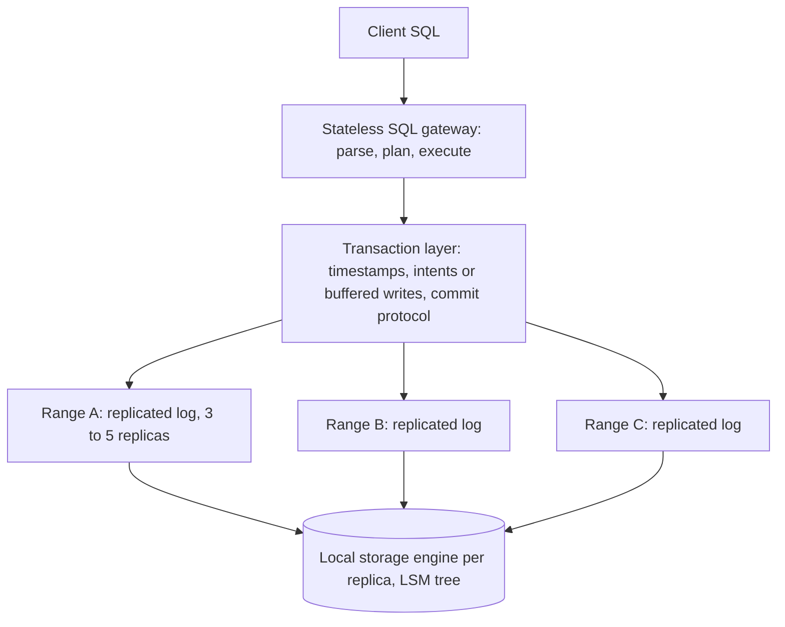
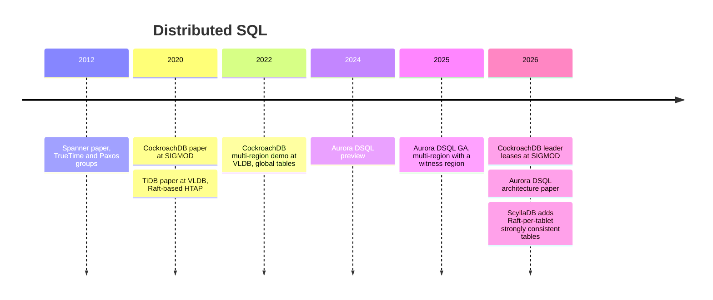

---
tags:
  - distributed-systems
  - databases
  - distributed-sql
status: draft
sources:
  - https://www.cs.princeton.edu/courses/archive/fall15/cos518/papers/spanner.pdf
  - https://muratbuffalo.blogspot.com/2022/03/cockroachdb-resilient-geo-distributed.html
  - https://www.cockroachlabs.com/guides/cockroachdb-the-resilient-geo-distributed-sql-database-sigmod-2020/
  - https://vldb.org/pvldb/vol15/p3610-taft.pdf
  - https://docs.cockroachlabs.com/docs/v26.2/multiregion-overview.md
  - https://cockroachlabs.com/blog/distributed-database-leader-leases
  - https://www.cs.purdue.edu/homes/csjgwang/CloudNativeDB/TiDBVLDB20.pdf
  - https://docs.yugabyte.com/preview/architecture/key-concepts/
  - https://brooker.co.za/blog/2024/12/05/inside-dsql-writes/
  - https://brooker.co.za/blog/2025/11/02/thinking-dsql.html
  - https://arxiv.org/abs/2607.13276
  - https://www.brooker.co.za/blog/2026/07/19/dsql-paper.html
  - https://aws.amazon.com/blogs/aws/amazon-aurora-dsql-is-now-generally-available
  - https://www.scylladb.com/2026/06/24/raft-strong-consistency/
created: 2026-11-26
updated: 2026-11-26
---

## Table Of Contents

---

- [[#TL;DR|TL;DR]]
- [[#The Problem|The Problem]]
- [[#Foundations|Foundations]]
    - [[#The Common Shape|The Common Shape]]
    - [[#MVCC and Timestamps|MVCC and Timestamps]]
- [[#How We Got Here|How We Got Here]]
- [[#How It Works|How It Works]]
    - [[#Spanner: Paxos Groups and TrueTime|Spanner: Paxos Groups and TrueTime]]
    - [[#CockroachDB: Raft Ranges and Hybrid Clocks|CockroachDB: Raft Ranges and Hybrid Clocks]]
    - [[#TiDB: Percolator over Multi-Raft|TiDB: Percolator over Multi-Raft]]
    - [[#YugabyteDB: PostgreSQL on Raft Tablets|YugabyteDB: PostgreSQL on Raft Tablets]]
    - [[#Aurora DSQL: Disaggregated and Optimistic|Aurora DSQL: Disaggregated and Optimistic]]
    - [[#A Worked Example: One Transfer, Three Designs|A Worked Example: One Transfer, Three Designs]]
    - [[#Going Multi-Region|Going Multi-Region]]
- [[#Where It Is Now|Where It Is Now]]
- [[#Trade-offs & Open Problems|Trade-offs & Open Problems]]
- [[#Resources|Resources]]
- [[#Related Notes|Related Notes]]

## ***TL;DR***
---
*Distributed SQL databases give you a relational database with ACID transactions that scales out across machines and regions, by splitting data into ranges, replicating each range with consensus, and running distributed transactions on top. Spanner showed it could be done; CockroachDB, TiDB, YugabyteDB and Aurora DSQL are the main descendants.*

- **The recipe:** shard the key space into ranges ([[Partitioning]]), replicate each range with [[Paxos]] or [[Raft]], version every value (MVCC) with timestamps from some clock ([[Time and Clocks]]), and commit across ranges with a two-phase-commit-style protocol ([[Distributed Transactions]]).
- **Where designs differ:** the clock (TrueTime, hybrid logical clocks, a timestamp oracle, synchronized physical clocks), the isolation level (serializable vs snapshot), and pessimistic locking vs optimistic validation at commit.
- **The cost:** every write pays a consensus round trip, cross-range transactions pay more, and multi-region writes pay the speed of light. Designs spend clever engineering to hide or move that cost, never to remove it ([[CAP and PACELC]]: these are PC/EC systems).
- **Now (Nov 2026):** Aurora DSQL has been GA since May 2025 and published its architecture paper in July 2026; CockroachDB presented leader leases at SIGMOD 2026; ScyllaDB is adding Raft-backed strongly consistent tables. The trend is toward disaggregated, serverless designs and strong consistency as the default.

## ***The Problem***
---
*A single-node relational database is simple and correct but runs out of capacity and can't survive losing its machine or region. [[Partitioning|Sharding]] it by hand trades those problems for operational pain and lost transactions.*

| Option | What you get | What breaks |
|---|---|---|
| One big Postgres or MySQL | Full SQL, transactions, simple reasoning | Write capacity of one machine; failover loses recent writes or takes minutes |
| Primary plus async replicas | Read scaling | Stale reads; promoted replica may lack acknowledged writes |
| Manual sharding | Write scaling | Cross-shard joins and transactions are on you; resharding is a project |
| NoSQL ([[Replication|Dynamo-style]]) | Scale and availability | Gave up SQL, joins and multi-key transactions |
| **Distributed SQL** | SQL and serializable or snapshot transactions across many nodes and regions | Higher write latency; complexity inside the database |

Spanner's first customer is the canonical story: Google's ads backend, F1, had run on manually sharded MySQL where resharding was "extremely costly"; on Spanner it got synchronous replication across coasts and automatic failover that was "nearly invisible" to the team ([Spanner, OSDI 2012](https://www.cs.princeton.edu/courses/archive/fall15/cos518/papers/spanner.pdf)).

## ***Foundations***
---
*Every distributed SQL database is a stack: a SQL layer over a transactional key-value layer over many small replicated logs. Timestamps and multi-version storage tie the layers together.*

### The Common Shape

- **SQL layer:** stateless, so any node can take any query. YugabyteDB reuses PostgreSQL's own query layer; TiDB speaks the MySQL protocol ([Yugabyte docs](https://docs.yugabyte.com/preview/architecture/key-concepts/); [TiDB, VLDB 2020](https://www.cs.purdue.edu/homes/csjgwang/CloudNativeDB/TiDBVLDB20.pdf)).
- **Ranges:** the key space is cut into contiguous ranges (CockroachDB ranges, TiKV Regions, Yugabyte and Spanner tablets) that split and merge as they grow. TiKV's default maximum is 96 MB; CockroachDB's were roughly 64 MB in its 2020 paper ([TiDB](https://www.cs.purdue.edu/homes/csjgwang/CloudNativeDB/TiDBVLDB20.pdf); [Demirbas on CockroachDB](https://muratbuffalo.blogspot.com/2022/03/cockroachdb-resilient-geo-distributed.html)). See [[Partitioning]].
- **Replication:** each range is its own consensus group, so failover is per range and placement can be per range. A cluster can have millions of groups; see [[Raft#Production Extensions|Multi-Raft]].
- **Storage:** each replica keeps data in a local engine, usually an [[LSM Trees|LSM tree]] (RocksDB, Pebble, DocDB's customized RocksDB).

Fault tolerance is the usual majority math: $f$ failures need $2f + 1$ replicas per range ([Yugabyte docs](https://docs.yugabyte.com/preview/architecture/key-concepts/)).

### MVCC and Timestamps

*Values are never overwritten; each write adds a version at a timestamp. Reads pick a timestamp and see a consistent snapshot without locking writers out.*

A transaction reads at a snapshot timestamp $t_s$ and sees, for each key, the newest version with timestamp $\le t_s$. Snapshot reads need no locks, which is why read-only transactions are cheap in every one of these systems.

The hard part is choosing timestamps across machines so that they respect real time. If transaction $T_1$ commits before $T_2$ starts, we want:

$$
\text{commit}(T_1) < \text{start}(T_2) \text{ in real time} \implies ts(T_1) < ts(T_2)
$$

*In words:* timestamps must agree with the order users saw things happen. That's Spanner's *external consistency*, which it also calls linearizability ([Spanner](https://www.cs.princeton.edu/courses/archive/fall15/cos518/papers/spanner.pdf)). *Example:* Alice removes Bob from a shared album (commit at 10:00:00.000), then tells Bob, who uploads a photo at 10:00:00.050. If the upload got a smaller timestamp because the second machine's clock was behind, a snapshot could show Bob uploading to an album he'd already been removed from. Each system below solves this differently; see [[Time and Clocks]] and [[Consistency Models]].

## ***How We Got Here***
---
*Spanner (2012) proved globally distributed serializable SQL was possible with special clocks. Open-source systems then rebuilt it on commodity hardware, and cloud providers are now rebuilding it again as disaggregated, serverless services.*

**Spanner (2012).** Google sharded data into Paxos-replicated tablets, ran two-phase commit across them, and used TrueTime, an API exposing clock uncertainty, to give globally meaningful timestamps ([Spanner](https://www.cs.princeton.edu/courses/archive/fall15/cos518/papers/spanner.pdf)).

**Commodity rebuilds (published 2020).** CockroachDB replaced TrueTime with hybrid logical clocks plus restarts when clock uncertainty matters, and Raft for Paxos; TiDB built on Percolator's transaction model over a Raft-replicated store, with a central timestamp oracle ([Demirbas on CockroachDB](https://muratbuffalo.blogspot.com/2022/03/cockroachdb-resilient-geo-distributed.html); [TiDB](https://www.cs.purdue.edu/homes/csjgwang/CloudNativeDB/TiDBVLDB20.pdf)). YugabyteDB put PostgreSQL's query layer on Raft-replicated tablets ([Yugabyte docs](https://docs.yugabyte.com/preview/architecture/key-concepts/)).

**[[Disaggregated Systems|Disaggregated]] and serverless (2024–now).** Aurora DSQL split query processing, conflict checking, replication and storage into separate services, buffered all writes until commit, and validated optimistically, so cross-region coordination happens once per transaction ([Brooker, Dec 2024](https://brooker.co.za/blog/2024/12/05/inside-dsql-writes/); [DSQL paper, Jul 2026](https://arxiv.org/abs/2607.13276)).

## ***How It Works***
---
*Same recipe, five different answers to two questions: how do you get timestamps that respect real time, and how do you stop conflicting transactions?*

| System | Replication | Clock | Isolation | Concurrency control |
|---|---|---|---|---|
| Spanner | Paxos per tablet | TrueTime (bounded uncertainty), commit wait | Serializable, externally consistent | Locks (2PL) for read-write; lock-free snapshot reads |
| CockroachDB | Raft per range | Hybrid logical clock; uncertainty restarts | Serializable by default | Write intents and locks; read refresh |
| TiDB | Raft per Region (TiKV) | Central timestamp oracle (PD) | Snapshot isolation / repeatable read | Percolator 2PC; optimistic or pessimistic locks |
| YugabyteDB | Raft per tablet | Hybrid time | Serializable, snapshot or read committed (YSQL) | Distributed transactions over DocDB |
| Aurora DSQL | Journal (internal replication) | Synchronized physical clocks | Strong snapshot isolation | OCC: buffer writes, check write-write conflicts at commit |

### Spanner: Paxos Groups and TrueTime

*TrueTime returns an interval guaranteed to contain the real time. Spanner picks a commit timestamp at the top of the interval and waits until it's surely in the past.*

From the [Spanner paper](https://www.cs.princeton.edu/courses/archive/fall15/cos518/papers/spanner.pdf):
- Each spanserver holds 100 to 1,000 tablets; each tablet is a Paxos group replicated across zones, with a long-lived leader holding a lease.
- `TT.now()` returns $[\text{earliest}, \text{latest}]$. The uncertainty $\varepsilon$ is typically a sawtooth from about 1 to 7 ms, averaging about 4 ms, backed by GPS and atomic clocks.
- **Commit wait:** the coordinator picks $s \ge \text{TT.now().latest}$, then doesn't make the commit visible until $\text{TT.after}(s)$ is true.

$$
\text{wait} \approx 2\bar{\varepsilon} \approx 8 \text{ ms on average}
$$

*In words:* waiting out twice the uncertainty guarantees no other machine anywhere could still hand out a smaller timestamp to a transaction that starts after this one finished. *Example:* at real time 100 ms with $\varepsilon = 4$, `TT.now()` returns $[96, 104]$. The leader picks $s = 104$ and waits until `TT.now().earliest` passes 104, around real time 108. Any transaction starting after that sees `TT.now().latest` $> 104$ and gets a larger timestamp.

- Single-group transactions skip two-phase commit; multi-group ones run 2PC with one group as coordinator, and the client drives it to avoid sending data across wide-area links twice.
- Read-only transactions take a timestamp and read lock-free from any sufficiently up-to-date replica.

### CockroachDB: Raft Ranges and Hybrid Clocks

*Without atomic clocks, CockroachDB lets transactions discover clock uncertainty and restart, instead of making every commit wait.*

From [Demirbas's review](https://muratbuffalo.blogspot.com/2022/03/cockroachdb-resilient-geo-distributed.html) of the [SIGMOD 2020 paper](https://www.cockroachlabs.com/guides/cockroachdb-the-resilient-geo-distributed-sql-database-sigmod-2020/):
- Each range is a Raft group; the **leaseholder** (usually the Raft leader) serves reads and proposes writes.
- Timestamps come from **hybrid logical clocks**: physical time plus a logical counter, tracking causality ([[Time and Clocks]]).
- Writes are **write intents**: provisional MVCC values pointing to a **transaction record** (pending, staging, committed, aborted). Flipping that one record commits every intent atomically; see [[Distributed Transactions]].
- **Parallel commits:** writes are pipelined and the record is marked *staged* while they're in flight; once all succeed the gateway can acknowledge, so commit costs about one consensus round trip, with cleanup afterwards.
- **Uncertainty intervals:** if a read finds a value timestamped slightly above its own but within the maximum clock offset, it can't tell which came first in real time, so it moves its timestamp up and restarts. If a transaction's timestamp moves, a **read refresh** checks nothing it read changed; otherwise it restarts.
- Serializable is the default isolation.

The trade against Spanner: no commit wait on every write, but more retries under contention and correctness that depends on a configured maximum clock offset being respected.

### TiDB: Percolator over Multi-Raft

*TiDB takes Google's Percolator transaction protocol and runs it on a Raft-replicated key-value store, with a central service handing out timestamps.*

From the [TiDB VLDB 2020 paper](https://www.cs.purdue.edu/homes/csjgwang/CloudNativeDB/TiDBVLDB20.pdf):
- **TiKV** stores rows as key-value pairs in Regions (default up to 96 MB), each a Raft group.
- **PD (Placement Driver)** places Regions and is the **timestamp oracle**, issuing strictly increasing timestamps that double as transaction IDs. One logical clock sidesteps the clock-skew problem, at the cost of a round trip to PD per transaction.
- **Transactions** are Percolator-style 2PC with a primary key holding the transaction's status; snapshot isolation (repeatable read) over MVCC; optimistic or pessimistic locking.
- **TiFlash** adds columnar replicas as Raft *learners*: they receive the log asynchronously and don't vote, giving analytics on fresh data without slowing writes. In the paper's CH-benCHmark tests, analytical load cut transactional throughput by at most about 10%, and about 99% of replication delays were under a second with light analytical load.

### YugabyteDB: PostgreSQL on Raft Tablets

*Yugabyte reuses PostgreSQL's query layer and replaces its storage with Raft-replicated tablets.*

From [Yugabyte's docs](https://docs.yugabyte.com/preview/architecture/key-concepts/): tables split into tablets, each replicated by Raft with a leader for writes and strongly consistent reads; storage is DocDB, a customized RocksDB; timestamps are hybrid time; YSQL offers serializable, snapshot and read committed isolation; xCluster adds asynchronous replication between clusters for disaster recovery.

### Aurora DSQL: Disaggregated and Optimistic

*DSQL does nothing distributed until COMMIT. Then one service checks for write conflicts and another makes the transaction durable, so a transaction crosses regions once, not once per statement.*

From [Brooker, Dec 2024](https://brooker.co.za/blog/2024/12/05/inside-dsql-writes/), [Brooker, 2025](https://brooker.co.za/blog/2025/11/02/thinking-dsql.html) and the [DSQL paper](https://arxiv.org/abs/2607.13276):
1. A **query processor** (stateless, in a Firecracker microVM, PostgreSQL-compatible) runs the transaction. Reads go to storage at the start timestamp; writes are buffered locally.
2. At `COMMIT`, it picks a commit time and asks an **adjudicator** whether any other transaction wrote the same keys between start and commit. That's optimistic concurrency control with write-write checks only, which gives **snapshot isolation** (PostgreSQL's `REPEATABLE READ`), not serializable.
3. If approved, the transaction goes to the **journal**, AWS's replication service. Once there it's durable, ordered and can't be rejected.
4. **Storage** replicas apply the journal in parallel, with no 2PC or consensus of their own.

No locks means no client can stall others by holding one; Brooker argues this cuts tail latency and lock-driven metastable failures ([Brooker, Jul 2026](https://www.brooker.co.za/blog/2026/07/19/dsql-paper.html)). The price: conflicting transactions abort and must retry, and there are hard limits (10 MiB or 3,000 rows written per transaction, five minutes per transaction) ([Brooker, 2025](https://brooker.co.za/blog/2025/11/02/thinking-dsql.html)).

### A Worked Example: One Transfer, Three Designs

*Move $50 from account A (range 1) to account B (range 2), both replicated in three zones of one region.*

| Step | Spanner | CockroachDB | Aurora DSQL |
|---|---|---|---|
| Read balances | Lock-free snapshot or locked reads at the leaders | Reads at the leaseholders at the transaction's HLC timestamp | Reads from storage at the start time; no coordination |
| Write A −50, B +50 | Locks taken; writes buffered at the client | Write intents laid down on both ranges (pipelined through Raft) | Buffered in the query processor; nothing leaves it |
| Commit | 2PC: prepare in both Paxos groups, coordinator picks $s$, **commit wait** about 2ε | **Parallel commit**: record staged; done when both intents are replicated | Adjudicator checks no one else wrote A or B since start; journal write |
| Consensus round trips on the commit path | Prepare + commit across groups | About one | One journal write |
| If another transfer touched A concurrently | Waits on the lock | Waits or pushes timestamp, may restart | Second committer aborts; client retries |

### Going Multi-Region

*With regions 50–100 ms apart, every design has to choose which operations pay the cross-region round trip.*

- **Home rows near their users.** CockroachDB's `REGIONAL BY ROW` gives each row a home region; `REGIONAL BY TABLE` homes a whole table ([CockroachDB docs, v26.2](https://docs.cockroachlabs.com/docs/v26.2/multiregion-overview.md)).
- **Make reads local everywhere, writes slower.** CockroachDB `GLOBAL` tables give writes a *future* timestamp and make writers commit-wait until it's the present; meanwhile every replica can serve consistent reads locally. Good for read-mostly reference data ([Ajmani et al., VLDB 2022](https://vldb.org/pvldb/vol15/p3610-taft.pdf)). Lowering the max clock offset cuts that write penalty ([CockroachDB docs](https://docs.cockroachlabs.com/docs/v26.2/multiregion-overview.md)).
- **Survival goals.** CockroachDB databases survive a zone failure by default, or a whole region with `REGION` survival, which needs replicas in more regions ([CockroachDB docs](https://docs.cockroachlabs.com/docs/v26.2/multiregion-overview.md)).
- **Two active regions plus a witness.** Aurora DSQL multi-region clusters have two peered regions with endpoints, both taking strongly consistent reads and writes, plus a witness region that stores data but has no endpoint, designed for 99.999% availability ([AWS, May 2025](https://aws.amazon.com/blogs/aws/amazon-aurora-dsql-is-now-generally-available)). See [[Witness Replicas]].

## ***Where It Is Now***
---
*As of November 2026, distributed SQL is mainstream: managed services from Google and AWS, mature open-source options, and research focused on cheaper leases, disaggregation and making strong consistency the default.*

- **Aurora DSQL** went GA on May 27, 2025: serverless, PostgreSQL-compatible, 99.99% single-region and 99.999% multi-region design targets; multi-region clusters launched in three US regions ([AWS, May 2025](https://aws.amazon.com/blogs/aws/amazon-aurora-dsql-is-now-generally-available)). Its architecture paper (arXiv, July 2026) describes scaling "from zero to millions of transactions per second" and argues strong consistency should be the default for nearly all applications ([DSQL paper](https://arxiv.org/abs/2607.13276); [Brooker, Jul 2026](https://www.brooker.co.za/blog/2026/07/19/dsql-paper.html)). Foreign keys and stored procedures weren't built yet as of Brooker's late-2025 write-up ([Brooker](https://brooker.co.za/blog/2025/11/02/thinking-dsql.html)).
- **CockroachDB leader leases (SIGMOD 2026).** Per-range lease renewals across hundreds of thousands of ranges were costly; merging the leaseholder and Raft leader roles with a node-level failure detector cut lease-maintenance CPU by up to 85% and recovers within seconds ([Cockroach Labs, May 2026](https://cockroachlabs.com/blog/distributed-database-leader-leases)). See [[Raft#Leases Are Being Redone|Raft]].
- **ScyllaDB** is adding experimental strongly consistent tables (2026.2), one Raft group per tablet, alongside its eventually consistent ones, so users can choose a consistency model per table ([ScyllaDB, Jun 2026](https://www.scylladb.com/2026/06/24/raft-strong-consistency/)).
- **The direction.** Two threads run through recent work: [[Disaggregated Systems|disaggregation]] (separate stateless compute, conflict checking, replication and storage, as in DSQL) and per-table or per-row choice of locality and consistency (CockroachDB localities, ScyllaDB multi-consistency).

## ***Trade-offs & Open Problems***
---
*Distributed SQL buys scale and survivability with write latency and engineering complexity. The design choices are mostly about which clock to trust and whether to lock or validate.*

| Choice | You get | You pay |
|---|---|---|
| TrueTime + commit wait (Spanner) | External consistency without restarts | Special clock hardware; ~2ε on every read-write commit |
| HLC + uncertainty restarts (CockroachDB) | Commodity clocks | Retries under contention; safety depends on max clock offset being honored |
| Timestamp oracle (TiDB) | No clock-skew problems | A round trip to one service per transaction; a central component to scale |
| Serializable | No write skew anomalies | More aborts or locking |
| Snapshot isolation (TiDB default, DSQL) | Fewer aborts, simpler validation | Write skew possible; see [[Consistency Models]] |
| Pessimistic locks | Fewer wasted retries under contention | Blocking; stalled clients hold locks |
| OCC at commit (DSQL) | No locks, one coordination point per transaction | Aborts on hot keys; transaction size limits |

Open problems worth tracking:
- **Hot keys and contention.** Every design degrades when many transactions touch the same row: lock queues, restarts or aborts. Schema design is still the main defense; see [[Partitioning]].
- **Clock trust.** HLC systems depend on a configured clock-offset bound; a clock that jumps past it can break guarantees. Better time sync shrinks the bound; see [[Clock Synchronization]] and [[Leases and Fencing]].
- **Lease cost at scale.** Millions of consensus groups each with a lease is expensive; CockroachDB's 2026 work and LeaseGuard both target this ([[Raft]]).
- **Testing.** These are some of the most complex systems in production; Jepsen and simulation testing keep finding isolation bugs ([[Isolation Testing]], [[Deterministic Simulation Testing]]).
- **Compatibility gaps.** "PostgreSQL-compatible" covers a varying subset; features like foreign keys, triggers and long transactions are often the last to arrive.

## ***Resources***
---
*Read the Spanner paper first; the rest are answers to "how do we do that without Google's clocks?" The DSQL paper is the clearest picture of the newer disaggregated style.*

**Primary papers**
- [Spanner: Google's Globally-Distributed Database](https://www.cs.princeton.edu/courses/archive/fall15/cos518/papers/spanner.pdf): Corbett et al., OSDI 2012.
- [CockroachDB: The Resilient Geo-Distributed SQL Database](https://www.cockroachlabs.com/guides/cockroachdb-the-resilient-geo-distributed-sql-database-sigmod-2020/): Taft et al., SIGMOD 2020.
- [A Demonstration of Multi-Region CockroachDB](https://vldb.org/pvldb/vol15/p3610-taft.pdf): Ajmani et al., VLDB 2022.
- [TiDB: A Raft-based HTAP Database](https://www.cs.purdue.edu/homes/csjgwang/CloudNativeDB/TiDBVLDB20.pdf): Huang et al., VLDB 2020.
- [Aurora DSQL: Scalable, Multi-Region OLTP](https://arxiv.org/abs/2607.13276): Brooker et al., arXiv, Jul 2026.

**Practitioner writing and docs**
- [CockroachDB paper review](https://muratbuffalo.blogspot.com/2022/03/cockroachdb-resilient-geo-distributed.html): Murat Demirbas, Mar 2022.
- [DSQL Vignette: Transactions and Durability](https://brooker.co.za/blog/2024/12/05/inside-dsql-writes/) and [the DSQL paper post](https://www.brooker.co.za/blog/2026/07/19/dsql-paper.html): Marc Brooker.
- [Amazon Aurora DSQL is now generally available](https://aws.amazon.com/blogs/aws/amazon-aurora-dsql-is-now-generally-available): AWS, May 2025.
- [CockroachDB multi-region overview](https://docs.cockroachlabs.com/docs/v26.2/multiregion-overview.md) and [leader leases](https://cockroachlabs.com/blog/distributed-database-leader-leases).
- [YugabyteDB key concepts](https://docs.yugabyte.com/preview/architecture/key-concepts/).

## Related Notes

- [[Paxos]] and [[Raft]] — The consensus protocols under every range.
- [[Replication]] — Where per-range consensus sits among primary-backup, chain and leaderless replication.
- [[Distributed Transactions]] — 2PC, Percolator and parallel commits across ranges.
- [[Partitioning]] — How the key space is split into ranges and rebalanced.
- [[Time and Clocks]] — TrueTime, hybrid logical clocks and timestamp oracles.
- [[Consistency Models]] — External consistency, serializability and snapshot isolation.
- [[CAP and PACELC]] — Why these are PC/EC systems and what that costs.
- [[Leases and Fencing]] — Leaseholders and why lease cost matters at scale.
- [[Witness Replicas]] — How DSQL and Spanner keep a majority with fewer full copies.
- [[LSM Trees]] — The storage engines underneath.
- [[Coordination Services]] — Chubby and etcd, consensus as a service rather than per range.
- [[Isolation Testing]] — How Jepsen checks these databases' isolation claims.
- [[Sharded Postgres]] — The alternative that keeps stock Postgres on every shard and coordinates above it.
- [[Secondary Indexes]] — Why indexes here are global and written in the row's transaction, and what that costs.
