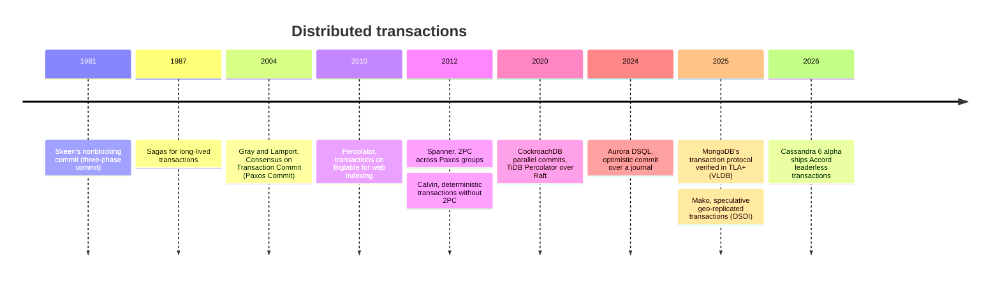
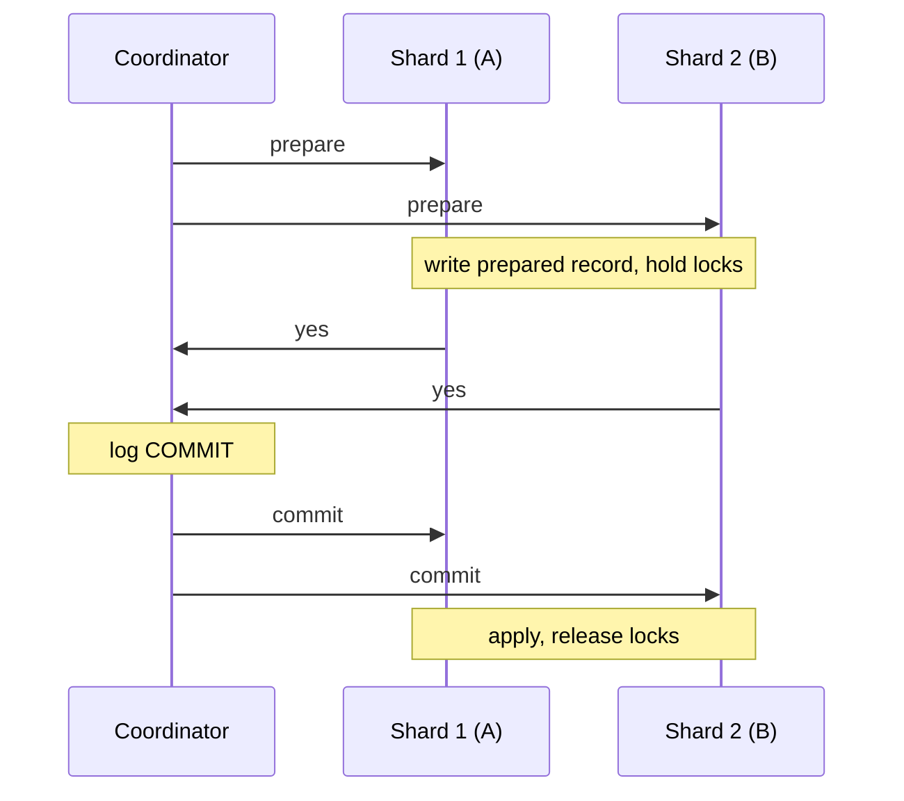

---
tags:
  - distributed-systems
  - transactions
  - databases
status: draft
sources:
  - https://arxiv.org/pdf/cs/0408036
  - https://web.eecs.umich.edu/~manosk/assets/papers/Ske81.pdf
  - https://www.cs.princeton.edu/research/techreps/598
  - https://www.cs.princeton.edu/courses/archive/fall10/cos597B/papers/percolator-osdi10.pdf
  - https://www.cs.princeton.edu/courses/archive/fall15/cos518/papers/spanner.pdf
  - https://www.cs.princeton.edu/courses/archive/fall19/cos418/papers/calvin.pdf
  - https://muratbuffalo.blogspot.com/2022/03/cockroachdb-resilient-geo-distributed.html
  - https://www.cs.purdue.edu/homes/csjgwang/CloudNativeDB/TiDBVLDB20.pdf
  - https://brooker.co.za/blog/2024/12/05/inside-dsql-writes/
  - https://www.vldb.org/pvldb/vol18/p5045-schultz.pdf
  - https://www.usenix.org/system/files/osdi25-shen-weihai.pdf
  - https://www.instaclustr.com/blog/apache-cassandra-6-accord-transactions-what-you-need-to-know/
created: 2026-11-26
updated: 2026-11-26
---

## Table Of Contents

---

- [[#TL;DR|TL;DR]]
- [[#The Problem|The Problem]]
- [[#Foundations|Foundations]]
    - [[#Atomicity and Isolation Are Separate Problems|Atomicity and Isolation Are Separate Problems]]
    - [[#Atomic Commit Is Not Consensus|Atomic Commit Is Not Consensus]]
- [[#How We Got Here|How We Got Here]]
- [[#How It Works|How It Works]]
    - [[#Two-Phase Commit|Two-Phase Commit]]
    - [[#Why 2PC Blocks: a Worked Example|Why 2PC Blocks: a Worked Example]]
    - [[#Three-Phase Commit|Three-Phase Commit]]
    - [[#2PC over Consensus Groups|2PC over Consensus Groups]]
    - [[#Percolator: 2PC with the Commit Point in the Data|Percolator: 2PC with the Commit Point in the Data]]
    - [[#Parallel Commits|Parallel Commits]]
    - [[#Deterministic Databases: Calvin|Deterministic Databases: Calvin]]
    - [[#Optimistic Validation at Commit|Optimistic Validation at Commit]]
    - [[#Sagas: Giving Up Atomic Isolation|Sagas: Giving Up Atomic Isolation]]
- [[#Where It Is Now|Where It Is Now]]
- [[#Trade-offs & Open Problems|Trade-offs & Open Problems]]
- [[#Resources|Resources]]
- [[#Related Notes|Related Notes]]

## ***TL;DR***
---
*A distributed transaction changes data on several machines so that either all the changes happen or none do, and concurrent transactions don't see each other's half-done work. Two-phase commit is the classic way; modern databases run it over consensus-replicated shards, or avoid it with deterministic ordering or optimistic validation.*

- **Two problems, not one:** *atomic commit* (all shards commit or all abort) and *isolation* (concurrent transactions behave as if run in some order). Protocols solve them separately and combine them.
- **2PC:** a coordinator asks every participant to prepare, then tells them all to commit if every one said yes. It costs four message delays and **blocks** if the coordinator dies after participants prepared ([Gray and Lamport](https://arxiv.org/pdf/cs/0408036)).
- **The fix in practice:** make the coordinator and participants fault tolerant by replicating each with [[Paxos]] or [[Raft]] (Spanner, CockroachDB, TiDB, MongoDB). Gray and Lamport showed 2PC is Paxos Commit with zero tolerated faults.
- **Ways around 2PC:** agree on transaction order first, then execute deterministically (Calvin); validate optimistically once at commit (Aurora DSQL); or split work into steps with compensations (sagas).
- **Now (Nov 2026):** consensus-backed 2PC is standard in [[Distributed SQL]]; research targets geo-distributed latency (Mako, OSDI 2025), leaderless one-round-trip transactions (Accord in Cassandra 6) and formal verification of commit protocols (MongoDB, VLDB 2025).

## ***The Problem***
---
*Once data is split across machines, one logical change can touch several of them. Without a protocol, a crash halfway through leaves the data permanently inconsistent.*

Transfer $50 from account A (on shard 1) to account B (on shard 2). Two writes, two machines:

| What goes wrong | Result |
|---|---|
| Shard 1 debits A, then shard 2 crashes before crediting B | $50 vanishes |
| Both apply, but another transaction reads A after the debit and B before the credit | It sees $50 missing: an inconsistent snapshot |
| Shard 2 credits B; the message telling shard 1 to debit A is lost | $50 appears from nowhere |
| Shards decide independently on a timeout | One commits, one aborts |

Single-node databases solve this with a log and locks on one machine. Across machines, the participants must *agree* on the outcome while any of them, or the network, can fail ([[Failure Models]]). And they must keep concurrent transactions from interleaving badly ([[Consistency Models]]).

## ***Foundations***
---
*Atomic commit and isolation are different problems with different tools. And atomic commit is subtly different from consensus: any participant can veto.*

### Atomicity and Isolation Are Separate Problems

| Problem | Question | Typical tools |
|---|---|---|
| **Atomic commit** | Do all participants commit, or all abort? | 2PC, Paxos Commit, commit records, deterministic ordering |
| **Isolation** | What may a transaction see of others running at the same time? | Two-phase locking, MVCC snapshots, optimistic validation, timestamp ordering |
| **Durability and replication** | Does a committed change survive machine loss? | Consensus logs per shard |

Real systems mix and match. Spanner: 2PC for atomicity, locking plus TrueTime timestamps for isolation, Paxos for replication ([Spanner](https://www.cs.princeton.edu/courses/archive/fall15/cos518/papers/spanner.pdf)). Percolator: 2PC with locks stored in the data, snapshot isolation from a timestamp oracle ([Percolator](https://www.cs.princeton.edu/courses/archive/fall10/cos597B/papers/percolator-osdi10.pdf)). Aurora DSQL: one optimistic check at commit, then a replicated journal ([Brooker](https://brooker.co.za/blog/2024/12/05/inside-dsql-writes/)).

### Atomic Commit Is Not Consensus

*In consensus, any proposed value can win. In atomic commit, the outcome must be commit only if every participant voted yes.*

Atomic commit's rules ([Gray and Lamport](https://arxiv.org/pdf/cs/0408036)):
- All participants reach the same decision.
- Commit is possible only if *every* participant voted to prepare.
- If all prepared and nothing failed, the decision is commit.

So one slow or crashed participant can force an abort, unlike [[Paxos]], where a majority suffices. Gray and Lamport's insight was to run *one consensus instance per participant* on "prepared or aborted", so the decision survives the coordinator's death:

$$
\text{commit} \iff \forall i: \text{decision}_i = \text{Prepared}
$$

*In words:* each participant's vote is made fault tolerant by consensus, and the transaction commits only if all those consensus decisions say Prepared. *Example:* three participants, each vote stored by its own Paxos instance on 3 acceptors. If the coordinator crashes, any acceptor-side leader can read the three decisions; if one participant never voted, a leader can have its instance choose Aborted, so nobody waits forever.

## ***How We Got Here***
---
*2PC came first and its blocking problem was known from the start. 3PC tried to fix it under unrealistic assumptions; Paxos Commit fixed it properly; and distributed databases since 2010 have built 2PC on top of replicated shards or found ways to skip it.*

**The blocking problem (1981).** Skeen showed the least change that makes 2PC nonblocking is a "prepare to commit" buffer state, giving three-phase commit, but only assuming the network never fails and failures are reliably detected ([Skeen, 1981](https://web.eecs.umich.edu/~manosk/assets/papers/Ske81.pdf)). Real networks partition, so 3PC never caught on.

**Escaping atomicity (1987).** Garcia-Molina and Salem's sagas split long-running transactions into steps, each its own transaction, with compensating transactions to undo partial work ([SAGAS, 1987](https://www.cs.princeton.edu/research/techreps/598)).

**Consensus meets commit (2004).** Gray and Lamport's Paxos Commit replaced the single coordinator with Paxos and proved 2PC is the special case with no tolerated faults ([Gray and Lamport](https://arxiv.org/pdf/cs/0408036)).

**At scale (2010–2012).** Google's Percolator ran snapshot-isolated transactions over Bigtable for web indexing, and Spanner ran 2PC across Paxos groups with TrueTime; Calvin showed that agreeing on order first can remove 2PC entirely ([Percolator](https://www.cs.princeton.edu/courses/archive/fall10/cos597B/papers/percolator-osdi10.pdf); [Spanner](https://www.cs.princeton.edu/courses/archive/fall15/cos518/papers/spanner.pdf); [Calvin](https://www.cs.princeton.edu/courses/archive/fall19/cos418/papers/calvin.pdf)).

## ***How It Works***
---
*All practical protocols are variations on 2PC's shape: collect votes, then record a decision. They differ in where the decision lives, how many round trips it takes, and whether conflicts are prevented, detected or ordered away.*

### Two-Phase Commit

*Phase 1 collects a durable yes or no from every participant; phase 2 broadcasts the decision. A yes is a promise: once prepared, a participant must be able to commit whatever happens.*

1. **Prepare.** The coordinator (transaction manager) sends `prepare` to every participant (resource manager).
2. **Vote.** Each participant makes its changes durable but not visible, holds its locks, writes a *prepared* record to disk, and votes yes. Or it votes no and aborts.
3. **Decide.** If every vote is yes, the coordinator writes *commit* to its log; otherwise *abort*.
4. **Complete.** The coordinator tells everyone; participants apply the decision and release locks.

Cost in the normal case: four message delays and $3N - 1$ messages for $N$ participants, with $N + 1$ forced disk writes ([Gray and Lamport](https://arxiv.org/pdf/cs/0408036)).

### Why 2PC Blocks: a Worked Example

*A prepared participant has given up the right to decide alone. If the coordinator disappears, it must wait.*

Coordinator TM, participants S1, S2, S3.

1. All three receive `prepare`, write prepared records and vote yes.
2. TM receives all three votes, writes COMMIT to its log, sends `commit` to S1 only, and crashes.
3. S1 commits. S2 and S3 are prepared, holding locks on their rows.
4. S2 asks S3: "did you hear the outcome?" S3: "no, I'm prepared too." Neither can abort, because S1 may have committed (it did). Neither can commit, because TM may have decided abort, for example if a vote was lost.
5. S2 and S3 wait, holding locks, until TM recovers. Every transaction touching those rows waits too.

Gray and Lamport's summary: if the coordinator fails after participants have prepared, they can't tell whether the transaction committed, so the protocol blocks until it's repaired ([Gray and Lamport](https://arxiv.org/pdf/cs/0408036)).

### Three-Phase Commit

*3PC adds a "prepared to commit" state so survivors can always decide. It works only if the network never partitions.*

Skeen's protocol inserts a committable buffer state between "waiting" and "committed". If the coordinator dies, survivors can look at each other's states and safely finish ([Skeen, 1981](https://web.eecs.umich.edu/~manosk/assets/papers/Ske81.pdf)). But the analysis assumes the network never fails and site failures are reliably reported. Under a partition, each side may decide differently. That's why practice went to consensus instead.

### 2PC over Consensus Groups

*Keep 2PC's shape, but make every participant and the coordinator a replicated group. A crash then means a leader change, not a stuck transaction.*

Spanner runs 2PC across Paxos groups ([Spanner](https://www.cs.princeton.edu/courses/archive/fall15/cos518/papers/spanner.pdf)):
- Each participant is a Paxos group's leader; its *prepared* record is written through Paxos, so it survives the leader's death.
- One participant group is the coordinator; its *commit* record is also replicated.
- Transactions touching one group skip 2PC entirely.

MongoDB does the same over Raft-based replica sets: a coordinator shard runs 2PC, each participant picks a prepare timestamp, the commit timestamp is at least the largest prepare timestamp, and reads that hit a prepared write block until it resolves ([Schultz and Demirbas, VLDB 2025](https://www.vldb.org/pvldb/vol18/p5045-schultz.pdf)). This is Paxos Commit in spirit: the decision outlives any one machine.

### Percolator: 2PC with the Commit Point in the Data

*Percolator stores locks in the database itself and makes one designated "primary" lock the commit point. Anyone who finds a stale lock can finish or undo the transaction by looking at the primary.*

From the [Percolator paper](https://www.cs.princeton.edu/courses/archive/fall10/cos597B/papers/percolator-osdi10.pdf):
- Each column has three hidden columns: `lock`, `write` (commit records) and `data`. A timestamp oracle serves about 2 million timestamps a second from one machine.
- **Prewrite:** lock every cell to be written; one lock is the **primary**, the rest point to it. Abort if any cell has a newer committed write or an existing lock.
- **Commit:** get a commit timestamp, replace the primary lock with a write record. *That single-row write is the commit point.* Then commit the secondaries.
- **Recovery without a coordinator:** a reader that hits a stranded secondary lock checks the primary. Committed, so roll the secondary forward; otherwise roll it back.
- Isolation is snapshot isolation, so write skew is possible.

Trade-off: lazy cleanup can delay commits by tens of seconds, fine for indexing, not for OLTP. TiDB adapted this protocol for OLTP over Raft-replicated TiKV ([TiDB](https://www.cs.purdue.edu/homes/csjgwang/CloudNativeDB/TiDBVLDB20.pdf)).

### Parallel Commits

*Instead of waiting for prepare and then writing commit, write the transaction record as "staged" alongside the writes. If all writes landed, the transaction is implicitly committed, and the client can be told after one round of consensus.*

CockroachDB's write intents point to a transaction record in one of the ranges. In *parallel commits*, the record is marked **staged** with the list of writes while those writes are still replicating; once every write has succeeded, the gateway answers the client, and the record is flipped to committed asynchronously ([Demirbas on CockroachDB](https://muratbuffalo.blogspot.com/2022/03/cockroachdb-resilient-geo-distributed.html)). Anyone who finds a staged record can check whether all listed writes exist to learn the outcome, the same idea as Percolator's primary lock.

| Protocol | Consensus rounds on the commit path |
|---|---|
| Classic 2PC over replicated shards | Prepare (one replicated write per participant), then commit record, then client reply |
| Parallel commits | Writes and staged record in parallel, then client reply; cleanup later |

### Deterministic Databases: Calvin

*If every replica agrees on the order of transactions before running them, and execution is deterministic, every replica reaches the same result without a commit protocol.*

From the [Calvin paper](https://www.cs.princeton.edu/courses/archive/fall19/cos418/papers/calvin.pdf):
- A **sequencer** layer batches incoming transactions into 10 ms epochs and replicates the batch (with Paxos, if synchronous). This fixes a global order.
- Each partition then acquires locks in that order and executes deterministically. No participant can unilaterally abort after the order is fixed, so no 2PC is needed, and locks are held much more briefly.
- Calvin replicates **inputs, not effects**: replicas re-execute the same transactions. Paxos adds latency but not contention.
- Result: nearly half a million TPC-C New Order transactions per second on 100 EC2 machines.
- **Catch:** transactions must declare their read and write sets in advance. Dependent transactions do a low-isolation "reconnaissance" read first (OLLP), then restart deterministically if the data changed.

### Optimistic Validation at Commit

*Run the transaction without coordination, then check once at commit whether anyone else wrote the same keys. One coordination point per transaction, at the cost of aborts under contention.*

Aurora DSQL buffers all writes in the query processor; at commit an adjudicator checks for write-write conflicts since the transaction's start, and a journal makes the result durable. Storage applies the journal without 2PC or consensus of its own ([Brooker](https://brooker.co.za/blog/2024/12/05/inside-dsql-writes/)). Checking only writes gives snapshot isolation; serializability would also need read-write checks. Mako (OSDI 2025) applies optimistic concurrency control and speculative 2PC to geo-replicated shards: transactions proceed before their decisions are replicated, replication streams in the background, and clients hear back only once it's done ([Shen et al.](https://www.usenix.org/system/files/osdi25-shen-weihai.pdf)).

### Sagas: Giving Up Atomic Isolation

*A saga is a sequence of local transactions with a compensating action for each. Either all steps complete or the completed ones are undone, but others can see the in-between states.*

Garcia-Molina and Salem designed sagas for long-lived transactions that would otherwise hold locks for too long ([SAGAS](https://www.cs.princeton.edu/research/techreps/598)). Today they're the usual pattern across services that don't share a database: book flight → book hotel → charge card, with "cancel flight" and "cancel hotel" as compensations if the charge fails.

| | Distributed transaction | Saga |
|---|---|---|
| Atomicity | All or nothing, invisible until commit | All or compensated; intermediate states visible |
| Isolation | Serializable or snapshot | None between steps |
| Locks held | For the transaction's duration | Only within each step |
| Failure handling | Protocol aborts | Application-written compensations, which must be idempotent ([[Reliability Patterns]]) |

## ***Where It Is Now***
---
*As of November 2026, the question is no longer whether distributed transactions can work but how cheaply: fewer round trips, fewer cross-region hops, fewer aborts, and protocols checked with formal methods.*

- **Consensus-backed 2PC is the default** in [[Distributed SQL]]: Spanner, CockroachDB (parallel commits), TiDB (Percolator over Raft), YugabyteDB, and MongoDB's multi-shard transactions.
- **Verification is becoming standard.** MongoDB's transaction protocol now has a modular TLA+ model (about 571 lines plus a 332-line storage model) checked for snapshot isolation; it was used to generate about 87,000 conformance tests against WiredTiger. Leaving prepared-read handling out of the model let the checker find a 27-step snapshot isolation violation, showing why reads must block on prepared writes ([Schultz and Demirbas, VLDB 2025](https://www.vldb.org/pvldb/vol18/p5045-schultz.pdf)). See [[Formal Methods in Practice]].
- **Geo-distributed latency.** Mako separates execution from replication and speculates on 2PC outcomes, reporting about 3.66 million TPC-C transactions per second across 10 shards, 8.6× the prior state of the art, with median latency about 121 ms over 50 ms inter-datacenter round trips ([Shen et al., OSDI 2025](https://www.usenix.org/system/files/osdi25-shen-weihai.pdf)).
- **Leaderless one-round-trip transactions.** Cassandra 6's Accord lets any node coordinate a multi-partition transaction, commits in one round trip under normal conditions and orders conflicts with hybrid logical clocks; it was in alpha as of April 2026 ([Instaclustr, Apr 2026](https://www.instaclustr.com/blog/apache-cassandra-6-accord-transactions-what-you-need-to-know/)). See [[Leaderless Consensus]].
- **Optimistic, disaggregated commit.** Aurora DSQL's single commit-time check is the clearest production example of moving all coordination to one point per transaction ([Brooker](https://brooker.co.za/blog/2024/12/05/inside-dsql-writes/)).

## ***Trade-offs & Open Problems***
---
*Every distributed transaction pays in round trips, held locks or aborts. The design question is which of those to pay and when.*

| Approach | You get | You pay |
|---|---|---|
| Plain 2PC | Simple and widely supported | Blocks on coordinator failure; locks held across two round trips |
| 3PC | Nonblocking with reliable failure detection | Unsafe under partitions |
| 2PC over consensus groups | Nonblocking in practice | A consensus round per prepare and commit; more latency |
| Percolator | No central coordinator; scales out | Snapshot isolation only; slow cleanup of crashed transactions |
| Parallel commits | About one consensus round per commit | Complex recovery logic for staged records |
| Deterministic (Calvin) | No 2PC; short lock holds; replicate inputs | Read and write sets known up front; batching latency |
| Optimistic validation | No locks; one coordination point | Aborts and retries on hot keys |
| Sagas | Works across services; no long locks | No isolation; compensations are hand-written |

Open problems worth tracking:
- **Cross-region commit latency.** Any protocol that needs a majority in several regions pays the speed of light at least once per transaction; speculation and fast paths shave rounds but complicate recovery ([Mako](https://www.usenix.org/system/files/osdi25-shen-weihai.pdf); see [[CAP and PACELC]]).
- **Contention.** [[Partitioning|Hot keys]] cause lock queues, restarts or aborts in every design; deterministic ordering handles contention best but needs read and write sets in advance ([Calvin](https://www.cs.princeton.edu/courses/archive/fall19/cos418/papers/calvin.pdf)).
- **Weaker isolation by default.** Several systems default to snapshot isolation, which allows write skew; see [[Consistency Models]] and [[Isolation Testing]].
- **Correct recovery paths.** Staged records, prepared reads and speculative aborts are where subtle bugs live; formal models and simulation testing are how teams find them ([[Formal Methods in Practice]], [[Deterministic Simulation Testing]]).
- **Transactions across systems.** Between services, databases and queues there is still no good alternative to sagas, idempotency keys and outbox patterns; see [[Reliability Patterns]] and [[Logs and Streaming]].

## ***Resources***
---
*Read Gray and Lamport for the clearest statement of 2PC and why it blocks, then Percolator and Calvin for two opposite modern designs. The MongoDB paper shows what verifying a real protocol looks like.*

**Primary papers**
- [Nonblocking Commit Protocols](https://web.eecs.umich.edu/~manosk/assets/papers/Ske81.pdf): Dale Skeen, 1981.
- [SAGAS](https://www.cs.princeton.edu/research/techreps/598): Garcia-Molina and Salem, Princeton TR, 1987.
- [Consensus on Transaction Commit](https://arxiv.org/pdf/cs/0408036): Jim Gray and Leslie Lamport.
- [Large-scale Incremental Processing Using Distributed Transactions and Notifications](https://www.cs.princeton.edu/courses/archive/fall10/cos597B/papers/percolator-osdi10.pdf): Peng and Dabek, OSDI 2010 (Percolator).
- [Spanner: Google's Globally-Distributed Database](https://www.cs.princeton.edu/courses/archive/fall15/cos518/papers/spanner.pdf): Corbett et al., OSDI 2012.
- [Calvin: Fast Distributed Transactions for Partitioned Database Systems](https://www.cs.princeton.edu/courses/archive/fall19/cos418/papers/calvin.pdf): Thomson et al., SIGMOD 2012.
- [TiDB: A Raft-based HTAP Database](https://www.cs.purdue.edu/homes/csjgwang/CloudNativeDB/TiDBVLDB20.pdf): Huang et al., VLDB 2020.
- [Design and Modular Verification of Distributed Transactions in MongoDB](https://www.vldb.org/pvldb/vol18/p5045-schultz.pdf): Schultz and Demirbas, VLDB 2025.
- [Mako: Speculative Distributed Transactions with Geo-Replication](https://www.usenix.org/system/files/osdi25-shen-weihai.pdf): Shen et al., OSDI 2025.

**Practitioner writing**
- [CockroachDB paper review](https://muratbuffalo.blogspot.com/2022/03/cockroachdb-resilient-geo-distributed.html): Murat Demirbas. Write intents and parallel commits.
- [DSQL Vignette: Transactions and Durability](https://brooker.co.za/blog/2024/12/05/inside-dsql-writes/): Marc Brooker, Dec 2024.
- [Apache Cassandra 6 Accord transactions](https://www.instaclustr.com/blog/apache-cassandra-6-accord-transactions-what-you-need-to-know/): Instaclustr, Apr 2026.

## Related Notes

- [[Paxos]] — Paxos Commit, and the replicated groups 2PC now runs over.
- [[Raft]] — The replication under CockroachDB, TiKV and MongoDB shards.
- [[Distributed SQL]] — The databases that put these protocols together.
- [[Consistency Models]] — Serializability, snapshot isolation and write skew.
- [[Time and Clocks]] — Commit timestamps from TrueTime, hybrid clocks and oracles.
- [[Failure Models]] — Why a coordinator crash blocks 2PC, and FLP's shadow over atomic commit.
- [[CAP and PACELC]] — The latency cost of cross-region commits.
- [[Partitioning]] — Why data ends up on several shards in the first place.
- [[Leaderless Consensus]] — Accord and fast paths for one-round-trip transactions.
- [[Reliability Patterns]] — Idempotency and retries for sagas and cross-service work.
- [[Formal Methods in Practice]] — TLA+ models of commit protocols.
- [[Isolation Testing]] — How Jepsen checks isolation claims.
- [[CRDTs]] — Avoiding coordination altogether for data that can merge.
