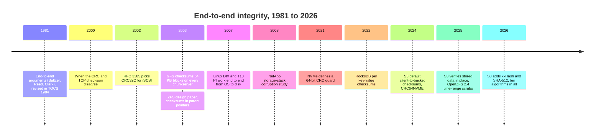
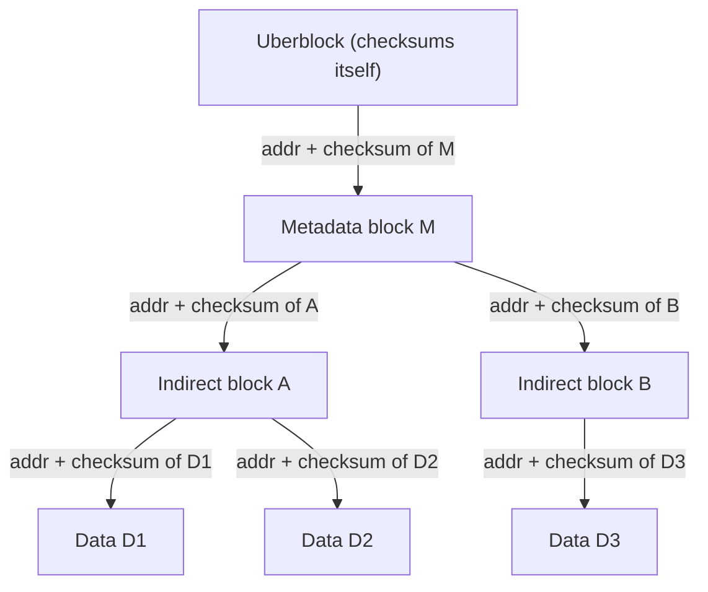

---
tags:
  - distributed-systems
  - data-and-storage
  - data-integrity
  - checksums
  - end-to-end-argument
  - scrubbing
  - zfs
  - storage
status: complete
sources:
  - https://web.mit.edu/Saltzer/www/publications/endtoend/endtoend.txt
  - https://www.andrew.cmu.edu/course/15-440/assets/READINGS/saltzer1984.pdf
  - https://conferences2.sigcomm.org/sigcomm/2000/conf/abstract/9-1.htm
  - https://www.rfc-editor.org/rfc/rfc3385.html
  - https://www.cs.rochester.edu/meetings/sosp2003/papers/p125-ghemawat.pdf
  - https://web.mit.edu/6.1800/www/papers/zfs.pdf
  - https://oss.oracle.com/%7Emkp/docs/dix.pdf
  - https://lwn.net/Articles/885809/
  - https://manpages.debian.org/unstable/zfsutils-linux/zpool-scrub.8.en.html
  - https://github.com/openzfs/zfs/releases/tag/zfs-2.4.0
  - https://btrfs.readthedocs.io/en/latest/Checksumming.html
  - https://btrfs.readthedocs.io/en/latest/Scrub.html
  - https://www.cloudera.com/blog/technical/hdfs-datanode-scanners-and-disk-checker-explained.html
  - https://www.ibm.com/docs/en/SSEG27_6/architecture/con_core_ceph-data-integrity.html
  - https://kafka.apache.org/41/implementation/message-format/
  - https://rocksdb.org/blog/2022/07/18/per-key-value-checksum.html
  - https://docs.tigerbeetle.com/concepts/safety/
  - https://aws.amazon.com/blogs/aws/introducing-default-data-integrity-protections-for-new-objects-in-amazon-s3
  - https://docs.aws.amazon.com/AmazonS3/latest/userguide/checking-object-integrity.md
  - https://aws.amazon.com/about-aws/whats-new/2025/08/amazon-s3-verify-content-stored-datasets
  - https://aws.amazon.com/about-aws/whats-new/2026/04/s3-five-additional-checksum-algorithms/
  - https://blog.allegro.tech/2025/12/transactions-arent-enough.html
created: 2026-11-28
updated: 2026-11-28
---

## Table Of Contents

- [[#TL;DR|TL;DR]]
- [[#The Problem|The Problem]]
- [[#Foundations|Foundations]]
    - [[#The End-to-End Argument|The End-to-End Argument]]
    - [[#Low-Level Checks Are a Performance Optimization|Low-Level Checks Are a Performance Optimization]]
    - [[#Detection Codes and Their Strength|Detection Codes and Their Strength]]
    - [[#Detection Is Not Repair|Detection Is Not Repair]]
    - [[#Wrong Bytes, Wrong Place, Wrong Time|Wrong Bytes, Wrong Place, Wrong Time]]
- [[#How We Got Here|How We Got Here]]
- [[#How It Works|How It Works]]
    - [[#The Layers of Checks|The Layers of Checks]]
    - [[#Checksums Stored in the Parent|Checksums Stored in the Parent]]
    - [[#Binding Data to Its Address|Binding Data to Its Address]]
    - [[#Carry the Checksum, Don't Recompute It|Carry the Checksum, Don't Recompute It]]
    - [[#Scrubbing|Scrubbing]]
    - [[#Repair After Detection|Repair After Detection]]
    - [[#End to End Beyond Bytes|End to End Beyond Bytes]]
- [[#Where It Is Now|Where It Is Now]]
- [[#Trade-offs & Open Problems|Trade-offs & Open Problems]]
- [[#Resources|Resources]]
- [[#Related Notes|Related Notes]]

## ***TL;DR***
---
*Data passes through many layers between the program that writes it and the program that reads it back, and every layer can damage it. Checks inside each layer only cover that layer, so the one check that guarantees correctness is computed by the writer, travels with the data, and is verified by the reader. Scrubbing is the same check run on a schedule, so damage is found while a good copy still exists.*

- **The end-to-end argument (Saltzer, Reed and Clark, 1981/1984).** A function like integrity "can completely and correctly be implemented only with the knowledge and help of the application standing at the endpoints." Checks lower down are still worth having, but as a performance optimization, not as the guarantee ([TOCS 1984](https://web.mit.edu/Saltzer/www/publications/endtoend/endtoend.txt)).
- **Layer checks leave gaps.** About 1 in 30,000 Internet packets failed the TCP checksum even though every link had a CRC, because errors happen inside routers and hosts where no link check looks; the TCP checksum itself was estimated to miss about 1 in 200 million packets ([Stone and Partridge, SIGCOMM 2000](https://conferences2.sigcomm.org/sigcomm/2000/conf/abstract/9-1.htm)).
- **Where the checksum lives matters as much as computing it.** ZFS stores each block's checksum in the parent pointer, building a tree of checksums that catches phantom and misdirected writes a checksum stored beside the data cannot ([Bonwick et al.](https://web.mit.edu/6.1800/www/papers/zfs.pdf)). T10 PI adds a reference tag that ties each sector to the address it was meant for ([Petersen](https://oss.oracle.com/%7Emkp/docs/dix.pdf)).
- **Scrubbing finds damage before you need the data.** ZFS, Btrfs, HDFS, Ceph and S3 all read everything periodically and repair from a redundant copy; [[Silent Data Corruption]] has the field data on how much this catches.
- **Now (Nov 2026):** S3 checksums every upload from the client by default (CRC64NVME, since December 2024), verifies stored datasets without downloading them (August 2025), and supports ten algorithms (April 2026). OpenZFS 2.4 (December 2025) can scrub only a chosen time range. The open gap is memory and CPU: checksums protect bytes that should not change, not the computation that produces them ([[Algorithm-Based Fault Tolerance]]).

## ***The Problem***
---
*Every component on the data path, from disk and controller to memory, network and software, can corrupt data without reporting an error. Each component has its own checks, but no single one sees the whole path, so corruption that happens between checks is passed along as good data.*

Picture a write from an application to a disk in another datacenter and a read back later. The bytes cross the application's memory, the kernel, a NIC, several switches and routers, another kernel, a storage server's memory, a RAID or HBA controller, the drive's firmware and the media itself. Every one of these has a way to damage data:

| Where | What goes wrong | Usual local check |
|---|---|---|
| Media | Bit rot, latent sector errors | Sector ECC |
| Drive firmware | Phantom writes (reported done, never written), misdirected reads and writes | None the host can see |
| Controller, HBA, driver | Bugs, DMA errors | Vendor-specific |
| Memory and CPU | Bit flips, miscomputation ([[Silent Data Corruption]]) | ECC memory, if present; nothing for logic errors |
| Network | Corrupted, lost, duplicated, reordered packets | Link CRC per hop, TCP checksum |
| Routers and gateways | Bugs and faults *between* hop checks | None |
| Software | Buffer bugs, wrong offsets, overwrites by another component | None |

The trap is that each local check covers its own segment and nothing else. Saltzer, Reed and Clark tell the story of an MIT network of local networks that checksummed every gateway-to-gateway hop. Programmers assumed that made transfers reliable, but data sat unprotected inside each gateway. One gateway developed a transient fault that swapped pairs of bytes at about one error per million bytes; source files passing through it were corrupted, and their owners had to repair them by hand from old listings, "the ultimate end-to-end error check" ([Saltzer et al.](https://web.mit.edu/Saltzer/www/publications/endtoend/endtoend.txt)).

Stone and Partridge measured the same effect on the Internet two decades later. In packet traces over two years, "1 in 30,000 packets fails the TCP checksum", on links whose CRCs should have caught almost all transmission errors. They traced nearly 100 distinct error patterns at every level of the network, and estimated that the 16-bit TCP checksum lets through roughly 1 in 200 million packets undetected ([SIGCOMM 2000](https://conferences2.sigcomm.org/sigcomm/2000/conf/abstract/9-1.htm)).

Storage adds two problems networks don't have. Data sits for years, so damage accumulates where nobody is looking until it is read. And a wrong answer can look valid: a drive that returns an old version of a block, or the right block from the wrong address, passes any check that only asks "do these bytes match their own checksum?". The NetApp field studies quantify both effects ([[Silent Data Corruption]]).

So a storage or messaging system has to answer three questions:

1. **Where is the check computed and verified?** If not at the ends, something in the middle can corrupt data unseen.
2. **What does the check bind together?** Bytes alone, or bytes plus the address and version they are supposed to have?
3. **How is damage found in data nobody reads?** Waiting for a read means waiting until the redundancy may be gone too.

## ***Foundations***
---
*Five ideas carry the topic: the end-to-end argument, the reason low-level checks still exist, how strong a detection code is, the difference between detecting and repairing, and the three kinds of wrong answer a storage system can return.*

### The End-to-End Argument

*Only the endpoints know what "correct" means and see the whole path, so only a check made by the endpoints can guarantee correctness. Everything below them can help, but cannot be relied on.*

The paper's running example is careful file transfer: move a file from a disk on host A to a disk on host B. It lists five threats ([Saltzer et al., TOCS 1984](https://web.mit.edu/Saltzer/www/publications/endtoend/endtoend.txt)):

1. The file may already be corrupted on A's disk.
2. Software on either host may mishandle the data while buffering or copying.
3. A transient hardware fault in a processor or memory may corrupt it.
4. The network may corrupt, lose or duplicate packets.
5. Either host may crash partway through.

Making every step reliable is expensive and still leaves gaps between steps. The paper's answer is "end-to-end check and retry": store a checksum with the file, transfer both, have B reread its copy from disk and recompute the checksum, and commit only if they match. A mismatch triggers a retry. The principle, in the paper's words:

> "The function in question can completely and correctly be implemented only with the knowledge and help of the application standing at the endpoints of the communication system."

Two details make the example work. B *rereads from disk*, so the check covers B's write path, not just the network. And the checksum was computed when the file was written, so it also covers threat 1, damage on A's disk before the transfer began.

The argument is not "never check below the application". It says the endpoint check is the one correctness depends on, and lower checks must be justified some other way.

### Low-Level Checks Are a Performance Optimization

*A reliable network doesn't make the endpoint check unnecessary; it makes retries rare. How much reliability to build lower down is a cost trade-off, not a correctness requirement.*

The paper says a reliable network "does not reduce the burden on the application program to ensure reliability", and that "it is probably not important to strive for a negligible error rate at any point below the application level" ([Saltzer et al.](https://web.mit.edu/Saltzer/www/publications/endtoend/endtoend.txt)). What lower layers buy is efficiency: if each packet independently has error probability $p$, a file of $N$ packets arrives intact with probability

$$
P_{\text{intact}} = (1 - p)^{N}, \qquad E[\text{attempts}] = \frac{1}{(1-p)^{N}}
$$

*In words:* the chance that every packet survives shrinks exponentially with file length, so without per-hop recovery an end-to-end retry of the whole file becomes hopeless for large files.

*Worked example:* with $p = 0.01$ (the paper's "one message in a hundred"):

| File size | $P_{\text{intact}}$ | Expected whole-file attempts |
|---|---|---|
| 100 packets | $0.99^{100} \approx 0.37$ | about 2.7 |
| 1,000 packets | $0.99^{1000} \approx 4.3 \times 10^{-5}$ | about 23,000 |

So lower layers retransmit single packets (TCP does exactly this) to keep end-to-end retries rare, while the end-to-end check stays the backstop. The same logic applies to storage: sector ECC and RAID keep most reads clean, and the file system or application checksum catches the rest.

### Detection Codes and Their Strength

*A checksum is a short summary that changes when the data changes. CRCs are cheap and very good at random and burst errors; simple sums are weak on real data; cryptographic hashes also resist deliberate tampering, at a higher cost.*

Three families appear in practice:

| Family | Examples | Strength | Cost |
|---|---|---|---|
| Sums | Internet (TCP/IP) checksum, Fletcher, Adler | Weak on real, biased data | Very cheap |
| CRCs | CRC32, CRC32C, CRC64 | Detect all bursts up to $r$ bits; random errors escape with probability about $2^{-r}$ | Cheap, hardware-accelerated |
| Hashes | xxHash (non-cryptographic); SHA-256, BLAKE2/3 (cryptographic) | xxHash: good error detection; cryptographic: also resists forgery | xxHash cheap; cryptographic 16x to 166x CRC32C on one CPU |

For an $r$-bit CRC, RFC 3385 gives the undetected-burst probability as 0 for bursts of $b \le r$ bits, $2^{-(r-1)}$ for $b = r+1$, and $2^{-r}$ for longer bursts, and notes that the undetected rate for random errors approaches $2^{-r}$ for long blocks ([RFC 3385](https://www.rfc-editor.org/rfc/rfc3385.html)). The iSCSI authors chose CRC32C because its estimated undetected-error rate was about 12,000 times better than Fletcher's and 22,000 times better than Adler's, and because sums "behave substantially worse than CRCs" on biased real data, citing Stone's measurements ([RFC 3385](https://www.rfc-editor.org/rfc/rfc3385.html)). CRC32C is now the default in Btrfs, Kafka and many storage engines; Btrfs measures it at 470 cycles per 4 KiB, with xxHash about 1.9x that and SHA-256 16x to 166x depending on implementation ([Btrfs docs](https://btrfs.readthedocs.io/en/latest/Checksumming.html)).

$$
P_{\text{undetected}} \approx 2^{-r}
$$

*In words:* if corruption scrambles a block effectively at random, an $r$-bit check fails to notice with probability about one in $2^r$.

*Worked example (illustrative, assuming random corruption):* suppose 1 in 30,000 packets arrives corrupted, Stone's figure. In a billion packets that is about 33,000 corrupt packets. A 32-bit CRC would miss about $33{,}000 \times 2^{-32} \approx 8 \times 10^{-6}$ of them, essentially none. Stone's estimate for the 16-bit TCP checksum on real traffic was 1 in 200 million packets, or about 5 per billion. Real corruption is not random, which is exactly why weak sums do worse in practice than the $2^{-16}$ formula suggests.

The choice between a CRC and a cryptographic hash depends on the threat. Against hardware and software faults, a CRC or xxHash is enough. Against an attacker, or when the checksum doubles as a content address (deduplication), only a cryptographic hash will do.

### Detection Is Not Repair

*A checksum turns silent corruption into a known failure. Fixing it needs a second, good copy, from a mirror, a replica, parity or the original writer.*

A mismatch tells you the data is wrong, not what it should be. Repair comes from redundancy: a mirror or replica ([[Replication]]), parity or an erasure code, which can rebuild a fragment once the checksum has marked it as missing ([[Erasure Coding]]), or a retry from the source, as in the file transfer example. Without redundancy, the best a system can do is refuse to return bad data, which is still far better than returning it.

This is why integrity and durability are separate properties. Three replicas with no checksums are durable but can silently serve a bad copy; one copy with checksums detects damage but can't fix it. Production systems need both.

### Wrong Bytes, Wrong Place, Wrong Time

*Storage can return three kinds of wrong answer: damaged bytes, the right bytes from the wrong address, or an old version of the right block. A checksum stored next to the data only catches the first.*

| Fault | What the reader gets | Caught by a checksum stored with the block? |
|---|---|---|
| Corruption (bit rot, bad DMA) | Damaged bytes | Yes |
| Misdirected write or read | A valid block from another address | No, the block matches its own checksum |
| Lost or phantom write | The previous version of the block | No, the old block matches its old checksum |

To catch the last two, the check has to bind the data to *where* it should be and *which version* it should be, and the expected value has to be stored somewhere other than the block itself. ZFS does this by keeping the checksum in the parent pointer; T10 PI does part of it with a reference tag; TigerBeetle hash-chains its data ([TigerBeetle](https://docs.tigerbeetle.com/concepts/safety/)). TigerBeetle cites field rates of silent corruption of about 0.031% of SSDs and 1.4% of enterprise HDDs per year, and misdirected I/O at about 0.023% of SSDs and 0.466% of nearline HDDs per year ([TigerBeetle](https://docs.tigerbeetle.com/concepts/safety/)).

## ***How We Got Here***
---
*The principle came first, from networking in 1981. Storage systems adopted it in the 2000s as field studies showed disks lying, and the 2020s pushed checks into hardware formats, application data structures and cloud APIs by default.*

| Year | Development | What it showed | Source |
|---|---|---|---|
| 1981, 1984 | **End-to-end arguments.** Careful file transfer, the MIT gateway story, reliability as a performance trade. | Correctness checks belong at the endpoints. | [Saltzer, Reed and Clark](https://web.mit.edu/Saltzer/www/publications/endtoend/endtoend.txt) |
| 2000 | **CRC vs TCP checksum.** 1 in 30,000 packets fail TCP's checksum; about 1 in 200 million slip through. | Errors happen inside hosts and routers, where link CRCs can't see. | [Stone and Partridge](https://conferences2.sigcomm.org/sigcomm/2000/conf/abstract/9-1.htm) |
| 2002 | **RFC 3385.** iSCSI analysis recommends CRC32C over sums. | A strong CRC in the storage protocol, not just the link. | [RFC 3385](https://www.rfc-editor.org/rfc/rfc3385.html) |
| 2003 | **GFS data integrity.** Each chunkserver checksums 64 KB blocks and verifies before returning data. | Distributed storage can't compare replicas byte for byte, so each replica checks itself. | [Ghemawat et al., SOSP 2003](https://www.cs.rochester.edu/meetings/sosp2003/papers/p125-ghemawat.pdf) |
| Early 2000s | **ZFS.** Checksums in parent block pointers, self-healing mirrors, copy-on-write. | A file system can make the disk an untrusted component. | [Bonwick et al.](https://web.mit.edu/6.1800/www/papers/zfs.pdf) |
| 2007 to 2009 | **DIX and T10 PI.** 8 bytes of protection per sector, from the OS through the controller to the disk. | Hardware can carry an end-to-end tag across every hop. | [Petersen](https://oss.oracle.com/%7Emkp/docs/dix.pdf) |
| 2007, 2008, 2010 | **NetApp field studies and ZFS fault injection.** | Disks return wrong data as if it were right; checksums catch disk faults but not memory faults. | [[Silent Data Corruption]] |
| 2021, 2022 | **NVMe 64-bit guard.** CRC64 guard with 48-bit reference tags (NVM Command Set 1.0b, ratified December 18, 2021); Linux support patches in 2022. | Stronger checks for larger blocks and addresses. | [LWN](https://lwn.net/Articles/885809/) |
| 2022 | **RocksDB per key-value checksums.** Protection info travels with each write through the WAL and memtable. | Checks moved into application data structures, against CPU and memory faults. | [RocksDB blog](https://rocksdb.org/blog/2022/07/18/per-key-value-checksum.html) |
| 2024 to 2026 | **S3 default integrity.** Client CRCs by default (Dec 2024), Compute checksum on stored data (Aug 2025), ten algorithms (Apr 2026). | The end-to-end check became a cloud API default. | [AWS](https://aws.amazon.com/blogs/aws/introducing-default-data-integrity-protections-for-new-objects-in-amazon-s3) |

## ***How It Works***
---
*Real systems combine five mechanisms: overlapping checks at each layer, checksums stored apart from the data they protect, tags that bind data to its address, checksums carried unchanged from writer to reader, and scrubbing with repair from a redundant copy.*

### The Layers of Checks

*A modern stack checks data many times, each check covering a segment. The end-to-end ones are those computed by the producer and verified by the consumer; the rest reduce how often those fire.*

| Layer | Mechanism | Covers | Gap |
|---|---|---|---|
| Link | Ethernet CRC per hop | Bits on one wire | Inside switches and hosts |
| Transport | TCP checksum (16-bit sum) | Host to host | Weak; misses about 1 in 200M real errors ([Stone](https://conferences2.sigcomm.org/sigcomm/2000/conf/abstract/9-1.htm)) |
| Block I/O | DIX + T10 PI, 8 bytes per sector | OS memory to disk media ([Petersen](https://oss.oracle.com/%7Emkp/docs/dix.pdf)) | Above the OS; lost writes |
| File system | ZFS (Fletcher by default in the design paper), Btrfs (CRC32C default; xxHash, SHA-256, BLAKE2b) | Every block, data and metadata | Memory before checksumming |
| Storage service | GFS 32-bit per 64 KB block; HDFS `.meta` files; Ceph BlueStore CRC in its database | Each replica's stored data | Data in flight between client and service |
| Message format | Kafka record batch CRC-32C ([Kafka docs](https://kafka.apache.org/41/implementation/message-format/)) | Producer to consumer | Fields excluded from the CRC |
| Storage engine | RocksDB block and file checksums; per key-value protection on writes | SST files; writes through WAL and memtable | Flush, compaction and reads, as of the 2022 design |
| Object API | S3 client-computed CRC64NVME by default, verified server-side and stored | Client memory to S3 and back ([AWS docs](https://docs.aws.amazon.com/AmazonS3/latest/userguide/checking-object-integrity.md)) | The application's own buffers |

Read top to bottom, each row covers more of the path. Only the last three rows are end to end in Saltzer's sense, and only if the reader verifies.

### Checksums Stored in the Parent

*Keep each block's checksum in the pointer that leads to it, and the whole tree checks itself from the root down. This catches phantom and misdirected writes, because the expected value never lives in the block that might be wrong.*

ZFS stores each block's checksum in its parent indirect block; only the root (the überblock) checksums itself. That "makes the checksums self-validating because each checksum is itself checksummed by its parent block", and the checksum comes for free when the parent is read ([Bonwick et al.](https://web.mit.edu/6.1800/www/papers/zfs.pdf)). The design paper lists what this targets: disk firmware bugs causing misdirected reads, misdirected writes and phantom writes, where "the disk reports that it wrote the block but didn't actually write it", plus driver bugs and administrative errors like turning the wrong partition into swap. It can't catch bugs in the file system itself, which computes the checksums.

This is a Merkle tree, and copy-on-write makes it consistent. ZFS never overwrites a block in place: a modified block is written to a new location, which changes its parent's pointer and checksum, and so on up to the überblock, which is rewritten once per transaction to switch atomically to the new tree ([Bonwick et al.](https://web.mit.edu/6.1800/www/papers/zfs.pdf)). The same structure underlies [[Anti-Entropy and Repair]]'s Merkle trees and the snapshot logs of [[Lakehouse Table Formats]].

*Worked example (phantom write):* file block D2 holds version 1, and indirect block A records `addr=700, cksum=c(v1)`. An update writes version 2 to a fresh address 912 and rewrites A as `addr=912, cksum=c(v2)`. The drive acknowledges the write to 912 but never performs it. Later, a read follows A to 912 and gets whatever was there before, call it `x`. It computes `c(x)`, which doesn't match `c(v2)`, and the read fails or is repaired from a mirror. A checksum stored *inside* the block at 912 couldn't help: either there is none (the block was never written) or it is a stale block with a self-consistent checksum.

On a mismatch with redundancy available, ZFS repairs in place: in a mirror, "the SPA can read the good copy of the data and repair the damaged copy automatically" ([Bonwick et al.](https://web.mit.edu/6.1800/www/papers/zfs.pdf)). Zhang et al.'s fault injection later showed this catches every injected disk corruption but not corruption in memory, which ZFS doesn't re-verify ([[Silent Data Corruption]]).

### Binding Data to Its Address

*T10 Protection Information appends 8 bytes to each sector: a CRC of the data, a tag for the application, and a reference tag that ties the sector to where it should be. Every hop, from OS to disk, can verify it.*

The T10 PI tuple per 512-byte sector ([Petersen, Oracle](https://oss.oracle.com/%7Emkp/docs/dix.pdf)):

| Field | Size | Purpose |
|---|---|---|
| Guard tag | 16 bits | CRC of the 512 data bytes |
| Application tag | 16 bits | Opaque, for the application |
| Reference tag | 32 bits | Detects misdirected and out-of-order writes |

T10 PI (also called DIF) covers the controller-to-disk path; DIX extends it to the OS-to-controller path by passing the protection bytes through DMA beside the data. Together they cover the whole path from the OS, or an application that generates PI, through the HBA, an optional SAN switch, the array and the disk, each of which can verify before passing data on ([Petersen](https://oss.oracle.com/%7Emkp/docs/dix.pdf)). NVMe later defined larger formats, including a CRC64 guard with 48-bit reference tags (NVM Command Set 1.0b), supported in Linux from 2022 patches ([LWN](https://lwn.net/Articles/885809/)). S3's default checksum, CRC64NVME, is named after the NVMe CRC-64.

*Worked example (misdirected write):* the host writes sector 5000 with reference tag 5000. A firmware bug lands it on sector 5001. A later read of 5001 expects tag 5001, sees 5000, and fails: misdirection detected. But a read of 5000 returns the *old* contents of 5000, whose guard and reference tag are both still valid. PI alone catches the wrong place but not the lost update, which is why file systems and databases also keep the expected checksum or version in a parent or index, as ZFS does.

### Carry the Checksum, Don't Recompute It

*Every time a system verifies data and then computes a fresh checksum, there is a window where corruption gets blessed. The fix is to carry the writer's checksum all the way to the reader, transforming it without ever trusting unchecked bytes.*

Recomputing a checksum at a layer boundary resets the end-to-end guarantee: if the data was damaged in memory just before the new checksum was computed, the new checksum certifies the damage. Several designs avoid this:

- **GFS verifies before forwarding.** A chunkserver checks every 64 KB block overlapping a read before returning it, "so corruption isn't passed to other machines", and on an overwrite it verifies the first and last partial blocks before writing, because otherwise "the new checksums could mask existing corruption" in their untouched parts ([Ghemawat et al.](https://www.cs.rochester.edu/meetings/sosp2003/papers/p125-ghemawat.pdf)). Replicas are checked independently because record appends don't keep them byte-identical, so comparing replicas wouldn't work.
- **Kafka leaves one field out of the CRC.** The batch CRC-32C "covers the data from the attributes to the end of the batch", deliberately excluding the partition leader epoch "to avoid the need to recompute the CRC" when a broker stamps it ([Kafka docs](https://kafka.apache.org/41/implementation/message-format/)). The producer's checksum survives the broker untouched ([[Logs and Streaming]]).
- **RocksDB transforms protection info instead of rehashing.** Each write carries an XOR of xxh3 hashes over key, value, sequence number, op type and column family. Moving a WriteBatch entry into the memtable removes the column family term and adds the sequence number algebraically, without trusting the bytes in between; it is verified before the WAL write and before the memtable insert ([RocksDB](https://rocksdb.org/blog/2022/07/18/per-key-value-checksum.html)). Separate seeds per field catch a key and value swapped. The 2022 design said coverage "ends at this verification": flush, compaction and reads were future work ([[LSM Trees]], [[Write-Ahead Logging]]).
- **S3 combines part checksums.** SDKs compute a CRC on the client and S3 independently recomputes and compares before storing the object and checksum ([AWS docs](https://docs.aws.amazon.com/AmazonS3/latest/userguide/checking-object-integrity.md)). For multipart uploads, a full-object checksum "combines the part checksums" so the client doesn't track parts ([AWS blog](https://aws.amazon.com/blogs/aws/introducing-default-data-integrity-protections-for-new-objects-in-amazon-s3)). This works because CRCs are linear: the CRC of a concatenation can be computed from the parts' CRCs and lengths, without rereading the data.

### Scrubbing

*Scrubbing reads every byte on a schedule and checks it. Its job is to find damage while redundancy still exists, because the read that discovers a bad block during a rebuild is the worst possible moment.*

Latent errors stay invisible until something reads the data. The NetApp studies found that about 8% of checksum mismatches surfaced only during RAID reconstruction, exactly when the redundancy to repair them was gone ([[Silent Data Corruption]]). A scrub closes that window by reading everything regularly.

| System | What a scrub does | Default cadence and limits |
|---|---|---|
| **ZFS** | Verifies every block's checksum; repairs on mirror, raidz or draid. Scans metadata first, sorting blocks into large sequential ranges, then reads them. | No built-in default; systemd weekly or monthly timers; Debian scrubs all pools on the second Sunday of each month ([man page](https://manpages.debian.org/unstable/zfsutils-linux/zpool-scrub.8.en.html)) |
| **Btrfs** | Validates all data and metadata checksums; a read-write scrub copies good data over bad on replicated profiles. Files with `NODATASUM` (for example `chattr +C`) get no data checks. | Monthly recommended; about 80% of device bandwidth on an idle file system; per-device `scrub_speed_max` since Linux 5.14 ([Btrfs](https://btrfs.readthedocs.io/en/latest/Scrub.html)) |
| **HDFS** | A volume scanner per disk reads and verifies every block; blocks with recent read errors ("suspicious") go first; corrupt replicas are reported and re-replicated. | 504 hours (3 weeks); 1 MB/s per volume by default ([Cloudera, 2016](https://www.cloudera.com/blog/technical/hdfs-datanode-scanners-and-disk-checker-explained.html)) |
| **Ceph** | Light scrub compares object metadata across replicas; deep scrub compares data bit for bit; BlueStore also checks a stored CRC on every read. | Light usually daily, deep usually weekly ([IBM Ceph docs](https://www.ibm.com/docs/en/SSEG27_6/architecture/con_core_ceph-data-integrity.html)) |
| **GFS** | Chunkservers verify inactive chunks during idle periods so rarely read data doesn't hide corruption. | Idle time ([Ghemawat et al.](https://www.cs.rochester.edu/meetings/sosp2003/papers/p125-ghemawat.pdf)) |
| **S3** | Periodic integrity checks of data at rest, plus customer-run Compute checksum jobs over billions of objects without restore or download. | Internal; on demand for customers ([AWS](https://aws.amazon.com/about-aws/whats-new/2025/08/amazon-s3-verify-content-stored-datasets)) |

ZFS's man page draws a useful distinction: a *resilver* checks only data known to be out of date, after a device is attached or replaced, while a *scrub* checks everything to find errors nobody knows about. Only one can run at a time, and a paused scrub's progress is saved on disk so it survives reboots ([man page](https://manpages.debian.org/unstable/zfsutils-linux/zpool-scrub.8.en.html)). `zpool scrub -e` rescans only blocks with known errors, which confirms a repair without a full pass.

The engineering problem is bandwidth. A scrub competes with foreground I/O ([[Multi-Tenant Storage QoS]]), so every system throttles it, and the throttle sets how stale a full pass can be.

$$
T_{\text{pass}} = \frac{C}{R}
$$

*In words:* one full pass takes the disk's capacity $C$ divided by the scrub rate $R$; the scrub period can't be shorter than that.

*Worked example (illustrative capacity):* HDFS's defaults are a 1 MB/s throttle per volume and a 504-hour target period. On a 20 TB disk, one pass takes $20 \times 10^{12} / 10^{6} = 2 \times 10^{7}$ seconds, about 231 days, eleven times the target. Meeting three weeks needs $20 \times 10^{12} / (504 \times 3600) \approx 11$ MB/s. As disks grow, a fixed throttle silently stretches the window in which a latent error and a disk failure can line up ([[Erasure Coding]] on why that window matters).

### Repair After Detection

*Once a check fails, the system needs a trusted copy and a way to replace the bad one without spreading the damage. The source of truth must be something the check itself vouches for.*

- **GFS:** the chunkserver returns an error and reports to the master; the client reads another replica; the master clones the chunk from a good replica and then has the bad server delete its copy ([Ghemawat et al.](https://www.cs.rochester.edu/meetings/sosp2003/papers/p125-ghemawat.pdf); re-replication in [[4. Master Operation]]).
- **HDFS:** the NameNode removes the corrupt replica and re-replicates from good ones ([Cloudera](https://www.cloudera.com/blog/technical/hdfs-datanode-scanners-and-disk-checker-explained.html)).
- **ZFS and Btrfs:** repair from the mirror or parity copy that passes its checksum, during normal reads as well as scrubs ([Btrfs](https://btrfs.readthedocs.io/en/latest/Scrub.html)).
- **TigerBeetle:** "assumes that its disk *will* fail"; latent sector errors are "detected and repaired without any operator involvement" from other replicas, and a record is lost only if corrupted on every replica, in which case the cluster halts rather than continue ([TigerBeetle](https://docs.tigerbeetle.com/concepts/safety/)).

Consensus systems need care here. A replica that lost or corrupted its log has forgotten votes it cast, and naively wiping and rejoining can break [[Raft]] or [[Paxos]] safety; repairing it is protocol-aware, which is why [[Anti-Entropy and Repair]] treats scrubbing in consensus systems separately from replication catch-up.

### End to End Beyond Bytes

*The argument isn't only about checksums. Any guarantee that depends on the whole path, like exactly-once effects, has to be checked by the endpoints too.*

The same reasoning that says a reliable network doesn't make file transfer reliable says a transactional database doesn't make a request exactly-once. A client that times out can't tell whether its request ran, and the database "happily accepts the duplicate request" as a separate transaction. The end-to-end fix is an operation ID created by the client and enforced by a uniqueness constraint, so retries become no-ops; Allegro records each checkout's ID and rejects duplicates for the same reason ([Chmura, Allegro, December 2025](https://blog.allegro.tech/2025/12/transactions-arent-enough.html)). [[Message Queues]], [[Distributed Transactions]] and [[Reliability Patterns]] cover idempotency in depth.

## ***Where It Is Now***
---
*As of November 28, 2026: end-to-end checksums are a default in cloud object storage, file systems keep refining scrubs, and engines are pushing checks into memory-resident data structures. The unsolved part is corruption in CPUs and memory before any checksum is computed.*

- **S3 integrity by default.** Since December 1, 2024, current SDKs, the CLI and the console compute a CRC on every upload and S3 validates it before writing to multiple devices; uploads without one get a server-computed checksum ([AWS blog](https://aws.amazon.com/blogs/aws/introducing-default-data-integrity-protections-for-new-objects-in-amazon-s3)). CRC64NVME is the default algorithm ([AWS docs](https://docs.aws.amazon.com/AmazonS3/latest/userguide/checking-object-integrity.md)).
- **S3 verifies stored data without downloading it.** The Batch Operations Compute checksum job (August 18, 2025) checksums any object in any storage class in place and produces an integrity report for audits ([AWS](https://aws.amazon.com/about-aws/whats-new/2025/08/amazon-s3-verify-content-stored-datasets)). On April 23, 2026, S3 added MD5, XXHash3, XXHash64, XXHash128 and SHA-512, for ten algorithms; checksums are preserved by S3 Replication and visible in S3 Inventory ([AWS](https://aws.amazon.com/about-aws/whats-new/2026/04/s3-five-additional-checksum-algorithms/)). Matching the algorithm to the one used elsewhere in a pipeline means a checksum can travel unchanged from source system to bucket ([[Object Storage]], [[Databases on Object Storage]]).
- **OpenZFS 2.4 (December 18, 2025)** added `zpool scrub -S/-E` to scrub only blocks written in a date range, for example everything since the last clean scrub, and `-a` to scrub all pools ([release notes](https://github.com/openzfs/zfs/releases/tag/zfs-2.4.0)). The 2.4.x line continues (2.4.4 is in Debian unstable) ([man page](https://manpages.debian.org/unstable/zfsutils-linux/zpool-scrub.8.en.html)).
- **Btrfs** scrubs can be interrupted by suspend, freezing or signals after kernel 6.19 and resumed from a position saved every 5 seconds ([Btrfs docs](https://btrfs.readthedocs.io/en/latest/Scrub.html)).
- **Checks moving into memory.** RocksDB's per key-value protection and TigerBeetle's hash-chained, checksummed data are the pattern: carry integrity information through in-memory structures, not just on disk. Full coverage of flush, compaction and reads was still listed as future work in RocksDB's design post.
- **The compute gap.** Checksums protect data that should not change. Bytes corrupted by a faulty core before the checksum is computed, or results of wrong arithmetic, sail through. That is the territory of fleet screening ([[Fleet Health and Hardware Screening]]) and checksummed computation ([[Algorithm-Based Fault Tolerance]]).

## ***Trade-offs & Open Problems***
---
*Every check costs CPU, space or bandwidth, and every check has a boundary. The open problems are closing the gap before the first checksum, scrubbing ever larger disks within budget, and agreeing on one checksum across systems so it never has to be recomputed.*

| Choice | Buys | Costs |
|---|---|---|
| Per-layer checks only | Cheap, transparent | Gaps between layers; corruption passed along as good data |
| End-to-end checksum | The only real guarantee | Endpoint CPU; requires the reader to verify |
| CRC32C / CRC64 | Very fast, hardware-accelerated, combinable | No protection against deliberate tampering |
| Cryptographic hash | Tamper resistance, content addressing | 16x to 166x CRC32C cost on one CPU ([Btrfs](https://btrfs.readthedocs.io/en/latest/Checksumming.html)) |
| Checksum beside the data | Simple, local | Misses misdirected and lost writes |
| Checksum in the parent (Merkle) | Catches misdirected and lost writes | Copy-on-write or extra metadata writes |
| T10 PI / DIX | Hardware-verified from OS to media | 8 bytes per sector, hardware support, lost writes still unseen |
| Frequent scrubs | Small window for latent errors | Disk bandwidth and tail latency for foreground work |
| Rare scrubs | Little overhead | Errors found during rebuilds, when it is too late |

Open problems:

- **Before the first checksum.** Data damaged in memory or by a CPU before it is checksummed gets a valid checksum; ZFS fault injection showed exactly this ([[Silent Data Corruption]]). Per-record protection in engines narrows the window but doesn't close it.
- **Scrubbing at scale.** Disk capacity grows faster than the bandwidth a scrub may take, so passes get longer; time-range scrubs (OpenZFS 2.4) and suspicious-first scanning (HDFS) are partial answers. How long a pass may take is a durability question ([[Durability Modeling]]).
- **One checksum end to end.** Every format change between client, service and storage tempts a recompute; S3's broader algorithm list and CRC combining are steps toward carrying one checksum unchanged.
- **Crash and write ordering.** Checksums say whether data is intact, not whether a crash left a consistent set of writes; that belongs to [[Crash Consistency]] and [[Write-Ahead Logging]].
- **Testing the checks.** Checksums that skip some bytes, like TigerBeetle's unchecksummed padding found by Jepsen, show coverage has to be tested with injected corruption ([[Silent Data Corruption]], [[Fault Injection and Chaos Engineering]], [[Deterministic Simulation Testing]]).

## ***Resources***
---
*Read the Saltzer paper first; it is short and still the clearest statement. Then Stone and Partridge for why lower-layer checks fail, the GFS integrity section and the ZFS paper for storage designs, and the S3 docs for what a 2026 default looks like.*

**Papers**
- [End-to-End Arguments in System Design](https://web.mit.edu/Saltzer/www/publications/endtoend/endtoend.txt): Saltzer, Reed and Clark, ACM TOCS 2(4), November 1984; revised from ICDCS 1981 ([PDF](https://www.andrew.cmu.edu/course/15-440/assets/READINGS/saltzer1984.pdf)).
- [When the CRC and TCP Checksum Disagree](https://conferences2.sigcomm.org/sigcomm/2000/conf/abstract/9-1.htm): Stone and Partridge, SIGCOMM 2000.
- [RFC 3385: iSCSI CRC/Checksum Considerations](https://www.rfc-editor.org/rfc/rfc3385.html): Sheinwald et al., September 2002. Why CRC32C.
- [The Google File System](https://www.cs.rochester.edu/meetings/sosp2003/papers/p125-ghemawat.pdf): Ghemawat, Gobioff and Leung, SOSP 2003. Section 5.2, Data Integrity.
- [The Zettabyte File System](https://web.mit.edu/6.1800/www/papers/zfs.pdf): Bonwick, Ahrens, Henson, Maybee and Shellenbaum. Checksums in parent pointers.
- [I/O Controller Data Integrity Extensions](https://oss.oracle.com/%7Emkp/docs/dix.pdf): Petersen, Oracle, 2007 to 2009. T10 PI and DIX.

**Docs and engineering posts**
- [zpool-scrub(8)](https://manpages.debian.org/unstable/zfsutils-linux/zpool-scrub.8.en.html), OpenZFS 2.4.x; [OpenZFS 2.4.0 release](https://github.com/openzfs/zfs/releases/tag/zfs-2.4.0).
- [Btrfs checksumming](https://btrfs.readthedocs.io/en/latest/Checksumming.html) and [Btrfs scrub](https://btrfs.readthedocs.io/en/latest/Scrub.html).
- [HDFS DataNode Scanners and Disk Checker Explained](https://www.cloudera.com/blog/technical/hdfs-datanode-scanners-and-disk-checker-explained.html): Cloudera, 2016.
- [Ceph data integrity](https://www.ibm.com/docs/en/SSEG27_6/architecture/con_core_ceph-data-integrity.html): IBM Storage Ceph docs.
- [Kafka message format](https://kafka.apache.org/41/implementation/message-format/): record batch CRC-32C.
- [Per Key-Value Checksum](https://rocksdb.org/blog/2022/07/18/per-key-value-checksum.html): RocksDB blog, July 2022.
- [TigerBeetle safety](https://docs.tigerbeetle.com/concepts/safety/): storage fault model and repair.
- [64-bit data integrity field support](https://lwn.net/Articles/885809/): LWN, February 2022.
- [Default data integrity protections for new objects in Amazon S3](https://aws.amazon.com/blogs/aws/introducing-default-data-integrity-protections-for-new-objects-in-amazon-s3): AWS, December 2024; [Checking object integrity](https://docs.aws.amazon.com/AmazonS3/latest/userguide/checking-object-integrity.md); [Compute checksum](https://aws.amazon.com/about-aws/whats-new/2025/08/amazon-s3-verify-content-stored-datasets), August 2025; [five more algorithms](https://aws.amazon.com/about-aws/whats-new/2026/04/s3-five-additional-checksum-algorithms/), April 2026.
- [Transactions Aren't Enough: The Need For End-To-End Thinking](https://blog.allegro.tech/2025/12/transactions-arent-enough.html): Chmura, Allegro, December 2025.

## ***Related Notes***
---
*This note is the design side of storage integrity; the field data on how often hardware lies lives in Silent Data Corruption, and repair lives in the replication and coding notes.*

- [[Silent Data Corruption]] — Field studies of disk, memory and CPU corruption that make these checks necessary.
- [[Anti-Entropy and Repair]] — Merkle trees, scrubbing and repair across replicas.
- [[Erasure Coding]] — Checksums turn corruption into erasures that a code can rebuild.
- [[Fleet Health and Hardware Screening]] — Finding the devices that corrupt data before checksums have to.
- [[Algorithm-Based Fault Tolerance]] — Checksums carried through computation, the gap this note leaves open.
- [[Replication]] — The redundant copies that repair comes from.
- [[Object Storage]] — Where S3's end-to-end checksums and at-rest checks apply.
- [[Write-Ahead Logging]] — Log records checksummed so recovery stops at a torn tail.
- [[LSM Trees]] — Block checksums and RocksDB's per key-value protection.
- [[Logs and Streaming]] — Kafka's batch CRC carried from producer to consumer.
- [[Message Queues]] — Idempotency, the end-to-end argument applied to delivery.
- [[Distributed Transactions]] — Why a commit inside one system isn't end to end.
- [[Failure Models]] — Corruption as a fault between crash and Byzantine.
- [[Gray and Fail-Slow Failures]] — Faulty hardware that degrades instead of failing cleanly.
- [[Multi-Tenant Storage QoS]] — Throttling background scrubs against foreground I/O.
- [[Fault Injection and Chaos Engineering]] — Injecting corruption to test that checks fire.
- [[Deterministic Simulation Testing]] — Simulated corruption, and the bit-flip granularity lesson from TigerBeetle.
- [[4. Master Operation]] — GFS re-replication, the repair path after a checksum mismatch.
- [[Crash Consistency]] — Planned: fsync semantics and torn writes, the ordering half of storage correctness.
- [[Durability Modeling]] — Planned: how scrub intervals and repair windows set durability.
- [[SSD Interference and Data Placement]] — Planned: SSD internals that shape latent errors and scrub cost.
