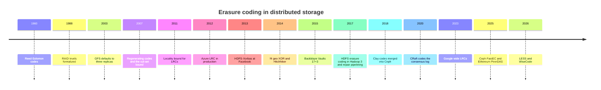
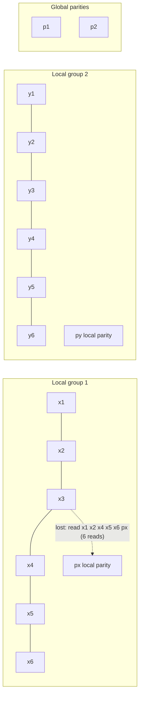

---
tags:
  - distributed-systems
  - data-and-storage
  - erasure-coding
  - reed-solomon
  - lrc
  - regenerating-codes
  - storage
  - durability
status: complete
sources:
  - https://sites.math.rutgers.edu/~zeilberg/akherim/reed.pdf
  - https://www.ll.mit.edu/impact/empowering-digital-communications
  - https://web.mit.edu/6.033/2015/wwwdocs/papers/Patterson88.pdf
  - https://arxiv.org/abs/cs/0702015
  - https://arxiv.org/abs/0803.0632
  - https://arxiv.org/pdf/1106.3625
  - https://www.usenix.org/system/files/conference/atc12/atc12-final181_0.pdf
  - https://arxiv.org/pdf/1301.3791
  - https://files.usenix.org/s3fs-public/cdn/osdi14-paper-muralidhar.pdf
  - https://research.facebook.com/file/237476094961438/publication00049_download0001.pdf
  - https://blog.acolyer.org/2014/12/17/a-hitchhikers-guide-to-fast-and-efficient-data-reconstruction-in-erasure-coded-data-centers/
  - https://arxiv.org/pdf/1806.04437
  - https://www.backblaze.com/blog/vault-cloud-storage-architecture/
  - https://www.backblaze.com/blog/reed-solomon/
  - https://www.cloudera.com/blog/technical/introduction-to-hdfs-erasure-coding-in-apache-hadoop.html
  - https://hadoop.apache.org/docs/stable/hadoop-project-dist/hadoop-hdfs/HDFSErasureCoding
  - https://usenix.org/conference/atc17/technical-sessions/presentation/li-runhui
  - https://usenix.org/conference/fast18/presentation/vajha
  - https://docs.ceph.com/en/latest/rados/operations/erasure-code-clay/
  - https://www.vastdata.com/blog/breaking-resiliency-trade-offs-with-locally-decodable-erasure-codes
  - https://www.usenix.org/conference/fast20/presentation/wang-zizhong
  - https://files.usenix.org/s3fs-public/cdn/fast20-wang_zizhong.pdf
  - https://www.usenix.org/conference/fast21/presentation/hu
  - https://usenix.org/conference/fast23/presentation/kadekodi
  - https://www.usenix.org/system/files/fast23-kadekodi.pdf
  - https://allthingsdistributed.com/2023/07/building-and-operating-a-pretty-big-storage-system.html
  - https://ceph.io/en/news/blog/2025/v20-2-0-tentacle-released
  - https://www.ceph.io/en/news/blog/2025/tentacle-fastec-performance-updates/
  - https://ethereum.org/en/roadmap/fusaka/peerdas/
  - https://blog.ethereum.org/2025/11/06/fusaka-mainnet-announcement
  - https://arxiv.org/abs/2505.05370
  - https://arxiv.org/abs/2512.10425v1
  - https://www.usenix.org/conference/fast26/presentation/cheng
  - https://www.usenix.org/conference/osdi26/presentation/cai
created: 2026-11-27
updated: 2026-11-28
---

## Table Of Contents

- [[#TL;DR|TL;DR]]
- [[#The Problem|The Problem]]
- [[#Foundations|Foundations]]
    - [[#Erasures, Not Errors|Erasures, Not Errors]]
    - [[#XOR Parity|XOR Parity]]
    - [[#Reed-Solomon and MDS Codes|Reed-Solomon and MDS Codes]]
    - [[#The Four Costs of a Code|The Four Costs of a Code]]
    - [[#The Repair Bandwidth Bound|The Repair Bandwidth Bound]]
    - [[#The Locality Bound|The Locality Bound]]
- [[#How We Got Here|How We Got Here]]
- [[#How It Works|How It Works]]
    - [[#Layout: Contiguous vs Striped|Layout: Contiguous vs Striped]]
    - [[#Placement Across Failure Domains|Placement Across Failure Domains]]
    - [[#The Write Path and Small Updates|The Write Path and Small Updates]]
    - [[#Reads and Degraded Reads|Reads and Degraded Reads]]
    - [[#Repair: Four Ways to Read Less|Repair: Four Ways to Read Less]]
    - [[#Wide Stripes|Wide Stripes]]
    - [[#Across Regions: Geo XOR|Across Regions: Geo XOR]]
    - [[#Erasure Coding Inside Consensus|Erasure Coding Inside Consensus]]
    - [[#Erasure Coding Against Byzantine Nodes|Erasure Coding Against Byzantine Nodes]]
- [[#Where It Is Now|Where It Is Now]]
- [[#Trade-offs & Open Problems|Trade-offs & Open Problems]]
- [[#Resources|Resources]]
- [[#Related Notes|Related Notes]]

## ***TL;DR***
---
*An erasure code turns $k$ pieces of data into $n = k + m$ pieces so that any $k$ of them rebuild the original. It gives the durability of several full copies for a fraction of the storage, and every large storage system uses it for cold and warm data. The cost moves from storage to repair: rebuilding one lost piece means reading many others, and most of the research since 2007 is about reading less.*

- **The trade.** Three full copies cost 3x storage and survive 2 losses. Reed-Solomon (6, 3) costs 1.5x and survives 3; (10, 4) costs 1.4x and survives 4. HDFS puts it plainly: replication has "200% overhead", typical erasure coding "no more than 50%" ([Apache Hadoop docs](https://hadoop.apache.org/docs/stable/hadoop-project-dist/hadoop-hdfs/HDFSErasureCoding)).
- **The catch.** Repairing one lost fragment of a Reed-Solomon $(k, m)$ stripe reads $k$ fragments. In Facebook's warehouse cluster that meant a median of more than 180 TB a day of cross-rack repair traffic, and 98.08% of stripes needing repair had lost exactly one block ([Rashmi et al., SIGCOMM 2014](https://blog.acolyer.org/2014/12/17/a-hitchhikers-guide-to-fast-and-efficient-data-reconstruction-in-erasure-coded-data-centers/)).
- **Four fixes for repair.** Locally repairable codes (LRC) add small group parities so one loss reads a few fragments (Azure, 2012). Regenerating codes download a fraction of each helper's data, down to a proven minimum (Dimakis et al., 2007; Clay codes in Ceph, 2018). Piggybacking (Hitchhiker) cuts repair traffic 25% to 45% at no extra storage. Repair pipelining spreads the work so repair takes about as long as a normal read.
- **The trend is wider stripes.** Google reports deployed LRCs about 50 and 80 blocks wide, and its FAST 2023 designs run at 1.1x to 1.17x overhead ([Kadekodi et al.](https://www.usenix.org/system/files/fast23-kadekodi.pdf)); VAST Data runs 150+4 at about 2.7% ([VAST, 2019](https://www.vastdata.com/blog/breaking-resiliency-trade-offs-with-locally-decodable-erasure-codes)). Wider stripes are cheaper to store and harder to repair, which is where 2026 research sits.
- **Beyond storage.** Coding now shows up inside consensus (CRaft stores 1/k of each log entry per server) and in adversarial systems (Ethereum's PeerDAS since December 3, 2025; Walrus's two-dimensional Red Stuff code).
- **Now (Nov 2026):** Ceph Tentacle (November 2025) made erasure-coded pools viable for block and file with partial reads and writes, and switched its default plugin to ISA-L; FAST 2026 and OSDI 2026 papers (LESS, WiseCode) attack repair I/O and wide-stripe scalability.

## ***The Problem***
---
*At fleet scale, disks and machines fail every day, so storing every byte three times is the price of durability, and that price is 200% of all the disks you buy. Erasure coding cuts the price, but it turns every failure into a burst of reads across many other machines.*

Replication is simple and fast: a lost copy is rebuilt by copying one surviving copy ([[Replication]]). GFS made three replicas the default for large clusters ([[2. Design Overview]]). The problem is cost. At exabyte scale, the difference between 3x and 1.4x is more than half of the storage fleet.

The obvious alternative, RAID inside each server, protects against a dead disk but not a dead machine, rack or power domain. Distributed storage needs redundancy *across* failure domains ([[Failure Models]]), so the code's fragments have to live on different machines, and repair has to move data over the network.

That is where the second problem appears. Facebook's warehouse cluster, running Reed-Solomon (10, 4) over HDFS, saw a median of more than 50 machine-unavailability events a day and recovered about 95,500 blocks a day, with a median of more than 180 TB a day crossing top-of-rack switches for reconstruction ([Rashmi et al., SIGCOMM 2014](https://blog.acolyer.org/2014/12/17/a-hitchhikers-guide-to-fast-and-efficient-data-reconstruction-in-erasure-coded-data-centers/)). The Xorbas paper on a 3,000-node, roughly 30 PB Facebook cluster estimated repair at 10% to 20% of the cluster's roughly 2 PB a day of network traffic, with only about 8% of data coded at the time ([Sathiamoorthy et al., VLDB 2013](https://arxiv.org/pdf/1301.3791)).

So an erasure-coded system has to answer four questions at once:

| Question | Why it matters |
|---|---|
| How much extra storage? | The reason to code at all |
| How many simultaneous losses survive? | Durability, especially under correlated failures |
| What does one repair cost in disk reads and network? | Repair traffic competes with user traffic; slow repair widens the window for a second loss |
| What does a read cost while a fragment is missing? | A degraded read has to reconstruct on the fly, which shows up in tail latency |

No code wins all four. The rest of this note is about which knob each design turns.

## ***Foundations***
---
*Four ideas carry the topic: an erasure is a known-missing piece, which is easier to fix than an unknown error; Reed-Solomon codes are optimal for storage; every code has to trade storage, fault tolerance and repair cost; and two theorems bound how far that trade can go.*

### Erasures, Not Errors

*Storage codes correct erasures, pieces you know are missing. Checksums are what turn silent corruption into a known erasure.*

A communication channel corrupts symbols without saying which ones; the decoder must find *and* fix them. A storage system knows which disk or server is gone, so the decoder only has to fill in known gaps. A code with minimum distance $d$ can fix $d - 1$ erasures but only $\lfloor (d-1)/2 \rfloor$ unknown errors, so storage gets twice the protection for the same parity.

This relies on detection. A disk that returns wrong data instead of no data is an error, not an erasure, and coding does nothing for it unless each fragment carries a checksum that turns "wrong" into "missing". That's why every coded store checksums fragments end to end and scrubs them ([[Silent Data Corruption]], [[Anti-Entropy and Repair]], [[End-to-End Data Integrity]]).

### XOR Parity

*The simplest erasure code is one parity block equal to the XOR of the data blocks. It survives one loss and is what RAID-5 uses.*

$$
P = D_1 \oplus D_2 \oplus \cdots \oplus D_k, \qquad D_i = P \oplus \bigoplus_{j \neq i} D_j
$$

*In words:* XOR every data block to get the parity; XOR the parity with the survivors to get back the missing one. *Worked example* with 4-bit blocks: $D_1 = 1010$, $D_2 = 0110$, $D_3 = 0011$. Then $P = 1010 \oplus 0110 \oplus 0011 = 1111$. Lose $D_2$: $1111 \oplus 1010 \oplus 0011 = 0110$, which is $D_2$. Overhead is $(k+1)/k$, and it tolerates exactly one loss. The 1988 RAID paper laid out this family of disk arrays ([Patterson, Gibson and Katz, SIGMOD 1988](https://web.mit.edu/6.033/2015/wwwdocs/papers/Patterson88.pdf)); RAID-6 adds a second, independent parity to survive two.

### Reed-Solomon and MDS Codes

*Reed-Solomon codes treat the data as a polynomial and store its values at $n$ points. Any $k$ points pin down the polynomial, so any $k$ fragments rebuild the data. That makes them "maximum distance separable": no code survives more losses for the same storage.*

Irving Reed and Gustave Solomon, radar engineers at MIT Lincoln Laboratory, published "Polynomial Codes over Certain Finite Fields" in the *Journal of the Society for Industrial and Applied Mathematics* in 1960; the codes later flew on Voyager and ended up in CDs, DVDs and QR codes ([MIT Lincoln Laboratory](https://www.ll.mit.edu/impact/empowering-digital-communications); [Reed and Solomon, 1960](https://sites.math.rutgers.edu/~zeilberg/akherim/reed.pdf)).

**The polynomial view.** Take $k$ data symbols $a_0, \ldots, a_{k-1}$ as the coefficients of $p(x) = a_0 + a_1 x + \cdots + a_{k-1} x^{k-1}$ and store $p(x_1), \ldots, p(x_n)$ at $n$ distinct points. A polynomial of degree $k - 1$ is fixed by any $k$ of its values, so any $k$ fragments recover the data and $m = n - k$ can be lost.

*Worked example* over the integers mod 7 (a tiny finite field), with $k = 2$, $n = 4$: data $a_0 = 3$, $a_1 = 5$, so $p(x) = 3 + 5x$. The four fragments are $p(0) = 3$, $p(1) = 8 \bmod 7 = 1$, $p(2) = 13 \bmod 7 = 6$, $p(3) = 18 \bmod 7 = 4$. Lose $p(0)$ and $p(2)$. From $p(1) = 1$ and $p(3) = 4$: $a_0 + a_1 = 1$ and $a_0 + 3a_1 = 4$, so $2a_1 = 3$, and since $2 \times 4 = 8 \equiv 1$, $a_1 = 3 \times 4 = 12 \equiv 5$, then $a_0 = 1 - 5 \equiv 3$. Both data symbols are back from the two surviving fragments.

**The matrix view, which is how libraries do it.** Real systems work in $GF(2^8)$, where every byte is a field element and addition is XOR. Encoding multiplies the data by an $n \times k$ generator matrix whose top $k$ rows are the identity, so the first $k$ fragments are the data itself (a *systematic* code) and the rest are parity. Decoding crosses out the rows of the lost fragments, inverts the remaining $k \times k$ matrix and multiplies it by the survivors ([Backblaze, 2015](https://www.backblaze.com/blog/reed-solomon/)). Backblaze's open-source Java library does this at about 149 MB/s per core and allows up to 256 shards in total (same source), which matches the 256 elements of $GF(2^8)$.

**Why "MDS".** The Singleton bound says any code with $n$ symbols, $k$ of them data, has minimum distance at most $n - k + 1$:

$$
d \le n - k + 1 \quad\Longrightarrow\quad \text{losses survived} = d - 1 \le n - k = m
$$

*In words:* each extra fragment buys at most one more survivable loss. Reed-Solomon meets the bound with equality, which is what maximum distance separable (MDS) means. Replication is the MDS code with $k = 1$.

### The Four Costs of a Code

*Storage overhead and fault tolerance are what a code is chosen for; repair cost and degraded-read cost are what it costs to run. Classic Reed-Solomon is optimal on the first two and worst on the last two.*

| Cost | Definition | RS $(k, m)$ | 3 replicas |
|---|---|---|---|
| Storage overhead | Raw bytes per logical byte | $(k + m)/k$ | 3 |
| Fault tolerance | Losses any stripe survives | $m$ | 2 |
| Repair bandwidth | Bytes moved over the network to rebuild one lost fragment | $k$ fragments | 1 copy |
| Repair I/O and locality | Disk bytes read and helper nodes contacted | $k$ fragments, $k$ helpers | 1 and 1 |
| Degraded read | Work to serve a read whose fragment is missing | Read $k$, decode | Read another copy |

Two more matter in practice: **encode/decode CPU** (vector instructions made this mostly cheap; HDFS uses Intel ISA-L with AVX and AVX2, per the [Hadoop docs](https://hadoop.apache.org/docs/stable/hadoop-project-dist/hadoop-hdfs/HDFSErasureCoding)) and **sub-packetization**, how many sub-pieces each fragment is cut into, which the repair-efficient codes below need and which makes disk reads less sequential.

Durability ties them together: data is lost only if more than $m$ fragments of one stripe are lost before repair finishes, so faster repair shrinks the window for the extra losses. [[Object Storage]] works the binomial loss probability through for replicas, RS (6, 3) and RS (10, 4).

### The Repair Bandwidth Bound

*Dimakis and colleagues treated repair as a flow problem and proved how little a replacement node must download. There is a curve between storing little per node and downloading little per repair; its two ends are called MSR and MBR.*

**The setup.** A file of size $B$ is spread over $n$ nodes, each storing $\alpha$. Any $k$ nodes must be enough to rebuild the file. When a node dies, a newcomer contacts $d$ helpers ($k \le d \le n - 1$) and downloads $\beta$ from each, a repair bandwidth of $\gamma = d\beta$. Modeling storage as an information-flow graph and applying a min-cut argument gives the cut-set bound ([Dimakis et al., arXiv 2007](https://arxiv.org/abs/cs/0702015); [2008 version](https://arxiv.org/abs/0803.0632); formulas as given in the [Balaji et al. survey](https://arxiv.org/pdf/1806.04437)):

$$
B \;\le\; \sum_{i=0}^{k-1} \min\{\alpha,\; (d - i)\beta\}
$$

*In words:* for data to survive any sequence of repairs, every set of $k$ nodes, each of which may itself have been repaired, must still carry $B$ bytes of information. Codes that meet it are **regenerating codes**, and the key move is that helpers send *functions* of what they store rather than whole fragments.

The two ends of the curve:

$$
\textbf{MSR:}\quad \alpha = \frac{B}{k}, \quad \beta = \frac{\alpha}{d - k + 1}, \quad \gamma = \frac{dB}{k(d - k + 1)}
$$

$$
\textbf{MBR:}\quad \beta = \frac{B}{dk - \binom{k}{2}}, \quad \alpha = \gamma = d\beta
$$

*In words:* minimum-storage regenerating (MSR) codes store exactly as little as Reed-Solomon ($B/k$ per node) but let each of $d$ helpers send only a $1/(d-k+1)$ slice of its fragment. Minimum-bandwidth regenerating (MBR) codes store a bit more per node so that repair downloads exactly one fragment's worth.

*Worked example,* $k = 8$, $m = 4$ ($n = 12$), 1 GiB fragments, so $B = 8$ GiB:

| Scheme | Stored per node | Helpers | Downloaded to rebuild one node |
|---|---|---|---|
| Reed-Solomon | 1 GiB | 8 | 8 GiB |
| MSR, $d = 11$ | 1 GiB | 11 | $11 \times 1/4 = 2.75$ GiB |
| MBR, $d = 11$ | $11 \times 8/60 \approx 1.47$ GiB | 11 | $\approx 1.47$ GiB |

The MSR row is exactly what Ceph's Clay plugin reports for $k = 8$, $m = 4$, $d = 11$: about 250 MiB from each of 11 OSDs, 2.75 GiB instead of 8 GiB ([Ceph docs](https://docs.ceph.com/en/latest/rados/operations/erasure-code-clay/)). MBR buys a cheaper repair with 47% more storage per node, which is why production systems lean toward the MSR end.

The price of MSR is **sub-packetization**: to send "a quarter of a fragment" that is useful to the newcomer, each fragment is split into many sub-chunks, and the helper reads specific ones. Clay's count is $q^{(k+m)/q}$ with $q = d - k + 1$, so 64 sub-chunks here, 16 of them read per repair (Ceph docs), and lower bounds show the count must grow exponentially in $n$ for the best-access MSR codes ([Balaji et al.](https://arxiv.org/pdf/1806.04437)). Many small reads hurt disks, which is the gap Clay and later work (LESS, WiseCode) try to close.

### The Locality Bound

*Locally repairable codes make a lost fragment recoverable from a few others, $r$, instead of $k$. Gopalan and colleagues at Microsoft proved what that locality costs in fault tolerance.*

A fragment has locality $r$ if it can be rebuilt from some $r$ other fragments. For a linear code with $n$ fragments, $k$ data and every data fragment of locality $r$ ([Gopalan, Huang, Simitci and Yekhanin, Theorem 5](https://arxiv.org/pdf/1106.3625)):

$$
d \;\le\; n - k - \left\lceil \frac{k}{r} \right\rceil + 2
$$

*In words:* compared with the MDS bound $n - k + 1$, you give up about one unit of distance for each local group, $\lceil k/r \rceil - 1$ in all. *Worked example:* Azure's LRC (12, 2, 2) has $n = 16$, $k = 12$, two local groups so $r = 6$: $d \le 16 - 12 - 2 + 2 = 4$, so it can guarantee at most 3 arbitrary losses, and it achieves exactly that ([Huang et al., §2.4](https://www.usenix.org/system/files/conference/atc12/atc12-final181_0.pdf)). Reed-Solomon (12, 4) with the same 16 fragments has $d = 5$ and survives 4, but repairs read 12 fragments, not 6. One unit of guaranteed fault tolerance buys half the repair cost.

## ***How We Got Here***
---
*The math is from 1960 and the disk arrays from 1988. Erasure coding became a distributed-systems topic in the late 2000s, when warehouse-scale clusters made replication's storage bill and coding's repair bill both visible, and the 2010s produced a code for each cost.*

**Copies first (2003).** GFS replicated 64 MB chunks three ways ([[2. Design Overview]], [[4. Master Operation]]). It was the right call when clusters were small and disks cheap relative to engineering time.

**Regenerating codes (2007).** Dimakis, Godfrey, Wainwright and Ramchandran asked how much a replacement node really needs to download, and showed that the usual "download $k$ fragments and decode" is wasteful when helpers can send combinations of their data ([arXiv cs/0702015](https://arxiv.org/abs/cs/0702015)). The 2008 paper characterized the full storage-versus-bandwidth curve and showed codes exist at every point on it ([arXiv 0803.0632](https://arxiv.org/abs/0803.0632)). This defined the research agenda for a decade.

**Locality (2011–2013).** Microsoft's Gopalan, Huang, Simitci and Yekhanin defined locality and proved the bound above, crediting the earlier pyramid codes of Huang, Chen and Li (2007) ([arXiv 1106.3625](https://arxiv.org/pdf/1106.3625)). Azure shipped Local Reconstruction Codes in Windows Azure Storage, coding sealed 1 GB extents lazily and cutting single-fragment repair in half at the same overhead as RS (12, 4) ([Huang et al., ATC 2012](https://www.usenix.org/system/files/conference/atc12/atc12-final181_0.pdf); details in [[Object Storage]]). At Facebook, HDFS-Xorbas added two local XOR parities to RS (10, 4), 16 blocks with locality 5, about 14% more storage than RS, and roughly halved repair disk I/O and network traffic: 11.5 blocks read per lost block for RS versus 5.8 for Xorbas, and repairs 25% to 45% shorter on EC2 ([Sathiamoorthy et al., VLDB 2013](https://arxiv.org/pdf/1301.3791)).

**Facebook's two papers of 2014.** f4 moved warm BLOBs from 3.6x replication to RS (10, 4) inside a cell plus an XOR across regions, landing at 2.1x ([Muralidhar et al., OSDI 2014](https://files.usenix.org/s3fs-public/cdn/osdi14-paper-muralidhar.pdf)). Hitchhiker kept RS (10, 4)'s storage and fault tolerance but "piggybacked" extra information on the parities, cutting reconstruction network and disk traffic by 25% to 45%; on Facebook's warehouse cluster it cut reconstruction read time by 32%, at the cost of a 72% longer median encoding time, and the authors estimate it would save close to 62 TB a day of disk and cross-rack traffic ([Rashmi et al., SIGCOMM 2014](https://research.facebook.com/file/237476094961438/publication00049_download0001.pdf); [summary](https://blog.acolyer.org/2014/12/17/a-hitchhikers-guide-to-fast-and-efficient-data-reconstruction-in-erasure-coded-data-centers/)).

**Coding goes mainstream (2015–2017).** Backblaze Vaults split every file into 17 data and 3 parity shards across 20 storage pods, 17.6% overhead, any 17 shards enough to rebuild ([Backblaze, 2015/2019](https://www.backblaze.com/blog/vault-cloud-storage-architecture/)), and open-sourced its Reed-Solomon library under the MIT license ([Backblaze, 2015](https://www.backblaze.com/blog/reed-solomon/)). Cloudera and Intel built native erasure coding into HDFS (HDFS-7285), choosing a striped layout first because small files dominated real clusters ([Cloudera, Sep 2015](https://www.cloudera.com/blog/technical/introduction-to-hdfs-erasure-coding-in-apache-hadoop.html)); it shipped in Hadoop 3.0 with RS (6, 3) as the default policy ([Hadoop docs](https://hadoop.apache.org/docs/stable/hadoop-project-dist/hadoop-hdfs/HDFSErasureCoding)). Li, Li, Lee and Huang's repair pipelining made repair time "approximately the same as the normal read time" for the same data, integrated into HDFS and QFS ([ATC 2017](https://usenix.org/conference/atc17/technical-sessions/presentation/li-runhui)).

**MSR codes become practical (2018).** Clay (Coupled-Layer) codes turned any MDS code into an MSR code by coupling stacked layers, optimal at once in repair bandwidth, sub-packetization and disk I/O; a 1.25x-overhead example cut repair network traffic by 2.9x versus RS, and the authors' changes went into Ceph's main codebase ([Vajha et al., FAST 2018](https://usenix.org/conference/fast18/presentation/vajha)).

**Wider and everywhere (2019 on).** VAST Data's locally decodable codes ran 150+4 stripes ([VAST, 2019](https://www.vastdata.com/blog/breaking-resiliency-trade-offs-with-locally-decodable-erasure-codes)); combined-locality work cut wide-stripe repair time by up to 90.5% ([Hu et al., FAST 2021](https://www.usenix.org/conference/fast21/presentation/hu)); Google published its wide LRC designs ([Kadekodi et al., FAST 2023](https://usenix.org/conference/fast23/presentation/kadekodi)). Coding also left storage: CRaft put it inside [[Raft]] (FAST 2020), and blockchains used it for data availability.

## ***How It Works***
---
*A production erasure-coded store decides how to cut data into stripes, where to put the fragments, when to encode, how to read around a missing fragment, and how to repair. The interesting engineering is in the last three.*

### Layout: Contiguous vs Striped

*Contiguous coding treats whole large blocks as fragments and codes them after the fact; striped coding cuts data into small cells and spreads them as it writes. The choice is about file size and when you can afford to encode.*

| | Contiguous (block-level) | Striped (cell-level) |
|---|---|---|
| Unit | A whole block or extent (e.g. Azure's 1 GB sealed extents, f4's 1 GB blocks) | Small cells, round-robin across fragments |
| When encoded | Offline, after data is sealed | Online, as it's written |
| Small files | Poor: a partial stripe still pays full parity | Good: even small files spread across nodes |
| Locality | A block's bytes sit on one node, good for compute-near-data | Every read touches several nodes |
| Example | Azure, f4, HDFS-RAID/Xorbas | HDFS 3 erasure coding, Ceph pools |

HDFS chose striping first because, at three of Cloudera's largest customers, files smaller than one coding group accounted for 36% to 97% of cluster usage ([Cloudera, 2015](https://www.cloudera.com/blog/technical/introduction-to-hdfs-erasure-coding-in-apache-hadoop.html)). Its built-in policies name both the code and the cell: RS-3-2-1024k, RS-6-3-1024k (the default), RS-10-4-1024k and XOR-2-1-1024k ([Hadoop docs](https://hadoop.apache.org/docs/stable/hadoop-project-dist/hadoop-hdfs/HDFSErasureCoding)).

### Placement Across Failure Domains

*A code only survives $m$ losses if no failure domain holds more than its share of a stripe's fragments. Placement is what turns "any 4 fragments" into "any 4 racks".*

The rule is to put each fragment of a stripe in a different failure domain, or at most $m$ fragments per domain if there aren't enough domains. HDFS states the requirement directly: RS (6, 3) needs at least 9 DataNodes, and rack tolerance needs $\lceil (k + m)/m \rceil$ racks, so at least 3 racks for RS (6, 3) and ideally 9 or more ([Hadoop docs](https://hadoop.apache.org/docs/stable/hadoop-project-dist/hadoop-hdfs/HDFSErasureCoding)). Backblaze puts the 20 shards of a file on the same drive position in 20 different pods, a unit it calls a tome ([Backblaze](https://www.backblaze.com/blog/vault-cloud-storage-architecture/)). S3 describes data split into $k$ shards plus $m$ parity shards and spread so that any $k$ surviving shards are enough ([Warfield, 2023](https://allthingsdistributed.com/2023/07/building-and-operating-a-pretty-big-storage-system.html)).

The tension: spreading fragments across racks or zones is what makes coding durable, and it's also what makes every repair and degraded read cross those boundaries. Combined-locality designs pair parity locality with topology locality, the rack layout, so that most repair traffic stays local ([Hu et al., FAST 2021](https://www.usenix.org/conference/fast21/presentation/hu)).

### The Write Path and Small Updates

*Coding is cheapest for data that never changes. Systems either replicate first and encode later, or encode inline and pay for small updates with parity deltas.*

**Replicate, then encode.** Azure appends to extents with three synchronous replicas, then encodes each sealed extent in the background and deletes the copies ([Huang et al., §4.2](https://www.usenix.org/system/files/conference/atc12/atc12-final181_0.pdf)). f4 moves BLOBs only once they're warm ([Muralidhar et al.](https://files.usenix.org/s3fs-public/cdn/osdi14-paper-muralidhar.pdf)). Writes stay as fast as replication, and coding happens once. This is the main reason immutability matters so much to object stores ([[Object Storage]]).

**Encode inline.** HDFS 3 striping encodes as the client writes, buffering only a few megabytes. The cost shows up in the API: `append()` and `truncate()` throw on coded files, and `hflush()` and `hsync()` are no-ops, so anything needing durable flushes (a [[Write-Ahead Logging|write-ahead log]], for instance) must stay replicated ([Hadoop docs](https://hadoop.apache.org/docs/stable/hadoop-project-dist/hadoop-hdfs/HDFSErasureCoding)).

**Small overwrites.** Changing one data cell naively means reading the whole stripe and re-encoding. Linear codes allow a shortcut: each parity is a fixed linear combination of the data, so it can be updated from the *change*:

$$
P'_j = P_j + g_{j,i}\,(D'_i - D_i)
$$

*In words:* read the old data cell and each parity, compute the difference, and add the scaled difference into each parity. In $GF(2^8)$ addition and subtraction are both XOR. *Worked example* with the XOR parity from [[#XOR Parity|XOR Parity]] ($g = 1$): $D_1$ changes from $1010$ to $1000$; the new parity is $1111 \oplus 1010 \oplus 1000 = 1101$, and recomputing from scratch ($1000 \oplus 0110 \oplus 0011$) gives the same $1101$. One data write plus $m$ parity read-modify-writes, instead of rewriting $k + m$ fragments. The 1988 RAID paper already gave this rule for its level 4 arrays: "new parity = (old data xor new data) xor old parity" ([Patterson, Gibson and Katz](https://web.mit.edu/6.033/2015/wwwdocs/papers/Patterson88.pdf)).

Ceph Tentacle's FastEC (November 2025) adds exactly these: partial reads, partial writes that touch only the changed data and parity chunks, parity-delta writes chosen per I/O, and no more padding of small objects to a full stripe. In its single-node test with a 6+2 pool, small writes at least doubled and small reads improved 2x to 3x over Squid, and a 70/30 mixed workload reached about half of 3-way replication's performance at 33% overhead instead of 200% ([Ceph, Nov 2025](https://www.ceph.io/en/news/blog/2025/tentacle-fastec-performance-updates/)). The flag `allow_ec_optimizations` is per pool and can't be turned off once set (same source).

### Reads and Degraded Reads

*A normal read of a systematic code just reads data fragments. A degraded read, one whose fragment is missing or slow, has to fetch $k$ others and decode, and that is where erasure coding shows up in the tail.*

Systematic codes keep the data in the clear, so healthy reads cost nothing extra. When a fragment is unavailable (a node rebooting, a disk being replaced, a [[Gray and Fail-Slow Failures|slow disk]]), the client reads enough other fragments to decode the missing range. With Reed-Solomon that's $k$ reads for one cell; with an LRC it's the local group. Because transient unavailability is far more common than permanent loss, degraded reads are frequent, and the LRC literature measures them separately (Google's FAST 2023 paper reports an "average degraded read cost" next to repair cost, [Kadekodi et al.](https://www.usenix.org/system/files/fast23-kadekodi.pdf)).

A useful trick: read $k + 1$ or more fragments and decode from whichever $k$ arrive first, trading extra load for a shorter tail, the coded version of a hedged request.

### Repair: Four Ways to Read Less

*Every repair-efficient design attacks one term of "read $k$ full fragments over the network from $k$ nodes". LRCs shrink the $k$, regenerating codes shrink the "full", piggybacking shrinks both a little for free, and pipelining spreads the work.*

*Azure LRC (12, 2, 2): one lost data fragment is rebuilt from its own group of six, not from twelve.*

| Approach | What it changes | Storage cost | Example result |
|---|---|---|---|
| **Locally repairable codes** | Fewer helpers: $k/l$ instead of $k$ | Extra local parities, or one less guaranteed loss | Azure LRC (12, 2, 2): 6 reads vs 12 at 1.33x ([Huang et al.](https://www.usenix.org/system/files/conference/atc12/atc12-final181_0.pdf)); Xorbas: 5.8 vs 11.5 blocks read ([Sathiamoorthy et al.](https://arxiv.org/pdf/1301.3791)) |
| **Regenerating (MSR) codes** | Less from each helper: $1/(d-k+1)$ of a fragment | None (MDS), but heavy sub-packetization | Clay: 2.9x less repair traffic at 1.25x ([Vajha et al.](https://usenix.org/conference/fast18/presentation/vajha)) |
| **Piggybacking** | Adds functions of one sub-stripe's data onto another's parities | None | Hitchhiker: 25% to 45% less repair traffic, 72% slower encode ([Rashmi et al.](https://blog.acolyer.org/2014/12/17/a-hitchhikers-guide-to-fast-and-efficient-data-reconstruction-in-erasure-coded-data-centers/)) |
| **Repair pipelining** | Same bytes, but each helper combines and forwards in small slices along a path, so no single link carries $k$ fragments | None; works with any linear code | Repair time close to a normal read ([Li et al., ATC 2017](https://usenix.org/conference/atc17/technical-sessions/presentation/li-runhui)) |

The approaches stack: pipelining applies to LRCs and MSR codes too, and the 2026 papers below combine several.

Repair is also a scheduling problem. Repairs compete with foreground traffic, so stores rate-limit them, prioritize stripes that have lost the most fragments (a stripe at $m$ losses is one failure from data loss), and avoid starting a full rebuild for a node that is only rebooting. That last point is why Facebook-scale clusters distinguish the 50 daily unavailability events from actual disk loss ([Rashmi et al.](https://blog.acolyer.org/2014/12/17/a-hitchhikers-guide-to-fast-and-efficient-data-reconstruction-in-erasure-coded-data-centers/)). Scrubbing finds latent losses before a second failure needs them ([[Anti-Entropy and Repair]]).

### Wide Stripes

*Making $k$ large drives overhead toward 1x: 150+4 costs 2.7%. It also makes every repair read more, makes multiple failures in one stripe more likely, and makes MSR sub-packetization explode. LRCs are how wide stripes stay repairable.*

| Stripe | Overhead | Parity fragments | Source |
|---|---|---|---|
| RS (10, 4) | 1.40x | 4 | f4, Facebook HDFS |
| 17+3 | 1.18x | 3 | Backblaze |
| Google 48-of-55 LRC | 1.15x | 7 (3 global, 4 local) | [Kadekodi et al., Table 1](https://www.usenix.org/system/files/fast23-kadekodi.pdf) |
| Google 96-of-105 LRC | 1.09x | 9 (5 global, 4 local) | same |
| 150+4 | 1.027x | 4 | [VAST, 2019](https://www.vastdata.com/blog/breaking-resiliency-trade-offs-with-locally-decodable-erasure-codes) |

Google's paper says wide codes cut overhead from the 30% to 60% typical of deployed LRCs and MDS codes to under 20%, that each percentage point is worth millions of dollars at scale, and that it has deployed LRCs about 50 and 80 blocks wide ([Kadekodi et al.](https://www.usenix.org/system/files/fast23-kadekodi.pdf)). Its **Uniform Cauchy LRC** spreads local groups evenly over data *and* global parities; on 278 real unavailable stripes in a width-50 deployment, the deployed LRC recovered none without restoration while a simulated Uniform Cauchy LRC of the same width and overhead recovered 92 (same source).

VAST's 150+4 rebuilds from about a quarter of the stripe: with $P$ protection strips it reads $1/P$ of the data strips, about 38 of 150 ([VAST](https://www.vastdata.com/blog/breaking-resiliency-trade-offs-with-locally-decodable-erasure-codes)).

The danger in numbers: a December 2025 analysis computes MTTDL of $2.66 \times 10^{17}$ years for an Azure-style (6, 2, 2) LRC but $1.90 \times 10^{14}$ for (24, 2, 2), a thousandfold drop from widening the groups ([Yu et al., arXiv 2512.10425](https://arxiv.org/abs/2512.10425v1)).

### Across Regions: Geo XOR

*Surviving a whole datacenter with a full second copy doubles storage. Facebook's f4 instead XORs pairs of blocks from two regions into a third.*

f4 codes each block with RS (10, 4) inside a cell (1.4x), then, for a pair of blocks $A$ and $B$ stored in two regions, stores $A \oplus B$ in a third. Lose region 1 and $A = (A \oplus B) \oplus B$ is rebuilt from the other two. Each region holds one 1.4x-coded block per pair, so three regions hold three blocks' worth for two blocks of data: $3 \times 1.4 / 2 = 2.1$x, against 2.8x for a coded copy in two regions ([Muralidhar et al., §5.3–5.4](https://files.usenix.org/s3fs-public/cdn/osdi14-paper-muralidhar.pdf); worked through in [[Object Storage]]). The price is that a read whose region is down crosses the WAN to two other regions, so it suits warm data that's rarely read.

### Erasure Coding Inside Consensus

*A replicated log stores every entry in full on every server. Coding the entries cuts that, but a decoder needs $k$ fragments, so quorums must overlap in $k$ servers, not one, which costs fault tolerance unless the protocol falls back to full copies.*

In [[Raft]] or [[Paxos]], two majorities overlap in at least one server, which is enough because that server has the whole entry. If each server holds one of $k$ coded fragments, a later leader must find at least $k$ fragments of any committed entry, so read and write quorums must overlap in $k$ servers. RS-Paxos's condition is ([Wang et al., FAST 2020, §2](https://files.usenix.org/s3fs-public/cdn/fast20-wang_zizhong.pdf)):

$$
Q_R + Q_W - N \ge k \quad\Longrightarrow\quad \text{failures tolerated} \le F - \frac{k-1}{2}, \quad N = 2F + 1
$$

*In words:* the overlap has to hold $k$ fragments, so quorums grow and fewer failures can be tolerated. *Worked example,* $N = 5$, $k = 3$: $Q_R + Q_W \ge 8$, so both quorums are 4 servers and only 1 failure is tolerated, against 2 for Raft. Each server stores a third of every entry, about 1.67x in total instead of 5x.

**CRaft** keeps Raft's fault tolerance by switching methods. When heartbeats show at least $F + k$ healthy servers, the leader sends coded fragments and commits once $F + k$ servers store one; otherwise it sends complete entries and commits at $F + 1$, exactly like Raft (same source). With $N = 5$, $F = 2$, $k = 3$, coding needs all five servers up, and with three or four the leader replicates in full. In a key-value store CRaft saved 66% of storage, cut write latency by 60.8% and raised write throughput by 250% versus Raft ([Wang et al., FAST 2020](https://www.usenix.org/conference/fast20/presentation/wang-zizhong)). The same intuition, durability from fewer full copies, is behind [[Witness Replicas]].

### Erasure Coding Against Byzantine Nodes

*In open networks a node may lie about what it stores. Coding plus cryptographic commitments lets clients check fragments, and lets a network prove data is available by sampling instead of downloading it.*

**Ethereum PeerDAS.** Fusaka activated on mainnet on December 3, 2025 at 21:49:11 UTC ([Ethereum Foundation](https://blog.ethereum.org/2025/11/06/fusaka-mainnet-announcement)). Its PeerDAS treats each blob as a polynomial, evaluates it at twice as many points (a Reed-Solomon extension), and splits the extended data into 128 columns gossiped on separate subnets. Any node with at least 64 columns can rebuild the rest; ordinary nodes custody a few columns and check them against KZG commitments in the block, so sampling gives a probabilistic guarantee that the whole blob is available ([ethereum.org](https://ethereum.org/en/roadmap/fusaka/peerdas/)). Blob-parameter-only forks then raised the per-block blob target and maximum from 6/9 to 10/15 (December 9, 2025) and 14/21 (January 7, 2026) ([Ethereum Foundation](https://blog.ethereum.org/2025/11/06/fusaka-mainnet-announcement)).

**Walrus and Red Stuff.** Mysten Labs' Walrus encodes a blob in two dimensions, so a node that lost its pieces rebuilds them with bandwidth proportional to what it lost, $O(|\text{blob}|/n)$ per node, instead of $O(|\text{blob}|)$ as with one-dimensional Reed-Solomon. It runs at about 4.5x replication, against 25x for full replication and 3x for classic RS at the same $10^{-12}$ security target, and supports storage challenges without assuming network synchrony ([Danezis et al., arXiv 2505.05370](https://arxiv.org/abs/2505.05370)). See [[Byzantine Fault Tolerance]] for the threat model.

## ***Where It Is Now***
---
*As of November 27, 2026: erasure coding is the default for warm and cold data everywhere, and the frontier has moved to wide stripes, repair disk I/O, coded block and file storage, and coding outside classic storage.*

- **Ceph (Tentacle, v20.2.0, November 18, 2025).** FastEC brings partial reads and writes to erasure-coded pools, opt-in per pool, and "the default plugin for erasure coded pools has been changed from Jerasure to ISA-L" for new clusters because Jerasure "is no longer maintained" ([Ceph release notes](https://ceph.io/en/news/blog/2025/v20-2-0-tentacle-released)). The FastEC author recommends a 16K stripe unit for new pools ([Ceph, Nov 2025](https://www.ceph.io/en/news/blog/2025/tentacle-fastec-performance-updates/)). Ceph's plugin list (jerasure, isa, lrc, shec, clay) is the most complete open-source menu of codes ([Ceph docs](https://docs.ceph.com/en/latest/rados/operations/erasure-code-clay/)).
- **HDFS** still defaults to RS (6, 3) with 1 MB cells, with ISA-L optional ([Hadoop docs](https://hadoop.apache.org/docs/stable/hadoop-project-dist/hadoop-hdfs/HDFSErasureCoding)).
- **Repair I/O (FAST 2026).** LESS layers extended Reed-Solomon sub-stripes so a single-block repair reads less data *and* needs fewer seeks, with a knob between the two, and beats prior I/O-optimal codes on HDFS for both single-block and full-node repair ([Cheng et al., FAST 2026](https://www.usenix.org/conference/fast26/presentation/cheng)).
- **Wide stripes (OSDI 2026).** WiseCode makes vector (MSR-style) codes work at about 100-wide stripes without sub-packetization blowup; on Ceph at 1.04x to 1.06x overhead it repairs 1.41x to 2.18x faster than Google's Uniform Cauchy LRCs at equal overhead ([Cai, Zhang and Niu, OSDI 2026](https://www.usenix.org/conference/osdi26/presentation/cai)). Cascaded Parity LRCs (December 2025) keep MDS-level fault tolerance in wide LRCs and cut single-node repair time by up to 41% on Alibaba Cloud ([Yu et al.](https://arxiv.org/abs/2512.10425v1)).
- **Storage engines on coded storage.** Disaggregated LSM engines store their value files erasure-coded on shared storage (Terark-DS uses 4:2, see [[Disaggregated LSMs and Compaction Offload]]), and [[Databases on Object Storage]] inherit S3's coding underneath.
- **Data availability.** Ethereum's PeerDAS has run since December 2025 with blob limits raised in two steps; Walrus applies two-dimensional coding to decentralized blob storage.

## ***Trade-offs & Open Problems***
---
*Every erasure code moves cost between storage, fault tolerance, repair and read latency. The open problems are making wide stripes repairable, making coded data cheap to update, and coping with correlated failures that the math assumes away.*

| Choice | Buys | Costs |
|---|---|---|
| Replication | Fast reads, writes and repair; easy updates | 2x to 3x storage, or more for zone survival |
| Reed-Solomon (MDS) | Optimal storage for its fault tolerance | Repair and degraded reads touch $k$ nodes |
| LRC | Repairs read $k/l$ | Extra parity, or one fewer guaranteed loss than MDS at the same overhead |
| MSR (Clay, regenerating) | Minimal repair bandwidth at MDS storage | Sub-packetization: many small, scattered reads |
| Piggybacking | 25% to 45% cheaper repair, no extra storage | Slower encoding, more complex decoder |
| Wide stripes | Overhead near 1x | Higher chance of multi-failure stripes, costlier repair |
| Lazy encoding | Write path stays fast | Data sits at 3x until sealed; a background pipeline to run |
| Geo XOR | Region survival at 2.1x instead of 2.8x | Cross-region reads when a region is down |
| Coded consensus | Less log storage and network | Bigger quorums, or a fallback path |

Open problems:

- **Correlated failures.** Durability math assumes independent fragment losses; real losses cluster by rack, power domain, firmware batch and software rollout. Wider stripes make this worse, and Google's FAST 2023 paper was largely about which unavailable stripes a code actually recovers ([Kadekodi et al.](https://www.usenix.org/system/files/fast23-kadekodi.pdf); [[Failure Models]]).
- **Repair versus disks.** Bandwidth-optimal codes read many small sub-chunks, which hurts hard drives; I/O-optimal codes (LESS) and sub-packetization control (WiseCode) are 2026's answers, and none is yet a default anywhere.
- **Coded data that changes.** Block and file workloads need small in-place updates; Ceph's FastEC narrows the gap to replication but its own numbers show about half of replica performance on mixed I/O.
- **Silent corruption.** A fragment that is wrong rather than missing poisons decoding unless caught by checksums first, and decoding itself runs on CPUs that can miscompute ([[Silent Data Corruption]]).
- **Theory versus deployment.** Optimal constructions often need large fields or impractical sub-packetization; production still mostly runs Reed-Solomon and LRCs over $GF(2^8)$.

## ***Resources***
---
*Start with the Azure LRC paper and Facebook's Xorbas and Hitchhiker papers for why repair is the real problem, then the Balaji et al. survey for the theory, and Google's FAST 2023 paper for where production is heading.*

**Papers**
- [Polynomial Codes over Certain Finite Fields](https://sites.math.rutgers.edu/~zeilberg/akherim/reed.pdf): Reed and Solomon, J. SIAM 1960.
- [A Case for Redundant Arrays of Inexpensive Disks (RAID)](https://web.mit.edu/6.033/2015/wwwdocs/papers/Patterson88.pdf): Patterson, Gibson and Katz, SIGMOD 1988.
- [Network Coding for Distributed Storage Systems](https://arxiv.org/abs/0803.0632): Dimakis et al., 2008 (first version [2007](https://arxiv.org/abs/cs/0702015)). Regenerating codes and the storage-bandwidth trade-off.
- [On the Locality of Codeword Symbols](https://arxiv.org/pdf/1106.3625): Gopalan, Huang, Simitci and Yekhanin. The locality bound.
- [Erasure Coding in Windows Azure Storage](https://www.usenix.org/system/files/conference/atc12/atc12-final181_0.pdf): Huang et al., USENIX ATC 2012. LRC in production.
- [XORing Elephants: Novel Erasure Codes for Big Data](https://arxiv.org/pdf/1301.3791): Sathiamoorthy et al., VLDB 2013. HDFS-Xorbas at Facebook.
- [f4: Facebook's Warm BLOB Storage System](https://files.usenix.org/s3fs-public/cdn/osdi14-paper-muralidhar.pdf): Muralidhar et al., OSDI 2014. Two-level coding and geo XOR.
- [A "Hitchhiker's" Guide to Fast and Efficient Data Reconstruction in Erasure-coded Data Centers](https://research.facebook.com/file/237476094961438/publication00049_download0001.pdf): Rashmi et al., SIGCOMM 2014 ([summary](https://blog.acolyer.org/2014/12/17/a-hitchhikers-guide-to-fast-and-efficient-data-reconstruction-in-erasure-coded-data-centers/)).
- [Repair Pipelining for Erasure-Coded Storage](https://usenix.org/conference/atc17/technical-sessions/presentation/li-runhui): Li et al., USENIX ATC 2017.
- [Clay Codes: Moulding MDS Codes to Yield an MSR Code](https://usenix.org/conference/fast18/presentation/vajha): Vajha et al., FAST 2018.
- [CRaft: An Erasure-coding-supported Version of Raft](https://www.usenix.org/conference/fast20/presentation/wang-zizhong): Wang et al., FAST 2020 ([PDF](https://files.usenix.org/s3fs-public/cdn/fast20-wang_zizhong.pdf)).
- [Exploiting Combined Locality for Wide-Stripe Erasure Coding](https://www.usenix.org/conference/fast21/presentation/hu): Hu et al., FAST 2021.
- [Practical Design Considerations for Wide Locally Recoverable Codes](https://usenix.org/conference/fast23/presentation/kadekodi): Kadekodi et al. (Google), FAST 2023 ([PDF](https://www.usenix.org/system/files/fast23-kadekodi.pdf)).
- [Walrus: An Efficient Decentralized Storage Network](https://arxiv.org/abs/2505.05370): Danezis et al. (Mysten Labs), 2025. Red Stuff.
- [Making Wide Stripes Practical: Cascaded Parity LRCs](https://arxiv.org/abs/2512.10425v1): Yu et al., December 2025.
- [LESS is More for I/O-Efficient Repairs in Erasure-Coded Storage](https://www.usenix.org/conference/fast26/presentation/cheng): Cheng et al., FAST 2026.
- [WiseCode: Breaking the Scalability Barriers of Wide-Stripe Vector Codes](https://www.usenix.org/conference/osdi26/presentation/cai): Cai, Zhang and Niu, OSDI 2026.

**Surveys**
- [Erasure Coding for Distributed Storage: An Overview](https://arxiv.org/pdf/1806.04437): Balaji et al. Regenerating codes, LRCs, sub-packetization, piggybacking.

**Engineering posts and docs**
- [Backblaze Vaults](https://www.backblaze.com/blog/vault-cloud-storage-architecture/) and [Backblaze's Reed-Solomon library](https://www.backblaze.com/blog/reed-solomon/): the clearest plain-English walkthrough of the matrix view.
- [Introduction to HDFS Erasure Coding](https://www.cloudera.com/blog/technical/introduction-to-hdfs-erasure-coding-in-apache-hadoop.html): Cloudera, 2015. Striped vs contiguous.
- [HDFS Erasure Coding docs](https://hadoop.apache.org/docs/stable/hadoop-project-dist/hadoop-hdfs/HDFSErasureCoding): policies, placement, limitations.
- [Ceph Clay plugin docs](https://docs.ceph.com/en/latest/rados/operations/erasure-code-clay/): MSR repair numbers in practice.
- [Ceph Tentacle release notes](https://ceph.io/en/news/blog/2025/v20-2-0-tentacle-released) and [FastEC performance](https://www.ceph.io/en/news/blog/2025/tentacle-fastec-performance-updates/): Nov 2025.
- [VAST: locally decodable erasure codes](https://www.vastdata.com/blog/breaking-resiliency-trade-offs-with-locally-decodable-erasure-codes): 2019. 150+4 stripes.
- [Building and operating a pretty big storage system called S3](https://allthingsdistributed.com/2023/07/building-and-operating-a-pretty-big-storage-system.html): Warfield, 2023.
- [PeerDAS](https://ethereum.org/en/roadmap/fusaka/peerdas/) and the [Fusaka mainnet announcement](https://blog.ethereum.org/2025/11/06/fusaka-mainnet-announcement): Ethereum, 2025.
- [Empowering digital communications](https://www.ll.mit.edu/impact/empowering-digital-communications): MIT Lincoln Laboratory on Reed-Solomon's history.

## ***Related Notes***
---
*Erasure coding is the storage layer under object stores and much of disaggregated storage; read it beside the replication and repair notes it trades against.*

- [[Object Storage]] — Where most coded bytes live; S3, Azure and f4 coding, with durability math.
- [[Replication]] — Full copies, the baseline erasure coding is measured against.
- [[Anti-Entropy and Repair]] — Scrubbing and rebuilding lost fragments in the background.
- [[Silent Data Corruption]] — Why fragments need checksums before decoding can trust them.
- [[Failure Models]] — Independent vs correlated failures behind durability claims.
- [[Gray and Fail-Slow Failures]] — Slow disks that turn reads into degraded reads.
- [[Raft]] — The log that CRaft codes.
- [[Paxos]] — RS-Paxos and quorum intersection with coded fragments.
- [[Witness Replicas]] — Another way to keep quorums without full copies everywhere.
- [[Byzantine Fault Tolerance]] — The threat model for PeerDAS and Walrus.
- [[Disaggregated Systems]] — Shared storage tiers that code underneath compute.
- [[Disaggregated LSMs and Compaction Offload]] — LSM value files stored erasure-coded on shared storage.
- [[Databases on Object Storage]] — Databases that inherit S3's coding and its costs.
- [[Write-Ahead Logging]] — Data that needs durable flushes and so stays replicated, not striped.
- [[2. Design Overview]] — GFS's three-replica design that erasure coding replaced for cold data.
- [[4. Master Operation]] — GFS re-replication, the repair loop coding makes more expensive.
- [[End-to-End Data Integrity]] — Checksums and scrubbing across the stack, the detection step before decoding.
- [[Tail Latency and Hedging]] — Reading extra fragments to cut the tail of degraded reads.
- [[Algorithm-Based Fault Tolerance]] — The same parity idea applied to a computation, kept valid through arithmetic.
