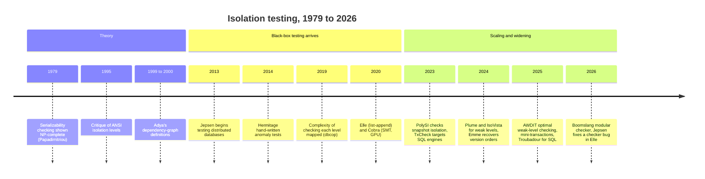
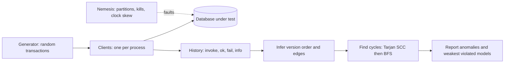
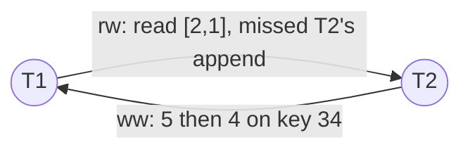

---
tags:
  - distributed-systems
  - data-and-storage
  - isolation-testing
  - testing
  - consistency-models
status: draft
sources:
  - https://arxiv.org/abs/2003.10554
  - https://github.com/jepsen-io/elle
  - https://blog.acolyer.org/2016/02/25/generalized-isolation-level-definitions/
  - https://www.aphyr.com/data/posts/294/adya-phd.pdf
  - https://jepsen.io/consistency/phenomena
  - https://jepsen.io/consistency/phenomena/g-nonadjacent
  - https://arxiv.org/pdf/1908.04509
  - https://www.lix.polytechnique.fr/%7Ecenea/papers/oopsla19.pdf
  - https://jepsen.io/consistency/phenomena/g-single
  - https://www.khoury.northeastern.edu/home/zhangjian3/attaches/eurosys23_final_version.pdf
  - https://www.usenix.org/conference/osdi20/presentation/tan
  - https://arxiv.org/pdf/2301.07313
  - https://hengxin.github.io/papers/2024-OOPSLA-Plume.pdf
  - https://vldb.org/pvldb/vol17/p4325-liu.pdf
  - https://arxiv.org/pdf/2504.06975
  - https://arxiv.org/html/2504.02344v1
  - https://www.doc.ic.ac.uk/~afd/papers/2026/TOCS.pdf
  - https://www.usenix.org/conference/osdi23/presentation/jiang
  - https://2025.splashcon.org/details/OOPSLA/96/Checking-Observational-Correctness-of-Database-Systems
  - https://pages.cs.wisc.edu/~aws/papers/oopsla25b.pdf
  - https://arxiv.org/pdf/2604.20587
  - https://arxiv.org/pdf/2607.15877
  - https://martin.kleppmann.com/2014/11/25/hermitage-testing-the-i-in-acid.html
  - https://jepsen.io/analyses
  - https://jepsen.io/analyses/amazon-rds-for-postgresql-17.4
  - https://jepsen.io/analyses/mariadb-galera-cluster-12.1.2
  - https://jepsen.io/analyses/particledb-1.1.4
  - https://jepsen.io/blog/2026-10-16-jepsen-0.3.15
created: 2026-11-26
updated: 2026-11-26
---

## Table Of Contents

---

- [[#TL;DR|TL;DR]]
- [[#The Problem|The Problem]]
- [[#Foundations|Foundations]]
    - [[#Observations, Not Internals|Observations, Not Internals]]
    - [[#Adya's Dependency Graph|Adya's Dependency Graph]]
    - [[#Phenomena as Cycle Shapes|Phenomena as Cycle Shapes]]
    - [[#Write Skew as a Graph, a Worked Example|Write Skew as a Graph, a Worked Example]]
    - [[#Why Checking Is Hard|Why Checking Is Hard]]
- [[#How We Got Here|How We Got Here]]
- [[#How It Works|How It Works]]
    - [[#The Test Loop|The Test Loop]]
    - [[#Making Histories Checkable|Making Histories Checkable]]
    - [[#Finding a G-single, a Worked Example|Finding a G-single, a Worked Example]]
    - [[#Long Fork in RDS PostgreSQL, a Worked Example|Long Fork in RDS PostgreSQL, a Worked Example]]
    - [[#Solver-Based Checkers|Solver-Based Checkers]]
    - [[#Fast Checkers for Weak Levels|Fast Checkers for Weak Levels]]
    - [[#Predicates, SQL and Gray-Box Checking|Predicates, SQL and Gray-Box Checking]]
    - [[#The Checker Landscape|The Checker Landscape]]
- [[#Where It Is Now|Where It Is Now]]
- [[#Trade-offs & Open Problems|Trade-offs & Open Problems]]
- [[#Resources|Resources]]
- [[#Related Notes|Related Notes]]

## ***TL;DR***
---
*Isolation testing is how you find out which [[Consistency Models|isolation level]] a database actually gives you, as opposed to the one it advertises. You run random concurrent transactions, record what clients saw, rebuild the dependency graph between transactions, and look for cycles that the claimed level forbids.*

- **The model:** Adya's formalism defines isolation levels by which cycles may appear in a graph whose nodes are committed transactions and whose edges are write-write (ww), write-read (wr) and read-write anti-dependency (rw) relations ([Adya, Liskov and O'Neil, 2000](https://blog.acolyer.org/2016/02/25/generalized-isolation-level-definitions/)). Serializable means no cycle; snapshot isolation allows cycles only when two rw edges sit next to each other ([Jepsen](https://jepsen.io/consistency/phenomena/g-nonadjacent)).
- **The hard part:** clients never see the database's internal version order, and checking a general history for serializability or snapshot isolation is NP-complete ([Biswas and Enea, 2019](https://arxiv.org/pdf/1908.04509)).
- **The trick:** design the workload so the history reveals the version order. Elle's list-append workload writes unique values and appends them to lists, so every read shows the full order of writes before it; that makes checking linear time and lets Elle handle hundreds of thousands of transactions in tens of seconds ([Kingsbury and Alvaro, 2020](https://arxiv.org/abs/2003.10554)).
- **The alternatives:** SMT-based checkers (Cobra, PolySI, Viper) search over unknown orders for general workloads; graph-based checkers (Plume, AWDIT) check weak levels fast; gray-box checkers (Emme, Troubadour) ask the database for extra information or model SQL to handle predicates.
- **Where it is now (Nov 2026):** Jepsen keeps finding isolation violations in healthy clusters of shipping databases, from Amazon RDS for PostgreSQL (2025) to MariaDB Galera and ParticleDB (2026) ([Jepsen](https://jepsen.io/analyses)). Predicates, mixed SQL workloads and the checkers' own bugs are the open edges.

## ***The Problem***
---
*Isolation bugs are silent: a database that loses an update or shows a torn snapshot returns success, and nothing crashes. They are rare, timing-dependent and often appear only under faults, so ordinary tests miss them and documentation is not evidence.*

Three things make isolation hard to trust:

1. **Names are ambiguous.** The SQL standard's levels are defined by phenomena that admit more than one reading, and vendors map them differently ([[Consistency Models]]). Kleppmann's Hermitage suite found in 2014 that "repeatable read" meant different things in PostgreSQL, MySQL and SQL Server, and that "Oracle 'serializable' is actually not serializable at all, but snapshot isolation" ([Kleppmann](https://martin.kleppmann.com/2014/11/25/hermitage-testing-the-i-in-acid.html)).
2. **Implementations are complex.** Distributed databases implement isolation with [[Distributed Transactions|multi-shard commit]], [[Time and Clocks|timestamps]], retries and failover, and each adds a place for a race. TiDB's automatic retries produced read skew and lost updates; YugabyteDB showed G2-item anomalies after master failover ([Elle](https://arxiv.org/abs/2003.10554)).
3. **The bugs are invisible to the caller.** A lost update or a stale read looks exactly like a correct result unless you compare it against what other transactions saw.

So you need a test that (a) generates concurrent transactions, ideally while injecting [[Failure Models|faults]], (b) records what each client observed, and (c) decides whether any legal execution under the claimed level could have produced those observations. Part (c) is the hard part, and most of this note is about it.

## ***Foundations***
---
*You need four ideas: a test only sees what clients observed; Adya's graph turns isolation levels into "which cycles are banned"; each named anomaly is a cycle shape; and inferring the graph from observations is computationally hard unless the workload helps.*

#### **Observations, Not Internals**
A client knows what it sent (begin, read $x$, write $y = 5$, commit) and what came back (the value read, commit or abort, or a timeout). It does not know the order in which the database installed versions of each key. That hidden order is called the **version order**, and every dependency between transactions depends on it. Elle's paper calls the client-side record an **observation** and the possible histories consistent with it **interpretations**; a checker should report an anomaly only if it appears in every interpretation ([Elle](https://arxiv.org/abs/2003.10554)).

Timeouts make this worse. A transaction that timed out may or may not have committed, so the checker must consider both cases. Jepsen records these as indeterminate operations.

#### **Adya's Dependency Graph**
Adya's thesis (MIT, March 1999, *Weak Consistency: A Generalized Theory and Optimistic Implementations for Distributed Transactions*) and the ICDE 2000 paper with Liskov and O'Neil defined isolation without reference to locks, because lock-based "preventative" definitions rule out optimistic and multi-version designs ([Acolyer on Adya et al.](https://blog.acolyer.org/2016/02/25/generalized-isolation-level-definitions/), [Adya thesis](https://www.aphyr.com/data/posts/294/adya-phd.pdf)). The **direct serialization graph** (DSG) has one node per committed transaction and three kinds of edge:

$$
\begin{aligned}
T_i \xrightarrow{ww} T_j &\iff T_i \text{ installs } x_k \text{ and } T_j \text{ installs the next version } x_{k+1}\\
T_i \xrightarrow{wr} T_j &\iff T_i \text{ installs } x_k \text{ and } T_j \text{ reads } x_k\\
T_i \xrightarrow{rw} T_j &\iff T_i \text{ reads } x_k \text{ and } T_j \text{ installs } x_{k+1}
\end{aligned}
$$

**In plain English:** ww means "overwrote you", wr means "read what you wrote", and rw (the **anti-dependency**) means "read the version just before you wrote over it", so the reader must come before the writer in any serial order. Each edge says the source must come before the target. A cycle means no serial order exists.

| Edge | Plain English | Must-precede reason |
|---|---|---|
| ww | $T_j$ overwrote $T_i$'s write | $T_j$'s version is later |
| wr | $T_j$ saw $T_i$'s write | You can't read what isn't written yet |
| rw | $T_i$ read a version that $T_j$ then replaced | $T_i$ didn't see $T_j$, so $T_i$ came first |

Two extra edge kinds come from the clients rather than the data: **process** edges (one client's transactions in the order it ran them, for session guarantees) and **real-time** edges ($T_i$ finished before $T_j$ started, for [[Consistency Models#Serializable vs Strict Serializable|strict serializability]]) ([Elle](https://arxiv.org/abs/2003.10554)).

#### **Phenomena as Cycle Shapes**
Each Adya phenomenon is a pattern in the DSG, and each isolation level bans a set of them ([Acolyer](https://blog.acolyer.org/2016/02/25/generalized-isolation-level-definitions/), [Jepsen phenomena](https://jepsen.io/consistency/phenomena), [Jepsen G-single](https://jepsen.io/consistency/phenomena/g-single)):

| Phenomenon | Shape | Plain English | First level that bans it |
|---|---|---|---|
| G0 | Cycle of only ww | Writes interleaved inconsistently (dirty write) | Read uncommitted (PL-1) |
| G1a | Not a cycle | Read a write from a transaction that aborted | Read committed (PL-2) |
| G1b | Not a cycle | Read an intermediate, not final, value of a transaction | Read committed (PL-2) |
| G1c | Cycle of ww and wr only | Circular information flow: each saw the other | Read committed (PL-2) |
| G-single | Cycle with exactly one rw | Read skew: saw part of a transaction's effects | Consistent view (PL-2+), and so snapshot isolation |
| G-nonadjacent | Cycle with rw edges, no two adjacent | Includes G-single and long fork | Snapshot isolation |
| G2-item | Cycle with one or more item rw edges | Write skew and friends | Repeatable read (PL-2.99) |
| G2 | Cycle with rw edges, including predicate reads | Phantoms | Serializable (PL-3) |

Snapshot isolation sits off this ladder: it bans G-nonadjacent but allows a cycle whose two rw edges are adjacent, which is exactly write skew ([Jepsen](https://jepsen.io/consistency/phenomena/g-nonadjacent)). That is why SI and repeatable read are incomparable.

#### **Write Skew as a Graph, a Worked Example**
Two doctors, $x$ (Alice on call) and $y$ (Bob on call). Rule: at least one must stay on call. Initially $T_0$ wrote $x = 1, y = 1$.

| Step | $T_1$ (Alice goes off call) | $T_2$ (Bob goes off call) |
|---|---|---|
| 1 | read $x = 1$, read $y = 1$ | read $x = 1$, read $y = 1$ |
| 2 | write $x = 0$ | write $y = 0$ |
| 3 | commit | commit |

Edges:
- $T_1$ read $y_0$ and $T_2$ installed $y_1$, so $T_1 \xrightarrow{rw} T_2$.
- $T_2$ read $x_0$ and $T_1$ installed $x_1$, so $T_2 \xrightarrow{rw} T_1$.

The cycle $T_1 \to T_2 \to T_1$ has two rw edges, adjacent to each other. It is G2-item, so serializable and repeatable read forbid it. It is not G-nonadjacent, so snapshot isolation allows it, and both doctors end up off call. A checker for SI must not flag this history; a checker for serializability must.

#### **Why Checking Is Hard**
If you knew the version order, building the DSG and finding cycles would be linear-time graph work. You don't, so the checker must find *some* version order that makes the graph acyclic, and that is a search.

| Level | General histories | With a bounded number of client sessions | Source |
|---|---|---|---|
| Read committed, read atomic, causal | Polynomial | Polynomial | [Biswas and Enea](https://arxiv.org/pdf/1908.04509) |
| Prefix consistency, snapshot isolation, serializability | NP-complete | Polynomial, but exponential in the number of sessions | [Biswas and Enea](https://arxiv.org/pdf/1908.04509) |

Serializability checking was already known to be NP-complete in general (Papadimitriou, 1979, as cited by [Elle](https://arxiv.org/abs/2003.10554)). Practical checkers escape in one of three ways: make the workload reveal the order (Elle, MTC), throw a SAT/SMT solver at the remaining choices (Cobra, PolySI), or ask the database for the order (Emme).

## ***How We Got Here***
---
*Isolation was formalized in the 1990s, but checking real systems against the formalism only became practical after 2013, when Jepsen made black-box histories routine and Elle (2020) made the checking scale. Since then the research front has moved to solvers, weak levels, predicates and SQL.*

| Year | Step | Problem it answered | Source |
|---|---|---|---|
| 1999 to 2000 | **Adya's generalized isolation levels.** Levels defined as banned cycles in a dependency graph, independent of locking. | ANSI definitions were ambiguous and ruled out optimistic and multi-version designs. | [Acolyer](https://blog.acolyer.org/2016/02/25/generalized-isolation-level-definitions/) |
| 2014 | **Hermitage.** Each test is a race between concurrent transactions translated from the anomaly literature; it passes if the database prevents it. | Comparing what isolation names actually mean across PostgreSQL, MySQL, Oracle and SQL Server. | [Kleppmann](https://martin.kleppmann.com/2014/11/25/hermitage-testing-the-i-in-acid.html) |
| 2019 | **Complexity map and dbcop.** RC, RA and causal checkable in polynomial time; SI and serializability NP-complete but polynomial for bounded sessions. | Which checks can scale at all. | [Biswas and Enea, OOPSLA 2019](https://www.lix.polytechnique.fr/%7Ecenea/papers/oopsla19.pdf) |
| 2020 | **Elle.** Recoverable, traceable workloads (list-append) let the checker infer the version order; linear time, detects every Adya anomaly except predicate ones. | Earlier checkers (Knossos, Gretchen) choked after a few hundred transactions. | [Kingsbury and Alvaro](https://arxiv.org/abs/2003.10554) |
| 2020 | **Cobra.** SMT solving with a new encoding, GPU-accelerated pruning and segmentation for continuous checking of serializability, at about 2,000 transactions per second. | Checking ordinary key-value workloads where the order isn't revealed. | [Tan et al., OSDI 2020](https://www.usenix.org/conference/osdi20/presentation/tan) |
| 2023 | **PolySI.** Generalized polygraphs plus the MonoSAT solver give a sound and complete SI checker; found violations in Dgraph, MariaDB Galera and YugabyteDB. | No black-box SI checker scaled or explained its counterexamples. | [Huang et al., PVLDB 2023](https://arxiv.org/pdf/2301.07313) |
| 2023 | **TxCheck.** Statement-level dependency graphs build test oracles for SQL transactions; 56 bugs in TiDB, MySQL and MariaDB. | Key-value checkers can't exercise SQL engines. | [Jiang et al., OSDI 2023](https://www.usenix.org/conference/osdi23/presentation/jiang) |
| 2024 | **Plume.** 14 "transactional anomalous patterns" checked with graph traversals and tree clocks, no solver; one million transactions in under five minutes. | Weak levels don't need SAT, and solvers were slow. | [Liu et al., OOPSLA 2024](https://hengxin.github.io/papers/2024-OOPSLA-Plume.pdf) |
| 2024 | **Emme.** The database reports its version order ("version certificate recovery"), so predicates become checkable. | Black-box checkers can't see predicate reads. | [Clark et al., EuroSys 2024; TOCS 2026](https://www.doc.ic.ac.uk/~afd/papers/2026/TOCS.pdf) |
| 2025 | **AWDIT.** RC and RA in $O(n^{3/2})$, causal in $O(n \cdot k)$, with a matching lower bound. | Plume's polynomial was degree 6. | [Møldrup and Pavlogiannis, PLDI 2025](https://arxiv.org/pdf/2504.06975) |
| 2026 | **Boomslang.** Modular checker front end and back end; Cobra, Viper and PolySI each re-expressed in about 300 lines; five more levels supported. | Each checker supported one level and a narrow API. | [Zhang, Mu and Tan, arXiv Apr 2026](https://arxiv.org/pdf/2604.20587) |

## ***How It Works***
---
*A test has two halves: generating a history that is both realistic and checkable, and deciding whether that history is legal. The design choice that matters most is how much the workload reveals about the version order, because that decides whether checking is linear-time or a search.*

### The Test Loop
A Jepsen-style test runs a generator of random transactions through many clients while a "nemesis" injects faults (partitions, process kills, clock skew), records every invocation and completion into one history, and hands the history to a checker ([Elle](https://arxiv.org/abs/2003.10554), [Jepsen](https://jepsen.io/analyses)).

The checker's output names the anomalies found, the weakest models they rule out, and the stronger models implied to be ruled out (Elle's `:not` and `:also-not`) ([Elle README](https://github.com/jepsen-io/elle)). This is the "outside in" style of checking that complements the "inside out" invariants of [[Deterministic Simulation Testing]].

### Making Histories Checkable
Elle's key move is to shape the data so observations pin down the version order ([Elle](https://arxiv.org/abs/2003.10554)):

- **Recoverability:** every written value is unique, so any value read maps to exactly one writing transaction.
- **Traceability:** a read reveals the history of versions, not just the latest. In the **list-append** workload each key is a list and each write appends a unique element, so reading `[1, 2, 3]` shows that the writes of 1, 2 and 3 happened in that order.

With those, Elle takes the longest committed read of each key as its version order, derives ww, wr and rw edges, and searches for cycles. It runs Tarjan's algorithm for strongly connected components, then breadth-first search inside each component for a short witness cycle, restricted to the edge types each anomaly allows:

| Anomaly | Edges allowed in the cycle |
|---|---|
| G0 | ww only |
| G1c | ww and wr |
| G-single | ww and wr, plus exactly one rw |
| G2 | ww and wr, plus one or more rw |

G1a and G1b need no cycle search: recoverability shows directly that a read returned an aborted or intermediate value. Elle also flags non-Adya problems like garbage reads, duplicate writes and a transaction not seeing its own writes ([Elle](https://arxiv.org/abs/2003.10554)).

Elle also has an **rw-register** workload for systems that only offer plain overwriting registers. Its inferences are weaker: the initial empty value precedes all others, a transaction's write follows its own read, and real-time order applies on linearizable keys ([Elle](https://arxiv.org/abs/2003.10554)). The README says "100-160,000 transactions/sec is readily attainable on modern hardware" and that Elle has checked real-world histories of 22 million transactions ([Elle README](https://github.com/jepsen-io/elle)).

The same idea, constraining the workload so checking is cheap, drives **mini-transactions** (MTC): transactions of at most four operations where every write follows a read of the same key and writes unique values. For such histories, strict serializability, serializability and SI check in linear or quadratic time, and the paper argues mini-transactions still express all 14 well-known anomalies ([Wei et al., 2025](https://arxiv.org/html/2504.02344v1)).

### Finding a G-single, a Worked Example
From Elle's TiDB case study, list-append over SQL text columns, under TiDB's claimed snapshot isolation ([Elle](https://arxiv.org/abs/2003.10554)):

| Transaction | Operations |
|---|---|
| $T_1$ | read key 34 = `[2, 1]`; append 5 to key 36; append 4 to key 34 |
| $T_2$ | append 5 to key 34 |
| $T_3$ | read key 34 = `[2, 1, 5, 4]` |

1. $T_3$'s read shows the version order of key 34: 2, 1, then $T_2$'s 5, then $T_1$'s 4. So $T_2 \xrightarrow{ww} T_1$.
2. $T_1$ read key 34 as `[2, 1]`, which does not include $T_2$'s 5, but $T_2$'s version comes next. So $T_1 \xrightarrow{rw} T_2$.
3. Cycle $T_1 \to T_2 \to T_1$ with exactly one rw edge: **G-single**, which snapshot isolation forbids.

In plain words: $T_1$ appended after $T_2$ but read a snapshot from before $T_2$, so $T_1$ wrote on top of something it never saw. The cause was TiDB's automatic transaction retries; the fix shipped in 3.0.0-rc2 ([Elle](https://arxiv.org/abs/2003.10554)).

### Long Fork in RDS PostgreSQL, a Worked Example
In April 2025 Jepsen ran list-append on healthy Amazon RDS for PostgreSQL Multi-AZ clusters, no faults injected, at the "repeatable read" level, which PostgreSQL implements as snapshot isolation ([Jepsen](https://jepsen.io/analyses/amazon-rds-for-postgresql-17.4)):

| Transaction | Did | Saw |
|---|---|---|
| $T_1$ | append 9 to row 89, giving `[4, 9]` | |
| $T_3$ | append 11 to row 90, giving `[11]` | |
| $T_2$ | read row 89 and row 90 | $T_1$'s 9, but not $T_3$'s 11 |
| $T_4$ | append 3 to row 90, read rows | `[11, 3]` on row 90 (saw $T_3$), but not $T_1$'s 9 |

$T_2$ ordered $T_1$ before $T_3$; $T_4$ ordered $T_3$ before $T_1$. Two observers saw two independent writes in opposite orders, a **long fork**, which is a G-nonadjacent cycle and illegal under SI. The cause, found after publication: a PostgreSQL primary makes transactions visible in an order set by an in-memory lock, while replicas make them visible in write-ahead-log order, so the two can disagree ([Jepsen](https://jepsen.io/analyses/amazon-rds-for-postgresql-17.4)). Versions 13.15 through 17.4 all showed it.

### Solver-Based Checkers
When the workload is ordinary reads and writes, many version orders fit the observations. Solver-based checkers encode every remaining choice as a constraint and ask a SAT or SMT solver whether some choice yields an acyclic graph.

- **Polygraph:** a graph of known edges plus pairs of alternative edges ("either $T_i$ wrote $x$ before $T_j$ or after"). Serializable means some selection from each pair is acyclic.
- **Cobra (OSDI 2020)** checks serializability with MonoSAT, prunes constraints on a GPU, and segments the history so it can check continuously at about 2,000 transactions per second, roughly 170 million a day ([Tan et al.](https://www.usenix.org/conference/osdi20/presentation/tan)).
- **PolySI (PVLDB 2023)** generalizes polygraphs to snapshot isolation, prunes constraints that would make cycles with known edges, and turns the solver's raw cycle back into a minimal, readable counterexample. It reproduced 2,477 known anomalies and checked a million transactions over a billion keys in under 40 GB and at most 4 hours ([Huang et al.](https://arxiv.org/pdf/2301.07313)).
- **Viper (EuroSys 2023)** checks snapshot isolation with a variant it calls BC-polygraphs plus heuristic pruning ([Zhang et al.](https://www.khoury.northeastern.edu/home/zhangjian3/attaches/eurosys23_final_version.pdf)); Boomslang later re-expressed its core logic in 281 lines ([Boomslang](https://arxiv.org/pdf/2604.20587)).

The cost is that solver time can blow up with concurrency, which is why constrained workloads (list-append, mini-transactions) remain popular.

### Fast Checkers for Weak Levels
Weak levels (read committed, read atomic, causal) are polynomial to check, so they don't need a solver.

- **Plume (OOPSLA 2024)** breaks the levels into 14 small transactional anomalous patterns (TAPs): read committed needs nine, read atomic twelve, causal all fourteen. It checks them with graph traversals, vector clocks and tree clocks. It found a "critical" six-year-old bug in MariaDB Galera releases 10.3 to 10.11 and violations in AntidoteDB and YugabyteDB, and reported that MongoDB histories violated read committed despite claiming SI and CockroachDB histories violated read atomic despite claiming serializability ([Liu et al.](https://hengxin.github.io/papers/2024-OOPSLA-Plume.pdf)).
- **AWDIT (PLDI 2025)** builds a minimal, saturated partial commit order and checks it for cycles. For a history of size $n$ with $k$ sessions it runs in

$$
O(n^{3/2}) \text{ for read committed and read atomic}, \qquad O(n \cdot k) \text{ for causal consistency}
$$

and proves $n^{3/2}$ is a lower bound for combinatorial algorithms at any level between read committed and causal. **In plain English:** doubling a history's size makes RC checking about 2.8 times slower, not 64 times as with a degree-6 algorithm. On large histories it averaged 245x faster than Plume for read committed ([Møldrup and Pavlogiannis](https://arxiv.org/pdf/2504.06975)).
- **IsoVista (PVLDB 2024)** packages PolySI and Plume-style checking for six levels behind a web interface that draws each violation as a dependency graph ([Gu et al.](https://vldb.org/pvldb/vol17/p4325-liu.pdf)).

### Predicates, SQL and Gray-Box Checking
Black-box key-value checkers see item reads only. A predicate read (`SELECT ... WHERE balance > 100`) depends on rows that *don't* exist, and Elle's paper says plainly that "we cannot distinguish between repeatable read and serializability" for that reason ([Elle](https://arxiv.org/abs/2003.10554)). Three lines of work attack this:

| Approach | Idea | Example | Result |
|---|---|---|---|
| **Gray-box version recovery** | Ask the database for its version order and version sets via a few hundred lines of per-database code, then check against Adya including predicates | Emme, Enne | Emme 1.2 to 3.6x faster than Elle; caught PostgreSQL read committed histories with predicate-only anomalies that Elle accepted as serializable; found a known PostgreSQL 12.3 serializable bug ([Clark et al.](https://www.doc.ic.ac.uk/~afd/papers/2026/TOCS.pdf)) |
| **SQL semantics in SMT** | Encode what each SQL statement could have returned from some legal committed state, under a chosen level | Troubadour (OOPSLA 2025) | Supports joins, predicates, aggregates and stored procedures; checked over a million bank transactions in 1.76 hours ([Pick et al.](https://pages.cs.wisc.edu/~aws/papers/oopsla25b.pdf)) |
| **Equivalent-test oracles** | Generate transactions, then compare against semantically equivalent sequential runs built from statement-level dependencies | TxCheck (OSDI 2023) | 56 bugs in TiDB, MySQL and MariaDB, 52 confirmed ([Jiang et al.](https://www.usenix.org/conference/osdi23/presentation/jiang)) |

Differential testing helps too: Jepsen's 2026 ParticleDB test generated random tables and SQL and compared results against PostgreSQL, which surfaced predicate bugs such as `SELECT ... WHERE FALSE` returning rows ([Jepsen](https://jepsen.io/analyses/particledb-1.1.4)).

### The Checker Landscape

| Checker | Levels | Method | Strength | Limit |
|---|---|---|---|---|
| Elle | RU through strict serializable, session guarantees | Inferred version order, cycle search | Linear time, explains each cycle, battle-tested in Jepsen | No predicates; needs list-append for full power; not complete |
| Cobra | Serializable | SMT + GPU pruning | Ordinary key-value workloads, continuous | Serializability only |
| PolySI, Viper | Snapshot isolation | Polygraphs + SAT | Sound and complete for SI | Solver cost grows with concurrency |
| Plume, AWDIT | RC, RA, causal | Graph patterns, clocks | Very fast, polynomial | Weak levels only |
| MTC | SSER, SER, SI | Constrained mini-transactions | Linear or quadratic checking | Workload must be mini-transactions |
| Emme, Enne | SER, SI (Emme); SER (Enne) | Database-reported version order | Predicates | Needs per-database hooks |
| Troubadour | RC, SI, SER and strict variants | SMT over SQL semantics | Real SQL with predicates | Slower per transaction |
| Boomslang | SER, SI, RR, RC, PL-2+, cursor stability and more | Modular front end, IR, solver back end | Range queries, duplicates, many levels | Research preprint |

## ***Where It Is Now***
---
*As of November 2026, black-box isolation testing is standard practice for anyone shipping a transactional database, and it still finds violations in healthy, fault-free clusters. Research has moved from "can we check this at all" to predicates, SQL, many levels in one tool, and trusting the checkers themselves.*

**Jepsen keeps finding real anomalies (2025 to 2026).**
- **Amazon RDS for PostgreSQL 17.4 (Apr 2025):** long fork and other G-nonadjacent cycles in healthy Multi-AZ clusters, so they may offer only parallel snapshot isolation ([Jepsen](https://jepsen.io/analyses/amazon-rds-for-postgresql-17.4)). See the worked example above.
- **MariaDB Galera Cluster 12.1.2 (Mar 2026):** lost updates and G-single in healthy clusters, stale reads without faults, and lost committed writes under crashes and partitions; all four issues were open at publication ([Jepsen](https://jepsen.io/analyses/mariadb-galera-cluster-12.1.2)).
- **ParticleDB 1.1.4 (Oct 2026):** G-single under its snapshot-isolation modes, read skew under its strongest mode in one release candidate, and stale reads in a strict-serializable mode about once per 300,000 transactions; the test combined Elle's register and list-append workloads with SQL differential testing ([Jepsen](https://jepsen.io/analyses/particledb-1.1.4)).

**Checkers have bugs too.** Jepsen 0.3.15 (Oct 16, 2026) "fixes a major safety bug in Elle's `rw-register` workload", traced to two issues in the Bifurcan data-structure library ([Jepsen](https://jepsen.io/blog/2026-10-16-jepsen-0.3.15)). The post does not say which past results were affected. Elle's own README has long advised checking reported anomalies by hand ([Elle README](https://github.com/jepsen-io/elle)).

**Research front (2025 to 2026).**
- **Optimal weak-level checking:** AWDIT closed the complexity question for RC and RA (PLDI 2025) ([Møldrup and Pavlogiannis](https://arxiv.org/pdf/2504.06975)).
- **One checker, many levels:** Boomslang (Apr 2026 preprint) supports range queries, iterators and duplicate values, adds five previously uncheckable levels, and found a new TiDB 8.5.4 pessimistic repeatable-read bug ([Zhang, Mu and Tan](https://arxiv.org/pdf/2604.20587)).
- **Predicates:** Emme and Enne's journal version (2026) and Troubadour (OOPSLA 2025) make predicate anomalies checkable with a little help from the database or a SQL model ([Clark et al.](https://www.doc.ic.ac.uk/~afd/papers/2026/TOCS.pdf), [Pick et al.](https://pages.cs.wisc.edu/~aws/papers/oopsla25b.pdf)).
- **Proof instead of test:** a 2026 Aarhus paper uses the Iris separation logic in Rocq to prove that any implementation meeting their key-value specs provides read uncommitted, read committed or snapshot isolation "for free" ([Mathiasen, Timany and Birkedal](https://arxiv.org/pdf/2607.15877)); see [[Formal Methods in Practice]].

## ***Trade-offs & Open Problems***
---
*Every checker trades realism of the workload against how cheaply and confidently the history can be checked. A clean run proves only that this run had no detectable anomaly; it never proves the database is correct.*

| Choice | Gain | Cost |
|---|---|---|
| Constrained workload (list-append, mini-transactions) | Linear-time, precise inference; readable cycles | Doesn't look like your application; may miss bugs in other code paths |
| General workload + solver | Checks ordinary reads and writes | Search can blow up with concurrency and history length |
| Black box | Works on any database, including managed cloud services | Can't see predicates or internal order |
| Gray box (version recovery) | Predicates, faster checking | Per-database instrumentation; trusts what the database reports |
| Sound but incomplete (Elle) | No false alarms in principle | May miss anomalies, especially near timeouts and the end of a history |

Open problems:
- **Absence of bugs.** As Jepsen puts it, "we can prove the presence of bugs, but not their absence" ([Jepsen](https://jepsen.io/analyses/amazon-rds-for-postgresql-17.4)). Coverage depends on the workload, the faults and luck; [[Deterministic Simulation Testing]] attacks the luck part.
- **Predicates in the black box.** Without help from the database, phantoms remain undetectable to Elle-style checkers ([Elle](https://arxiv.org/abs/2003.10554)).
- **Realistic SQL at scale.** Troubadour handles real SQL, but in five minutes it checked only 445 to 2,860 serializable transactions on TPC-C, RUBiS and Twitter workloads, against hundreds of thousands for Elle on list-append ([Pick et al.](https://pages.cs.wisc.edu/~aws/papers/oopsla25b.pdf)).
- **Trusting the checker.** A checker bug can turn into false confidence, as Elle's 2026 rw-register fix showed ([Jepsen](https://jepsen.io/blog/2026-10-16-jepsen-0.3.15)). Cross-checking with a second, independent checker is cheap insurance.
- **Fault models.** Many anomalies appear only during failover or clock trouble, so the nemesis must reflect real [[Failure Models]], [[Gray and Fail-Slow Failures|gray failures]] and [[Clock Synchronization|clock faults]].

## ***Resources***
---
*Read Elle's paper first: it explains Adya's model, the inference trick and real bugs in one place. Then the Jepsen phenomena pages for definitions, and PolySI or AWDIT for how the research checkers go further.*

**Primary papers**
- [Generalized Isolation Level Definitions](https://blog.acolyer.org/2016/02/25/generalized-isolation-level-definitions/): Adya, Liskov and O'Neil, ICDE 2000 (Acolyer's summary). Full detail in [Adya's PhD thesis](https://www.aphyr.com/data/posts/294/adya-phd.pdf), MIT 1999.
- [Elle: Inferring Isolation Anomalies from Experimental Observations](https://arxiv.org/abs/2003.10554): Kingsbury and Alvaro, PVLDB 14(3), 2020.
- [Viper: A Fast Snapshot Isolation Checker](https://www.khoury.northeastern.edu/home/zhangjian3/attaches/eurosys23_final_version.pdf): Zhang, Ji, Mu and Tan, EuroSys 2023.
- [On the Complexity of Checking Transactional Consistency](https://arxiv.org/pdf/1908.04509): Biswas and Enea, OOPSLA 2019.
- [Cobra: Making Transactional Key-Value Stores Verifiably Serializable](https://www.usenix.org/conference/osdi20/presentation/tan): Tan, Zhao, Mu and Walfish, OSDI 2020.
- [Efficient Black-box Checking of Snapshot Isolation in Databases (PolySI)](https://arxiv.org/pdf/2301.07313): Huang et al., PVLDB 16, 2023.
- [Detecting Transactional Bugs in Database Engines via Graph-Based Oracle Construction (TxCheck)](https://www.usenix.org/conference/osdi23/presentation/jiang): Jiang, Liu, Rigger and Su, OSDI 2023.
- [Plume: Efficient and Complete Black-Box Checking of Weak Isolation Levels](https://hengxin.github.io/papers/2024-OOPSLA-Plume.pdf): Liu, Gu, Wei and Basin, OOPSLA 2024.
- [IsoVista: Black-box Checking Database Isolation Guarantees](https://vldb.org/pvldb/vol17/p4325-liu.pdf): Gu et al., PVLDB 17, 2024.
- [AWDIT: An Optimal Weak Database Isolation Tester](https://arxiv.org/pdf/2504.06975): Møldrup and Pavlogiannis, PLDI 2025.
- [Boosting End-to-End Database Isolation Checking via Mini-Transactions](https://arxiv.org/html/2504.02344v1): Wei et al., arXiv Apr 2025.
- [Checking Observational Correctness of Database Systems (Troubadour)](https://pages.cs.wisc.edu/~aws/papers/oopsla25b.pdf): Pick, Xu, Desai, Seshia and Albarghouthi, [OOPSLA 2025](https://2025.splashcon.org/details/OOPSLA/96/Checking-Observational-Correctness-of-Database-Systems).
- [Bringing Order to Practical Validation of Database Isolation Levels (Emme, Enne)](https://www.doc.ic.ac.uk/~afd/papers/2026/TOCS.pdf): Clark, Rigger, Wickerson and Donaldson, 2026 journal version of their EuroSys 2024 paper.
- [Making Transaction Isolation Checking Practical (Boomslang)](https://arxiv.org/pdf/2604.20587): Zhang, Mu and Tan, arXiv Apr 2026.
- [Verifying Isolation Levels of Database Implementations for Free Using Separation Logic](https://arxiv.org/pdf/2607.15877): Mathiasen, Timany and Birkedal, arXiv 2026.

**Tools, references and analysis**
- [Elle on GitHub](https://github.com/jepsen-io/elle): the checker, with history format and output.
- [Jepsen: phenomena](https://jepsen.io/consistency/phenomena) and [G-nonadjacent](https://jepsen.io/consistency/phenomena/g-nonadjacent): definitions of each anomaly.
- [Hermitage: Testing the "I" in ACID](https://martin.kleppmann.com/2014/11/25/hermitage-testing-the-i-in-acid.html): Martin Kleppmann, Nov 2014.
- [Jepsen: Amazon RDS for PostgreSQL 17.4](https://jepsen.io/analyses/amazon-rds-for-postgresql-17.4): Apr 2025.
- [Jepsen: MariaDB Galera Cluster 12.1.2](https://jepsen.io/analyses/mariadb-galera-cluster-12.1.2): Mar 2026.
- [Jepsen: ParticleDB 1.1.4](https://jepsen.io/analyses/particledb-1.1.4): Oct 2026.
- [Jepsen 0.3.15](https://jepsen.io/blog/2026-10-16-jepsen-0.3.15): Oct 2026, the Elle rw-register fix.

## Related Notes

- [[Consistency Models]] — The models and anomalies these tests check for.
- [[Distributed Transactions]] — How serializable and snapshot isolation are built, and where the races live.
- [[Distributed SQL]] — The databases most often tested this way.
- [[Deterministic Simulation Testing]] — Inside-out invariants and reproducible fault schedules, the complement to history checking.
- [[Formal Methods in Practice]] — Proving protocols correct instead of sampling their behavior.
- [[Failure Models]] — The faults a nemesis should inject.
- [[Replication]] — Replica visibility order, the cause of the RDS PostgreSQL long fork.
- [[Time and Clocks]] — Real-time edges and timestamp-based isolation.
- [[Clock Synchronization]] — Clock faults that expose strict-serializability bugs.
- [[Logs and Streaming]] — Jepsen checks Kafka-style transactions for G0, G1 and aborted reads.
- [[MVCC and Version Garbage Collection]] — The version order that isolation checkers try to recover.
- [[Fault Injection and Chaos Engineering]] — Injecting faults in production as well as in tests.
