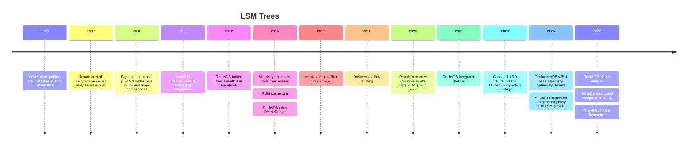
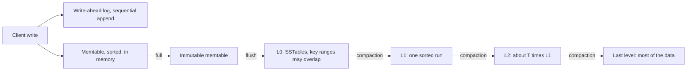
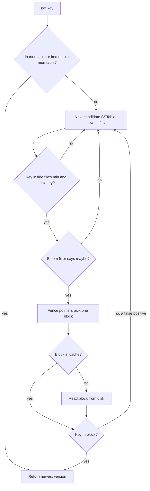
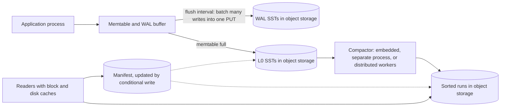

---
tags:
  - distributed-systems
  - storage
  - lsm-tree
  - storage-engines
status: draft
sources:
  - https://www.cs.umb.edu/~poneil/lsmtree.pdf
  - https://static.googleusercontent.com/media/research.google.com/en//archive/bigtable-osdi06.pdf
  - https://opensource.googleblog.com/2011/07/leveldb-fast-persistent-key-value-store.html
  - https://www.eecg.utoronto.ca/~stumm/Papers/Dong-Fast-21.pdf
  - https://users.cs.utah.edu/~pandey/courses/cs6530/fall22/papers/indexdesign/rum.pdf
  - https://files.usenix.org/s3fs-public/cdn/fast16-papers-lu.pdf
  - https://cs-people.bu.edu/mathan/publications/sigmod17-dayan.pdf
  - https://scholar.harvard.edu/files/stratos/files/dostoevskykv.pdf
  - https://github.com/facebook/rocksdb/wiki/Leveled-Compaction
  - https://github.com/facebook/rocksdb/wiki/Universal-Compaction
  - https://rocksdb.org/blog/2015/07/23/dynamic-level.html
  - https://rocksdb.org/blog/2021/05/26/integrated-blob-db.html
  - https://rocksdb.org/blog/2026/06/20/blob-direct-write-partitioned-blob-files.html
  - https://github.com/meta/rocksdb/releases
  - https://github.com/meta/rocksdb/releases/tag/v11.13.2
  - https://newreleases.io/project/github/facebook/rocksdb/release/v11.0.4
  - https://www.cockroachlabs.com/blog/pebble-rocksdb-kv-store/
  - https://docs.cockroachlabs.com/docs/stable/architecture/storage-layer.md
  - https://www.cockroachlabs.com/blog/value-separation-pebble-optimization
  - https://cockroachlabs.com/blog/value-separation-cockroachdb-25-3-improved-performance
  - https://pkg.go.dev/github.com/cockroachdb/pebble/v2/objstorage@v2.1.0
  - https://docs.pingcap.com/tidb/dev/titan-overview/
  - https://tikv.org/blog/rocksdb-in-tikv/
  - https://docs.yugabyte.com/preview/architecture/key-concepts/
  - https://cassandra.apache.org/doc/latest/cassandra/architecture/storage-engine.html
  - https://cassandra.apache.org/doc/latest/cassandra/managing/operating/compaction/tombstones.html
  - https://cassandra.apache.org/doc/latest/cassandra/managing/operating/compaction/ucs.html
  - https://cassandra.apache.org/_/blog/Apache-Cassandra-5.0-Features-Unified-Compaction-Strategy.html
  - https://docs.scylladb.com/manual/stable/architecture/compaction/compaction-strategies.html
  - https://hbase.apache.org/book.html
  - https://github.com/rockset/rocksdb-cloud
  - https://openai.com/index/openai-acquires-rockset/
  - https://www.jack-vanlightly.com/analyses/2023/11/15/neon-serverless-postgresql-asds-chapter-3
  - https://github.com/slatedb/slatedb
  - https://github.com/slatedb/slatedb/releases
  - https://slatedb.io/
  - https://slatedb.io/docs/design/overview/
  - https://slatedb.io/blog/introducing-slatedb/
  - https://slatedb.io/blog/segment-oriented-compaction/
  - https://slatedb.io/blog/compaction-roadmap/
  - https://slatedb.io/blog/benchmarking-slatedb/
  - https://people.iiis.tsinghua.edu.cn/~huanchen/publications/ecotune-sigmod25.pdf
  - https://arxiv.org/pdf/2504.17178
  - https://arxiv.org/html/2507.09642v1
  - https://www.usenix.org/conference/fast26/presentation/ren
  - https://rmarcus.info/dbscholar/papers/hddfd005d29d7b6da
  - https://arxiv.org/abs/2603.05439
  - https://vldb.org/2026/program.html
  - https://www.vldb.org/pvldb/vol19/p3786-zablotchi.pdf
  - https://en.wikipedia.org/wiki/Log-structured_merge-tree
created: 2026-11-26
updated: 2026-11-26
---

## Table Of Contents

---

- [[#TL;DR|TL;DR]]
- [[#The Problem|The Problem]]
- [[#Foundations|Foundations]]
    - [[#Out-of-Place Updates|Out-of-Place Updates]]
    - [[#Three Kinds of Amplification|Three Kinds of Amplification]]
    - [[#The RUM Conjecture|The RUM Conjecture]]
- [[#How We Got Here|How We Got Here]]
- [[#How It Works|How It Works]]
    - [[#The Write Path|The Write Path]]
    - [[#The Read Path|The Read Path]]
    - [[#Compaction Strategies|Compaction Strategies]]
    - [[#The Amplification Math|The Amplification Math]]
    - [[#Deletes and Tombstones|Deletes and Tombstones]]
    - [[#Key-Value Separation|Key-Value Separation]]
    - [[#Tuning the Shape: Monkey and Dostoevsky|Tuning the Shape: Monkey and Dostoevsky]]
    - [[#LSM vs B-Tree|LSM vs B-Tree]]
    - [[#Why Distributed Databases Sit on LSMs|Why Distributed Databases Sit on LSMs]]
    - [[#LSMs on Object Storage|LSMs on Object Storage]]
- [[#Where It Is Now|Where It Is Now]]
    - [[#RocksDB|RocksDB]]
    - [[#Pebble and the Distributed SQL Engines|Pebble and the Distributed SQL Engines]]
    - [[#SlateDB and Object-Native LSMs|SlateDB and Object-Native LSMs]]
    - [[#Research in 2025 and 2026|Research in 2025 and 2026]]
- [[#Trade-offs & Open Problems|Trade-offs & Open Problems]]
- [[#Resources|Resources]]
- [[#Related Notes|Related Notes]]

## ***TL;DR***
---
*An LSM tree (log-structured merge tree) turns random writes into sequential ones: it buffers writes in memory, dumps them to disk as immutable sorted files, and merges those files in the background. It is the storage engine under most distributed databases built since Bigtable, and its whole design space is a trade between write, read and space amplification.*

- **The idea:** never update data in place. Put each write in a log and an in-memory sorted table (the *memtable*); when the memtable fills, write it out as a sorted, immutable file (an *SSTable*); merge files later (*compaction*). O'Neil et al. proposed it in 1996 because B-tree index maintenance roughly doubled the disk cost of insert-heavy transaction workloads ([O'Neil et al., 1996](https://www.cs.umb.edu/~poneil/lsmtree.pdf)).
- **The costs:** a key's latest value may be in any of several files, so reads check several places (*read amplification*); compaction rewrites the same bytes many times (*write amplification*); stale versions sit on disk until merged away (*space amplification*). The RUM conjecture says you can't minimize all three at once ([Athanassoulis et al., 2016](https://users.cs.utah.edu/~pandey/courses/cs6530/fall22/papers/indexdesign/rum.pdf)).
- **The knobs:** compaction strategy (*leveled* favors reads and space, *tiered* favors writes), the size ratio $T$ between levels, Bloom filter bits, and whether large values live outside the tree (*key-value separation*, from WiscKey).
- **Lineage:** Bigtable (2006) → LevelDB (2011) → RocksDB (2012) → CockroachDB's Pebble (2020); Cassandra, HBase and ScyllaDB in parallel. TiKV, YugabyteDB's DocDB and CockroachDB all keep each replica's data in an LSM ([[Distributed SQL]]).
- **Now (Nov 2026):** RocksDB is on the 11.x line (11.13.2, October 2026) and is adding blob direct writes; Pebble separates values of 256 bytes or more by default from CockroachDB v25.4; SlateDB, an LSM that lives entirely in [[Object Storage|object storage]], reached v0.18.1 in November 2026 with distributed compaction; research has moved to disaggregated LSMs and to compaction as a scheduling problem.

## ***The Problem***
---
*Indexes that update in place pay a random disk write for every insert. When inserts dominate, that cost swamps everything else; the LSM tree trades some read cost to make writes cheap and sequential.*

O'Neil, Cheng, Gawlick and O'Neil's motivating example was a TPC-A-style bank: each transaction appends a row to a History table, and you want an index on `Acct-ID || Timestamp` so recent account activity can be queried. A B-tree on that index adds about 2,000 random I/Os per second at 1,000 transactions per second, which in their words "will effectively double the I/O cost of the transaction" ([O'Neil et al., 1996](https://www.cs.umb.edu/~poneil/lsmtree.pdf)). In 1996, disk arms were the expensive resource: their cost model put the B-tree's disks at about \$56,400 against about \$11,400 for a two-component LSM tree, a five-fold saving, and the gap widened to two orders of magnitude at higher insert rates.

The fix is to *defer and batch* index changes. A random write to a B-tree touches one leaf page for one key. An LSM tree collects thousands of keys in memory, sorts them, and writes them out as one long sequential run, then merges runs "reminiscent of merge sort." The same reasoning still holds on flash: SSDs prefer large sequential writes, and RocksDB's early priority was cutting write amplification to save flash erase cycles ([Dong et al., FAST 2021](https://www.eecg.utoronto.ca/~stumm/Papers/Dong-Fast-21.pdf)).

| Workload need | B-tree (update in place) | LSM tree (out of place) |
|---|---|---|
| High insert or update rate | Random page writes per key | Sequential batched writes |
| Point reads | One root-to-leaf path | Memtable plus several files, filtered by Bloom filters |
| Space | Pages partly empty after splits | Old versions until compaction |
| Snapshots, backups, shipping data | Need copy-on-write or locking | Files are immutable, so a set of files *is* a snapshot |

The last row is why LSMs matter for distributed systems in particular: immutable files are easy to replicate, ship between nodes and put on [[Object Storage|object storage]].

## ***Foundations***
---
*Three ideas carry the rest of the note: updates go to new places instead of overwriting old ones, the cost of that shows up as three kinds of amplification, and no design can make all three small at once.*

### Out-of-Place Updates

*An LSM never modifies a file once written. A newer version of a key simply shadows the older one, and a later merge throws the older one away.*

- **Write:** append to the log, insert into the memtable. No disk read is needed, so a write never waits for a page to be fetched.
- **Read:** look in the newest place first and stop at the first version found. The newest version wins.
- **Update and delete:** both are just newer writes. A delete writes a *tombstone*, a marker that says "this key is gone as of now" ([Bigtable, §5.4](https://static.googleusercontent.com/media/research.google.com/en//archive/bigtable-osdi06.pdf)).
- **Garbage:** shadowed versions and tombstones stay on disk until compaction merges the files that hold them.

This is the same idea as a log-structured file system or as [[CRDTs|tombstones in CRDTs]]: keep writes cheap by appending, and pay later to clean up.

### Three Kinds of Amplification

*Every storage engine is judged by how many bytes it moves or stores per byte the user asked for. LSM tuning is the art of moving cost between these three ratios.*

| Ratio | Definition | What drives it in an LSM |
|---|---|---|
| **Write amplification (WA)** | Bytes written to storage ÷ bytes the user wrote | Compaction rewriting the same key at every level |
| **Read amplification (RA)** | Data read (including index and filter blocks) ÷ data returned | Number of files a lookup must check |
| **Space amplification (SA)** | Space on disk ÷ size of live data | Stale versions and tombstones not yet compacted |

The RUM paper defines the same three as *update*, *read* and *memory* overhead ([Athanassoulis et al., 2016](https://users.cs.utah.edu/~pandey/courses/cs6530/fall22/papers/indexdesign/rum.pdf)). They're not academic: WiscKey measured LevelDB at a write amplification of 14 and read amplification of 327 on a 100 GB database ([Lu et al., FAST 2016](https://files.usenix.org/s3fs-public/cdn/fast16-papers-lu.pdf)).

### The RUM Conjecture

*Athanassoulis and colleagues argued that read, update and memory overhead form a triangle: pin two, and the third has a floor. LSM trees sit in the update-optimized corner.*

The conjecture, stated in the EDBT 2016 paper: "An access method that can set an upper bound for two out of the read, update, and memory overheads, also sets a lower bound for the third overhead" ([Athanassoulis et al., 2016](https://users.cs.utah.edu/~pandey/courses/cs6530/fall22/papers/indexdesign/rum.pdf)). The paper places LSM trees among *write-optimized differential structures*: they buy cheap updates with extra read and space cost. B-trees sit toward the read-optimized corner, hash tables and plain logs at other extremes.

*In words:* there's no free lunch. *Example:* make writes cheaper by compacting less often (tiering), and either reads check more files or you spend more memory on Bloom filters to avoid those checks. Compact eagerly (leveling) and reads get cheaper, but each byte is rewritten more times.

## ***How We Got Here***
---
*The LSM tree was a 1996 paper about disk arms. Bigtable made it the storage engine of a distributed database, LevelDB and RocksDB made it a reusable library, and the last decade has been about tuning it, separating values from keys, and moving it onto object storage.*

**The paper (1996).** O'Neil et al. described a small in-memory tree $C_0$ and a larger disk tree $C_1$ whose leaves are packed full and written in multi-page blocks. A *rolling merge* cursor sweeps through the key space, merging a slice of $C_0$ into $C_1$ and writing the merged blocks to new locations, so the old ones stay valid for recovery ([O'Neil et al.](https://www.cs.umb.edu/~poneil/lsmtree.pdf)). With more components $C_0 \dots C_k$ the cost falls further. A 1997 VLDB paper by Jagadish et al. introduced the *stepped-merge* variant, which lets several runs accumulate before merging, an early form of tiering ([Wikipedia](https://en.wikipedia.org/wiki/Log-structured_merge-tree)).

**Bigtable (2006).** Google's Bigtable gave the design the vocabulary everyone still uses. Recent writes sit "in memory in a sorted buffer called a memtable" backed by a commit log; a *minor compaction* freezes the memtable and writes it out as an SSTable; a *merging compaction* combines a few SSTables; a *major compaction* rewrites all of a tablet's SSTables into one and drops deletion markers. Bloom filters let most lookups for missing rows skip disk, and a block cache and scan cache sit above the files ([Chang et al., OSDI 2006](https://static.googleusercontent.com/media/research.google.com/en//archive/bigtable-osdi06.pdf)). The coordination around it, a single master elected through Chubby, is covered in [[Coordination Services]]. HBase reproduces the same pieces under different names: MemStore, HFiles, a WAL, and minor and major compactions ([HBase book](https://hbase.apache.org/book.html)).

**LevelDB (2011).** Jeff Dean and Sanjay Ghemawat open-sourced LevelDB in July 2011; each Bigtable tablet was stored using "a precursor to LevelDB," and Chrome's IndexedDB was built on it ([Google Open Source Blog, 2011](https://opensource.googleblog.com/2011/07/leveldb-fast-persistent-key-value-store.html)). LevelDB introduced the *leveled* layout most engines now default to: levels growing about 10x each, every level past L0 holding one sorted run ([Lu et al.](https://files.usenix.org/s3fs-public/cdn/fast16-papers-lu.pdf)).

**RocksDB (2012).** Facebook forked LevelDB in 2012 for SSDs and server workloads. Its priorities moved from write amplification (flash wear) to space amplification (most deployments ran out of disk before wearing it out) and then to CPU. It became the engine under MyRocks, CockroachDB (until Pebble), TiDB, Kafka Streams, Flink and many more ([Dong et al., FAST 2021](https://www.eecg.utoronto.ca/~stumm/Papers/Dong-Fast-21.pdf)). The codebase grew from LevelDB's roughly 30k lines to over 350k ([Mattis, 2020](https://www.cockroachlabs.com/blog/pebble-rocksdb-kv-store/)).

**Tuning and separation (2016–2018).** WiscKey showed that most compaction traffic in large-value workloads is values being copied for no reason, and moved values to a separate log ([Lu et al., FAST 2016](https://files.usenix.org/s3fs-public/cdn/fast16-papers-lu.pdf)). The Harvard DASlab line of work (RUM, Monkey, Dostoevsky) turned LSM design into a cost model with knobs you can solve for.

**Pebble (2020).** Cockroach Labs rewrote RocksDB's core in Go, compatible with RocksDB 6.2.1's file formats so clusters could migrate both ways. Reasons: the cost and opacity of calling C++ from Go, high-severity RocksDB bugs in a codebase they didn't own, and features they kept working around. Pebble was opt-in in 20.1 and the default in 20.2 ([Mattis, 2020](https://www.cockroachlabs.com/blog/pebble-rocksdb-kv-store/)).

## ***How It Works***
---
*A write lands in a log and a memtable, gets flushed to an immutable SSTable, and is merged down through levels by compaction. A read checks the same places newest-first, using Bloom filters and in-memory indexes to skip most of them. Everything else is a choice of how aggressively to merge.*

### The Write Path

*Writes are a log append plus an in-memory insert. Disk work happens later and in bulk.*

1. **Log:** the write is appended to the WAL ([[Write-Ahead Logging]]) so it survives a crash. In Pebble, each WAL corresponds one-to-one with a memtable ([CockroachDB docs](https://docs.cockroachlabs.com/docs/stable/architecture/storage-layer.md)). Cassandra calls this the commit log ([Cassandra docs](https://cassandra.apache.org/doc/latest/cassandra/architecture/storage-engine.html)).
2. **Memtable:** the write is inserted into a sorted in-memory structure, typically a skip list ([SlateDB design overview](https://slatedb.io/docs/design/overview/)).
3. **Flush:** when the memtable reaches its size limit it is frozen, a fresh memtable takes new writes, and the frozen one is written as an SSTable in L0. Once flushed, its WAL can be dropped. Bigtable calls this a minor compaction; it "shrinks the memory usage" and "reduces the amount of data that has to be read from the commit log during recovery" ([Bigtable, §5.4](https://static.googleusercontent.com/media/research.google.com/en//archive/bigtable-osdi06.pdf)).
4. **Compaction:** background threads merge SSTables, keeping the newest version of each key and dropping what's shadowed. SSTables "are immutable; they are never modified, even during the compaction process" ([CockroachDB docs](https://docs.cockroachlabs.com/docs/stable/architecture/storage-layer.md)): a compaction writes new files and then atomically swaps the file set in a manifest.

**Why L0 is special.** Each flush produces a file covering whatever keys were in the memtable, so L0 files overlap each other. Every deeper level is one sorted run split into non-overlapping files by key range ([RocksDB wiki](https://github.com/facebook/rocksdb/wiki/Leveled-Compaction)). Too many L0 files means every read checks all of them, which is why engines stall or slow writes when L0 grows.

**An SSTable's anatomy.** Data blocks of sorted key-value pairs, an index from keys to blocks, a Bloom filter, and metadata. Cassandra's SSTable components show this directly: `Data.db`, an index from partition keys to positions in `Data.db`, a summary sampling every 128th index entry, and `Filter.db`, "A Bloom Filter of the partition keys in the SSTable" ([Cassandra docs](https://cassandra.apache.org/doc/latest/cassandra/architecture/storage-engine.html)).

### The Read Path

*A point lookup checks the memtable, then each candidate file newest-first, and stops at the first hit. Bloom filters and fence pointers make most of those checks free.*

- **Key range check:** each file's smallest and largest key are kept in memory, so files that can't hold the key are skipped ([SlateDB design overview](https://slatedb.io/docs/design/overview/)). In leveled compaction, at most one file per level past L0 qualifies.
- **[[Bloom and Range Filters|Bloom filters]]:** a compact bitmap per file (or per block) that answers "definitely not here" or "maybe here." Bigtable added them so that "most lookups for non-existent rows or columns do not need to touch disk" ([Bigtable, §6](https://static.googleusercontent.com/media/research.google.com/en//archive/bigtable-osdi06.pdf)).
- **Fence pointers:** the in-memory index of each file's blocks, storing the first key of each block, so a lookup reads exactly one block per file it checks ([Dayan et al., SIGMOD 2017](https://cs-people.bu.edu/mathan/publications/sigmod17-dayan.pdf)).
- **Block cache:** recently read blocks stay in memory. Bigtable had both a block cache of SSTable blocks and a higher-level cache of key-value pairs ([Bigtable, §6](https://static.googleusercontent.com/media/research.google.com/en//archive/bigtable-osdi06.pdf)).
- **Range scans** can't use Bloom filters (range filters like SuRF and Rosetta can; see [[Bloom and Range Filters]]). They open an iterator on every level and merge them, so scan cost grows with the number of sorted runs.

The Bloom filter false-positive rate with $b$ bits per key (and the optimal number of hash functions) is

$$
\text{FPR} \approx e^{-b \,(\ln 2)^2}
$$

*In words:* every extra bit per key cuts false positives by roughly a factor of 1.6. *Example:* at the common default of 10 bits per key, $\text{FPR} \approx e^{-10 \times 0.48} \approx 0.82\%$; at 5 bits it's about 9%. A lookup for a missing key across 8 candidate files then costs about $8 \times 0.0082 \approx 0.07$ wasted disk reads with 10 bits, against $0.72$ with 5 bits. Dostoevsky notes mainstream systems default to about 10 bits per entry ([Dayan and Idreos, SIGMOD 2018](https://scholar.harvard.edu/files/stratos/files/dostoevskykv.pdf)).

### Compaction Strategies

*Compaction decides when files get merged and how many sorted runs each level may hold. Leveled keeps one run per level (cheap reads, more rewriting); tiered lets runs pile up (cheap writes, more reading); everything else is a mix.*

| Strategy | Runs per level | How merging works | Write amp | Read cost | Space amp | Used by |
|---|---|---|---|---|---|---|
| **Leveled** | 1 | Push a file from level $i$ into the overlapping files of level $i+1$ | High: about 10–30 in RocksDB | Low: one file per level | Low: about 1.1x | LevelDB, RocksDB default, Pebble, Cassandra LCS |
| **Size-tiered / tiered** | Up to $T$ | Merge runs of similar size into one bigger run | Low: about 4–10 in RocksDB | Higher: many runs | Higher; full merges can double disk use | Cassandra STCS, ScyllaDB STCS and ICS |
| **Universal** (RocksDB's tiered) | Many, ordered by age | Merge adjacent runs when counts or size ratios trigger | Low | Varies, spiky | Bounded by `max_size_amplification_percent` | RocksDB for write-heavy data |
| **FIFO** | n/a | Delete the oldest files at a size limit; no merging | 1 | Many files | Bounded by the limit | TTL data, caches |
| **Hybrid: lazy leveling, UCS** | Tiered at top, leveled at bottom, or tunable | Varies | Between the two | Between the two | Near leveled | Dostoevsky, Cassandra UCS |

Sources: RocksDB's FAST paper reports leveled write amplification of 10–30 against 4–10 for tiered, and a microbenchmark of 16.07 vs 4.8 ([Dong et al.](https://www.eecg.utoronto.ca/~stumm/Papers/Dong-Fast-21.pdf)); [RocksDB leveled](https://github.com/facebook/rocksdb/wiki/Leveled-Compaction) and [universal](https://github.com/facebook/rocksdb/wiki/Universal-Compaction) wikis; [ScyllaDB docs](https://docs.scylladb.com/manual/stable/architecture/compaction/compaction-strategies.html); [Cassandra UCS docs](https://cassandra.apache.org/doc/latest/cassandra/managing/operating/compaction/ucs.html).

**Leveled in practice (RocksDB).** A level's *score* is its size divided by its target; the highest score compacts first. L0 is scored by file count against `level0_file_num_compaction_trigger`, and an L0 compaction usually takes all L0 files because they overlap. With `level_compaction_dynamic_level_bytes` (the default since RocksDB 8.4), targets are computed bottom-up from the last level's actual size, so about 90% of the data sits in the last level ([RocksDB wiki](https://github.com/facebook/rocksdb/wiki/Leveled-Compaction)). That gave a steady space overhead of about 12% in RocksDB's experiments, where LevelDB-style static targets ranged from 12% to 26% ([Dong et al.](https://www.eecg.utoronto.ca/~stumm/Papers/Dong-Fast-21.pdf)).

**Universal in practice.** RocksDB suggests trying it "if leveled compaction is not able to handle the required write rate." Runs are merged only with neighbors in age order; space amplification is estimated as everything but the oldest run divided by the oldest run, and a full compaction is triggered when it exceeds `max_size_amplification_percent`. Full compactions can temporarily double disk use ([RocksDB wiki](https://github.com/facebook/rocksdb/wiki/Universal-Compaction)).

**Cassandra's Unified Compaction Strategy (UCS).** Added in Cassandra 5.0, UCS folds leveled and tiered into one scaling parameter $w$: $w < 0$ behaves leveled with fanout $f = 2 - w$, $w > 0$ behaves tiered with $f = 2 + w$ and threshold $t = f$, and $w = 0$ is where the two coincide. It also shards SSTables at fixed token boundaries so compactions run in parallel, and parameters can change without a full recompaction ([Cassandra UCS docs](https://cassandra.apache.org/doc/latest/cassandra/managing/operating/compaction/ucs.html); [Cassandra blog, Oct 2023](https://cassandra.apache.org/_/blog/Apache-Cassandra-5.0-Features-Unified-Compaction-Strategy.html)).

**ScyllaDB's Incremental Compaction Strategy (ICS)** behaves like size-tiered but builds runs from many small fragments, so a merge frees input space as it goes; the docs say it "eliminates the high temporary space amplification problem of STCS" ([ScyllaDB docs](https://docs.scylladb.com/manual/stable/architecture/compaction/compaction-strategies.html)).

### The Amplification Math

*With size ratio $T$ and $L$ levels, leveling rewrites each byte up to about $T$ times per level, while tiering writes it about once per level but leaves up to $T$ runs per level to read. That one difference explains the table above.*

The number of levels grows logarithmically with data size $N$ over the in-memory buffer size $M$:

$$
L \approx \left\lceil \log_T \frac{N}{M} \right\rceil
$$

Worst-case write cost per entry (Monkey's analysis, in units of a block of $B$ entries) ([Dayan et al., SIGMOD 2017](https://cs-people.bu.edu/mathan/publications/sigmod17-dayan.pdf)):

$$
W_{\text{leveling}} = O\!\left(\frac{T \cdot L}{B}\right), \qquad W_{\text{tiering}} = O\!\left(\frac{L}{B}\right)
$$

and Bloom-filtered lookups for a missing key cost $O(L \cdot e^{-M_f/N})$ with leveling and $O(T \cdot L \cdot e^{-M_f/N})$ with tiering, where $M_f$ is the memory given to filters.

*In words:* leveling merges a byte into a full level each time it moves down, so each move rewrites up to $T$ bytes of the level below; tiering only merges runs of similar size, so each byte is copied once per level, but a level can hold up to $T$ runs that reads must check. WiscKey puts the leveled number plainly: "the write amplification of moving a file across two levels can be up to 10," and over 50 across LevelDB's levels ([Lu et al.](https://files.usenix.org/s3fs-public/cdn/fast16-papers-lu.pdf)). Cassandra's UCS docs model leveled write amplification as proportional to $(f - 1)$ times the number of levels, and tiered as proportional to the number of levels ([UCS docs](https://cassandra.apache.org/doc/latest/cassandra/managing/operating/compaction/ucs.html)).

**Worked example: 1 TB, size ratio 10.** Take $T = 10$, L1 = 1 GB, so L2 = 10 GB, L3 = 100 GB and L4 = 1 TB holds the data ($L = 4$ levels below L0). Each user byte is written once to the WAL and once at flush.

| | Leveled | Tiered ($T = 10$) |
|---|---|---|
| Write amp, worst case | $2 + 10 \times 4 = 42$ | $2 + 4 = 6$ |
| Write amp, typical | Merges usually overlap only part of the next level, so roughly half: $\approx 2 + 5 \times 4 = 22$ | $\approx 6$ |
| What RocksDB reports | 10–30; 16.07 measured | 4–10; 4.8 measured |
| Sorted runs a point read may check (plus L0 files) | 4 | up to $10 \times 4 = 40$ |
| Wasted reads for a missing key at 10 bits per key | $\approx 4 \times 0.0082 = 0.03$ | $\approx 40 \times 0.0082 = 0.33$ |
| Space amp with a full last level | $\frac{1000 + 100 + 10 + 1}{1000} \approx 1.11$ | Up to about 2 before a full merge |

The "half" in the typical row is a rule of thumb, not a sourced constant; the reported figures are RocksDB's ([Dong et al.](https://www.eecg.utoronto.ca/~stumm/Papers/Dong-Fast-21.pdf)). The 1.11 space figure is RocksDB's own example for a last level of 1000 GB; if the last level's target were 1000 GB but only 200 GB of data existed, static targets would give $\frac{200 + 100 + 10 + 1}{200} \approx 1.56$, which is the problem dynamic level sizing fixes ([RocksDB blog, 2015](https://rocksdb.org/blog/2015/07/23/dynamic-level.html)).

At the scale of a disk, write amplification of 22 means a node ingesting 50 MB/s of user writes is pushing about 1.1 GB/s through its SSD, which is why compaction falling behind is the classic LSM failure.

### Deletes and Tombstones

*A delete is a write. The tombstone has to outlive every older copy of the key it hides, on this node and on every replica, or the deleted value comes back.*

- **Point tombstone:** a marker for one key. Reads that find it return "not found" and stop.
- **Range tombstone:** one marker covering a key range, so deleting a million keys doesn't write a million markers. RocksDB added `DeleteRange()` in 2016, and lists the read cost of long stretches of deletion markers as an open problem ([Dong et al.](https://www.eecg.utoronto.ca/~stumm/Papers/Dong-Fast-21.pdf)). Pebble reworked range deletions so iterators can skip whole deleted spans ([Mattis, 2020](https://www.cockroachlabs.com/blog/pebble-rocksdb-kv-store/)).
- **When a tombstone can be dropped:** only when compaction reaches a point where no older version can exist below it, in practice the bottom level. Bigtable's non-major compactions keep deletion entries; a major compaction removes them and the data they hide, which is also how it purges sensitive data on schedule ([Bigtable, §5.4](https://static.googleusercontent.com/media/research.google.com/en//archive/bigtable-osdi06.pdf)).

**The distributed twist: zombies.** In a replicated store, a tombstone must also reach every replica before anyone forgets it. Cassandra keeps tombstones for `gc_grace_seconds`, 864000 seconds (ten days) by default; if a node is down longer than that, after the others purge the tombstone "its deleted data will be repaired back to the other nodes and reappear in the cluster." Even after the grace period, tombstones only disappear when a compaction includes every SSTable holding older data for that partition ([Cassandra tombstones docs](https://cassandra.apache.org/doc/latest/cassandra/managing/operating/compaction/tombstones.html)). This couples storage engine housekeeping to [[Anti-Entropy and Repair|repair]] and to the clocks that order versions ([[Time and Clocks]]).

*Worked example:* three replicas A, B, C hold `k = v1`. C goes offline on day 0. A client deletes `k` on day 1; A and B write tombstones. On day 12, A and B compact and drop the tombstone and `v1` (grace of 10 days has passed). C rejoins on day 13 with `k = v1` and no tombstone; anti-entropy sees C has data the others lack and copies `v1` back. The delete is undone.

### Key-Value Separation

*Most compaction work in a large-value workload is copying values that didn't change. Keep the values in a separate log and let compaction move only keys and pointers.*

WiscKey stores each value in an append-only *value log* (vLog) and puts only the key and a pointer in the LSM tree. The tree becomes small enough to mostly fit in memory, so compaction and lookups get much cheaper: WiscKey loaded databases 2.5x–111x faster than LevelDB and did random lookups 1.6x–14x faster ([Lu et al., FAST 2016](https://files.usenix.org/s3fs-public/cdn/fast16-papers-lu.pdf)). The cost moves to garbage collection: a GC pass reads a chunk from the vLog's tail, asks the tree which values are still live, appends those to the head, syncs, records the new tail and frees the old space.

| Implementation | Where | How garbage is reclaimed | Notable numbers |
|---|---|---|---|
| **WiscKey** | Research, FAST 2016 | Tail-to-head copying of live values | Load 2.5x–111x faster than LevelDB |
| **Integrated BlobDB** | RocksDB, 2021 | Inside compaction: blobs in the oldest 25% of blob files are relocated by default (`blob_garbage_collection_age_cutoff`) | Overwrite write amp 1.4–1.7 vs 6.1–6.8 for leveled |
| **Titan** | TiKV plugin, default for new TiDB clusters since v7.6.0 | Discardable-size tracking per blob file, plus rewrites during compaction of the bottom levels | Update QPS up from 17,913 to 30,767 at 1 KB; scans 40% to several times slower |
| **Pebble value separation** | CockroachDB, default from v25.4 for values ≥ 256 bytes | Blob-file rewrite compactions copy only live values, tracked by per-SSTable liveness bitmaps | About 47% more throughput on a 4 KiB-value benchmark |

Sources: [RocksDB blog, May 2021](https://rocksdb.org/blog/2021/05/26/integrated-blob-db.html); [PingCAP Titan docs](https://docs.pingcap.com/tidb/dev/titan-overview/); [Owens and Pompa, Cockroach Labs](https://www.cockroachlabs.com/blog/value-separation-pebble-optimization).

**What it costs.** Reads take an extra indirection, range scans lose locality (keys are sorted, values aren't), and space amplification grows until GC catches up. CockroachDB's docs put it at about 50% less write amplification for about 20% more space amplification ([CockroachDB docs](https://docs.cockroachlabs.com/docs/stable/architecture/storage-layer.md)); PingCAP tells Titan users to plan for up to twice RocksDB's disk use ([Titan docs](https://docs.pingcap.com/tidb/dev/titan-overview/)). Pebble bounds the read cost by tracking each SSTable's *blob reference depth*, the number of blob files a scan of it would touch, and rewriting blob files when it grows too large ([Owens and Pompa](https://www.cockroachlabs.com/blog/value-separation-pebble-optimization)).

### Tuning the Shape: Monkey and Dostoevsky

*Two results from Harvard's DASlab showed that the default LSM shape wastes resources: Bloom filter memory is spread evenly when it should be skewed, and most merging at the small levels buys almost nothing.*

**Monkey (SIGMOD 2017).** Engines give every file the same bits per key. But the last level holds most of the entries, so extra bits there buy little, while the same memory at small levels drives their false positives toward zero. Monkey sets each level's false-positive rate proportional to its number of entries, so "the false positive rates for shallower levels are exponentially decreasing." That "shaves a factor of O(L) from the worst-case lookup cost," making missing-key lookups roughly independent of the number of levels, and cut lookup latency 50%–80% on LevelDB ([Dayan et al.](https://cs-people.bu.edu/mathan/publications/sigmod17-dayan.pdf)).

*Example:* 4 levels, 10 bits per key everywhere gives $4 \times 0.82\% \approx 3.3\%$ summed false-positive rate. Monkey keeps the same total memory but gives the 1 TB last level slightly fewer bits and the 1, 10 and 100 GB levels many more, so their rates fall by factors of 10 each and the sum is dominated by the last level's single rate.

**Dostoevsky (SIGMOD 2018).** Point lookups, long range scans and space amplification are dominated by the *largest* level, while update cost comes from every level about equally. So merging eagerly at small levels costs writes and buys almost nothing. *Lazy leveling* tiers every level except the last and levels only the last: update cost drops to $O((L + T)/B)$ from leveling's $O(L \cdot T / B)$, while missing-key lookups and space amplification match leveling. Its *Fluid LSM-tree* generalizes this with two bounds, $K$ runs at the upper levels and $Z$ at the last ($K = Z = 1$ is leveling, $K = Z = T - 1$ is tiering, $K = T - 1, Z = 1$ is lazy leveling) ([Dayan and Idreos](https://scholar.harvard.edu/files/stratos/files/dostoevskykv.pdf)). Cassandra's UCS and RocksDB's mixed policies are production cousins of this idea.

### LSM vs B-Tree

*B-trees update in place and are read-optimized; LSMs update out of place and are write-optimized. Neither wins everywhere, and modern engines borrow from both.*

| | B-tree / B+-tree | LSM tree |
|---|---|---|
| Update | Read the leaf page, modify, write the page back (random I/O) | Append to log and memtable; disk work deferred and batched |
| Write amplification | A whole page per small change, plus WAL | Repeated compaction rewrites; 10–30 leveled, 4–10 tiered |
| Point read | One root-to-leaf path, usually 1 I/O with cached inner nodes | Memtable plus a file per level, mostly filtered by Bloom filters |
| Range scan | Walk sibling leaves | Merge iterators across all runs |
| Space | Fragmentation from splits and partly full pages | Stale versions and tombstones until compacted |
| Latency | Predictable | Background compaction competes with foreground work; stalls when it falls behind |
| Concurrency and recovery | Latching, page-level logging | Immutable files: snapshots and checkpoints are cheap |
| Typical home | PostgreSQL, InnoDB, most single-node OLTP | Bigtable, Cassandra, RocksDB, Pebble, most distributed KV layers |

O'Neil et al. pitched the LSM for insert-heavy indexes, accepting that "immediate-response finds lose some I/O efficiency" ([O'Neil et al.](https://www.cs.umb.edu/~poneil/lsmtree.pdf)); RUM puts B-trees and LSMs in different corners of the same triangle ([Athanassoulis et al.](https://users.cs.utah.edu/~pandey/courses/cs6530/fall22/papers/indexdesign/rum.pdf)). The latency row is real: in RocksDB's BlobDB benchmarks, leveled and universal compaction stalled writes roughly 40% to 70% of the time during an overwrite workload ([RocksDB blog, 2021](https://rocksdb.org/blog/2021/05/26/integrated-blob-db.html)).

### Why Distributed Databases Sit on LSMs

*Distributed databases are mostly write-heavy, range-partitioned and built from replicated logs. LSMs match all three, and immutable files make moving data between nodes cheap.*

- **One embedded engine per node, many ranges inside it.** TiKV runs two RocksDB instances per node, one for data and one for the Raft log, rather than one per Region ([Tang, 2020](https://tikv.org/blog/rocksdb-in-tikv/)). YugabyteDB's DocDB is "a highly customized and optimized version of" RocksDB ([Yugabyte docs](https://docs.yugabyte.com/preview/architecture/key-concepts/)). CockroachDB keeps all MVCC data in Pebble ([CockroachDB docs](https://docs.cockroachlabs.com/docs/stable/architecture/storage-layer.md)). See [[Distributed SQL]] for the layers above.
- **Ordered keys suit range [[Partitioning]].** A range is a key interval, which maps onto SSTable key ranges. TiKV uses SST table properties to decide Region splits and GC without scanning the Region ([Tang](https://tikv.org/blog/rocksdb-in-tikv/)).
- **Immutable files move well.** Rebalancing or adding a replica can build SSTables and *ingest* them instead of replaying writes; TiKV replaced a slow bulk-load path with SST ingestion ([Tang](https://tikv.org/blog/rocksdb-in-tikv/)), and Pebble supports ingestion and checkpoints natively ([Mattis](https://www.cockroachlabs.com/blog/pebble-rocksdb-kv-store/)).
- **MVCC is free-ish.** Versioned keys are just more keys; old versions disappear through compaction once outside the GC window. CockroachDB can only GC versions not covered by a *protected timestamp* held by a backup or changefeed ([CockroachDB docs](https://docs.cockroachlabs.com/docs/stable/architecture/storage-layer.md); [[Distributed Transactions]]).
- **The Raft log lives in the engine too.** CockroachDB's value separation stores Raft log values out-of-band even when small, because they are rarely read ([Owens and Pompa](https://www.cockroachlabs.com/blog/value-separation-pebble-optimization)). LSM-Raft (SIGMOD 2026) goes further and makes Raft replicate compacted SSTables as log units, so followers don't redo the leader's compaction ([Zhang et al.](https://rmarcus.info/dbscholar/papers/hddfd005d29d7b6da)). See [[Raft]] and [[Replication]].
- **[[Stream Processing|Stream processing]] state.** Kafka Streams, Flink and Samza keep operator state in RocksDB ([Dong et al.](https://www.eecg.utoronto.ca/~stumm/Papers/Dong-Fast-21.pdf); [[Logs and Streaming]]).

**The cost in a cluster:** compaction is invisible background work that competes with foreground reads on every replica. In Cassandra, background compaction measurably slows foreground reads, which is what the FAST 2026 HATS paper schedules around by steering reads away from compacting replicas ([Ren et al., FAST 2026](https://www.usenix.org/conference/fast26/presentation/ren)); see [[Gray and Fail-Slow Failures]]. CockroachDB flags an *inverted LSM* (more data in upper levels than lower) as a sign compaction has fallen behind, with "degraded read performance" and "excessive compaction debt," and treats read amplification below 10 as healthy ([CockroachDB docs](https://docs.cockroachlabs.com/docs/stable/architecture/storage-layer.md)).

### LSMs on Object Storage

*Immutable sorted files are exactly what object stores are good at holding. The hard parts are the 50–100 ms latency, per-request pricing, and the absence of file locks.*

- **SlateDB** writes everything, WAL included, to object storage. Object store requests take 50–100 ms and are metered at roughly \$0.40 per million reads and \$5 per million writes, so a naive 10,000 ops/s split evenly would cost about \$70K a month; SlateDB batches writes and makes the *flush interval* the knob between latency, PUT cost and durability. Its team tried running RocksDB's storage API on S3 and found that object stores lack the file locks, caching and links it assumes ([SlateDB blog, Jun 2026](https://slatedb.io/blog/introducing-slatedb/)). It is single-writer, multi-reader, with a "formally verified manifest fencing protocol" built on conditional writes ([slatedb.io](https://slatedb.io/); [[Leases and Fencing]]).
- **RocksDB-Cloud** is Rockset's fork of RocksDB that keeps the whole database in S3 and only the working set locally, with zero-copy clones between machines ([RocksDB-Cloud README](https://github.com/rockset/rocksdb-cloud)). OpenAI acquired Rockset in June 2024 ([OpenAI, 2024](https://openai.com/index/openai-acquires-rockset/)); the README still says the Rockset team maintains it, but I couldn't confirm recent activity.
- **Pebble** has a storage abstraction in which an SSTable or blob file can be local, *shared* (on remote storage, owned by one Pebble instance in the cluster and possibly used by several) or *external* (on remote storage, owned by none) ([Pebble objstorage docs](https://pkg.go.dev/github.com/cockroachdb/pebble/v2/objstorage@v2.1.0)).
- **Neon** (serverless Postgres) is LSM-like rather than a textbook LSM: its pageserver stores *delta layers* (an indexed WAL) over *image layers* (materialized pages at an LSN), replays deltas into new images, and uploads layer files of about 128–256 MB to S3 ([Vanlightly, 2023](https://www.jack-vanlightly.com/analyses/2023/11/15/neon-serverless-postgresql-asds-chapter-3)).

This is the storage side of [[Disaggregated Systems]]: compute nodes hold a cache, object storage holds the truth, and compaction becomes a job that can run anywhere.

## ***Where It Is Now***
---
*As of November 2026: RocksDB keeps shipping roughly monthly on its 11.x line and is pushing large values out of the write path; CockroachDB's Pebble has made value separation the default; object-native LSMs like SlateDB are maturing quickly but are still pre-1.0; and research is about disaggregated designs and compaction as a resource-scheduling problem.*

### RocksDB

*Still the reference engine. 2026 work is about blobs, async I/O and operational safety rather than new compaction styles.*

- **11.0 (23 February 2026):** removed long-deprecated APIs and dropped SST `format_version` below 2; added `AbortAllCompactions()`, wide-column values in blob files, FIFO compaction's `use_kv_ratio_compaction` for BlobDB workloads, interpolation search for index blocks and a `separate_key_value_in_data_block` table option. Universal compaction's `reduce_file_locking` now defaults to true, to cut write stalls ([11.0.x release notes](https://newreleases.io/project/github/facebook/rocksdb/release/v11.0.4)).
- **Blob direct write (blog, June 2026):** values above `min_blob_size` go straight to blob files at write time, with only a `BlobIndex` in the WAL and memtable, and blob files can be partitioned, for example by TTL bucket, so whole files expire together. The v1 can't recover unflushed blob state through WAL replay ([RocksDB blog, Jun 2026](https://rocksdb.org/blog/2026/06/20/blob-direct-write-partitioned-blob-files.html)).
- **11.8 (July to August 2026):** callback-based `DB::GetAsync()` and `DB::MultiGetAsync()` ([releases](https://github.com/meta/rocksdb/releases)).
- **11.12 to 11.13 (October 2026):** 11.12 added full-mode external table APIs and write-buffer flush policies; 11.13.0 (21 October) makes retryable I/O errors during flush or compaction a hard stop when auto-resume is disabled, and 11.13.1 and 11.13.2 (23 and 28 October, published on GitHub 4 November) fixed data-loss bugs where converting runs of deleted keys into range tombstones could delete live keys ([v11.13.2 notes](https://github.com/meta/rocksdb/releases/tag/v11.13.2)). A reminder that tombstone handling remains the sharpest edge in the engine.
- The project's GitHub releases now appear under `github.com/meta/rocksdb`; I couldn't confirm when or why it moved from `facebook/rocksdb`.

### Pebble and the Distributed SQL Engines

- **Pebble value separation** was a public preview in CockroachDB 25.3 (October 2025 announcement), and "by default CockroachDB in v25.4+ will separate values 256 bytes and larger automatically." The nightly kv0 benchmark with 4 KiB values gained about 47% throughput when it was turned on in late June 2025 ([Cockroach Labs, Oct 2025](https://cockroachlabs.com/blog/value-separation-cockroachdb-25-3-improved-performance); [Owens and Pompa, updated Jan 2026](https://www.cockroachlabs.com/blog/value-separation-pebble-optimization)). The v26.4 storage docs still show the `storage.value_separation.enabled` cluster setting ([CockroachDB docs](https://docs.cockroachlabs.com/docs/stable/architecture/storage-layer.md)).
- **TiKV** turned on Titan by default for new TiDB clusters from v7.6.0 ([Titan docs](https://docs.pingcap.com/tidb/dev/titan-overview/)), so both Raft-based SQL systems now separate large values by default.
- **Cassandra and ScyllaDB** steer users to adaptive strategies (UCS, ICS) instead of choosing between STCS and LCS by hand ([UCS docs](https://cassandra.apache.org/doc/latest/cassandra/managing/operating/compaction/ucs.html); [ScyllaDB docs](https://docs.scylladb.com/manual/stable/architecture/compaction/compaction-strategies.html)). Cassandra 6.0's coordination changes are covered in [[Replication]].

### SlateDB and Object-Native LSMs

*SlateDB is the most visible object-native LSM: Apache-2.0, a Commonhaus Foundation project, releasing roughly every two months.*

- **Version:** v0.18.1, released 7 November 2026 (v0.18.0 on 2 November added incremental compaction and an object-store mirroring crate). The releases page omits years; the dates line up with the 0.14 releases the project's blog places in June and July 2026 ([GitHub releases](https://github.com/slatedb/slatedb/releases); [SlateDB blog](https://slatedb.io/blog/compaction-roadmap/)). The README promises storage-format compatibility between adjacent versions but not API stability ([README](https://github.com/slatedb/slatedb)).
- **Segment-oriented compaction (0.14.0, June 2026; blog post July 2026):** a prefix extractor splits the database into separate LSM trees per segment, each with its own compaction policy. Time-series windows can be frozen, and retention drops a whole segment by detaching its files from the manifest with no rewriting ([Gustafson, Jul 2026](https://slatedb.io/blog/segment-oriented-compaction/)).
- **Distributed compaction (0.14.1, July 2026):** a coordinator writes jobs to a shared transactional object, stateless workers claim them; six single-vCPU workers reached 5.2x the single-worker rate. Subcompactions split one compaction by key range: a 12-way split cut a 2m37s compaction to about 14 s ([Dielhenn and Gavra, Jul 2026](https://slatedb.io/blog/compaction-roadmap/)).
- **Benchmarks (August 2026):** run on Graviton instances against S3 and Tigris with a cache of about 10% of the data; one finding was that an idle database with default settings spent about \$40 a month on API polling, cut to under \$5 ([SlateDB blog, Aug 2026](https://slatedb.io/blog/benchmarking-slatedb/)). In its June 2026 comparison, write throughput was comparable to RocksDB but reads still trailed ([SlateDB blog, Jun 2026](https://slatedb.io/blog/introducing-slatedb/)).
- **Adopters** listed in the README include Dropbox, Prisma, Responsive, s2-lite and ZeroFS, without saying which are in production ([README](https://github.com/slatedb/slatedb)). Range deletions were still unchecked on its feature list as of November 2026.

### Research in 2025 and 2026

| Work | Venue, date | Claim |
|---|---|---|
| **EcoTune**, "Rethinking the Compaction Policies in LSM-trees" (Wang, Qiu, Yuan, Zhang) | SIGMOD 2025 (PACMMOD, June 2025) | Treat compaction as an investment for future queries: compact aggressively early in a round, lazily late; 1.5x–3x average query throughput over leveling ([paper](https://people.iiis.tsinghua.edu.cn/~huanchen/publications/ecotune-sigmod25.pdf)) |
| **"How to Grow an LSM-tree?"** (Mo, Luo, Idreos) | SIGMOD 2025 | Adding levels (RocksDB) vs growing fixed levels (Bigtable); hybrid *Vertiorizon* gets up to 3.2x throughput over the vertical scheme ([arXiv](https://arxiv.org/pdf/2504.17178)) |
| **LSM-KVS survey** (Lv et al., incl. OceanBase) | 2025 | Taxonomy of 2020–2025 work: compaction stalls, filters, ZNS and persistent memory, disaggregation, multi-tenancy ([arXiv](https://arxiv.org/html/2507.09642v1)) |
| **HATS** (Ren, Sheng, Cao, Li, Lee) | FAST 2026, February | Co-schedules reads and compaction across Cassandra replicas to cut latency spikes ([USENIX](https://www.usenix.org/conference/fast26/presentation/ren)) |
| **O3-LSM** (Lin et al.) | arXiv, March 2026 | Offloads memtables, flushes and compaction to disaggregated memory; up to 4.5x write throughput over Disaggregated-RocksDB, CaaS-LSM and Nova-LSM ([arXiv](https://arxiv.org/abs/2603.05439)) |
| **LSM-Raft** (Zhang et al.) | SIGMOD 2026 | Raft log units are entries or compacted SSTables; safety checked in TLA+ ([dbscholar](https://rmarcus.info/dbscholar/papers/hddfd005d29d7b6da)) |
| **Tidehunter** (Chursin et al., Mysten Labs) | VLDB 2026 | Treats the WAL as permanent storage with small index tables, avoiding value compaction; 763K writes/s on 1 TB of 1 KB values, 6.8x RocksDB and 2.2x BlobDB in the published paper (the February 2026 preprint said 830K and 8.4x) ([PVLDB](https://www.vldb.org/pvldb/vol19/p3786-zablotchi.pdf); [VLDB 2026 program](https://vldb.org/2026/program.html)) |
| **Terark-DS** (Zhang et al., HUST and ByteDance) | VLDB 2026 | Key-value separation on disaggregated storage with access-pattern-aware redundancy; 20.4%–63.9% higher write throughput, 22.7%–58.6% lower cost ([VLDB 2026 program](https://vldb.org/2026/program.html)) |

The direction is clear: compaction is now treated as a schedulable, offloadable job (to other replicas, remote workers, disaggregated memory or FaaS), and value separation has moved from research to defaults. See [[Formal Methods in Practice]] for LSM-Raft's and SlateDB's verification.

## ***Trade-offs & Open Problems***
---
*An LSM moves cost from the write path into background work. Every design choice decides who pays that cost, when, and how visibly; the open problems are about making that background work predictable and cheap in clusters and in the cloud.*

| Choice | You get | You pay |
|---|---|---|
| Leveled compaction | Few runs per read, space amp near 1.1 | Write amp 10–30; compaction bandwidth |
| Tiered / universal | Write amp 4–10; absorbs bursts | More runs to read and scan; temporary 2x space |
| Hybrid (lazy leveling, UCS, ICS) | Most of tiering's write savings with leveling's lookups | More knobs; behavior depends on tuning |
| Larger size ratio $T$ | Fewer levels | More rewriting per level (leveled) or more runs per level (tiered) |
| More Bloom bits | Fewer wasted reads | Memory; nothing for range scans |
| Key-value separation | Write amp near 1–2 for large values | Slower scans, extra indirection, GC, up to 2x space |
| Long tombstone grace | Deletes survive slow replicas | Tombstones pile up and slow reads ([[Anti-Entropy and Repair]]) |
| Object storage backing | Cheap, durable, shareable files; stateless compute | 50–100 ms writes unless batched; request costs; no locks, so single-writer fencing |

Open problems worth tracking:
- **Compaction debt and tail latency.** When ingest outruns compaction, L0 fills, the tree inverts, and engines stall writes. Scheduling compaction against foreground load, inside a node and across replicas, is active research (EcoTune, HATS).
- **Tombstone-heavy workloads.** Queues and deletes-by-range leave long runs of markers that reads must skip; RocksDB still calls this open ([Dong et al.](https://www.eecg.utoronto.ca/~stumm/Papers/Dong-Fast-21.pdf)), and its October 2026 data-loss fixes were in exactly this code.
- **Cross-layer duplication.** A replicated database writes each change to a Raft log, an LSM WAL and then through compaction, on every replica. LSM-Raft and Tidehunter attack this from different ends.
- **Disaggregation.** Moving compaction off the node saves CPU on the serving path but adds network cost and makes GC of separated values slower (Terark-DS, O3-LSM; [[Disaggregated Systems]]).
- **Object storage semantics.** Single-writer fencing via conditional writes works, but multi-writer LSMs on object storage are still future work for SlateDB ([SlateDB blog](https://slatedb.io/blog/introducing-slatedb/)).
- **Corruption.** Compaction rewrites data many times; a bit flip during a merge is copied into a new, checksummed-and-trusted file ([[Silent Data Corruption]]).

## ***Resources***
---
*Read O'Neil's paper for the original argument, the Bigtable paper's §5.4 for the modern vocabulary, then the RocksDB FAST 2021 paper for what matters in production. Monkey and Dostoevsky are the best way to understand the tuning math; WiscKey for key-value separation; SlateDB's blog for where it's heading.*

**Primary papers**
- [The Log-Structured Merge-Tree (LSM-Tree)](https://www.cs.umb.edu/~poneil/lsmtree.pdf): Patrick O'Neil, Edward Cheng, Dieter Gawlick and Elizabeth O'Neil, Acta Informatica 1996. The original; cost model in disk arms.
- [Bigtable: A Distributed Storage System for Structured Data](https://static.googleusercontent.com/media/research.google.com/en//archive/bigtable-osdi06.pdf): Chang et al., OSDI 2006. Memtable, SSTables, minor and major compactions, Bloom filters.
- [Evolution of Development Priorities in Key-value Stores Serving Large-scale Applications: The RocksDB Experience](https://www.eecg.utoronto.ca/~stumm/Papers/Dong-Fast-21.pdf): Dong, Kryczka, Jin and Stumm, FAST 2021. Write vs space vs CPU priorities, leveled vs tiered numbers.
- [Designing Access Methods: The RUM Conjecture](https://users.cs.utah.edu/~pandey/courses/cs6530/fall22/papers/indexdesign/rum.pdf): Athanassoulis et al., EDBT 2016.
- [WiscKey: Separating Keys from Values in SSD-Conscious Storage](https://files.usenix.org/s3fs-public/cdn/fast16-papers-lu.pdf): Lu, Pillai, Arpaci-Dusseau and Arpaci-Dusseau, FAST 2016.
- [Monkey: Optimal Navigable Key-Value Store](https://cs-people.bu.edu/mathan/publications/sigmod17-dayan.pdf): Dayan, Athanassoulis and Idreos, SIGMOD 2017.
- [Dostoevsky: Better Space-Time Trade-Offs for LSM-Tree Based Key-Value Stores](https://scholar.harvard.edu/files/stratos/files/dostoevskykv.pdf): Dayan and Idreos, SIGMOD 2018. Lazy leveling, Fluid LSM.
- [Rethinking The Compaction Policies in LSM-trees](https://people.iiis.tsinghua.edu.cn/~huanchen/publications/ecotune-sigmod25.pdf): Wang, Qiu, Yuan and Zhang, SIGMOD 2025.
- [How to Grow an LSM-tree?](https://arxiv.org/pdf/2504.17178): Mo, Luo and Idreos, SIGMOD 2025.
- [Holistic and Automated Task Scheduling for Distributed LSM-tree-based Storage](https://www.usenix.org/conference/fast26/presentation/ren): Ren et al., FAST 2026.
- [O3-LSM: Maximizing Disaggregated LSM Write Performance via Three-Layer Offloading](https://arxiv.org/abs/2603.05439): Lin et al., arXiv March 2026.
- [LSM-Raft: Optimizing Raft for LSM-tree Store](https://rmarcus.info/dbscholar/papers/hddfd005d29d7b6da): Zhang et al., SIGMOD 2026 (index entry; links to the paper).

**Analysis and surveys**
- [Rethinking LSM-tree based Key-Value Stores: A Survey](https://arxiv.org/html/2507.09642v1): Lv et al., 2025. Good map of 2020–2025 work.
- [Neon, Serverless PostgreSQL (ASDS chapter 3)](https://www.jack-vanlightly.com/analyses/2023/11/15/neon-serverless-postgresql-asds-chapter-3): Jack Vanlightly, Nov 2023. LSM-like layers on S3.
- [Introducing Pebble](https://www.cockroachlabs.com/blog/pebble-rocksdb-kv-store/): Peter Mattis, Cockroach Labs, Sep 2020. Why rewrite RocksDB.
- [Value separation in Pebble](https://www.cockroachlabs.com/blog/value-separation-pebble-optimization): Jackson Owens and Annie Pompa, Cockroach Labs, updated Jan 2026. Blob files, liveness bitmaps, reference depth.
- [RocksDB in TiKV](https://tikv.org/blog/rocksdb-in-tikv/): Siddon Tang, PingCAP, Mar 2020.

**Docs and project pages**
- [RocksDB Leveled Compaction](https://github.com/facebook/rocksdb/wiki/Leveled-Compaction) and [Universal Compaction](https://github.com/facebook/rocksdb/wiki/Universal-Compaction) wiki pages.
- [Dynamic Level Size for Level-Based Compaction](https://rocksdb.org/blog/2015/07/23/dynamic-level.html): RocksDB blog, Jul 2015.
- [Integrated BlobDB](https://rocksdb.org/blog/2021/05/26/integrated-blob-db.html): Levi Tamasi, RocksDB blog, May 2021.
- [Blob direct write and partitioned blob files](https://rocksdb.org/blog/2026/06/20/blob-direct-write-partitioned-blob-files.html): Xingbo Wang, RocksDB blog, Jun 2026.
- [RocksDB releases](https://github.com/meta/rocksdb/releases).
- [CockroachDB storage layer](https://docs.cockroachlabs.com/docs/stable/architecture/storage-layer.md): Pebble, inverted LSMs, value separation.
- [Titan overview](https://docs.pingcap.com/tidb/dev/titan-overview/): PingCAP.
- [Cassandra storage engine](https://cassandra.apache.org/doc/latest/cassandra/architecture/storage-engine.html), [tombstones](https://cassandra.apache.org/doc/latest/cassandra/managing/operating/compaction/tombstones.html) and [UCS](https://cassandra.apache.org/doc/latest/cassandra/managing/operating/compaction/ucs.html).
- [ScyllaDB compaction strategies](https://docs.scylladb.com/manual/stable/architecture/compaction/compaction-strategies.html).
- [SlateDB](https://github.com/slatedb/slatedb), [design overview](https://slatedb.io/docs/design/overview/), and blog posts on [the introduction](https://slatedb.io/blog/introducing-slatedb/), [segment compaction](https://slatedb.io/blog/segment-oriented-compaction/), [the compaction roadmap](https://slatedb.io/blog/compaction-roadmap/) and [benchmarking](https://slatedb.io/blog/benchmarking-slatedb/).
- [RocksDB-Cloud](https://github.com/rockset/rocksdb-cloud): Rockset's S3-backed fork.

## Related Notes

- [[Distributed SQL]] — CockroachDB, TiDB and YugabyteDB keep every replica's data in an LSM engine.
- [[Raft]] — The replicated log stored alongside the data; LSM-Raft aligns the two.
- [[Replication]] — Each replica runs its own LSM and pays its own compaction cost.
- [[Partitioning]] — Range-partitioned keys map onto SSTable key ranges; splits use file metadata.
- [[Distributed Transactions]] — MVCC versions stored as LSM keys and garbage-collected by compaction.
- [[Object Storage]] — Where object-native LSMs like SlateDB keep their SSTables.
- [[Disaggregated Systems]] — Compaction offloaded from compute; storage on shared remote tiers.
- [[Logs and Streaming]] — Kafka Streams and Flink state in RocksDB; WAL-as-storage designs like Tidehunter.
- [[Anti-Entropy and Repair]] — Tombstones must reach every replica before they are purged.
- [[Time and Clocks]] — Timestamps decide which version and which tombstone wins.
- [[Leases and Fencing]] — Single-writer fencing for LSMs on object storage.
- [[Gray and Fail-Slow Failures]] — Compaction makes a replica slow without failing it.
- [[Silent Data Corruption]] — Compaction rewrites, and can propagate, corrupted data.
- [[CRDTs]] — Another place tombstones must outlive every replica that might resurrect data.
- [[Formal Methods in Practice]] — TLA+ for LSM-Raft, verified fencing in SlateDB.
- [[Coordination Services]] — Bigtable's master election via Chubby, above its LSM storage.
- [[Secondary Indexes]] — Index maintenance needs the old value, turning blind LSM writes into read-modify-writes.
- [[Stream Processing]] — Operator state in RocksDB, and Flink 2.0's ForSt, an LSM tree whose primary copy lives on remote storage.
- [[Bloom and Range Filters]] — Point and range filters per SSTable, Ribbon, Chucky, and the range-filter line from SuRF to Memento.
- [[Write-Ahead Logging]] — The log behind the memtable, group commit, and Tidehunter's WAL-as-storage design.
