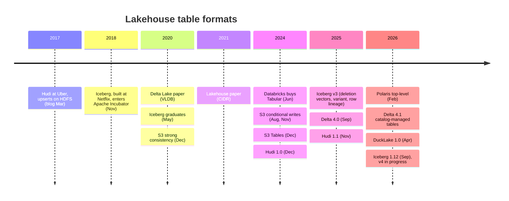
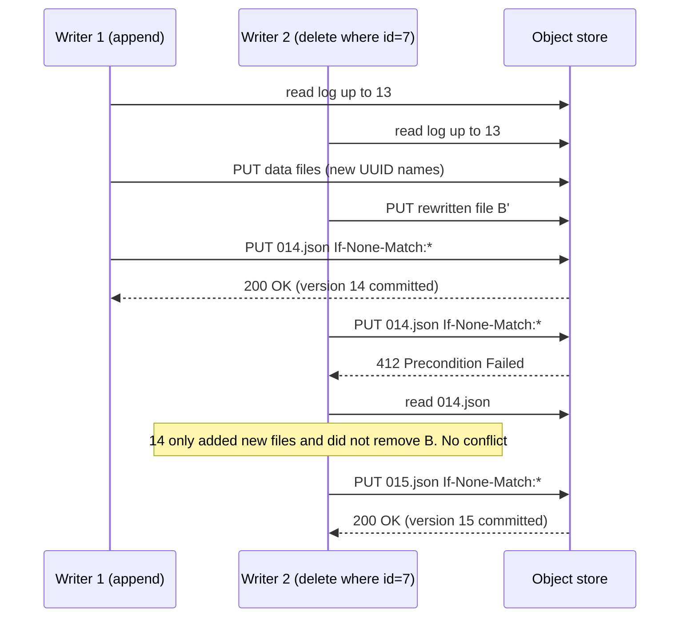
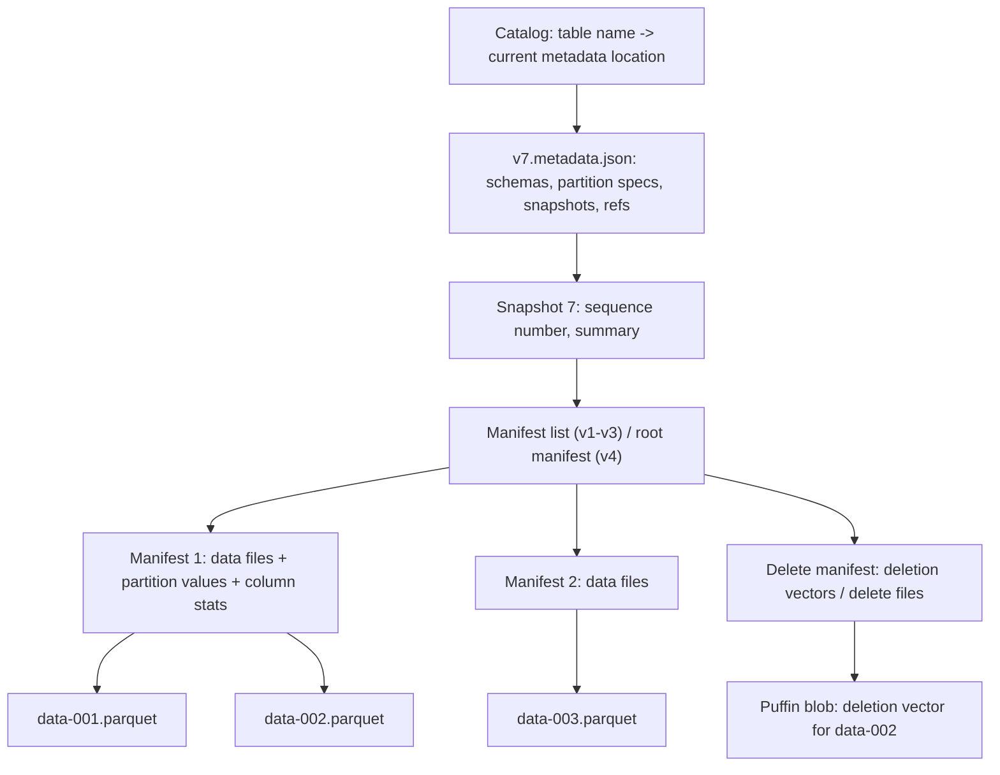

---
aliases:
  - Open Table Formats
  - Lakehouse
tags:
  - distributed-systems
  - data-and-storage
  - lakehouse
  - iceberg
  - delta-lake
  - hudi
  - table-formats
  - object-storage
  - optimistic-concurrency
status: complete
sources:
  - https://www.vldb.org/pvldb/vol13/p3411-armbrust.pdf
  - https://www.databricks.com/wp-content/uploads/2020/12/cidr_lakehouse.pdf
  - https://iceberg.apache.org/spec/
  - https://github.com/apache/iceberg/blob/main/format/spec.md
  - https://github.com/apache/iceberg/blob/main/open-api/rest-catalog-open-api.yaml
  - https://github.com/delta-io/delta/blob/master/PROTOCOL.md
  - https://hudi.apache.org/learn/tech-specs
  - https://www.uber.com/blog/hoodie/
  - https://cwiki.apache.org/confluence/display/INCUBATOR/IcebergProposal
  - https://incubator.apache.org/projects/iceberg.html
  - https://vldb.org/pvldb/vol17/p4159-okolnychyi.pdf
  - https://www.vldb.org/pvldb/vol19/p3216-goetz.pdf
  - https://hudi.apache.org/blog/2024/12/06/non-blocking-concurrency-control
  - https://hudi.apache.org/blog/2024/12/16/announcing-hudi-1-0-0
  - https://hudi.apache.org/blog/2025/11/25/apache-hudi-release-1-1-announcement
  - https://www.databricks.com/company/newsroom/press-releases/databricks-agrees-acquire-tabular-company-founded-original-creators
  - https://aws.amazon.com/about-aws/whats-new/2024/08/amazon-s3-conditional-writes
  - https://aws.amazon.com/about-aws/whats-new/2024/12/amazon-s3-tables-apache-iceberg-tables-analytics-workloads
  - https://aws.amazon.com/about-aws/whats-new/2026/07/amazon-s3-tables-variant-iceberg-v3/
  - https://aws.amazon.com/about-aws/whats-new/2026/08/kinesis/data-delivery-s3-tables
  - https://delta.io/blog/2025-09-25-delta-lake-40/
  - https://delta.io/blog/2026-02-02-delta-catalog-managed-tables/
  - https://newreleases.io/project/github/delta-io/delta/release/v4.4.0
  - https://www.databricks.com/blog/convergence-open-table-formats-and-open-catalogs-catalog-commits-generally-available-article
  - https://opensource.googleblog.com/2025/08/whats-new-in-iceberg-v3.html
  - https://opensource.googleblog.com/2026/05/announcing-apache-iceberg-1110.html
  - https://www.dremio.com/blog/apache-iceberg-1-12-0-whats-new-breaking-changes-and-upgrade-guide
  - https://www.snowflake.com/en/blog/engineering/iceberg-summit-2026-recap-v4-spec/
  - https://polaris.apache.org/blog/2026/02/19/apache-polaris-graduates-to-top-level-project/
  - https://ducklake.select/2026/04/13/ducklake-10/
  - https://xtable.apache.org/blog/apache-xtable-0.4.0-release/
  - https://paimon.apache.org/docs/2.0/maintenance/dedicated-compaction
created: 2026-11-27
updated: 2026-11-27
---

## Table Of Contents

- [[#TL;DR|TL;DR]]
- [[#The Problem|The Problem]]
- [[#Foundations|Foundations]]
    - [[#A Table Is a List of Files|A Table Is a List of Files]]
    - [[#One Atomic Step Per Commit|One Atomic Step Per Commit]]
    - [[#Optimistic Concurrency and Its Ceiling|Optimistic Concurrency and Its Ceiling]]
    - [[#Snapshots, Time Travel and Garbage|Snapshots, Time Travel and Garbage]]
- [[#How We Got Here|How We Got Here]]
- [[#How It Works|How It Works]]
    - [[#Delta Lake: An Ordered Log of Files|Delta Lake: An Ordered Log of Files]]
    - [[#Iceberg: A Tree of Metadata and a Pointer Swap|Iceberg: A Tree of Metadata and a Pointer Swap]]
    - [[#Hudi: A Timeline and File Groups|Hudi: A Timeline and File Groups]]
    - [[#Conflict Detection and Retry|Conflict Detection and Retry]]
    - [[#Row-Level Changes: Copy-on-Write vs Merge-on-Read|Row-Level Changes: Copy-on-Write vs Merge-on-Read]]
    - [[#Catalogs: Who Holds the Pointer|Catalogs: Who Holds the Pointer]]
    - [[#Scan Planning and Statistics|Scan Planning and Statistics]]
    - [[#Maintenance: Compaction, Expiry and Orphans|Maintenance: Compaction, Expiry and Orphans]]
    - [[#Interoperability|Interoperability]]
- [[#Where It Is Now|Where It Is Now]]
- [[#Trade-offs & Open Problems|Trade-offs & Open Problems]]
- [[#Resources|Resources]]
- [[#Related Notes|Related Notes]]

## ***TL;DR***
---
*A lakehouse table format turns a pile of Parquet files in [[Object Storage]] into a database table with ACID commits, snapshots and schema evolution, by keeping a small metadata layer that says exactly which files make up each version. Every format reduces a commit to one atomic step, a put-if-absent or a pointer swap, and that single step is both what makes them correct and what caps how fast one table can change.*

- **The idea.** Data stays in open files (Parquet, ORC, Avro) on cheap storage; a metadata layer lists which files belong to which table version, so many engines can read the same table and every change is all-or-nothing ([Lakehouse, CIDR 2021](https://www.databricks.com/wp-content/uploads/2020/12/cidr_lakehouse.pdf)).
- **Three designs, one trick.** Delta Lake commits by creating the next numbered log file "if no other client has written this object" ([Armbrust et al., VLDB 2020, §3.2.2](https://www.vldb.org/pvldb/vol13/p3411-armbrust.pdf)). Iceberg commits by "an atomic swap of one table metadata file for another" held by a catalog ([Iceberg spec](https://iceberg.apache.org/spec/)). Hudi publishes an instant on a timeline under a table-level lock ([Hudi spec](https://hudi.apache.org/learn/tech-specs)). All three are [[Distributed Transactions|optimistic concurrency]] on a single object or row.
- **The ceiling.** One atomic step per table version means one table commits serially. The Delta paper put the limit at "several transactions per second" ([§3.4](https://www.vldb.org/pvldb/vol13/p3411-armbrust.pdf)); a 2026 PVLDB study found that "already with two concurrent transactions, throughput stagnates for both Iceberg and Delta Lake" ([Götz et al.](https://www.vldb.org/pvldb/vol19/p3216-goetz.pdf)).
- **Updates and deletes.** Copy-on-write rewrites whole files; merge-on-read writes small delete records (now binary deletion vectors in Iceberg v3 and Delta) that readers apply, at the cost of later compaction ([Okolnychyi et al., VLDB 2024](https://vldb.org/pvldb/vol17/p4159-okolnychyi.pdf)).
- **The catalog won.** Both major formats now treat a catalog service as the commit authority: Iceberg's REST catalog (Apache Polaris graduated February 2026) and Delta's catalog-managed tables (Delta 4.1, Catalog Commits GA in Unity Catalog May 2026). DuckLake (1.0, April 2026) goes further and keeps all metadata in a SQL database.
- **Now (Nov 2026):** Iceberg 1.12 shipped September 30, 2026 with v3 types usable across engines; v4, which promises one-file commits and relative paths, is still "not a production format you should enable" ([Dremio](https://www.dremio.com/blog/apache-iceberg-1-12-0-whats-new-breaking-changes-and-upgrade-guide)). AWS now streams Kinesis data straight into S3 Tables (August 2026).

## ***The Problem***
---
*A data lake is just files in directories, so "the table" is whatever a directory listing returns at that moment. With no transactions, readers see half-written jobs, writers clobber each other, and listing millions of objects becomes the slowest part of every query.*

Before table formats, analytics on [[Object Storage]] used the Hive layout: a table is a directory, each partition is a subdirectory, and the files inside are the data. That breaks in four ways.

| Problem | What goes wrong | Example |
|---|---|---|
| **No atomic multi-file change** | A job writing 500 files fails at file 300; readers see 300 | A nightly rewrite of a partition is visible half-done |
| **Listing is the plan** | Finding files means LIST calls, which return "up to 1000 keys per call" and take "tens to hundreds of milliseconds" each | Hive took "more than an hour" to find the objects in a table with 10,000 partitions ([Armbrust et al., §2.1, §6.1](https://www.vldb.org/pvldb/vol13/p3411-armbrust.pdf)) |
| **Eventual consistency** (before Dec 2020) | A LIST could miss a file that was just written | A reader skips fresh data silently ([Iceberg proposal](https://cwiki.apache.org/confluence/display/INCUBATOR/IcebergProposal)) |
| **No row-level change** | Fixing one row means rewriting its partition by hand | GDPR deletes across years of partitions |

The alternative was a two-tier setup: land data in the lake, then ETL it into a warehouse. The Lakehouse paper lists the costs: staleness ("new data frequently taking days to load"), reliability ("keeping the data lake and warehouse consistent is difficult and costly"), and paying to store data twice in a proprietary format ([CIDR 2021](https://www.databricks.com/wp-content/uploads/2020/12/cidr_lakehouse.pdf)).

So the problem is: *give a set of immutable files in an object store the semantics of a database table*, with atomic commits, isolation between readers and writers, fast planning, and the ability to change schemas and rows, without running a database server on the data path.

## ***Foundations***
---
*Four ideas carry every table format: track files instead of directories, reduce a commit to one atomic operation, resolve concurrent writers optimistically, and keep old versions as immutable snapshots that can be read and later garbage-collected.*

### A Table Is a List of Files

The key move is to stop inferring the table from the storage layout. Iceberg puts it plainly: "This table format tracks individual data files in a table instead of directories. This allows writers to create data files in-place and only adds files to the table in an explicit commit" ([Iceberg spec](https://iceberg.apache.org/spec/)).

Writing is then two phases ([Delta protocol](https://github.com/delta-io/delta/blob/master/PROTOCOL.md)):

1. **Write data files** anywhere, with unique names. They are invisible because no table version lists them.
2. **Commit** a small metadata record saying "files X and Y are now in the table; file Z is out."

A failed job leaves orphan files that no version references, which a cleanup job deletes later. It never leaves a half-visible table. This is the same separation a [[Write-Ahead Logging|write-ahead log]] makes between doing work and making it durable, except here the "log" is the metadata and the "pages" are whole files.

### One Atomic Step Per Commit

Because data files are invisible until listed, the only thing that needs atomicity is the metadata update, and it is shrunk to one operation on one key:

| Format | The atomic step | Needs from storage or catalog |
|---|---|---|
| Delta Lake | Create `_delta_log/<v>.json` only if it doesn't exist | Put-if-absent (GCS, Azure), atomic rename (HDFS), or a coordinator on S3 before 2024 ([§3.2.2](https://www.vldb.org/pvldb/vol13/p3411-armbrust.pdf)) |
| Iceberg | Swap the table's metadata pointer from version $V$ to $V+1$ | A check-and-put in a catalog ("metastore or database"); the old rename-based scheme is "deprecated" and "unsafe in object stores" ([spec](https://github.com/apache/iceberg/blob/main/format/spec.md)) |
| Hudi | Publish a completed instant on the timeline | A table-level lock (external, or since 1.1 a lock file using conditional writes) ([Hudi 1.1](https://hudi.apache.org/blog/2025/11/25/apache-hudi-release-1-1-announcement)) |

Any of these is a compare-and-swap on a single cell. That is the primitive a [[Coordination Services|coordination service]] provides, and since S3 added `If-None-Match` (August 2024) and `If-Match` (November 2024) the object store can provide it too ([AWS](https://aws.amazon.com/about-aws/whats-new/2024/08/amazon-s3-conditional-writes); see [[Object Storage#Conditional Writes Turn S3 into a Coordination Primitive|Object Storage]]).

### Optimistic Concurrency and Its Ceiling

Writers don't lock. Each one reads the current version, does its work, and tries the atomic step. If someone else committed first, it checks whether the other commit conflicts with what it read and wrote; if not, it rebases onto the new version and tries again ([[Distributed Transactions]]).

Since every commit of a table goes through one key, commits to one table are serialized. If one attempt takes $t_c$ from reading the base version to completing the atomic step, then

$$\lambda_{\max} \approx \frac{1}{t_c}$$

**In plain English:** a single table can't commit faster than one commit per commit-latency, however many writers you add. Extra writers only add retries.

**Worked example (illustrative numbers).** Say an Iceberg v3 append writes one manifest, one manifest list and one metadata file, then asks the catalog to swap the pointer, and each object-store PUT takes about 30 ms while the catalog call takes 20 ms. Then $t_c \approx 3 \times 30 + 20 = 110$ ms and $\lambda_{\max} \approx 9$ commits per second. Three writers each trying to commit every 200 ms offer 15 commits per second, so on average about 6 of every 15 attempts must lose the race and retry, and each retry costs another $t_c$. This is why the Delta paper says "a high rate of write transactions will result in commit failures" and caps throughput at "several transactions per second" ([§3.4](https://www.vldb.org/pvldb/vol13/p3411-armbrust.pdf)), and why Iceberg v4's goal is fewer files per commit ([[#Where It Is Now|Where It Is Now]]).

### Snapshots, Time Travel and Garbage

Each commit produces a new immutable **snapshot**: the full set of live files at that version. Readers pin the snapshot they started with and never see later changes, so reads get snapshot isolation for free. Delta's write transactions are serializable, ordered by log record ID; reads get snapshot isolation by default ([Armbrust et al., §3.3](https://www.vldb.org/pvldb/vol13/p3411-armbrust.pdf)). Iceberg lets each writer choose what to validate, so "Writers can select what to validate and can make different isolation guarantees" ([spec](https://iceberg.apache.org/spec/)).

Old snapshots give **time travel** (`VERSION AS OF`, `TIMESTAMP AS OF`) at no extra cost, because old files are still there. The bill comes as garbage: a file removed in version 50 can only be physically deleted once no reader or retention rule still needs version 49 or earlier. Delta's `VACUUM` defaults to a 7-day retention ([protocol](https://github.com/delta-io/delta/blob/master/PROTOCOL.md)). This is the same horizon problem as [[MVCC and Version Garbage Collection]], at the granularity of files instead of row versions.

## ***How We Got Here***
---
*Table formats came out of three companies hitting the limits of Hive tables on cloud storage around 2016 and 2017. They converged on the same idea, competed for five years, and by 2026 the fight had moved from the file layout to the catalog that commits to it.*

- **Hudi (Uber).** Uber's March 2017 post describes Hoodie ("Hadoop Upsert Delete and Incremental") as "an incremental processing framework to power all business critical data pipelines at low latency," letting teams apply updates and deletes to HDFS data within minutes and pull only changed records ([Uber](https://www.uber.com/blog/hoodie/)). Its roots are streaming upserts, which is why it led on indexes and merge-on-read.
- **Iceberg (Netflix).** Built for "large, slow-moving tabular data" on cloud blob stores with "High latency for directory listings" and "Eventual consistency in the namespace"; proposed to Apache with Ryan Blue and Daniel Weeks among the initial committers ([proposal](https://cwiki.apache.org/confluence/display/INCUBATOR/IcebergProposal)). It entered the incubator on 2018-11-16 and graduated on 2020-05-20 ([ASF](https://incubator.apache.org/projects/iceberg.html)). Its design goal was "O(1) remote calls to plan the files for a scan" ([spec](https://iceberg.apache.org/spec/)).
- **Delta Lake (Databricks).** The VLDB 2020 paper reports it "deployed at thousands of Databricks customers that process exabytes of data per day," handling "around half our overall workload" ([Armbrust et al.](https://www.vldb.org/pvldb/vol13/p3411-armbrust.pdf)). Because S3 then lacked put-if-absent, Databricks ran "a separate lightweight coordination service" for commits.
- **The lakehouse framing.** The CIDR 2021 paper named the pattern: "a data management system" on low-cost, directly accessible storage that also provides ACID transactions, versioning, indexing and query optimization ([CIDR 2021](https://www.databricks.com/wp-content/uploads/2020/12/cidr_lakehouse.pdf)).
- **Consolidation.** On June 4, 2024 Databricks agreed to buy Tabular, the company founded by Ryan Blue, Daniel Weeks and Jason Reid, to "bring format compatibility to the lakehouse" ([Databricks](https://www.databricks.com/company/newsroom/press-releases/databricks-agrees-acquire-tabular-company-founded-original-creators)). In the same year S3 gained conditional writes and launched S3 Tables, "the first cloud object store with built-in Apache Iceberg support" ([AWS, Dec 2024](https://aws.amazon.com/about-aws/whats-new/2024/12/amazon-s3-tables-apache-iceberg-tables-analytics-workloads)). From then on, the competition is mostly about catalogs ([[#Catalogs: Who Holds the Pointer|Catalogs]]).

## ***How It Works***
---
*Delta keeps an ordered log, Iceberg keeps a tree of immutable metadata files under one pointer, and Hudi keeps a timeline of actions over file groups. The differences show up in how they find the current state, how they handle many small commits, and how they apply row-level changes.*

### Delta Lake: An Ordered Log of Files

A Delta table is a directory with data files and a `_delta_log/` subdirectory ([protocol](https://github.com/delta-io/delta/blob/master/PROTOCOL.md)):

- **Commits** are newline-delimited JSON files named by version, "zero-padded to 20 digits" (`00000000000000000000.json`, `…001.json`, …). Each holds actions: `add` and `remove` (a file and its stats), `metaData` (schema, partitioning), `protocol` (required reader and writer features), `txn` (an application's id and version, for exactly-once writes), `commitInfo` (provenance).
- **Checkpoints** are Parquet files that fold the log up to a version; clients write one by default "every 10 transactions," and `_last_checkpoint` points to the newest ([Armbrust et al., §3.1.3, §3.2.1](https://www.vldb.org/pvldb/vol13/p3411-armbrust.pdf)). Newer protocol versions add **log compaction files** (`<x>.<y>.compacted.json`) that aggregate a range of commits.

The state at version $v$ is a replay:

$$S_v = \text{reconcile}\big(C_c,\ \Delta_{c+1}, \dots, \Delta_v\big), \quad c = \text{latest checkpoint} \le v$$

**In plain English:** start from the latest checkpoint, then apply each JSON commit after it, where a later `remove` cancels an earlier `add` of the same path.

**Worked example.** A reader wants the latest version. It reads `_last_checkpoint` (says 10), LISTs `_delta_log/` from key `…010` and finds `…011.json`, `…012.json`, `…013.json`. It loads `…010.checkpoint.parquet` (files A, B, C), then applies 11 (`add D`), 12 (`remove A`, `add E`, a compaction), 13 (`add F`). Snapshot 13 is {B, C, D, E, F}. Reading version 11 instead (time travel) stops after 11: {A, B, C, D}.

**Commit.** A writer that read version 13 writes its Parquet files, then tries to create `…014.json` with put-if-absent. Two writers racing for 14 look like this:

Since Delta 4.1, a table can opt into **catalog-managed** commits, where "the catalog that manages the table becomes the source of truth for whether a given commit attempt succeeded." A client proposes a commit (staged under `_delta_log/_staged_commits/` or sent inline), the catalog ratifies it, and ratified commits are later published as normal Delta files. The catalog "must not ratify version `v` until it has ratified version `v - 1`, and it must ratify version `v` at most once" ([protocol](https://github.com/delta-io/delta/blob/master/PROTOCOL.md); [Delta blog, Feb 2026](https://delta.io/blog/2026-02-02-delta-catalog-managed-tables/)). The commit point moves from the file system to a service, which is exactly what Iceberg did from the start.

### Iceberg: A Tree of Metadata and a Pointer Swap

Iceberg stores table state as a tree of immutable files ([spec](https://github.com/apache/iceberg/blob/main/format/spec.md)):

| Level | Holds | Why it exists |
|---|---|---|
| Table metadata file | Schema history, partition specs, sort orders, snapshot list, branches and tags | The one object the catalog points at |
| Manifest list | One row per manifest, with partition ranges and file counts | Skip whole manifests during planning |
| Manifest | One row per data or delete file: path, partition, record count, per-column bounds and null counts | Skip files; reused across snapshots so slow-changing metadata isn't rewritten |
| Data and delete files | Parquet, ORC or Avro rows; Puffin blobs for deletion vectors | The actual table |

A commit writes new data files, new manifests for them, a new manifest list that reuses unchanged manifests, and a new metadata file, then "commits by swapping the table's metadata file pointer from the base version to the new version" ([spec](https://iceberg.apache.org/spec/)). With a metastore, version `V+1` is written to `<V+1>-<uuid>.metadata.json` and the catalog's check-and-put either succeeds or tells the writer to start again.

**Sequence numbers** order data against deletes. Every commit gets the next sequence number, and new files inherit it at read time, so a retried commit only rewrites its manifest list to take a new number ([spec](https://iceberg.apache.org/spec/)). The rules for applying deletes are:

$$\text{position delete or DV applies to file } f \iff \text{seq}(f) \le \text{seq}(d) \qquad \text{equality delete applies} \iff \text{seq}(f) < \text{seq}(d)$$

**In plain English:** a delete only affects data that existed when it was written. Position deletes also apply to rows added in the same commit (they name exact positions); equality deletes, which match by value, must not hit rows inserted in their own commit.

**Worked example.** Snapshot 5 adds `f1` (seq 5) containing `id=7`. Snapshot 6 writes an equality delete `id=7` (seq 6) and, in the same commit, a new `f2` (seq 6) that re-inserts `id=7` with new values. For `f1`, $5 < 6$, so the old row is deleted. For `f2`, $6 < 6$ is false, so the new row survives. That is an upsert expressed with no file rewrite.

### Hudi: A Timeline and File Groups

Hudi records every action as an **instant** on a timeline: `commit`, `deltacommit`, `compaction`, `clean`, `replacecommit` and others, each moving through requested, inflight and completed. Records map by key to a **file group**; a **file slice** is one base file (Parquet, ORC, HFile or Lance) plus log files of later changes ([Hudi spec](https://hudi.apache.org/learn/tech-specs)). Two table types follow:

- **Copy-on-write:** each write produces new base files. Reads are plain Parquet scans.
- **Merge-on-read:** writes append to log files; readers merge base and logs; compaction folds logs into new base files.

Hudi also keeps a **metadata table** (itself a merge-on-read Hudi table) with file listings, column statistics, Bloom filters and a record index, which is why it can do keyed upserts without scanning. Commits use optimistic concurrency under an exclusive table lock: write files without the lock, then inside it check for conflicts with actions completed since the writer's snapshot, update the metadata table, and publish the completed instant ([spec](https://hudi.apache.org/learn/tech-specs)).

Hudi 1.0 (December 2024) redesigned the archived timeline "as an LSM tree" and added **non-blocking concurrency control** for streaming writers on merge-on-read tables: writers append to the same file group without conflict checks, and "the compaction table service would take care of the conflict resolution," ordering records by commit time or by an event-time field. It needs a bucket index so each key always lands in the same file group, and globally monotonic timestamps, which Hudi gets with "a lock-based TrueTime approach" that waits out the configured maximum clock skew ([Hudi, Dec 2024](https://hudi.apache.org/blog/2024/12/06/non-blocking-concurrency-control); [[Time and Clocks]], [[Clock Synchronization]]). It is the one mainstream design that lets same-table writers proceed without aborting, by moving reconciliation to read and compaction time, the [[CRDTs|merge-later]] idea applied to files.

### Conflict Detection and Retry

Losing the race isn't the same as conflicting. After a failed atomic step, a writer looks at what committed in between and asks whether its own change is still valid. Iceberg spells out the rules ([spec](https://github.com/apache/iceberg/blob/main/format/spec.md)):

| Operation | Can retry on a new base if... |
|---|---|
| Append | Always |
| Replace (compaction, format change) | All files it removes are still in the table |
| Delete of specific files | Those files are still in the table |
| Delete by expression (`ts < X`) | Always |
| Schema or partition change | The schema hasn't changed since the base |

Serializable writers also check that no new data matching their read predicate was added; snapshot isolation skips that check and permits write skew ([Okolnychyi et al.](https://vldb.org/pvldb/vol17/p4159-okolnychyi.pdf); [[Consistency Models]]). Delta does the same check by reading the intervening JSON commits.

**Worked example (Iceberg, three writers on snapshot 20).**
1. Writer A appends 4 files and swaps 20 → 21.
2. Writer B (compaction of files `p1`–`p8` into `q1`) fails its swap, sees 21 only appended, so `p1`–`p8` are still live; it rewrites its manifest list on 21 and swaps 21 → 22.
3. Writer C (a `MERGE` that read `p3` and wants to delete a row in it) fails its swap, sees 22 removed `p3`. Its change no longer applies, so it must re-read and redo the whole job.

Step 3 is the classic pain: a long `MERGE` losing to a short compaction. That's why Paimon runs compaction as a single dedicated job ([Paimon docs](https://paimon.apache.org/docs/2.0/maintenance/dedicated-compaction); [[Disaggregated LSMs and Compaction Offload]]), and why deletion vectors that only touch metadata conflict less than file rewrites.

Transactions are also per table. Delta "currently only supports transactions within one table" ([§3.3](https://www.vldb.org/pvldb/vol13/p3411-armbrust.pdf)). Iceberg's REST API has a `POST /v1/{prefix}/transactions/commit` that will "Commit updates to multiple tables in an atomic operation," but only if the catalog implements it ([REST spec](https://github.com/apache/iceberg/blob/main/open-api/rest-catalog-open-api.yaml)). Multi-table atomicity is a catalog feature, not a format feature.

### Row-Level Changes: Copy-on-Write vs Merge-on-Read

Files are immutable, so changing one row means either rewriting its file or recording the change elsewhere ([Okolnychyi et al., VLDB 2024](https://vldb.org/pvldb/vol17/p4159-okolnychyi.pdf)):

| Strategy | Write cost | Read cost | Best for |
|---|---|---|---|
| **Copy-on-write** (rewrite the file) | High: "all unmatched rows in modified data files must be copied over" | None extra | Bulk jobs touching much of the table |
| **Position deletes** (file path + row number) | Low; must find the rows first | Load a bitmap per file | Frequent sparse updates |
| **Equality deletes** (`id = 7`) | Lowest; no read of the target | High: every older file in the partition is checked | Streaming upserts (Flink) |
| **Deletion vectors** (one bitmap per data file) | Low | Low: one bitmap, directly addressable | The current default in Iceberg v3 and Delta |

The Apple and Tabular paper measured position-delete writes as "almost 7 times faster" than copy-on-write after 10 micro-batches, with read cost that a minor compaction (23% of one rewrite's time) cut by 45% ([Okolnychyi et al.](https://vldb.org/pvldb/vol17/p4159-okolnychyi.pdf)). Equality deletes are cheap to write but their read cost "grew rapidly," and Iceberg v4 stops allowing new ones ([spec](https://github.com/apache/iceberg/blob/main/format/spec.md)).

Iceberg v3 **deletion vectors** are binary bitmaps of deleted row positions, stored as `deletion-vector-v1` blobs in Puffin files, and "there can be at most one deletion vector for a given data file in a snapshot," so writers "must merge new deletes with existing vectors" ([spec](https://github.com/apache/iceberg/blob/main/format/spec.md)). Delta's deletion vectors work the same way and can even be stored inline in the log entry ([protocol](https://github.com/delta-io/delta/blob/master/PROTOCOL.md)). This is the format-level version of tombstones in [[LSM Trees]]: a cheap marker now, a rewrite later.

### Catalogs: Who Holds the Pointer

The **catalog** maps table names to their current metadata and, crucially, performs the atomic step. It used to be an afterthought (Hive Metastore, AWS Glue, a JDBC table). Now it is where the action is:

- **Iceberg REST catalog.** A commit has "two parts, requirements and updates": requirements such as `assert-ref-snapshot-id` are checked first, then updates such as "add a new child snapshot and set the ref" are applied atomically ([REST spec](https://github.com/apache/iceberg/blob/main/open-api/rest-catalog-open-api.yaml)). The same API covers credential vending (`X-Iceberg-Access-Delegation: vended-credentials`), multi-table commits and, since Iceberg 1.11, server-side **scan planning**, where "the engine submits a single `POST …/plan` request" instead of walking manifests ([Google, May 2026](https://opensource.googleblog.com/2026/05/announcing-apache-iceberg-1110.html)).
- **Apache Polaris**, a vendor-neutral implementation of that REST spec, graduated to a top-level Apache project in February 2026 ([Polaris](https://polaris.apache.org/blog/2026/02/19/apache-polaris-graduates-to-top-level-project/)).
- **Unity Catalog** is the first catalog to support Delta's catalog-managed tables ([Delta blog](https://delta.io/blog/2026-02-02-delta-catalog-managed-tables/)); Databricks made Catalog Commits GA on May 12, 2026, saying "Now that both Delta and Iceberg are catalog-oriented, customers can rely on their tables having a standardized model" ([Databricks](https://www.databricks.com/blog/convergence-open-table-formats-and-open-catalogs-catalog-commits-generally-available-article)).
- **S3 Tables** put an Iceberg catalog inside the storage service, with "table buckets" and automatic compaction, snapshot management and unreferenced-file removal, claiming "up to 10x higher transactions per second compared to self-managed tables" ([AWS, Dec 2024](https://aws.amazon.com/about-aws/whats-new/2024/12/amazon-s3-tables-apache-iceberg-tables-analytics-workloads)).
- **DuckLake** inverts the design: "DuckLake stores all metadata in a database," any SQL system with primary keys (PostgreSQL, SQLite or DuckDB), while data stays in files. Small inserts, updates and deletes can be **inlined** into the catalog database, on by default below 10 rows, to avoid the small-file problem ([DuckLake 1.0](https://ducklake.select/2026/04/13/ducklake-10/)).

Why the shift? Delta's own list of file-system problems: brittle path-based access, coarse authorization, unvalidated schema changes, and log replay that "can add 100+ ms to query execution" ([Delta blog, Feb 2026](https://delta.io/blog/2026-02-02-delta-catalog-managed-tables/)). A catalog can answer "what is the current version" in one call, hold commits that are not yet published, enforce access control, and coordinate across tables. The cost is that the catalog becomes a highly available service on the commit path, with its own [[Replication]] and failover, much like the [[Cluster Metadata and Routing|metadata service]] in any sharded database.

### Scan Planning and Statistics

Lakehouse tables mostly do without [[Secondary Indexes]]. Instead each file's metadata carries per-column min/max bounds and null counts, and planners skip files whose ranges can't match. Delta's `add` actions carry "per-column min/max values and null counts" ([§3.1.2](https://www.vldb.org/pvldb/vol13/p3411-armbrust.pdf)); Iceberg manifests carry bounds keyed by field ID, plus partition ranges one level up in the manifest list.

Skipping only works if similar values are clustered. On a 500 TB dataset, Z-ordering on several fields let queries "skip 93% of the data in the table," while a single global sort skipped 99% on its sort key and almost nothing on others ([Armbrust et al., §6.2](https://www.vldb.org/pvldb/vol13/p3411-armbrust.pdf)). Iceberg 1.12 adds Hilbert-curve clustering in Spark ([Dremio](https://www.dremio.com/blog/apache-iceberg-1-12-0-whats-new-breaking-changes-and-upgrade-guide)). Below the file level, Parquet's row-group statistics and [[Bloom and Range Filters|split-block Bloom filters]] skip further.

Partitioning is table config, not a directory layout. Iceberg's **hidden partitioning** stores transforms like `day(ts)` or `bucket(16, id)` in the spec, so queries filter on `ts` and the planner derives partition predicates; specs can evolve without rewriting old data ([spec](https://iceberg.apache.org/spec/); [[Partitioning]]).

The payoff is in the metadata cost. Delta found 1 million partitions in 108 seconds (17 seconds with the log cached on SSD), where Hive took over an hour for 10,000 ([§6.1](https://www.vldb.org/pvldb/vol13/p3411-armbrust.pdf)).

### Maintenance: Compaction, Expiry and Orphans

A table format is a storage engine without a resident process, so housekeeping is a set of jobs someone has to run:

| Job | Why | Failure if skipped |
|---|---|---|
| **Compaction** (bin-pack, sort, Z-order) | Streaming commits create many small files and many delete files | Planning and reads slow down; Okolnychyi et al. show reads degrading as deletes pile up |
| **Snapshot expiry** | Every snapshot pins its files | Storage grows without bound |
| **Orphan cleanup** | Failed writers leave unreferenced files | Paying for invisible data |
| **Manifest rewrite / checkpoint** | Many small manifests or a long JSON log | Slower planning and log replay |

Compaction is itself a commit and races with writers ([[#Conflict Detection and Retry|above]]). Managed services increasingly sell this job; S3 Tables, for example, runs compaction, snapshot management and unreferenced-file removal as policies ([AWS, Dec 2024](https://aws.amazon.com/about-aws/whats-new/2024/12/amazon-s3-tables-apache-iceberg-tables-analytics-workloads)). It's the same background-merge trade-off as LSM compaction ([[LSM Trees]], [[Disaggregated LSMs and Compaction Offload]]), with object-store request costs in place of disk I/O.

### Interoperability

Since all three formats sit over the same Parquet files, much of the "format war" became translation:

- **Delta UniForm / IcebergCompatV2** writes Iceberg metadata alongside the Delta log for the same files, under writer rules such as column mapping by ID ([protocol](https://github.com/delta-io/delta/blob/master/PROTOCOL.md)).
- **Apache XTable** "converts metadata between Apache Hudi, Apache Iceberg and Delta Lake without rewriting any data files"; 0.4.0 (August 25, 2026, still incubating) adds Paimon and plain Parquet sources and a Delta Kernel path ([XTable](https://xtable.apache.org/blog/apache-xtable-0.4.0-release/)).
- **Hudi 1.1** adds a pluggable table-format framework so Hudi's services can manage other formats through adapters ([Hudi 1.1](https://hudi.apache.org/blog/2025/11/25/apache-hudi-release-1-1-announcement)).

Translation covers the file list and schema; it can't merge two commit protocols. One format has to own writes, and the others are read-only views.

## ***Where It Is Now***
---
*As of late November 2026, Iceberg is the common format and Delta the other large one, the two now share a catalog-first commit model, and the frontier is making commits small and frequent enough for streaming. Multi-writer throughput on a single table is still the weakest point, and research is starting to measure it.*

**Iceberg.**
- 1.11 (announced May 27, 2026) brought REST-catalog scan planning and built-in table encryption with envelope keys in a KMS ([Google](https://opensource.googleblog.com/2026/05/announcing-apache-iceberg-1110.html)).
- 1.12 (September 30, 2026) made v3 types (variant, geospatial) "worth a serious end-to-end test," added a REST endpoint to unregister a table without deleting its files, tightened deletion-vector correctness checks, and removed Spark 3.4 ([Dremio](https://www.dremio.com/blog/apache-iceberg-1-12-0-whats-new-breaking-changes-and-upgrade-guide)).
- **v4** is "under active development and has not been formally adopted" ([spec](https://github.com/apache/iceberg/blob/main/format/spec.md)). It replaces the manifest list with a single root manifest that can hold data files directly (an "adaptive metadata tree, enabling efficient small commits"), stores each data file with its deletion vector in one entry, allows relative paths, adds column files for updating columns without rewriting whole files, and forbids new equality deletes. At Iceberg Summit 2026 (600+ attendees) the pitch was "one-file commits which enable low-latency writes," with PyIceberg at "500,000 daily downloads" ([Snowflake, Jun 2026](https://www.snowflake.com/en/blog/engineering/iceberg-summit-2026-recap-v4-spec/)).

**Delta Lake.** Delta 4.0 (September 2025) added variant and a preview of catalog-managed tables ([Delta](https://delta.io/blog/2025-09-25-delta-lake-40/)); 4.1 made catalog-managed tables available with Unity Catalog 0.4.0 ([Delta, Feb 2026](https://delta.io/blog/2026-02-02-delta-catalog-managed-tables/)); Catalog Commits went GA in Unity Catalog on May 12, 2026. Delta 4.4 supports Spark 4.2 and routes Delta Kernel's Unity Catalog committer through the UC Delta API, and concurrent Kernel writes to the same file "now conflict instead of corrupting state" ([release notes](https://newreleases.io/project/github/delta-io/delta/release/v4.4.0)).

**Hudi.** 1.1 (November 25, 2025) added a storage-based lock using conditional writes on a lock file, removing the need for DynamoDB, ZooKeeper or Hive Metastore locks, plus 2-3x faster Flink writes and reads ([Hudi](https://hudi.apache.org/blog/2025/11/25/apache-hudi-release-1-1-announcement)).

**Catalogs and services.** Polaris is a top-level Apache project (February 2026). DuckLake 1.0 shipped April 13, 2026 in DuckDB 1.5.2 ([DuckLake](https://ducklake.select/2026/04/13/ducklake-10/)). S3 Tables added the Iceberg v3 variant type on July 28, 2026 ([AWS](https://aws.amazon.com/about-aws/whats-new/2026/07/amazon-s3-tables-variant-iceberg-v3/)), and on August 28, 2026 Kinesis Data Streams began delivering streams straight into S3 Tables ([AWS](https://aws.amazon.com/about-aws/whats-new/2026/08/kinesis/data-delivery-s3-tables)). Streams landing as tables is now common: Confluent Tableflow, StreamNative's Ursa ([[Diskless Streaming]]), Fluss and Cloudflare Pipelines ([[Stream Processing]], [[Change Data Capture]]).

**Research.** Götz et al. (PVLDB 19, 2026) show that existing formats give "transactional guarantees only for single-table transactions," that throughput stagnates at two concurrent transactions, and that in a one-warehouse TPC-C run Delta Lake and Nessie aborted 100% of transactions and DuckLake 99.98%. Their LakeVilla layer adds multi-table transactions using only object-store primitives, with abort rates under 1% on YCSB and about 100 ms of extra latency ([Götz et al.](https://www.vldb.org/pvldb/vol19/p3216-goetz.pdf)).

## ***Trade-offs & Open Problems***
---
*Table formats trade write concurrency and freshness for cheap storage and open access. The open problems are high-rate commits to one table, transactions across tables, keeping maintenance from fighting writers, and making the catalog as reliable as the storage under it.*

| Choice | Buys | Costs |
|---|---|---|
| Commit point in storage (Delta put-if-absent) | No extra service; table is self-describing and copyable | Log replay on every read; serialized commits; path-based security |
| Commit point in a catalog (Iceberg, catalog-managed Delta) | One-call lookups, unpublished commits, access control, multi-table commits | A service on the write path that must be highly available |
| Metadata in a SQL database (DuckLake) | Small, fast commits and inlined tiny writes | Commit throughput bound by one database; less portable |
| Copy-on-write | Fast reads, no maintenance debt | Heavy write amplification on sparse updates |
| Merge-on-read / deletion vectors | Cheap updates and streaming upserts | Compaction debt; reads slow until it's paid |
| Non-blocking writers (Hudi NBCC) | No aborts for same-table streaming writers | Merge semantics instead of serializability; needs bucket index and monotonic clocks |
| Statistics instead of indexes | No index maintenance on immutable files | Point lookups depend on clustering; poor for keyed access |

Open problems:

- **Commit rate on one table.** One atomic step per version caps a table at a few to tens of commits per second, and v3 Iceberg writes several files per commit. v4's one-file commits and catalog-inlined commits (Delta staged or inline commits, DuckLake inlining) all try to shrink $t_c$; none removes the serialization ([[#Optimistic Concurrency and Its Ceiling|above]]).
- **Multi-table transactions.** The REST spec has the endpoint, but semantics depend on each catalog, and cross-table isolation anomalies remain in stock Iceberg and Delta per the Hermitage tests in Götz et al. ([[Isolation Testing]]).
- **Long writers vs short compactions.** Table-level conflict detection makes long `MERGE` jobs starve; finer-grained (file- or row-level) validation and scheduling compaction around writers are still product-specific.
- **Catalog as a single point of failure.** Moving commits into a catalog means the catalog's availability, replication and region failover now bound the table's; the formats specify the API, not how to run it reliably ([[Replication]], [[Coordination Services]]).
- **Garbage collection across branches and clones.** Branches, tags and zero-copy clones (lakeFS, Nessie, Iceberg refs) pin files; deciding when a file is truly unreferenced is reference tracking across many snapshots ([[MVCC and Version Garbage Collection]], [[Database Branching and Zero-Copy Clones]]).
- **Translation limits.** UniForm and XTable keep metadata in sync, but features that one format has and the other lacks (equality deletes, v4 column files, Delta table features) don't translate cleanly.

## ***Resources***
---
*Read the Delta Lake paper for why object stores make ACID hard, then the Iceberg spec's overview and commit sections, then Okolnychyi et al. on row-level changes and Götz et al. for where concurrency breaks down.*

**Papers**
- [Delta Lake: High-Performance ACID Table Storage over Cloud Object Stores](https://www.vldb.org/pvldb/vol13/p3411-armbrust.pdf): Armbrust et al., PVLDB 13(12), 2020. Log design, put-if-absent, checkpoints, Z-order numbers.
- [Lakehouse: A New Generation of Open Platforms that Unify Data Warehousing and Advanced Analytics](https://www.databricks.com/wp-content/uploads/2020/12/cidr_lakehouse.pdf): Armbrust, Ghodsi, Xin and Zaharia, CIDR 2021.
- [Petabyte-Scale Row-Level Operations in Data Lakehouses](https://vldb.org/pvldb/vol17/p4159-okolnychyi.pdf): Okolnychyi et al. (Apple, Tabular), PVLDB 17(12), 2024. Copy-on-write vs merge-on-read, measured.
- [Interoperable ACID Transactions for Open Table Formats](https://www.vldb.org/pvldb/vol19/p3216-goetz.pdf): Götz, Ritter, El-Hindi and Giceva, PVLDB 19(11), 2026. LakeVilla, concurrency and isolation measurements.

**Specifications**
- [Apache Iceberg table spec](https://iceberg.apache.org/spec/) ([source, including v4 draft](https://github.com/apache/iceberg/blob/main/format/spec.md)): optimistic concurrency, sequence numbers, delete rules, retry conditions.
- [Iceberg REST catalog OpenAPI](https://github.com/apache/iceberg/blob/main/open-api/rest-catalog-open-api.yaml): requirements and updates, multi-table commits, scan planning.
- [Delta transaction log protocol](https://github.com/delta-io/delta/blob/master/PROTOCOL.md): actions, checkpoints, deletion vectors, catalog-managed tables, IcebergCompatV2.
- [Apache Hudi technical specification](https://hudi.apache.org/learn/tech-specs): timeline, file groups, metadata table, concurrency.

**Engineering posts and history**
- [Hoodie: Uber Engineering's incremental processing framework on Hadoop](https://www.uber.com/blog/hoodie/): Uber, March 2017.
- [Iceberg incubator proposal](https://cwiki.apache.org/confluence/display/INCUBATOR/IcebergProposal) and [incubation record](https://incubator.apache.org/projects/iceberg.html).
- [Hudi non-blocking concurrency control](https://hudi.apache.org/blog/2024/12/06/non-blocking-concurrency-control), [Hudi 1.0](https://hudi.apache.org/blog/2024/12/16/announcing-hudi-1-0-0) and [Hudi 1.1](https://hudi.apache.org/blog/2025/11/25/apache-hudi-release-1-1-announcement).
- [Delta catalog-managed tables](https://delta.io/blog/2026-02-02-delta-catalog-managed-tables/) (Feb 2026), [Delta 4.0](https://delta.io/blog/2025-09-25-delta-lake-40/), [Delta 4.4 release notes](https://newreleases.io/project/github/delta-io/delta/release/v4.4.0), [Catalog Commits GA](https://www.databricks.com/blog/convergence-open-table-formats-and-open-catalogs-catalog-commits-generally-available-article) (May 2026).
- [What's new in Iceberg v3](https://opensource.googleblog.com/2025/08/whats-new-in-iceberg-v3.html) (Aug 2025), [Iceberg 1.11](https://opensource.googleblog.com/2026/05/announcing-apache-iceberg-1110.html) (May 2026), [Iceberg 1.12](https://www.dremio.com/blog/apache-iceberg-1-12-0-whats-new-breaking-changes-and-upgrade-guide) (Sep 2026), [Iceberg Summit 2026 recap](https://www.snowflake.com/en/blog/engineering/iceberg-summit-2026-recap-v4-spec/).
- [Apache Polaris graduates](https://polaris.apache.org/blog/2026/02/19/apache-polaris-graduates-to-top-level-project/) (Feb 2026); [DuckLake 1.0](https://ducklake.select/2026/04/13/ducklake-10/) (Apr 2026); [Apache XTable 0.4.0](https://xtable.apache.org/blog/apache-xtable-0.4.0-release/) (Aug 2026).
- [S3 conditional writes](https://aws.amazon.com/about-aws/whats-new/2024/08/amazon-s3-conditional-writes) (Aug 2024), [S3 Tables](https://aws.amazon.com/about-aws/whats-new/2024/12/amazon-s3-tables-apache-iceberg-tables-analytics-workloads) (Dec 2024), [S3 Tables variant](https://aws.amazon.com/about-aws/whats-new/2026/07/amazon-s3-tables-variant-iceberg-v3/) (Jul 2026), [Kinesis streaming tables](https://aws.amazon.com/about-aws/whats-new/2026/08/kinesis/data-delivery-s3-tables) (Aug 2026).
- [Databricks agrees to acquire Tabular](https://www.databricks.com/company/newsroom/press-releases/databricks-agrees-acquire-tabular-company-founded-original-creators) (Jun 2024).
- [Paimon dedicated compaction](https://paimon.apache.org/docs/2.0/maintenance/dedicated-compaction): giving compaction a single owner to avoid commit conflicts.

## ***Related Notes***
---
*Table formats sit on object storage and borrow their machinery from databases: logs, MVCC, optimistic transactions and compaction. Read them beside the storage and streaming notes that feed and serve them.*

- [[Object Storage]] — The storage underneath, and the conditional writes that made storage-only commits safe.
- [[Databases on Object Storage]] — The same CAS-on-a-manifest pattern used by OLTP and search engines.
- [[Distributed Transactions]] — Optimistic concurrency, validation and retry behind every commit.
- [[Consistency Models]] — Serializable vs snapshot isolation choices per writer.
- [[Isolation Testing]] — Hermitage-style anomaly tests that stock formats fail across tables.
- [[MVCC and Version Garbage Collection]] — Snapshots, time travel and the retention horizon, at file granularity.
- [[Write-Ahead Logging]] — Delta's log as a WAL whose pages are whole files.
- [[Logs and Streaming]] — The ordered-log idea behind Delta and Hudi's timeline.
- [[LSM Trees]] — Deletion vectors and compaction as tombstones and merges.
- [[Disaggregated LSMs and Compaction Offload]] — Paimon's LSM tables and dedicated compaction jobs.
- [[Partitioning]] — Hidden partitioning and partition evolution.
- [[Secondary Indexes]] — Why lakehouses rely on file statistics instead.
- [[Bloom and Range Filters]] — Parquet Bloom filters and min/max skipping.
- [[Change Data Capture]] — CDC streams landing in Iceberg and Delta tables.
- [[Stream Processing]] — Flink, Fluss and Pipelines writing tables continuously.
- [[Diskless Streaming]] — Ursa and Lakestream writing Kafka data as lakehouse tables.
- [[Coordination Services]] — The compare-and-swap service a catalog provides.
- [[Cluster Metadata and Routing]] — Catalogs as the metadata service of the lake.
- [[Replication]] — What a catalog on the commit path needs to stay available.
- [[CRDTs]] — Merge-later semantics, the idea behind Hudi's non-blocking writers.
- [[Time and Clocks]] — Monotonic commit timestamps for Hudi's TrueTime-style ordering.
- [[Streams as Lakehouse Tables]] — Planned: Ursa, Lakestream and Iceberg-native topics in depth.
- [[Database Branching and Zero-Copy Clones]] — Planned: lakeFS, Nessie and table branches pinning files.
