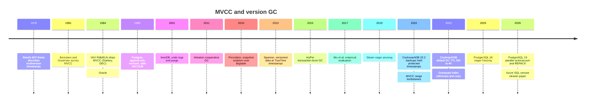
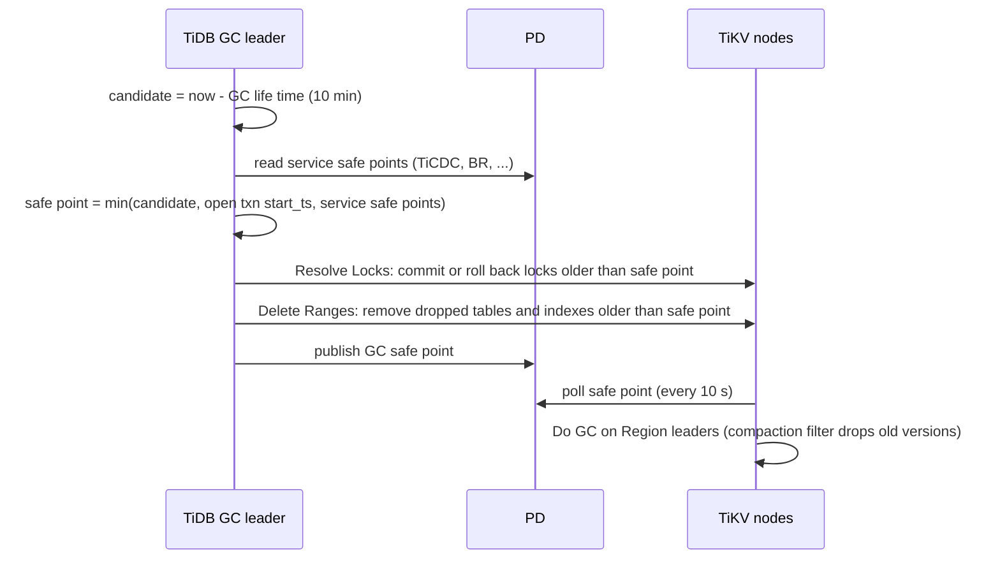

---
tags:
  - distributed-systems
  - storage
  - mvcc
  - garbage-collection
  - transactions
  - snapshot-isolation
status: draft
sources:
  - https://en.wikipedia.org/wiki/Multiversion_concurrency_control
  - https://www.vldb.org/pvldb/vol10/p781-Wu.pdf
  - https://db.cit.tum.de/~boettcher/p128-boettcher.pdf
  - https://www.vldb.org/pvldb/vol16/p1426-alhomssi.pdf
  - https://www.vldb.org/pvldb/vol19/p3916-gandikota.pdf
  - https://arxiv.org/abs/2606.09133
  - https://arxiv.org/pdf/2610.15793
  - https://www.postgresql.org/docs/current/routine-vacuuming.html
  - https://www.postgresql.org/docs/18/static/runtime-config-vacuum.html
  - https://www.postgresql.org/docs/current/release-18.html
  - https://www.postgresql.org/docs/19/release-19.html
  - https://postgresql.org/about/news/postgresql-19-released-3449
  - https://pganalyze.com/docs/checks/vacuum/xmin_horizon
  - https://dev.mysql.com/doc/refman/en/innodb-purge-configuration.html
  - https://docs.cockroachlabs.com/docs/stable/architecture/storage-layer.md
  - https://docs.cockroachlabs.com/docs/stable/configure-replication-zones.md
  - https://docs.cockroachlabs.com/docs/stable/operational-faqs.md
  - https://docs.cockroachlabs.com/docs/stable/protect-changefeed-data.md
  - https://www.cockroachlabs.com/blog/protected-timestamps-for-less-garbage/
  - https://www.cockroachlabs.com/blog/mvcc-range-tombstones/
  - https://dev.to/authzd/cockroachdb-231-new-defaults-impact-spicedb-51d2
  - https://docs.pingcap.com/tidb/dev/garbage-collection-overview/
  - https://docs.pingcap.com/tidb/dev/garbage-collection-configuration/
  - https://docs.pingcap.com/tidb/dev/ticdc-faq/
  - https://dev.to/tidbcommunity/tikv-component-gc-physical-space-reclamation-principles-and-common-issues-33a1
  - https://dev.to/yugabyte/snapshot-too-old-in-yugabytedb-23g5
  - https://docs.cloud.google.com/spanner/docs/pitr
  - https://www.mongodb.com/docs/v8.3/tutorial/long-running-queries/
  - https://apple.github.io/foundationdb/known-limitations
  - https://apple.github.io/foundationdb/anti-features.html
  - https://brooker.co.za/blog/2025/02/04/versioning
  - https://etcd.io/docs/v3.6/op-guide/maintenance/
  - https://rocksdb.org/blog/2026/06/22/range-tombstone-conversion.html
created: 2026-11-26
updated: 2026-11-26
---

## Table Of Contents

---

- [[#TL;DR|TL;DR]]
- [[#The Problem|The Problem]]
- [[#Foundations|Foundations]]
    - [[#Versions and the Visibility Rule|Versions and the Visibility Rule]]
    - [[#The Horizon|The Horizon]]
    - [[#Deletes Are Versions Too|Deletes Are Versions Too]]
    - [[#Four Design Choices|Four Design Choices]]
- [[#How We Got Here|How We Got Here]]
- [[#How It Works|How It Works]]
    - [[#Where Old Versions Live|Where Old Versions Live]]
    - [[#Single-Node Collectors: Vacuum, Purge and Pruning|Single-Node Collectors: Vacuum, Purge and Pruning]]
    - [[#PostgreSQL: The xmin Horizon and Wraparound|PostgreSQL: The xmin Horizon and Wraparound]]
    - [[#MVCC on an LSM: GC Is Compaction|MVCC on an LSM: GC Is Compaction]]
    - [[#Distributed GC: A Window Instead of a Census|Distributed GC: A Window Instead of a Census]]
    - [[#Holding the Horizon: Protected Timestamps and Service Safe Points|Holding the Horizon: Protected Timestamps and Service Safe Points]]
    - [[#A TiDB GC Round, Step by Step|A TiDB GC Round, Step by Step]]
    - [[#Bulk Deletes and Range Tombstones|Bulk Deletes and Range Tombstones]]
    - [[#Long-Running Readers|Long-Running Readers]]
- [[#Where It Is Now|Where It Is Now]]
- [[#Trade-offs & Open Problems|Trade-offs & Open Problems]]
- [[#Resources|Resources]]
- [[#Related Notes|Related Notes]]

## ***TL;DR***
---
*Multi-version concurrency control (MVCC) never overwrites a value; it adds a new version, so readers see a consistent snapshot without blocking writers. The price is garbage: every old version must eventually be deleted, and deciding when is the hard part, because one slow reader anywhere can stop the cleanup everywhere.*

- **The idea:** each write creates a new version stamped with a transaction ID or timestamp. A reader picks a snapshot and sees, for each item, the newest version at or before it. Readers don't wait for writers and writers don't wait for readers ([Wikipedia: MVCC](https://en.wikipedia.org/wiki/Multiversion_concurrency_control)).
- **The garbage rule:** a version can go once a newer version is visible to *every* snapshot that could still read. The oldest such snapshot is the **horizon** (PostgreSQL's *xmin horizon*, TiDB's *safe point*, CockroachDB's *GC threshold*). Everything below the horizon except the newest version per key is garbage.
- **What goes wrong:** the horizon is only as new as the oldest reader. A forgotten open transaction, a stuck replication slot, a paused change feed or a backup can hold it back for hours, and dead versions pile up: bloat, slower scans and, in PostgreSQL, transaction-ID wraparound ([PostgreSQL docs](https://www.postgresql.org/docs/current/routine-vacuuming.html); [pganalyze](https://pganalyze.com/docs/checks/vacuum/xmin_horizon)).
- **The distributed answer:** don't count readers across the cluster; keep a fixed time window instead. CockroachDB keeps 4 hours by default ([docs](https://docs.cockroachlabs.com/docs/stable/configure-replication-zones.md)), TiDB 10 minutes ([docs](https://docs.pingcap.com/tidb/dev/garbage-collection-overview/)), Spanner 1 hour (up to 7 days) ([docs](https://docs.cloud.google.com/spanner/docs/pitr)), FoundationDB about 5 seconds ([docs](https://apple.github.io/foundationdb/known-limitations)). Readers older than the window get "snapshot too old". Long jobs that need more (backups, change data capture) register explicit **protected timestamps** or **service safe points**, with expiry so a dead job can't hold the horizon forever.
- **Now (Nov 2026):** PostgreSQL 19 (Nov 19, 2026) adds parallel autovacuum, a scoring system for which table to vacuum first, `REPACK CONCURRENTLY`, and earlier wraparound warnings ([release notes](https://www.postgresql.org/docs/19/release-19.html)); Microsoft reports a rebuilt MVCC version cleaner running on more than 12 million Azure SQL databases (PVLDB 2026) ([Gandikota et al.](https://www.vldb.org/pvldb/vol19/p3916-gandikota.pdf)); and a CIDR 2027 paper argues the cloud primary shouldn't use MVCC at all ([Nguyen et al.](https://arxiv.org/pdf/2610.15793)).

## ***The Problem***
---
*Snapshots need old data to stay put while newer writes land. Storage is finite, so old data must eventually go. The database has to know, cheaply and safely, the moment nobody can read a version any more, and in a distributed system the "nobody" spans many machines and outside tools.*

Picture a bank table with one hot row, `balance = 100`. A reporting query starts at 09:00 and will run for an hour. At 09:01 a payment updates the row to 80, at 09:02 to 60, and so on, once a second.

- **Without versions** (single-version locking), the report either blocks the payments while it reads, or reads the row mid-update and sums inconsistent numbers.
- **With versions**, the report keeps reading `100` (the 09:00 snapshot), and the payments proceed. After an hour the row has 3,600 versions.

Which of those 3,600 can be deleted? Only those no snapshot can still see. While the 09:00 report runs, the version it reads (`100`) must stay, and every newer version must stay too, because newer readers may need them. Once the report ends and the oldest reader started at, say, 09:59:58, all versions older than the one current at 09:59:58 can go.

Three things make this hard:

1. **Finding the oldest reader.** On one node that's a scan of the active-transaction list. In a cluster, readers are spread over hundreds of nodes, plus replicas, standbys and tools (backup, change data capture) that read "as of" a time.
2. **Finding the garbage.** Old versions live in heap pages, undo logs or LSM files; finding them means scanning, which competes with user work.
3. **Deletes.** A delete is itself a version (a tombstone). It must outlive every older version it hides, on every replica, or the deleted value comes back ([[Anti-Entropy and Repair]]).

| Symptom | Cause | Example |
|---|---|---|
| Disk use keeps growing after deletes | Old versions and tombstones not yet collected, or collected but not yet compacted | CockroachDB "soft deletes" data, then needs compaction to free space ([FAQ](https://docs.cockroachlabs.com/docs/stable/operational-faqs.md)) |
| Scans get slower over the day | Scans step over dead versions and tombstones | One open OLAP snapshot collapses TPC-C throughput within about 10 seconds ([Alhomssi and Leis](https://www.vldb.org/pvldb/vol16/p1426-alhomssi.pdf)) |
| "Snapshot too old" errors | Reader older than the retention window | YugabyteDB, MongoDB, FoundationDB (below) |
| Database refuses writes | PostgreSQL XIDs about to wrap because old rows weren't frozen | [PostgreSQL docs](https://www.postgresql.org/docs/current/routine-vacuuming.html) |

## ***Foundations***
---
*Four ideas carry the note: the visibility rule that tells a snapshot which version to read, the horizon that tells the collector what it may delete, the fact that deletes are versions, and the four design choices every MVCC engine makes.*

### Versions and the Visibility Rule

*A snapshot is a timestamp. For each key, it reads the newest committed version at or before that timestamp.*

Each key $k$ has versions written at commit timestamps $v_1 < v_2 < \dots < v_n$. A reader with snapshot timestamp $s$ sees:

$$
\text{read}(k, s) = \text{value at } \max\{\, v_i : v_i \le s,\ v_i \text{ committed} \,\}
$$

*In plain English:* go back in time from your snapshot and take the first committed version you meet.

*Worked example:* key `k` has versions at 90 (`a`), 120 (`b`) and 150 (`c`). A reader at $s = 100$ sees `a`; at $s = 130$ sees `b`; at $s = 200$ sees `c`. Writers adding version 160 don't disturb any of them.

The timestamps can be transaction IDs (PostgreSQL, InnoDB), hybrid logical clock values (CockroachDB, YugabyteDB; see [[Time and Clocks]]), timestamps from a central oracle (TiDB) or synchronized physical clocks (Spanner, Aurora DSQL; see [[Clock Synchronization]]). This is the machinery under snapshot isolation in [[Consistency Models]] and [[Distributed Transactions]].

### The Horizon

*The horizon is the oldest snapshot anyone may still read at. For each key, keep the newest version at or below the horizon and everything above it; the rest is garbage.*

Let $h$ be the horizon: the minimum snapshot timestamp over every reader that could still start a read (open transactions, replicas, backups, change feeds). A version $v_i$ of key $k$ is garbage when a newer version is already visible to every possible reader:

$$
\text{garbage}(v_i) \iff \exists\, j > i : v_j \le h
$$

*In plain English:* if some newer version is at or below the horizon, every reader that can still exist will read that newer one (or something newer still), so nobody can ever reach $v_i$ again.

*Worked example (3 readers):* versions of `k` at 90, 120, 150. Active readers T1 (snapshot 100), T2 (140), T3 (155), so $h = 100$.

| Version | Newer version $\le h = 100$? | Keep? |
|---|---|---|
| 90 | No (120 > 100) | Keep: T1 reads it |
| 120 | No | Keep: T2 reads it |
| 150 | No | Keep: T3 reads it |

T1 commits; now $h = 140$. Version 120 is $\le 140$, so version 90 is garbage. T2 and T3 commit and new readers start at 200: $h = 200$, and only 150 survives.

Two refinements matter in practice:

- **Middle versions.** If the only readers are at 100 and 155, version 120 is unreachable even though it's above the horizon: 100 reads 90, 155 reads 150. A horizon-only collector keeps it anyway. Steam's "eager pruning" removes such in-between versions too ([Böttcher et al.](https://db.cit.tum.de/~boettcher/p128-boettcher.pdf)).
- **Separate horizons.** If short OLTP transactions and long OLAP queries are tracked separately, versions only an OLAP query could need can be moved out of OLTP's way instead of blocking all cleanup ([Alhomssi and Leis](https://www.vldb.org/pvldb/vol16/p1426-alhomssi.pdf)).

### Deletes Are Versions Too

*A delete writes a tombstone version. It can only be dropped when no older version of the key survives anywhere, or the deleted value reappears.*

- If the newest version at or below the horizon is a tombstone, the tombstone and everything older can go, since every reader sees "not found". TiDB's GC keeps "the last write per key before the safe point unless it's a deletion" ([TiDB docs](https://docs.pingcap.com/tidb/dev/garbage-collection-overview/)).
- In an LSM tree, an older copy may sit in a lower level, so the tombstone can only be dropped when compaction reaches the bottom ([[LSM Trees]]).
- Across replicas, every replica must have the tombstone first. Cassandra's `gc_grace_seconds` and ScyllaDB's repair-based tombstone GC exist for this ([[Anti-Entropy and Repair]]).

### Four Design Choices

*Wu, Pavlo and colleagues split every MVCC engine into four choices. GC is one, but version storage and index pointers decide how expensive GC is.*

From [Wu et al., PVLDB 2017](https://www.vldb.org/pvldb/vol10/p781-Wu.pdf):

| Choice | Options | What it means for GC |
|---|---|---|
| **Concurrency control** | MVTO (timestamp ordering), MVOCC (optimistic), MV2PL (locking), SI plus a serialization certifier | Decides which snapshots exist and how long they live |
| **Version storage** | Append-only (chain oldest-to-newest or newest-to-oldest), time-travel (old versions in a separate table), delta (main table holds the newest; undo records hold old attribute values) | Where the garbage sits and how hard it is to find |
| **Garbage collection** | Tuple-level: background vacuuming, or cooperative cleaning by transactions that walk past old versions; transaction-level: drop a finished transaction's versions using its write set | Who pays for cleanup, and when |
| **Index management** | Logical pointers (index points to a stable ID, then the chain) or physical pointers (index points at a specific version) | With physical pointers, every new version needs new index entries, and GC must clean the indexes too |

The paper's survey of real systems:

| System | Protocol | Version storage | GC | Index pointers |
|---|---|---|---|---|
| Oracle (1984) | MV2PL | Delta | Tuple-level, background | Logical |
| Postgres (1985) | MV2PL / SSI | Append-only, oldest-to-newest | Tuple-level, background (VACUUM) | Physical |
| MySQL InnoDB (2001) | MV2PL | Delta | Tuple-level, background (purge) | Logical (primary key) |
| Hekaton (2011) | MVOCC | Append-only, oldest-to-newest | Tuple-level, cooperative | Physical |
| SAP HANA (2012) | MV2PL | Time-travel | Hybrid | Logical |
| HyPer (2015) | MVOCC | Delta | Transaction-level | Logical |

## ***How We Got Here***
---
*MVCC was described in 1978, shipped in 1984, and by the 2000s was the default in most databases. GC stayed a background chore until in-memory engines, HTAP workloads and distributed SQL made it a first-class design problem.*

| Year | Step | Why it mattered |
|---|---|---|
| 1978 | **David Reed's MIT dissertation** "quite clearly describes MVCC" ([Wikipedia](https://en.wikipedia.org/wiki/Multiversion_concurrency_control)) | The idea: keep versions, read at a timestamp |
| 1981 | **Bernstein and Goodman**, "Concurrency Control in Distributed Database Systems" ([Wikipedia](https://en.wikipedia.org/wiki/Multiversion_concurrency_control)) | MVCC enters the standard theory |
| 1984 | **VAX Rdb/ELN** by Jim Starkey at DEC, "the first shipping, commercial database software product featuring MVCC"; Starkey later built InterBase ([Wikipedia](https://en.wikipedia.org/wiki/Multiversion_concurrency_control)) | MVCC in production |
| 1984 to 2001 | **Oracle** (delta storage), **Postgres** (append-only, VACUUM), **InnoDB** (undo, purge) ([Wu et al.](https://www.vldb.org/pvldb/vol10/p781-Wu.pdf)) | The two dominant layouts, and their two collectors |
| 2011 to 2015 | **In-memory engines**: Hekaton (cooperative cleaning), HyPer (transaction-level GC) ([Wu et al.](https://www.vldb.org/pvldb/vol10/p781-Wu.pdf)) | GC now on the critical path of millions of transactions per second |
| 2010s | **Distributed SQL**: Percolator (2010) and Spanner (2012) version every value at a timestamp ([[Distributed Transactions]]); TiDB, CockroachDB and YugabyteDB put versioned keys in an LSM; GC becomes a cluster-wide time window ([[Distributed SQL]]) | No single node knows the oldest reader |
| 2017 | **Wu et al.** measure all four design choices on one engine; transaction-level GC gives "the best performance with the smallest memory footprint" ([PVLDB](https://www.vldb.org/pvldb/vol10/p781-Wu.pdf)) | A map of the design space |
| 2019 | **Steam** prunes versions eagerly, bounding chain length by the number of active transactions ([Böttcher et al.](https://db.cit.tum.de/~boettcher/p128-boettcher.pdf)) | Long-running readers stop being catastrophic |
| 2022 to 2023 | **CockroachDB**: protected timestamps let backups run independently of the GC TTL ([Maru, Jan 2023](https://www.cockroachlabs.com/blog/protected-timestamps-for-less-garbage/)); the default TTL dropped from 25 hours to 4 hours for new deployments in v23.1 ([Authzed](https://dev.to/authzd/cockroachdb-231-new-defaults-impact-spicedb-51d2)); MVCC range tombstones arrive ([Grinaker and Owens, Jan 2023](https://www.cockroachlabs.com/blog/mvcc-range-tombstones/)) | Explicit holds replace "keep everything for a day" |
| 2023 | **Graveyard index** and separate OLTP/OLAP watermarks ([Alhomssi and Leis](https://www.vldb.org/pvldb/vol16/p1426-alhomssi.pdf)) | HTAP without throughput collapse |
| 2025 to 2026 | **PostgreSQL 18 and 19** rework vacuum: eager freezing, a fixed autovacuum cap, parallel autovacuum, scoring, `REPACK` ([18](https://www.postgresql.org/docs/current/release-18.html), [19](https://www.postgresql.org/docs/19/release-19.html)) | The most widely deployed collector gets its biggest change in years |

## ***How It Works***
---
*Start with where versions are stored, then the classic single-node collectors, then PostgreSQL's horizon and wraparound in detail, then how LSM-based distributed databases turn GC into compaction plus a cluster-wide window, and finally the holds and long readers that make it hard.*

### Where Old Versions Live

*Version storage decides who pays. Keeping old versions in the table makes reads of the newest version slower; keeping them in an undo log makes reads of old versions slower.*

| Layout | Newest version | Old versions | Garbage collector | Example |
|---|---|---|---|---|
| **Append-only in the heap** | A new tuple anywhere in the table; old tuple marked with the deleting transaction | Stay in place as dead tuples | VACUUM scans pages, removes dead tuples and their index entries | PostgreSQL |
| **Delta / undo** | Updated in place in the table | Undo records describing how to rebuild the old one | Purge walks the history list of undo logs | InnoDB, Oracle |
| **Versioned keys in an LSM** | A new key `(user_key, timestamp)` | Older `(user_key, timestamp)` entries in lower levels | Compaction drops them once past the horizon | CockroachDB (Pebble), TiKV and YugabyteDB (RocksDB-based) |
| **Persistent version store** | In place | A separate version store | Background cleaner | SQL Server / Azure SQL ([Gandikota et al.](https://www.vldb.org/pvldb/vol19/p3916-gandikota.pdf)) |

In Wu et al.'s measurements, newest-to-oldest chains beat oldest-to-newest by 2.4 to 3.4x under high contention, and they blamed PostgreSQL's and Hekaton's weaker TPC-C results on oldest-to-newest append-only storage ([PVLDB 2017](https://www.vldb.org/pvldb/vol10/p781-Wu.pdf)). Delta storage was about 2x faster for wide-row updates but had the worst scan latency.

### Single-Node Collectors: Vacuum, Purge and Pruning

*Three styles: a background sweeper (vacuum, purge), the transactions themselves cleaning as they go (cooperative, Steam), or reclaiming a whole transaction's versions at once (transaction-level).*

- **Background vacuuming.** A separate thread scans for expired versions. Simple, but it lags and scans a lot of live data. PostgreSQL VACUUM and InnoDB purge both work this way.
- **Cooperative cleaning.** A transaction that walks an oldest-to-newest chain and passes dead versions removes them. Only works with that chain order (Hekaton) ([Wu et al.](https://www.vldb.org/pvldb/vol10/p781-Wu.pdf)).
- **Transaction-level.** When the horizon passes a finished transaction, drop everything it overwrote, found through its write set. Wu et al. measured it about 20% faster than tuple-level on update-heavy work, and both styles 20 to 30% faster than no GC ([PVLDB 2017](https://www.vldb.org/pvldb/vol10/p781-Wu.pdf)).
- **Eager pruning (Steam).** Every time a thread touches a chain, it removes *all* versions no active transaction needs, including middle ones. Each thread publishes its own minimum start timestamp, so there is no global lock ([Böttcher et al.](https://db.cit.tum.de/~boettcher/p128-boettcher.pdf)). In a mixed benchmark this cut maximum chain length from 30,287 to 2 and raised throughput about 5x (6,554 to 30,580 transactions/s).

**InnoDB purge in practice.** A row is physically removed "only after the row is no longer required for multi-version concurrency control (MVCC) or rollback". Purge works through the *history list* of committed transactions' undo pages; its length is "typically a low value, usually less than a few thousand", but long transactions make it grow "even for transactions that are read only". Two classic culprits: `mysqldump --single-transaction` during heavy writes, and a `SELECT` with autocommit off and no `COMMIT` ([MySQL docs](https://dev.mysql.com/doc/refman/en/innodb-purge-configuration.html)). `innodb_max_purge_lag` (default 0, off) can slow writers when purge falls behind, by a delay of `(purge_lag / innodb_max_purge_lag - 0.9995) * 10000` microseconds.

### PostgreSQL: The xmin Horizon and Wraparound

*PostgreSQL keeps dead tuples in the table until VACUUM removes them, and its 32-bit transaction IDs force VACUUM to visit every table regularly even when nothing is dead. Both depend on the xmin horizon moving forward.*

**What VACUUM is for** ([PostgreSQL docs](https://www.postgresql.org/docs/current/routine-vacuuming.html)): reclaim space from updated or deleted rows, update planner statistics, update the *visibility map* (which pages are visible to everyone, so later vacuums and index-only scans can skip them), and protect against transaction-ID and multixact wraparound.

**What holds the horizon back** ([pganalyze](https://pganalyze.com/docs/checks/vacuum/xmin_horizon); [PostgreSQL docs](https://www.postgresql.org/docs/current/routine-vacuuming.html)):

| Holder | Why it pins old rows |
|---|---|
| Long-running transaction | Its snapshot may still need them |
| Abandoned prepared transaction (two-phase commit) | Counts as open until committed or rolled back |
| Physical replication slot with `hot_standby_feedback` | The standby reports its oldest query; a slow or dead standby stalls the primary |
| Long query on a standby with `hot_standby_feedback` | Same as a long query on the primary |
| Logical replication slot that isn't advancing | Holds the catalog xmin; see [[Change Data Capture]] |

**Wraparound.** XIDs are 32 bits and "compared using modulo-2^32 arithmetic", so "for every normal XID, there are two billion XIDs that are 'older' and two billion that are 'newer'". A row must be **frozen** (marked as visible to everyone, forever) before its XID ages past that, so "it is necessary to vacuum every table in every database at least once every two billion transactions" ([PostgreSQL docs](https://www.postgresql.org/docs/current/routine-vacuuming.html)).

$$
\text{age}(\text{datfrozenxid}) < 2^{31} \approx 2.1 \times 10^{9}
$$

*In plain English:* the oldest unfrozen transaction in the database must be less than about 2.1 billion transactions old, or new transactions would see old rows as "in the future" and they'd vanish.

The safety ladder, with PostgreSQL 18 defaults ([config docs](https://www.postgresql.org/docs/18/static/runtime-config-vacuum.html)) and PostgreSQL 19 warnings ([release notes](https://www.postgresql.org/docs/19/release-19.html)):

| Age of oldest unfrozen XID | What happens |
|---|---|
| 50 million (`vacuum_freeze_min_age`) | Rows this old get frozen when vacuum visits them |
| 150 million (`vacuum_freeze_table_age`) | Vacuum goes *aggressive*: it also scans all-visible pages that aren't yet all-frozen, instead of skipping them |
| 200 million (`autovacuum_freeze_max_age`) | Autovacuum forces an anti-wraparound vacuum even if disabled |
| 1.6 billion (`vacuum_failsafe_age`) | Failsafe: vacuum stops cost-based delay, bypasses index vacuuming and may use all of shared buffers to finish freezing fast |
| 100 million left before wraparound | Warnings (raised from 40 million in PostgreSQL 19) |
| 3 million left | "database is not accepting commands that assign new transaction IDs"; only read-only work runs |

*Worked example:* a cluster runs 10,000 write transactions per second. It burns 200 million XIDs in $2 \times 10^8 / 10^4 = 20{,}000$ s, about 5.6 hours, so every table gets an anti-wraparound vacuum roughly that often. If a forgotten transaction pins the horizon, freezing can't pass it, and the remaining 1.9 billion XIDs last $1.9 \times 10^9 / 10^4 \approx 53$ hours before writes stop. The fix order in the docs: resolve old prepared transactions, end long transactions, drop stale replication slots, then VACUUM.

**When autovacuum starts.** For dead tuples, the trigger is:

$$
\text{dead tuples} > \min\big(\,50 + 0.2 \times \text{reltuples},\ 100{,}000{,}000\,\big)
$$

*In plain English:* vacuum once 20% of the table plus 50 rows are dead, but never wait for more than 100 million dead rows (the cap, `autovacuum_vacuum_max_threshold`, is new in PostgreSQL 18).

*Worked example:* a 1-million-row table vacuums after 200,050 dead rows. A 1-billion-row table would have waited for 200 million dead rows before PostgreSQL 18; now it vacuums at 100 million.

### MVCC on an LSM: GC Is Compaction

*In an LSM-based store, a version is just a key with a timestamp suffix, and deleting it means compaction leaving it out of the next file. Logical GC (deciding what's garbage) and physical GC (getting the bytes off disk) are separate steps.*

- **Keys carry versions.** CockroachDB uses HLC timestamps "to differentiate between versions of data, track commit timestamps, and identify a value's garbage collection expiration", all stored in Pebble ([CockroachDB docs](https://docs.cockroachlabs.com/docs/stable/architecture/storage-layer.md)). See [[LSM Trees]].
- **Two ways to delete old versions.** Issue explicit deletes (which are themselves new writes and tombstones), or drop versions inside compaction. TiKV's original GC worker scanned every version and issued deletes on one thread and "the system is heavily impacted"; since TiDB 5.0 the default is a *compaction filter* that drops old versions as RocksDB rewrites files ([Wu, PingCAP, Jul 2025](https://dev.to/tidbcommunity/tikv-component-gc-physical-space-reclamation-principles-and-common-issues-33a1)).
- **Space comes back only after compaction.** "Only after RocksDB compaction completes will the physical space be reclaimed", and a delete marker may need to reach the bottom level, so it can take two compactions ([same source](https://dev.to/tidbcommunity/tikv-component-gc-physical-space-reclamation-principles-and-common-issues-33a1)). CockroachDB's FAQ gives the same two reasons disk usage doesn't drop right after deletes: MVCC history and compaction ([FAQ](https://docs.cockroachlabs.com/docs/stable/operational-faqs.md)).
- **Tombstones slow scans until then.** RocksDB 11.3 (June 2026) can turn a run of point tombstones into one synthesized range tombstone during a scan; on delete-heavy workloads forward scans went from 2,685 to 266,733 ops/s and reverse scans from 519 to 191,119 ops/s, with no regression on delete-free workloads. Off by default (`min_tombstones_for_range_conversion = 0`) ([Kang, RocksDB blog](https://rocksdb.org/blog/2026/06/22/range-tombstone-conversion.html)). Note the motivation: compaction "can't clear tombstones that a long-lived snapshot still needs".

### Distributed GC: A Window Instead of a Census

*A cluster can't cheaply know its oldest reader, so most distributed databases keep a fixed window of history and refuse reads older than it. The window is a product decision: longer means time travel and slower backups, shorter means less garbage.*

The horizon becomes:

$$
h = \min\big(\, t_{\text{now}} - \text{TTL},\ \text{oldest protected timestamp},\ \text{oldest open transaction (if tracked)} \,\big)
$$

*In plain English:* history is kept for a fixed time, unless something has explicitly asked for more, and (in some systems) unless a live transaction is older still.

| System | Default window | What the window buys | Reader older than the window |
|---|---|---|---|
| CockroachDB | `gc.ttlseconds` = 14400 (4 hours); 600 s is the smallest regularly tested ([docs](https://docs.cockroachlabs.com/docs/stable/configure-replication-zones.md)) | `AS OF SYSTEM TIME` queries, non-scheduled incremental backups | Fails; backups instead use protected timestamps |
| TiDB | GC life time 10 minutes, GC every 10 minutes ([docs](https://docs.pingcap.com/tidb/dev/garbage-collection-overview/)) | Reads at past timestamps, which need the versions the window keeps | Safe point never passes an open transaction's start, bounded by `tidb_gc_max_wait_time` (v6.1+) ([config docs](https://docs.pingcap.com/tidb/dev/garbage-collection-configuration/)) |
| YugabyteDB | `timestamp_history_retention_interval_sec` = 15 minutes ([Pachot](https://dev.to/yugabyte/snapshot-too-old-in-yugabytedb-23g5)) | Repeatable read and serializable reads, read committed statements | "Snapshot too old", not retryable |
| Spanner | 1 hour, up to 7 days ([docs](https://docs.cloud.google.com/spanner/docs/pitr)) | Point-in-time recovery and reads at past timestamps | Outside the earliest version time |
| MongoDB | 300 seconds (`minSnapshotHistoryWindowInSeconds`) ([docs](https://www.mongodb.com/docs/v8.3/tutorial/long-running-queries/)) | Snapshot reads, including on secondaries | `SnapshotTooOld` |
| FoundationDB | About 5 seconds of conflict history ([known limitations](https://apple.github.io/foundationdb/known-limitations); [anti-features](https://apple.github.io/foundationdb/anti-features.html)) | Short transactions | `transaction_too_old` |
| Aurora DSQL | 5-minute transaction cap ([Brooker, Feb 2025](https://brooker.co.za/blog/2025/02/04/versioning)) | Keeping versions for running transactions becomes a local property, with no global registry | Transaction can't run that long |
| etcd | Periodic or revision-based compaction, e.g. keep 1 hour or the last 1,000 revisions ([docs](https://etcd.io/docs/v3.6/op-guide/maintenance/)) | Watches and reads at old revisions ([[Coordination Services]]) | "required revision has been compacted" |

Brooker's DSQL argument is the cleanest statement of why a time cap helps: with physical-clock timestamps and a maximum transaction length, each storage replica knows on its own which versions any running transaction could need, so no node ever has to ask "who is the oldest reader?" ([Brooker](https://brooker.co.za/blog/2025/02/04/versioning)). The cost is that the design "wouldn't suit long-running OLAP or reporting workloads".

*Worked example (sizing the window):* one hot CockroachDB row updated 100 times a second keeps $100 \times 14{,}400 = 1.44$ million versions under the 4-hour default. At 400 bytes each that's about 576 MB of history for one row, all in one range. The docs warn exactly about this: a high TTL "can cause problems if the retained versions of a single row approach the maximum range size" ([docs](https://docs.cockroachlabs.com/docs/stable/configure-replication-zones.md)). For hot rows, lower the TTL on that table.

Spanner adds a second cost: longer retention means more compaction work, so "Spanner uses extra resources to compact and maintain older versions", which can raise CPU and latency, and raising retention from 3 to 7 days takes about 4 days for storage to settle ([docs](https://docs.cloud.google.com/spanner/docs/pitr)).

### Holding the Horizon: Protected Timestamps and Service Safe Points

*Long-running jobs (backups, change feeds, index builds) register an explicit hold on old history instead of forcing everyone to keep a long window. Every hold needs an expiry, or a dead job becomes a permanent leak.*

**CockroachDB protected timestamps.** "Garbage collection can only run on MVCC values which are not covered by a protected timestamp" ([docs](https://docs.cockroachlabs.com/docs/stable/architecture/storage-layer.md)). A record targets a cluster, database or table. Before v22.2, incremental backups failed if GC had removed what they needed, which pushed users to long TTLs; since then scheduled backups write a protected timestamp before a full backup, hold it through incrementals and advance it after each succeeds, making backup cadence "independent from the GC TTL" ([Maru](https://www.cockroachlabs.com/blog/protected-timestamps-for-less-garbage/)). Changefeeds protect data "up to the time of the checkpoint". Guards against leaks: `gc_protect_expires_after` cancels a changefeed whose hold is too old, and `changefeed.protect_timestamp.max_age` (default 4 days) fails it ([docs](https://docs.cockroachlabs.com/docs/stable/protect-changefeed-data.md)).

**TiDB service safe points.** Tools register their own safe point in PD, the placement driver. TiCDC's owner sets it to "the smallest value of `checkpoint-ts`" across changefeeds, so a paused changefeed stops it from advancing. `gc-ttl` (default 24 hours) bounds that: a changefeed suspended longer "enters the `failed` status and cannot be resumed", and GC moves on ([TiCDC FAQ](https://docs.pingcap.com/tidb/dev/ticdc-faq/)).

**PostgreSQL's equivalents** are replication slots, with no built-in expiry by default, which is why a stuck slot is the classic cause of runaway bloat ([[Change Data Capture]]). PostgreSQL 19's new `retain_dead_tuples` subscription option deliberately holds dead tuples for conflict detection and comes with `max_retention_duration` to cap it ([release notes](https://www.postgresql.org/docs/19/release-19.html)).

### A TiDB GC Round, Step by Step

*One round of distributed GC: compute the safe point, finish or roll back any transaction older than it, drop dropped tables wholesale, then let each storage node prune its own Regions.*

From the [TiDB GC overview](https://docs.pingcap.com/tidb/dev/garbage-collection-overview/) and [PingCAP's TiKV write-up](https://dev.to/tidbcommunity/tikv-component-gc-physical-space-reclamation-principles-and-common-issues-33a1):

*Worked example:* it's 10:00. The candidate is 09:50. An interactive transaction started at 09:30 is still open, so the safe point is 09:30. A TiCDC changefeed paused at 08:00 has a service safe point of 08:00, so the safe point is 08:00 and two hours of history stay. If the changefeed stays paused past 24 hours, it fails, its hold is released, and the next round jumps forward.

**Why resolve locks first:** TiDB uses Percolator-style two-phase commit ([[Distributed Transactions]]). A lock left by a crashed client says "this write might be committed". GC must settle every lock below the safe point (commit it if the primary key committed, otherwise roll it back) before it can tell which version is the newest committed one.

### Bulk Deletes and Range Tombstones

*Dropping a billion-row table shouldn't write a billion tombstones, but deleting data underneath MVCC breaks anything that reads history. Range tombstones are the compromise.*

CockroachDB used to remove data from dropped tables and cancelled imports directly in the storage engine, which "can break functionality that relies on the MVCC history" (it blocked cluster-to-cluster replication). MVCC range tombstones "mark an entire keyspan as deleted with a single (cheap) write", are garbage collected like point tombstones, and when a whole range is deleted the GC also lays a Pebble range tombstone so compaction can drop it in one go ([Grinaker and Owens, Jan 2023](https://www.cockroachlabs.com/blog/mvcc-range-tombstones/)). They shipped in 22.2 behind a setting, for schema deletions and import cleanup only; ordinary SQL `DELETE` still writes point tombstones. TiDB's "Delete Ranges" step does the same job for `DROP TABLE` and `DROP INDEX` ([TiDB docs](https://docs.pingcap.com/tidb/dev/garbage-collection-overview/)).

### Long-Running Readers

*Every collector above stalls on the oldest reader. The research answers are to prune around it, to move its garbage out of everyone else's way, or to give it a separate copy of the data.*

| Approach | Idea | Source |
|---|---|---|
| Time window plus "snapshot too old" | Refuse readers older than the window | CockroachDB, TiDB, YugabyteDB, MongoDB, FoundationDB (above) |
| Eager pruning | Remove middle versions no live snapshot can see, so chains stay short | Steam ([Böttcher et al.](https://db.cit.tum.de/~boettcher/p128-boettcher.pdf)) |
| Separate watermarks plus graveyard | Track OLTP and OLAP horizons separately; move tombstones only OLAP needs into a side index OLTP never reads | [Alhomssi and Leis](https://www.vldb.org/pvldb/vol16/p1426-alhomssi.pdf): about 2 million TPC-C transactions/s on 64 cores alongside a long OLAP scan |
| Statement-level snapshots | Under read committed, let each statement's snapshot, not the transaction's, pin versions | Azure SQL: about 27% of reclaimed version store where holdups exceeded 50 GB ([Gandikota et al.](https://www.vldb.org/pvldb/vol19/p3916-gandikota.pdf)) |
| Read from a replica or snapshot copy | Run the report on a secondary or a separate engine | MongoDB snapshot reads on secondaries "do not impact your application's write workload" ([docs](https://www.mongodb.com/docs/v8.3/tutorial/long-running-queries/)) |
| Cap transaction length | Make long readers impossible | FoundationDB 5 s, Aurora DSQL 5 min |

## ***Where It Is Now***
---
*As of late November 2026: PostgreSQL's collector got its largest overhaul in years, cloud vendors are publishing how their cleaners behave at fleet scale, and researchers are questioning whether the cloud primary needs MVCC at all.*

- **PostgreSQL 19 (released Nov 19, 2026)** ([release notes](https://www.postgresql.org/docs/19/release-19.html); [announcement](https://postgresql.org/about/news/postgresql-19-released-3449)):
  - Parallel autovacuum of indexes (`autovacuum_max_parallel_workers`), and a **scoring system** for which tables autovacuum processes first, with five weight settings and a `pg_stat_autovacuum_scores` view.
  - **`REPACK`** replaces `VACUUM FULL` and `CLUSTER`; `REPACK (CONCURRENTLY)` rebuilds a bloated table without blocking reads or writes.
  - Ordinary query scans can now mark pages all-visible, so later vacuums skip them.
  - Wraparound warnings now start 100 million transactions out (was 40 million); multixact members are now 64-bit. XIDs themselves are still 32-bit.
  - Parallel vacuum workers now share one cost-delay budget, so some parallel vacuums run slower than before.
- **PostgreSQL 18 (Sep 2025)** made normal vacuums freeze some all-visible pages early ("eager freezing", capped by `vacuum_max_eager_freeze_failure_rate`, default 3%), added the 100-million dead-tuple cap, and let `autovacuum_max_workers` change without a restart ([release notes](https://www.postgresql.org/docs/current/release-18.html); [config](https://www.postgresql.org/docs/18/static/runtime-config-vacuum.html)).
- **Azure SQL version cleaner (PVLDB 19, 2026).** Microsoft rebuilt its MVCC cleaner with parallel sweeps, retries for pages it couldn't lock, transaction-level tracking and statement-level cleanup. The 99.99th-percentile sweep for databases with 100 GB or more of version store fell from about 6 days to about 1 day, and it runs by default on more than 12 million databases ([Gandikota et al.](https://www.vldb.org/pvldb/vol19/p3916-gandikota.pdf)). (One success figure in the paper is internally inconsistent: 98.6% vs about 86%.)
- **Single-version concurrency control, again (CIDR 2027, arXiv Oct 2026).** Nguyen, Haas, El-Hindi, Leis and Bernstein argue that in the cloud, analytics run on replicas and separate engines, so the primary writer pays MVCC's costs (16 to 32+ bytes of metadata per record, unpredictable GC, roughly 2 to 3x the engineering effort in their prototypes) without needing its benefits. They propose single-version control on the primary with extensions for large transactions ([Nguyen et al.](https://arxiv.org/pdf/2610.15793)). A position paper, not a measured system.
- **Index-level versioning (arXiv, Jun 2026).** The concurrent multiversion B-tree (cMVBT) keeps versions inside the index, needs no latches for range scans, and claims "continuous garbage collection without activity spikes" ([Tonta et al.](https://arxiv.org/abs/2606.09133)). Preprint, no numbers in the abstract.
- **Storage engines.** RocksDB 11.3's tombstone-to-range conversion (above) attacks the scan cost of not-yet-compacted deletes ([Kang, Jun 2026](https://rocksdb.org/blog/2026/06/22/range-tombstone-conversion.html)).
- **Distributed SQL defaults.** CockroachDB v26.4 docs still give 4 hours with protected timestamps for backups and changefeeds; TiDB keeps 10 minutes with service safe points; Spanner keeps 1 hour by default (sources above).

## ***Trade-offs & Open Problems***
---
*Every knob trades history for garbage. The open problems are about who is allowed to hold history, for how long, and how to stop one reader from taxing everyone.*

| Choice | You get | You pay |
|---|---|---|
| Long GC window | Time travel, slower backups, long reads succeed | Bloat, slower scans, hot rows near range limits |
| Short GC window | Less garbage, faster scans | "Snapshot too old"; backups and CDC need explicit holds |
| Explicit holds (protected timestamps, slots) | Exactly the history a job needs | A dead job leaks garbage until expiry; expiry fails the job |
| Track open transactions in the horizon | Long transactions succeed | One forgotten transaction stalls GC cluster-wide |
| Cap transaction length | Purely local GC decisions | No long reads or big writes on that system |
| Append-only in-heap versions | Cheap old-version reads, simple rollback | Dead tuples in the table and its indexes; vacuum and freezing |
| Undo-based versions | Table holds only current data | Old reads rebuild from undo; long history list |
| GC in compaction | No extra delete writes | Space only returns when compaction runs; tombstones linger |

**Open problems:**

- **Fair holds.** Nothing yet ranks holders: a paused change feed and a production OLTP workload share one horizon, and the only lever is an expiry that kills the feed. Per-holder budgets, or tiering held history to [[Object Storage]], are obvious next steps.
- **Cross-system horizons.** A lakehouse sink, a search index and a replica each read "as of" a time. Lining up their holds with the source's GC is still manual ([[Change Data Capture]]).
- **Unbounded wraparound.** PostgreSQL's multixact members went 64-bit in version 19, but transaction IDs did not; the full 64-bit XID change is still out of tree.
- **Is MVCC worth it on the primary?** The CIDR 2027 argument for single-version control is unmeasured against production HTAP workloads; the 2017 data showed MVCC's GC overhead is real but its read benefits were large.
- **Tombstones and replicas.** GC must respect both the local horizon and replica convergence; time-based grace periods are still the norm outside ScyllaDB ([[Anti-Entropy and Repair]]).

## ***Resources***
---
*Start with Wu et al. for the design space and the PostgreSQL vacuuming chapter for the operational reality; the CockroachDB and TiDB docs show how distributed databases bound history.*

**Papers**
- [An Empirical Evaluation of In-Memory Multi-Version Concurrency Control](https://www.vldb.org/pvldb/vol10/p781-Wu.pdf): Wu, Arulraj, Lin, Xian, Pavlo, PVLDB 10(7), 2017.
- [Scalable Garbage Collection for In-Memory MVCC Systems](https://db.cit.tum.de/~boettcher/p128-boettcher.pdf): Böttcher, Leis, Neumann, Kemper, PVLDB 13(2), 2019 (Steam).
- [Scalable and Robust Snapshot Isolation for High-Performance Storage Engines](https://www.vldb.org/pvldb/vol16/p1426-alhomssi.pdf): Alhomssi and Leis, PVLDB 16(6), 2023.
- [Highly Scalable SQL Azure MVCC Version Cleaner](https://www.vldb.org/pvldb/vol19/p3916-gandikota.pdf): Gandikota et al., PVLDB 19(12), 2026.
- [The Case for Single-Version Concurrency Control in the Cloud](https://arxiv.org/pdf/2610.15793): Nguyen, Haas, El-Hindi, Leis, Bernstein, CIDR 2027.
- [Multiversion Concurrency Control for Multiversion B-Trees](https://arxiv.org/abs/2606.09133): Tonta, Seeger, Soisalon-Soininen, arXiv, Jun 2026.
- History (Reed 1978; Bernstein and Goodman 1981; VAX Rdb/ELN): [Wikipedia: Multiversion concurrency control](https://en.wikipedia.org/wiki/Multiversion_concurrency_control).

**Practitioner write-ups**
- [Protected Timestamps: For a future with less garbage](https://www.cockroachlabs.com/blog/protected-timestamps-for-less-garbage/): Aditya Maru, Cockroach Labs, Jan 2023.
- [MVCC range tombstones](https://www.cockroachlabs.com/blog/mvcc-range-tombstones/): Erik Grinaker and Jackson Owens, Cockroach Labs, Jan 2023.
- [Versioning versus Coordination](https://brooker.co.za/blog/2025/02/04/versioning): Marc Brooker, Feb 2025.
- [Snapshot too old in YugabyteDB](https://dev.to/yugabyte/snapshot-too-old-in-yugabytedb-23g5): Franck Pachot, Apr 2024.
- [TiKV Component GC (Physical Space Reclamation)](https://dev.to/tidbcommunity/tikv-component-gc-physical-space-reclamation-principles-and-common-issues-33a1): Shirly Wu, PingCAP, Jul 2025.
- [Range tombstone conversion](https://rocksdb.org/blog/2026/06/22/range-tombstone-conversion.html): Josh Kang, RocksDB blog, Jun 2026.
- [xmin horizon check](https://pganalyze.com/docs/checks/vacuum/xmin_horizon): pganalyze.
- [CockroachDB 23.1 new defaults](https://dev.to/authzd/cockroachdb-231-new-defaults-impact-spicedb-51d2): Authzed.

**Docs**
- PostgreSQL: [Routine Vacuuming](https://www.postgresql.org/docs/current/routine-vacuuming.html), [vacuum settings (18)](https://www.postgresql.org/docs/18/static/runtime-config-vacuum.html), [18 release notes](https://www.postgresql.org/docs/current/release-18.html), [19 release notes](https://www.postgresql.org/docs/19/release-19.html), [19 announcement](https://postgresql.org/about/news/postgresql-19-released-3449).
- [InnoDB purge configuration](https://dev.mysql.com/doc/refman/en/innodb-purge-configuration.html).
- CockroachDB: [storage layer](https://docs.cockroachlabs.com/docs/stable/architecture/storage-layer.md), [replication zones (gc.ttlseconds)](https://docs.cockroachlabs.com/docs/stable/configure-replication-zones.md), [operational FAQs](https://docs.cockroachlabs.com/docs/stable/operational-faqs.md), [protect changefeed data](https://docs.cockroachlabs.com/docs/stable/protect-changefeed-data.md).
- TiDB: [GC overview](https://docs.pingcap.com/tidb/dev/garbage-collection-overview/), [GC configuration](https://docs.pingcap.com/tidb/dev/garbage-collection-configuration/), [TiCDC FAQ](https://docs.pingcap.com/tidb/dev/ticdc-faq/).
- [Spanner point-in-time recovery](https://docs.cloud.google.com/spanner/docs/pitr); [MongoDB long-running snapshot queries](https://www.mongodb.com/docs/v8.3/tutorial/long-running-queries/); FoundationDB [known limitations](https://apple.github.io/foundationdb/known-limitations) and [anti-features](https://apple.github.io/foundationdb/anti-features.html); [etcd maintenance](https://etcd.io/docs/v3.6/op-guide/maintenance/).

## ***Related Notes***
---
*Notes that store, read or hold back the versions described here.*

- [[LSM Trees]] — Versioned keys, tombstones and why GC is compaction.
- [[Anti-Entropy and Repair]] — Tombstones must reach every replica before they are purged.
- [[Distributed Transactions]] — Snapshot reads, Percolator locks that GC must resolve.
- [[Distributed SQL]] — How Spanner, CockroachDB, TiDB, YugabyteDB and DSQL version data.
- [[Consistency Models]] — Snapshot isolation, the main user of MVCC.
- [[Isolation Testing]] — Checkers that recover the version order MVCC produces.
- [[Time and Clocks]] — HLC and physical timestamps as version stamps.
- [[Clock Synchronization]] — Why DSQL can make GC a local decision.
- [[Change Data Capture]] — Replication slots and change feeds as horizon holders.
- [[Write-Ahead Logging]] — Undo, redo, and why in-heap versions change what undo must do.
- [[Coordination Services]] — etcd's revision history and compaction.
- [[Message Queues]] — Postgres-backed queues and the dead tuples they create.
- [[Secondary Indexes]] — Physical index pointers make every new version an index write.
- [[Replication]] — Standbys whose queries hold back the primary's horizon.
- [[Object Storage]] — Where held history could be tiered.
- [[Bloom and Range Filters]] — Skipping files full of dead versions.
