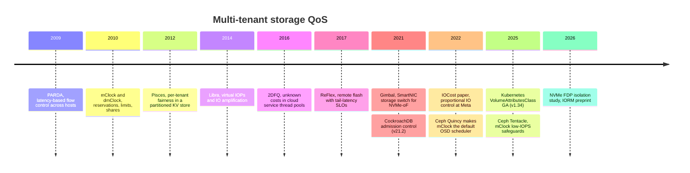
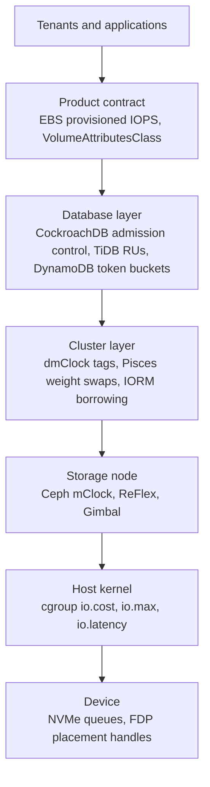

---
tags:
  - distributed-systems
  - storage
  - multi-tenancy
  - qos
  - fairness
  - admission-control
  - ssd
status: complete
sources:
  - https://static.usenix.org/events/fast09/tech/full_papers/gulati/gulati.pdf
  - https://static.usenix.org/events/osdi10/tech/full_papers/Gulati.pdf
  - https://www.cs.princeton.edu/~mfreed/docs/pisces-osdi12.pdf
  - https://www.cs.princeton.edu/~mfreed/docs/libra-eurosys14.pdf
  - https://people.mpi-sws.org/~jcmace/papers/mace20162dfq.pdf
  - https://courses.physics.illinois.edu/ece598ms/fa2019/papers/paper193.pdf
  - https://conferences.sigcomm.org/sigcomm/2021/files/papers/3452296.3472940.pdf
  - https://par.nsf.gov/servlets/purl/10332478
  - https://docs.ceph.com/en/reef/rados/configuration/mclock-config-ref/
  - https://pve.proxmox.com/wiki/Ceph_mClock_Tuning
  - https://ceph.io/en/news/blog/2025/v20-2-0-tentacle-released
  - https://gitverse.ru/githubmirror/ceph/tag/v20.1.1/PendingReleaseNotes
  - https://www.cockroachlabs.com/blog/admission-control-in-cockroachdb/
  - https://docs.cockroachlabs.com/docs/v26.3/admission-control
  - https://docs.pingcap.com/tidb/dev/tidb-resource-control-ru-groups/
  - https://usenix.org/system/files/atc22-elhemali.pdf
  - https://docs.aws.amazon.com/ebs/latest/userguide/general-purpose.html
  - https://kubernetes.io/blog/2025/09/08/kubernetes-v1-34-volume-attributes-class/
  - https://arxiv.org/html/2607.16578
  - https://arxiv.org/html/2610.02676v1
created: 2026-11-28
updated: 2026-11-28
---

## Table Of Contents

---

- [[#TL;DR|TL;DR]]
- [[#The Problem|The Problem]]
- [[#Foundations|Foundations]]
    - [[#What a Tenant Asks For|What a Tenant Asks For]]
    - [[#What an IO Costs|What an IO Costs]]
    - [[#Capacity Is a Moving Target|Capacity Is a Moving Target]]
    - [[#Token Buckets and Burst Credits|Token Buckets and Burst Credits]]
- [[#How We Got Here|How We Got Here]]
- [[#How It Works|How It Works]]
    - [[#Where QoS Is Enforced|Where QoS Is Enforced]]
    - [[#PARDA, Fairness Without a Central Scheduler|PARDA, Fairness Without a Central Scheduler]]
    - [[#IOCost, Proportional Control Inside the Kernel|IOCost, Proportional Control Inside the Kernel]]
    - [[#ReFlex and Gimbal, QoS for Shared Flash|ReFlex and Gimbal, QoS for Shared Flash]]
    - [[#Libra, From Application Requests to Virtual IOPs|Libra, From Application Requests to Virtual IOPs]]
    - [[#2DFQ, When Costs Are Unknown|2DFQ, When Costs Are Unknown]]
    - [[#Ceph's mClock Profiles in Practice|Ceph's mClock Profiles in Practice]]
    - [[#Databases, Admission Control and Request Units|Databases, Admission Control and Request Units]]
    - [[#Cloud Volumes, QoS as a Product|Cloud Volumes, QoS as a Product]]
- [[#Where It Is Now|Where It Is Now]]
- [[#Trade-offs & Open Problems|Trade-offs & Open Problems]]
- [[#Resources|Resources]]
- [[#Related Notes|Related Notes]]

## ***TL;DR***
---
*Multi-tenant storage QoS is how a shared disk, SSD or storage cluster keeps one tenant's IO from wrecking another's latency. The fairness math is the same as anywhere else; what makes storage hard is that nobody knows exactly what an IO costs or how much the device can do right now.*

- **Tenants ask for three things:** a floor (reservation), a ceiling (limit) and a share of the rest (weight), often plus a latency target. mClock (OSDI 2010) is the classic scheduler for all three; its tag math and dmClock's distributed version are in [[Resource Fairness#Storage IO, mClock and Pisces|Resource Fairness]], and this note builds on them rather than repeating them.
- **The real problem is cost.** On flash a write costs roughly 10 to 20 reads ([ReFlex, ASPLOS 2017](https://courses.physics.illinois.edu/ece598ms/fa2019/papers/paper193.pdf)); in a key-value store one PUT later turns into log, flush and compaction IO ([Libra, EuroSys 2014](https://www.cs.princeton.edu/~mfreed/docs/libra-eurosys14.pdf)); in a cloud service request costs vary by "at least 4 orders of magnitude" ([2DFQ, SIGCOMM 2016](https://people.mpi-sws.org/~jcmace/papers/mace20162dfq.pdf)). Every working system first builds a **cost model**, then schedules in units of it.
- **Capacity has to be discovered by feedback.** PARDA (FAST 2009) adjusts each host's window from measured latency; Linux's IOCost scales its virtual clock (`vrate`) from latency targets; Gimbal treats an SSD like a congested network link; CockroachDB issues write tokens from the health of its [[LSM Trees|LSM]].
- **Enforcement happens at every layer:** the device (NVMe placement hints), the host kernel (`io.cost`), the storage node (Ceph's mClock), the cluster (dmClock, Pisces), the database (CockroachDB admission control, TiDB Request Units, DynamoDB's token buckets) and the cloud product (EBS provisioned IOPS, Kubernetes VolumeAttributesClass).
- **In production, Nov 2026:** Ceph schedules every OSD with mClock but treats all external clients as one class; IOCost runs across Meta's whole fleet; CockroachDB v26.3 ships disk-bandwidth provisioning in Preview; Kubernetes made per-volume IOPS and throughput changes GA in v1.34. Per-tenant QoS that holds across a cluster, on mixed hardware, is still mostly research and preprints.

## ***The Problem***
---
*A shared storage system is cheap only if a backup job, a compaction storm or a rebuild after a disk failure doesn't stall the tenant next to it. Storage makes this harder than CPU or network because the cost of an IO depends on its type, size, history and what else the device is doing.*

Five things make storage QoS different from fair queuing on a network link ([[Resource Fairness]]):

| Difficulty | What it means | Example |
|---|---|---|
| **Reads and writes cost differently** | Writes trigger flash garbage collection and wear-levelling, which slow reads | A 4 KB write costs 10, 16 or 20 "read tokens" on three NVMe SSDs ([ReFlex](https://courses.physics.illinois.edu/ece598ms/fa2019/papers/paper193.pdf)) |
| **Capacity fluctuates** | The same device does more sequential than random IO, more reads than writes, and less when it is full | Ceph benchmarks each OSD at boot because a fixed IOPS number is wrong for most drives ([Ceph docs](https://docs.ceph.com/en/reef/rados/configuration/mclock-config-ref/)) |
| **IO amplification** | One application request causes more IO later | A PUT goes to the [[Write-Ahead Logging|write-ahead log]], then a flush, then compactions ([Libra](https://www.cs.princeton.edu/~mfreed/docs/libra-eurosys14.pdf)) |
| **Background work is a tenant too** | Recovery, rebalancing, scrubbing and compaction compete with clients | Ceph splits every OSD between clients, recovery and "best-effort" work ([Ceph docs](https://docs.ceph.com/en/reef/rados/configuration/mclock-config-ref/)) |
| **Tenants span many nodes** | A tenant's data is spread over partitions whose load shifts | Static per-node splits of a limit "strand capacity on idle nodes and throttle the tenant below its entitlement" ([IORM preprint, 2026](https://arxiv.org/html/2607.16578)) |

What goes wrong without QoS is concrete. In the mClock paper an uncapped data-migration VM held an OLTP VM's latency at 36 ms instead of 16 ms ([Gulati et al., OSDI 2010](https://static.usenix.org/events/osdi10/tech/full_papers/Gulati.pdf)). In PARDA's tests, two hosts whose VMs had a 2:1 share ratio got nearly equal throughput (710 vs 730 IOPS), because the array served whichever host sent more requests ([PARDA](https://static.usenix.org/events/fast09/tech/full_papers/gulati/gulati.pdf)). Interference also shows up as the slow-but-alive behavior described in [[Gray and Fail-Slow Failures]] and as tail latency in fan-out reads ([[Tail Latency and Hedging]]).

## ***Foundations***
---
*Four ideas carry the whole topic: what a tenant is promised, how an IO is priced, how the system learns its own capacity, and how bursts are allowed without breaking promises.*

### What a Tenant Asks For
---
*Storage QoS contracts have the same three knobs almost everywhere. Knowing which knob a product exposes tells you what it can and can't promise.*

| Knob | Meaning | Who uses it |
|---|---|---|
| **Reservation** (floor) | Minimum IOPS or bandwidth, guaranteed even under contention | mClock $r$, Ceph `_res`, ReFlex latency-critical tenants |
| **Limit** (ceiling) | Maximum, enforced even when the device is idle | mClock $l$, Ceph `_lim`, cgroup `io.max`, EBS volume size |
| **Weight** (share) | Proportion of whatever is left after reservations | mClock $w$, cgroup `io.weight`, PARDA $\beta$ |
| **Latency target** | A percentile latency at a given load | ReFlex SLO (e.g. 200 µs p95 at 50K IOPS), cgroup `io.latency` |

Reservations need **admission control**: the sum of floors must fit in the device's worst-case capacity, or the guarantee is a lie. Ceph says so directly, warning operators to "ensure that the sum of the reservations do not exceed the maximum proportion (1.0)" ([Ceph docs](https://docs.ceph.com/en/reef/rados/configuration/mclock-config-ref/)). Limits are **not work-conserving**: a capped tenant waits while the disk sits idle. Weights are work-conserving but promise nothing in absolute terms. The mClock scheduler combines all three with three tags per request; see [[Resource Fairness#Storage IO, mClock and Pisces|Resource Fairness]] for the tag update rule and the paper's 1,200-IOPS worked example.

### What an IO Costs
---
*Every successful system converts IOs into a common unit before it schedules. The unit differs (microseconds of device time, read-equivalents, virtual IOPs, Request Units), but the idea is the same: charge each IO for the share of the device it actually uses.*

| System | Unit | How it's priced |
|---|---|---|
| IOCost (Linux `io.cost`) | Device time | Linear model with 6 parameters: read/write × random/sequential base cost, plus a per-byte rate ([IOCost](https://par.nsf.gov/servlets/purl/10332478)) |
| ReFlex | Tokens (1 token = 4 KB random read) | Writes cost 10 to 20 tokens depending on the device; larger IOs scale with size above 4 KB ([ReFlex](https://courses.physics.illinois.edu/ece598ms/fa2019/papers/paper193.pdf)) |
| Libra | Virtual IOPs (VOPs) | Derived from measured throughput-vs-size curves, using the *floor* of capacity under interference ([Libra](https://www.cs.princeton.edu/~mfreed/docs/libra-eurosys14.pdf)) |
| Gimbal | Virtual slots (128 KB) | Write cost starts at a worst case of 9 and is recalibrated from latency ([Gimbal](https://conferences.sigcomm.org/sigcomm/2021/files/papers/3452296.3472940.pdf)) |
| TiDB | Request Units | 1 RU = 8 read requests, 64 KiB read, 1 KiB written (per replica) or 3 ms CPU ([TiDB docs](https://docs.pingcap.com/tidb/dev/tidb-resource-control-ru-groups/)) |
| Ceph mClock | IOPS of 4 KiB random writes, plus sequential bandwidth | Measured at OSD start, with `osd_mclock_max_sequential_bandwidth_*` as the bandwidth term ([Ceph docs](https://docs.ceph.com/en/reef/rados/configuration/mclock-config-ref/)) |

IOCost's model is the clearest to write down:

$$
\text{cost}(io) = \text{base}_{\,\text{rw},\,\text{seq/rand}} + \text{rate}_{\,\text{rw}} \times \text{size}, \qquad
\text{rate} = \frac{1\,\text{s}}{\text{Bps}}, \qquad
\text{base} = \frac{1\,\text{s}}{\text{IOPS}_{4\text{K}}} - \text{rate} \times 4\,\text{KiB}
$$

*In words:* an IO costs a fixed overhead that depends on whether it is a read or write and random or sequential, plus a time per byte. Both come from benchmarking the device's peak 4 KB IOPS and peak bandwidth. A cost of 20 ms "indicates that the device can process 50 such requests every second" ([IOCost](https://par.nsf.gov/servlets/purl/10332478)).

*Worked example (the paper's configuration, my arithmetic):* with `rbps = 488,636,629` and `rrandiops = 8,518`, the per-byte rate is $1/488{,}636{,}629 \approx 2.05$ ns/B and the random-read base cost is $1/8{,}518 - 2.05\,\text{ns} \times 4{,}096 \approx 117.4 - 8.4 = 109\,\mu s$, matching the paper's 109 µs.

- A 4 KiB random read costs $109 + 8.4 \approx 117\,\mu s$, so the device does about 8,500 per second.
- A 64 KiB random read costs $109 + 65{,}536 \times 2.05\,\text{ns} \approx 109 + 134 = 243\,\mu s$, about 4,100 per second.
- A tenant entitled to 25% of the device pays $243 / 0.25 \approx 972\,\mu s$ of its budget per 64 KiB read, so it can sustain about 1,030 of them per second when everyone else is busy.

### Capacity Is a Moving Target
---
*A scheduler that divides "1,000 IOPS" fails when the device can do 600 today. Storage QoS systems therefore measure congestion, usually latency, and adjust how much they let through, the same control-loop pattern described in [[Reconciliation and Control Loops]].*

- **PARDA** treats rising array latency as the congestion signal, like TCP treats packet loss, and shrinks each host's window of outstanding IOs ([PARDA](https://static.usenix.org/events/fast09/tech/full_papers/gulati/gulati.pdf)).
- **IOCost** keeps a global virtual clock whose speed `vrate` rises when the device isn't saturated and falls when it is, judged by request depletion and latency targets such as "p90 read completion latency exceeds 10 ms" ([IOCost](https://par.nsf.gov/servlets/purl/10332478)).
- **Gimbal** uses IO latency, "not bandwidth, as the congestion signal", with a threshold that adapts between 250 µs and 1,500 µs ([Gimbal](https://conferences.sigcomm.org/sigcomm/2021/files/papers/3452296.3472940.pdf)).
- **CockroachDB** limits writes from the LSM's state, using "bytes added to the system, and bytes compacted out of level 0" to keep read amplification at or below a threshold that defaults to 20 ([Cockroach Labs, 2022](https://www.cockroachlabs.com/blog/admission-control-in-cockroachdb/)).

Why latency? [[Queueing Theory for Systems]] explains it: once utilization nears 1, queues and latency grow without bound, so latency is the earliest reliable sign that the device is full, whatever its nominal IOPS.

### Token Buckets and Burst Credits
---
*Products sell storage performance as a baseline plus a burst. A token bucket is the mechanism: tokens accrue at the baseline rate up to a cap, and spending them allows short bursts above it.*

Amazon EBS gp2 is the textbook case. Baseline IOPS is 3 per GiB, between 100 and 16,000; volumes under 1 TiB can burst to 3,000 IOPS from a bucket of 5.4 million I/O credits, refilled at 3 credits per GiB per second whenever demand is at or below baseline ([AWS docs](https://docs.aws.amazon.com/ebs/latest/userguide/general-purpose.html)):

$$
\text{burst duration} = \frac{\text{credit balance}}{\text{burst IOPS} - \text{baseline IOPS}}
$$

*In words:* a full bucket drains at the gap between the burst rate and what the volume earns anyway.

*Worked example:* a 100 GiB gp2 volume has a 300 IOPS baseline. From a full bucket it can run at 3,000 IOPS for $5{,}400{,}000 / (3{,}000 - 300) = 2{,}000$ seconds, about 33 minutes. Refilling an empty bucket at $3 \times 100 = 300$ credits per second takes $5{,}400{,}000 / 300 = 18{,}000$ seconds, five hours. A database that hits the cliff mid-batch drops to 300 IOPS, a 10× slowdown with no change in its own behavior. gp3 removed the cliff: it gives a flat 3,000 IOPS and 125 MiB/s regardless of size and does "not use burst performance" ([AWS docs](https://docs.aws.amazon.com/ebs/latest/userguide/general-purpose.html)).

The same bucket shape appears inside schedulers. ReFlex lets latency-critical tenants run up a small deficit (−50 tokens) and donate 90% of any surplus to a shared bucket ([ReFlex](https://courses.physics.illinois.edu/ece598ms/fa2019/papers/paper193.pdf)); Oracle's IORM caps carried-forward credit at one second of burst "to prevent long idle periods from building up credit that later monopolizes the disk" ([IORM](https://arxiv.org/html/2607.16578)). That cap is storage's version of the "idle time must not become credit" rule in [[Resource Fairness#Fair Queuing and Virtual Time|fair queuing]].

## ***How We Got Here***
---
*Storage QoS started with VMs sharing a SAN, moved to multi-tenant key-value stores and flash, then to kernels, databases and cloud volume APIs. Each step added a better answer to "what does this IO cost?"*

- **2009–2010, virtualized storage.** VMware's PARDA gave hosts sharing an array proportional shares with no central scheduler ([FAST 2009](https://static.usenix.org/events/fast09/tech/full_papers/gulati/gulati.pdf)); mClock added reservations and limits, and dmClock extended it to many servers ([OSDI 2010](https://static.usenix.org/events/osdi10/tech/full_papers/Gulati.pdf)).
- **2012–2014, multi-tenant key-value stores.** Pisces made fairness hold for a *tenant* spread over many partitions ([OSDI 2012](https://www.cs.princeton.edu/~mfreed/docs/pisces-osdi12.pdf); covered in [[Resource Fairness#Storage IO, mClock and Pisces|Resource Fairness]]). Libra, from the same group, priced application requests in device terms, including the compaction IO they cause later ([EuroSys 2014](https://www.cs.princeton.edu/~mfreed/docs/libra-eurosys14.pdf)).
- **2016–2021, flash and cloud services.** 2DFQ tackled requests whose cost is unknown and varies by orders of magnitude, using Azure Storage traces ([SIGCOMM 2016](https://people.mpi-sws.org/~jcmace/papers/mace20162dfq.pdf)). ReFlex served remote NVMe flash at near-local latency with per-tenant tail-latency SLOs ([ASPLOS 2017](https://courses.physics.illinois.edu/ece598ms/fa2019/papers/paper193.pdf)); Gimbal moved that job onto SmartNIC JBOFs ([SIGCOMM 2021](https://conferences.sigcomm.org/sigcomm/2021/files/papers/3452296.3472940.pdf)).
- **2021–2022, production.** CockroachDB added admission control in v21.2 and v22.1 ([Cockroach Labs](https://www.cockroachlabs.com/blog/admission-control-in-cockroachdb/)); Meta published IOCost after two years of fleet-wide use ([ASPLOS 2022](https://par.nsf.gov/servlets/purl/10332478)); Ceph Quincy switched OSDs from `wpq` to `mclock_scheduler` ([Proxmox wiki](https://pve.proxmox.com/wiki/Ceph_mClock_Tuning)).
- **2025–2026, QoS as configuration.** Kubernetes made per-volume performance profiles GA ([Kubernetes, Sept 2025](https://kubernetes.io/blog/2025/09/08/kubernetes-v1-34-volume-attributes-class/)), Ceph hardened mClock's capacity measurement ([Tentacle, Nov 2025](https://ceph.io/en/news/blog/2025/v20-2-0-tentacle-released)), and research turned to heterogeneous hardware and device-level isolation.

## ***How It Works***
---
*No one layer can provide QoS alone: the device doesn't know tenants, the kernel doesn't see the cluster, and the cluster doesn't see the flash. Real systems stack several mechanisms, each with the information its layer has.*

### Where QoS Is Enforced
---
*Read this table top to bottom as a request travels down the stack. Each layer can only enforce what it can see.*

| Layer | Sees | Can't see | Examples |
|---|---|---|---|
| Device | Flash state, garbage collection | Tenants | NVMe Flexible Data Placement ([FDP study](https://arxiv.org/html/2610.02676v1)) |
| Host kernel | Every IO on one machine, by cgroup | Other machines on shared storage | IOCost, `io.max`, `io.latency` ([[Block Layer and IO Schedulers]], [[Containers, Namespaces and cgroups]]) |
| Storage node | All IO to its disks, by class or client | A tenant's load on other nodes | Ceph mClock, ReFlex, Gimbal |
| Cluster | A tenant's total entitlement | Per-device cost detail | dmClock, Pisces, IORM, PARDA |
| Database | Requests, priorities, LSM health | Device internals | CockroachDB, TiDB, DynamoDB ([[Partitioning]]) |
| Product | The contract | How it is met | EBS volume types, Kubernetes volume classes |

### PARDA, Fairness Without a Central Scheduler
---
*PARDA solved a problem every shared-storage cluster has: many hosts send IO to one array, and nobody sits in the middle to schedule it. Each host runs a TCP-like control loop on latency, so the hosts share the array in proportion to their weights.*

Each host keeps a window $w$ of outstanding IOs and adjusts it every two seconds ([PARDA](https://static.usenix.org/events/fast09/tech/full_papers/gulati/gulati.pdf)):

$$
w(t+1) = (1-\gamma)\,w(t) + \gamma\left(\frac{L}{L(t)}\,w(t) + \beta\right)
$$

*In words:* $L$ is the latency the cluster aims for, $L(t)$ the smoothed latency every host measures (through a shared file, so all see the same number), $\beta$ is proportional to the host's total VM shares, and $\gamma$ smooths changes. Latency above target shrinks the window; below target grows it. At equilibrium $w = \frac{L}{L(t)}w + \beta$, so

$$
w^{*} = \beta \cdot \frac{L(t)}{L(t) - L}
$$

and because every host sees the same $L(t)$, **windows end up proportional to $\beta$**. Inside each host, a start-time fair queuing scheduler divides the host's window among its VMs.

*Worked example (my arithmetic, paper's $\gamma = 0.8$):* target $L = 30$ ms, measured $L(t) = 40$ ms. Host A ($\beta_A = 4$) has $w = 32$: the new window is $0.2 \times 32 + 0.8 \times (\tfrac{30}{40} \times 32 + 4) = 6.4 + 22.4 = 28.8$. If latency settles at 40 ms, $w^{*}_A = 4 \times 40 / 10 = 16$ and host B ($\beta_B = 2$) settles at 8, a 2:1 split of the array.

**Results:** with PARDA, two hosts holding a 3:2 share ratio got throughput in about that ratio, and inside host 1 the 2:1 VMs got 1,266 and 591 operations per second. With $L = 30$ ms, six hosts reached 3,150 IOPS, about the same as the 3,130 IOPS they reached uncontrolled at roughly 60 ms latency: half the latency for no loss in throughput.

### IOCost, Proportional Control Inside the Kernel
---
*IOCost is Linux's `io.cost` controller, built at Meta because fixed caps, latency targets and BFQ all failed for containers on fast SSDs. It charges IO by device time, divides time by hierarchical weights, and tunes its own speed from latency.*

The pieces ([IOCost, ASPLOS 2022](https://par.nsf.gov/servlets/purl/10332478)):

1. **Cost model:** the six-parameter linear model in [[#What an IO Costs|What an IO Costs]], built offline with fio for each of about thirty device models in Meta's fleet.
2. **Virtual time:** a global clock advances at `vrate` × wall time. Each cgroup's local clock advances by each IO's cost divided by its *hweight*, its share of the device after multiplying weights up the cgroup tree. The gap between the two clocks is the cgroup's budget; an IO issues immediately if the budget covers it.
3. **Donation:** cgroups using less than their hweight lower their weight so others can use it, and can take it back locally without a global operation. That keeps control work-conserving.
4. **QoS controller:** `vrate` rises when the device has headroom and falls when latency targets are missed. When the paper deliberately halved the cost model, `vrate` roughly doubled to compensate, so a wrong model degrades gracefully.
5. **Memory awareness:** swap and filesystem journal IO can't be throttled without priority inversion, so it is charged as debt instead of delayed.

| Controller | Proportional | Work-conserving | Problem found at Meta |
|---|---|---|---|
| `blk-throttle` (`io.max`) | No (fixed caps) | No | Hard to configure across heterogeneous devices |
| `io.latency` | No (priority by latency target) | Technically | "Very hard" to find a working configuration; ~10:1 instead of 2:1 |
| BFQ | Yes | Yes | High per-request overhead, wide latency swings; >10:1 instead of 2:1 |
| IOCost | Yes | Yes | Hit 2:1 precisely |

In a six-hour ZooKeeper test, `blk-throttle` had 78 SLO violations, BFQ 13 and `io.latency` 31; IOCost had two marginal ones. In production, package-fetch failures dropped about 10× versus `io.latency`. The kernel-side details of these controllers are in [[Block Layer and IO Schedulers]].

### ReFlex and Gimbal, QoS for Shared Flash
---
*Disaggregated flash ([[Disaggregated Systems]]) puts many tenants on one NVMe device over the network. ReFlex showed how to give each a tail-latency SLO; Gimbal showed how to keep that working when the SSD's behavior changes with fragmentation.*

**ReFlex** classifies tenants as *latency-critical* (an SLO such as 50K IOPS at 200 µs p95 with 80% reads) or *best-effort*. It generates tokens at the rate the device can sustain under the strictest SLO, gives latency-critical tenants their tokens first, and lets best-effort tenants share the rest round-robin ([ReFlex](https://courses.physics.illinois.edu/ece598ms/fa2019/papers/paper193.pdf)).

*Worked example (the paper's numbers):* Device A sustains 420K tokens/s at a 500 µs SLO, and a write costs 10 tokens. A tenant wanting 100K IOPS at 80% reads needs $80\text{K} \times 1 + 20\text{K} \times 10 = 280\text{K}$ tokens/s. That leaves 140K, enough for one more tenant at 50K IOPS with the same mix ($40\text{K} + 100\text{K}$). Admit a third and someone's p95 breaks; best-effort tenants get only what latency-critical tenants leave unused. One ReFlex core served up to 850K IOPS and 2,500 tenants, adding 21 µs over local flash.

**Gimbal** is "a software storage switch" on a SmartNIC in front of four NVMe SSDs ([Gimbal](https://conferences.sigcomm.org/sigcomm/2021/files/papers/3452296.3472940.pdf)). It borrows from networking:

- **Delay-based congestion control** on each SSD, with separate read and write token buckets.
- **Write cost recalibrated from latency**, because a fragmented SSD's writes cost far more than a clean one's; ReFlex's fixed costs are calibrated once.
- **Deficit round robin** across tenants on cost-weighted sizes ([[Resource Fairness#Deficit Round Robin|DRR]]).
- **Credit-based flow control** to clients, piggybacked on NVMe-oF completions, so queues build at the client rather than in the switch.

Against ReFlex it reached up to 6.6× higher utilization for writes on a clean SSD and 1.7× higher RocksDB throughput; against PARDA on a fragmented SSD it cut p99 write latency by 62.6%.

### Libra, From Application Requests to Virtual IOPs
---
*Tenants think in GETs and PUTs per second; the SSD thinks in IOs; an LSM store turns one into many of the other, later. Libra closes that gap by tracking which background IO each request causes.*

Libra measures the SSD's throughput-versus-size curves for reads and writes and defines a *virtual IOP* as a size-normalized cost: $\text{VOP cost per byte} = \text{Max-IOP} / (\text{Achieved-IOP(size)} \times \text{size})$ ([Libra](https://www.cs.princeton.edu/~mfreed/docs/libra-eurosys14.pdf)). It provisions only the *floor* of capacity under read/write interference: on the paper's Intel SSD, 18K ops/s against an interference-free 37.5K.

Its key move is **amplification tracking**. Every IO is tagged with the request that caused it, including later FLUSH and COMPACT work in the [[LSM Trees|LSM tree]]. Each second, Libra updates each request type's profile (its own cost plus its share of the background work it triggers) and sets a tenant's VOP allocation to reservation × profile. A distributed deficit round robin scheduler then charges every IO its VOP cost. With tracking, write-heavy tenants averaged about 4,300 PUT/s against a 4,200 reservation; without it, about 3,600, short of what they were promised. The general lesson, that background work must be charged to the tenant who caused it, applies equally to [[Disaggregated LSMs and Compaction Offload|offloaded compaction]].

### 2DFQ, When Costs Are Unknown
---
*Inside a multi-tenant service such as a storage front end, requests from all tenants share one thread pool, and a request's cost is known only after it runs. Classic fair queuing then produces bursty schedules where big requests block small ones.*

Request costs in Azure Storage vary by "at least 4 orders of magnitude across different tenants and API types", versus about 1.5 orders for packet sizes ([2DFQ](https://people.mpi-sws.org/~jcmace/papers/mace20162dfq.pdf)). WFQ and WF²Q stay fair over the long run but let several large requests occupy every thread at once. **2DFQ** schedules "across both time and the available threads": requests become eligible on different threads at staggered virtual times, so small requests gravitate to some threads and large ones to others, and a burst of large requests can't take every thread.

For unknown costs, **2DFQᴱ** estimates pessimistically: it tracks each tenant's largest recent cost per API, jumps up immediately on a bigger one and decays slowly ($\alpha = 0.99$), and corrects charges after completion. This pushes unpredictable tenants away from predictable small ones. On production traces it cut the service-lag range for small-request tenants from 0.8 s (WFQ) to 0.01 s, and improved a small tenant's p99 by over 100× with many unpredictable tenants. The limit is fundamental: when every thread is busy with long requests, a work-conserving scheduler can't help a small one without preemption.

### Ceph's mClock Profiles in Practice
---
*Ceph is the most widely deployed open-source mClock. In practice it isolates client IO from Ceph's own background work, not tenants from each other, and its biggest operational issue has been measuring each OSD's capacity correctly.*

Each OSD divides its measured IOPS among three classes, using proportions rather than raw numbers ([Ceph docs](https://docs.ceph.com/en/reef/rados/configuration/mclock-config-ref/)):

| Profile | Client (res / wgt / lim) | Background recovery | Background best-effort (backfill, scrub, snap trim, PG deletion) |
|---|---|---|---|
| **balanced** (default) | 50% / 1 / max | 50% / 1 / max | min / 1 / 90% |
| **high_client_ops** | 60% / 2 / max | 40% / 1 / max | min / 1 / 70% |
| **high_recovery_ops** | 30% / 1 / max | 70% / 2 / max | min / 1 / max |
| **custom** | operator-set | operator-set | operator-set |

*Worked example:* an SSD OSD that benchmarks at the default 21,500 IOPS, under `balanced`, reserves 10,750 IOPS for clients and 10,750 for recovery, caps scrubbing and backfill at 19,350, and splits anything unreserved 1:1:1. Switching to `high_client_ops` during business hours raises the client floor to 12,900 and gives clients twice the weight for spare capacity.

Things operators run into:

- **One class for all clients.** The "Client" class covers "I/O requests issued by external clients of Ceph", so it isolates clients from recovery but the docs describe nothing that separates two tenants on the same OSD.
- **Capacity measurement.** Each OSD runs `osd bench` at start-up with 4 KiB random writes and overrides `osd_mclock_max_capacity_iops_[hdd|ssd]` (defaults 315 and 21,500). Results above 500 (HDD) or 80,000 (SSD) are rejected as inflated; Tentacle (Nov 18, 2025) added a low threshold too (50 HDD, 1,000 SSD), falling back to the last valid value or default ([Ceph docs](https://docs.ceph.com/en/reef/rados/configuration/mclock-config-ref/); [Tentacle notes](https://ceph.io/en/news/blog/2025/v20-2-0-tentacle-released)).
- **Old knobs stop working.** Under mClock, `osd_max_backfills` and `osd_recovery_max_active` are overridden unless `osd_mclock_override_recovery_settings` is set, and sleep throttles like `osd_recovery_sleep` are ignored ([Ceph docs](https://docs.ceph.com/en/reef/rados/configuration/mclock-config-ref/); [Proxmox wiki](https://pve.proxmox.com/wiki/Ceph_mClock_Tuning)).
- **Units changed.** Up to 17.2.6, `_res` and `_lim` were IOPS; from 17.2.7 and 18.2.0 they are fractions from 0.0 to 1.0 ([Proxmox wiki](https://pve.proxmox.com/wiki/Ceph_mClock_Tuning)).
- **HDDs with many shards.** Tests at scale found "scheduling with mClock was not optimal" with multiple OSD shards on HDD, so Ceph changed HDD defaults to 1 shard with 5 threads (was 5 shards with 1 thread) "as an interim measure"; the change is listed in the Tentacle release notes and reflected in the current mClock docs ([release notes](https://gitverse.ru/githubmirror/ceph/tag/v20.1.1/PendingReleaseNotes); [Ceph docs](https://docs.ceph.com/en/reef/rados/configuration/mclock-config-ref/)). Each shard runs its own mClock queue, so the device's capacity was being divided into pieces that couldn't see each other.

Rebuild traffic after a disk loss is exactly the "background recovery" class; how much of it there is depends on replication or [[Erasure Coding]] choices, and how fast it must finish is a durability question ([[Replication]], [[Anti-Entropy and Repair]]).

### Databases, Admission Control and Request Units
---
*Distributed databases add QoS above the storage engine, where they can see tenants, priorities and the engine's own health. Three designs show the range.*

**CockroachDB admission control** queues work for CPU and for store writes on every node ([docs](https://docs.cockroachlabs.com/docs/v26.3/admission-control); [blog, 2022](https://www.cockroachlabs.com/blog/admission-control-in-cockroachdb/)):

- **Write tokens from LSM health.** Storage writes use rate-shaping *tokens* rather than slots, because a write's real cost (flushes, compactions) arrives later. Tokens come from bytes added and bytes compacted out of level 0 of the Pebble LSM, so writes slow before read amplification passes its threshold (default 20). Overloads had pushed it to 1,000.
- **Tenant fairness first, then priority.** A top-level heap orders tenants by resources allocated, and each tenant's own heap orders work by (priority, transaction start time), so the least-served tenant goes next. This matters most in CockroachDB Standard and Basic, where a tenant under load "should not degrade the performance or availability of a different, isolated tenant cluster" on the same host.
- **Replication admission control.** Regular writes are paced at a quorum's rate, background ("elastic") replication at the slowest replica's; from v25.1, leaders also pace catch-up traffic to restarted nodes.
- **Results:** on TPC-C with 3,000 warehouses, throughput held at about 1,050 txn/s with admission control and collapsed from 1,200 to 400 txn/s within 10 minutes without it.

**TiDB resource control** prices everything in Request Units and gives each *resource group* an `RU_PER_SEC` refill rate, a `PRIORITY` and optional `BURSTABLE` mode. TiDB enforces the rate with a token bucket; TiKV schedules by priority ([TiDB docs](https://docs.pingcap.com/tidb/dev/tidb-resource-control-ru-groups/)). It has been on by default since v7.0.

*Worked example (TiDB's RU rates, my arithmetic):* a query sending 8 read requests in 2 batches that return 640 KiB and use 6 ms of CPU costs $1 + 1 + 10 + 2 = 14$ RU. A group with `RU_PER_SEC = 600` can run about 43 such queries per second before waiting for tokens. A 10 KiB single-request write costs $(1 + 1 + 10) = 12$ RU per replica, so 36 RU with three replicas: in RU terms, one small write costs more than two of those reads.

**DynamoDB** enforces provisioned throughput with token buckets. It first split a table's throughput evenly across partitions, then added bursting and adaptive capacity, and finally *global admission control*, table-wide token buckets held by request routers ([Elhemali et al., USENIX ATC 2022](https://usenix.org/system/files/atc22-elhemali.pdf)). The partition-level story, including split for heat and the 3,000 read / 1,000 write per-partition ceiling, is in [[Partitioning]] and [[Hot Keys and Cache Stampedes]].

### Cloud Volumes, QoS as a Product
---
*Public clouds sell isolation as a number on a volume. The trend is from size-coupled bursting toward independent, adjustable IOPS and throughput.*

| Era | Example | Contract |
|---|---|---|
| Size-coupled with burst credits | EBS gp2 | 3 IOPS/GiB baseline (100 to 16,000), burst to 3,000 from a 5.4M-credit bucket |
| Decoupled baseline plus provisioning | EBS gp3 | 3,000 IOPS and 125 MiB/s included; up to 80,000 IOPS (500 per GiB) and 2,000 MiB/s (0.25 MiB/s per IOPS), no bursting ([AWS docs](https://docs.aws.amazon.com/ebs/latest/userguide/general-purpose.html)) |
| Adjustable through the orchestrator | Kubernetes VolumeAttributesClass | A cluster-scoped "profile" of mutable volume parameters that lets admins "expose different quality-of-service (QoS) levels or performance tiers"; GA in v1.34 ([Kubernetes blog](https://kubernetes.io/blog/2025/09/08/kubernetes-v1-34-volume-attributes-class/)) |

Inside the provider, these volume limits are met by the layered mechanisms above: per-volume token buckets at the front, fair queuing at storage nodes, and [[Zonal Isolation and Cell-Based Architecture|cells]] or shuffle sharding to bound the blast radius ([[Resource Fairness#Shuffle Sharding|Shuffle Sharding]]). Object stores expose the same idea per key prefix: S3's per-prefix request rates and `503 Slow Down` responses are covered in [[Object Storage]].

## ***Where It Is Now***
---
*As of November 2026: proportional IO control is solved and deployed inside one machine, Ceph uses mClock to protect clients from recovery, databases do their own admission control, and the open frontier is per-tenant QoS across many nodes and mixed hardware generations.*

- **Kernel.** IOCost "runs across the whole of Meta's datacenters, covering millions of machines" and is upstream in Linux as `io.cost` ([IOCost](https://par.nsf.gov/servlets/purl/10332478)). NVMe devices usually run with no IO scheduler, so `io.cost` and `io.max` are where per-container isolation happens on a host ([[Block Layer and IO Schedulers]]).
- **Ceph.** mClock is the default OSD scheduler since Quincy. Tentacle (v20.2.0, Nov 18, 2025) added low-IOPS sanity checks on the start-up benchmark, and fixed a recovery hang in dmClock's background cleanup thread; HDD OSDs now default to a single shard while the multi-queue problem is investigated ([Tentacle notes](https://ceph.io/en/news/blog/2025/v20-2-0-tentacle-released); [release notes](https://gitverse.ru/githubmirror/ceph/tag/v20.1.1/PendingReleaseNotes)). Client QoS is still one class per OSD.
- **Databases.** CockroachDB v26.3 has admission control on by default, `kvadmission.store.provisioned_bandwidth` to pace background writes within a disk's provisioned bandwidth, and snapshot-ingest bandwidth control, all three bandwidth features in Preview ([docs](https://docs.cockroachlabs.com/docs/v26.3/admission-control)). TiDB's resource groups cover TiKV and, since v7.4, TiFlash ([TiDB docs](https://docs.pingcap.com/tidb/dev/tidb-resource-control-ru-groups/)).
- **Orchestration.** VolumeAttributesClass lets a Kubernetes user move a running volume to another performance tier, for drivers that support it, GA since v1.34 in September 2025 ([Kubernetes blog](https://kubernetes.io/blog/2025/09/08/kubernetes-v1-34-volume-attributes-class/)).
- **Cluster-wide, heterogeneous QoS (preprint, July 2026).** Oracle's IORM argues that time-based cost models give one tenant's "32,000 IOPS" different meanings on different hardware generations. It prices IOs with fixed datasheet costs per generation, runs a 200 ms quantum limiter with one second of carried credit, and lets busy nodes borrow idle peers' capacity under a ±5%-per-tick limit. On an 8-node test cluster with skewed load, static per-node splits oscillated between 9,700 and 26,000 IOPS while IORM converged to about 32,000 within 10 seconds ([arXiv 2607.16578](https://arxiv.org/html/2607.16578)). Its review status isn't stated, and results are from a test cluster, not production.
- **Device-level isolation (preprint, Oct 2026).** A Penn State and Samsung study of NVMe Flexible Data Placement found that giving each tenant's stream its own reclaim-unit handle keeps write amplification near 1 and cut tail latency by about 77% for uneven sequential writers, but warned that "under heavy GC pressure from random write workloads, shared OP space can lead to noisy neighbor interference" ([arXiv 2610.02676](https://arxiv.org/html/2610.02676v1)). Placement hints reduce one interference source; they don't replace scheduling.

## ***Trade-offs & Open Problems***
---
*Every storage QoS design trades guarantees against utilization, and accuracy of cost against overhead. The hardest open problems are about cost models that stay right as hardware, workloads and the device's own state change.*

| Choice | Gains | Costs |
|---|---|---|
| Hard limits (`io.max`, gp2-style caps) | Predictable ceilings, simple billing | Not work-conserving; idle device, waiting tenant |
| Reservations | Guaranteed floors | Admission control on worst-case capacity strands capacity on good days (Libra provisions the interference floor, about half of peak) |
| Weights only | Work-conserving, high utilization | No absolute guarantee; a tenant's share shrinks as others join |
| Fixed cost model (ReFlex, IORM) | Stable, comparable limits across nodes | Wrong when the device fragments or ages (Gimbal's argument) |
| Feedback-tuned cost (IOCost `vrate`, Gimbal) | Tracks the device's real state | Oscillation and tuning; latency targets must be set per device |
| Enforcement in the database | Sees tenants and engine health (L0, compaction) | Duplicates work the storage layer does; blind to other users of the disk |
| Enforcement in the storage node | Sees all IO to the device | Can't see tenant entitlement across nodes |

Open problems:

- **Per-tenant QoS in Ceph and similar systems.** dmClock defines client reservations across servers, but Ceph's deployed mClock still lumps all clients into one class. Per-client tags, which need every client to carry dmClock's counters, have not reached Ceph's default configuration.
- **Cost models across hardware generations.** IORM's datasheet costs and IOCost's per-model profiling both need someone to characterize every device; neither handles a drive whose behavior changes as it fills or wears ([FDP study](https://arxiv.org/html/2610.02676v1); [[Gray and Fail-Slow Failures]]).
- **Charging background work to its cause.** Libra charges compaction to the requests behind it; most systems instead give background work its own class (Ceph) or its own budget (CockroachDB elastic work). With compaction moving to shared pools ([[Disaggregated LSMs and Compaction Offload]]), who pays is an accounting question again.
- **Latency vs throughput guarantees.** Products sell IOPS and bandwidth; tenants care about p99. ReFlex-style latency SLOs need admission control on the strictest tenant, which lowers everyone's capacity.
- **Interaction with other resources.** IOCost had to handle swap and journal IO specially to avoid priority inversion; memory pressure, network and CPU interfere with storage QoS in ways a per-device scheduler can't see ([[Overcommit and Vertical Autoscaling]]).
- **Unknown costs.** 2DFQ shows that when costs aren't known in advance, scheduling quality depends on prediction; nothing removes the long-request-blocks-short-one case without preemption, which storage engines rarely support.

## ***Resources***
---
*Start with mClock and PARDA for the foundations, IOCost for the most complete production design, and the Ceph docs for how it looks to an operator.*

**Papers**
- Ajay Gulati, Irfan Ahmad, Carl Waldspurger, [PARDA: Proportional Allocation of Resources for Distributed Storage Access](https://static.usenix.org/events/fast09/tech/full_papers/gulati/gulati.pdf), FAST 2009. Latency-based flow control across hosts.
- Ajay Gulati, Arif Merchant, Peter Varman, [mClock: Handling Throughput Variability for Hypervisor IO Scheduling](https://static.usenix.org/events/osdi10/tech/full_papers/Gulati.pdf), OSDI 2010. Reservations, limits, shares; dmClock.
- David Shue, Michael Freedman, Anees Shaikh, [Performance Isolation and Fairness for Multi-Tenant Cloud Storage (Pisces)](https://www.cs.princeton.edu/~mfreed/docs/pisces-osdi12.pdf), OSDI 2012.
- David Shue, Michael Freedman, [From Application Requests to Virtual IOPs: Provisioned Key-Value Storage with Libra](https://www.cs.princeton.edu/~mfreed/docs/libra-eurosys14.pdf), EuroSys 2014.
- Jonathan Mace et al., [2DFQ: Two-Dimensional Fair Queuing for Multi-Tenant Cloud Services](https://people.mpi-sws.org/~jcmace/papers/mace20162dfq.pdf), SIGCOMM 2016.
- Ana Klimovic, Heiner Litz, Christos Kozyrakis, [ReFlex: Remote Flash ≈ Local Flash](https://courses.physics.illinois.edu/ece598ms/fa2019/papers/paper193.pdf), ASPLOS 2017.
- Jaehong Min et al., [Gimbal: Enabling Multi-tenant Storage Disaggregation on SmartNIC JBOFs](https://conferences.sigcomm.org/sigcomm/2021/files/papers/3452296.3472940.pdf), SIGCOMM 2021.
- Tejun Heo et al., [IOCost: Block IO Control for Containers in Datacenters](https://par.nsf.gov/servlets/purl/10332478), ASPLOS 2022.
- Mostafa Elhemali et al., [Amazon DynamoDB: A Scalable, Predictably Performant, and Fully Managed NoSQL Database Service](https://usenix.org/system/files/atc22-elhemali.pdf), USENIX ATC 2022.

**Preprints (2026)**
- Rajarshi Chowdhury, Akshay Shah, Sue K. Lee (Oracle), [Hardware-Transparent I/O Governance in Disaggregated Heterogeneous Storage](https://arxiv.org/html/2607.16578).
- Sijie Lan et al. (Penn State, Samsung), [FDP: The Data Placement Promise of Modern NVMe SSDs](https://arxiv.org/html/2610.02676v1).

**Docs and engineering posts**
- [Ceph mClock Config Reference](https://docs.ceph.com/en/reef/rados/configuration/mclock-config-ref/); [Ceph v20.2.0 Tentacle release](https://ceph.io/en/news/blog/2025/v20-2-0-tentacle-released); [Proxmox: Ceph mClock Tuning](https://pve.proxmox.com/wiki/Ceph_mClock_Tuning).
- Sumeer Bhola, [Admission control in CockroachDB](https://www.cockroachlabs.com/blog/admission-control-in-cockroachdb/), June 2022; [CockroachDB v26.3 admission control docs](https://docs.cockroachlabs.com/docs/v26.3/admission-control).
- [TiDB resource control with Request Units](https://docs.pingcap.com/tidb/dev/tidb-resource-control-ru-groups/).
- [Amazon EBS General Purpose SSD volumes](https://docs.aws.amazon.com/ebs/latest/userguide/general-purpose.html).
- [Kubernetes v1.34: VolumeAttributesClass for Volume Modification GA](https://kubernetes.io/blog/2025/09/08/kubernetes-v1-34-volume-attributes-class/).

## ***Related Notes***
---
*Storage QoS sits where fairness, storage engines and overload control meet.*

- [[Resource Fairness]] — Max-min fairness, virtual time, DRR, and mClock's tag math with dmClock and Pisces.
- [[Fair LLM Serving]] — The same reservation-and-fair-share problem for GPU tokens instead of IOPS.
- [[LSM Trees]] — Write amplification and compaction, the background IO that QoS must account for.
- [[Disaggregated LSMs and Compaction Offload]] — Shared compaction pools and who pays for them.
- [[Write-Ahead Logging]] — The first IO behind every write request.
- [[Partitioning]] — DynamoDB's token buckets, adaptive capacity and global admission control.
- [[Hot Keys and Cache Stampedes]] — Skewed load from one key or tenant.
- [[Object Storage]] — Per-prefix request rates and `503 Slow Down`.
- [[Disaggregated Systems]] — Remote flash and NVMe-oF, where ReFlex and Gimbal live.
- [[Erasure Coding]] — How redundancy choices set the size of recovery traffic.
- [[Replication]] — Rebuild and catch-up traffic that competes with clients.
- [[Anti-Entropy and Repair]] — Background repair, another best-effort class.
- [[Queueing Theory for Systems]] — Why latency is the congestion signal and why utilization near 1 hurts.
- [[Reconciliation and Control Loops]] — The feedback pattern behind PARDA, IOCost's `vrate` and Gimbal.
- [[Tail Latency and Hedging]] — Interference as a source of tail latency in fan-out reads.
- [[Gray and Fail-Slow Failures]] — Slow devices and noisy neighbors that look like failures.
- [[Overcommit and Vertical Autoscaling]] — Oversubscribing storage alongside CPU and memory.
- [[Zonal Isolation and Cell-Based Architecture]] — Coarse-grained isolation that bounds a bad tenant's blast radius.
- [[Block Layer and IO Schedulers]] — BFQ, mq-deadline, Kyber and the cgroup IO controllers on one Linux host.
- [[Containers, Namespaces and cgroups]] — `io.weight`, `io.max` and `io.latency` as container settings.
- [[Rate Limiting]] — Token and leaky buckets in general (planned).
- [[HTAP and Workload Isolation]] — Separating analytics from transactions on shared storage (planned).
