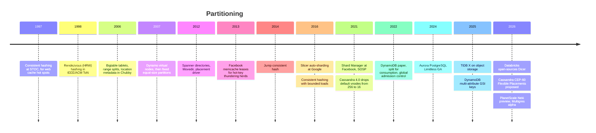
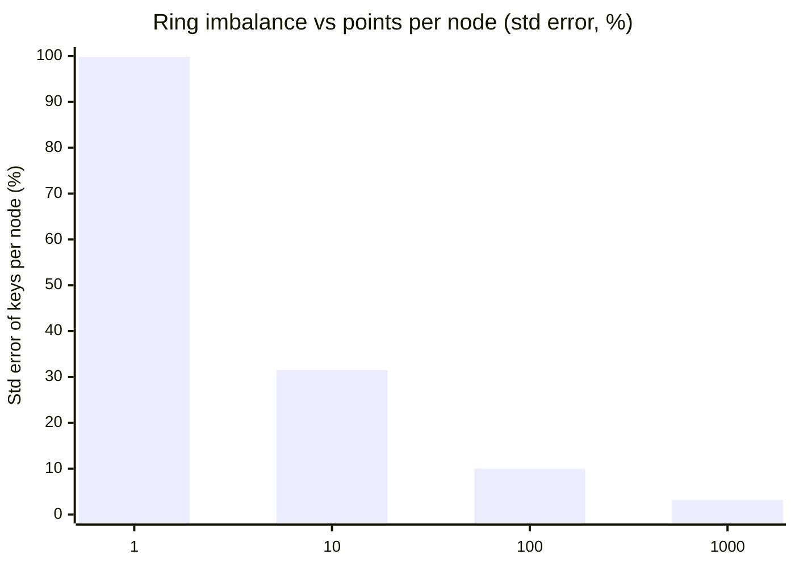
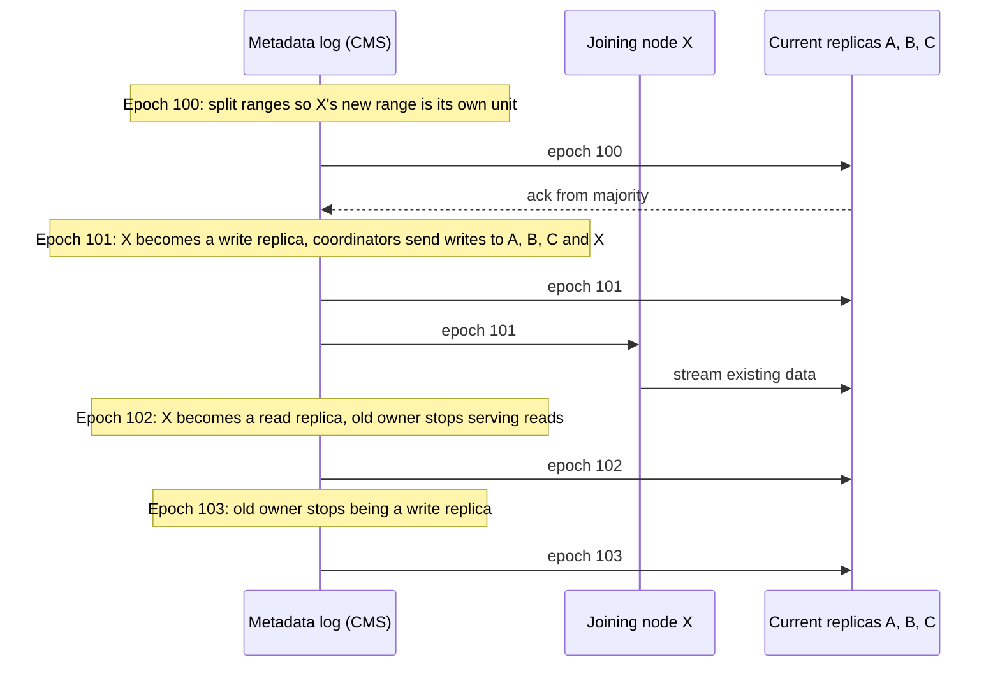
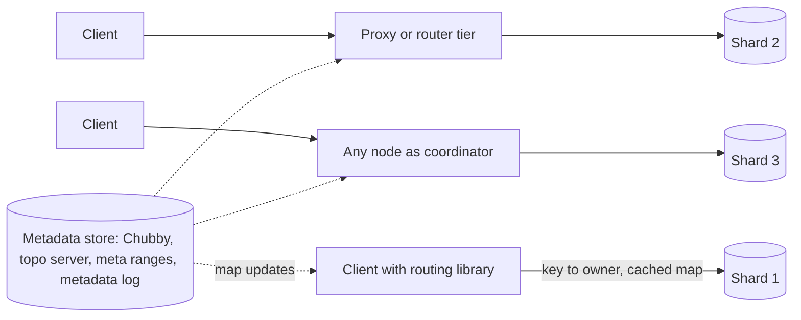

---
tags:
  - distributed-systems
  - partitioning
  - sharding
  - consistent-hashing
  - databases
status: draft
sources:
  - https://cs.brown.edu/courses/csci2950-u/f09/papers/chash97stoc.pdf
  - https://www.cs.ucr.edu/~ravi/Papers/Jrnl/HRW98.pdf
  - https://arxiv.org/pdf/1406.2294
  - https://arxiv.org/abs/1608.01350
  - https://static.usenix.org/event/osdi06/tech/chang/chang_html/index.html
  - https://www.cs.princeton.edu/courses/archive/fall15/cos518/papers/dynamo.pdf
  - https://www.cs.princeton.edu/courses/archive/fall15/cos518/papers/spanner.pdf
  - https://pdos.csail.mit.edu/6.824/papers/memcache-fb.pdf
  - https://cs.ubc.ca/~andy/538w-2016/papers/osdi16-adya.pdf
  - https://research.facebook.com/file/245575980870853/Shard-Manager-A-Generic-Shard-Management-Framework-for-Geo-distributed-Applications.pdf
  - https://usenix.org/system/files/atc22-elhemali.pdf
  - https://docs.aws.amazon.com/amazondynamodb/latest/developerguide/burst-adaptive-capacity.html
  - https://aws.amazon.com/blogs/database/part-3-scaling-dynamodb-how-partitions-hot-keys-and-split-for-heat-impact-performance
  - https://docs.aws.amazon.com/amazondynamodb/latest/developerguide/bp-partition-key-sharding.html
  - https://docs.aws.amazon.com/amazondynamodb/latest/developerguide/SecondaryIndexes.html
  - https://aws.amazon.com/about-aws/whats-new/2025/11/amazon-dynamodb-multi-attribute-composite-keys-global-secondary-indexes
  - https://www.cockroachlabs.com/glossary/distributed-db/range-shard
  - https://docs.cockroachlabs.com/docs/stable/architecture/distribution-layer.md
  - https://docs.cockroachlabs.com/docs/stable/load-based-splitting.md
  - https://github.com/cockroachdb/docs/issues/16243
  - https://docs.cockroachlabs.com/docs/stable/indexes.md
  - https://docs.pingcap.com/tidb/dev/configure-load-base-split/
  - https://docs.pingcap.com/tidbcloud/tidb-x-architecture/
  - https://www.pingcap.com/blog/introducing-tidb-x-a-new-foundation-distributed-sql-ai-era/
  - https://docs.cloud.google.com/spanner/docs/pre-warm-database
  - https://docs.cloud.google.com/spanner/docs/introspection/hot-split-statistics
  - https://www.mongodb.com/docs/manual/core/hashed-sharding/
  - https://cassandra.apache.org/doc/latest/getting-started/production.html
  - https://thelastpickle.com/blog/2021/01/29/impacts-of-changing-the-number-of-vnodes.html
  - https://cwiki.apache.org/confluence/spaces/CASSANDRA/pages/217391203/CEP-21+Transactional+Cluster+Metadata
  - https://cwiki.apache.org/confluence/spaces/CASSANDRA/pages/406621457/CEP-60+Flexible+Placements
  - https://digitalis.io/post/apache-cassandra-6-0-everything-that-changed-in-one-page
  - https://vitess.io/docs/reference/features/sharding/
  - https://vitess.io/docs/reference/vreplication/internal/cutover/
  - https://vitess.io/blog/2025-11-04-announcing-vitess-23/
  - https://vitess.io/blog/2026-04-30-announcing-vitess-24/
  - https://aws.amazon.com/blogs/aws/amazon-aurora-postgresql-limitless-database-is-now-generally-available
  - https://docs.aws.amazon.com/AmazonRDS/latest/AuroraUserGuide/limitless-architecture.html
  - https://supabase.com/blog/multigres-vitess-for-postgres
  - https://supabase.com/blog/multigres-v0-1-alpha
  - https://supabase.com/changelog/multigres-private-alpha
  - https://planetscale.com/blog/introducing-neki
  - https://www.citusdata.com/updates/v14-0/
  - https://www.databricks.com/blog/open-sourcing-dicer-databricks-auto-sharder
  - https://arxiv.org/pdf/2512.23434
created: 2026-11-26
updated: 2026-11-26
---

## Table Of Contents

---

- [[#TL;DR|TL;DR]]
- [[#The Problem|The Problem]]
- [[#Foundations|Foundations]]
    - [[#Key-Range Partitioning|Key-Range Partitioning]]
    - [[#Hash Partitioning|Hash Partitioning]]
    - [[#Why Not hash mod N|Why Not hash mod N]]
- [[#How We Got Here|How We Got Here]]
- [[#How It Works|How It Works]]
    - [[#Consistent Hashing|Consistent Hashing]]
    - [[#Virtual Nodes and Fixed Partitions|Virtual Nodes and Fixed Partitions]]
    - [[#Rendezvous and Jump Hashing|Rendezvous and Jump Hashing]]
    - [[#Range Splits and Merges|Range Splits and Merges]]
    - [[#Rebalancing and Moving Data Safely|Rebalancing and Moving Data Safely]]
    - [[#Hot Keys and Skew|Hot Keys and Skew]]
    - [[#Secondary Indexes|Secondary Indexes]]
    - [[#Routing Requests|Routing Requests]]
- [[#Where It Is Now|Where It Is Now]]
    - [[#Managed Stores Hide the Partitions|Managed Stores Hide the Partitions]]
    - [[#Cassandra Moves Ownership Off the Ring|Cassandra Moves Ownership Off the Ring]]
    - [[#Sharded Postgres Arrives|Sharded Postgres Arrives]]
    - [[#Sharding as a Service|Sharding as a Service]]
- [[#Trade-offs & Open Problems|Trade-offs & Open Problems]]
- [[#Resources|Resources]]
- [[#Related Notes|Related Notes]]

## ***TL;DR***
---
*Partitioning (sharding) splits a dataset so that each machine holds and serves only part of it. It's how a system grows past one machine's disk, memory and write throughput; the design questions are how keys map to partitions, how partitions map to machines, and how both mappings change without downtime or hot spots.*

- **Two ways to cut the key space.** *Key-range* partitioning keeps keys sorted and gives each partition a contiguous range, so range scans are cheap but sequential keys pile onto one partition. *Hash* partitioning spreads keys evenly but scatters neighbors, so a range scan has to ask every partition.
- **Consistent hashing** ([Karger et al., 1997](https://cs.brown.edu/courses/csci2950-u/f09/papers/chash97stoc.pdf)) places nodes and keys on the same ring, so adding the $(N+1)$th node moves only about $K/(N+1)$ of $K$ keys, against about $K \cdot N/(N+1)$ with `hash mod N`. Virtual nodes (Dynamo), rendezvous hashing and jump hashing are refinements of the same goal.
- **Real systems mostly split ranges dynamically:** Bigtable tablets, Spanner splits, CockroachDB ranges and TiKV Regions start small, split when they grow or get hot, merge when they shrink, and are moved by a placement service. Each range is replicated on its own ([[Replication]], [[Raft]]).
- **Skew is the hard part.** One celebrity key can overload any partitioning scheme. The fixes are load-based splitting (until a single key is the hot spot), salting the key, caching, and coalescing duplicate requests.
- **Now (Nov 2026):** Cassandra 6.0 (alpha3 as of September 2026) moves token ownership into a consensus-backed metadata log and a February 2026 proposal would drop the ring for placed tablets; sharded Postgres is arriving from several directions (Aurora Limitless GA since Oct 2024, Citus 14 in Feb 2026, PlanetScale's Neki in preview since Sep 2026, Supabase's Multigres in alpha without sharding yet); DynamoDB added multi-attribute GSI keys in Nov 2025.

## ***The Problem***
---
*Replication makes copies of the same data; partitioning divides different data across machines. You need it once the data, the writes or the hot working set no longer fit on one node, and every choice about how to divide decides which queries stay cheap.*

A single machine has a ceiling on storage, memory and, above all, write throughput, because [[Replication]] copies every write to every replica and so adds no write capacity. Partitioning is the only way to add write capacity: give each node a slice of the keys, and the system's capacity is roughly the sum of the slices.

| Goal | What partitioning buys | Example |
|---|---|---|
| **Capacity** | Data larger than one node | Bigtable splits tables into tablets of roughly 100 to 200 MB each ([Chang et al., 2006](https://static.usenix.org/event/osdi06/tech/chang/chang_html/index.html)) |
| **Write throughput** | Writes to different keys go to different machines | A DynamoDB partition takes at most 1,000 writes/s, so a busy table is spread over many partitions ([AWS docs](https://docs.aws.amazon.com/amazondynamodb/latest/developerguide/burst-adaptive-capacity.html)) |
| **Fault isolation** | A failure or hot spot hurts one slice, not everything | Each range is its own consensus group in [[Distributed SQL]] |
| **Locality** | Keep data near the users or the other data it's queried with | Spanner directories and interleaved tables ([Corbett et al., 2012](https://www.cs.princeton.edu/courses/archive/fall15/cos518/papers/spanner.pdf)) |

What goes wrong:
- **Skew:** some partitions get far more data or traffic than others. Karger et al. framed their whole paper around *hot spots*, which "occur any time a large number of clients wish to simultaneously access data from a single server" ([Karger et al.](https://cs.brown.edu/courses/csci2950-u/f09/papers/chash97stoc.pdf)).
- **Cross-partition work:** a query or transaction that touches several partitions pays extra round trips, and a multi-partition write needs [[Distributed Transactions]].
- **Change:** nodes join, leave and fail, and data grows. Moving partitions while serving traffic, without losing writes or sending requests to the wrong owner, is where most of the engineering goes.

## ***Foundations***
---
*Every scheme is two mappings: key to partition, and partition to node. The first decides which queries are cheap and how skew behaves; the second decides how much data moves when the cluster changes.*

### Key-Range Partitioning

*Keep keys sorted and give each partition a contiguous range. Scans over a range touch few partitions, but keys that arrive in order all land on the same partition.*

Bigtable "maintains data in lexicographic order by row key", and "each row range is called a tablet, which is the unit of distribution and load balancing" ([Chang et al.](https://static.usenix.org/event/osdi06/tech/chang/chang_html/index.html)). Applications design keys for locality: Webtable stored `maps.google.com/index.html` under `com.google.maps/index.html`, so all pages from one domain sit in contiguous rows.

- **Good at:** range scans, prefix queries, ordered iteration, and keeping related rows together.
- **Bad at:** monotonic keys. With a timestamp or auto-increment key, every insert goes to the last range. MongoDB's docs describe exactly this: the chunk whose upper bound is `MaxKey` "receives the majority incoming writes", which "restricts insert operations to the single shard containing this chunk" ([MongoDB docs](https://www.mongodb.com/docs/manual/core/hashed-sharding/)).
- **Boundaries must adapt:** a fixed set of boundaries goes stale as data grows unevenly, so range-partitioned systems split and merge ranges automatically (see [[#Range Splits and Merges|below]]).

### Hash Partitioning

*Hash the key first and partition the hash space. Load spreads evenly whatever the key distribution, but neighboring keys scatter, so range queries become scatter-gather.*

MongoDB's docs put the trade in one line: hashed sharding "provides a more even data distribution across the sharded cluster at the cost of reducing" targeted operations. An equality match still goes to one shard, but "documents with 'close' shard key values are unlikely to be on the same chunk or shard", so a range query is likely to be broadcast ([MongoDB docs](https://www.mongodb.com/docs/manual/core/hashed-sharding/)).

**The common compromise: hash, then range.** Hash the first part of a compound key to pick the partition, and keep the rest sorted within it. DynamoDB uses the partition key as input to "an internal hash function", and the hash plus the optional sort key decide where an item is stored; each partition holds "a disjoint and contiguous part of the table's key-range" ([Elhemali et al., 2022](https://usenix.org/system/files/atc22-elhemali.pdf)). Queries for one partition key with a sort-key range stay on one partition; queries across partition keys don't.

| | Key-range | Hash |
|---|---|---|
| Point lookup | One partition | One partition |
| Range scan on the key | Few partitions | Every partition |
| Sequential inserts | One hot partition | Spread evenly |
| Locality control | Designed into the key | Only within a compound key's sorted part |
| Rebalancing | Split and move ranges | Move hash ranges or tokens |
| Examples | Bigtable, HBase-style stores, Spanner, CockroachDB, TiKV | Dynamo, Cassandra, Aurora Limitless ("hash-based, not range- or list-based") ([AWS docs](https://docs.aws.amazon.com/AmazonRDS/latest/AuroraUserGuide/limitless-architecture.html)) |

### Why Not hash mod N

*Assigning key $k$ to node $h(k) \bmod N$ is perfectly balanced and terrible to change: growing from $N$ to $N+1$ nodes moves almost every key.*

A key stays put only if $h(k) \bmod N = h(k) \bmod (N+1)$. By the Chinese remainder theorem that happens for exactly $N$ of every $N(N+1)$ consecutive hash values, so:

$$
\Pr[\text{key moves}] = 1 - \frac{N}{N(N+1)} = \frac{N}{N+1}
$$

*In words:* add one node to $N$ and nearly every key changes owner, though only $1/(N+1)$ of them needed to (the new node's fair share). *Example:* $K = 1{,}000{,}000$ keys on 4 nodes, add a fifth. With `mod N`, about $1{,}000{,}000 \times 4/5 = 800{,}000$ keys move, almost all of them between old nodes. The minimum is the new node's share, $200{,}000$. In a cache that means 80% of entries miss at once; in a database it means copying 80% of the data.

Two fixes appear in practice: make the key-to-node function itself change minimally (consistent, rendezvous and jump hashing), or put a level of indirection between them (many fixed partitions, or ranges, mapped to nodes by a table that a placement service edits).

## ***How We Got Here***
---
*Consistent and rendezvous hashing came out of 1990s web caching. Bigtable and Dynamo (2006–2007) set the two templates for storage, range tablets and a hashed ring, and since then the trend has been toward dynamic, load-aware splitting run by a placement service, with the ring itself now being retired in Cassandra.*

**Hashing for caches (1997–1998).** Karger, Lehman, Leighton, Levine, Lewin and Panigrahy wanted clients with different views of which caches exist to agree on where a URL lives, and to move little when caches came and went ([Karger et al.](https://cs.brown.edu/courses/csci2950-u/f09/papers/chash97stoc.pdf)). Thaler and Ravishankar's highest-random-weight (rendezvous) hashing solved the same problem a different way ([Thaler and Ravishankar, 1998](https://www.cs.ucr.edu/~ravi/Papers/Jrnl/HRW98.pdf)).

**Two storage templates (2006–2007).** Bigtable used ordered row ranges that split automatically, with a master assigning tablets and [[Coordination Services|Chubby]] holding the root of the location metadata ([Chang et al.](https://static.usenix.org/event/osdi06/tech/chang/chang_html/index.html)). Dynamo used a consistent-hashing ring with virtual nodes and later moved to fixed, equal-size partitions ([DeCandia et al., 2007](https://www.cs.princeton.edu/courses/archive/fall15/cos518/papers/dynamo.pdf)). Cassandra took Dynamo's ring; HBase, Spanner, CockroachDB and TiKV took Bigtable's ranges.

**Load awareness (2012 on).** Spanner's placement driver moved directories between Paxos groups for load and constraints ([Corbett et al.](https://www.cs.princeton.edu/courses/archive/fall15/cos518/papers/spanner.pdf)). Google's Slicer and Facebook's Shard Manager turned sharding into a shared service for ordinary applications ([Adya et al., 2016](https://cs.ubc.ca/~andy/538w-2016/papers/osdi16-adya.pdf); [Shard Manager, SOSP 2021](https://research.facebook.com/file/245575980870853/Shard-Manager-A-Generic-Shard-Management-Framework-for-Geo-distributed-Applications.pdf)). DynamoDB's 2022 paper describes the shift from splitting by provisioned throughput to splitting by observed consumption ([Elhemali et al.](https://usenix.org/system/files/atc22-elhemali.pdf)).

## ***How It Works***
---
*Hash-family algorithms make the key-to-node mapping change minimally on their own; range systems instead keep an explicit, editable map from ranges to nodes. Either way, the hard parts are moving data safely, handling hot keys, indexing by anything other than the partition key, and getting each request to the right node.*

### Consistent Hashing

*Hash nodes and keys onto the same circle; each key belongs to the first node clockwise from it. Adding or removing a node only moves the keys in the arc next to it.*

Karger et al. define a good "ranged hash function" by four properties ([Karger et al.](https://cs.brown.edu/courses/csci2950-u/f09/papers/chash97stoc.pdf)):

| Property | Meaning |
|---|---|
| **Balance** | Each bucket gets about $1/\lvert V \rvert$ of the items for a view $V$ of the buckets |
| **Monotonicity** | When buckets are added, "an item may move from an old bucket to a new bucket, but not from one old bucket to another" |
| **Spread** | Across clients with different views, an item is assigned to few distinct buckets |
| **Load** | Across views, a bucket is assigned few distinct items |

Their construction maps buckets and items to random points on the unit interval and assigns each item to the closest bucket, with $\Theta(\log C)$ points per bucket for balance. The paper's Theorem 4.4 gives the expected fraction of items that keep their bucket between views $V_1$ and $V_2$ as $\lvert V_1 \cap V_2 \rvert / \lvert V_1 \cup V_2 \rvert$. For one node joining $N$ nodes:

$$
\mathbb{E}[\text{keys moved}] = K\left(1 - \frac{N}{N+1}\right) = \frac{K}{N+1} \approx \frac{K}{N}
$$

*In words:* the new node takes its fair share and nothing else moves; every moved key moves *to* the new node. Removing a node moves only that node's keys, to its successors.

*Worked example (ring of size 100):* nodes sit at A = 10, B = 35, C = 60, D = 85. A key goes to the first node at or after its position, wrapping around. Key positions 5 → A, 20 → B, 40 → C, 50 → C, 70 → D, 90 → A (wraps). Node E joins at 48. Only keys in $(35, 48]$ change owner, from C to E: the key at 40 moves, the one at 50 stays on C, and nothing touches A, B or D. E got 13% of the ring. With random placement the *expected* share is $1/5 = 20\%$, but any one placement can be far off, which is the next problem.

### Virtual Nodes and Fixed Partitions

*One point per node gives wildly uneven arcs. Many points per node (virtual nodes) even out the load, and Dynamo eventually went further and fixed the partitions themselves, moving only their ownership.*

With one random point per node, arc lengths vary a lot. Lamping and Veach tabulated the spread of keys per bucket for Karger's ring ([Lamping and Veach, 2014](https://arxiv.org/pdf/1406.2294)):

| Points per bucket | Standard error of bucket size | 99% of buckets fall within (× mean) |
|---|---|---|
| 1 | 99.8% | 0.005 to 5.25 |
| 10 | 31.5% | 0.37 to 1.98 |
| 100 | 10.0% | 0.76 to 1.28 |
| 1000 | 3.2% | 0.92 to 1.09 |

$$
\frac{\sigma_{\text{load}}}{\text{mean load}} \approx \frac{1}{\sqrt{v}}
$$

*In words:* with $v$ points per node, imbalance shrinks only with the square root of $v$; cutting it by 10× costs 100× more points. *Example:* the table's rows match the rule: $1/\sqrt{100} = 10\%$ and $1/\sqrt{1000} \approx 3.2\%$. Even at 1,000 points, about 1% of buckets are at least 8% off the mean, and the ring then costs thousands of bytes per bucket (46 MB for 1,000 buckets in one of their versions).

**Dynamo's virtual nodes.** Each physical node takes several tokens, so when a node fails "the load handled by this node is evenly dispersed across the remaining available nodes", a joining node takes a little from everyone, and bigger machines can take more tokens ([DeCandia et al., §4.2](https://www.cs.princeton.edu/courses/archive/fall15/cos518/papers/dynamo.pdf)).

**Then Dynamo fixed the partitions (§6.2).** Random tokens tied partitioning to placement, and that hurt operations: a joining node had to take ranges from others, bootstrapping during busy seasons "has taken almost a day to complete", donors had to scan their stores, and Merkle trees for [[Anti-Entropy and Repair|anti-entropy]] had to be recomputed for every changed range. Dynamo compared three strategies:

| Strategy | Partitions | Placement | Result |
|---|---|---|---|
| 1. $T$ random tokens per node | Ranges between tokens, unequal | Tied to tokens | First production scheme; slow bootstrap, costly rescans |
| 2. $T$ random tokens, $Q$ equal partitions | Fixed, equal | Tokens decide owners | Worst balance; interim only |
| 3. $Q/S$ tokens per node, $Q$ equal partitions | Fixed, equal | Decoupled; tokens handed over on join and leave | Best balance, and per-node membership metadata three orders of magnitude smaller |

Strategy 3 is the **fixed number of partitions** pattern: choose $Q$ much larger than the node count, never change partition boundaries, and rebalance by moving whole partitions. *Example:* $Q = 1{,}024$ partitions on 4 nodes is 256 each; a fifth node takes about 51 from each, ending near 205 apiece, and only those 205 partitions are copied. The catch is choosing $Q$ up front: too few and big nodes can't be balanced, too many and per-partition overhead dominates.

**Fewer vnodes in Cassandra.** Cassandra 4.0 cut the default `num_tokens` from 256 to 16 ([Grasso, Jan 2021](https://thelastpickle.com/blog/2021/01/29/impacts-of-changing-the-number-of-vnodes.html)). More tokens means each node shares ranges with more peers, so losing any two nodes makes some data unavailable at quorum; in a six-node RF = 3 test with three vnodes per node, losing two nodes made 33.3% of data unreadable at `LOCAL_QUORUM`. Repair also runs one session per vnode. Few random tokens balance badly (ownership ranged from 39.9% to 66.6% in the same test), so 4.0 pairs the lower default with a replica-aware allocator via `allocate_tokens_for_local_replication_factor` ([Grasso](https://thelastpickle.com/blog/2021/01/29/impacts-of-changing-the-number-of-vnodes.html); [Cassandra docs](https://cassandra.apache.org/doc/latest/getting-started/production.html)). This is the same trade as [[Replication]]'s quorum math: more spread means faster rebuilds but more ways for two failures to overlap.

**Bounded loads.** Mirrokni, Thorup and Zadimoghaddam cap every server at $c = 1 + \varepsilon$ times the average load and overflow to the next server on the ring; with $\varepsilon = 1$ they guarantee "a guaranteed max-load of 2 while only moving an expected constant number of clients for each update" ([Mirrokni et al., 2016](https://arxiv.org/abs/1608.01350)).

### Rendezvous and Jump Hashing

*Two ring-free alternatives. Rendezvous hashing scores every node per key and picks the highest; jump hashing computes a bucket number with no table at all, but only for buckets numbered 0 to N-1.*

**Rendezvous (highest random weight).** For key $k$ and each server $s$, compute a pseudorandom weight $w(k, s)$; "a request is sent to the active server with the highest weight" ([Thaler and Ravishankar, 1998](https://www.cs.ucr.edu/~ravi/Papers/Jrnl/HRW98.pdf)).

$$
\text{owner}(k) = \arg\max_{s \in S} \; w(k, s)
$$

*In words:* every server bids a random-looking number for each key, and the highest bid wins. Removing a server only moves the keys it won (each goes to its runner-up); adding a server only moves the keys it now outbids everyone for, about $K/(N+1)$. *Example:* key `user:42` scores A = 0.61, B = 0.93, C = 0.27, so B owns it. If B fails, the key goes to its runner-up A, and keys that A or C owned don't move. The runner-up list doubles as a replica order. The cost is $O(N)$ hashes per lookup, against $O(\log N)$ for a sorted ring.

**Jump consistent hash.** A five-line function that maps a 64-bit key to a bucket in $[0, n)$ with "no memory beyond what fits in a few registers", near-perfect balance (standard error $7.6 \times 10^{-9}$ against 3.2% for a 1,000-point ring) and expected iterations below $\ln n + 1$ ([Lamping and Veach, 2014](https://arxiv.org/pdf/1406.2294)). Going from $n - 1$ to $n$ buckets moves about $1/n$ of keys, all into the new bucket. The limit: buckets are numbered, so you can only add or remove at the end, which the authors say makes it "primarily suitable for the data storage case" (numbered shards with their own replication) rather than caches whose servers come and go arbitrarily.

| Scheme | Lookup cost | Memory | Balance | Arbitrary node removal |
|---|---|---|---|---|
| `hash mod N` | $O(1)$ | None | Perfect | Moves almost everything |
| Ring, $v$ points per node | $O(\log Nv)$ | $O(Nv)$ | $\approx 1/\sqrt{v}$ | Yes |
| Rendezvous | $O(N)$ | Node list | Good | Yes |
| Jump | $O(\log N)$ | None | Near perfect | No, only the last bucket |
| Fixed partitions + table | $O(1)$ | $O(Q)$ table | Set by the placer | Yes, by reassigning partitions |

### Range Splits and Merges

*Range systems don't need a clever hash: they start with one range per table, split a range when it gets too big or too busy, merge small neighbors, and let a placement service move ranges between nodes.*

| System | Unit | Size target | Load-based split | Placement |
|---|---|---|---|---|
| Bigtable | Tablet | ~100 to 200 MB by default | Size-based in the 2006 paper | Master assigns tablets; servers tracked in Chubby ([Chang et al.](https://static.usenix.org/event/osdi06/tech/chang/chang_html/index.html)) |
| Spanner | Directory, split into fragments | Splits "if it grows too large" | Yes, splits follow load and size | Placement driver moves directories "on the timescale of minutes" ([Corbett et al.](https://www.cs.princeton.edu/courses/archive/fall15/cos518/papers/spanner.pdf); [Google docs](https://docs.cloud.google.com/spanner/docs/pre-warm-database)) |
| CockroachDB | Range | 512 MiB or smaller | QPS threshold, default 2,500 | Allocator rebalances replicas and leases ([Cockroach glossary](https://www.cockroachlabs.com/glossary/distributed-db/range-shard); [docs](https://docs.cockroachlabs.com/docs/stable/load-based-splitting.md)) |
| TiKV (TiDB) | Region | 256 MiB in TiDB X docs | Load Base Split: 3,000 QPS or 30 MiB/s for 10 s | PD schedules Regions ([TiDB X docs](https://docs.pingcap.com/tidbcloud/tidb-x-architecture/); [TiDB docs](https://docs.pingcap.com/tidb/dev/configure-load-base-split/)) |
| DynamoDB | Partition | Split near 10 GB | Split for consumption | Storage nodes own membership; routers learn it from MemDS ([Elhemali et al.](https://usenix.org/system/files/atc22-elhemali.pdf)) |

**Size splits.** A range that reaches its limit is cut into two contiguous halves; the new boundary is written to the range metadata in the same step. In Bigtable "the tablet server commits the split by recording information for the new tablet in the METADATA table" ([Chang et al.](https://static.usenix.org/event/osdi06/tech/chang/chang_html/index.html)). CockroachDB's default size is chosen to be small enough to move quickly and large enough to hold "a meaningfully contiguous set of data" ([CockroachDB docs](https://docs.cockroachlabs.com/docs/stable/architecture/distribution-layer.md)).

**Load splits.** Size is a poor proxy for heat: a 10 MB range of hot counters can need more servers than a 500 MB archive. CockroachDB samples keys once a range passes its QPS threshold and picks a split point that balances load on both sides while avoiding splits that many queries would cross; it logs "no split key found" when no such point exists ([CockroachDB docs](https://docs.cockroachlabs.com/docs/stable/load-based-splitting.md)). It can also split on request CPU time instead of QPS when the rebalancing objective is set to CPU ([CockroachDB docs issue](https://github.com/cockroachdb/docs/issues/16243)). TiDB's Load Base Split acts on Regions whose load "consistently exceeds the threshold for 10 seconds", and PD avoids merging hot Regions back right away ([TiDB docs](https://docs.pingcap.com/tidb/dev/configure-load-base-split/)).

**Merges.** Splitting alone leaves thousands of tiny ranges after deletes or TTL expiry, and each one costs a consensus group, heartbeats and metadata. CockroachDB merges a small range into its right-hand neighbor when the combined size fits under the maximum ([CockroachDB docs](https://docs.cockroachlabs.com/docs/stable/architecture/distribution-layer.md)); Spanner merges splits that consistently get little traffic ([Google docs](https://docs.cloud.google.com/spanner/docs/pre-warm-database)).

**Splits aren't instant.** Spanner's docs warn that "Splitting is not instantaneous", so a sudden spike can queue requests, raise latency and abort transactions. For a launch you can *pre-split*: create split points (about 10 per node is the guidance) between 7 days and 12 hours ahead; they expire after 10 days by default, at most 30 ([Google docs](https://docs.cloud.google.com/spanner/docs/pre-warm-database)).

### Rebalancing and Moving Data Safely

*Moving a partition means copying it while it keeps taking writes, then switching ownership so that no write is lost and no reader asks the wrong node. Every system does some version of copy, catch up, cut over.*

Two policies decide *when* to move:

| Policy | How it works | Trade-off |
|---|---|---|
| **Fixed partition count** | $Q \gg N$ partitions; move whole partitions (Dynamo strategy 3) | Simple, cheap metadata; $Q$ chosen up front |
| **Dynamic splitting** | Partitions split and merge as data and load change (Bigtable, Spanner, CockroachDB, TiKV, DynamoDB) | Adapts to skew; needs a split protocol and a placer |
| **Proportional to nodes** | Each node owns a fixed number of ranges, split when a node joins (vnodes) | Partition size tracks node count, not data |
| **Load-aware placer** | A controller moves or splits units to cut imbalance per byte moved (Slicer, Shard Manager) | Needs good load signals and a churn budget |

Slicer makes the churn trade explicit: it ranks candidate moves by imbalance reduction divided by key churn and stops when a churn budget, 9% of the keyspace per run, is spent ([Adya et al.](https://cs.ubc.ca/~andy/538w-2016/papers/osdi16-adya.pdf)).

**How a move stays safe.** The common shape, with each system's version:

1. **Copy in the background** while the source keeps serving. Spanner's Movedir moves data in the background, then "uses a transaction to atomically move that nominal amount and update the metadata for the two Paxos groups" ([Corbett et al.](https://www.cs.princeton.edu/courses/archive/fall15/cos518/papers/spanner.pdf)). In consensus-replicated ranges, a move is usually a membership change: add a replica on the new node, let it catch up from the [[Raft]] log or a snapshot, then remove an old one.
2. **Keep the new copy current** by streaming changes. Vitess keeps new shards up to date "while the existing shards continue to serve live read and write traffic" ([Vitess docs](https://vitess.io/docs/reference/features/sharding/)).
3. **Cut over atomically in the metadata.** Vitess's `SwitchTraffic` first moves replica reads, then flips which shards are primary-serving in the topology server, with the old primary told to reject queries; the switch costs "only a few seconds of read-only downtime" ([Vitess cutover](https://vitess.io/docs/reference/vreplication/internal/cutover/); [Vitess docs](https://vitess.io/docs/reference/features/sharding/)).
4. **Fence the old owner** so it can't keep acting on stale ownership; see [[Leases and Fencing]]. Slicer bases per-key ownership on leases held through three Chubby locks ([Adya et al.](https://cs.ubc.ca/~andy/538w-2016/papers/osdi16-adya.pdf)).

**Ownership changes in steps (Cassandra CEP-21).** Under gossip, coordinators could disagree about the ring with "no guaranteed upper bound" on how far apart they were, so Cassandra relied on waiting periods and on operators not running overlapping operations. Transactional Cluster Metadata turns a bootstrap into four steps, each a committed epoch that a majority must acknowledge before the next ([CEP-21](https://cwiki.apache.org/confluence/spaces/CASSANDRA/pages/217391203/CEP-21+Transactional+Cluster+Metadata)):

Writes go to both old and new owners *before* reads move, so a quorum read always overlaps a quorum write during the move. Every message carries the sender's epoch, and a coordinator checks that "the initial replica plan is still valid" before reporting success, so a request planned on stale ownership fails instead of silently missing a replica ([CEP-21](https://cwiki.apache.org/confluence/spaces/CASSANDRA/pages/217391203/CEP-21+Transactional+Cluster+Metadata)).

### Hot Keys and Skew

*No partitioning function helps when one key gets most of the traffic: that key lives on one partition. The defenses are splitting until the hot key is alone, then spreading or absorbing its load with salting, caching and request coalescing.*

**Kinds of skew.**
- **Data skew:** some partitions hold more bytes. Fixed by size-based splits.
- **Traffic skew across keys:** a busy range among quiet ones. Fixed by load-based splits.
- **A single hot key** (the celebrity problem: one account, product or counter that everyone reads or writes). A split can isolate it but not divide it. DynamoDB detects "single-hot-item and sequentially accessed key ranges" and doesn't split for them ([Elhemali et al.](https://usenix.org/system/files/atc22-elhemali.pdf)); at best adaptive capacity moves that one item onto its own partition, capped at 3,000 reads/s and 1,000 writes/s ([AWS docs](https://docs.aws.amazon.com/amazondynamodb/latest/developerguide/burst-adaptive-capacity.html)).
- **Moving hot spot:** sequential keys keep the hot spot at the end of the key space. Splitting doesn't help because "no matter the chosen cut point, all new writes using that partition key will be on the second partition" ([Hunter and Natarajan, 2023](https://aws.amazon.com/blogs/database/part-3-scaling-dynamodb-how-partitions-hot-keys-and-split-for-heat-impact-performance)). Spanner's hot-split statistics report such splits with `UNSPLITTABLE_REASONS` ([Google docs](https://docs.cloud.google.com/spanner/docs/introspection/hot-split-statistics)).

**DynamoDB's layers, from the 2022 paper** ([Elhemali et al.](https://usenix.org/system/files/atc22-elhemali.pdf)):
- Originally a table's provisioned throughput was divided evenly across partitions, so splitting a hot partition could leave "the hot portion of the partition having less available performance than it did before the split". *Example from the paper:* at 1,000 WCU per partition, a 3,200 WCU table is four partitions of 800 WCU; raise it to 6,000 and it becomes eight partitions of 750.
- **Bursting** let a partition use up to 300 seconds of unused capacity; **adaptive capacity** boosted throttled partitions and "eliminated over 99.99% of the throttling due to skewed access pattern", but reactively.
- **Global admission control** replaced per-partition allocation with table-wide token buckets held by request routers, and **split for consumption** picks the split point from "key distribution the partition has observed".

**Key salting (write sharding).** Append a suffix so one logical key becomes $s$ physical keys on different partitions:

$$
\text{load per partition} = \frac{L}{s}, \qquad \text{reads per logical lookup} = s
$$

*In words:* salting divides the write load by $s$ and multiplies the read fan-out by $s$. *Example:* a key needs 5,000 writes/s and a DynamoDB partition takes 1,000, so $s \ge 5$; with $s = 8$ each salted key carries 625 writes/s, but reading "all of today's items" now takes eight queries and a merge. AWS's own example salts a date key with suffixes 1 to 200 (`2014-07-09.1` … `2014-07-09.200`); a *calculated* suffix (a hash of the order ID, mod 200) keeps single-item `GetItem` possible because the suffix can be recomputed ([AWS docs](https://docs.aws.amazon.com/amazondynamodb/latest/developerguide/bp-partition-key-sharding.html)). Salt only the keys you know are hot; salting everything turns every read into a scatter-gather.

**Caching and replicating hot reads.** Facebook's memcache tier, itself partitioned by consistent hashing, replicates a small, very hot key set to several servers so any replica can answer; in their example this cut per-server load from 1M to 500k requests/s. They also warn that rehashing a failed server's keys onto survivors is risky because "a single key can account for 20% of a server's requests" ([Nishtala et al., 2013](https://pdos.csail.mit.edu/6.824/papers/memcache-fb.pdf)). Slicer and Databricks' Dicer replicate hot slices across several tasks automatically ([Adya et al.](https://cs.ubc.ca/~andy/538w-2016/papers/osdi16-adya.pdf); [Databricks, Jan 2026](https://www.databricks.com/blog/open-sourcing-dicer-databricks-auto-sharder)).

**Request coalescing.** When a hot cached value expires or is invalidated, every reader misses at once and hits the database (a thundering herd). Facebook's *leases* give only one client per key a token to refill the cache, at most once every 10 seconds; others wait briefly and retry. Peak database load in their test dropped from 17K to 1.3K queries/s ([Nishtala et al.](https://pdos.csail.mit.edu/6.824/papers/memcache-fb.pdf)). The general pattern is often called request coalescing; see [[Reliability Patterns]].

### Secondary Indexes

*An index on anything other than the partition key has to be partitioned too. Partition it with the data (local) and every index read asks every partition; partition it by the indexed value (global) and every write may touch another partition.*

Full note: [[Secondary Indexes]].

| | Local (document-partitioned) | Global (term-partitioned) |
|---|---|---|
| Where index entries live | With the rows they index, on the same partition | In their own partitions, split by the indexed value |
| Write cost | One partition | Base partition plus one or more index partitions |
| Read by index value | Scatter to all partitions, gather results | Go to the one index partition holding that value |
| Consistency | Same as the base row | Asynchronous (eventually consistent) or a cross-partition transaction |
| Examples | DynamoDB LSIs, query-by-scatter in sharded stores | DynamoDB GSIs; indexes in [[Distributed SQL]] |

*Worked example:* 16 partitions of a `users` table, partitioned by `user_id`, with an index on `city`. Query `city = 'Lisbon'`: a local index sends 16 requests and waits for the slowest; a global index sends one. Update user 42's city from Lisbon to Porto: a local index changes one partition; a global index changes the base row plus the `Lisbon` and `Porto` index partitions, up to three partitions in one logical write.

**DynamoDB shows both** ([AWS docs](https://docs.aws.amazon.com/amazondynamodb/latest/developerguide/SecondaryIndexes.html)):
- A **local secondary index** "lets you query over a single partition", supports strongly consistent reads, must be defined when the table is created, and caps each partition key value's indexed items at 10 GB. LSIs also stop split for heat from dividing an item collection ([Hunter and Natarajan](https://aws.amazon.com/blogs/database/part-3-scaling-dynamodb-how-partitions-hot-keys-and-split-for-heat-impact-performance)).
- A **global secondary index** queries "across all partitions", has its own throughput and no size limit, but "support[s] eventual consistency only": updates reach it asynchronously. Up to 20 GSIs and 5 LSIs per table by default.

**Distributed SQL makes global indexes transactional.** CockroachDB "stores indexes directly in its key-value store" as a sorted copy of the indexed columns, so the index is range-partitioned by its own key like any other data, and "new values have to be written for both the table *and* the index" ([CockroachDB docs](https://docs.cockroachlabs.com/docs/stable/indexes.md)). Those writes are part of the same transaction, which is one reason every write there pays [[Distributed Transactions|distributed-transaction]] costs.

### Routing Requests

*Something has to know which node owns a key right now. The three placements for that knowledge are the client, a proxy tier, or any node acting as coordinator, and all three cache a map whose source of truth lives in a small, strongly consistent store.*

| Placement | How | Examples |
|---|---|---|
| **Client-side** | A library hashes the key or looks up a cached map | Facebook's memcache clients use consistent hashing over a server map from a configuration system ([Nishtala et al.](https://pdos.csail.mit.edu/6.824/papers/memcache-fb.pdf)); Slicer's Clerk and Dicer's Clerk ([Adya et al.](https://cs.ubc.ca/~andy/538w-2016/papers/osdi16-adya.pdf); [Databricks](https://www.databricks.com/blog/open-sourcing-dicer-databricks-auto-sharder)); Bigtable's client library |
| **Proxy tier** | Stateless routers parse the request, pick shards, merge results | Vitess VTGate; Aurora Limitless routers, which "maintain metadata about where data is stored" ([AWS docs](https://docs.aws.amazon.com/AmazonRDS/latest/AuroraUserGuide/limitless-architecture.html)); Neki routers; DynamoDB request routers |
| **Any node coordinates** | The receiving node forwards to the owners | Dynamo and Cassandra coordinators; CockroachDB gateways |

**Where the map lives.**
- **Bigtable:** a three-level tree: a Chubby file points to the root tablet, which points to METADATA tablets, which point to user tablets. 128 MB METADATA tablets address $2^{34}$ tablets. The client caches locations; an empty cache costs three round trips, a stale one up to six, "because stale cache entries are only discovered upon misses" ([Chang et al.](https://static.usenix.org/event/osdi06/tech/chang/chang_html/index.html)).
- **CockroachDB:** the same idea with two levels of *meta ranges* (`meta1` → `meta2` → data); `meta1` is never split and its location is gossiped, and each node caches the `meta2` entries it has used ([CockroachDB docs](https://docs.cockroachlabs.com/docs/stable/architecture/distribution-layer.md)).
- **Vitess:** VSchema, shard records and routing rules live in a global topology server and serving maps in a per-cell one, cached locally by VTGate ([Vitess cutover](https://vitess.io/docs/reference/vreplication/internal/cutover/)).
- **DynamoDB:** routers once downloaded a table's whole routing table; a 99.75% cache hit rate hid cold-start spikes where metadata traffic reached 75% of request volume. The fix was MemDS, an in-memory metadata store; routers refresh asynchronously on every hit, so metadata load stays constant. Storage nodes remain authoritative and correct a router that guessed wrong ([Elhemali et al.](https://usenix.org/system/files/atc22-elhemali.pdf)).
- **Shard Manager:** shard maps flow through service discovery to a client routing library ([Shard Manager paper](https://research.facebook.com/file/245575980870853/Shard-Manager-A-Generic-Shard-Management-Framework-for-Geo-distributed-Applications.pdf)).

The design rule that DynamoDB's story illustrates: a routing cache is fine, but the system must survive it being stale (the owner rejects or redirects) and survive it being empty (cold caches shouldn't stampede the metadata store). The metadata store itself is a [[Coordination Services|coordination service]] or a consensus log.

## ***Where It Is Now***
---
*As of November 2026: managed databases split and merge partitions automatically and are adding tools for the cases automation can't fix; Cassandra is replacing gossip-based ring ownership with a metadata log and debating dropping the ring; several projects are bringing Vitess-style sharding to Postgres; and auto-sharders are spreading from databases to ordinary services.*

### Managed Stores Hide the Partitions

- **DynamoDB (Nov 2025):** global secondary indexes accept multi-attribute keys, up to four attributes each for the partition and sort key, so "you no longer need to manually concatenate values into synthetic keys", a common source of backfills when adding an index ([AWS, Nov 19, 2025](https://aws.amazon.com/about-aws/whats-new/2025/11/amazon-dynamodb-multi-attribute-composite-keys-global-secondary-indexes)). Partition limits are unchanged in the current docs: 3,000 reads and 1,000 writes per second per partition ([AWS docs](https://docs.aws.amazon.com/amazondynamodb/latest/developerguide/burst-adaptive-capacity.html)).
- **Spanner (docs as of Oct 2026):** pre-splitting lets you create expiring split points ahead of a known spike, and hot-split statistics expose which splits are hot (a split is "warm" above 50% resource-constrained load) and why they can't be split further ([pre-splitting](https://docs.cloud.google.com/spanner/docs/pre-warm-database); [hot splits](https://docs.cloud.google.com/spanner/docs/introspection/hot-split-statistics)). Automatic splitting stays the default; the new tools are for the predictable spike and the unsplittable key.
- **TiDB X (announced Oct 2025):** keeps range-based Regions (256 MiB by default) but makes object storage "the single source of truth", gives each Region its own [[LSM Trees|LSM tree]], and loads data on demand, so adding or removing TiKV nodes no longer copies large volumes between peers; PingCAP reports 5× to 10× faster scale-out and scale-in than classic TiDB ([TiDB X docs](https://docs.pingcap.com/tidbcloud/tidb-x-architecture/); [PingCAP, Oct 2025](https://www.pingcap.com/blog/introducing-tidb-x-a-new-foundation-distributed-sql-ai-era/)). Rebalancing becomes a metadata change over [[Object Storage]], the same direction as [[Disaggregated Systems]].
- **CockroachDB (docs as of v26.4):** 512 MiB ranges, load-based splitting on by default at 2,500 QPS, automatic merges ([glossary](https://www.cockroachlabs.com/glossary/distributed-db/range-shard); [docs](https://docs.cockroachlabs.com/docs/stable/load-based-splitting.md)). Its 2026 lease redesign, which matters because every range carries a lease, is covered in [[Distributed SQL]] and [[Raft]].

### Cassandra Moves Ownership Off the Ring

- **6.0 status:** pre-release 6.0-alpha3 as of a September 14, 2026 survey, with 5.0.9 the current GA release ([Digitalis, Sep 2026](https://digitalis.io/post/apache-cassandra-6-0-everything-that-changed-in-one-page)).
- **Transactional Cluster Metadata (CEP-21), always on in 6.0:** moves "topology, token ownership and schema out of gossip and into a linearized log of ordered events" committed by a small quorum (the CMS, grown to at least three members after `nodetool cms initialize`). Bootstrap, decommission and moves run as staged placements, with write placements applied before read placements so quorums overlap while data streams ([Digitalis](https://digitalis.io/post/apache-cassandra-6-0-everything-that-changed-in-one-page); [CEP-21](https://cwiki.apache.org/confluence/spaces/CASSANDRA/pages/217391203/CEP-21+Transactional+Cluster+Metadata)). See [[Gossip and Membership]] for what this replaces.
- **Flexible Placements (CEP-60, proposed Feb 19, 2026, "Under discussion"):** would make ranges per keyspace and table, call them tablets, and assign them to nodes explicitly instead of by ring position, aiming to "allow associating any range with any node" and to drive placement by capacity and load. It would be opt-in, keep token and vnode clusters supported, and leave auto-scaling to a later CEP; no release is targeted ([CEP-60](https://cwiki.apache.org/confluence/spaces/CASSANDRA/pages/406621457/CEP-60+Flexible+Placements)). If adopted, the main Dynamo descendant would end up with the Bigtable-style "explicit map plus placer" design.

### Sharded Postgres Arrives

The systems below are covered in depth in [[Sharded Postgres]].

| Project | Status (date) | Approach |
|---|---|---|
| **Aurora PostgreSQL Limitless** | GA Oct 31, 2024 | Routers plus shards; hash sharding on a shard key; collocated tables; reference tables copied to every shard; shard split as a management operation ([AWS, Oct 2024](https://aws.amazon.com/blogs/aws/amazon-aurora-postgresql-limitless-database-is-now-generally-available); [AWS docs](https://docs.aws.amazon.com/AmazonRDS/latest/AuroraUserGuide/limitless-architecture.html)) |
| **Citus** | 14.0 in Feb 2026 (PostgreSQL 18 support); 14.2 in Aug 2026 | Postgres extension with distributed tables on a distribution column such as `tenant_id` ([Citus 14.0](https://www.citusdata.com/updates/v14-0/)) |
| **Vitess** (MySQL) | 23.0 Nov 2025; 24.0 Apr 30, 2026 | VTGate proxy, vindexes, online resharding with VReplication; v24 adds per-shard start and stop of `MoveTables` and `Reshard` workflows and retries on other tablets after tablet-specific errors ([Vitess 23](https://vitess.io/blog/2025-11-04-announcing-vitess-23/); [Vitess 24](https://vitess.io/blog/2026-04-30-announcing-vitess-24/)) |
| **PlanetScale Neki** | Platform preview from Sep 10, 2026, not for production | Routers over shards that are each a full Postgres cluster (primary plus two replicas across three zones); "shard indexes" choose the routing column and hash; online resharding, so you can start unsharded ([PlanetScale, Sep 2026](https://planetscale.com/blog/introducing-neki)) |
| **Supabase Multigres** | Announced Jun 10, 2025 (Apache 2.0, led by Vitess co-creator Sugu Sougoumarane); v0.1 alpha Jun 4, 2026; private alpha on Supabase Oct 1, 2026 | Pooling, failover and consensus-backed durability first; "Sharding (the eventual flagship feature) is not in this release" ([Supabase, Jun 2025](https://supabase.com/blog/multigres-vitess-for-postgres); [v0.1](https://supabase.com/blog/multigres-v0-1-alpha); [private alpha](https://supabase.com/changelog/multigres-private-alpha)) |

The shared pattern is Vitess's: keep each shard an unmodified database, put a SQL-aware router in front, keep the shard map in a consistent metadata store, and make resharding an online copy-then-cutover workflow. The open question for all of them is how much SQL survives once a query or transaction spans shards ([[Distributed Transactions]]).

### Sharding as a Service

*The [[Auto-Sharding]] note covers these services in depth.*

- **Databricks Dicer (open-sourced Jan 13, 2026):** an auto-sharder in the Slicer and Shard Manager line. Keys hash into SliceKeys; an Assigner "dynamically splits, merges, replicates, and reassigns Slices" from load and health signals, and can give a hot key its own slice spread over several pods. Assignments are eventually consistent by design, trading strict ownership for availability; Databricks reports 90% to 95% cache hit rates for Unity Catalog with it ([Databricks, Jan 2026](https://www.databricks.com/blog/open-sourcing-dicer-databricks-auto-sharder)).
- **Why services shard, not just databases:** in-memory state and caches need key affinity too. Shard Manager found planned container stops "≈1000 times more frequent than unplanned failures", so graceful shard migration around restarts mattered more than failover: without it, request success fell from about 100% to about 98%, and below 90% with neither mechanism ([Shard Manager, SOSP 2021](https://research.facebook.com/file/245575980870853/Shard-Manager-A-Generic-Shard-Management-Framework-for-Geo-distributed-Applications.pdf)). This is close to [[Cluster Scheduling]].
- **Research on the hash functions continues.** A December 2025 single-author preprint, Local Rendezvous Hashing, runs rendezvous selection among 8 nearby ring candidates and reports balance close to multi-probe consistent hashing at about 6.8× its throughput, on prototype code ([Guan, Dec 2025](https://arxiv.org/pdf/2512.23434)). Treat it as a direction, not a result.

## ***Trade-offs & Open Problems***
---
*Each choice moves cost between scans and spread, between write cost and read fan-out, and between data movement and balance. The unsolved parts are the keys no scheme can divide and the queries that refuse to stay on one partition.*

| Choice | You get | You pay |
|---|---|---|
| Key-range partitioning | Cheap range scans, locality by key design | Hot spots on sequential keys; needs split and merge machinery |
| Hash partitioning | Even spread without tuning | Range scans become scatter-gather |
| Consistent hashing, few vnodes | Small metadata, fewer peers per node | Poor balance unless tokens are allocated carefully |
| Consistent hashing, many vnodes | Balance, fast parallel rebuilds | More metadata, more repair sessions, lower availability under two failures |
| Fixed partition count | Simple moves, stable boundaries | Must pick $Q$ in advance |
| Dynamic splits | Adapts to data and load | Splits lag spikes; tiny ranges need merging |
| Jump hash | No memory, near-perfect balance | Can only add or remove the last bucket |
| Key salting | Divides a hot key's write load by $s$ | Reads fan out $s$ ways; app logic changes |
| Local secondary index | Writes stay on one partition; strong reads | Index reads hit every partition |
| Global secondary index | Index reads hit one partition | Async staleness, or a distributed transaction per write |
| Client-side routing | One fewer hop | Every client must track the map |
| Proxy routing | Thin clients, cross-shard query planning | Extra hop; proxy tier to scale and operate |

Open problems worth tracking:
- **The single hot key.** Splitting stops at one key. Replication of hot reads works; hot *writes* need salting, [[CRDTs]] or batching in the application, and no store does that transparently. DynamoDB and Spanner both now report unsplittable hot spots rather than fix them ([Elhemali et al.](https://usenix.org/system/files/atc22-elhemali.pdf); [Google docs](https://docs.cloud.google.com/spanner/docs/introspection/hot-split-statistics)).
- **Choosing the key.** Most partitioning pain comes from a shard key chosen before the access pattern was known. Online resharding (Vitess, Neki) and multi-attribute index keys (DynamoDB) reduce the cost of changing your mind; they don't remove it.
- **Cross-partition queries and transactions.** Every multi-shard join, index update and transaction adds round trips and coordination ([[Distributed Transactions]], [[CAP and PACELC]]).
- **Moving data versus moving ownership.** Disaggregated designs such as TiDB X make rebalancing mostly a metadata change ([TiDB X docs](https://docs.pingcap.com/tidbcloud/tidb-x-architecture/)), which shifts the hard problem to caching and to the object store's own limits.
- **Metadata correctness.** Wrong ownership views cause the worst partitioning bugs: writes sent to a node that no longer owns a range, or reads that miss a replica. Cassandra's move from gossip to an epoch log is a direct answer ([CEP-21](https://cwiki.apache.org/confluence/spaces/CASSANDRA/pages/217391203/CEP-21+Transactional+Cluster+Metadata)); see [[Formal Methods in Practice]] and [[Deterministic Simulation Testing]] for how such protocols get checked.
- **Placement under correlated and gray failures.** More vnodes speed up rebuilds but widen the set of node pairs whose joint loss makes data unavailable ([Grasso](https://thelastpickle.com/blog/2021/01/29/impacts-of-changing-the-number-of-vnodes.html)); slow-but-alive nodes skew load without triggering a move ([[Gray and Fail-Slow Failures]]).

## ***Resources***
---
*Start with Karger et al. for the idea and the Dynamo paper's §4.2 and §6.2 for how it played out in production, then Bigtable for the range alternative. For today's practice, read the DynamoDB 2022 paper on splitting and routing, and the Vitess and Cassandra CEP-21 pages on moving data safely.*

**Primary papers**
- [Consistent Hashing and Random Trees](https://cs.brown.edu/courses/csci2950-u/f09/papers/chash97stoc.pdf): Karger, Lehman, Leighton, Levine, Lewin and Panigrahy, STOC 1997. The original definitions: balance, monotonicity, spread, load.
- [Using Name-Based Mappings to Increase Hit Rates](https://www.cs.ucr.edu/~ravi/Papers/Jrnl/HRW98.pdf): Thaler and Ravishankar, IEEE/ACM Transactions on Networking, Feb 1998. Rendezvous (HRW) hashing.
- [Bigtable: A Distributed Storage System for Structured Data](https://static.usenix.org/event/osdi06/tech/chang/chang_html/index.html): Chang et al., OSDI 2006. Tablets, splits, three-level location metadata.
- [Dynamo: Amazon's Highly Available Key-value Store](https://www.cs.princeton.edu/courses/archive/fall15/cos518/papers/dynamo.pdf): DeCandia et al., SOSP 2007. Virtual nodes and the three partitioning strategies.
- [Spanner: Google's Globally-Distributed Database](https://www.cs.princeton.edu/courses/archive/fall15/cos518/papers/spanner.pdf): Corbett et al., OSDI 2012. Directories, Movedir, placement driver.
- [Scaling Memcache at Facebook](https://pdos.csail.mit.edu/6.824/papers/memcache-fb.pdf): Nishtala et al., NSDI 2013. Hot keys, leases, replicated hot sets.
- [A Fast, Minimal Memory, Consistent Hash Algorithm](https://arxiv.org/pdf/1406.2294): Lamping and Veach, 2014. Jump hash, and measured ring imbalance.
- [Consistent Hashing with Bounded Loads](https://arxiv.org/abs/1608.01350): Mirrokni, Thorup and Zadimoghaddam, 2016.
- [Slicer: Auto-Sharding for Datacenter Applications](https://cs.ubc.ca/~andy/538w-2016/papers/osdi16-adya.pdf): Adya et al., OSDI 2016. Load-aware resharding with a churn budget.
- [Shard Manager](https://research.facebook.com/file/245575980870853/Shard-Manager-A-Generic-Shard-Management-Framework-for-Geo-distributed-Applications.pdf): Facebook, SOSP 2021. Sharding for services, graceful migration.
- [Amazon DynamoDB: A Scalable, Predictably Performant, and Fully Managed NoSQL Database Service](https://usenix.org/system/files/atc22-elhemali.pdf): Elhemali et al., USENIX ATC 2022. Split for consumption, global admission control, MemDS routing.

**Analysis**
- [The Impacts of Changing the Number of VNodes in Apache Cassandra](https://thelastpickle.com/blog/2021/01/29/impacts-of-changing-the-number-of-vnodes.html): Anthony Grasso, The Last Pickle, Jan 2021. Availability and repair cost of vnode counts.
- [Scaling DynamoDB: partitions, hot keys and split for heat (Part 3)](https://aws.amazon.com/blogs/database/part-3-scaling-dynamodb-how-partitions-hot-keys-and-split-for-heat-impact-performance): Jason Hunter and Vivek Natarajan, AWS, Jan 2023.
- [Apache Cassandra 6.0: everything that changed](https://digitalis.io/post/apache-cassandra-6-0-everything-that-changed-in-one-page): Digitalis, Sep 2026.
- [Local Rendezvous Hashing](https://arxiv.org/pdf/2512.23434): Yongjie Guan, arXiv, Dec 2025. Prototype-level preprint.

**Docs and project pages**
- [CEP-21: Transactional Cluster Metadata](https://cwiki.apache.org/confluence/spaces/CASSANDRA/pages/217391203/CEP-21+Transactional+Cluster+Metadata) and [CEP-60: Flexible Placements](https://cwiki.apache.org/confluence/spaces/CASSANDRA/pages/406621457/CEP-60+Flexible+Placements) (Feb 2026).
- [CockroachDB distribution layer](https://docs.cockroachlabs.com/docs/stable/architecture/distribution-layer.md) and [load-based splitting](https://docs.cockroachlabs.com/docs/stable/load-based-splitting.md).
- [TiDB Load Base Split](https://docs.pingcap.com/tidb/dev/configure-load-base-split/) and [TiDB X architecture](https://docs.pingcap.com/tidbcloud/tidb-x-architecture/).
- [Spanner pre-splitting](https://docs.cloud.google.com/spanner/docs/pre-warm-database) and [hot split statistics](https://docs.cloud.google.com/spanner/docs/introspection/hot-split-statistics).
- [DynamoDB burst and adaptive capacity](https://docs.aws.amazon.com/amazondynamodb/latest/developerguide/burst-adaptive-capacity.html), [write sharding](https://docs.aws.amazon.com/amazondynamodb/latest/developerguide/bp-partition-key-sharding.html), [secondary indexes](https://docs.aws.amazon.com/amazondynamodb/latest/developerguide/SecondaryIndexes.html).
- [MongoDB hashed sharding](https://www.mongodb.com/docs/manual/core/hashed-sharding/).
- [Vitess sharding](https://vitess.io/docs/reference/features/sharding/) and [how traffic is switched](https://vitess.io/docs/reference/vreplication/internal/cutover/).
- [Aurora PostgreSQL Limitless architecture](https://docs.aws.amazon.com/AmazonRDS/latest/AuroraUserGuide/limitless-architecture.html).
- [Introducing Neki](https://planetscale.com/blog/introducing-neki): PlanetScale, Sep 2026.
- [Multigres v0.1 alpha](https://supabase.com/blog/multigres-v0-1-alpha): Supabase, Jun 2026.
- [Open-sourcing Dicer](https://www.databricks.com/blog/open-sourcing-dicer-databricks-auto-sharder): Databricks, Jan 2026.

## Related Notes

- [[Replication]] — Partitioning divides the data; replication copies each partition. Dynamo's preference list sits on the ring described here.
- [[Distributed SQL]] — Range partitioning with a consensus group per range, as in Spanner, CockroachDB and TiDB.
- [[Distributed Transactions]] — The cost of any operation that spans partitions.
- [[Raft]] — Multi-Raft: thousands of small groups, one per range; moves are membership changes.
- [[Paxos]] — Spanner's and DynamoDB's per-partition groups.
- [[Coordination Services]] — Where shard maps and ownership live (Chubby for Bigtable, a topology server for Vitess).
- [[Gossip and Membership]] — How Cassandra spread ring ownership before moving it to a metadata log.
- [[Leases and Fencing]] — Keeping an old owner from acting after its partition moves.
- [[Consistency Models]] — Why global indexes are often only eventually consistent.
- [[CAP and PACELC]] — Cross-partition coordination is where latency is paid.
- [[Anti-Entropy and Repair]] — Merkle trees per range, and why changing ranges makes repair expensive.
- [[LSM Trees]] — The per-node storage under most range-partitioned stores; TiDB X gives each Region its own.
- [[Object Storage]] — Shared storage that turns rebalancing into a metadata change.
- [[Disaggregated Systems]] — Separating compute from storage changes what "moving a partition" costs.
- [[Auto-Sharding]] — Slicer, Shard Manager and Dicer: load-aware sharding as a shared service.
- [[Cluster Scheduling]] — Placing shards of services alongside the scheduler's container moves.
- [[Reliability Patterns]] — Request coalescing, caching and load shedding around hot keys.
- [[CRDTs]] — Mergeable counters as an alternative to salting a hot write key.
- [[Logs and Streaming]] — Partitioned logs, where partition count and key choice set ordering and parallelism.
- [[Gray and Fail-Slow Failures]] — Slow nodes that skew load without failing.
- [[Formal Methods in Practice]] — Checking ownership-transfer and metadata protocols.
- [[Deterministic Simulation Testing]] — Testing splits, moves and cutovers under faults.
- [[Failure Models]] — Why correlated failures make vnode spread a double-edged choice.
- [[Sharded Postgres]] — Citus, Aurora Limitless, Neki, PgDog and Multigres: routers in front of unmodified Postgres shards.
- [[Secondary Indexes]] — Local vs global indexes, transactional and asynchronous maintenance, uniqueness and online index builds.
