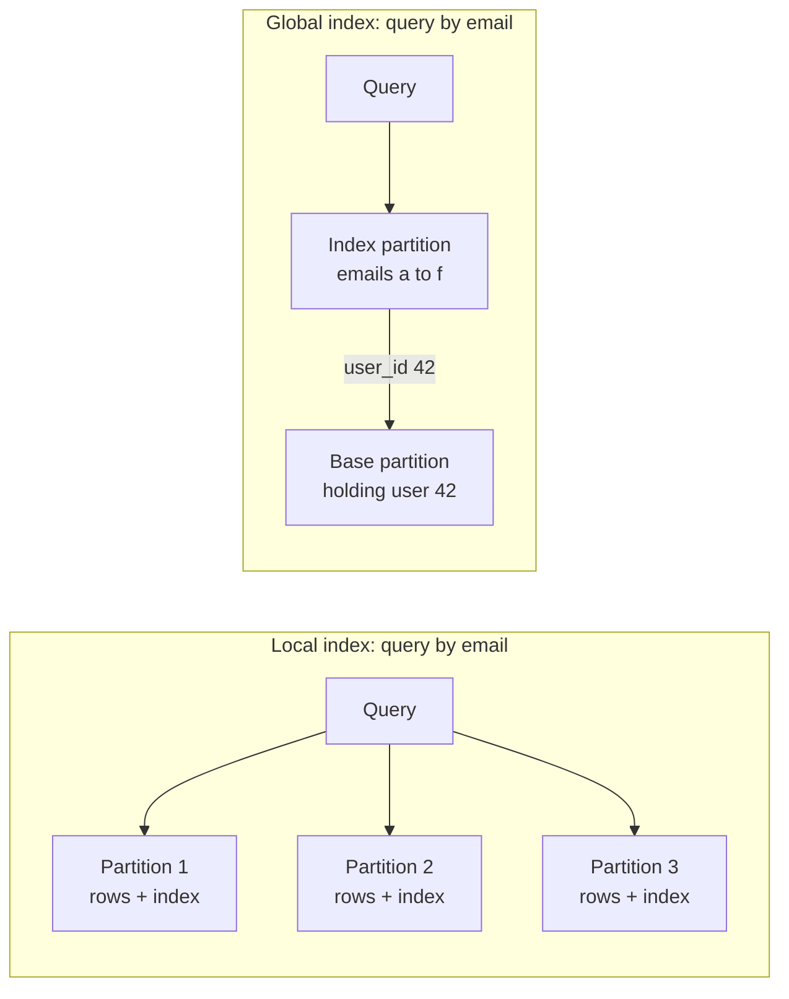
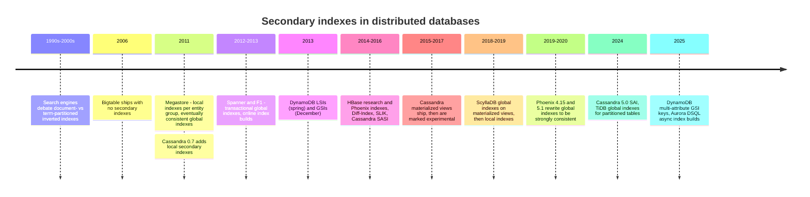
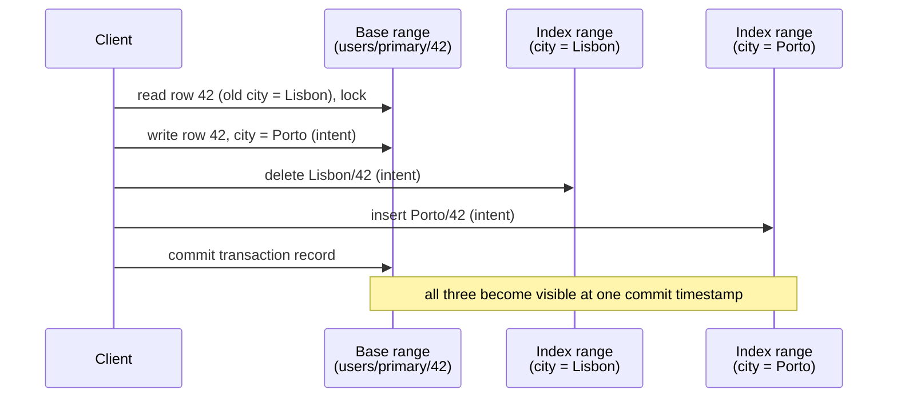
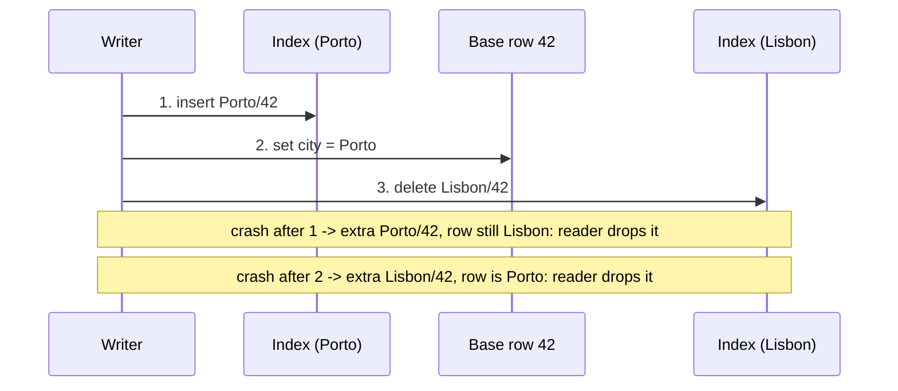
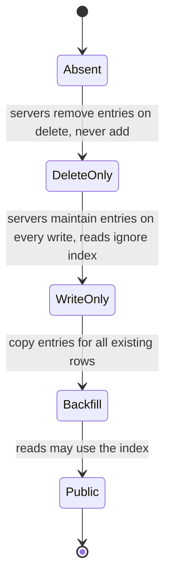

---
tags:
  - distributed-systems
  - databases
  - indexing
  - partitioning
  - data-and-storage
status: complete
sources:
  - https://www.oreilly.com/library/view/designing-data-intensive-applications/9781491903063/ch06.html
  - https://muratbuffalo.blogspot.com/2024/09/ddia-chp-6-partitioning.html
  - https://www.cidrdb.org/cidr2011/Papers/CIDR11_Paper32.pdf
  - https://research.google/pubs/online-asynchronous-schema-change-in-f1/
  - https://docs.cloud.google.com/spanner/docs/secondary-indexes
  - https://docs.aws.amazon.com/amazondynamodb/latest/developerguide/SecondaryIndexes.html
  - https://docs.aws.amazon.com/amazondynamodb/latest/developerguide/GSI.html
  - https://aws.amazon.com/about-aws/whats-new/2025/11/amazon-dynamodb-multi-attribute-composite-keys-global-secondary-indexes
  - https://docs.aws.amazon.com/aurora-dsql/latest/userguide/working-with-create-index-async.html
  - https://docs.cockroachlabs.com/docs/stable/indexes.md
  - https://www.cockroachlabs.com/blog/regional-by-row/
  - https://vldb.org/pvldb/vol15/p3610-taft.pdf
  - https://docs.pingcap.com/tidb/dev/global-indexes/
  - https://docs.yugabyte.com/stable/explore/ysql-language-features/indexes-constraints/secondary-indexes-ysql/
  - https://cassandra.apache.org/_/blog/Apache-Cassandra-5.0-Features-Storage-Attached-Indexes.html
  - https://learn.microsoft.com/en-us/azure/managed-instance-apache-cassandra/materialized-views
  - https://Scylladb.com/2019/07/23/global-or-localsecondary-indexes-in-scylla-the-choice-is-now-yours/
  - https://docs.scylladb.com/manual/master/features/secondary-indexes.md
  - https://phoenix.apache.org/secondary_indexing.html
  - https://engineering.salesforce.com/the-design-of-strongly-consistent-global-secondary-indexes-in-apache-phoenix-part-2-392c57ec6633/
  - https://www.usenix.org/biblio/slik-scalable-low-latency-indexes-key-value-store
  - https://www.usenix.org/conference/atc16/technical-sessions/presentation/kejriwal
  - https://www.cs.ucr.edu/~vagelis/publications/LSM-secondary-indexing-sigmod2018.pdf
  - https://vitess.io/docs/reference/features/vindexes
  - https://planetscale.com/blog/vitess-consistent-lookup-vindex
  - https://www.mongodb.com/docs/manual/core/sharding-shard-key-indexes/
  - https://www.mongodb.com/docs/manual/tutorial/maintain-uniqueness-in-sharded-clusters/
  - https://docs.citusdata.com/en/v12.0/faq/faq.html
created: 2026-11-26
updated: 2026-11-26
---

## Table Of Contents

- [[#TL;DR|TL;DR]]
- [[#The Problem|The Problem]]
- [[#Foundations|Foundations]]
    - [[#Local vs Global|Local vs Global]]
    - [[#What an Index Entry Is|What an Index Entry Is]]
    - [[#Scatter-Gather and the Tail|Scatter-Gather and the Tail]]
    - [[#Write Fan-Out|Write Fan-Out]]
- [[#How We Got Here|How We Got Here]]
- [[#How It Works|How It Works]]
    - [[#Local Indexes in Practice|Local Indexes in Practice]]
    - [[#Global Indexes Inside a Transaction|Global Indexes Inside a Transaction]]
    - [[#Asynchronous Global Indexes|Asynchronous Global Indexes]]
    - [[#Ordered Writes Without Two-Phase Commit|Ordered Writes Without Two-Phase Commit]]
    - [[#Uniqueness Across Partitions|Uniqueness Across Partitions]]
    - [[#Building an Index on a Live Table|Building an Index on a Live Table]]
    - [[#Covering, Interleaving and Locality|Covering, Interleaving and Locality]]
- [[#Where It Is Now|Where It Is Now]]
- [[#Trade-offs & Open Problems|Trade-offs & Open Problems]]
- [[#Resources|Resources]]
- [[#Related Notes|Related Notes]]

## ***TL;DR***
---
*A secondary index lets you find rows by something other than the key the data is partitioned on. In a distributed database the index itself has to be split across machines, and the only real choice is how: next to the rows it points at (local), or by the indexed value (global). Every system on this page is a set of answers to the costs that choice creates.*

- **Local (document-partitioned) index.** Each partition indexes only its own rows. Writes stay on one partition and the index is always in step with the data, but a lookup by the indexed value has to ask every partition and wait for the slowest. Cassandra's indexes, MongoDB, Elasticsearch, Citus and DynamoDB's LSIs work this way.
- **Global (term-partitioned) index.** The index is its own partitioned table, keyed by the indexed value. A lookup goes to one partition, but a write to the base row may also have to change one or two index partitions somewhere else.
- **Keeping a global index correct** takes one of three routes: write it in the same [[Distributed Transactions|distributed transaction]] as the row (Spanner, CockroachDB, TiDB, YugabyteDB), update it asynchronously and accept stale reads (DynamoDB GSIs, Megastore's global indexes, Cassandra materialized views), or order the writes so that a stale index entry is only ever a harmless hint that reads double-check (SLIK, Vitess consistent lookup vindexes, and Phoenix's strong indexes, which add read repair).
- **Uniqueness is the sharpest edge.** A `UNIQUE` constraint on a column that isn't the partition key needs a global view of that column, so systems with only local indexes forbid it unless the partition key is part of the constraint.
- **Where it is now (Nov 2026).** Transactional global indexes are standard in [[Distributed SQL]]; TiDB added global indexes for partitioned tables; DynamoDB GSIs took multi-attribute keys (Nov 2025); Cassandra 5.0 replaced its old local indexes with Storage-Attached Indexes, while its materialized views, the one built-in global option, are still marked experimental and the community is debating how to make them repairable.

## ***The Problem***
---
*[[Partitioning]] puts each row on a machine chosen by its primary key, so a lookup by that key goes straight to one place. A lookup by any other column has no idea where to go, and the two ways of fixing that move the cost either to reads or to writes.*

Take a `users` table partitioned by `user_id` across 16 machines. `SELECT * FROM users WHERE user_id = 42` hashes 42 and asks one machine. `SELECT * FROM users WHERE email = 'ana@example.com'` has nothing to hash: without an index, all 16 machines scan their whole slice.

An index on `email` fixes the scan, but the index is itself data that has to live somewhere. Put each machine's index entries next to its own rows and you still have to ask all 16 machines (they just answer faster). Put the index on machines chosen by the email value and the lookup goes to one machine, but every insert, delete and email change now writes to two places that may be on different machines, and those two writes can disagree if one fails or arrives late.

Single-node databases never faced this: the table and its B-tree index are on the same disk and updated in the same local transaction. The distributed version reopens three questions a single node gets for free:

| Question | Why it gets hard |
|---|---|
| Can the index and the table disagree? | Two partitions, two writes, two failure points |
| How many machines does a lookup touch? | One for a global index; all of them for a local one |
| Can the database enforce `UNIQUE` on this column? | Only if some machine sees every value of it |

## ***Foundations***
---
*Four ideas carry the rest of the note: the local/global split, what an index entry actually stores, why asking every partition is slow at the tail, and how many partitions one write touches.*

### Local vs Global

*Kleppmann's terms in [DDIA chapter 6](https://www.oreilly.com/library/view/designing-data-intensive-applications/9781491903063/ch06.html) are "document-partitioned" (local) and "term-partitioned" (global); the second name comes from search engines, which split an inverted index by term.*

| | Local (document-partitioned) | Global (term-partitioned) |
|---|---|---|
| Where index entries live | On the same partition as the rows they index | In separate partitions, split by the indexed value |
| A write touches | One partition | The base partition plus the index partition(s) for the old and new values |
| A lookup by indexed value touches | Every partition (scatter-gather) | One partition per value, then the base partition(s) |
| Index vs table consistency | Same as the row: updated in the same local write | Needs a distributed transaction, or is eventually consistent |
| Unique constraints | Only if the partition key is part of the constraint | Possible: one partition sees each value |
| Examples | Cassandra 2i and SAI, MongoDB, Elasticsearch, Citus, DynamoDB LSI, ScyllaDB local indexes | Spanner, CockroachDB, TiDB, YugabyteDB, DynamoDB GSI, ScyllaDB global indexes, Vitess lookup vindexes |

There is a middle ground: partition the index by the indexed value but **co-locate** it with a parent row, as Spanner's interleaved indexes and Megastore's per-entity-group local indexes do. That works when queries always name the parent (all orders *for this customer* by date), which is really a local index whose partition key you chose on purpose.

### What an Index Entry Is

*An index is just another sorted key-value table whose key is (indexed value, primary key). Knowing that makes most of the design choices below obvious.*

In a key-value-backed database such as CockroachDB, a row lives at a key like `/users/primary/42` and an index entry on `email` lives at `/users/email_idx/ana@example.com/42`, with the primary key appended so that two users with the same value get distinct entries ([CockroachDB docs](https://docs.cockroachlabs.com/docs/stable/indexes.md)). Because the index key starts with the email, the index is range-partitioned by email just like any other data: it is global by construction.

Reading through an index is then two steps:

1. **Index lookup:** find entries whose key starts with the value, collect primary keys.
2. **Base lookup ("index join"):** fetch each row by primary key, which may be on a different partition.

A **covering index** copies extra columns into the index entry (Spanner's `STORING`, CockroachDB's `STORING`, DynamoDB projections) so step 2 can be skipped, at the cost of more bytes written per update.

### Scatter-Gather and the Tail

*A local-index lookup is only as fast as the slowest of the partitions it asks, so it inherits every partition's bad moments. This is the main reason big systems pay for global indexes.*

If each partition is slow (above some latency $t$) with probability $p$, independently, a query that must hear from all $N$ partitions is slow with probability

$$P(\text{query slow}) = 1 - (1 - p)^N$$

*In words:* the chance that at least one of $N$ answers is slow grows quickly with $N$, even when each one is rarely slow.

*Worked example:* with $p = 0.01$ (each partition's 99th percentile is $t$):

| Partitions $N$ | $P(\text{query slower than } t)$ |
|---|---|
| 1 | 1% |
| 16 | 1 − 0.99¹⁶ ≈ 15% |
| 100 | 1 − 0.99¹⁰⁰ ≈ 63% |

So with 100 partitions, a local-index query hits a partition's p99 latency almost two times in three. A global-index lookup asks one index partition and then the base partitions that actually hold matches, so for a selective query (one email, a few users) it stays near the single-partition latency. This is the same arithmetic behind Dean and Barroso's tail-at-scale argument; see [[Tail Latency and Hedging]].

Local indexes also cost throughput: every lookup does work on all $N$ partitions, so adding partitions does not add lookup capacity. A global index lets lookups scale out with the index's own partitions.

### Write Fan-Out

*The global index pays for its cheap reads at write time. Counting partitions per write makes the cost concrete.*

For a row with $k$ global indexes, an update that changes the indexed value of $c$ of them ($c \le k$) must:

- write the base row (1 partition),
- delete the old entry and insert the new entry for each changed index ($2c$ entries, each possibly on a different partition).

$$\text{partitions touched} \le 1 + 2c, \qquad \text{entries written} = 1 + 2c$$

An insert writes $1 + k$ entries (one per index); a delete removes $1 + k$.

*Worked example:* `users` has global indexes on `email` and `city`. User 42 moves from Lisbon to Porto and keeps the same email: $c = 1$, so the write touches up to 3 partitions (base, `Lisbon/42`, `Porto/42`). If the database writes them in one [[Distributed Transactions|transaction]], that is a cross-partition commit for what looks like a single-row update; with a local index it would have been one partition. Note too that to delete the old entry the writer must first **read** the old value: index maintenance turns blind writes into read-modify-writes, which matters a lot for [[LSM Trees]] (see [[#Asynchronous Global Indexes|below]]).

## ***How We Got Here***
---
*Distributed indexing went from "build it yourself" in the first NoSQL stores, to eventually consistent global indexes as a product feature, to transactional global indexes as a default in distributed SQL. Search engines had worked through the same local-vs-global choice for inverted indexes years earlier.*

**No indexes at all (2006).** Bigtable offered one sorted key and nothing else; applications kept their own index tables and lived with the gaps. HBase inherited the same model, which is why so much of the early research on distributed indexes is about HBase.

**Megastore names the trade-off (2011).** Google's Megastore ([Baker et al., CIDR 2011](https://www.cidrdb.org/cidr2011/Papers/CIDR11_Paper32.pdf)) partitioned data into *entity groups* (say, one user's mail). A **local index** lived inside an entity group, and its entries were "updated atomically and consistently with the primary entity data"; a **global index** spanned entity groups, and its scans "are not guaranteed to reflect all recent updates." In the paper's summary, local indexes "obey ACID semantics; those across entity groups have looser consistency." That is the same split every later system makes.

**Cassandra goes local (2011).** Cassandra 0.7 added secondary indexes stored on each node beside the data they index, so a query on an indexed column fans out across the cluster. Later rewrites (SASI in 3.4, SAI in 5.0) improved the per-node index structure but kept it local.

**Spanner and F1 make global indexes transactional (2012–2013).** In Spanner an index is a table keyed by the indexed columns, updated in the same transaction as the row, so it is always consistent ([Spanner docs](https://docs.cloud.google.com/spanner/docs/secondary-indexes)). F1, Google's ads database on Spanner, then had to answer how to *add* such an index to a live, globally distributed table without stopping writes. Its answer, a sequence of intermediate schema states, became the model for online index builds ([Rae et al., VLDB 2013](https://research.google/pubs/online-asynchronous-schema-change-in-f1/); see [[#Building an Index on a Live Table|below]]).

**DynamoDB productizes both (2013).** DynamoDB launched local secondary indexes in spring 2013 and global secondary indexes in December 2013. Its documentation still states the trade-off most plainly: LSIs support strongly consistent reads but are confined to one partition key value; GSIs span all partitions but support eventually consistent reads only ([AWS docs](https://docs.aws.amazon.com/amazondynamodb/latest/developerguide/SecondaryIndexes.html)).

**The HBase research wave (2014–2016).** IBM's Diff-Index (EDBT 2014) offered several maintenance schemes on HBase, from fully synchronous to asynchronous, to let applications pick their point on the latency/consistency curve. SLIK ([Kejriwal et al., USENIX ATC 2016](https://www.usenix.org/biblio/slik-scalable-low-latency-indexes-key-value-store)) partitioned indexes "independently of the data in tables" on the RAMCloud key-value store and kept them consistent with "a lightweight ordered write approach" instead of distributed transactions, at 11 µs per indexed read and 30 µs per write. A 2018 comparison ([Qader, Cheng and Hristidis, SIGMOD 2018](https://www.cs.ucr.edu/~vagelis/publications/LSM-secondary-indexing-sigmod2018.pdf)) measured embedded versus stand-alone (eager, lazy, composite) index designs inside LSM-tree stores.

**Materialized views as global indexes (2015–2019).** Cassandra 3.0 shipped materialized views, a server-maintained copy of a table repartitioned by another column, which is exactly an asynchronous global index. Edge cases left views out of sync with their base tables, and the project marked them experimental and disabled them by default. Microsoft's managed-Cassandra docs (updated Aug 2026) still say "there's no way to determine if a materialized view is out of sync with its base table" and that the only fix for a diverged view is to drop and re-create it ([Azure managed Cassandra docs](https://learn.microsoft.com/en-us/azure/managed-instance-apache-cassandra/materialized-views)). ScyllaDB built its global secondary indexes on its own materialized-view implementation, and in ScyllaDB Open Source 3.1 (October 2019) added local indexes so users could choose ([ScyllaDB, July 2019](https://Scylladb.com/2019/07/23/global-or-localsecondary-indexes-in-scylla-the-choice-is-now-yours/)).

**Distributed SQL makes it the default.** CockroachDB, YugabyteDB and TiDB all store indexes as ordinary key ranges written in the row's transaction, so the user never chooses "local or global" at all; the database chooses global and pays the transaction cost ([[Distributed SQL]]). Apache Phoenix, the SQL layer on HBase, "completely rewrote" its global indexing for versions 4.15 and 5.1 to make it strongly consistent, using a three-phase write with read repair (see [[#Ordered Writes Without Two-Phase Commit|below]]) ([Phoenix docs](https://phoenix.apache.org/secondary_indexing.html); [Salesforce Engineering](https://engineering.salesforce.com/the-design-of-strongly-consistent-global-secondary-indexes-in-apache-phoenix-part-2-392c57ec6633/)).

## ***How It Works***
---
*There are four mechanisms worth knowing in detail: local indexes and their query planning, transactional global indexes, asynchronous global indexes, and write-ordering tricks that get consistency without two-phase commit. Uniqueness, online builds and locality controls sit on top of them.*

### Local Indexes in Practice

*A local index is simple to keep correct and expensive to query. Systems that use them work hard to avoid the full fan-out.*

- **Cassandra SAI (5.0).** Storage-Attached Indexes are "attached to the normal Memtable/SSTable lifecycle," so "the index data mimics the structure/locality of backing table data" and needs no separate index table ([Cassandra blog, Nov 2023](https://cassandra.apache.org/_/blog/Apache-Cassandra-5.0-Features-Storage-Attached-Indexes.html)). Compared with the original indexes, whose storage grew linearly with the number of indexed columns and whose queries "often required full scans," SAI shares index structures per SSTable and supports numeric range, prefix/suffix and boolean queries. Because the index is per node, a query that also restricts the partition key hits one replica set; one that doesn't has to be sent across the token ring by the coordinator.
- **MongoDB.** Each shard indexes its own documents. A query that includes the shard key is routed to one shard; one that doesn't is broadcast by `mongos` to every shard ([MongoDB docs](https://www.mongodb.com/docs/manual/core/sharding-shard-key-indexes/)).
- **Elasticsearch** is the textbook document-partitioned search engine: each shard holds a full inverted index for its documents, and every search is a query-then-fetch over all shards.
- **Citus and most sharded Postgres.** Indexes are created per shard by ordinary Postgres, so a predicate without the distribution column runs on every shard ([[Sharded Postgres]]).
- **DynamoDB LSI.** Index entries share the partition key with the base items, so the index is local to one *item collection*, supports strongly consistent reads, must be defined at table creation, and caps each item collection at 10 GB ([AWS docs](https://docs.aws.amazon.com/amazondynamodb/latest/developerguide/SecondaryIndexes.html)).

How systems blunt the scatter: include the partition key in the query whenever possible (then the local index is perfect), cap the fan-out with `LIMIT` and paging, run the fan-out in parallel, and hedge slow partitions ([[Tail Latency and Hedging]]).

### Global Indexes Inside a Transaction

*The clean answer: treat the index entries as more rows and write them in the same transaction as the base row. The index is never wrong; every write that changes an indexed column becomes a multi-partition commit.*

- **Spanner.** An index is a table whose key is the indexed columns plus the base table's primary key. "When you update a row in a table, Spanner must also update its secondary indexes," inside the same transaction, and the docs warn that for a global index this can mean a distributed two-phase commit across [[Paxos]] groups ([Spanner docs](https://docs.cloud.google.com/spanner/docs/secondary-indexes)).
- **CockroachDB.** Indexes live in the same key-value space and are split into ranges like data; "new values have to be written for both the table *and* the index" ([CockroachDB docs](https://docs.cockroachlabs.com/docs/stable/indexes.md)). Its parallel commits protocol lets the commit acknowledge after one round of replicated writes when all intents succeed.
- **TiDB and YugabyteDB.** Same idea: index key-values written in the row's [[Distributed Transactions|Percolator-style]] or provisional-record transaction ([TiDB docs](https://docs.pingcap.com/tidb/dev/global-indexes/); [YugabyteDB docs](https://docs.yugabyte.com/stable/explore/ysql-language-features/indexes-constraints/secondary-indexes-ysql/)).

The cost scales with how many indexes a table has and how often indexed columns change. A common rule in these systems' tuning guides: drop indexes nobody reads, and prefer covering indexes only for hot queries.

### Asynchronous Global Indexes

*The cheap-write answer: commit the base row, then propagate index changes in the background. Lookups are fast, but an index read can miss a just-written row or return one that no longer matches.*

- **DynamoDB GSI.** Indexes "are updated asynchronously, using an eventually consistent model," normally "within a fraction of a second" but with "longer propagation delays" possible in failures, and applications must "anticipate and handle" stale results. A GSI has its own write capacity, and if it is too low, "the write activity on the table will be throttled"; AWS advises giving each GSI at least the base table's write capacity ([AWS GSI docs](https://docs.aws.amazon.com/amazondynamodb/latest/developerguide/GSI.html)). The asynchronous index is not free; its back-pressure lands on the writer.
- **Megastore global indexes** (2011) and **Cassandra materialized views** work the same way: the replica that applies a base write computes the view update and sends it to the view's partition.
- **Phoenix `CONSISTENCY=EVENTUAL` global indexes** take index maintenance off the data write path for write-heavy tables that can tolerate a bounded staleness window ([Phoenix docs](https://phoenix.apache.org/secondary_indexing.html)).

The hard part is *what happens on failure.* If the base write commits and the index update is lost, the index has a missing entry; if a stale update is applied late, it can resurrect an old value. Fixing that needs a repair process that compares base and index, and because they are partitioned by different keys, the comparison is a join across the whole cluster rather than a range-by-range Merkle tree as in normal [[Anti-Entropy and Repair]]. That is exactly the problem that kept Cassandra's materialized views experimental.

**The read-before-write tax in LSM stores.** In an [[LSM Trees|LSM tree]], a plain write is a blind append, which is why LSMs write fast. An index update needs the *old* value to delete the old entry, which means a read on every write. Designs work around it by deferring cleanup: write the new index entry blindly and validate entries at read time against the base row (lazy), or let compaction drop entries that no longer match (Qader et al. compare these approaches, [SIGMOD 2018](https://www.cs.ucr.edu/~vagelis/publications/LSM-secondary-indexing-sigmod2018.pdf)).

### Ordered Writes Without Two-Phase Commit

*A third route keeps reads correct without a distributed transaction: write the index in an order that makes every possible failure leave an extra index entry, never a missing one, and make readers check each entry against the base row.*

The invariant is:

$$\text{every live row is reachable from the index} \quad (\text{index} \supseteq \text{rows})$$

*In words:* the index may point at things that aren't (or are no longer) there, but it never fails to point at something that is. Stale pointers are filtered by the reader; missing pointers could not be recovered.

The write order that keeps it:

1. Insert the **new** index entry.
2. Write the base row.
3. Delete the **old** index entry (best effort; a background sweep cleans up leftovers).

And the read rule: for each primary key the index returns, fetch the row and check that its current value still matches the query; drop it if not.

*Worked example:* the writer crashes after step 2. A query `city = 'Lisbon'` finds `Lisbon/42`, fetches row 42, sees `Porto`, and drops it: correct. A query `city = 'Porto'` finds `Porto/42` and returns the row: correct. No failure point loses the row from the `Porto` index.

- **SLIK** used this "lightweight ordered write approach" on RAMCloud, storing each index as B+ tree nodes in the key-value store itself, with indexed reads in 11 µs and writes in 30 µs ([Kejriwal et al., ATC 2016](https://www.usenix.org/conference/atc16/technical-sessions/presentation/kejriwal)).
- **Apache Phoenix (4.15 and 5.1+)** does a variant: (1) write new index rows marked *unverified* and mark the old ones unverified, (2) write the data row, (3) delete old index rows and mark new ones *verified*. A reader that meets an unverified row repairs it from the data table ([Phoenix docs](https://phoenix.apache.org/secondary_indexing.html)). This gives strong consistency on reads, at the cost of a read-repair round when a write was interrupted.
- **Vitess lookup vindexes** keep a lookup table (value → keyspace ID) in its own keyspace. The *consistent* lookup vindex uses three connections committed in order, *Pre*, *Main*, *Post*: new lookup rows go on Pre, the user row on Main, and lookup deletes on Post, so an update is a Post delete plus a Pre insert. A failure can leave an orphan lookup row, which points at a shard where the row no longer exists, so queries still return correct results, and a later insert of the same value reuses it. In the authors' words, it uses "careful locking and transaction sequences to guarantee consistency without using 2PC" ([PlanetScale, Apr 2024](https://planetscale.com/blog/vitess-consistent-lookup-vindex); [Vitess docs](https://vitess.io/docs/reference/features/vindexes)).

The catch: it guarantees "no missed rows" for point reads, not a consistent snapshot. A scan over the index can still see a row that changed mid-query, and it doesn't give you `UNIQUE` without more work.

### Uniqueness Across Partitions

*Enforcing `UNIQUE(email)` needs one place that sees every email. With local indexes only, there is no such place, so systems restrict what you may declare unique.*

| System | Rule |
|---|---|
| MongoDB | "A sharded cluster enforces a unique constraint across shards only when the unique index is on the shard key or includes the shard key as a prefix"; the `_id` index is unique "per shard" unless `_id` is the shard key ([MongoDB docs](https://www.mongodb.com/docs/manual/tutorial/maintain-uniqueness-in-sharded-clusters/)) |
| Citus | Unique and primary-key constraints must include the distribution column ([Citus FAQ](https://docs.citusdata.com/en/v12.0/faq/faq.html)) |
| TiDB partitioned tables (before global indexes), MySQL | Every unique key must include all partitioning columns |
| Spanner, CockroachDB, YugabyteDB | Any unique index; enforced through the global index in the write transaction |
| Vitess | A unique lookup vindex acts as the global uniqueness check |

The usual workaround with local-only indexes is a separate "uniqueness table" partitioned by the unique value, written in the same transaction or with the ordered-write trick above. That is a hand-built global index.

Multi-region databases add a twist. In a CockroachDB `REGIONAL BY ROW` table, each row's home region is a hidden column that prefixes every index, which makes indexes effectively local to a region. A unique constraint on `email` then needs a check in *every* region on insert. These checks run as extra queries in the same transaction and may visit every region. CockroachDB skips them when the column defaults to `gen_random_uuid()` (collisions are vanishingly unlikely), when the region is a computed column derived from the key, or when you ask only for per-region uniqueness with `UNIQUE (crdb_region, col)`. Its *locality-optimized search* looks for a unique row in the local region first and skips the remote scan if it finds it ([CockroachDB blog](https://www.cockroachlabs.com/blog/regional-by-row/); [Taft et al., VLDB 2022](https://vldb.org/pvldb/vol15/p3610-taft.pdf)).

### Building an Index on a Live Table

*Adding an index to a table that is taking writes means backfilling millions of entries while new writes keep arriving, on servers that don't all switch schema at the same moment. F1's protocol is the standard answer.*

The danger: server A knows about the new index and writes entries; server B doesn't and writes rows without entries; a backfill running concurrently might miss B's rows. F1 solves this by moving through intermediate states, guaranteeing that at most two adjacent states are in use at once ([Rae et al., VLDB 2013](https://research.google/pubs/online-asynchronous-schema-change-in-f1/)):

- **Why delete-only first:** if a server in write-only state adds an entry and a server still in absent state deletes the row, the entry would be orphaned. Delete-only servers clean up such entries, so the two adjacent states can safely overlap.
- **Why the backfill is safe:** by the time it runs, every server maintains the index for new writes, so the backfill only has to cover rows that existed before.

CockroachDB, TiDB and YugabyteDB use variants of this protocol for online `CREATE INDEX`. Spanner backfills in the background without taking the database offline, and warns that "index creation can take from several minutes to many hours" depending on data size and load ([Spanner docs](https://docs.cloud.google.com/spanner/docs/secondary-indexes)). Aurora DSQL exposes the background build directly: `CREATE INDEX ASYNC` "immediately returns a `job_id`," doesn't lock or block the base table, and a migration can call `sys.wait_for_job` before using the index. A failed build leaves the index `INVALID` until you drop it, for example when a unique index finds duplicates ([AWS docs](https://docs.aws.amazon.com/aurora-dsql/latest/userguide/working-with-create-index-async.html)).

### Covering, Interleaving and Locality

*Three knobs reduce the cost of a global index lookup: copy columns into the index, place index entries near related data, and pin index partitions near the readers.*

- **Covering (`STORING`, projections).** Spanner and CockroachDB let an index store extra columns so a query never fetches the base row; DynamoDB GSIs choose a projection (`KEYS_ONLY`, `INCLUDE`, `ALL`). Each stored column is written on every update of that column, so storage and write cost rise ([Spanner docs](https://docs.cloud.google.com/spanner/docs/secondary-indexes)).
- **Interleaving.** Spanner indexes "can be interleaved with other tables in order to colocate index rows with those of another table"; the parent's primary key must prefix the index key, so all index entries for one parent (one customer's orders by date) sit with the parent row. This turns a global index into a local one by design when every query names the parent.
- **Multi-attribute keys.** DynamoDB GSIs, since November 2025, accept up to four attributes each in the partition and sort key, so an index on `(tenant, status)` no longer needs a synthetic concatenated attribute maintained by the application ([AWS, Nov 2025](https://aws.amazon.com/about-aws/whats-new/2025/11/amazon-dynamodb-multi-attribute-composite-keys-global-secondary-indexes)).
- **Region placement.** In multi-region SQL, an index can be pinned (or duplicated) per region so reads stay local; duplicating it multiplies write cost by the number of copies ([[Replication]], [[CAP and PACELC]]).

## ***Where It Is Now***
---
*As of late November 2026, the split is settled by product category: distributed SQL does transactional global indexes by default, wide-column stores default to local indexes with an asynchronous global option, and the frontier is making asynchronous indexes repairable and making global indexes cheaper to write.*

| System | Default index | Global option | Consistency of the global option |
|---|---|---|---|
| Spanner, CockroachDB, YugabyteDB | Global | — | Transactional |
| TiDB | Global for non-partitioned tables; local per partition for partitioned tables | Global indexes on partitioned tables | Transactional |
| DynamoDB | LSI (local) | GSI | Eventual; throttles base writes if behind |
| Cassandra 5.x | SAI (local) | Materialized views (experimental) | Eventual, no built-in repair |
| ScyllaDB | Global (on materialized views) | Local indexes on request | Eventual |
| MongoDB, Elasticsearch, Citus | Local | Application-managed | — |
| Vitess | Local per shard | Lookup vindexes | Ordered writes, orphans tolerated |
| Phoenix on HBase | Global or local | Strongly consistent global (default for new tables since 4.15/5.1) | Three-phase write with read repair |

Notable recent moves (dates from each vendor's own docs or announcements):

- **Cassandra 5.0 (GA Sep 2024)** made SAI the recommended index type, replacing the original 2i and SASI for most uses ([Cassandra blog](https://cassandra.apache.org/_/blog/Apache-Cassandra-5.0-Features-Storage-Attached-Indexes.html)). Materialized views are still disabled by default. In 2025 the dev list debated an enhancement proposal for first-class materialized views with a real repair mechanism, and discussion centered on how to compare two copies partitioned by different keys; with [[Leaderless Consensus|Accord]] transactions arriving, transactionally maintained views are now plausible but not shipped.
- **TiDB** added global indexes for partitioned tables as an experimental feature in v8.3.0 and made them generally available in v8.4.0 (both 2024). Before them, "primary keys and unique keys had to include all the partition keys"; a `GLOBAL` index lifts that rule ([TiDB docs](https://docs.pingcap.com/tidb/dev/global-indexes/)).
- **DynamoDB (Nov 2025)** added multi-attribute GSI keys; the eventual-consistency and back-pressure model is unchanged.
- **Aurora DSQL** builds indexes asynchronously with `CREATE INDEX ASYNC`, fitting its disaggregated, OCC-based design ([[Distributed SQL]]).
- **Sharded Postgres** (Citus, Neki, PgDog, Multigres) still offers only per-shard local indexes; global lookups mean a hand-maintained lookup table, the gap noted in [[Sharded Postgres]].

## ***Trade-offs & Open Problems***
---
*Every design trades read fan-out, write fan-out and consistency against each other; you can have any two cheaply. The open problems are about making the third less painful.*

| Design | Reads by index value | Writes | Index consistency | Unique constraints |
|---|---|---|---|---|
| Local | All partitions, tail-latency bound | One partition | Exact | Only with partition key |
| Global, transactional | One index partition + base | Distributed transaction | Exact | Yes |
| Global, asynchronous | One index partition + base | One partition now, index later | Stale reads, needs repair | No (not safely) |
| Global, ordered writes + read check | One index partition + base, plus verification | Several sequential writes, no 2PC | No missed rows; no snapshot | With extra work |

Open problems:

- **Repairing asynchronous indexes.** Base and index are partitioned by different keys, so you cannot compare them range by range; a full comparison is a cluster-wide join. Cassandra's materialized views have stalled on this for years.
- **Write amplification with many indexes.** Every transactional index adds partitions to the commit. Wide tables with 10 indexes turn single-row updates into 10-plus-partition transactions; deterministic and batched designs ([[Deterministic Transactions]]) may lower the per-index cost.
- **Low-cardinality and hot index values.** An index on `status` with three values puts every write for `status = 'active'` on one index partition: a [[Hot Keys and Cache Stampedes|hot key]] the base table never had. Global indexes need the same salting and splitting tricks as base data ([[Partitioning]]).
- **Index lag you can see.** Asynchronous indexes rarely expose *how* stale they are; read-your-writes through a GSI is not available, and applications discover lag by surprise ([[Consistency Models]]).
- **Indexes over object storage.** Lakehouse tables and object-store databases ([[Object Storage]]) mostly rely on min/max statistics and filters per file rather than true secondary indexes; maintaining a global index on immutable files is an open design area ([[Bloom and Range Filters]], [[Lakehouse Table Formats]]).
- **Testing.** Index/table divergence only shows under specific failure timings, which is exactly what [[Deterministic Simulation Testing]] and [[Isolation Testing]] (Jepsen-style) are for.

## ***Resources***
---
*Start with Kleppmann for the model, Megastore and the F1 schema-change paper for the history, and the DynamoDB and CockroachDB docs for how the two main approaches look in production.*

**Concepts**
- [Designing Data-Intensive Applications, ch. 6: Partitioning](https://www.oreilly.com/library/view/designing-data-intensive-applications/9781491903063/ch06.html) — Martin Kleppmann; the document- vs term-partitioned framing.
- [DDIA chapter 6 notes](https://muratbuffalo.blogspot.com/2024/09/ddia-chp-6-partitioning.html) — Murat Demirbas, Sep 2024.

**Papers**
- [Megastore: Providing Scalable, Highly Available Storage for Interactive Services](https://www.cidrdb.org/cidr2011/Papers/CIDR11_Paper32.pdf) — Baker et al., CIDR 2011.
- [Online, Asynchronous Schema Change in F1](https://research.google/pubs/online-asynchronous-schema-change-in-f1/) — Rae et al., VLDB 2013.
- [SLIK: Scalable Low-Latency Indexes for a Key-Value Store](https://www.usenix.org/conference/atc16/technical-sessions/presentation/kejriwal) — Kejriwal et al., USENIX ATC 2016.
- [A Comparative Study of Secondary Indexing Techniques in LSM-based NoSQL Databases](https://www.cs.ucr.edu/~vagelis/publications/LSM-secondary-indexing-sigmod2018.pdf) — Qader, Cheng, Hristidis, SIGMOD 2018.
- [Multi-Region in CockroachDB](https://vldb.org/pvldb/vol15/p3610-taft.pdf) — Taft et al., VLDB 2022.

**System docs and engineering posts**
- [DynamoDB: improving data access with secondary indexes](https://docs.aws.amazon.com/amazondynamodb/latest/developerguide/SecondaryIndexes.html) and [GSIs](https://docs.aws.amazon.com/amazondynamodb/latest/developerguide/GSI.html); [multi-attribute GSI keys, Nov 2025](https://aws.amazon.com/about-aws/whats-new/2025/11/amazon-dynamodb-multi-attribute-composite-keys-global-secondary-indexes).
- [Spanner secondary indexes](https://docs.cloud.google.com/spanner/docs/secondary-indexes).
- [CockroachDB indexes](https://docs.cockroachlabs.com/docs/stable/indexes.md); [REGIONAL BY ROW](https://www.cockroachlabs.com/blog/regional-by-row/).
- [TiDB global indexes](https://docs.pingcap.com/tidb/dev/global-indexes/); [YugabyteDB secondary indexes](https://docs.yugabyte.com/stable/explore/ysql-language-features/indexes-constraints/secondary-indexes-ysql/).
- [Aurora DSQL asynchronous indexes](https://docs.aws.amazon.com/aurora-dsql/latest/userguide/working-with-create-index-async.html).
- [Cassandra 5.0: Storage-Attached Indexes](https://cassandra.apache.org/_/blog/Apache-Cassandra-5.0-Features-Storage-Attached-Indexes.html); [materialized views status (Azure managed Cassandra)](https://learn.microsoft.com/en-us/azure/managed-instance-apache-cassandra/materialized-views).
- [ScyllaDB: global or local secondary indexes](https://Scylladb.com/2019/07/23/global-or-localsecondary-indexes-in-scylla-the-choice-is-now-yours/); [ScyllaDB global index docs](https://docs.scylladb.com/manual/master/features/secondary-indexes.md).
- [Apache Phoenix secondary indexing](https://phoenix.apache.org/secondary_indexing.html); [Strongly consistent global indexes in Phoenix, part 2](https://engineering.salesforce.com/the-design-of-strongly-consistent-global-secondary-indexes-in-apache-phoenix-part-2-392c57ec6633/) (Salesforce Engineering).
- [Vitess vindexes](https://vitess.io/docs/reference/features/vindexes); [Vitess consistent lookup vindex](https://planetscale.com/blog/vitess-consistent-lookup-vindex) (PlanetScale, Apr 2024).
- [MongoDB shard key indexes](https://www.mongodb.com/docs/manual/core/sharding-shard-key-indexes/); [uniqueness in sharded clusters](https://www.mongodb.com/docs/manual/tutorial/maintain-uniqueness-in-sharded-clusters/).
- [Citus FAQ (unique constraints)](https://docs.citusdata.com/en/v12.0/faq/faq.html).

## ***Related Notes***
---
*Where the costs on this page come from and where they lead.*

- [[Partitioning]] — The base-table partitioning that makes indexes a distributed problem; its Secondary Indexes section is the short version of this note.
- [[Distributed SQL]] — Spanner, CockroachDB, TiDB and YugabyteDB, where transactional global indexes are the default.
- [[Distributed Transactions]] — The commit protocols every transactional index write pays for.
- [[Sharded Postgres]] — Per-shard local indexes and the missing global index.
- [[LSM Trees]] — Why index maintenance's read-before-write hurts write-optimized stores.
- [[Anti-Entropy and Repair]] — Range-by-range repair, and why it doesn't work between a table and its index.
- [[Consistency Models]] — What "eventually consistent index" means for readers.
- [[CAP and PACELC]] — Index placement across regions as a latency vs consistency choice.
- [[Replication]] — Per-region index copies and their write cost.
- [[Leaderless Consensus]] — Accord, the transaction layer that could make Cassandra's views consistent.
- [[Paxos]] — Spanner's per-split groups, which index writes span.
- [[Isolation Testing]] — Finding index/table divergence under faults.
- [[Deterministic Simulation Testing]] — Exploring the failure timings that orphan or lose index entries.
- [[Object Storage]] — Where immutable-file layouts make classic indexes hard.
- [[Tail Latency and Hedging]] — Planned: the math behind scatter-gather slowness.
- [[Hot Keys and Cache Stampedes]] — Low-cardinality index values as hot keys, and how to salt or cache them.
- [[Change Data Capture]] — Deriving indexes and views from a change stream instead of the write path.
- [[Deterministic Transactions]] — Planned: cheaper multi-partition writes.
- [[Bloom and Range Filters]] — The lightweight alternative to indexes in LSMs and lakehouses.
- [[Lakehouse Table Formats]] — Planned: file-level statistics instead of secondary indexes.
