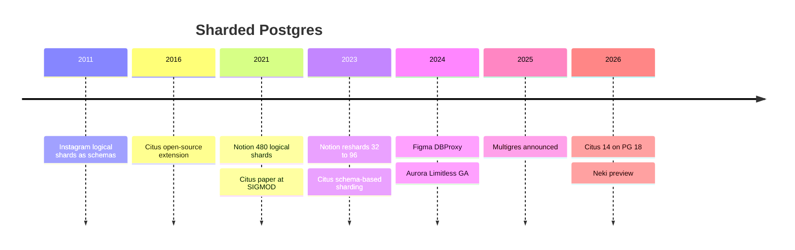
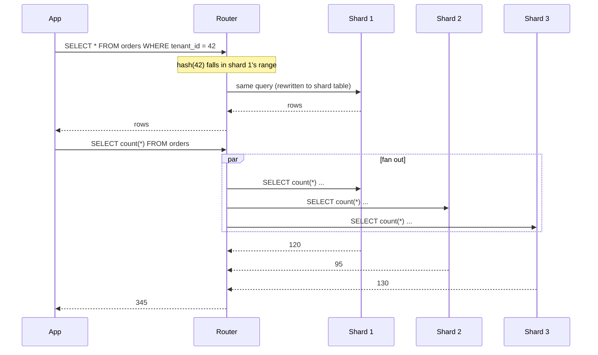
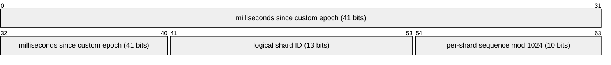
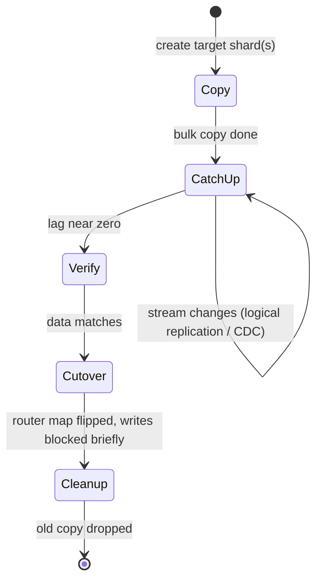

---
tags:
  - distributed-systems
  - postgres
  - sharding
  - databases
  - data-and-storage
status: complete
sources:
  - https://docs.citusdata.com/en/stable/get_started/concepts.html
  - https://paper-notes.zhjwpku.com/assets/pdfs/citus.pdf
  - https://www.citusdata.com/blog/2016/03/24/citus-unforks-goes-open-source/
  - https://www.citusdata.com/blog/2019/01/24/microsoft-acquires-citus-data/
  - https://www.citusdata.com/blog/2022/09/19/citus-11-1-shards-postgres-tables-without-interruption/
  - https://docs.citusdata.com/en/v12.1/develop/api_guc.html
  - https://www.citusdata.com/blog/2022/06/17/citus-11-goes-fully-open-source/
  - https://www.citusdata.com/blog/2023/07/18/citus-12-schema-based-sharding-for-postgres/
  - https://www.citusdata.com/updates/v14-0/
  - https://learn.microsoft.com/azure/postgresql/flexible-server/concepts-elastic-clusters
  - https://docs.aws.amazon.com/AmazonRDS/latest/AuroraUserGuide/limitless-architecture.html
  - https://docs.aws.amazon.com/AmazonRDS/latest/AuroraUserGuide/limitless-query.distributed.html
  - https://aws.amazon.com/blogs/aws/amazon-aurora-postgresql-limitless-database-is-now-generally-available
  - https://muratbuffalo.blogspot.com/2025/01/use-of-time-in-distributed-databases_14.html
  - https://vitess.io/docs/reference/features/sharding/
  - https://planetscale.com/blog/introducing-neki
  - https://planetscale.com/blog/the-architecture-of-neki
  - https://supabase.com/blog/multigres-vitess-for-postgres
  - https://supabase.com/blog/multigres-v0-1-alpha
  - https://supabase.com/changelog/multigres-private-alpha
  - https://docs.pgdog.dev/features/sharding/
  - https://docs.pgdog.dev/features/sharding/cross-shard-queries/
  - https://instagram-engineering.com/1cf5a71e5a5c
  - https://www.notion.com/blog/sharding-postgres-at-notion
  - https://www.notion.com/blog/the-great-re-shard
  - https://www.figma.com/blog/how-figmas-databases-team-lived-to-tell-the-scale/
  - https://openai.com/index/scaling-postgresql/
created: 2026-11-26
updated: 2026-11-26
---

## Table Of Contents

- [[#TL;DR|TL;DR]]
- [[#The Problem|The Problem]]
- [[#Foundations|Foundations]]
    - [[#Shard Keys and Hash Ranges|Shard Keys and Hash Ranges]]
    - [[#Logical Shards vs Physical Databases|Logical Shards vs Physical Databases]]
    - [[#Colocation and Reference Tables|Colocation and Reference Tables]]
    - [[#Where the Router Lives|Where the Router Lives]]
- [[#How We Got Here|How We Got Here]]
- [[#How It Works|How It Works]]
    - [[#Routing a Query|Routing a Query]]
    - [[#Transactions Across Shards|Transactions Across Shards]]
    - [[#The Missing Global Snapshot|The Missing Global Snapshot]]
    - [[#IDs Without a Single Sequence|IDs Without a Single Sequence]]
    - [[#Resharding Online|Resharding Online]]
    - [[#Each Shard Is Still a Postgres Cluster|Each Shard Is Still a Postgres Cluster]]
- [[#Where It Is Now|Where It Is Now]]
    - [[#The Field in November 2026|The Field in November 2026]]
    - [[#How Far One Primary Goes|How Far One Primary Goes]]
- [[#Trade-offs & Open Problems|Trade-offs & Open Problems]]
- [[#Resources|Resources]]
- [[#Related Notes|Related Notes]]

## ***TL;DR***
---
*Sharded Postgres splits one logical PostgreSQL database across many ordinary PostgreSQL servers, each holding a slice of the rows chosen by a shard key, with a router in front that sends each query to the right slice. It is how Postgres scales writes past one machine without switching to a new database engine, and in 2024 to 2026 it went from something each big company built for itself to a feature you can buy.*

- **The idea.** Pick a column that most queries filter on (a tenant, workspace or user ID), hash it, and map hash ranges to shards. Each shard is a normal Postgres database; a router (an extension, a proxy or a managed service) rewrites and forwards queries. This is [[Partitioning]] applied to an engine that was built for one node.
- **Why it's different from [[Distributed SQL]].** CockroachDB, YugabyteDB and Spanner rebuild storage, replication and transactions from scratch around [[Raft]] or [[Paxos]] groups. Sharded Postgres keeps every shard a stock (or nearly stock) Postgres and adds coordination *above* it, so extensions, the planner and operational tooling keep working, but anything that spans shards has to be bolted on.
- **The easy case.** Queries and transactions that touch one shard key value stay on one shard and behave exactly like plain Postgres. Good shard-key choice makes this the 95% case.
- **The hard cases.** Cross-shard joins, cross-shard transactions (two-phase commit), a consistent snapshot across shards, globally unique IDs, schema changes on every shard, and moving data when shards fill up. Each system in this note is mostly a set of answers to those six problems.
- **Where it is now (Nov 2026).** Citus 14 (open source, also run by Microsoft as Azure elastic clusters), Aurora PostgreSQL Limitless (GA since Oct 2024), PlanetScale's Neki (preview since Sep 2026), PgDog (open-source sharding proxy) and Supabase's Multigres (alpha, sharding not yet shipped). Meanwhile OpenAI showed in Jan 2026 how far a single primary plus read replicas can go before you need any of this.

## ***The Problem***
---
*Postgres replication copies the whole database to every replica, so replicas add read capacity but never write capacity or storage. Once one primary can't absorb the writes, vacuum the tables or hold the data, you have to split the data itself.*

A single Postgres primary is limited in a few concrete ways:

| Limit | Why it bites | Does a read replica help? |
|---|---|---|
| **Write throughput** | Every insert, update and delete goes through one primary's CPU, WAL and disk ([[Replication]]) | No: replicas replay the same WAL |
| **Vacuum and bloat** | Postgres keeps old row versions (MVCC) and cleans them up with vacuum; on a multi-terabyte table one vacuum pass can take hours while dead rows pile up | No |
| **Storage on one node** | All data must fit one instance's storage | No: every replica holds a full copy |
| **Connections** | Each connection is a process; thousands of app servers overwhelm it | Partly, with poolers |
| **Blast radius** | One bad query or one failover affects every customer | No |

Teams hit these walls in the same order. Notion's 2021 write-up says they moved to sharding when their monolith's CPU spiked, vacuum stalled and they risked transaction ID wraparound, which forces Postgres to stop accepting writes ([Notion, 2021](https://www.notion.com/blog/sharding-postgres-at-notion)). Figma started 2020 on a single Postgres database on AWS's largest physical instance, and its database stack grew almost 100x after that ([Figma, Mar 2024](https://www.figma.com/blog/how-figmas-databases-team-lived-to-tell-the-scale/)).

The alternatives each have a cost. Moving to a [[Distributed SQL]] engine means a new storage engine, new failure modes and partial Postgres compatibility. Vertical partitioning (moving some tables to their own database) buys time but stops working when one table outgrows a node. Sharding keeps Postgres but pushes complexity into routing, cross-shard semantics and operations.

## ***Foundations***
---
*Four ideas carry every design here: a shard key hashed into ranges, many small logical shards packed onto fewer servers, colocation so related rows share a shard, and a router that knows the map. Get these and the systems differ mostly in where they put the router.*

### Shard Keys and Hash Ranges
Every sharded Postgres design starts by choosing a **shard key** (Citus calls it the *distribution column*, Neki a *shard index*, Vitess a *vindex*). Most use hashing so that load spreads evenly no matter how the key values cluster.

Citus is the clearest example. It hashes the distribution column (Postgres hash functions return a signed 32-bit integer) and gives each shard a contiguous range of hash values, stored in its metadata as `shardminvalue` and `shardmaxvalue`; the ranges are disjoint and together cover the whole hash space ([Citus concepts](https://docs.citusdata.com/en/stable/get_started/concepts.html); [Citus paper](https://paper-notes.zhjwpku.com/assets/pdfs/citus.pdf)). By default a hash-distributed table gets 32 shards ([Citus configuration](https://docs.citusdata.com/en/v12.1/develop/api_guc.html)). With $N$ shards:

$$
\text{shard}(k) = \left\lfloor \frac{h(k) + 2^{31}}{2^{32} / N} \right\rfloor, \qquad h(k) \in [-2^{31},\ 2^{31})
$$

**In plain English:** shift the 32-bit hash so it starts at zero, then divide by the width of one shard's slice. Every key lands in exactly one slice, and each slice is the same width, so a good hash gives each shard about the same number of keys.

**Worked example ($N = 4$).** Each shard covers $2^{32}/4 = 1{,}073{,}741{,}824$ hash values:

| Shard | Hash range |
|---|---|
| 0 | $-2{,}147{,}483{,}648$ to $-1{,}073{,}741{,}825$ |
| 1 | $-1{,}073{,}741{,}824$ to $-1$ |
| 2 | $0$ to $1{,}073{,}741{,}823$ |
| 3 | $1{,}073{,}741{,}824$ to $2{,}147{,}483{,}647$ |

If `tenant_id = 42` hashes to $-5{,}000$, then $(-5{,}000 + 2^{31}) / 2^{30} \approx 1.99996$, so it lives on shard 1. Every row, in every table distributed on `tenant_id`, with value 42 lands on shard 1.

Hashing gives even spread but kills range scans on the key; range sharding keeps ranges together but invites hot spots. The full trade-off is in [[Partitioning]].

### Logical Shards vs Physical Databases
Because moving data is expensive, almost every design creates **many more logical shards than servers** and maps several logical shards to each physical database. Growing then means moving whole logical shards to new servers, never re-hashing rows.

| System | Logical shards | Physical placement |
|---|---|---|
| Instagram (2011) | Several thousand, each a Postgres *schema* | "Far fewer" physical shards, starting with a few servers ([Instagram](https://instagram-engineering.com/1cf5a71e5a5c)) |
| Notion (2021) | 480, one schema per logical shard | 32 physical databases, 15 schemas each ([Notion, 2021](https://www.notion.com/blog/sharding-postgres-at-notion)) |
| Notion (2023) | Same 480 | 96 databases, 5 each ([Notion, 2023](https://www.notion.com/blog/the-great-re-shard)) |
| Citus | `shard_count` per table, default 32 | Shards are tables spread over worker nodes; the rebalancer moves them ([Citus concepts](https://docs.citusdata.com/en/stable/get_started/concepts.html); [Citus configuration](https://docs.citusdata.com/en/v12.1/develop/api_guc.html)) |

Notion's choice of 480 is a nice piece of arithmetic. $480 = 2^5 \cdot 3 \cdot 5$ has many divisors (24 of them, including 32, 48, 96, 120, 160 and 240), so the same 480 logical shards can be spread evenly over many different machine counts. Going from 32 to 96 databases changed only the logical-to-physical map: $480 / 32 = 15$ schemas per database became $480 / 96 = 5$, and no row's logical shard changed.

### Colocation and Reference Tables
Joins and transactions are cheap only when all the rows they touch sit on one shard. Two tools make that happen:

- **Colocation.** Tables sharded on the same key with the same hash ranges put matching rows on the same node. Citus groups such tables into *co-location groups*, so `orders` and `order_items` distributed on `tenant_id` can be joined and updated together locally ([Citus concepts](https://docs.citusdata.com/en/stable/get_started/concepts.html)). Figma calls a group of tables that share a shard key a *colo* ([Figma, 2024](https://www.figma.com/blog/how-figmas-databases-team-lived-to-tell-the-scale/)); Aurora Limitless calls them *collocated tables* ([AWS docs](https://docs.aws.amazon.com/AmazonRDS/latest/AuroraUserGuide/limitless-architecture.html)).
- **Reference tables.** Small, widely joined tables (countries, plans, feature flags) are copied in full to every node, so any shard can join against them locally. Writes to them must reach every copy, which makes them expensive to update. Citus and Aurora Limitless both have them.

The practical rule that follows: pick the key that most transactions share (usually the tenant), and denormalize it into every table that hangs off it.

### Where the Router Lives
Something must know the shard map and turn one SQL statement into per-shard statements. The four families differ in where that code runs:

| Family | Router | Examples | What you give up |
|---|---|---|---|
| **Application-level** | A library in the app picks the database | Instagram, Notion | Every query path must carry the key; cross-shard work is hand-written |
| **Proxy** | A separate SQL-aware process between app and databases | Figma's DBProxy, PgDog, Neki, Vitess for MySQL, Multigres | A network hop; the proxy must parse Postgres SQL itself |
| **Extension** | A Postgres extension hooks the planner and executor | Citus | Tied to Postgres versions; coordinator is a Postgres node |
| **Managed service** | Router nodes run by the cloud provider | Aurora Limitless, Azure elastic clusters (Citus) | Vendor lock-in; limits on SQL and extensions |

The shard map itself lives in a consistent store: Citus metadata tables on the coordinator, a topology server for Vitess-style designs, the provider's control plane for managed ones ([[Coordination Services]], [[Cluster Metadata and Routing]]).

## ***How We Got Here***
---
*Postgres sharding started as in-house code at fast-growing companies, became an extension (Citus) in the mid-2010s, and became a managed product and a crowded open-source field in 2024 to 2026. The recurring lesson is that sharding inside the database tier beats sharding in the app.*

| Year | Event |
|---|---|
| 2011 | **Instagram** publishes how it shards Postgres: thousands of logical shards as schemas on few servers, and IDs built from time plus shard number ([Instagram](https://instagram-engineering.com/1cf5a71e5a5c)) |
| 2016 | **Citus** "unforks" and is released as an open-source Postgres extension rather than a fork (Mar 24) ([Citus, Mar 2016](https://www.citusdata.com/blog/2016/03/24/citus-unforks-goes-open-source/)) |
| 2019 | Microsoft acquires Citus Data (Jan 24) ([Citus, Jan 2019](https://www.citusdata.com/blog/2019/01/24/microsoft-acquires-citus-data/)) |
| 2021 | **Notion** moves from one Postgres to 480 logical shards on 32 databases, with five minutes of scheduled downtime at cutover ([Notion](https://www.notion.com/blog/sharding-postgres-at-notion)); the Citus paper appears at SIGMOD |
| 2022 | Citus 11 (Jun) makes the whole extension open source and lets any node coordinate queries ([Citus, Jun 2022](https://www.citusdata.com/blog/2022/06/17/citus-11-goes-fully-open-source/)) |
| 2023 | Notion reshards from 32 to 96 databases without downtime ([Notion](https://www.notion.com/blog/the-great-re-shard)); Citus 12 (Jul) adds schema-based sharding, one tenant per schema ([Citus, Jul 2023](https://www.citusdata.com/blog/2023/07/18/citus-12-schema-based-sharding-for-postgres/)); AWS previews Aurora Limitless |
| 2024 | **Figma** describes DBProxy and its first horizontally sharded tables ([Figma](https://www.figma.com/blog/how-figmas-databases-team-lived-to-tell-the-scale/)); **Aurora PostgreSQL Limitless** goes GA on Oct 31 ([AWS](https://aws.amazon.com/blogs/aws/amazon-aurora-postgresql-limitless-database-is-now-generally-available)) |
| 2025 | **Supabase** announces Multigres, led by Vitess co-creator Sugu Sougoumarane (Jun 10) ([Supabase](https://supabase.com/blog/multigres-vitess-for-postgres)) |
| 2026 | OpenAI describes running ChatGPT on one unsharded primary (Jan) ([OpenAI](https://openai.com/index/scaling-postgresql/)); Citus 14 adds PostgreSQL 18 (Feb); Multigres v0.1 alpha (Jun); **PlanetScale Neki** platform preview (Sep 10) ([PlanetScale](https://planetscale.com/blog/introducing-neki)) |



The arc mirrors MySQL's a decade earlier, where YouTube's in-house sharding became Vitess and then PlanetScale ([Vitess docs](https://vitess.io/docs/reference/features/sharding/)). Two of the 2025 to 2026 Postgres projects come from Vitess's builders: Multigres is led by Vitess co-creator Sugu Sougoumarane ([Supabase](https://supabase.com/blog/multigres-vitess-for-postgres)), and PlanetScale bills Neki as "Sharded Postgres, from the team behind Vitess" ([PlanetScale](https://planetscale.com/blog/the-architecture-of-neki)).

## ***How It Works***
---
*A sharded Postgres request goes through a router that classifies the statement, sends it to one shard or fans it out, and merges results. Most of the engineering is in the cases that don't fit one shard: transactions, snapshots, IDs and moving data.*

### Routing a Query
The router parses each statement, finds the shard key in it, and picks a strategy. Citus names them explicitly:

| Query shape | Strategy | Cost |
|---|---|---|
| `WHERE tenant_id = 42` | **Router**: send the whole statement to one shard | Same as plain Postgres plus one hop |
| Aggregate over all tenants | **Scatter-gather / pushdown**: run partial aggregates on every shard, combine at the router | One round trip to every shard; slowest shard sets latency |
| Join on the shard key between colocated tables | **Pushdown join**: each shard joins locally | Parallel, no data movement |
| Join on a non-key column | **Repartition join**: reshuffle rows between nodes, or pull to the router | Expensive; often disallowed |



Proxies must parse Postgres SQL themselves. PgDog speaks the Postgres wire protocol and parses SQL to find the shard key; a query without one goes to every shard, and PgDog then does "any requested sorting, aggregation, or row disambiguation" itself ([PgDog docs](https://docs.pgdog.dev/features/sharding/cross-shard-queries/)). Neki's router parses each query with a Postgres-compatible parser, plans it against the current shard layout, and runs cross-shard joins itself ([PlanetScale](https://planetscale.com/blog/the-architecture-of-neki)). Figma's DBProxy has a parser, a logical planner that extracts logical shard IDs, and a physical planner that maps them to databases; it deliberately supports a subset covering "the most common 90% of queries", with joins allowed only inside a colo and on the shard key ([Figma](https://www.figma.com/blog/how-figmas-databases-team-lived-to-tell-the-scale/)).

A query with no shard key becomes a scatter to every shard, so its latency is the *maximum* over shards. With 32 shards each having a 1% chance of a 100 ms stall, a scatter query stalls $1 - 0.99^{32} \approx 27\%$ of the time, versus 1% for a single-shard query. This is why sharded schemas push hard toward single-shard access ([[Tail Latency and Hedging]]).

### Transactions Across Shards
Within one shard, a transaction is a normal Postgres transaction. Across shards, the standard tool is **two-phase commit (2PC)**, which Postgres supports natively with `PREPARE TRANSACTION` and `COMMIT PREPARED` ([[Distributed Transactions]]).

```mermaid
sequenceDiagram
    participant C as Coordinator / Router
    participant A as Shard A
    participant B as Shard B
    C->>A: BEGIN; UPDATE ... (tenant 7)
    C->>B: BEGIN; UPDATE ... (tenant 9)
    C->>A: PREPARE TRANSACTION 'tx_81'
    C->>B: PREPARE TRANSACTION 'tx_81'
    A-->>C: prepared (durable)
    B-->>C: prepared (durable)
    Note over C: record commit decision durably
    C->>A: COMMIT PREPARED 'tx_81'
    C->>B: COMMIT PREPARED 'tx_81'
```

The coordinator must record its decision before telling shards to commit, and a recovery process must finish or roll back prepared transactions left behind by a crashed coordinator, because a prepared transaction holds its locks until resolved. Citus writes a commit record for each prepared transaction into its metadata before committing locally, and a maintenance daemon periodically compares pending prepared transactions against those records, committing the ones with a record and aborting the rest. The same daemon runs distributed deadlock detection: every 2 seconds it polls each worker's lock graph, merges the edges by distributed transaction, and cancels the youngest transaction in any cycle, because two transactions can each wait on the other on *different* shards where no single Postgres instance sees the cycle ([Citus paper](https://paper-notes.zhjwpku.com/assets/pdfs/citus.pdf)).

Several systems simply don't offer this. Application-level sharding (Instagram, Notion) and early proxies leave cross-shard atomicity to the app, and Figma "chose not to support atomic cross-shard transactions": full transactions work only within one shard key ([Figma](https://www.figma.com/blog/how-figmas-databases-team-lived-to-tell-the-scale/)).

### The Missing Global Snapshot
2PC makes a multi-shard write atomic, but it doesn't make concurrent *reads* see it atomically. Each shard has its own snapshot, so a reader that touches two shards can see one half of a committed transaction and not the other.

**Worked example (2 shards).** A transfer moves 10 units from account X (shard A) to account Y (shard B), total 100.

| Time | Writer T1 | Reader R |
|---|---|---|
| t1 | prepared on A and B | |
| t2 | `COMMIT PREPARED` on A | |
| t3 | | reads X on A: sees new value 40 |
| t4 | | reads Y on B: still sees old value 50 |
| t5 | `COMMIT PREPARED` on B | |

R sums 40 + 50 = 90 and concludes 10 units vanished. No single shard misbehaved; the anomaly exists only across them. This is a fractured read, which [[Consistency Models]] and [[Isolation Testing]] classify as a violation of read atomicity.

Fixes need a shared notion of order across shards:

- **Accept it.** Citus multi-node transactions "do not provide distributed snapshot isolation guarantees": a concurrent multi-node query "could obtain a local MVCC snapshot before commit on one node, and after commit on another" ([Citus paper](https://paper-notes.zhjwpku.com/assets/pdfs/citus.pdf)).
- **Clocks.** Aurora Limitless uses "time-based Multi Version Concurrency Control": each transaction's commit time is recorded, its start time becomes its snapshot time, and a commit is visible to a reader only if its commit time is earlier than the reader's snapshot time; commits go through an optimized two-phase commit when needed. Murat Demirbas lists Limitless among systems that get "consistent global reads using timestamps", with consistency leases of a few seconds so zombie nodes can't serve stale reads ([AWS docs](https://docs.aws.amazon.com/AmazonRDS/latest/AuroraUserGuide/limitless-query.distributed.html); [Murat Demirbas](https://muratbuffalo.blogspot.com/2025/01/use-of-time-in-distributed-databases_14.html)). This is the same move Spanner and CockroachDB make ([[Time and Clocks]], [[Clock Synchronization]]).
- **A central sequencer.** Postgres-XL-style global transaction managers hand out snapshots from one node, which is correct but becomes a bottleneck and a single point of failure.

### IDs Without a Single Sequence
A Postgres `SERIAL` column draws from one sequence on one server. Across shards you need IDs that are unique without coordination and, ideally, carry their shard. Instagram's 2012 scheme packs a 64-bit ID inside the database with PL/pgSQL ([Instagram](https://instagram-engineering.com/1cf5a71e5a5c)):



Reading an ID tells you its shard without a lookup, and IDs sort roughly by creation time. Each logical shard can mint 1,024 IDs per millisecond, and 41 bits of milliseconds since a custom epoch (Jan 1, 2011 in the post's example) last about 69.7 years ($2^{41}$ ms $\approx 2.2 \times 10^{12}$ ms); the post itself says 41 years, which undercounts. The cost: moving a row to another shard leaves its ID naming the old one, so the shard number in the ID must refer to a *logical* shard that moves as a unit.

### Resharding Online
Shards fill up or get hot, so every mature system can move data while serving traffic. They all follow the same copy, catch up, cut over pattern described in [[Partitioning]]:



How each step is done differs:

| System | Copy and catch up | Cutover |
|---|---|---|
| Citus (11.1+) | Shard splits, moves, rebalancing and even distributing a table are "built on top of logical replication" so writes continue during the copy ([Citus, Sep 2022](https://www.citusdata.com/blog/2022/09/19/citus-11-1-shards-postgres-tables-without-interruption/)) | "a brief blip in latency at the end" while the metadata switches |
| Notion (2023) | Postgres logical replication to the new databases, then verification with dark reads, reaching "near 100% equivalence" ([Notion](https://www.notion.com/blog/the-great-re-shard)) | Pause traffic, confirm replication caught up, update the PgBouncer shard map, resume; no perceived user downtime |
| Neki | A Replicator copies rows, then keeps them current by decoding a Postgres logical replication stream ([PlanetScale](https://planetscale.com/blog/the-architecture-of-neki)) | Flip the shard layout in etcd; the router buffers queries during the switch and then releases them |
| Vitess (MySQL) | VReplication streams changes into new shards while old ones serve | Flip the serving map in the topology server; seconds of read-only ([[Partitioning]]) |
| Aurora Limitless | Managed shard split | Managed by AWS ([AWS docs](https://docs.aws.amazon.com/AmazonRDS/latest/AuroraUserGuide/limitless-architecture.html)) |

The catch-up stream is [[Change Data Capture]] from the WAL; correctness depends on the cutover fencing off the old copy so no write lands on it after the map flips ([[Leases and Fencing]]).

### Each Shard Is Still a Postgres Cluster
Sharding splits data; it doesn't replace [[Replication]]. Each shard needs its own primary, standbys and failover. Neki makes each shard "a full Postgres cluster with one primary and at least two replicas across 3 availability zones" ([PlanetScale](https://planetscale.com/blog/introducing-neki)); Multigres puts consensus-backed durability and failover first, ahead of sharding ([Supabase](https://supabase.com/blog/multigres-v0-1-alpha)). With $S$ shards and $r$ copies each, you operate $S \cdot r$ Postgres servers: 32 shards at 3 copies is 96 servers to upgrade, monitor and back up. That operational multiplier, more than query routing, is what managed offerings sell.

## ***Where It Is Now***
---
*As of November 2026 there are five serious ways to shard Postgres without writing your own router, at very different stages of maturity, and one prominent argument for not sharding at all. Dates below are from first-party posts and docs.*

### The Field in November 2026

| System | Model | Status (Nov 2026) |
|---|---|---|
| **Citus** | Open-source extension; coordinator plus workers; hash or schema-based sharding; 2PC across shards | 14.0 in Feb 2026 added PostgreSQL 18; 14.2 in Aug 2026 ([Citus 14.0](https://www.citusdata.com/updates/v14-0/)). Run by Microsoft as elastic clusters in Azure Database for PostgreSQL ([Microsoft Learn](https://learn.microsoft.com/azure/postgresql/flexible-server/concepts-elastic-clusters)) |
| **Aurora PostgreSQL Limitless** | Managed routers plus shards; sharded, collocated and reference tables; time-based MVCC for distributed snapshots | GA since Oct 31, 2024 ([AWS](https://aws.amazon.com/blogs/aws/amazon-aurora-postgresql-limitless-database-is-now-generally-available)) |
| **PlanetScale Neki** | Routers (shard map in etcd) over shards that are each a three-zone Postgres cluster; online resharding, so you can start unsharded | Platform preview since Sep 10, 2026, not for production ([PlanetScale](https://planetscale.com/blog/introducing-neki)) |
| **PgDog** | Open-source pooler and load balancer that also routes and merges across shards | Open source, actively developed ([PgDog docs](https://docs.pgdog.dev/features/sharding/)) |
| **Supabase Multigres** | Vitess for Postgres, Apache 2.0; pooling, failover and consensus-backed durability first | v0.1 alpha Jun 4, 2026; private alpha on Supabase Oct 1, 2026; sharding "is not in this release" ([Supabase](https://supabase.com/blog/multigres-v0-1-alpha); [changelog](https://supabase.com/changelog/multigres-private-alpha)) |

The common pattern, set by Vitess, is: keep each shard an unmodified Postgres, put a SQL-aware router in front, store the shard map in a consistent metadata store, and make resharding an online workflow. Where they differ is how much SQL survives across shards (Citus and Limitless try hardest; proxies support a subset) and whether reads across shards are snapshot-consistent (Limitless documents time-based snapshots, Citus says it has none, and Neki's launch posts don't say).

### How Far One Primary Goes
OpenAI's January 2026 post is the strongest recent argument for delaying sharding. ChatGPT's main Postgres runs as one primary on Azure Database for PostgreSQL with "nearly 50 read replicas" across regions, serving millions of queries per second. OpenAI has been moving shardable, write-heavy workloads to sharded systems such as Azure Cosmos DB rather than sharding Postgres, because that would mean "changes to hundreds of application endpoints", and it no longer allows new tables in the main database; it isn't ruling out sharding Postgres later ([OpenAI, Jan 2026](https://openai.com/index/scaling-postgresql/)). The lesson isn't "never shard". It's that read-heavy workloads go a very long way on replicas, and that the expensive part of sharding is rewriting every query path, which OpenAI chose to avoid by moving new write-heavy data elsewhere.

## ***Trade-offs & Open Problems***
---
*Sharded Postgres trades engine compatibility for cross-shard weakness. The open problems are the ones that make a sharded database feel like a single one: consistent multi-shard reads, cheap resharding, and SQL that works no matter which shards it touches.*

| | Sharded Postgres | [[Distributed SQL]] (CockroachDB, YugabyteDB, Spanner) |
|---|---|---|
| Single-shard queries | Plain Postgres speed and semantics | Extra consensus round per write |
| Cross-shard transactions | 2PC bolted on; snapshot usually per shard | Built in, serializable or SI across ranges |
| Postgres compatibility | Near full on each shard (extensions, planner) | Partial; reimplemented on a new engine |
| Rebalancing | Explicit moves and splits of logical shards | Automatic range splits and moves ([[Auto-Sharding]]) |
| Shard key | Must be chosen and designed around | Optional; primary key ranges by default |

Open problems:

- **Choosing the key once.** Changing a shard key means rewriting every table that carries it. Online resharding (Vitess, Neki, Citus) moves shards cheaply but doesn't change the key ([[Partitioning]]).
- **Consistent cross-shard reads without special clocks.** Limitless uses time-based snapshots; Citus documents none and the other open-source systems don't describe any. A portable answer would need either clocks ([[Time and Clocks]]) or a sequencer ([[Deterministic Transactions]]).
- **Global secondary indexes.** A lookup by a non-key column (email, file name) must scatter unless you maintain a separate index sharded by that column, which then needs cross-shard atomic updates ([[Secondary Indexes]]).
- **Schema changes.** DDL must reach every shard and either succeed everywhere or nowhere; a migration that fails on shard 17 of 32 leaves a mixed schema.
- **Hot tenants.** Hashing spreads tenants, not load; one giant tenant still fits on one shard. Citus's tenant isolation and schema-based sharding move a big tenant to its own node, but can't split it ([[Hot Keys and Cache Stampedes]]).
- **Operating many clusters.** $S \cdot r$ servers to patch, back up and fail over; managed services win here, and disaggregated storage ([[Disaggregated Systems]]) may let shards share storage and move faster.
- **Testing.** Cross-shard bugs show up only under concurrency and failure, which is where [[Isolation Testing]] and [[Deterministic Simulation Testing]] earn their keep.

## ***Resources***
---
*Start with the Citus docs for the vocabulary, then the Notion and Figma posts for what doing it yourself costs, then Aurora Limitless's docs for how clocks fix cross-shard snapshots. The Neki and Multigres posts show where the field is heading.*

**Papers and docs**
- [Citus: Distributed PostgreSQL for Data-Intensive Applications](https://paper-notes.zhjwpku.com/assets/pdfs/citus.pdf): Cubukcu et al., SIGMOD 2021.
- [Citus concepts](https://docs.citusdata.com/en/stable/get_started/concepts.html): distribution columns, shards, colocation, reference tables.
- [Citus 11 goes fully open source](https://www.citusdata.com/blog/2022/06/17/citus-11-goes-fully-open-source/) and [Citus 12: schema-based sharding](https://www.citusdata.com/blog/2023/07/18/citus-12-schema-based-sharding-for-postgres/): Citus blog, 2022 and 2023.
- [Citus 14.0 release notes](https://www.citusdata.com/updates/v14-0/): Feb 2026.
- [Elastic clusters in Azure Database for PostgreSQL](https://learn.microsoft.com/azure/postgresql/flexible-server/concepts-elastic-clusters): Microsoft Learn.
- [Aurora PostgreSQL Limitless architecture](https://docs.aws.amazon.com/AmazonRDS/latest/AuroraUserGuide/limitless-architecture.html) and [distributed queries](https://docs.aws.amazon.com/AmazonRDS/latest/AuroraUserGuide/limitless-query.distributed.html).
- [PgDog sharding docs](https://docs.pgdog.dev/features/sharding/).
- [Vitess sharding](https://vitess.io/docs/reference/features/sharding/): the model the newer proxies follow.

**Practitioners and teams**
- [Sharding & IDs at Instagram](https://instagram-engineering.com/1cf5a71e5a5c): Instagram Engineering, 2011.
- [Herding elephants: lessons learned from sharding Postgres at Notion](https://www.notion.com/blog/sharding-postgres-at-notion): Notion, Oct 2021.
- [The Great Re-shard](https://www.notion.com/blog/the-great-re-shard): Notion, Jul 2023.
- [How Figma's databases team lived to tell the scale](https://www.figma.com/blog/how-figmas-databases-team-lived-to-tell-the-scale/): Figma, Mar 2024.
- [Scaling PostgreSQL to power 800 million ChatGPT users](https://openai.com/index/scaling-postgresql/): OpenAI, Jan 2026.
- [Amazon Aurora PostgreSQL Limitless Database is now generally available](https://aws.amazon.com/blogs/aws/amazon-aurora-postgresql-limitless-database-is-now-generally-available): AWS, Oct 2024.
- [Use of Time in Distributed Databases](https://muratbuffalo.blogspot.com/2025/01/use-of-time-in-distributed-databases_14.html): Murat Demirbas, Jan 2025.
- [Introducing Neki](https://planetscale.com/blog/introducing-neki) and [The architecture of Neki](https://planetscale.com/blog/the-architecture-of-neki): PlanetScale, 2026.
- [Multigres: Vitess for Postgres](https://supabase.com/blog/multigres-vitess-for-postgres) and [Multigres v0.1 alpha](https://supabase.com/blog/multigres-v0-1-alpha): Supabase, 2025 and 2026.

## Related Notes

- [[Partitioning]] — Hash vs range sharding and the copy, catch up, cut over pattern resharding follows.
- [[Auto-Sharding]] — Control planes that move shards automatically, which sharded Postgres mostly does by hand.
- [[Distributed SQL]] — The rebuild-the-engine alternative, including YugabyteDB's Postgres-compatible layer.
- [[Distributed Transactions]] — Two-phase commit and why it blocks when the coordinator fails.
- [[Replication]] — Primary and standbys inside each shard.
- [[Consistency Models]] — Fractured reads and what per-shard snapshots promise.
- [[Isolation Testing]] — How cross-shard anomalies are found in practice.
- [[Time and Clocks]] — Clock-based snapshots behind Aurora Limitless.
- [[Clock Synchronization]] — The time service those snapshots depend on.
- [[Leases and Fencing]] — Keeping the old shard from taking writes after cutover.
- [[Coordination Services]] — Where shard maps live.
- [[Logs and Streaming]] — The WAL streams that resharding copies from.
- [[Disaggregated Systems]] — Aurora-style shared storage under each shard.
- [[Tail Latency and Hedging]] — Planned: why scatter-gather queries get slow.
- [[Secondary Indexes]] — Planned: local vs global indexes when lookups miss the shard key.
- [[Cluster Metadata and Routing]] — Planned: how routers learn the shard map.
- [[Change Data Capture]] — Planned: the WAL-based catch-up stream used in resharding.
- [[Hot Keys and Cache Stampedes]] — Planned: tenants too big for one shard.
- [[Deterministic Transactions]] — Planned: ordering before execution, another route to cross-shard consistency.
