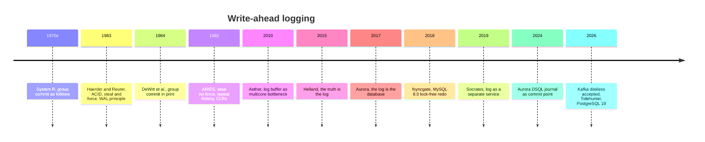
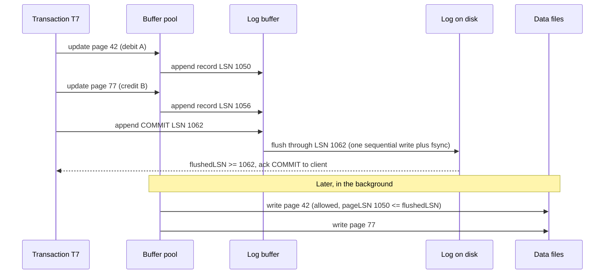
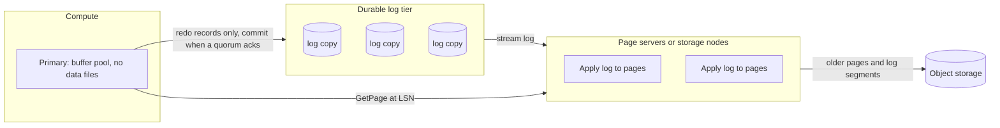

---
tags:
  - distributed-systems
  - storage
  - write-ahead-logging
  - recovery
  - durability
status: draft
sources:
  - https://pages.cs.wisc.edu/~nil/764/Trans/17_p287-haerder.pdf
  - https://cs.uwaterloo.ca/%7Edavid/cs448/aries-mohan.pdf
  - https://15721.courses.cs.cmu.edu/spring2019/papers/01-inmemory/p1-dewitt.pdf
  - https://infoscience.epfl.ch/record/149436
  - https://infoscience.epfl.ch/record/170505/files/aether-smpfulltext.pdf
  - https://arxiv.org/pdf/2606.18187
  - https://ceres.cs.umd.edu/818/papers/immutability.pdf
  - https://pdos.csail.mit.edu/6.824/papers/aurora.pdf
  - https://www.microsoft.com/en-us/research/uploads/prod/2019/05/socrates.pdf
  - https://neon.com/docs/introduction/architecture-overview
  - https://cloud.google.com/blog/products/databases/alloydb-for-postgresql-intelligent-scalable-storage/
  - https://usenix.org/system/files/atc22-elhemali.pdf
  - https://brooker.co.za/blog/2024/12/05/inside-dsql-writes/
  - https://www.brooker.co.za/blog/2026/07/19/dsql-paper.html
  - https://www.postgresql.org/docs/19/wal-reliability.html
  - https://www.postgresql.org/docs/19/wal-async-commit.html
  - https://www.postgresql.org/docs/19/runtime-config-wal.html
  - https://www.postgresql.org/docs/current/wal-internals.html
  - https://www.postgresql.org/docs/current/release-18.html
  - https://www.postgresql.org/docs/release/19.0/
  - https://wiki.postgresql.org/wiki/Fsync_Errors
  - https://www.usenix.org/conference/atc20/presentation/rebello
  - https://www.usenix.org/conference/fast18/presentation/alagappan
  - https://blog.acolyer.org/2018/02/27/protocol-aware-recovery-for-consensus-based-storage/
  - https://dev.mysql.com/blog-archive/mysql-8-0-new-lock-free-scalable-wal-design/
  - https://dev.mysql.com/doc/refman/8.0/en/innodb-doublewrite-buffer.html
  - https://dev.mysql.com/blog-archive/dynamic-innodb-redo-log-in-mysql-80/
  - https://github.com/facebook/rocksdb/wiki/Write-Ahead-Log-(WAL)
  - https://docs.redhat.com/en/documentation/openshift_container_platform/4.22/html/etcd/etcd-practices
  - https://jack-vanlightly.com/blog/2023/4/24/why-apache-kafka-doesnt-need-fsync-to-be-safe
  - https://jepsen.io/analyses/nats-2.12.1
  - https://jepsen.io/analyses/amazon-rds-for-postgresql-17.4
  - https://github.com/slatedb/slatedb
  - https://slatedb.io/docs/design/overview/
  - https://www.vldb.org/pvldb/vol19/p3786-zablotchi.pdf
  - https://arxiv.org/abs/2602.01873
created: 2026-11-26
updated: 2026-11-26
---

## Table Of Contents

---

- [[#TL;DR|TL;DR]]
- [[#The Problem|The Problem]]
- [[#Foundations|Foundations]]
    - [[#Stable Storage and the Atomic Unit|Stable Storage and the Atomic Unit]]
    - [[#Steal, Force and Why the Log Needs Undo and Redo|Steal, Force and Why the Log Needs Undo and Redo]]
    - [[#The Two WAL Rules|The Two WAL Rules]]
    - [[#LSNs|LSNs]]
- [[#How We Got Here|How We Got Here]]
- [[#How It Works|How It Works]]
    - [[#Anatomy of a Log Record|Anatomy of a Log Record]]
    - [[#The Commit Path|The Commit Path]]
    - [[#Group Commit and the Flush Math|Group Commit and the Flush Math]]
    - [[#Durability Knobs|Durability Knobs]]
    - [[#Torn Pages|Torn Pages]]
    - [[#Checkpoints|Checkpoints]]
    - [[#ARIES Recovery: Analysis, Redo, Undo|ARIES Recovery: Analysis, Redo, Undo]]
    - [[#Scaling the Log Buffer|Scaling the Log Buffer]]
    - [[#When fsync Lies or Fails|When fsync Lies or Fails]]
    - [[#WAL in an LSM Tree|WAL in an LSM Tree]]
    - [[#From Local Log to Replicated Log|From Local Log to Replicated Log]]
    - [[#The Log Is the Database|The Log Is the Database]]
    - [[#WAL on Object Storage and WAL as Storage|WAL on Object Storage and WAL as Storage]]
- [[#Where It Is Now|Where It Is Now]]
- [[#Trade-offs & Open Problems|Trade-offs & Open Problems]]
- [[#Resources|Resources]]
- [[#Related Notes|Related Notes]]

## ***TL;DR***
---
*A write-ahead log (WAL) is an append-only record of every change, forced to durable storage before the change itself is. It is how a database commits quickly, survives crashes, and, in distributed systems, it is the thing that gets replicated: a Raft log, a Kafka topic and Aurora's storage tier are all WALs with more machinery around them.*

- **The idea:** before you change data in place, write a description of the change to a sequential log and make that log durable. After a crash, replay the log to redo committed work and undo uncommitted work. Haerder and Reuter stated the principle in 1983: undo information must reach the log before changed pages reach the database, and redo information must reach the log before the commit is acknowledged ([Haerder and Reuter, 1983](https://pages.cs.wisc.edu/~nil/764/Trans/17_p287-haerder.pdf)).
- **Why it's fast:** commit waits for one sequential log write, not for random writes to every page the transaction touched. Pages are written lazily, in the background. That is the *steal, no-force* buffer policy, and ARIES (Mohan et al., 1992) is the recovery algorithm that made it practical ([ARIES](https://cs.uwaterloo.ca/%7Edavid/cs448/aries-mohan.pdf)).
- **The cost you tune:** every synchronous commit pays a flush. *Group commit* shares one flush among many transactions; asynchronous commit skips the wait and risks losing the last few transactions, but not corrupting the database ([PostgreSQL docs](https://www.postgresql.org/docs/19/wal-async-commit.html)).
- **The distributed turn:** Helland's line "The truth is the log. The database is a cache of a subset of the log" ([CIDR 2015](https://ceres.cs.umd.edu/818/papers/immutability.pdf)) became architecture. Aurora ships only redo records to six storage copies and has no checkpoints ([Verbitski et al., 2017](https://pdos.csail.mit.edu/6.824/papers/aurora.pdf)); Socrates, Neon and AlloyDB split the log into its own tier; Aurora DSQL's commit point is a write to a replicated journal ([Brooker, 2024](https://brooker.co.za/blog/2024/12/05/inside-dsql-writes/)).
- **Now (Nov 2026):** PostgreSQL 19 (Nov 19, 2026) picks the best WAL compression by default and reports full-page-image bytes ([release notes](https://www.postgresql.org/docs/release/19.0/)); Tidehunter (PVLDB 2026) keeps values in the WAL permanently instead of compacting them ([Chursin et al.](https://www.vldb.org/pvldb/vol19/p3786-zablotchi.pdf)); a June 2026 analysis argues group commit "self-clocks", so commit-delay knobs rarely need tuning ([arXiv 2606.18187](https://arxiv.org/pdf/2606.18187)).

## ***The Problem***
---
*Memory is fast and forgets on power loss; disks remember but are slow at random writes and can't write several pages atomically. A database has to make a transaction's changes all-or-nothing and permanent without paying a random write for every page at commit.*

A transaction that moves \$100 from account A to account B changes two pages. Three things can go wrong:

1. **Crash before anything is on disk.** If the server acknowledged the commit, the transfer is lost. *Durability* is broken.
2. **Crash after one page is on disk.** A is debited, B is not. *Atomicity* is broken. Haerder and Reuter put it bluntly: with in-place updates, "no set of pages can be written indivisibly" ([1983](https://pages.cs.wisc.edu/~nil/764/Trans/17_p287-haerder.pdf)).
3. **Crash in the middle of one page.** PostgreSQL writes 8 KB pages, which is 16 sectors of 512 bytes, and power can fail with only some sectors written ([PostgreSQL docs](https://www.postgresql.org/docs/19/wal-reliability.html)). The page is now *torn*: half old, half new.

The obvious fix, writing every changed page to its home location at commit (*force*), makes each commit wait for several random writes, and it still doesn't solve problem 2. The other obvious fix, never letting uncommitted changes leave memory (*no-steal*), means a large transaction can exhaust the buffer pool.

The write-ahead log sidesteps all of it. Write a small record describing each change to the end of one sequential file, make that file durable at commit, and treat the data pages as a cache that can be rebuilt from the log. A commit becomes one sequential append; atomicity and durability come from replaying the log after a crash.

| Approach | Commit cost | Atomic across pages | Survives torn pages | Used by |
|---|---|---|---|---|
| Force pages in place | Random write per page | No | No | Nobody alone |
| Shadow paging (write new copies, swap a pointer) | Copy pages, then one atomic switch | Yes | Yes | Haerder and Reuter's "indirect page allocation" for ATOMIC propagation |
| Write-ahead log, steal, no-force | One sequential log flush | Yes, via redo and undo | Yes, with full-page images or a doublewrite buffer | PostgreSQL, InnoDB, RocksDB, etcd (all below) |

## ***Foundations***
---
*Four ideas carry the rest of the note: what "durable" actually means on real hardware, the steal and force policies that decide what the log must contain, the two rules that make a log a write-ahead log, and log sequence numbers that tie pages to log positions.*

### Stable Storage and the Atomic Unit

*"Durable" means "on stable storage", and stable storage is an abstraction that real disks only approximate. A WAL is only as good as the flush call underneath it.*

- **Flushing.** A `write()` lands in the OS page cache. Only `fsync()` (or `fdatasync()`, or `O_DSYNC` writes) asks the kernel to push it to the device and the device to make it durable. Until then a power cut loses it.
- **Device caches.** Drives may acknowledge writes from a volatile write-back cache; PostgreSQL warns that "many [SSDs] do not honor cache flush commands by default" and that consumer drives are "particularly likely to have write-back caches that will not survive a power failure" ([PostgreSQL docs](https://www.postgresql.org/docs/19/wal-reliability.html)).
- **The atomic unit.** Hardware writes whole sectors; a database page spans many sectors, so a page write is not atomic. Log records are protected by checksums instead: each PostgreSQL WAL record carries a CRC-32C "set when we write each WAL record and checked during crash recovery, archive recovery and replication" ([PostgreSQL docs](https://www.postgresql.org/docs/19/wal-reliability.html)). A record whose checksum fails at the end of the log is treated as the end of the log.

This is the crash-recovery model from [[Failure Models]]: nodes crash and restart with their stable storage intact. Everything below assumes that a successful flush means the bytes will be there after a restart, and [[#When fsync Lies or Fails|that assumption breaks]] more often than people expect.

### Steal, Force and Why the Log Needs Undo and Redo

*Two buffer-manager choices decide what the log must hold. Steal means uncommitted changes can reach disk, so the log needs undo. No-force means committed changes may not be on disk yet, so the log needs redo. Fast databases choose both and log both.*

Haerder and Reuter's taxonomy ([1983](https://pages.cs.wisc.edu/~nil/764/Trans/17_p287-haerder.pdf)):

- **STEAL:** "Modified pages may be written and/or propagated at any time", even before the transaction commits. The buffer pool can evict a dirty page whenever it likes, so after a crash the disk may hold uncommitted changes that must be **undone**.
- **¬STEAL:** modified pages stay in memory "at least until the end of the transaction". No undo needed, but the buffer pool must hold every active transaction's changes.
- **FORCE:** "All modified pages are written and propagated during EOT processing." No redo needed, but commit waits on random writes.
- **¬FORCE:** commit writes nothing but the log. Committed changes may be missing from disk after a crash, so they must be **redone**.

| | FORCE | NO-FORCE |
|---|---|---|
| **NO-STEAL** | No undo, no redo; slowest commits and tightest memory | Redo only; memory-bound |
| **STEAL** | Undo only; slow commits | Undo and redo; fastest. ARIES, PostgreSQL, InnoDB |

PostgreSQL's restart is a forward pass: it reads the checkpoint location from `pg_control` and "performs the REDO operation by scanning forward from the WAL location indicated in the checkpoint record" ([PostgreSQL docs](https://www.postgresql.org/docs/current/wal-internals.html)). How engines that keep old row versions in place handle aborted work is the subject of [[MVCC and Version Garbage Collection]].

### The Two WAL Rules

*A log is "write-ahead" only if it obeys two ordering rules: log before page, and log before commit. Everything else in this note is about making those two rules cheap.*

Let $\text{flushedLSN}$ be the highest log position known to be on stable storage, $\text{pageLSN}(P)$ the position of the last log record that changed page $P$, and $\text{commitLSN}(T)$ the position of transaction $T$'s commit record.

$$
\textbf{Rule 1 (undo):}\quad \text{write page } P \text{ to disk only if } \text{pageLSN}(P) \le \text{flushedLSN}
$$

$$
\textbf{Rule 2 (redo):}\quad \text{acknowledge commit of } T \text{ only if } \text{commitLSN}(T) \le \text{flushedLSN}
$$

*In words:* never let a change reach the data files before the log record that explains it, and never tell a client "committed" before its commit record is durable. ARIES's wording for rule 1 is that the log records describing a change "must already be on stable storage" before the changed page replaces the old version ([ARIES](https://cs.uwaterloo.ca/%7Edavid/cs448/aries-mohan.pdf)).

*Example:* page 42 was last changed by the record at LSN 1050, and the log is flushed only to LSN 1000. The buffer manager wants to evict page 42. Rule 1 says it must first flush the log through LSN 1050, then write the page. If it skipped that and crashed, the disk would hold a change with no log record to undo it. Separately, transaction T7's commit record is at LSN 1062; T7's client gets "COMMIT" only once a flush reaches 1062, even if none of T7's pages has been written.

### LSNs

*Every log record gets a log sequence number, usually its byte offset in the log. Stamping each page with the LSN of its last change is what lets recovery tell, page by page, which log records are already reflected on disk.*

- **LSN:** "Every log record is assigned a unique log sequence number (LSN)"; LSNs increase and "are typically log addresses" ([ARIES](https://cs.uwaterloo.ca/%7Edavid/cs448/aries-mohan.pdf)). PostgreSQL's LSN "is a byte offset into the WAL, increasing monotonically with each new record", and the WAL itself is a series of segment files, "normally each 16 MB in size" ([PostgreSQL docs](https://www.postgresql.org/docs/current/wal-internals.html)).
- **pageLSN:** a field in each page holding "the LSN of the log record that describes the latest update to the page."
- **Idempotent redo:** redo a record only if the page hasn't seen it: "A log record's update is redone if the affected page's page-LSN is less than the log record's LSN." Replaying the same log twice is then harmless.

LSNs leak far beyond recovery. Replicas report replay positions as LSNs, [[Change Data Capture]] slots are cursors over LSNs, PostgreSQL 19's `WAIT` command lets a standby wait for an LSN to be replayed for read-your-writes ([release notes](https://www.postgresql.org/docs/release/19.0/)), and disaggregated page servers serve "page 42 as of LSN 1050" ([[Disaggregated Systems]]).

## ***How We Got Here***
---
*Logging started as folklore inside IBM's systems, was named and classified in 1983, perfected by ARIES in 1992, then rediscovered as a distributed-systems primitive when replicated logs and cloud storage turned "the log" into the system's source of truth.*

- **1970s, System R.** Group commit was already "part of the unwritten database folklore"; DeWitt et al. note that "the System-R implementors claim to have implemented it" and that "neither the idea nor the implementation details has yet appeared in print" ([DeWitt et al., 1984](https://15721.courses.cs.cmu.edu/spring2019/papers/01-inmemory/p1-dewitt.pdf)).
- **1983, Haerder and Reuter.** "Principles of Transaction-Oriented Database Recovery" (ACM Computing Surveys) defined ACID, STEAL/FORCE and ATOMIC propagation, stated the write-ahead log principle, and classified checkpoints from transaction-consistent to fuzzy ([paper](https://pages.cs.wisc.edu/~nil/764/Trans/17_p287-haerder.pdf)).
- **1984, group commit in print.** DeWitt, Katz, Olken, Shapiro, Stonebraker and Wood estimated about 400 bytes of log per transaction, so a 4 KB log page holds about ten commits, and one write per page raises throughput "from about 100 to about 1,000 transactions per second" ([paper](https://15721.courses.cs.cmu.edu/spring2019/papers/01-inmemory/p1-dewitt.pdf)).
- **1992, ARIES.** Mohan, Haderle, Lindsay, Pirahesh and Schwarz (ACM TODS 17(1)) combined steal/no-force with fine-grained locking, fuzzy checkpoints, "repeating history" during redo, and compensation log records so rollback is itself logged ([ARIES](https://cs.uwaterloo.ca/%7Edavid/cs448/aries-mohan.pdf)). It became the reference design for steal/no-force recovery.
- **2010, multicore logging.** Aether (Johnson et al., VLDB 2010) showed that on many cores the log buffer itself becomes the bottleneck, and fixed it with early lock release, flush pipelining and a consolidation array ([Aether](https://infoscience.epfl.ch/record/149436)).
- **2015, the log as truth.** Helland: "The truth is the log. The database is a cache of a subset of the log" ([CIDR 2015](https://ceres.cs.umd.edu/818/papers/immutability.pdf)). Kafka and the [[Logs and Streaming]] world had already built systems on that idea.
- **2017 to 2019, the log becomes the storage tier.** Aurora ships only redo to storage ([SIGMOD 2017](https://pdos.csail.mit.edu/6.824/papers/aurora.pdf)); Socrates gives the log its own service ([SIGMOD 2019](https://www.microsoft.com/en-us/research/uploads/prod/2019/05/socrates.pdf)).
- **2018, fsyncgate.** PostgreSQL learned that on Linux a failed `fsync()` could mark buffers clean so that a retry "can falsely report success"; it now PANICs on fsync failure ([PostgreSQL wiki](https://wiki.postgresql.org/wiki/Fsync_Errors)). The same year MySQL 8.0 replaced InnoDB's mutex-serialized redo log with a lock-free design ([Olchawa, 2018](https://dev.mysql.com/blog-archive/mysql-8-0-new-lock-free-scalable-wal-design/)).
- **2022 to 2026, logs everywhere.** DynamoDB log replicas hold only recent WAL ([ATC 2022](https://usenix.org/system/files/atc22-elhemali.pdf)); Aurora DSQL commits to a replicated journal ([Brooker, 2024](https://brooker.co.za/blog/2024/12/05/inside-dsql-writes/)); Kafka accepts diskless topics built on shared WAL objects in object storage (KIP-1150, March 2026; see [[Diskless Streaming]]); Tidehunter makes the WAL the permanent value store ([PVLDB 2026](https://www.vldb.org/pvldb/vol19/p3786-zablotchi.pdf)).

## ***How It Works***
---
*A WAL engine appends records to an in-memory buffer, flushes the buffer in batches, writes pages lazily, takes fuzzy checkpoints to bound recovery, and on restart replays from the checkpoint. The distributed versions replicate the same log instead of, or as well as, flushing it locally.*

### Anatomy of a Log Record

*A record names which transaction changed which page, how to redo and undo it, and where the transaction's previous record is. The back-pointer chain is what makes rollback possible without scanning the whole log.*

| Field | Purpose |
|---|---|
| LSN | Position in the log; often implicit (the byte offset) |
| Transaction ID | Which transaction made the change |
| PrevLSN | The same transaction's previous record, so undo can walk backwards |
| Page ID | Which page the change applies to |
| Redo info | How to reapply the change |
| Undo info | How to reverse it (absent in redo-only logs) |
| Checksum | Detects torn or corrupted records (CRC-32C in PostgreSQL) |

**What "redo info" contains** is a design choice:

- **Physical:** byte-level before and after images. Simple, large.
- **Logical:** the operation, like "insert key 7 into index I". Small, but replay must re-run the operation against a possibly inconsistent structure.
- **Physiological:** physical to a page, logical within it, like "insert this tuple into slot 3 of page 42". ARIES-family systems use page-oriented redo with possibly logical undo ([ARIES](https://cs.uwaterloo.ca/%7Edavid/cs448/aries-mohan.pdf)). This is the common compromise.

### The Commit Path

*A transaction's changes go to buffered pages and buffered log records; only the commit forces a log flush; the pages follow much later, whenever the buffer manager gets to them.*

The commit's cost is one sequential flush, however many pages it touched. Page writes are batched across many transactions, and a page changed a thousand times between writes is written once.

### Group Commit and the Flush Math

*One flush can make many commits durable at once. Under load, batches form by themselves because transactions pile up while the previous flush is running, which is why group commit rarely needs manual tuning.*

Model a flush of $K$ commit records as costing a fixed barrier plus a per-record term, as Mandarapu and Kunkunuru do ([arXiv 2606.18187](https://arxiv.org/pdf/2606.18187)):

$$
F(K) = F_0 + K\,\delta \qquad\Rightarrow\qquad \text{commits/s} \le \frac{K}{F_0 + K\delta}
$$

*In words:* each flush pays a fixed cost $F_0$ (the device round trip) no matter how many commits ride on it, so throughput grows almost linearly with batch size until the per-record cost $\delta$ (bandwidth) dominates, at which point throughput approaches $1/\delta$.

*Example with measured numbers:* the same paper measured $F_0 = 0.90$ ms on an EBS gp3 volume and $0.036$ ms on instance NVMe. With one commit per flush and one flush at a time, EBS caps out near $1/0.0009 \approx 1{,}100$ commits/s. Let ten commits share each flush and the cap is about $11{,}000$ (ignoring $\delta$). On NVMe the single-commit cap is already about $28{,}000$.

**Why batches self-form.** While one flush is in flight, new commits queue. When it finishes, the next flush takes all of them. As a rough sketch, with commits arriving at rate $\lambda$ the next batch is about $\lambda \cdot F$. At $\lambda = 6{,}600$/s on EBS, $K \approx 6$. The paper's result is that a "greedy" policy (flush as soon as the device is free) is within about 0.1% of the best hand-tuned timer, and that above a load threshold

$$
\lambda^\star = \frac{2}{F_0}
$$

timers stop mattering at all. *Example:* on EBS, $\lambda^\star = 2/0.0009\,\text{s} \approx 2{,}200$ commits/s; on NVMe about 55,000/s. Their pgbench runs found PostgreSQL's `commit_delay = 0` within about 10% of the best setting at 32 clients, while at 2 clients tuning helped about 17%. Their advice: "leave commit_delay≈ 0 and let the log self-clock" ([arXiv 2606.18187](https://arxiv.org/pdf/2606.18187)). This is a June 2026 preprint from a small team, and the authors say their closed-loop bound is conjectured, not proven.

`commit_delay` itself is PostgreSQL's explicit group-commit knob: a delay "just before a transaction flushes WAL to disk, in the hope that a single flush executed by one such transaction can also serve other transactions committing at about the same time" ([PostgreSQL docs](https://www.postgresql.org/docs/19/wal-async-commit.html)). It applies only if at least `commit_siblings` other transactions are active, adds up to `commit_delay` of latency to each flush, and defaults to zero ([config docs](https://www.postgresql.org/docs/19/runtime-config-wal.html)).

### Durability Knobs

*Every engine lets you trade the last few transactions for latency. The important distinction is between losing recent commits (recoverable to a consistent state) and corrupting the database (not recoverable).*

| Engine | Setting | What you risk |
|---|---|---|
| PostgreSQL | `synchronous_commit = off` | Commits return before their WAL is flushed; a crash loses up to "three times `wal_writer_delay`" of commits, and the risk is "data loss, not data corruption" ([docs](https://www.postgresql.org/docs/19/wal-async-commit.html)) |
| PostgreSQL | `fsync = off` | A system crash "could result in arbitrarily bad corruption" ([docs](https://www.postgresql.org/docs/19/wal-async-commit.html)) |
| InnoDB | `innodb_flush_log_at_trx_commit = 1` vs `2` | 1 waits for the flush at every commit; with 2 the committer is notified once redo reaches the OS cache ([Olchawa, 2018](https://dev.mysql.com/blog-archive/mysql-8-0-new-lock-free-scalable-wal-design/)), so those commits are only as durable as the OS cache |
| RocksDB | `WriteOptions::disableWAL`, `manual_wal_flush` | No WAL at all, for users who "rely on other logging or don't care about data loss"; or the application decides when to call `FlushWAL` ([RocksDB wiki](https://github.com/facebook/rocksdb/wiki/Write-Ahead-Log-(WAL))) |
| Kafka | Default: acknowledge before fsync | Safe against single-broker loss because a broker that lost unflushed data re-fetches it and can't lead until it has ([Vanlightly, 2023](https://jack-vanlightly.com/blog/2023/4/24/why-apache-kafka-doesnt-need-fsync-to-be-safe)); correlated power loss is the gap ([[Logs and Streaming]]) |
| NATS JetStream | Flush on a timer, two minutes by default | Jepsen's December 2025 test of 2.12.1 lost about 14% of acknowledged messages in power-failure simulations ([Jepsen](https://jepsen.io/analyses/nats-2.12.1); [[Message Queues]]) |

The last two rows are the distributed version of the same trade: replace the local flush with copies on other machines, and you are betting that those machines don't all lose power together.

### Torn Pages

*Rule 1 protects against missing log records, not against a page that was half-written. Engines protect pages separately, by logging a whole copy of each page the first time it changes after a checkpoint, or by writing pages twice.*

- **PostgreSQL full-page writes.** PostgreSQL "periodically writes full page images to permanent WAL storage *before* modifying the actual page on disk", so recovery can restore a torn page from the WAL. On a file system that prevents partial writes, such as ZFS, `full_page_writes` can be turned off ([docs](https://www.postgresql.org/docs/19/wal-reliability.html)). The image is taken "during the first modification of that page after a checkpoint", so one way to cut the cost "is to increase the checkpoint interval parameters" ([docs](https://www.postgresql.org/docs/19/runtime-config-wal.html)). PostgreSQL 19 now reports full-page-image bytes in `pg_stat_wal`, `EXPLAIN (ANALYZE, WAL)` and VACUUM logs ([release notes](https://www.postgresql.org/docs/release/19.0/)).
- **InnoDB doublewrite buffer.** InnoDB writes pages "to a storage area ... before writing the pages to their proper positions"; after a torn write, recovery finds "a good copy of the page from the doublewrite buffer". Data is written twice but not at twice the cost, because the doublewrite area is written "in a large sequential chunk, with a single `fsync()`". Since 8.0.20 it lives in separate `.dblwr` files ([MySQL docs](https://dev.mysql.com/doc/refman/8.0/en/innodb-doublewrite-buffer.html)).
- **LSM engines** don't need either: their data files are immutable and written once, so a torn file is just an incomplete flush, recovered from the WAL ([[LSM Trees]]).

### Checkpoints

*A checkpoint bounds how much log recovery must replay and how much log must be kept. Fuzzy checkpoints do it without stopping transactions or forcing pages at checkpoint time.*

Haerder and Reuter's classes, from most to least disruptive ([1983](https://pages.cs.wisc.edu/~nil/764/Trans/17_p287-haerder.pdf)):

- **Transaction-consistent:** quiesce all updates, write every dirty page. Clean restart point, long pause.
- **Action-consistent:** wait only until no single update is in progress. Shorter pause, still costly with big buffers.
- **Fuzzy:** write only log information (and let pages trickle out). ARIES writes a `begin_chkpt` record, then an `end_chkpt` record holding the **transaction table** and the **dirty page table**, without forcing pages; each dirty-page entry has a **RecLSN**, the log position "from what point in the log there may be updates" not yet on disk ([ARIES](https://cs.uwaterloo.ca/%7Edavid/cs448/aries-mohan.pdf)).

The redo start point after a crash is the smallest RecLSN in the dirty page table. Everything before it can be recycled, unless something else still needs it: a lagging replica, an archive, or a logical replication slot ([[Change Data Capture]]). RocksDB's rule is the LSM version: a WAL file can go once "all column families have flushed beyond the largest sequence number contained in the WAL" ([RocksDB wiki](https://github.com/facebook/rocksdb/wiki/Write-Ahead-Log-(WAL))).

*Sizing intuition:* recovery time is roughly (log bytes since the redo point) divided by replay speed. If a server generates 50 MB/s of WAL and checkpoints every 5 minutes, a crash just before a checkpoint leaves about 15 GB to replay. That is the knob: more frequent checkpoints mean shorter recovery but more page writes and, in PostgreSQL, more full-page images. MySQL made this trade easier to change: since 8.0.30, `innodb_redo_log_capacity` resizes the redo log "on the fly without the need for a restart", across about 32 files, with a 100 MB default ([Descamps, 2022](https://dev.mysql.com/blog-archive/dynamic-innodb-redo-log-in-mysql-80/)).

### ARIES Recovery: Analysis, Redo, Undo

*ARIES restarts in three passes: rebuild the in-memory state at the crash, replay everything ("repeat history") so the pages look exactly as they did, then roll back the transactions that never committed, logging each undo so a crash during recovery is also safe.*

1. **Analysis.** Scan forward from the last checkpoint. Rebuild the transaction table and dirty page table, find the redo start point (RedoLSN), and identify the *losers*, transactions active at the crash.
2. **Redo.** From RedoLSN forward, reapply every logged change, *including losers'*, whenever the page's pageLSN is below the record's LSN. This is "repeating history" ([ARIES](https://cs.uwaterloo.ca/%7Edavid/cs448/aries-mohan.pdf)). Redo writes no log records.
3. **Undo.** Roll back losers in one backward sweep. Each undo writes a **compensation log record (CLR)**, redo-only and never undone, whose UndoNxtLSN points to the next record to undo. A crash during undo resumes from there instead of undoing the undo.

*Worked example.* The log at the crash:

| LSN | Record |
|---|---|
| 10 | T1 updates P1 |
| 20 | T2 updates P2 |
| 30 | begin_chkpt |
| 40 | end_chkpt: T1 (last 10), T2 (last 20) active; dirty P1 (RecLSN 10), P2 (RecLSN 20) |
| 50 | T1 updates P3 |
| 60 | T1 commits |
| 70 | T2 updates P1 |
| | *crash* |

On disk: P1 has pageLSN 10 (written after LSN 10, before 70), P2 has pageLSN 0 (never written), P3 has pageLSN 50 (stolen and written after LSN 50).

- **Analysis** starts at the checkpoint's tables, reads 50 (adds P3 with RecLSN 50), 60 (T1 committed, drop it), 70 (T2's last LSN is now 70). Loser: T2. RedoLSN = min(10, 20, 50) = 10.
- **Redo** from 10: LSN 10 on P1, pageLSN 10 is not below 10, skip. LSN 20 on P2, pageLSN 0 < 20, redo. LSN 50 on P3, pageLSN 50, skip. LSN 70 on P1, pageLSN 10 < 70, redo, P1's pageLSN becomes 70. The pages now match the moment of the crash, T2's change included.
- **Undo** T2: undo LSN 70 and log CLR 80 (UndoNxtLSN 20); undo LSN 20 and log CLR 90 (UndoNxtLSN none); write T2's end record. T1's committed changes survive; T2 vanishes.

If the server crashes again after writing CLR 80, the next recovery redoes CLR 80, sees UndoNxtLSN 20, and undoes only LSN 20. Undo work is bounded no matter how many times recovery is interrupted.

### Scaling the Log Buffer

*On a many-core machine, the single in-memory log buffer is a global lock that every update hits. Modern engines let threads reserve log space concurrently and track completion separately from ordering.*

Johnson et al. found four bottlenecks: flush I/O latency, locks held while waiting for the commit flush, scheduler overload from threads blocking on flushes, and contention on the log buffer, which they call the most dangerous long-term one ([Aether VLDBJ](https://infoscience.epfl.ch/record/170505/files/aether-smpfulltext.pdf)). Their fixes:

- **Early lock release:** release a committing transaction's locks before its commit record is durable; a dependent transaction can't commit before it anyway, because the log is ordered. Reported gains of 15 to 164% "even when log disk latency is minimal".
- **Flush pipelining:** worker threads hand off a committing transaction and move on instead of sleeping on the flush, matching asynchronous commit's throughput without giving up durability.
- **Consolidation array:** threads that collide on the buffer merge their inserts into one reservation; over 2.2 GB/s of small log records on one socket, about 20 times a single mutex.

MySQL 8.0 rebuilt InnoDB's redo along the same lines. The old design held `log_sys_t::mutex` and `flush_order_mutex` "in a lock step manner", so "any other thread that wanted to write to the log buffer had to wait." The new one lets mini-transactions copy records into the buffer concurrently, tracks finished ranges in lock-free `recent_written` and `recent_closed` arrays that a single thread scans for holes, and gives writing, flushing and notification their own threads (`log_writer`, `log_flusher`, `log_flush_notifier`, `log_write_notifier`) ([Olchawa, 2018](https://dev.mysql.com/blog-archive/mysql-8-0-new-lock-free-scalable-wal-design/)).

### When fsync Lies or Fails

*The WAL contract rests on "flush succeeded means durable". In 2018 the database world learned that on Linux a failed flush could later report success, and that most applications handle flush errors badly.*

- **fsyncgate (2018).** PostgreSQL assumed a successful `fsync()` meant all of a file's data was on disk. On some systems "buffers are marked clean after errors, so retrying fsync() can falsely report success". Linux 4.13 improved error reporting, but even later kernels report an error "only once", so retrying is unsafe. PostgreSQL now PANICs on fsync failure, back-patched to 9.4, and the wiki notes InnoDB and WiredTiger made similar changes ([PostgreSQL wiki](https://wiki.postgresql.org/wiki/Fsync_Errors)).
- **Applications in general.** Rebello et al. (ATC 2020) tested PostgreSQL, LMDB, LevelDB, SQLite and Redis: their strategies for fsync failures vary but "none are sufficient", leading to data loss and corruption ([USENIX](https://www.usenix.org/conference/atc20/presentation/rebello)).
- **The lesson for WAL design:** after a failed flush you don't know what's on disk. The only safe moves are to crash and recover from what *is* durable, or to rebuild from a replica. That is also why [[Silent Data Corruption]] and checksums matter: the log is the one file whose corruption is fatal.

### WAL in an LSM Tree

*In an LSM engine the WAL protects only the memtable. Each WAL file lives exactly as long as the memtable it backs, so the log stays small and is mostly deleted, not checkpointed.*

Every write goes to the WAL and the memtable; when the memtable flushes to an SSTable, the WAL that backed it can be dropped ([[LSM Trees]]). RocksDB uses one WAL shared by all column families, starts a new WAL file when a column family flushes, and forces flushes once WALs exceed `max_total_wal_size` so old files can be deleted ([RocksDB wiki](https://github.com/facebook/rocksdb/wiki/Write-Ahead-Log-(WAL))). Archived WAL files can be kept and streamed to a follower through the transaction log iterator, which is a replication log in miniature.

The interesting consequence for distributed databases: a Raft-replicated LSM writes each change to the Raft log, then to the LSM's WAL, then to SSTables, then again in compaction. Designs like LSM-Raft align the consensus log with the engine's storage to cut some of those writes ([[LSM Trees]]).

### From Local Log to Replicated Log

*A consensus log is a WAL whose flush is "durable on a majority" instead of "durable on my disk". The same rules apply: log before apply, commit before acknowledge, and a corrupted entry is dangerous.*

In [[Raft]] and Multi-[[Paxos]], each replica appends entries to its own on-disk log, and an entry is committed once a majority has it durably. The state machine applies committed entries in order, which is exactly redo from a WAL. Two consequences:

- **Disk latency is consensus latency.** etcd "depends on persistently storing metadata to a log (WAL)"; Red Hat's guidance is that 8 KB writes with fdatasync should complete with a p99 "less than 10 ms", and that slow fsync can delay heartbeats past the election timeout, causing leader elections ([Red Hat etcd docs](https://docs.redhat.com/en/documentation/openshift_container_platform/4.22/html/etcd/etcd-practices); [[Coordination Services]]).
- **Local corruption can break global safety.** Alagappan et al. (FAST 2018) found that ZooKeeper, LogCabin and etcd typically either crash on a corrupted log entry (losing availability) or truncate the log at it, and truncation can silently lose *committed* entries if the node then forms a majority with lagging peers. Their CTRL design separates "crashed mid-write" from "corrupted" and repairs entries from other replicas, so "committed data will never be lost" while one correct copy exists ([USENIX](https://www.usenix.org/conference/fast18/presentation/alagappan); [Acolyer](https://blog.acolyer.org/2018/02/27/protocol-aware-recovery-for-consensus-based-storage/)).

Replication also changes what order means. Jepsen's April 2025 analysis of Amazon RDS for PostgreSQL multi-AZ clusters found Long Fork anomalies traced to the primary making transactions visible in lock order while replicas used WAL order ([Jepsen](https://jepsen.io/analyses/amazon-rds-for-postgresql-17.4); [[Consistency Models]]). The WAL defines one order; anything that exposes a different one to readers needs care.

### The Log Is the Database

*Cloud databases separate compute from storage by making the WAL the only thing compute writes. Storage nodes apply the log to pages in the background, so checkpoints, page flushes and much of crash recovery leave the database server entirely.*

- **Aurora (SIGMOD 2017).** "As far as the engine is concerned, the log is the database." "The only writes that cross the network are redo log records"; pages are never written from the engine. Each 10 GB segment is stored six ways across three AZs with a write quorum of 4 and a read quorum of 3. Against mirrored MySQL on SysBench write-only it did about 35 times more transactions with 7.7 times fewer I/Os per transaction. Commits are acknowledged asynchronously once the *Volume Durable LSN* passes the commit LSN; there are no checkpoints, and recovery is "generally under 10 seconds" ([paper](https://pdos.csail.mit.edu/6.824/papers/aurora.pdf)). Only two of a storage node's eight steps (queue and persist) are on the foreground path.

$$
W + R > N \quad\text{and}\quad 2W > N \qquad\text{with } N = 6,\; W = 4,\; R = 3
$$

*In words:* any read quorum overlaps any write quorum ($4 + 3 = 7 > 6$), and two writes can't both succeed on disjoint copies ($8 > 6$). *Example:* lose a whole AZ (2 copies); 4 remain, so writes still reach a quorum. Lose one more node; 3 remain, enough to read and rebuild, so no data is lost.

- **Socrates (SIGMOD 2019).** Azure SQL Hyperscale writes log blocks "synchronously and reliably into the LZ [landing zone] for durability" and "asynchronously to the XLOG process for availability"; XLOG disseminates only hardened blocks, page servers apply the log for their partition, and the design "separates availability from durability". Targets included 100 TB databases and sub-0.5 ms commits; a logging-bound test measured 89.8 MB/s against 56.9 MB/s for the older HADR design ([paper](https://www.microsoft.com/en-us/research/uploads/prod/2019/05/socrates.pdf)).
- **Neon and AlloyDB.** Neon's compute "streams WAL to the storage layer" through three Paxos-replicated safekeepers, and pageservers turn WAL into layer files on object storage; AlloyDB writes WAL synchronously to regional log storage and replays it into block storage, so the primary needs no checkpoints ([[Disaggregated Systems]]; [Neon docs](https://neon.com/docs/introduction/architecture-overview); [Google Cloud](https://cloud.google.com/blog/products/databases/alloydb-for-postgresql-intelligent-scalable-storage/)).
- **DynamoDB log replicas.** Some members of a partition's Paxos group "only persist recent write-ahead log entries" and hold no key-value data, which makes them cheap to add during repair ([ATC 2022](https://usenix.org/system/files/atc22-elhemali.pdf); [[Witness Replicas]]).
- **Aurora DSQL.** After the adjudicator approves a transaction it is written to the Journal, and "at this point, the transaction *is committed*"; storage replicas "just consume the journal, and apply its changes locally" ([Brooker, 2024](https://brooker.co.za/blog/2024/12/05/inside-dsql-writes/); [[Distributed SQL]]). Only committed transactions go on the Journal, so there is nothing to undo.

The common thread: durability is decided at the log, and everything downstream of it (pages, indexes, replicas) is a deterministic, replayable function of the log. More detail on page servers is planned in [[Cloud-Native Database Storage]].

### WAL on Object Storage and WAL as Storage

*Two newer moves push the log further: put the WAL itself on object storage and batch writes to make that affordable, or never move data out of the WAL at all and keep only an index into it.*

- **WAL on object storage.** SlateDB writes all its data, WAL included, to object storage; it "batches writes" to mitigate "high write API costs (PUTs)", and a writer can call `await_durable()` to wait until its write is in object storage ([SlateDB](https://github.com/slatedb/slatedb)). The manifest records "the WAL recovery starting point" ([design overview](https://slatedb.io/docs/design/overview/)). The flush interval becomes group commit's batching window, measured in tens of milliseconds instead of microseconds ([[LSM Trees]]). Diskless Kafka designs do the same with shared WAL objects that mix many partitions and are later rewritten per partition ([[Diskless Streaming]]); commit protocols and the S3 Express logging tier are in [[Databases on Object Storage]].
- **WAL as permanent storage.** Tidehunter (Chursin, Kokoris-Kogias, Orlov, Sonnino and Zablotchi, Mysten Labs and UCL; PVLDB 19(11), 2026) keeps values in the WAL forever: "Values are never overwritten; and small, lazily-flushed index tables map keys to WAL positions." Compaction rewrites only the indexes. The motivation was a Sui validator where 40 MB/s of application writes became about 500 MB/s of disk writes under RocksDB. On 1 TB of 1 KB values it reports 763K writes/s, 6.8 times RocksDB and 2.2 times BlobDB (the February 2026 preprint reported 830K, 8.4 times and 2.9 times) ([PVLDB](https://www.vldb.org/pvldb/vol19/p3786-zablotchi.pdf); [arXiv](https://arxiv.org/abs/2602.01873)). Space is reclaimed by a background pass that re-appends live entries to the tail and deletes old files; it's needed for disk space, not read speed. LSMs still win for small values: 1.4 to 2.2 times faster at 64 bytes, and Tidehunter is 2 to 4 times slower on key-dominated mixes.

## ***Where It Is Now***
---
*As of November 2026, the classic WAL is mature and mostly getting better observability; the action is in where the log lives (a separate tier, object storage, a replicated journal) and in engines that make the log the primary store.*

**Engines (dated).**
- **PostgreSQL 18** (Sep 25, 2025) added an asynchronous I/O subsystem (`io_method`), WAL I/O rows in `pg_stat_io`, per-backend WAL statistics, and `idle_replication_slot_timeout` to invalidate idle slots that pin WAL ([release notes](https://www.postgresql.org/docs/current/release-18.html)).
- **PostgreSQL 19** (Nov 19, 2026): `wal_compression = on` now picks "the best WAL compression method available" (the first of zstd, lz4 and pglz that the build supports) instead of always `pglz` ([config docs](https://www.postgresql.org/docs/19/runtime-config-wal.html)); full-page-image bytes are reported in `pg_stat_wal`, VACUUM logs and `EXPLAIN (ANALYZE, WAL)`; new wait events for `commit_delay` and WAL write and flush LSNs; logical replication can switch on automatically when `wal_level = replica` (with a new `effective_wal_level`); and a `WAIT` command lets standbys wait for an LSN to be written, flushed or replayed for read-your-writes ([release notes](https://www.postgresql.org/docs/release/19.0/)).
- **InnoDB** has had the lock-free redo log since 8.0 (2018) and online redo resizing since 8.0.30 ([MySQL blog](https://dev.mysql.com/blog-archive/dynamic-innodb-redo-log-in-mysql-80/)).
- **RocksDB** 11.x is adding blob direct writes; its v1 can't recover unflushed blob state through WAL replay ([[LSM Trees]]).

**Architectures.**
- The log-as-database line (Aurora, Socrates, Neon, AlloyDB) is the common shape of cloud relational databases. Aurora DSQL, whose commit point is a journal write, published its full design as *Aurora DSQL: Scalable, Multi-Region OLTP* on arXiv in July 2026 ([Brooker](https://www.brooker.co.za/blog/2026/07/19/dsql-paper.html); [[Distributed SQL]]).
- Apache Kafka accepted diskless topics (KIP-1150) in March 2026, putting shared WAL objects in object storage ([[Diskless Streaming]]).
- Tidehunter is the clearest 2026 example of "the WAL is the store": in a 150-machine Sui cluster at 6,000 TPS, disk writes fell from 1 to 4 GB/s to under 100 MB/s, and as of January 2026 it ran on devnet with some testnet full nodes migrated ([PVLDB](https://www.vldb.org/pvldb/vol19/p3786-zablotchi.pdf)).

**Research.**
- *Group commit self-clocks* (June 2026 preprint): parameter-free greedy flushing is within about 0.1% of the best tuned timer above $\lambda^\star = 2/F_0$ ([arXiv 2606.18187](https://arxiv.org/pdf/2606.18187)).
- Durability testing keeps finding WAL gaps: Jepsen's power-failure simulations (NATS, December 2025) and [[Deterministic Simulation Testing]], where TigerBeetle checks that replicas agree on the write-ahead log.

## ***Trade-offs & Open Problems***
---
*The WAL trades a small, certain sequential write now for replay work later. Most open problems are about the cost of that write on modern hardware and clouds, and about trusting the layer underneath.*

| Choice | Buys | Costs |
|---|---|---|
| Synchronous commit | No acknowledged commit lost | One flush per commit (shared by group commit) |
| Asynchronous commit | Lower latency | Last few commits lost on crash, never corruption |
| Ack before local fsync, rely on replicas | Throughput | Correlated power loss loses data (Kafka gap, NATS) |
| Frequent checkpoints | Fast recovery, less WAL kept | More page writes, more full-page images |
| Full-page images or doublewrite | Torn-page safety | WAL volume or a second write |
| Physiological redo | Compact records | Replay must understand page formats |
| Log-as-database | No checkpoints in compute, cheap replicas, fast recovery | A whole storage service that must apply logs and serve pages |
| WAL on object storage | No local disks, cheap durability across zones | Tens of ms per batch, PUT cost per flush |
| WAL as permanent store | Write amplification near 1 for large values | Index maintenance, GC by relocation, weak for small values |

**Open problems.**
- **Write amplification across layers.** A replicated LSM can write the same bytes to a consensus log, an engine WAL, SSTables and compaction output. Merging the logs (Raft log as WAL) or removing a layer (Tidehunter) are partial answers ([[LSM Trees]]).
- **Trusting the flush.** fsync semantics still differ across kernels and file systems, and Rebello et al. found no application handles failures correctly ([USENIX](https://www.usenix.org/conference/atc20/presentation/rebello)). Cloud block devices hide even more.
- **Corruption in replicated logs.** Protocol-aware recovery shows the fix, but most production consensus libraries still crash or truncate on a bad entry ([FAST 2018](https://www.usenix.org/conference/fast18/presentation/alagappan); [[Silent Data Corruption]]).
- **Retention coupling.** Anything that reads the log (replicas, CDC slots, archives) pins it. A stuck consumer fills the disk; a cap forces a re-snapshot. PostgreSQL 18's idle slot timeout is a policy, not a solution ([[Change Data Capture]]).
- **Order mismatches.** The WAL order, the lock order and the visibility order can differ, and replicas expose that (the RDS Long Fork finding).
- **Latency floor on object storage.** Every object-store WAL is a bet on how long you can batch. Zone-local tiers are faster but single-zone, so durability needs a quorum again one layer down ([[Diskless Streaming]]).

## ***Resources***
---
*Start with Haerder and Reuter for the vocabulary, ARIES for the algorithm, and the Aurora paper for the distributed turn; the docs below are the most reliable statements of what real engines do today.*

**Papers**
- [Principles of Transaction-Oriented Database Recovery](https://pages.cs.wisc.edu/~nil/764/Trans/17_p287-haerder.pdf): Haerder and Reuter, ACM Computing Surveys, Dec 1983.
- [Implementation Techniques for Main Memory Database Systems](https://15721.courses.cs.cmu.edu/spring2019/papers/01-inmemory/p1-dewitt.pdf): DeWitt et al., 1984. Group commit in print.
- [ARIES](https://cs.uwaterloo.ca/%7Edavid/cs448/aries-mohan.pdf): Mohan, Haderle, Lindsay, Pirahesh, Schwarz, ACM TODS, Mar 1992.
- [Aether: A Scalable Approach to Logging](https://infoscience.epfl.ch/record/149436): Johnson et al., VLDB 2010; [journal version](https://infoscience.epfl.ch/record/170505/files/aether-smpfulltext.pdf), VLDBJ 2011.
- [Immutability Changes Everything](https://ceres.cs.umd.edu/818/papers/immutability.pdf): Pat Helland, CIDR 2015.
- [Amazon Aurora: Design Considerations for High Throughput Cloud-Native Relational Databases](https://pdos.csail.mit.edu/6.824/papers/aurora.pdf): Verbitski et al., SIGMOD 2017.
- [Protocol-Aware Recovery for Consensus-Based Storage](https://www.usenix.org/conference/fast18/presentation/alagappan): Alagappan et al., FAST 2018; [Acolyer's summary](https://blog.acolyer.org/2018/02/27/protocol-aware-recovery-for-consensus-based-storage/).
- [Socrates: The New SQL Server in the Cloud](https://www.microsoft.com/en-us/research/uploads/prod/2019/05/socrates.pdf): Antonopoulos et al., SIGMOD 2019.
- [Can Applications Recover from fsync Failures?](https://www.usenix.org/conference/atc20/presentation/rebello): Rebello et al., ATC 2020.
- [Amazon DynamoDB: A Scalable, Predictably Performant, and Fully Managed NoSQL Database Service](https://usenix.org/system/files/atc22-elhemali.pdf): Elhemali et al., ATC 2022.
- [Tidehunter: Large-Value Storage With Minimal Data Relocation](https://www.vldb.org/pvldb/vol19/p3786-zablotchi.pdf): Chursin et al., PVLDB 2026; [arXiv preprint](https://arxiv.org/abs/2602.01873).
- [Group Commit Self-Clocks](https://arxiv.org/pdf/2606.18187): Mandarapu and Kunkunuru, arXiv, Jun 2026.

**Practitioner write-ups**
- [Inside DSQL writes](https://brooker.co.za/blog/2024/12/05/inside-dsql-writes/): Marc Brooker, Dec 2024.
- [MySQL 8.0: New Lock free, scalable WAL design](https://dev.mysql.com/blog-archive/mysql-8-0-new-lock-free-scalable-wal-design/): Paweł Olchawa, Jun 2018.
- [Dynamic InnoDB Redo Log in MySQL 8.0](https://dev.mysql.com/blog-archive/dynamic-innodb-redo-log-in-mysql-80/): Frederic Descamps, Dec 2022.
- [Why Apache Kafka doesn't need fsync to be safe](https://jack-vanlightly.com/blog/2023/4/24/why-apache-kafka-doesnt-need-fsync-to-be-safe): Jack Vanlightly, Apr 2023.
- Jepsen: [NATS 2.12.1](https://jepsen.io/analyses/nats-2.12.1) (Dec 2025) and [Amazon RDS for PostgreSQL 17.4](https://jepsen.io/analyses/amazon-rds-for-postgresql-17.4) (Apr 2025).

**Docs**
- PostgreSQL: [Reliability](https://www.postgresql.org/docs/19/wal-reliability.html), [WAL Internals](https://www.postgresql.org/docs/current/wal-internals.html), [WAL configuration](https://www.postgresql.org/docs/19/runtime-config-wal.html), [Asynchronous Commit](https://www.postgresql.org/docs/19/wal-async-commit.html), [18 release notes](https://www.postgresql.org/docs/current/release-18.html), [19 release notes](https://www.postgresql.org/docs/release/19.0/), [Fsync Errors wiki](https://wiki.postgresql.org/wiki/Fsync_Errors).
- [InnoDB doublewrite buffer](https://dev.mysql.com/doc/refman/8.0/en/innodb-doublewrite-buffer.html).
- [RocksDB Write Ahead Log wiki](https://github.com/facebook/rocksdb/wiki/Write-Ahead-Log-(WAL)).
- [Recommended etcd practices](https://docs.redhat.com/en/documentation/openshift_container_platform/4.22/html/etcd/etcd-practices): Red Hat OpenShift.
- [SlateDB](https://github.com/slatedb/slatedb) and its [design overview](https://slatedb.io/docs/design/overview/).
- [Neon architecture overview](https://neon.com/docs/introduction/architecture-overview); [AlloyDB storage](https://cloud.google.com/blog/products/databases/alloydb-for-postgresql-intelligent-scalable-storage/).

## Related Notes

- [[LSM Trees]] — The WAL backs the memtable and is dropped at flush; Tidehunter and Raft-log-as-WAL attack the duplicated writes.
- [[Raft]] — A replicated WAL: append, commit on a majority, apply in order.
- [[Paxos]] — Multi-Paxos logs; Neon's safekeepers replicate WAL with a Paxos-like protocol.
- [[Replication]] — Log shipping and replaying WAL on followers.
- [[Change Data Capture]] — Reads the WAL through logical decoding; slots pin WAL.
- [[Logs and Streaming]] — Kafka as a distributed log, and its no-fsync durability argument.
- [[Diskless Streaming]] — Shared WAL objects on object storage.
- [[Disaggregated Systems]] — Log tiers, page servers and GetPage@LSN.
- [[Object Storage]] — Where SlateDB and diskless Kafka put their WAL.
- [[Witness Replicas]] — DynamoDB log replicas that hold only recent WAL.
- [[Distributed SQL]] — Aurora DSQL's journal as the commit point.
- [[Distributed Transactions]] — Commit records and two-phase commit both rely on forced log writes.
- [[Failure Models]] — Crash-recovery with stable storage, and disks that lie about fsync.
- [[Silent Data Corruption]] — Why log checksums and protocol-aware recovery matter.
- [[Consistency Models]] — The RDS Long Fork caused by WAL order differing from visibility order.
- [[Coordination Services]] — etcd's WAL fsync latency as consensus latency.
- [[Message Queues]] — NATS JetStream's timer-based fsync and Jepsen's findings.
- [[Deterministic Simulation Testing]] — Checking that replicas agree on the WAL.
- [[MVCC and Version Garbage Collection]] — Old versions kept in place change what undo has to do; vacuum, purge and the xmin horizon.
- [[Cloud-Native Database Storage]] — Planned: page servers and log tiers in depth.
- [[Databases on Object Storage]] — Commit-point designs on object storage, and logging to S3 Express One Zone.
