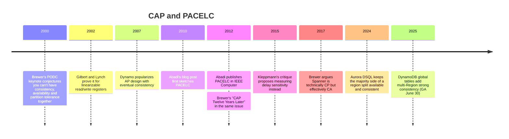
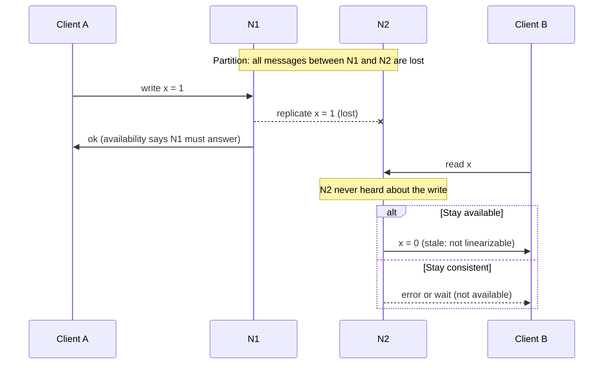
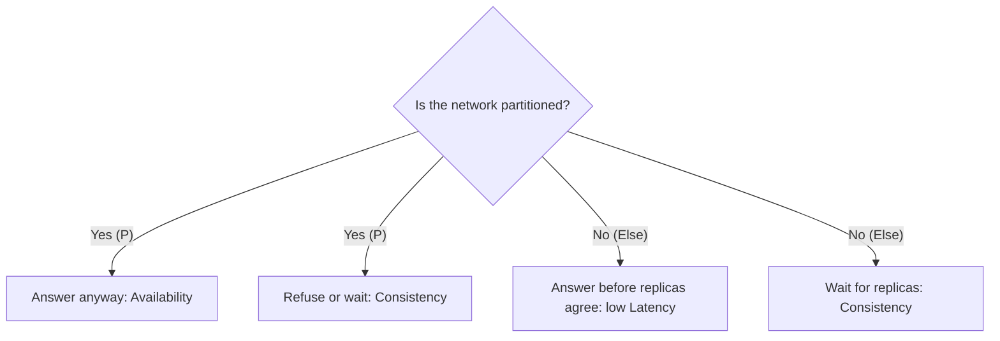
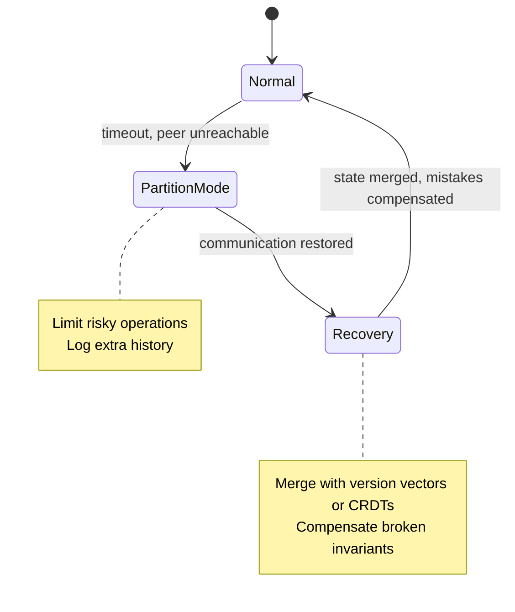

---
tags:
  - distributed-systems
  - foundations
  - cap-theorem
  - pacelc
status: draft
sources:
  - https://sites.cs.ucsb.edu/~rich/class/cs293b-cloud/papers/brewer-cap.pdf
  - https://www.comp.nus.edu.sg/~gilbert/pubs/BrewersConjecture-SigAct.pdf
  - https://cs.umd.edu/~abadi/papers/abadi-pacelc.pdf
  - https://www.infoq.com/articles/cap-twelve-years-later-how-the-rules-have-changed
  - https://arxiv.org/pdf/1509.05393v1
  - https://martin.kleppmann.com/2015/05/11/please-stop-calling-databases-cp-or-ap.html
  - https://research.google/pubs/spanner-truetime-and-the-cap-theorem/
  - https://cloud.google.com/blog/products/databases/inside-cloud-spanner-and-the-cap-theorem
  - https://brooker.co.za/blog/2024/12/06/inside-dsql-cap/
  - https://www.brooker.co.za/blog/2026/07/19/dsql-paper.html
  - https://brooker.co.za/blog/2025/11/18/consistency
  - https://docs.aws.amazon.com/amazondynamodb/latest/developerguide/V2globaltables_HowItWorks.html
  - https://aws.amazon.com/about-aws/whats-new/2025/06/amazon-dynamo-db-global-tables-multi-region-strong-consistency-generally-available
  - https://jepsen.io/consistency/models
created: 2026-11-26
updated: 2026-11-26
---

## Table Of Contents

---

- [[#TL;DR|TL;DR]]
- [[#The Problem|The Problem]]
- [[#Foundations|Foundations]]
    - [[#What C, A and P Actually Mean|What C, A and P Actually Mean]]
    - [[#A Partition Is a Timeout|A Partition Is a Timeout]]
- [[#How We Got Here|How We Got Here]]
- [[#How It Works|How It Works]]
    - [[#The Proof, a Worked Example|The Proof, a Worked Example]]
    - [[#Why "Pick Two of Three" Misleads|Why "Pick Two of Three" Misleads]]
    - [[#PACELC, the Else Branch|PACELC, the Else Branch]]
    - [[#The Latency Cost, a Worked Example|The Latency Cost, a Worked Example]]
    - [[#Where Real Systems Sit|Where Real Systems Sit]]
    - [[#Designing for Partition Mode|Designing for Partition Mode]]
    - [[#Latency Bounds Beyond CAP|Latency Bounds Beyond CAP]]
- [[#Where It Is Now|Where It Is Now]]
    - [[#Majority Side Stays Up|Majority Side Stays Up]]
    - [[#The Choice as a Product Setting|The Choice as a Product Setting]]
    - [[#Effectively CA|Effectively CA]]
- [[#Trade-offs & Open Problems|Trade-offs & Open Problems]]
- [[#Resources|Resources]]
- [[#Related Notes|Related Notes]]

## ***TL;DR***
---
*CAP says that when the network splits, a replicated system must either refuse some requests or risk returning stale data. PACELC adds the part that matters every day: even with a healthy network, stronger consistency costs latency.*

- **CAP, precisely:** no system can be both linearizable and available (every request to a live node gets an answer) when the network may drop messages between nodes ([Gilbert and Lynch, 2002](https://www.comp.nus.edu.sg/~gilbert/pubs/BrewersConjecture-SigAct.pdf)). It is a narrow impossibility result, not a menu.
- **"Pick two of three" misleads:** partitions aren't optional, so the real question is what you do *during* one. Outside partitions you can have both C and A ([Brewer, 2012](https://www.infoq.com/articles/cap-twelve-years-later-how-the-rules-have-changed)).
- **PACELC:** if Partitioned, choose Availability or Consistency; Else, choose Latency or Consistency ([Abadi, 2012](https://cs.umd.edu/~abadi/papers/abadi-pacelc.pdf)). The else branch is the trade-off you pay on every request.
- **Labels are coarse:** most real systems are neither CP nor AP in the theorem's strict sense ([Kleppmann, 2015](https://martin.kleppmann.com/2015/05/11/please-stop-calling-databases-cp-or-ap.html)). Ask instead which [[Consistency Models|consistency model]] each operation gets, and what happens on each side of a split.
- **Now (Nov 2026):** the choice is a product setting. DynamoDB global tables offer async (PA/EL) or synchronous strong (PC/EC) modes, and Aurora DSQL keeps the majority side of a split available and strongly consistent ([AWS docs](https://docs.aws.amazon.com/amazondynamodb/latest/developerguide/V2globaltables_HowItWorks.html), [Brooker, 2024](https://brooker.co.za/blog/2024/12/06/inside-dsql-cap/)).

## ***The Problem***
---
*You replicate data so it survives machine and region failures, but replicas have to talk over a network that can be slow or cut. When they can't talk, every replica faces the same question: answer now with what it has, or wait.*

Replication exists for availability and durability ([[Replication]]). The moment a value lives in two places, a write to one copy has to reach the other before the other can serve the new value. If the link between them is down, a replica that receives a read has two choices:

| Choice | What the client sees | Cost |
|---|---|---|
| Answer from local data | A response, possibly stale | Breaks linearizability: a read can miss a write that already finished |
| Wait or refuse | An error or a hang | Breaks availability for that client |

There is no third choice. Every design trick, from quorums to clocks to [[CRDTs]], is about making one of these two costs smaller or rarer, or moving it to operations where it hurts less.

The same tension shows up without any failure. Waiting for a remote replica takes at least one network round trip, so a strongly consistent write in a multi-region system is slow even on a perfect day. That everyday cost is what PACELC names.

## ***Foundations***
---
*CAP only makes sense with its precise definitions. Each word means something much narrower than its everyday meaning, and most arguments about CAP come from mixing the two.*

### What C, A and P Actually Mean

| Letter | Gilbert and Lynch's definition | What it is *not* |
|---|---|---|
| **C**onsistency | Linearizability (atomic consistency): every operation appears to take effect at one instant, in one total order, as if there were a single copy | Not the "C" in ACID, which is about application invariants. Not serializability. See [[Consistency Models]] |
| **A**vailability | "Every request received by a non-failing node in the system must result in a response," with no time limit | Not "99.99% uptime." A system that answers in a week counts as available; one that errors out on the minority side doesn't |
| **P**artition tolerance | The network may lose arbitrarily many messages between nodes | Not a feature you pick. It's an assumption about the network, from [[Failure Models]] |

Two consequences follow straight from these definitions ([Kleppmann, 2015](https://arxiv.org/pdf/1509.05393v1)):
- **A is very strict.** Any system with an elected leader fails it, because nodes cut off from the leader can't serve linearizable writes. So Raft-based and Paxos-based databases, which people think of as "highly available," are not "A" in CAP terms.
- **C is only linearizability.** A system that offers snapshot isolation or causal consistency is not "C" in the theorem, but it isn't simply "giving up consistency" either.

### A Partition Is a Timeout

A node can't see a partition directly. It sees a message that hasn't arrived *yet*. Brewer's point is that a partition is just a time bound on communication: when the bound expires, the system decides whether to cancel the operation (lose availability) or go ahead (risk inconsistency). Retrying forever is choosing consistency ([Brewer, 2012](https://www.infoq.com/articles/cap-twelve-years-later-how-the-rules-have-changed)).

This ties CAP to the timing models in [[Failure Models]]. In an asynchronous network a slow link and a dead link look the same, which is why the choice has to be made by timeout, and why different nodes can disagree about whether a partition exists at all.

## ***How We Got Here***
---
*CAP began as a conjecture from building web services, became a theorem two years later, and spent the next decade being stretched far beyond what it proves. PACELC and the 2012 to 2015 critiques pulled it back to its useful core.*

**The conjecture (2000).** Eric Brewer, then building large web services at Inktomi, argued in his PODC 2000 keynote "Towards Robust Distributed Systems" that services had to weaken consistency to stay available ([slides](https://sites.cs.ucsb.edu/~rich/class/cs293b-cloud/papers/brewer-cap.pdf)). It was a design argument, framed as "pick two."

**The theorem (2002).** Seth Gilbert and Nancy Lynch turned it into a precise statement and proof: in an asynchronous network that can lose messages, no read/write register is both linearizable and available ([Gilbert and Lynch](https://www.comp.nus.edu.sg/~gilbert/pubs/BrewersConjecture-SigAct.pdf)). They also showed that in a partially synchronous model you can get a weaker guarantee they call *Delayed-t consistency*: reads may be stale during a partition, but once messages flow again for long enough, order is restored. That bounded-staleness idea is the ancestor of today's tunable staleness settings.

**The NoSQL era (2007 to 2012).** Amazon's Dynamo, then Cassandra and Riak, chose availability and low latency, and "we're AP" became a design slogan. Abadi noticed that these systems gave up consistency even when there was no partition, which CAP can't explain. His answer was PACELC: the latency trade-off is the reason, and it applies all the time ([Abadi, 2012](https://cs.umd.edu/~abadi/papers/abadi-pacelc.pdf)).

**The correction (2012 to 2015).** Brewer himself wrote that "2 of 3" was misleading and that the interesting work is managing partitions, not avoiding a letter ([Brewer, 2012](https://www.infoq.com/articles/cap-twelve-years-later-how-the-rules-have-changed)). Kleppmann went further: CAP's definitions are too narrow to classify real systems, and it "has now reached the end of its usefulness" as a design tool ([Kleppmann, 2015](https://arxiv.org/pdf/1509.05393v1)).

**Engineering around it (2017 to now).** Google argued that with enough control over the network, partitions are rare enough that a CP system can look CA to users ([Brewer, 2017](https://research.google/pubs/spanner-truetime-and-the-cap-theorem/)). Cloud vendors now ship both sides of the trade-off as settings on the same product.

## ***How It Works***
---
*The proof is a two-node thought experiment. Everything else (PACELC, latency bounds, partition-mode design) is about what that experiment means for systems you actually build.*

### The Proof, a Worked Example

*Split the nodes into two groups, drop every message between them, write on one side and read on the other. The reader's side either answers with old data or doesn't answer.*

Take two replicas, N1 and N2, holding a register `x = 0`. Cut the link between them.

1. Client A writes `x = 1` to N1. N1 is alive, so availability says it must answer, and it does.
2. The write has finished. Linearizability now says every later read must return 1.
3. Client B reads from N2. N2 is alive too, so it must answer.
4. N2 has received nothing from N1, so the only value it knows is 0. Answering 0 breaks linearizability; not answering breaks availability.

That's the whole proof ([Gilbert and Lynch](https://www.comp.nus.edu.sg/~gilbert/pubs/BrewersConjecture-SigAct.pdf)). Note what it doesn't say: it says nothing about systems with no partition, about weaker models than linearizability, or about how long the partition lasts.

### Why "Pick Two of Three" Misleads

*You don't get to drop P, the choice applies only during a partition, and it can differ per operation. "CA" describes a system that hasn't been tested under a partition yet.*

- **P isn't optional.** Networks do lose messages, so a "CA" system is one whose behavior under partition is undefined. Partition tolerance describes the network, not a feature ([Kleppmann, 2015](https://arxiv.org/pdf/1509.05393v1)).
- **The choice is only made during a partition.** With a healthy network, a system can be both linearizable and available ([Brewer, 2012](https://www.infoq.com/articles/cap-twelve-years-later-how-the-rules-have-changed)).
- **It isn't binary or global.** A system can choose per operation, per data item or per user: reads of a product catalog can stay available while checkout refuses to go ahead.
- **Most systems fit neither label.** A leader-based database with snapshot isolation isn't C (not linearizable) and isn't A (minority side refuses writes). Calling it "CP" hides both facts ([Kleppmann, 2015](https://martin.kleppmann.com/2015/05/11/please-stop-calling-databases-cp-or-ap.html)).

### PACELC, the Else Branch

*PACELC asks two questions. During a partition: availability or consistency? Else, in normal operation: latency or consistency? The second answer explains most real design choices.*

Abadi's argument ([Abadi, 2012](https://cs.umd.edu/~abadi/papers/abadi-pacelc.pdf)):
1. High availability needs replication.
2. Replication forces a choice in *normal* operation: wait for other replicas before answering (consistent, slower) or answer first and replicate after (faster, possibly inconsistent).
3. That latency cost is paid on every request, while the partition cost is paid rarely. So it drives design more than CAP does.

Abadi lists three ways to replicate an update, and each forces the trade-off in its own way:

| Replication option | Consistent version | Fast version |
|---|---|---|
| Send to all replicas at once | Run an agreement step to order concurrent updates (adds latency) | Apply in arrival order (replicas can diverge) |
| Send to an agreed master first | Master waits for replicas before acking (synchronous) | Master acks first, replicates later (asynchronous; reads from replicas can be stale, and a failover can lose acked writes) |
| Send to any node, which forwards | Same as above, plus the forwarding hop | Same as above |

### The Latency Cost, a Worked Example

*With replicas on two continents, the consistent write waits for an ocean crossing; the fast write doesn't. The numbers below are illustrative.*

Say a database has replicas in Virginia and Ireland, with a round trip of about 80 ms between them, and a client in Virginia.

| Mode | What a write waits for | Write latency (illustrative) | What can go wrong |
|---|---|---|---|
| EL (async) | Local disk and local ack | a few ms | A reader in Ireland sees the old value for up to the replication lag; if Virginia fails before replicating, the write is lost |
| EC (sync) | Ireland's ack | at least 80 ms | Nothing, until a partition, when the write must fail or hang |

A page that does 10 sequential writes pays roughly 0.8 seconds in EC mode and tens of milliseconds in EL mode. That's the everyday trade PACELC describes, and it's why systems that choose EL do so even though partitions are rare.

### Where Real Systems Sit

*Abadi's 2012 classification still gives the vocabulary, but tunable systems can move between boxes, and newer systems offer both modes on one product.*

| System | PACELC | Why |
|---|---|---|
| Dynamo, Cassandra, Riak | PA/EL | Answer locally; reconcile later ([Abadi](https://cs.umd.edu/~abadi/papers/abadi-pacelc.pdf)) |
| VoltDB/H-Store, Megastore, BigTable/HBase | PC/EC | Never give up consistency; pay with latency and availability ([Abadi](https://cs.umd.edu/~abadi/papers/abadi-pacelc.pdf)) |
| MongoDB (as of 2012) | PA/EC | Consistent through a primary normally, but a partition could leave old and new primaries diverged ([Abadi](https://cs.umd.edu/~abadi/papers/abadi-pacelc.pdf)) |
| PNUTS (Yahoo) | PC/EL | Gives up consistency for latency normally, but gives up availability rather than consistency in a partition ([Abadi](https://cs.umd.edu/~abadi/papers/abadi-pacelc.pdf)) |
| DynamoDB global tables, MREC mode | PA/EL | Asynchronous replication, last writer wins ([AWS docs](https://docs.aws.amazon.com/amazondynamodb/latest/developerguide/V2globaltables_HowItWorks.html)) |
| DynamoDB global tables, MRSC mode | PC/EC | Write waits for another Region; conflicting writes fail ([AWS docs](https://docs.aws.amazon.com/amazondynamodb/latest/developerguide/V2globaltables_HowItWorks.html)) |
| Spanner, Aurora DSQL, CockroachDB | PC/EC | Quorum replication via [[Paxos]] or [[Raft]]-style protocols; minority side refuses ([Brewer, 2017](https://research.google/pubs/spanner-truetime-and-the-cap-theorem/), [Brooker, 2024](https://brooker.co.za/blog/2024/12/06/inside-dsql-cap/)) |

Systems with tunable quorums (Cassandra's per-request consistency levels, for example) can move toward EC for some operations. The label describes a configuration, not the software.

### Designing for Partition Mode

*Brewer's practical advice: detect the partition, run in an explicit limited mode, then recover and repair. The goal is to keep as much working as is safe, and know exactly what to fix afterwards.*

From [Brewer, 2012](https://www.infoq.com/articles/cap-twelve-years-later-how-the-rules-have-changed):
- **Detect.** A timeout starts partition mode. Different nodes may enter it at different times.
- **Limit.** Decide per operation what's allowed. His ATM example: during a partition, allow withdrawals only up to a fixed limit, which bounds how much the bank can lose.
- **Record.** Keep enough history to see what ran on each side; version vectors show which operations were concurrent (see [[Time and Clocks]]).
- **Recover.** Merge state. [[CRDTs]] merge automatically for data types that allow it. Everything else needs a rule (last writer wins, merge, or escalate to a person).
- **Compensate.** Fix broken invariants after the fact, the way a bank charges an overdraft fee instead of preventing every overdraft.

### Latency Bounds Beyond CAP

*Kleppmann's reframing: forget the letters and ask how each operation's latency grows with network delay. Linearizable operations must wait on the network; causal ones don't have to.*

Kleppmann proposes classifying operations by delay sensitivity, with network delay $d$ ([Kleppmann, 2015](https://arxiv.org/pdf/1509.05393v1)):

| Model | Write latency | Read latency | Works offline? |
|---|---|---|---|
| Linearizability | $O(d)$ | $O(d)$ | No |
| Sequential consistency | $O(d)$ | $O(1)$ | No |
| Causal consistency | $O(1)$ | $O(1)$ | Yes |

The linearizability row comes from a lower bound by Attiya and Welch: if message delay can vary by $u$, some linearizable operation must take at least $u/2$. A partition is just a very large $d$, so a delay-sensitive operation that slows down as $d$ grows becomes unavailable as $d \to \infty$. Causal consistency doesn't wait on the network at all, which is why it can keep serving clients that stick to one replica during a partition ([[Consistency Models]]).

## ***Where It Is Now***
---
*As of November 2026 the debate is settled in practice: strongly consistent systems keep the majority side up, cloud products expose the PACELC choice as a setting, and Google argues that network control makes CP look like CA.*

### Majority Side Stays Up

*A CP system doesn't go fully down in a partition. Only the minority side does, and with three regions the majority keeps both consistency and availability for clients that can reach it.*

Marc Brooker describes how Aurora DSQL handles a region split ([Brooker, Dec 2024](https://brooker.co.za/blog/2024/12/06/inside-dsql-cap/)):
- A multi-region cluster has two full regions and a third **witness** region that holds only a copy of the transaction journal (see [[Witness Replicas]]).
- If a full region is cut off, its endpoint becomes unavailable for reads and writes. The majority side's endpoint stays available and strongly consistent, as long as the minority side accepts no writes.
- If the witness is cut off, clients see no outage, only slightly higher commit latency in some setups. Normal replication is a 2-of-3 quorum; after a region is lost it becomes 2-of-2, so every commit waits for the slowest remaining link.

His team's 2026 paper on DSQL argues that changes in hardware, networking and time distribution since the 2007 Dynamo paper have shifted the trade-off toward strong consistency as the default ([Brooker, Jul 2026](https://www.brooker.co.za/blog/2026/07/19/dsql-paper.html), [Why Strong Consistency?](https://brooker.co.za/blog/2025/11/18/consistency)).

### The Choice as a Product Setting

*DynamoDB global tables let you pick PA/EL or PC/EC when you create a table. The strong mode costs latency and features, which is PACELC as a pricing page.*

| | MREC (default) | MRSC (GA June 30, 2025) |
|---|---|---|
| Replication | Asynchronous, typically within a second | Synchronous to at least one other Region before the write returns |
| Strongly consistent reads | May be stale if last written in another Region | Always the latest, in any Region |
| Conflicts | Last writer wins, per item | Write fails with `ReplicatedWriteConflictException` |
| Latency | Lower | Higher; depends on inter-Region round trip |
| RPO | Replication lag | Zero |
| Regions | Any | Exactly three (replicas, or two replicas plus a witness) |
| Gaps | Transactions aren't atomic across Regions | No transactions, TTL or local secondary indexes |

Sources: [AWS docs](https://docs.aws.amazon.com/amazondynamodb/latest/developerguide/V2globaltables_HowItWorks.html), [GA announcement](https://aws.amazon.com/about-aws/whats-new/2025/06/amazon-dynamo-db-global-tables-multi-region-strong-consistency-generally-available). The mode is fixed when the table is created and can't be mixed within a table.

### Effectively CA

*Google's position: Spanner is CP, but its network makes partitions rare enough that users can treat it as CA. The argument rests on owning the network, not on beating the theorem.*

Brewer, now at Google, wrote that Spanner is "technically a CP system": partitions have happened at Google, and in some of them Spanner chose consistency. But it delivers more than five 9s of availability, so "the short answer is 'no' technically, but 'yes' in effect and its users can and do assume CA" ([Brewer, 2017](https://cloud.google.com/blog/products/databases/inside-cloud-spanner-and-the-cap-theorem)). The biggest factor, he says, is that Google controls the whole network, and the network caused less than 10% of Spanner's already rare outages. [[Time and Clocks|TrueTime]] is what lets Spanner keep strong consistency cheaply once the network is reliable.

The catch for everyone else: this works because partitions are rare *inside Google's network*. A client cut off from every Spanner region still sees an outage, and CAP still applies to it.

## ***Trade-offs & Open Problems***
---
*CAP's real lessons are about what you pay and when. The open questions are about failures that don't look like clean partitions and about making the latency cost smaller.*

| Choice | You get | You pay |
|---|---|---|
| PC (refuse on minority side) | One copy of the truth; no reconciliation | Outage for clients on the minority side |
| PA (answer everywhere) | Every live node answers | Stale reads, conflicts, merge logic, possible lost writes |
| EC (wait for replicas) | Linearizable or serializable results | At least one replica round trip on writes (and often reads) |
| EL (answer first) | Local latency | Staleness window; data loss if the node dies before replicating |

Open problems worth tracking:
- **Partitions aren't clean.** Real failures include partial partitions, where some nodes can reach each other and others can't, and [[Gray and Fail-Slow Failures|gray failures]], where a link is slow but not down. CAP's model of a clean split doesn't describe these, and they cause real outages ([Alquraan et al., OSDI 2018](https://www.usenix.org/conference/osdi18/presentation/alquraan); see [[Failure Models]]).
- **Availability as clients see it.** CAP's availability has no latency bound, so it doesn't match an SLA. Kleppmann's proposal to measure the share of requests that meet a latency bound is closer to practice, but there's no agreed formal replacement ([Kleppmann, 2015](https://arxiv.org/pdf/1509.05393v1)).
- **Shrinking the EC cost.** Witness regions, leaderless commit protocols and better clocks all try to cut the round trips a strong write needs. The round trip to a quorum doesn't go away; see [[Paxos]] and [[Distributed Transactions]].
- **Mixed models in one application.** Choosing consistency per operation is the right idea, but tooling to check that an app's mix of strong and weak operations keeps its invariants is still thin; see [[CRDTs]] for the coordination-free side.

## ***Resources***
---
*Read Gilbert and Lynch for the precise result, Brewer 2012 for how to design with it, Abadi for PACELC, and Kleppmann for why the labels mislead. Brooker's DSQL post shows what a modern CP system does in a split.*

**Primary papers**
- [Towards Robust Distributed Systems](https://sites.cs.ucsb.edu/~rich/class/cs293b-cloud/papers/brewer-cap.pdf): Eric Brewer, PODC keynote, July 2000. The original conjecture.
- [Brewer's Conjecture and the Feasibility of Consistent, Available, Partition-Tolerant Web Services](https://www.comp.nus.edu.sg/~gilbert/pubs/BrewersConjecture-SigAct.pdf): Gilbert and Lynch, SIGACT News, 2002. The proof.
- [Consistency Tradeoffs in Modern Distributed Database System Design](https://cs.umd.edu/~abadi/papers/abadi-pacelc.pdf): Daniel Abadi, IEEE Computer, Feb 2012. PACELC.
- [CAP Twelve Years Later: How the "Rules" Have Changed](https://www.infoq.com/articles/cap-twelve-years-later-how-the-rules-have-changed): Eric Brewer, IEEE Computer, 2012. Partition-mode design.
- [A Critique of the CAP Theorem](https://arxiv.org/pdf/1509.05393v1): Martin Kleppmann, 2015. Delay-sensitivity framework.
- [Spanner, TrueTime and the CAP Theorem](https://research.google/pubs/spanner-truetime-and-the-cap-theorem/): Eric Brewer, Google, Feb 2017.

**Practitioner writing**
- [Please Stop Calling Databases CP or AP](https://martin.kleppmann.com/2015/05/11/please-stop-calling-databases-cp-or-ap.html): Martin Kleppmann, May 2015.
- [Inside Cloud Spanner and the CAP Theorem](https://cloud.google.com/blog/products/databases/inside-cloud-spanner-and-the-cap-theorem): Eric Brewer, Google Cloud blog, Feb 2017.
- [Aurora DSQL and the CAP theorem](https://brooker.co.za/blog/2024/12/06/inside-dsql-cap/): Marc Brooker, Dec 2024. What DSQL does in a region split.
- [Aurora DSQL paper post](https://www.brooker.co.za/blog/2026/07/19/dsql-paper.html): Marc Brooker, Jul 2026.
- [Why Strong Consistency?](https://brooker.co.za/blog/2025/11/18/consistency): Marc Brooker, Nov 2025.
- [DynamoDB global tables: how it works](https://docs.aws.amazon.com/amazondynamodb/latest/developerguide/V2globaltables_HowItWorks.html): AWS docs. MREC vs MRSC.
- [Jepsen: Consistency Models](https://jepsen.io/consistency/models): which models can stay available in a partition.

## Related Notes

- [[Consistency Models]] — The "C" in CAP is only linearizability; this is the full map and which models survive a partition.
- [[Failure Models]] — Partitions, timing models and why a slow link looks like a dead one.
- [[Time and Clocks]] — Version vectors for partition recovery, and TrueTime for cheap strong consistency.
- [[Paxos]] — How PC/EC systems replicate: majority quorums that keep the majority side available.
- [[Raft]] — The other common quorum protocol, and why its minority side can't serve writes.
- [[Replication]] — Synchronous vs asynchronous, leader vs leaderless: the mechanisms behind the PACELC choices.
- [[CRDTs]] — Data types that merge automatically after a partition, for PA/EL designs.
- [[Distributed SQL]] — Spanner, CockroachDB and Aurora DSQL, the PC/EC systems of today.
- [[Distributed Transactions]] — The extra round trips strong consistency costs across shards.
- [[Witness Replicas]] — The third region that votes without a full copy, in DSQL, DynamoDB MRSC and Spanner.
