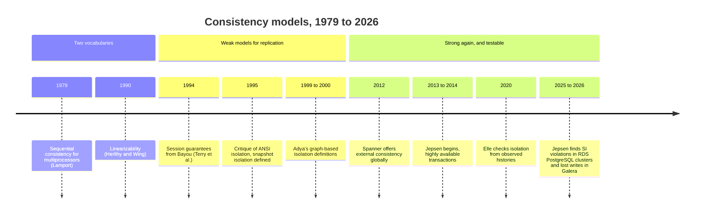
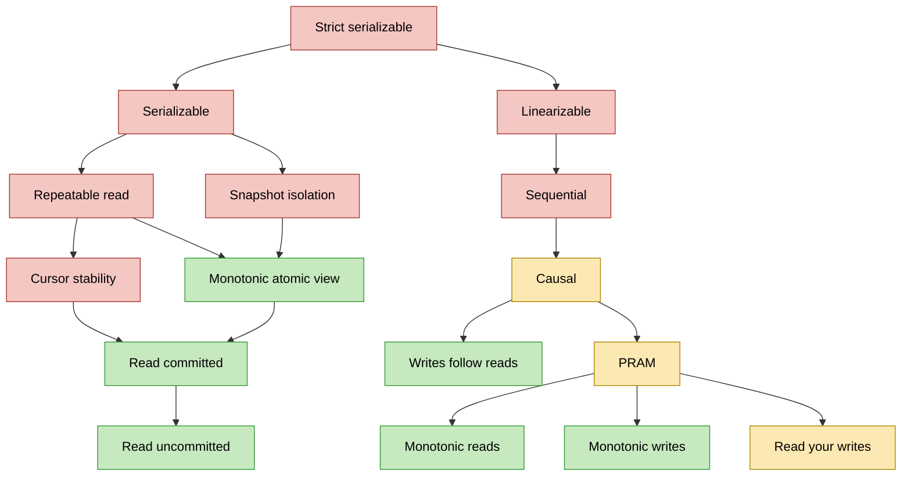

---
tags:
  - distributed-systems
  - foundations
  - consistency-models
status: draft
sources:
  - https://jepsen.io/consistency/models
  - https://jepsen.io/consistency/models/strict-serializable
  - https://www.cs.columbia.edu/~wing/publications/HerlihyWing90.pdf
  - https://arxiv.org/pdf/cs/0701157
  - https://pages.cs.wisc.edu/~remzi/Classes/739/Fall2016/Papers/bayou-sessions94.pdf
  - https://www.vldb.org/pvldb/vol7/p181-bailis.pdf
  - https://arxiv.org/abs/2003.10554
  - https://jepsen.io/analyses/amazon-rds-for-postgresql-17.4
  - https://jepsen.io/analyses/mariadb-galera-cluster-12.1.2
  - https://jepsen.io/analyses/particledb-1.1.4
  - https://jepsen.io/analyses
  - https://brooker.co.za/blog/2025/11/18/consistency
  - https://www.cs.princeton.edu/courses/archive/fall15/cos518/papers/spanner.pdf
  - https://cockroachlabs.com/blog/living-without-atomic-clocks/
created: 2026-11-26
updated: 2026-11-26
---

## Table Of Contents

---

- [[#TL;DR|TL;DR]]
- [[#The Problem|The Problem]]
- [[#Foundations|Foundations]]
    - [[#Histories, Operations and Transactions|Histories, Operations and Transactions]]
    - [[#Real Time vs Program Order|Real Time vs Program Order]]
    - [[#Anomalies Define the Models|Anomalies Define the Models]]
- [[#How We Got Here|How We Got Here]]
- [[#How It Works|How It Works]]
    - [[#The Map|The Map]]
    - [[#Single-Object Models|Single-Object Models]]
    - [[#Linearizable vs Sequential, a Worked Example|Linearizable vs Sequential, a Worked Example]]
    - [[#Session Guarantees and Causal Consistency|Session Guarantees and Causal Consistency]]
    - [[#Transactional Isolation Levels|Transactional Isolation Levels]]
    - [[#Write Skew, a Worked Example|Write Skew, a Worked Example]]
    - [[#Serializable vs Strict Serializable|Serializable vs Strict Serializable]]
    - [[#Which Models Survive a Partition|Which Models Survive a Partition]]
- [[#Where It Is Now|Where It Is Now]]
    - [[#What Jepsen Keeps Finding|What Jepsen Keeps Finding]]
    - [[#Strong Consistency as the Default|Strong Consistency as the Default]]
- [[#Trade-offs & Open Problems|Trade-offs & Open Problems]]
- [[#Resources|Resources]]
- [[#Related Notes|Related Notes]]

## ***TL;DR***
---
*A consistency model is a promise about which results a system is allowed to return when many clients use it at once. Stronger models are easier to program against but cost latency and availability; weaker ones are fast but let clients see anomalies you have to design around.*

- **Two families:** single-object models (linearizable, sequential, causal, session guarantees like read-your-writes) and transactional isolation levels (serializable, snapshot isolation, repeatable read, read committed). **Strict serializability** is the top of both: serializable transactions that also respect real time ([Jepsen](https://jepsen.io/consistency/models/strict-serializable)).
- **The key distinction:** linearizability means every operation appears to happen at one instant between its start and its finish ([Herlihy and Wing, 1990](https://www.cs.columbia.edu/~wing/publications/HerlihyWing90.pdf)). Serializability means transactions appear to run one at a time in *some* order, which need not match real time.
- **The availability line:** models at or above snapshot isolation, cursor stability or sequential consistency can't stay available during a partition; causal and read-your-writes can if clients stick to one server; read committed and weaker can be fully available ([Jepsen map](https://jepsen.io/consistency/models), [Bailis et al., 2014](https://www.vldb.org/pvldb/vol7/p181-bailis.pdf)).
- **Names lie:** the SQL standard's isolation names are ambiguous, and databases routinely provide less than their documentation says ([Berenson et al., 1995](https://arxiv.org/pdf/cs/0701157)).
- **Where it is now (Nov 2026):** Jepsen's 2025 to 2026 reports keep finding gaps between claimed and actual isolation, from Amazon RDS for PostgreSQL clusters violating snapshot isolation to MariaDB Galera losing committed writes ([Jepsen analyses](https://jepsen.io/analyses)). Meanwhile new distributed databases (Spanner, Aurora DSQL) argue for strong consistency as the default ([Brooker, Nov 2025](https://brooker.co.za/blog/2025/11/18/consistency)).

## ***The Problem***
---
*With one copy of the data and one client, a read returns the last write. With replicas, caches and concurrent clients, "the last write" is ambiguous, and every system picks some rule for which value you may see. If you don't know the rule, your code has bugs you can't reproduce.*

Some everyday anomalies, all of which real systems allow under some setting:

| Anomaly | What the user sees | Forbidden by |
|---|---|---|
| Stale read | You update your profile, refresh, and see the old version | Linearizability (or read-your-writes for your own updates) |
| Non-monotonic read | A comment appears, then disappears on the next refresh | Monotonic reads |
| Causal reversal | A reply appears before the message it replies to | Causal consistency |
| Lost update | Two clients increment a counter from 10; the result is 11 | Snapshot isolation and stronger |
| Write skew | Two doctors each see the other is on call and both go off call | Serializability |
| Long fork | Two readers see two independent writes in opposite orders | Snapshot isolation and stronger |

Brooker's example of the cost: a client creates a resource and immediately reads it, but the read hits a lagging replica and returns "does not exist", so every client ends up writing retry loops with magic sleeps ([Brooker, Nov 2025](https://brooker.co.za/blog/2025/11/18/consistency)).

## ***Foundations***
---
*Consistency models are defined over histories: the record of what each client asked and what it got back. You need three ideas: what a history is, the two kinds of ordering a model may have to respect, and the idea that a model is defined by the anomalies it forbids.*

#### **Histories, Operations and Transactions**
- An **operation** is one request on one object (read $x$, write $x$), with an **invocation** time and a **response** time.
- A **transaction** is a group of operations on possibly many objects that should behave as one unit.
- A **history** is the full record of invocations and responses across all clients.

A consistency model is a set of allowed histories. A system "is linearizable" if every history it can produce is in the linearizable set.

#### **Real Time vs Program Order**
| Ordering | Means | Who must respect it |
|---|---|---|
| Program order | The order one client issued its own operations | Sequential consistency and stronger single-object models |
| Real-time order | If operation A finished before B started (by a global clock), A comes first | Linearizability, strict serializability |
| Causal order | A could have influenced B (same client, or B read A's effect) | Causal consistency and stronger; see [[Time and Clocks]] |

#### **Anomalies Define the Models**
Most transactional models are defined by which **phenomena** they forbid. The vocabulary from Berenson et al. ([1995](https://arxiv.org/pdf/cs/0701157)):

| Phenomenon | Pattern | Plain English |
|---|---|---|
| P0 Dirty write | $w_1[x] \dots w_2[x]$ before T1 ends | Overwriting uncommitted data |
| P1 Dirty read | $w_1[x] \dots r_2[x]$ before T1 ends | Reading uncommitted data |
| P2 Fuzzy read | $r_1[x] \dots w_2[x]$ before T1 ends | Data you read changes under you |
| P3 Phantom | T1 reads rows matching a predicate, T2 inserts a matching row | A query's result set changes under you |
| P4 Lost update | Both read $x$, both write $x$ based on what they read | One increment disappears |
| A5A Read skew | $r_1[x] \dots w_2[x]\, w_2[y]\, c_2 \dots r_1[y]$ | You see half of someone else's update |
| A5B Write skew | $r_1[x]\, r_2[y]\, w_1[y]\, w_2[x]$, both commit | Each transaction is fine alone; together they break a rule |

Adya's later formalism, used by Jepsen, defines the same anomalies as cycles in a graph of dependencies between transactions (for example **G-single**, a cycle with exactly one anti-dependency edge, which snapshot isolation forbids) ([Jepsen](https://jepsen.io/consistency/models)).

## ***How We Got Here***
---
*Databases and shared-memory multiprocessors invented their consistency vocabularies separately in the 1970s to 1990s. Replicated and geo-distributed systems then needed weaker, available models, and from 2013 Jepsen turned the whole map into something you can test.*

| Year | Step | Problem it answered | Source |
|---|---|---|---|
| 1990 | **Linearizability.** Each operation appears to take effect instantly between invocation and response; the property is local (composes per object). | Sequential consistency doesn't respect real time and doesn't compose. | [Herlihy and Wing](https://www.cs.columbia.edu/~wing/publications/HerlihyWing90.pdf) |
| 1994 | **Session guarantees.** Read-your-writes, monotonic reads, writes-follow-reads, monotonic writes, for weakly consistent replicas. | Mobile and disconnected replicas could not be strongly consistent, but users still needed sane behavior. | [Terry et al.](https://pages.cs.wisc.edu/~remzi/Classes/739/Fall2016/Papers/bayou-sessions94.pdf) |
| 1995 | **Critique of ANSI isolation.** Showed the SQL phenomena are ambiguous, defined snapshot isolation, read skew and write skew. | Vendors and the standard disagreed on what isolation names meant. | [Berenson et al.](https://arxiv.org/pdf/cs/0701157) |
| 2012 | **External consistency at global scale.** Strict serializable transactions across datacenters using TrueTime. | Believed too expensive for geo-distributed systems. | [Spanner](https://www.cs.princeton.edu/courses/archive/fall15/cos518/papers/spanner.pdf) |
| 2014 | **Highly available transactions.** Which isolation levels can survive partitions; only 3 of 18 databases surveyed defaulted to serializable, and 8 didn't offer it. | What weak-isolation databases can actually promise. | [Bailis et al.](https://www.vldb.org/pvldb/vol7/p181-bailis.pdf) |
| 2020 | **Elle.** Infers transaction dependency graphs from client observations and detects every Adya anomaly except predicate ones. | Checking isolation in black-box tests. | [Kingsbury and Alvaro](https://arxiv.org/abs/2003.10554) |

## ***How It Works***
---
*Picture a map: strict serializability at the top, splitting into the transactional branch (serializable, snapshot isolation, read committed) and the single-object branch (linearizable, sequential, causal). Each step down allows more anomalies and needs less coordination.*

#### **The Map**
Arrows point from a stronger model to a weaker one it implies ([Jepsen](https://jepsen.io/consistency/models)). Colors show the availability classes explained [[#Which Models Survive a Partition|below]].

*Red: not available during a partition. Yellow: available only if each client sticks to one server. Green: available to every client during a partition.*

#### **Single-Object Models**
| Model | Promise | Plain English |
|---|---|---|
| Linearizable | There is a single order of all operations, consistent with real time, and each read returns the latest write in that order | It behaves like one copy on one machine |
| Sequential | There is a single order consistent with each client's program order, but not necessarily real time | Everyone sees the same order, which may lag reality |
| Causal | Causally related operations are seen in the same order by everyone; concurrent ones may differ | Replies never appear before the message they reply to |
| PRAM | Each client's writes are seen in the order it made them | No cross-client ordering |
| Read your writes | A client sees its own earlier writes | Your update doesn't vanish on refresh |
| Monotonic reads | A client never sees an older state after a newer one | Time doesn't go backwards for you |

Linearizability is **local**: if every object is linearizable, the whole system is. Sequential consistency and serializability are not ([Herlihy and Wing](https://www.cs.columbia.edu/~wing/publications/HerlihyWing90.pdf)). That is why you can build a linearizable store out of independently linearizable keys, but two serializable databases glued together are not serializable.

#### **Linearizable vs Sequential, a Worked Example**
One register $x$, initially 0. Client A writes 1; client B reads after A's write has finished.

| Time (ms) | Client A | Client B |
|---|---|---|
| 0 | invoke write(x, 1) | |
| 10 | write returns OK | |
| 20 | | invoke read(x) |
| 25 | | read returns **0** |

- **Linearizable?** No. A's write took effect at some instant in [0, 10]; B's read took effect in [20, 25], strictly later, so it must return 1.
- **Sequentially consistent?** Yes. The order "B reads 0, then A writes 1" respects each client's own program order (each did only one thing), and a sequential execution in that order gives exactly these results.

This is the gap that matters in practice: a sequentially consistent system can serve a read from a replica that hasn't caught up, as long as every client sees the same order. A linearizable one can't. See [[Replication]].

#### **Session Guarantees and Causal Consistency**
The four Bayou session guarantees ([Terry et al., 1994](https://pages.cs.wisc.edu/~remzi/Classes/739/Fall2016/Papers/bayou-sessions94.pdf)) are promises to one client (a "session"):

| Guarantee | Forbids |
|---|---|
| Read your writes | Not seeing your own write |
| Monotonic reads | Seeing older data after newer data |
| Writes follow reads | Your write being ordered before a write you had already read |
| Monotonic writes | Your writes being applied out of order |

Causal consistency is roughly all four together, for every client. Classic example: Alice posts "I lost my ring", then "Found it!". Bob reads both and replies "Glad to hear it". Under causal consistency, nobody sees Bob's reply without first seeing "Found it!", because the reply causally depends on it. Causal consistency can stay available during a partition as long as each client keeps talking to the same server ([Jepsen](https://jepsen.io/consistency/models)); it is the natural model for [[CRDTs]] and local-first software.

#### **Transactional Isolation Levels**
| Level | Prevents | Still allows |
|---|---|---|
| Read uncommitted | Dirty writes (P0) | Dirty reads and everything below |
| Read committed | Dirty reads (P1) | Fuzzy reads, read skew, lost updates, write skew |
| Repeatable read | Fuzzy reads (P2), lost updates | Phantoms (in the strict ANSI reading) |
| Snapshot isolation | Dirty and fuzzy reads, read skew, lost updates (first committer wins) | **Write skew** |
| Serializable | All of the above | Nothing, except real-time reordering |
| Strict serializable | Everything | Nothing |

Snapshot isolation (SI) means each transaction reads a consistent snapshot as of its start, and commits only if no concurrent committed transaction wrote the same items. SI is stronger than read committed and **incomparable** with repeatable read: SI allows write skew but not phantoms; strict repeatable read allows phantoms but not write skew ([Berenson et al.](https://arxiv.org/pdf/cs/0701157)).

Names vary by product. PostgreSQL's "Repeatable Read" is snapshot isolation, which is what Jepsen tested in Amazon RDS ([Jepsen, Apr 2025](https://jepsen.io/analyses/amazon-rds-for-postgresql-17.4)). Always check the definition behind the name.

#### **Write Skew, a Worked Example**
Two accounts, $x = 50$ and $y = 50$. The rule: $x + y \ge 0$ (either may go negative, the sum may not). Each transaction checks the rule, then withdraws 80 from one account.

| Step | T1 | T2 |
|---|---|---|
| 1 | read x = 50, y = 50 (sum 100, OK) | |
| 2 | | read x = 50, y = 50 (sum 100, OK) |
| 3 | write x = −30 | |
| 4 | | write y = −30 |
| 5 | commit | commit |

$$
x + y = -30 + (-30) = -60 < 0
$$

*In plain English: each transaction was correct on its own snapshot, and they wrote different keys, so snapshot isolation's "first committer wins" check (which only looks at write-write conflicts) lets both commit. Run serially, the second would have seen sum 20 and refused.* Serializability forbids this; the fixes are serializable isolation, or explicitly locking or writing the rows you read (`SELECT ... FOR UPDATE`).

#### **Serializable vs Strict Serializable**
Serializable says transactions behave as if run one at a time in **some** order. Strict serializable adds that the order respects real time: if T1 commits before T2 starts, T1 comes first ([Jepsen](https://jepsen.io/consistency/models/strict-serializable)).

The gap shows up in geo-distributed databases:
- **Spanner** gives strict serializability (it calls it external consistency) by waiting out clock uncertainty at commit ([Spanner](https://www.cs.princeton.edu/courses/archive/fall15/cos518/papers/spanner.pdf)).
- **CockroachDB** gives serializability, not strict serializability. Two causally related transactions on disjoint keys can be ordered against real time ("causal reverse") when clocks are skewed ([Cockroach Labs](https://cockroachlabs.com/blog/living-without-atomic-clocks/)).

See [[Time and Clocks]] for why the difference comes down to clocks, and [[Distributed SQL]] for the systems.

#### **Which Models Survive a Partition**
From Jepsen's map and the HAT paper ([Jepsen](https://jepsen.io/consistency/models), [Bailis et al.](https://www.vldb.org/pvldb/vol7/p181-bailis.pdf)):

| Class | Models | Why |
|---|---|---|
| Not available in a partition | Strict serializable, serializable, repeatable read, snapshot isolation, cursor stability, linearizable, sequential | Preventing lost updates or write skew, or guaranteeing recency, needs coordination across the partition |
| Sticky available | Causal, PRAM, read your writes | Works if each client keeps talking to the same server |
| Totally available | Monotonic atomic view, read committed, read uncommitted, writes follow reads, monotonic reads, monotonic writes | Can be enforced locally |

The cost of the strong side is latency, not only availability: across two US regions, a coordinated "master" approach averaged about 300 ms per operation against about 37 ms for highly available configurations ([Bailis et al., 2014](https://www.vldb.org/pvldb/vol7/p181-bailis.pdf)). This is the trade-off [[CAP and PACELC]] formalizes.

## ***Where It Is Now***
---
*As of November 2026, the theory is stable and the action is in verification and defaults. Jepsen keeps finding that shipped systems give weaker isolation than they claim, while the newest cloud databases argue strong consistency should be what you get without asking.*

#### **What Jepsen Keeps Finding**
- **Amazon RDS for PostgreSQL multi-AZ clusters (Apr 2025):** expected snapshot isolation (PostgreSQL "Repeatable Read"), observed **Long Fork** and other cycles even with no faults, in every version from 13.15 to 17.4. AWS traced it to the primary making transactions visible in lock order while replicas used WAL order. The behavior is consistent with the slightly weaker Parallel Snapshot Isolation ([Jepsen](https://jepsen.io/analyses/amazon-rds-for-postgresql-17.4)).
- **MariaDB Galera Cluster 12.1.2 (Mar 2026):** claimed isolation "between Serializable and Repeatable Read" and "no lost transactions". Jepsen found lost updates and G-single cycles in healthy clusters, stale reads every few minutes, and lost committed writes under crashes, and judged it "weaker than Read Uncommitted" given the lost writes ([Jepsen](https://jepsen.io/analyses/mariadb-galera-cluster-12.1.2)).
- **ParticleDB (Oct 2026):** a new multi-model database for AI workloads that advertised "Full ACID" and TLA+ proofs; Jepsen reported 96 issues including lost committed writes in the default mode, G-single and lost updates under `serializable`, and stale reads under `strict-serializable`. Most were fixed during the engagement ([Jepsen](https://jepsen.io/analyses/particledb-1.1.4)).

The pattern: isolation names in documentation are claims, and Elle-style history checking is how you find out what a system actually does ([Kingsbury and Alvaro](https://arxiv.org/abs/2003.10554)).

#### **Strong Consistency as the Default**
- Brooker argues eventual consistency pushes complexity onto every client (retry loops, routing reads to the primary) and that replicas are only useful for read-modify-write if reads are strongly consistent. In Aurora DSQL every read is strongly consistent: a query picks a start timestamp and a replica either serves data as of that timestamp or waits until it has caught up ([Brooker, Nov 2025](https://brooker.co.za/blog/2025/11/18/consistency)).
- The enabling trend is cheaper coordination: better clocks make timestamp-based strong reads fast (see [[Time and Clocks]]), so the latency penalty that justified weak defaults has shrunk.
- Weak models remain the right tool where clients must work offline or across slow links; that is the territory of [[CRDTs]] and causal consistency.

## ***Trade-offs & Open Problems***
---
*Stronger models cost round trips, and the round trips are slow across regions and impossible during partitions. The open problems are about verifying what systems actually provide and making the strong end cheaper.*

| Choose | You get | You pay |
|---|---|---|
| Strict serializable / linearizable | Code reasons as if there's one copy; no anomalies | Cross-replica coordination on every write, often on reads; unavailable in a minority partition |
| Serializable | No anomalies within the database | Real-time reordering across clients (stale reads possible) |
| Snapshot isolation | Fast reads from snapshots, no lost updates | Write skew; you must find and lock the invariants yourself |
| Read committed | High availability, low latency | Read skew, lost updates, write skew |
| Causal / session | Available offline, sane per-user behavior | No global invariants; conflicts must be merged |

Open problems worth tracking:
- **Claims vs reality.** Jepsen's 2025 to 2026 reports on RDS for PostgreSQL, Galera and ParticleDB all found isolation or durability weaker than documented ([Jepsen analyses](https://jepsen.io/analyses)). Making isolation claims precise and checked is still not standard practice.
- **Predicate anomalies.** Elle can't detect predicate-based anomalies like phantoms ([Kingsbury and Alvaro](https://arxiv.org/abs/2003.10554)); black-box checking of them is open.
- **Choosing a level.** Applications mostly run on their database's default, and defaults are weak: only 3 of 18 databases surveyed in 2013 defaulted to serializable ([Bailis et al.](https://www.vldb.org/pvldb/vol7/p181-bailis.pdf)). Knowing which anomalies your default allows is still on the developer.
- **Cheap strong consistency across regions.** Clock-based approaches shrink the cost but don't remove the round trip to a quorum; see [[Paxos]] and [[Distributed Transactions]].

## ***Resources***
---
*Start with Jepsen's consistency map and click through the models; it is the best reference there is. Then read Berenson et al. for isolation and Herlihy and Wing's introduction for linearizability.*

**Primary papers**
- [Linearizability: A Correctness Condition for Concurrent Objects](https://www.cs.columbia.edu/~wing/publications/HerlihyWing90.pdf): Herlihy and Wing, TOPLAS, July 1990.
- [Session Guarantees for Weakly Consistent Replicated Data](https://pages.cs.wisc.edu/~remzi/Classes/739/Fall2016/Papers/bayou-sessions94.pdf): Terry et al., PDIS 1994.
- [A Critique of ANSI SQL Isolation Levels](https://arxiv.org/pdf/cs/0701157): Berenson, Bernstein, Gray, Melton, O'Neil, O'Neil, SIGMOD 1995.
- [Highly Available Transactions: Virtues and Limitations](https://www.vldb.org/pvldb/vol7/p181-bailis.pdf): Bailis et al., VLDB 2014.
- [Elle: Inferring Isolation Anomalies from Experimental Observations](https://arxiv.org/abs/2003.10554): Kingsbury and Alvaro, VLDB 2020.
- [Spanner](https://www.cs.princeton.edu/courses/archive/fall15/cos518/papers/spanner.pdf): Corbett et al., OSDI 2012. External consistency in practice.

**References and analysis**
- [Jepsen: Consistency Models](https://jepsen.io/consistency/models): Kyle Kingsbury. The map, with a page per model and per phenomenon.
- [Jepsen: Amazon RDS for PostgreSQL 17.4](https://jepsen.io/analyses/amazon-rds-for-postgresql-17.4): Apr 2025.
- [Jepsen: MariaDB Galera Cluster 12.1.2](https://jepsen.io/analyses/mariadb-galera-cluster-12.1.2): Mar 2026.
- [Jepsen: ParticleDB 1.1.4](https://jepsen.io/analyses/particledb-1.1.4): Oct 2026.
- [Why Strong Consistency?](https://brooker.co.za/blog/2025/11/18/consistency): Marc Brooker, Nov 2025.
- [Living Without Atomic Clocks](https://cockroachlabs.com/blog/living-without-atomic-clocks/): Cockroach Labs, Jan 2022. Serializable vs strict serializable in practice.

## Related Notes

- [[Time and Clocks]] — Why strict serializability and linearizability depend on clocks or a single sequencer.
- [[Failure Models]] — The partitions and crashes under which these guarantees must hold.
- [[CAP and PACELC]] — The formal trade-off between linearizability, availability and latency.
- [[Paxos]] — Consensus, the standard way to build a linearizable log.
- [[Raft]] — The other standard way, and how linearizable reads are served.
- [[Replication]] — Leader-based vs leaderless replication and the consistency each gives.
- [[Distributed Transactions]] — How serializable and snapshot isolation are implemented across shards.
- [[Distributed SQL]] — Spanner, CockroachDB, YugabyteDB and Aurora DSQL and the isolation each offers.
- [[CRDTs]] — Convergence under causal and eventual consistency without coordination.
- [[Deterministic Simulation Testing]] — Testing that a system really provides its claimed model.
