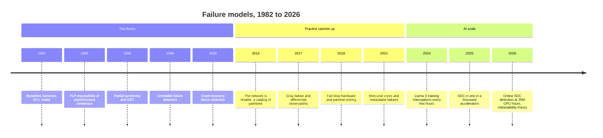
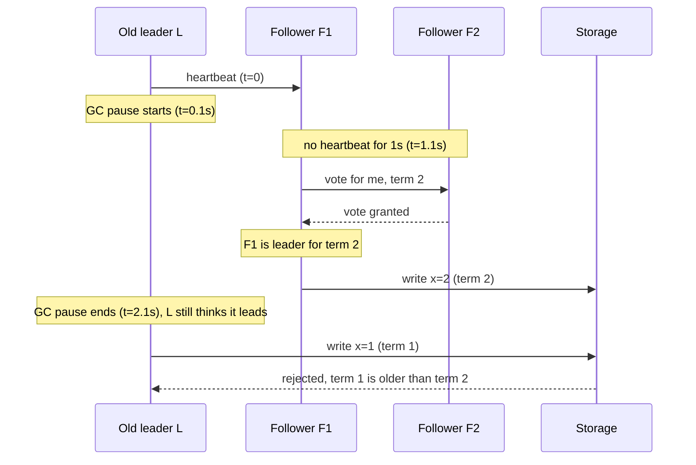

---
tags:
  - distributed-systems
  - foundations
  - failure-models
status: draft
sources:
  - https://www.andrew.cmu.edu/course/15-440-sp15/assets/READINGS/lamport1982.pdf
  - https://groups.csail.mit.edu/tds/papers/Lynch/jacm85.pdf
  - https://groups.csail.mit.edu/tds/papers/Lynch/jacm88.pdf
  - https://cs.nyu.edu/~apanda/classes/sp25/papers/chandra-toueg.pdf
  - https://www.microsoft.com/en-us/research/publication/failure-detection-consensus-crash-recovery-model/
  - https://aphyr.com/posts/288-the-network-is-reliable
  - https://www.usenix.org/conference/osdi18/presentation/alquraan
  - https://pages.cs.wisc.edu/~ra/Classes/739-sp20/papers/grayfailure-hotos17.pdf
  - https://www.usenix.org/node/210509
  - https://research.google/pubs/pub50337/
  - https://www.usenix.org/conference/osdi22/presentation/huang-lexiang
  - https://arxiv.org/html/2606.00942v1
  - https://arxiv.org/pdf/2407.21783
  - https://engineering.fb.com/2025/07/22/data-infrastructure/how-meta-keeps-its-ai-hardware-reliable/
  - https://www.usenix.org/conference/osdi26/presentation/lei
created: 2026-11-26
updated: 2026-11-26
---

## Table Of Contents

---

- [[#TL;DR|TL;DR]]
- [[#The Problem|The Problem]]
- [[#Foundations|Foundations]]
    - [[#Safety and Liveness|Safety and Liveness]]
    - [[#Processes, Links and Timing|Processes, Links and Timing]]
    - [[#Fault Tolerance Is Counted in f|Fault Tolerance Is Counted in f]]
- [[#How We Got Here|How We Got Here]]
- [[#How It Works|How It Works]]
    - [[#Process Failure Models|Process Failure Models]]
    - [[#Network Failure Models|Network Failure Models]]
    - [[#Timing Models|Timing Models]]
    - [[#FLP Impossibility|FLP Impossibility]]
    - [[#Partial Synchrony and How Real Protocols Escape FLP|Partial Synchrony and How Real Protocols Escape FLP]]
    - [[#How Many Nodes You Need|How Many Nodes You Need]]
    - [[#Failure Detectors|Failure Detectors]]
    - [[#A Worked Example of a False Suspicion|A Worked Example of a False Suspicion]]
- [[#Where It Is Now|Where It Is Now]]
    - [[#Failures That Don't Fit the Textbook Models|Failures That Don't Fit the Textbook Models]]
    - [[#Silent Data Corruption in AI Clusters|Silent Data Corruption in AI Clusters]]
    - [[#Metastable Failures Get a Theory|Metastable Failures Get a Theory]]
- [[#Trade-offs & Open Problems|Trade-offs & Open Problems]]
- [[#Resources|Resources]]
- [[#Related Notes|Related Notes]]

## ***TL;DR***
---
*A failure model is the contract that says what can go wrong: how nodes fail, how messages fail, and how slow anything can be. Every protocol's correctness proof is only as good as its failure model, and real systems keep finding failures the models left out.*

- **Three axes:** how processes fail (crash-stop, crash-recovery, omission, Byzantine), how links fail (loss, duplication, partition), and how much timing you can assume (synchronous, asynchronous, partially synchronous).
- **The central impossibility:** in a fully asynchronous system, no deterministic consensus protocol can guarantee it finishes if even one process might crash ([FLP, 1985](https://groups.csail.mit.edu/tds/papers/Lynch/jacm85.pdf)), because a crashed node and a slow node look the same.
- **The escape hatch:** assume timing bounds hold "eventually" (partial synchrony, [Dwork, Lynch, Stockmeyer, 1988](https://groups.csail.mit.edu/tds/papers/Lynch/jacm88.pdf)). Protocols like [[Paxos]] and [[Raft]] stay safe always and make progress once the network behaves.
- **The price in nodes:** tolerating $f$ crash failures needs $2f+1$ nodes; tolerating $f$ Byzantine failures needs $3f+1$ ([Lamport, Shostak, Pease, 1982](https://www.andrew.cmu.edu/course/15-440-sp15/assets/READINGS/lamport1982.pdf)).
- **Where it is now (Nov 2026):** the hard failures in production are the ones between the textbook categories: gray failures, fail-slow hardware, metastable overload, and [[Silent Data Corruption|silent data corruption]], which Meta now sees in about one in a thousand AI accelerators ([Meta, Jul 2025](https://engineering.fb.com/2025/07/22/data-infrastructure/how-meta-keeps-its-ai-hardware-reliable/)).

## ***The Problem***
---
*You can't design for "anything can go wrong", and you can't prove anything about a system without saying what can go wrong. A failure model draws that line, and picking it badly is how systems that were "proven correct" lose data.*

Failures at scale are not rare events; they are the steady state:

| Evidence | What it shows |
|---|---|
| Microsoft data centers averaged 5.2 device failures and 40.8 link failures per day; redundancy improved median traffic by only 43% ([Kingsbury and Bailis, 2014](https://aphyr.com/posts/288-the-network-is-reliable)) | The network fails all the time, and redundancy doesn't hide it |
| 136 partition-caused failures across 25 widely used systems; most were catastrophic (data loss, deleted data reappearing, broken locks) and many could be triggered by isolating a single node ([Alquraan et al., OSDI 2018](https://www.usenix.org/conference/osdi18/presentation/alquraan)) | Mature systems mishandle failures their designers didn't model |
| 419 unexpected interruptions in 54 days of training Llama 3 405B on up to 16K H100s, about 78% from confirmed hardware issues ([Llama 3 paper, 2024](https://arxiv.org/pdf/2407.21783)) | At [[GPU Cluster Infrastructure\|AI-cluster scale]], something fails every few hours |

The core difficulty: a node can't tell the difference between "the other node crashed", "the network dropped my message", and "the other node is just slow". Every failure model is a decision about how much of that uncertainty the protocol has to survive.

## ***Foundations***
---
*Two ideas from correctness and one from counting are enough: safety vs liveness, the parts of the system model (processes, links, timing), and the habit of measuring fault tolerance as "up to $f$ failures".*

#### **Safety and Liveness**
| Property | Means | Example | Violated how |
|---|---|---|---|
| Safety | Nothing bad ever happens | Two nodes never decide different values | At a specific moment you can point to |
| Liveness | Something good eventually happens | Every request eventually gets an answer | Only in an infinite run (you can always "wait longer") |

Good protocols keep safety under every failure the model allows and give up liveness only when they must. FLP below is a statement about liveness.

#### **Processes, Links and Timing**
A **system model** has three parts:
- **Processes:** the nodes, and the ways they may misbehave.
- **Links:** the channels between them, and the ways messages may be lost, delayed, duplicated or reordered.
- **Timing:** whether there are bounds on message delay and on how fast processes run, and whether the protocol knows them.

The failure model is the "misbehave" part of each. It connects directly to [[Time and Clocks]]: without timing bounds, a timeout can't prove anything.

#### **Fault Tolerance Is Counted in f**
Protocols are described as tolerating up to $f$ faulty nodes out of $n$. The interesting question is how big $n$ has to be for a given $f$ and failure type, and the answer comes from **quorum intersection**: any two groups the protocol waits for must overlap in enough good nodes.

## ***How We Got Here***
---
*The theory was laid down between 1978 and 1996: Byzantine agreement, FLP, partial synchrony and failure detectors. Practice since 2010 has been about the failures those models didn't name: partitions in real networks, gray failures, slow hardware, overload that sustains itself, and hardware that computes wrong answers silently.*

| Year | Step | Problem it answered | Source |
|---|---|---|---|
| 1982 | **Byzantine Generals.** With $m$ arbitrary traitors and plain messages you need $3m+1$ generals; with unforgeable signatures any number works. | Nodes that lie, not just stop. | [Lamport, Shostak, Pease](https://www.andrew.cmu.edu/course/15-440-sp15/assets/READINGS/lamport1982.pdf) |
| 1985 | **FLP.** No deterministic asynchronous consensus survives even one crash. | What is possible with no timing at all. | [Fischer, Lynch, Paterson](https://groups.csail.mit.edu/tds/papers/Lynch/jacm85.pdf) |
| 1988 | **Partial synchrony.** Bounds exist but are unknown, or hold only after an unknown stabilization time. | A realistic middle ground between synchronous and asynchronous. | [Dwork, Lynch, Stockmeyer](https://groups.csail.mit.edu/tds/papers/Lynch/jacm88.pdf) |
| 1996 | **Failure detectors.** Capture timing assumptions as an oracle that suspects nodes, with defined mistakes. | A modular way to say "how much timing does consensus need?". | [Chandra and Toueg](https://cs.nyu.edu/~apanda/classes/sp25/papers/chandra-toueg.pdf) |
| 2000 | **Crash-recovery.** Failure detectors and consensus when nodes restart and links lose messages, and when stable storage is required. | Real nodes reboot. | [Aguilera, Chen, Toueg](https://www.microsoft.com/en-us/research/publication/failure-detection-consensus-crash-recovery-model/) |
| 2017 | **Gray failure.** Failures that the system's own detectors don't see but applications do. | Crash-only models missed partial failures. | [Huang et al., HotOS](https://pages.cs.wisc.edu/~ra/Classes/739-sp20/papers/grayfailure-hotos17.pdf) |
| 2018 | **Fail-slow hardware.** 101 incidents from 12 institutions where hardware kept working but slowly. | "Slow" is not modeled as a failure. | [Gunawi et al., FAST](https://www.usenix.org/node/210509) |
| 2021 | **Mercurial cores.** CPU cores that occasionally compute wrong answers without crashing. | The fail-stop assumption about CPUs no longer holds. | [Hochschild et al., HotOS](https://research.google/pubs/pub50337/) |

## ***How It Works***
---
*A failure model is a choice along three axes. The choices determine what is possible (FLP), how many nodes you need ($2f+1$ or $3f+1$), and what a timeout can and can't tell you.*

#### **Process Failure Models**
Roughly from most benign to least:

| Model | What a faulty node may do | Real-world source | Who assumes it |
|---|---|---|---|
| Crash-stop (fail-stop) | Stop forever, at any moment | Power loss, kernel panic, decommissioning | FLP, most textbook protocols |
| Omission | Follow the protocol but fail to send or receive some messages | Full buffers, dropped packets, overloaded NIC | DLS 1988 |
| Crash-recovery | Crash and later restart, possibly having lost in-memory state | Reboots, process restarts, deploys | Real systems: [[Raft]], [[Paxos]] implementations with a durable log |
| Byzantine (arbitrary) | Anything: lie, send different messages to different nodes, corrupt data | Bugs, corrupted memory, compromised nodes, malicious participants | [[Byzantine Fault Tolerance]], blockchains |
| Authenticated Byzantine | Anything except forge another node's signature | As above, with cryptography | PBFT-style protocols |

The important detail in crash-recovery is **what survives a restart**. A node that promised something (a vote, an accepted value) and then forgets it after a reboot has effectively lied. That is why consensus implementations write votes to stable storage before replying, and why Aguilera, Chen and Toueg had to work out when stable storage is necessary at all ([2000](https://www.microsoft.com/en-us/research/publication/failure-detection-consensus-crash-recovery-model/)).

#### **Network Failure Models**
| Link model | Guarantee |
|---|---|
| Reliable link | Every message sent between correct nodes is eventually delivered, exactly once. FLP assumes this. |
| Fair-loss link | Messages can be lost, but a message sent infinitely often is delivered infinitely often. Retries turn this into a reliable link. |
| Partitions | The network splits into groups that can't talk, for some time. A **partial partition** cuts some pairs but not others. |

Partitions are the case that turns into the [[CAP and PACELC]] trade-off. Partial partitions are especially nasty because node A can see both B and C while B and C can't see each other, so they disagree about who is alive ([Alquraan et al.](https://www.usenix.org/conference/osdi18/presentation/alquraan)).

#### **Timing Models**
| Model | Assumption | What you can do |
|---|---|---|
| Synchronous | Known upper bounds on message delay and processing speed | Timeouts are exact: no reply within the bound means crashed. Consensus is easy. |
| Asynchronous | No bounds at all | Nothing can be inferred from silence. Deterministic consensus is impossible with one crash (FLP). |
| Partially synchronous | Bounds exist but are unknown, **or** known bounds hold only after an unknown Global Stabilization Time (GST) | Consensus is possible: safe always, live after GST ([DLS](https://groups.csail.mit.edu/tds/papers/Lynch/jacm88.pdf)). |

Real data centers are best described as partially synchronous: usually fast, occasionally arbitrarily slow (GC pauses, congestion, VM migration).

#### **FLP Impossibility**
The model: asynchronous, no clocks, reliable messages that can be arbitrarily delayed, at most one process that may crash. The theorem: "No consensus protocol is totally correct in spite of one fault" ([FLP](https://groups.csail.mit.edu/tds/papers/Lynch/jacm85.pdf)).

The proof idea, in plain English:
- Call a system state **bivalent** if both outcomes (0 and 1) are still possible from it, and **univalent** if only one is.
- **Some starting state is bivalent.** Line up starting inputs that differ in one process at a time; somewhere the decision flips, and if that one process never runs, nobody can tell the two states apart.
- **From any bivalent state, the adversary can stay bivalent.** Whatever message would force a decision, the scheduler can delay it, deliver something else first, and land in another bivalent state.
- Repeat forever: every message is still eventually delivered, no process actually crashes, and yet nobody ever decides.

*In plain English: because a crashed process and a slow one are indistinguishable, any protocol that waits for a process can be stalled forever, and any protocol that doesn't wait can be pushed into disagreement. A protocol must give up either guaranteed termination or the assumption of pure asynchrony.*

What FLP does **not** rule out, as the paper itself notes: randomized protocols that terminate with probability 1, models with realistic timing assumptions, and consensus when processes are dead from the start rather than dying mid-run.

#### **Partial Synchrony and How Real Protocols Escape FLP**
Every practical consensus protocol uses the partial synchrony escape:

- **Safety never depends on timing.** Votes, quorums and ballot numbers guarantee no two nodes decide differently, no matter how slow the network is.
- **Liveness depends on timing eventually holding.** A leader is elected using timeouts. If timeouts fire wrongly (network slow, no GST yet), leaders keep getting replaced and nothing commits, but nothing wrong commits either.

That is exactly the shape of [[Paxos]] and [[Raft]]: FLP's stalled run corresponds to dueling leaders that never settle.

#### **How Many Nodes You Need**
From the DLS results table ([Dwork, Lynch, Stockmeyer](https://groups.csail.mit.edu/tds/papers/Lynch/jacm88.pdf)), the smallest $n$ that tolerates $t$ faults (the last column is their "partially synchronous communication" case):

| Failure type | Synchronous | Asynchronous | Partially synchronous |
|---|---|---|---|
| Fail-stop (crash) | $t$ | impossible | $2t+1$ |
| Omission | $t$ | impossible | $2t+1$ |
| Authenticated Byzantine | $t$ | impossible | $3t+1$ |
| Byzantine | $3t+1$ | impossible | $3t+1$ |

Why those numbers come from quorum intersection:

$$
\text{Crash:}\; n = 2f+1,\; q = f+1,\; 2q - n = 1 \qquad \text{Byzantine:}\; n = 3f+1,\; q = 2f+1,\; 2q - n = f+1
$$

*In plain English: with crashes you wait for a majority ($q$), and any two majorities share at least one node, which carries the earlier decision forward. With Byzantine nodes, two quorums must share at least $f+1$ nodes so that at least one of the shared nodes is honest.*

**Worked example.**
- Crash, $f = 2$: $n = 5$, quorum $q = 3$. Two quorums {A,B,C} and {C,D,E} share C. If 2 nodes crash, 3 remain, enough for a quorum.
- Byzantine, $f = 1$: $n = 4$, quorum $q = 3$. Two quorums {A,B,C} and {B,C,D} share B and C. Even if one of them lies, the other is honest and reports the truth.
- Why 3 nodes can't tolerate 1 Byzantine fault: a lieutenant who hears "attack" from the commander and "the commander said retreat" from the other lieutenant can't tell which of the two is the traitor ([Lamport, Shostak, Pease](https://www.andrew.cmu.edu/course/15-440-sp15/assets/READINGS/lamport1982.pdf)).

#### **Failure Detectors**
Chandra and Toueg turned "how much timing do you need" into "how good a failure detector do you need". A failure detector is a local module that outputs a list of suspected nodes, and it is characterized by two properties ([Chandra and Toueg, 1996](https://cs.nyu.edu/~apanda/classes/sp25/papers/chandra-toueg.pdf)):

| Property | Strong form | Eventual form |
|---|---|---|
| Completeness | Every crashed node is eventually suspected by every correct node | (completeness is always "eventual") |
| Accuracy | No node is suspected before it crashes (Perfect, $P$) | There is a time after which some correct node is never suspected ($\diamond S$, "eventually strong") |

Key results:
- Consensus is solvable with $\diamond S$ (and the equivalent $\diamond W$) if a majority of processes are correct, and the majority requirement is necessary.
- $\diamond W$ is the **weakest** failure detector for consensus with a correct majority: anything that solves consensus can be used to build it.

*In plain English: a detector that is allowed to be wrong for a while, as long as it eventually stops suspecting at least one healthy node forever, is exactly enough for consensus. A heartbeat with a timeout that keeps growing after each false alarm approximates this.*

In practice failure detectors are heartbeats and timeouts, or adaptive detectors that output a suspicion level instead of yes or no; see [[Gossip and Membership]].

#### **A Worked Example of a False Suspicion**
Leader L sends heartbeats every 100 ms; followers suspect it after 1 s of silence. L then has a 2-second stop-the-world GC pause.

The timeout was a false suspicion: L never crashed. Safety survives only because the storage layer checks a **term or fencing token** and rejects the stale leader. Without that check, two leaders would both write. This is the general lesson: timeouts are a liveness tool; safety must come from quorums, terms and fencing. See [[Coordination Services]] and [[Time and Clocks]].

## ***Where It Is Now***
---
*As of November 2026, the classic models are settled and the field's attention is on failures that don't fit them: partial failures that detectors miss, slow-but-alive hardware, overload that sustains itself after the trigger is gone, and processors that silently compute wrong answers. AI training clusters made the last one impossible to ignore.*

#### **Failures That Don't Fit the Textbook Models**
- **[[Gray and Fail-Slow Failures|Gray failure]]:** the system's own detector says healthy while applications see failure ("differential observability"). Examples from Microsoft Azure: a core switch silently dropping packets, a VM whose heartbeats arrive over a local path while its real network is broken, a storage server crashing in a loop because a reporting bug hid its capacity pressure ([Huang et al., 2017](https://pages.cs.wisc.edu/~ra/Classes/739-sp20/papers/grayfailure-hotos17.pdf)). The recommended fix is to monitor from the application's point of view, not only with heartbeats.
- **Fail-slow:** disks, SSDs, CPUs, memory and NICs that keep working at a fraction of their speed; faults convert from one form to another and cascade ([Gunawi et al., 2018](https://www.usenix.org/node/210509)). A crash-stop model treats a slow node as healthy, and one slow replica in a synchronous path slows everything.
- **Partitions in practice:** most partition bugs are deterministic and need no special client input, so partition [[Fault Injection and Chaos Engineering|fault injection]] in tests catches the majority ([Alquraan et al.](https://www.usenix.org/conference/osdi18/presentation/alquraan)). See [[Deterministic Simulation Testing]].

#### **Silent Data Corruption in AI Clusters**
- **Mercurial cores:** Google reported CPU cores that pass manufacturing tests yet occasionally compute wrong results, with no crash; it called for software that detects and isolates such cores ([Hochschild et al., 2021](https://research.google/pubs/pub50337/)).
- **Rate in 2025:** Meta says soft-error bitflips were historically about one per million devices, while [[Silent Data Corruption|silent data corruption]] now occurs in about **one per thousand** AI accelerators because of higher silicon density. Its fleet tools include Fleetscanner (full sweep every 45 to 60 days), Ripple (tests alongside workloads, fleet coverage in days) and Hardware Sentinel, which Meta says beats testing-based detection by 41% ([Meta, Jul 2025](https://engineering.fb.com/2025/07/22/data-infrastructure/how-meta-keeps-its-ai-hardware-reliable/)).
- **Online detection, 2026:** ByteDance and Tsinghua's AEGIS detects SDC during LLM training with a cheap sensing stage and a separate verification stage, at about 0.86% overhead. Over 35 million GPU hours it caught 18 real SDC incidents and 13 faulty GPUs ([OSDI '26](https://www.usenix.org/conference/osdi26/presentation/lei)).

Silent corruption is a Byzantine fault produced by hardware, not by an attacker. Most data systems still assume crash faults, so the 2026 answer is detection and isolation rather than full [[Byzantine Fault Tolerance]].

#### **Metastable Failures Get a Theory**
- **The pattern:** a trigger (a load spike, a brief outage) pushes a system into a bad state, and a sustaining effect (usually retries) keeps it there after the trigger is gone. A study of 22 incidents across 11 organizations found at least 4 of 15 major AWS outages in a decade were metastable ([Huang et al., OSDI 2022](https://www.usenix.org/conference/osdi22/presentation/huang-lexiang)).
- **May 2026:** Cornell and Penn researchers recast metastability as a **fault**: a cycle of destabilizing interactions between components that are each stable on their own ("sins of composition"). They give a proof method for metastable-fault tolerance and a language, Nyx, for reproducing these failures. In their retry-storm model, switching to exponential backoff or prioritizing original requests over retries removes the failure ([Farahbakhsh et al.](https://arxiv.org/html/2606.00942v1)). See [[Reliability Patterns]].

## ***Trade-offs & Open Problems***
---
*A weaker failure model gives cheaper, faster protocols that break when reality exceeds the model. A stronger one survives more but costs nodes, messages and latency. The open problems are mostly about failures that are partial, slow or silent.*

| Choice | Buys | Costs |
|---|---|---|
| Assume crash-stop | $2f+1$ nodes, simple protocols | Wrong under silent corruption, lying nodes, amnesia after restart |
| Assume crash-recovery with stable storage | Survives reboots | An fsync on the critical path ([[Write-Ahead Logging]]); disks that lie about fsync break it |
| Assume Byzantine | Survives arbitrary faults | $3f+1$ nodes, more messages, cryptography; see [[Byzantine Fault Tolerance]] |
| Short timeouts | Fast failover | More false suspicions, leader churn, split-brain risk without fencing |
| Long timeouts | Fewer false suspicions | Slow failover; fail-slow nodes stay in the critical path |

Open problems worth tracking:
- **Detecting [[Gray and Fail-Slow Failures|gray and fail-slow failures]]** without drowning in false positives, and agreeing on whose fault a failure is ([Huang et al.](https://pages.cs.wisc.edu/~ra/Classes/739-sp20/papers/grayfailure-hotos17.pdf)).
- **[[Silent Data Corruption|Silent data corruption]].** Fleet-wide testing is slow and online detection is workload-specific; general-purpose, low-overhead detection is open ([Meta](https://engineering.fb.com/2025/07/22/data-infrastructure/how-meta-keeps-its-ai-hardware-reliable/), [AEGIS](https://www.usenix.org/conference/osdi26/presentation/lei)).
- **Composition.** Components that are each correct and stable can combine into metastable systems; proving the whole is safe is new territory ([Farahbakhsh et al.](https://arxiv.org/html/2606.00942v1)). See [[Formal Methods in Practice]].
- **Models vs reality.** Many production bugs come from failures the chosen model excluded, not from protocol bugs; testing under injected faults is the practical check ([Alquraan et al.](https://www.usenix.org/conference/osdi18/presentation/alquraan)).

## ***Resources***
---
*Read FLP's introduction and the DLS results table first; they frame everything else. Then the gray failure paper for how failures look in production.*

**Primary papers**
- [The Byzantine Generals Problem](https://www.andrew.cmu.edu/course/15-440-sp15/assets/READINGS/lamport1982.pdf): Lamport, Shostak, Pease, TOPLAS, July 1982.
- [Impossibility of Distributed Consensus with One Faulty Process](https://groups.csail.mit.edu/tds/papers/Lynch/jacm85.pdf): Fischer, Lynch, Paterson, JACM, 1985.
- [Consensus in the Presence of Partial Synchrony](https://groups.csail.mit.edu/tds/papers/Lynch/jacm88.pdf): Dwork, Lynch, Stockmeyer, JACM, 1988.
- [Unreliable Failure Detectors for Reliable Distributed Systems](https://cs.nyu.edu/~apanda/classes/sp25/papers/chandra-toueg.pdf): Chandra and Toueg, JACM, 1996.
- [Failure Detection and Consensus in the Crash-Recovery Model](https://www.microsoft.com/en-us/research/publication/failure-detection-consensus-crash-recovery-model/): Aguilera, Chen, Toueg, Distributed Computing, 2000.

**Failures in production**
- [The Network Is Reliable](https://aphyr.com/posts/288-the-network-is-reliable): Kyle Kingsbury with Peter Bailis, 2014. A catalog of real partitions.
- [An Analysis of Network-Partitioning Failures in Cloud Systems](https://www.usenix.org/conference/osdi18/presentation/alquraan): Alquraan et al., OSDI 2018.
- [Gray Failure: The Achilles' Heel of Cloud-Scale Systems](https://pages.cs.wisc.edu/~ra/Classes/739-sp20/papers/grayfailure-hotos17.pdf): Huang et al., HotOS 2017.
- [Fail-Slow at Scale](https://www.usenix.org/node/210509): Gunawi et al., FAST 2018.
- [Cores That Don't Count](https://research.google/pubs/pub50337/): Hochschild et al., HotOS 2021.
- [Metastable Failures in the Wild](https://www.usenix.org/conference/osdi22/presentation/huang-lexiang): Huang et al., OSDI 2022.
- [Characterizing Metastable Faults and Failures](https://arxiv.org/html/2606.00942v1): Farahbakhsh et al., May 2026.

**AI-scale reliability**
- [The Llama 3 Herd of Models](https://arxiv.org/pdf/2407.21783): Meta, 2024. Section 3.3.4 on training interruptions.
- [How Meta Keeps Its AI Hardware Reliable](https://engineering.fb.com/2025/07/22/data-infrastructure/how-meta-keeps-its-ai-hardware-reliable/): Meta, Jul 2025.
- [Safeguarding LLM Training at Scale (AEGIS)](https://www.usenix.org/conference/osdi26/presentation/lei): Lei et al., OSDI 2026.

## Related Notes

- [[Time and Clocks]] — Why timeouts can't distinguish slow from crashed, and how bounded clocks change that.
- [[Consistency Models]] — The guarantees a system keeps or loses under these failures.
- [[CAP and PACELC]] — What happens to consistency and availability under the partition failure model.
- [[Paxos]] — Safe under asynchrony, live under partial synchrony; tolerates $f$ crashes with $2f+1$ nodes.
- [[Raft]] — Same failure model as Paxos, with randomized election timeouts to avoid FLP-style dueling leaders.
- [[Byzantine Fault Tolerance]] — Protocols for the arbitrary-failure model, from PBFT to HotStuff.
- [[Replication]] — How quorum sizes follow from the failure model.
- [[Gossip and Membership]] — Practical failure detectors (SWIM, phi accrual).
- [[Coordination Services]] — Leases and fencing tokens that keep a falsely suspected leader from doing damage.
- [[Reliability Patterns]] — Timeouts, retries with backoff and load shedding, the defenses against metastable failure.
- [[Deterministic Simulation Testing]] — Injecting crashes, partitions and clock faults to find bugs the model hides.
- [[Formal Methods in Practice]] — Checking protocols against an explicit failure model.
- [[Gray and Fail-Slow Failures]] — Components that are broken for their users but look healthy to the system, and hardware that runs slow without failing.
- [[Silent Data Corruption]] — Hardware that computes or stores wrong values without raising an error, now a fleet-scale problem in AI clusters.
- [[GPU Cluster Infrastructure]] — Failures, stragglers and SDC at AI-training scale, where one fault stops thousands of GPUs.
- [[Write-Ahead Logging]] — How crash-recovery with stable storage is built, and fsyncgate.
- [[Fault Injection and Chaos Engineering]] — Injecting the faults a model claims to tolerate, in tests and in production.
