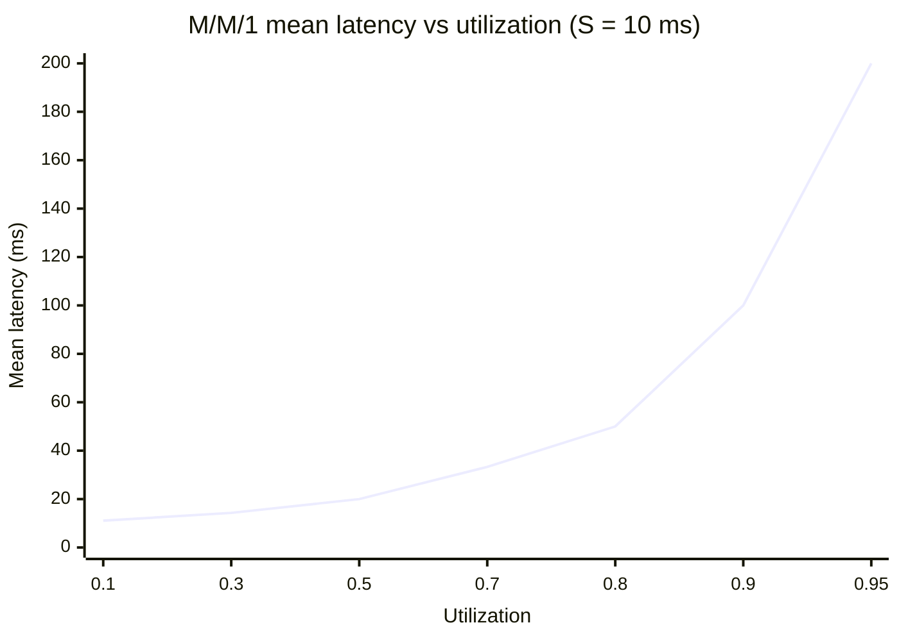
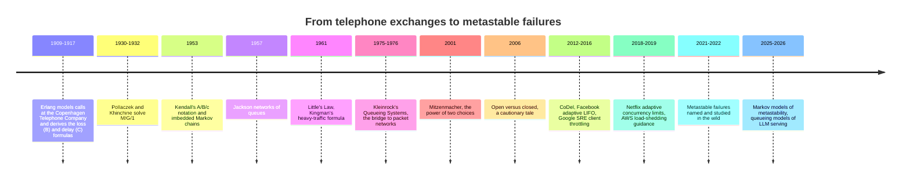
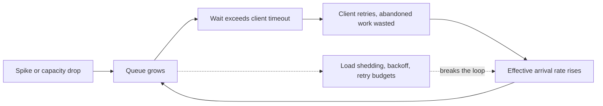

---
tags:
  - distributed-systems
  - queueing-theory
  - performance
  - capacity-planning
  - overload
  - load-balancing
  - foundations
status: complete
sources:
  - https://people.cs.umass.edu/~emery/classes/cmpsci691st/readings/OS/Littles-Law-50-Years-Later.pdf
  - https://www.informs.org/Explore/History-of-O.R.-Excellence/O.R.-Methodologies/Queueing-Models
  - https://www.informs.org/Explore/History-of-O.R.-Excellence/Biographical-Profiles/Erlang-Agner-Krarup
  - https://en.wikipedia.org/wiki/Agner_Krarup_Erlang
  - https://projecteuclid.org/euclid.aoms/1177728975
  - https://en.wikipedia.org/wiki/Pollaczek%E2%80%93Khinchine_formula
  - https://en.wikipedia.org/wiki/Kingman%27s_formula
  - https://www.cs.cmu.edu/~harchol/PerformanceModeling/book.html
  - https://www.usenix.org/legacy/event/nsdi06/tech/full_papers/schroeder/schroeder_html/index.html
  - https://www.eecs.harvard.edu/~michaelm/postscripts/tpds2001.pdf
  - https://www.envoyproxy.io/docs/envoy/latest/intro/arch_overview/upstream/load_balancing/load_balancers
  - https://brooker.co.za/blog/2020/08/06/erlang.html
  - https://brooker.co.za/blog/2021/08/05/utilization.html
  - https://brooker.co.za/blog/2025/05/20/icpe
  - https://www.perfdynamics.com/Manifesto/USLscalability.html
  - https://datatracker.ietf.org/doc/html/draft-ietf-aqm-codel
  - https://queue.acm.org/detail.cfm?id=2839461
  - https://sre.google/sre-book/handling-overload/
  - https://builder.aws.com/content/3Eun1EEyX6p2e3VYNyRLSJzLuMV/using-load-shedding-to-avoid-overload
  - https://netflixtechblog.medium.com/performance-under-load-3e6fa9a60581
  - https://www.uber.com/en-TR/blog/from-static-rate-limiting-to-intelligent-load-management/
  - https://www.usenix.org/system/files/osdi22-huang-lexiang.pdf
  - https://cdn.amazon.science/a4/ff/894a054e485f9d80936e796fbd07/analyzing-metastable-failures.pdf
  - https://arxiv.org/pdf/2510.03551
  - https://corp.roblox.com/publications/modeling-metastability
  - https://arxiv.org/html/2606.00942v1
  - https://arxiv.org/abs/2504.07347
  - https://icml.cc/virtual/2026/poster/66051
created: 2026-11-28
updated: 2026-11-28
---

## Table Of Contents

---

- [[#TL;DR|TL;DR]]
- [[#The Problem|The Problem]]
- [[#Foundations|Foundations]]
    - [[#The Vocabulary|The Vocabulary]]
    - [[#Little's Law|Little's Law]]
    - [[#The M/M/1 Queue and the Hockey Stick|The M/M/1 Queue and the Hockey Stick]]
    - [[#Variability, Pollaczek-Khinchine and Kingman|Variability, Pollaczek-Khinchine and Kingman]]
    - [[#Open vs Closed Systems|Open vs Closed Systems]]
- [[#How We Got Here|How We Got Here]]
- [[#How It Works|How It Works]]
    - [[#Sizing Pools with Little's Law|Sizing Pools with Little's Law]]
    - [[#Many Servers, Erlang C and Pooling|Many Servers, Erlang C and Pooling]]
    - [[#Load Balancing, the Power of Two Choices|Load Balancing, the Power of Two Choices]]
    - [[#Scalability Curves, Amdahl and the USL|Scalability Curves, Amdahl and the USL]]
    - [[#Admission Control and Queue Management|Admission Control and Queue Management]]
    - [[#Retries, Feedback and Metastability|Retries, Feedback and Metastability]]
- [[#Where It Is Now|Where It Is Now]]
- [[#Trade-offs & Open Problems|Trade-offs & Open Problems]]
- [[#Resources|Resources]]
- [[#Related Notes|Related Notes]]

## ***TL;DR***
---
*Queueing theory is the math of waiting: how many requests pile up, how long they wait, and why both explode as a server gets busy. A handful of results from it explain most of what goes wrong when real systems get loaded, and they tell you how to size pools, balance load and shed work before it is too late.*

- **Little's Law.** Average work in flight equals arrival rate times average time in the system, $L = \lambda W$. It holds for any arrival pattern, service pattern or scheduling order, as long as the averages exist ([Little, 2011](https://people.cs.umass.edu/~emery/classes/cmpsci691st/readings/OS/Littles-Law-50-Years-Later.pdf)).
- **Latency is nonlinear in utilization.** For the simplest queue, mean response time is $S/(1-\rho)$: going from 50% to 90% busy multiplies latency by 5, and 90% to 99% by 10 again. Brooker: raising utilization "increases queue depth, which increases latency. By a lot" ([Latency Sneaks Up On You](https://brooker.co.za/blog/2021/08/05/utilization.html)).
- **Variability costs as much as load.** Waiting time scales with how uneven arrivals and service times are (Pollaczek-Khinchine, Kingman). Halving variance can buy as much as adding servers.
- **Pooling and choice are cheap wins.** One shared queue in front of many servers beats separate queues (Erlang C), and asking just two random servers for their queue length cuts waiting exponentially compared with picking one at random ([Mitzenmacher, 2001](https://www.eecs.harvard.edu/~michaelm/postscripts/tpds2001.pdf)).
- **Benchmarks lie gently.** Closed-loop load generators slow down when the server does, so they report latencies that can be an order of magnitude better than an open system's at the same load ([Schroeder et al., NSDI 2006](https://www.usenix.org/legacy/event/nsdi06/tech/full_papers/schroeder/schroeder_html/index.html)).
- **Overload control is applied queueing theory.** CoDel, adaptive LIFO, adaptive concurrency limits and client-side throttling all bound waiting time rather than queue length, because waiting time is what users feel.
- **Now (Nov 2026):** Queueing models are back in fashion for two reasons. Metastable failures are being analyzed as Markov chains (AWS's HotOS 2025 toolchain and its 2025 formal follow-up; a May 2026 causal account from Cornell and Penn), and LLM serving is being modeled as batched queues with memory limits (ICML 2026, and Dai et al.'s throughput-optimality results revised May 2026).

## ***The Problem***
---
*Every system has work arriving and a finite rate at which it can finish that work. The gap between the two, moment to moment, becomes a queue, and the queue becomes latency, timeouts, retries and outages.*

Picture a service whose servers can each handle 100 requests per second. Traffic averages 80 per second. On paper it is 80% busy with 20% to spare. In practice:

- Requests don't arrive evenly. Some milliseconds see five at once, others none. The bunched ones wait.
- Requests don't cost the same. A cache miss takes 50 times longer than a hit, and everything behind it waits too.
- The queue doesn't drain instantly when the burst ends; it drains at only the spare 20 requests per second.
- When the wait passes the client's timeout, the client gives up and retries, so the server now receives the same work twice, and the work it already did for the abandoned request was wasted.

The result is that a system with "20% headroom" can show p99 latencies many times its service time, and a short spike can tip it into a state it can't recover from by itself. Queueing theory gives the numbers behind each of those bullets, so you can predict them instead of discovering them in production.

**Why it is a distributed systems problem.** Every hop in a call graph is a queue: the socket backlog, the thread pool, the connection pool, the disk, the lock. Queues in series add their waits, retries at each layer multiply load ([[Reliability Patterns#Retries Multiply|Retries Multiply]]), and a slow replica turns into a queue that the [[Gray and Fail-Slow Failures|fail-slow]] literature keeps rediscovering. The same math sizes [[Message Queues]], [[Cluster Scheduling|scheduler]] backlogs, [[Cluster Metadata and Routing|metadata tiers]] and [[GPU Cluster Infrastructure|GPU inference fleets]].

## ***Foundations***
---
*Five ideas carry the topic: the names for the parts of a queue, Little's Law, the M/M/1 hockey stick, why variability matters as much as load, and the difference between open and closed systems. Everything later is built from these.*

### The Vocabulary

*A queue is described by how work arrives, how long it takes, how many servers there are and in what order work is picked. Kendall's shorthand packs that into a few letters.*

| Symbol | Meaning | Example |
|---|---|---|
| $\lambda$ | Arrival rate | 800 requests/s |
| $S$, $\mu = 1/S$ | Mean service time and service rate | 1 ms per request, so 1,000/s |
| $c$ | Number of servers (threads, cores, replicas) | 8 worker threads |
| $\rho = \lambda / (c\mu)$ | Utilization, the fraction of time servers are busy | 800 / 8,000 = 10% |
| $W$, $W_q$ | Mean time in system, and mean time waiting before service ($W = W_q + S$) | 1.2 ms, 0.2 ms |
| $L$, $L_q$ | Mean number in system, and mean number waiting | |
| $C_a^2$, $C_s^2$ | Squared coefficient of variation (variance over mean squared) of interarrival and service times | 1 for exponential, 0 for constant |

**Kendall notation** A/B/c, introduced in Kendall's 1953 paper ([Annals of Mathematical Statistics](https://projecteuclid.org/euclid.aoms/1177728975)), names the arrival process, the service distribution and the server count. M means Markovian (Poisson arrivals or exponential service), D deterministic, G general. So M/M/1 is Poisson arrivals, exponential service, one server; M/G/1 allows any service distribution; G/G/c is the general case with $c$ servers. Extra letters add a capacity limit (M/M/1/K drops arrivals once K are present) or a discipline (FCFS, processor sharing, LIFO, SRPT).

A queue is **stable** only if $\rho < 1$: the servers must, on average, finish work faster than it arrives. At $\rho \ge 1$ the queue grows without bound, however clever the scheduling.

### Little's Law

*The one law that needs no assumptions about distributions. It ties together the three numbers you can measure, so knowing two gives you the third.*

$$
L = \lambda W
$$

*In plain English:* the average number of things inside a system equals how fast they arrive times how long each one stays. John Little proved it in 1961 ("A proof for the queuing formula: L = λW", *Operations Research* 9(3)); his 50th-anniversary review stresses that it "holds under remarkably general conditions", independent of queue discipline, and needs no assumption about service at all, only time spent inside. Over a finite measurement window it is "numerically exact" ([Little, 2011](https://people.cs.umass.edu/~emery/classes/cmpsci691st/readings/OS/Littles-Law-50-Years-Later.pdf)).

**Worked example.** A service handles 2,000 requests/s with a mean latency of 50 ms. Then $L = 2000 \times 0.05 = 100$ requests are in flight on average. If its worker pool has 64 threads, that pool can't hold the load: requests are waiting in a socket queue somewhere, and the measured 50 ms includes that wait. Turn it around: with 64 threads and 30 ms of real work per request, the most this box can do is $64 / 0.03 \approx 2{,}133$ requests/s.

Little uses exactly this trick in his review: a Microsoft benchmark measured latency, he derived queue length from it, and the queue "goes up approximately linearly and then climbs steeply, indicating failure", with requests "essentially dumped" past about 18 requests/s.

Little's Law works on any boundary you draw: one thread pool, one server, a whole region, a Kafka consumer group (backlog = produce rate × lag; see [[Message Queues#Backlogs and Little's Law|Backlogs and Little's Law]]), or the bytes in flight to [[Databases on Object Storage|object storage]].

### The M/M/1 Queue and the Hockey Stick

*The simplest queue with randomness already shows the most important fact in performance engineering: latency rises gently, then vertically, as utilization approaches one.*

For M/M/1 (Poisson arrivals, exponential service, one FCFS server):

$$
W = \frac{S}{1-\rho}, \qquad L = \frac{\rho}{1-\rho}
$$

*In plain English:* the time you spend is your own service time stretched by $1/(1-\rho)$. At 50% busy you wait as long as you are served; at 90% busy you spend 10 service times in the system. The number in the system follows from Little's Law, $L = \lambda W = \rho/(1-\rho)$.

**Worked example.** A server with $S = 10$ ms ($\mu = 100$/s):

| Load $\lambda$ | $\rho$ | Mean latency $W$ | Mean in system $L$ |
|---|---|---|---|
| 50/s | 0.50 | 20 ms | 1 |
| 80/s | 0.80 | 50 ms | 4 |
| 90/s | 0.90 | 100 ms | 9 |
| 95/s | 0.95 | 200 ms | 19 |
| 99/s | 0.99 | 1,000 ms | 99 |

Two consequences people relearn often:

- **Tails grow with the mean.** In FCFS M/M/1 the time in system is exponential with rate $\mu - \lambda$, so p99 is $\ln(100) \approx 4.6$ times the mean. At 90/s above, mean 100 ms means p99 about 460 ms. This is why Brooker calls high-percentile latency "a good (leading) indicator of pending overload" but "a bad way to measure efficiency": efficiency work lowers $\rho$ and makes tails look great, until traffic grows back into the curve ([Latency Sneaks Up On You](https://brooker.co.za/blog/2021/08/05/utilization.html)). [[Tail Latency and Hedging]] covers what fan-out does to those tails.
- **Spare capacity is the recovery rate.** A backlog of $B$ requests built up during a spike drains at only $\mu - \lambda$. At 90/s with a 1,000-request backlog, that is 100 seconds of elevated latency after the spike ends, which is why [[Hot Keys and Cache Stampedes|stampedes]] and [[Overcommit and Vertical Autoscaling|overcommitted]] machines recover so slowly.

### Variability, Pollaczek-Khinchine and Kingman

*Exponential service times are a convenient fiction. With real distributions, waiting time grows with the variance of the work, so a few huge requests can hurt everyone more than a higher average load would.*

For M/G/1, the **Pollaczek-Khinchine formula** (Pollaczek 1930, recast by Khinchine in 1932, per [Wikipedia](https://en.wikipedia.org/wiki/Pollaczek%E2%80%93Khinchine_formula)) gives the mean wait before service:

$$
W_q = \frac{\rho}{1-\rho} \cdot \frac{1 + C_s^2}{2} \cdot S
$$

For G/G/1, **Kingman's formula** (Kingman 1961, the "VUT" equation: variability × utilization × time, per [Wikipedia](https://en.wikipedia.org/wiki/Kingman%27s_formula)) approximates it in heavy traffic:

$$
W_q \approx \left(\frac{C_a^2 + C_s^2}{2}\right) \left(\frac{\rho}{1-\rho}\right) S
$$

*In plain English:* waiting time is a product of three things you can attack separately. Lower utilization, lower variability in arrivals or service, or shorter service. Constant service times ($C_s^2 = 0$, M/D/1) halve the wait of exponential ones; heavy-tailed service multiplies it.

**Worked example.** $S = 10$ ms, $\rho = 0.8$, Poisson arrivals ($C_a^2 = 1$):

| Service times | $C_s^2$ | $W_q$ |
|---|---|---|
| All exactly 10 ms | 0 | 0.5 × 4 × 10 = 20 ms |
| Exponential | 1 | 1 × 4 × 10 = 40 ms |
| Mostly fast, some very slow (e.g. cache misses) | 4 | 2.5 × 4 × 10 = 100 ms |

The third row is as bad as running the exponential case at $\rho \approx 0.91$. Splitting slow requests onto their own queue (Uber's "slow queue" below), capping request size, or paginating large scans all attack $C_s^2$ instead of buying servers. Harchol-Balter's book devotes a whole part to high-variability and heavy-tailed workloads and to size-based scheduling like SRPT, which exists precisely to stop short jobs waiting behind long ones ([Performance Modeling and Design of Computer Systems](https://www.cs.cmu.edu/~harchol/PerformanceModeling/book.html)).

### Open vs Closed Systems

*Whether new work waits for old work to finish changes the answer to every performance question. Real services are mostly open; most benchmarks are closed, and therefore too optimistic.*

Schroeder, Wierman and Harchol-Balter's NSDI 2006 paper defines the three models ([paper](https://www.usenix.org/legacy/event/nsdi06/tech/full_papers/schroeder/schroeder_html/index.html)):

| Model | How work arrives | Example |
|---|---|---|
| **Closed** | A fixed number $N$ of users; each sends a request only after the previous one completes plus a think time $Z$ | A load generator with 100 threads in a loop |
| **Open** | New requests arrive at rate $\lambda$ regardless of completions | Internet traffic from millions of independent users |
| **Partly open** | Users arrive openly, then send follow-ups with probability $p$ | A browsing session |

In a closed system, Little's Law over the whole loop gives the **interactive response time law**, $X = N / (R + Z)$. If the server slows, throughput $X$ drops automatically, so load backs off and the queue can never exceed $N$. An open system has no such brake.

**Worked example.** 100 closed-loop users, think time 9 s, response time 1 s: $X = 100/10 = 10$ requests/s. Server slows to 2 s: $X = 100/11 \approx 9.1$/s, so the server gets 9% less load just when it needs it. An open system at 10/s keeps sending 10/s while the queue grows.

The paper's findings, quoted: "For a given load, mean response times are significantly lower in closed systems than in open systems"; variability and scheduling matter far less in closed systems; and a partly-open system behaves open with about 5 or fewer requests per session and closed with about 10 or more. Of the 33 benchmarks and load generators it surveyed, 24 were closed. Brooker's 2025 ICPE keynote builds on it: "Most cloud systems are *open*", "Most benchmarks are *closed*", and "Closed benchmarks are too kind to realistically reflect how performance changes with load" ([Good Performance for Bad Days](https://brooker.co.za/blog/2025/05/20/icpe)).

## ***How We Got Here***
---
*Queueing theory began in telephone exchanges, matured in operations research and computer networks, and is now being pulled back into systems practice by overload incidents and AI serving.*

- **Telephony (1909 to 1917).** Agner Krarup Erlang joined the Copenhagen Telephone Company in 1908, published "The Theory of Probabilities and Telephone Conversations" in 1909 and gave his loss and waiting-time formulas in 1917; telephone companies including the British Post Office soon used them ([INFORMS, Erlang](https://www.informs.org/Explore/History-of-O.R.-Excellence/Biographical-Profiles/Erlang-Agner-Krarup); [INFORMS, Queueing Models](https://www.informs.org/Explore/History-of-O.R.-Excellence/O.R.-Methodologies/Queueing-Models)). In 1946 the CCITT named the international unit of telephone traffic, the unit of offered load used below, the erlang ([Wikipedia](https://en.wikipedia.org/wiki/Agner_Krarup_Erlang)).
- **Mathematical foundations (1930s to 1960s).** Pollaczek and Khinchine handled arbitrary service times; Kendall gave the notation; Jackson (1957) showed networks of queues could be analyzed node by node; Little (1961) proved $L = \lambda W$ ([INFORMS](https://www.informs.org/Explore/History-of-O.R.-Excellence/O.R.-Methodologies/Queueing-Models)).
- **Computers and networks (1970s).** Kleinrock's two-volume *Queueing Systems* (1975 to 1976) made queueing central to data communications and the Internet ([INFORMS](https://www.informs.org/Explore/History-of-O.R.-Excellence/O.R.-Methodologies/Queueing-Models)).
- **Back into computer science (2000s to 2010s).** Harchol-Balter's 2013 book set out to "bring queueing theory decisively back to computer science" ([book page](https://www.cs.cmu.edu/~harchol/PerformanceModeling/book.html)), and the practical results (two choices, open vs closed, CoDel) spread through engineering posts more than textbooks.
- **Overload as the main enemy (2015 onward).** Facebook's *Fail at Scale* (2015), Google's SRE book (2016), AWS's Builders' Library (2019) and the metastable-failure papers (HotOS 2021, OSDI 2022) reframed reliability around queues that grow when they shouldn't. See [[Reliability Patterns]].

## ***How It Works***
---
*How the theory turns into engineering decisions: sizing pools, choosing how many servers share a queue, routing load, reading scalability curves, deciding what to reject, and keeping retries from turning a spike into an outage.*

### Sizing Pools with Little's Law

*Every pool (threads, connections, GPU batch slots) should be sized from arrival rate and holding time, not from a round number.*

| Pool | $\lambda$ | Holding time $W$ | Needed $L = \lambda W$ |
|---|---|---|---|
| Database connections | 3,000 queries/s | 4 ms per query | 12 connections busy on average |
| HTTP worker threads | 2,000 requests/s | 50 ms (including downstream calls) | 100 threads |
| Kafka consumer lag | 50,000 msgs/s produced | 30 s acceptable lag | 1.5 M messages of backlog budget |

Two refinements. First, Little gives the **average**; size above it so bursts fit, using the M/M/c math below to pick the margin. Second, holding time includes everything the request holds the slot for, including waiting on a downstream call. A pool sized for 4 ms queries starves if one slow dependency makes queries hold connections for 40 ms, which is how a [[Gray and Fail-Slow Failures|fail-slow]] dependency spreads.

### Many Servers, Erlang C and Pooling

*Putting servers behind one shared queue lets an idle server help a busy one. The gain is large at modest scale and is why big pools can run hotter at the same latency.*

For M/M/c the probability an arrival must wait at all is **Erlang C**:

$$
P_{\text{wait}} = \frac{\dfrac{A^c}{c!}\dfrac{c}{c-A}}{\displaystyle\sum_{k=0}^{c-1}\frac{A^k}{k!} + \frac{A^c}{c!}\frac{c}{c-A}}, \qquad W_q = \frac{P_{\text{wait}}}{c\mu - \lambda}
$$

where $A = \lambda / \mu$ is the offered load in erlangs. *In plain English:* given how many servers' worth of work arrives ($A$) and how many servers you have ($c$), this is the chance a request finds every server busy, and the mean wait follows from it.

**Worked example (Brooker's).** Service time 1 s, 5 servers, 2.5 requests/s (50% busy): about 13% of requests wait. Double both, 10 servers at 5/s, still 50% busy: only 3.6% wait, and mean latency falls toward the 1 s service time ([Surprising Economics of Load-Balanced Systems](https://brooker.co.za/blog/2020/08/06/erlang.html)). Recomputed here: mean latency is 1.052 s for 5 servers and 1.007 s for 10.

**Pooling vs splitting.** Two servers each at 80%:

| Layout | Model | Mean latency (in service times) |
|---|---|---|
| Two separate queues, requests split 50/50 | Two M/M/1 at $\rho = 0.8$ | 5.0 |
| One shared queue feeding both | One M/M/2 at $\rho = 0.8$ | 2.78 |

Same hardware, same load, latency almost halved. This is the queueing argument against per-tenant hard partitions (balanced in [[Resource Fairness]]) and for work-stealing schedulers.

**Square-root staffing.** For large pools, the number of servers needed to keep waits rare grows as $c \approx A + \beta\sqrt{A}$, the result Harchol-Balter's book covers under capacity provisioning ([book](https://www.cs.cmu.edu/~harchol/PerformanceModeling/book.html)). With $A = 100$ erlangs and $\beta = 1$, 110 servers (91% busy) leave only about 24% of requests waiting, and those wait on average about 2% of a service time. The spare capacity needed grows like $\sqrt{A}$, not like $A$, so a pool 100 times larger needs only 10 times the headroom.

### Load Balancing, the Power of Two Choices

*You don't need global knowledge to balance load well. Sampling two servers and picking the less loaded one captures most of the benefit of always picking the best.*

Mitzenmacher's supermarket model: $n$ servers, each arrival samples $d$ at random and joins the shortest queue. With $d = 1$ (random) the expected time in system is $1/(1-\lambda)$ service times; with $d \ge 2$ "there is an exponential improvement", and $d = 3$ is "only a constant factor better than $d = 2$" ([Mitzenmacher, IEEE TPDS 2001](https://www.eecs.harvard.edu/~michaelm/postscripts/tpds2001.pdf)). In the large-$n$ limit, $T_d = \sum_{i \ge 1} \lambda^{(d^i - d)/(d-1)}$:

| Load $\lambda$ | Random ($d = 1$) | Two choices | Three choices |
|---|---|---|---|
| 0.90 | 10.0 | 2.61 | 2.03 |
| 0.99 | 100.0 | 5.43 | 3.86 |

*(Mean time in system, in units of mean service time, computed from the paper's limiting formula.)* The maximum queue length drops from roughly $\log n / \log\log n$ to $\log\log n / \log d$. Envoy's least-request balancer uses exactly this: with equal host weights it samples 2 random hosts by default and cites Mitzenmacher for performing almost as well as a full scan ([Envoy docs](https://www.envoyproxy.io/docs/envoy/latest/intro/arch_overview/upstream/load_balancing/load_balancers)). Sampling a few candidates instead of scanning everything is the same idea behind sampling-based [[Cluster Scheduling|schedulers]]. The catch is staleness: if many balancers act on the same old load reports, they herd onto the same "least loaded" server.

### Scalability Curves, Amdahl and the USL

*Adding parallelism helps until shared resources become the queue. The Universal Scalability Law fits that curve with two numbers and tells you where it peaks.*

Gunther's **Universal Scalability Law** ([USL](https://www.perfdynamics.com/Manifesto/USLscalability.html)):

$$
C(N) = \frac{N}{1 + \alpha (N-1) + \beta N (N-1)}, \qquad N^* = \sqrt{\frac{1-\alpha}{\beta}}
$$

*In plain English:* relative throughput with $N$ workers is ideal $N$, divided by a contention term $\alpha$ (waiting for a shared resource, a queue) and a coherency term $\beta$ (workers syncing with each other, which grows with pairs of workers). With $\beta = 0$ it is Amdahl's law and flattens at $1/\alpha$; with $\beta > 0$ throughput peaks at $N^*$ and then *falls*. Gunther shows both are equivalent to the synchronous queueing bound of a machine-repairman model, so USL is queueing theory in disguise.

**Worked example.** $\alpha = 0.05$, $\beta = 0.001$: $N^* = \sqrt{0.95/0.001} \approx 31$. At 31 workers $C \approx 31/(1 + 1.5 + 0.93) \approx 9.0$; at 64 workers $C \approx 64/(1 + 3.15 + 4.03) \approx 7.8$. Adding threads past 31 makes it slower. AWS's load-shedding guidance cites USL and Amdahl for why overloaded servers lose throughput to contention, context switching and GC ([Builders' Library](https://builder.aws.com/content/3Eun1EEyX6p2e3VYNyRLSJzLuMV/using-load-shedding-to-avoid-overload)).

### Admission Control and Queue Management

*If a request will wait longer than anyone will wait for it, accepting it only wastes capacity. Modern overload control bounds time in queue and in-flight work, and it decides who gets rejected.*

**Throughput vs goodput.** Throughput is what reaches the server; goodput is "the subset of the throughput that is handled without errors" and fast enough to be useful. If median latency equals the client timeout, about half of requests fail even though the server is working flat out. Shedding excess keeps goodput steady as load rises ([Builders' Library](https://builder.aws.com/content/3Eun1EEyX6p2e3VYNyRLSJzLuMV/using-load-shedding-to-avoid-overload)).

| Technique | Signal | Rule | Source |
|---|---|---|---|
| **CoDel** | Minimum sojourn time over an interval | If even the shortest wait stays above TARGET (5 ms) for INTERVAL (100 ms), start dropping, next drop at $t + \text{INTERVAL}/\sqrt{\text{count}}$ | [RFC 8289 draft](https://datatracker.ietf.org/doc/html/draft-ietf-aqm-codel) |
| **Facebook's CoDel for RPC** | Has the queue been empty recently? | If not empty in the last N = 100 ms, queue timeout is M = 5 ms; otherwise N | [Fail at Scale](https://queue.acm.org/detail.cfm?id=2839461) |
| **Adaptive LIFO** | A queue is forming | Switch from FIFO to LIFO so fresh requests, whose users are still waiting, go first | [Fail at Scale](https://queue.acm.org/detail.cfm?id=2839461) |
| **Adaptive concurrency limit** | Latency gradient $RTT_{noload}/RTT_{actual}$ | $\text{newLimit} = \text{limit} \times \text{gradient} + \sqrt{\text{limit}}$ | [Netflix, 2018](https://netflixtechblog.medium.com/performance-under-load-3e6fa9a60581) |
| **Client-side throttling** | Requests vs accepts over two minutes | Reject locally with probability $\max(0, \frac{\text{requests} - K \cdot \text{accepts}}{\text{requests} + 1})$, $K = 2$ preferred | [Google SRE, ch. 21](https://sre.google/sre-book/handling-overload/) |
| **Deadline check** | Remaining time budget propagated per hop | Drop a dequeued request whose deadline has already passed | [Builders' Library](https://builder.aws.com/content/3Eun1EEyX6p2e3VYNyRLSJzLuMV/using-load-shedding-to-avoid-overload) |

Why these signals work, in queueing terms:

- **Time, not length.** CoDel separates "good queue", a burst that drains within about a round trip, from "bad queue", a standing queue that adds delay without adding throughput. Queue length can't tell them apart when service times vary; sojourn time can.
- **Concurrency is Little's Law in reverse.** A concurrency limit caps $L$. With $L$ capped, any rise in $W$ forces $\lambda$ (accepted rate) down instead of letting the queue grow. Netflix's gradient estimates whether the extra in-flight work is being served or just queued.
- **Client throttling cuts the cost of rejection.** Even a fast reject costs the server something. In the SRE example, a client that sent 1,000 requests with 400 accepted rejects $(1000 - 800)/1001 \approx 20\%$ of new requests itself, before they reach the overloaded backend.
- **Who gets rejected matters.** Google tags requests CRITICAL_PLUS, CRITICAL, SHEDDABLE_PLUS and SHEDDABLE and sheds from the bottom ([SRE book](https://sre.google/sre-book/handling-overload/)); AWS prioritizes health checks, requests that finish workflows and later pages of paginated reads ([Builders' Library](https://builder.aws.com/content/3Eun1EEyX6p2e3VYNyRLSJzLuMV/using-load-shedding-to-avoid-overload)). [[Resource Fairness]] covers fair shares among tenants.

### Retries, Feedback and Metastability

*A queue with retries has two stable states: empty and fast, or full and failing. Queueing models now predict where the tipping point is and how long recovery takes.*

A plain queue recovers once load drops below capacity. Add timeouts and retries and the arrival rate depends on the queue: a long queue causes timeouts, timeouts cause retries, retries lengthen the queue. Huang et al. found retries were the sustaining effect in more than 50% of 22 metastable incidents ([OSDI 2022](https://www.usenix.org/system/files/osdi22-huang-lexiang.pdf)); the failure taxonomy is in [[Reliability Patterns#Metastable Failures|Metastable Failures]].

**Modeling it as a Markov chain.** AWS's HotOS 2025 paper models a request-response server as a continuous-time Markov chain whose state is (queue length, number of requests waiting to retry, the "orbit"). Drawing the most likely transitions as a vector field shows a safe region that drains toward empty and a tipping region that feeds itself ([Isaacs et al., HotOS 2025](https://cdn.amazon.science/a4/ff/894a054e485f9d80936e796fbd07/analyzing-metastable-failures.pdf)).

**Worked example (from that paper).** One thread, capacity 10 RPS, queue bound 150. Clients send 5 RPS with a 5 s timeout and up to 5 retries. A trigger raises load to 15 RPS for 10 minutes, then load returns to 5 RPS for 30 minutes.

1. During the trigger, arrivals exceed capacity by 5 RPS, so the queue climbs about 300 requests per minute until it hits the bound.
2. Queued requests now wait far longer than 5 s; their clients time out and retry, so many accepted requests are already abandoned when served.
3. The model's inflection point is near queue length 40 with at least 30 requests retrying. Past it, retries alone keep the server busy.
4. With queue bound 150 the simulation stays stuck after load returns to 5 RPS, half of capacity. With queue bound 35 the queue can't reach the inflection point, excess requests are rejected at once instead of waiting past their timeout, and the system recovers.

The lesson is a queueing one: the bigger buffer, meant to absorb bursts, is what made the bad state possible. A follow-up formalizes metastability through escape probabilities and the near-zero eigenvalues of the chain, predicts recovery times, and shows recovery time growing sharply near the metastable parameter region; in its running example ($\mu = 10$, $\lambda = 9.5$, 9 s timeout, 3 retries), throttling arrivals to 8 RPS recovers quickly while 9.5 RPS does not ([Alvaro et al., arXiv Oct 2025](https://arxiv.org/pdf/2510.03551)).

A simpler threshold appears in Cornell and Penn's May 2026 retry-storm example: with server capacity $s$, client load $r$ and retry timeout $T$, pending retries above $(s - r) \cdot T$ outrun the spare capacity. For $s = 35$, $r = 30$, $T = 4$ that is 20 pending requests; exponential backoff, or serving original requests ahead of retries, removes the failure ([Farahbakhsh et al., 2026](https://arxiv.org/html/2606.00942v1)).

## ***Where It Is Now***
---
*As of late November 2026, queueing theory is moving from textbook background back into tooling: metastability models at AWS and Roblox, stability results for LLM serving, and production overload controllers that are explicitly built on Little's Law.*

- **Metastability gets models, not just postmortems (2025 to 2026).** HotOS 2025 had two modeling papers: AWS's CTMC-plus-simulation toolchain, whose stated goal is to rule out metastable failures across its services ([Isaacs et al.](https://cdn.amazon.science/a4/ff/894a054e485f9d80936e796fbd07/analyzing-metastable-failures.pdf)), and Haeberlen's simple model for predicting whether metastable states exist ([Modeling Metastability, Roblox](https://corp.roblox.com/publications/modeling-metastability)). The formal follow-up reports qualitative analysis in milliseconds per server, and that modeling up to three servers sufficed in industrial use ([arXiv 2510.03551](https://arxiv.org/pdf/2510.03551)). Cornell and Penn (arXiv, May 2026) argue the overload framing is incomplete and recast metastable failures as cycles of components that each stabilize alone but destabilize each other, with a DSL (Nyx) to reproduce them ([arXiv 2606.00942](https://arxiv.org/html/2606.00942v1)).
- **LLM serving as a queueing network.** Dai, Deng, Li and Peng show that a broad class of work-conserving batch schedulers reaches maximum throughput for LLM requests and agent DAGs; Orca and Sarathi-Serve are throughput-optimal, while FasterTransformer and vanilla vLLM are not maximally stable (v3, May 2026, [arXiv 2504.07347](https://arxiv.org/abs/2504.07347)). An ICML 2026 paper adds KV-cache memory to the model and derives stability conditions that matched real GPU deployments typically within 10%, aimed at sizing clusters from arrival rates ([Nie, Si, Zhou](https://icml.cc/virtual/2026/poster/66051)). See [[LLM Serving]] and the planned [[Fair LLM Serving]].
- **Production overload control.** Uber (Apr 2026) describes moving Docstore and Schemaless from static rate limits to Cinnamon: CoDel with separate read, write and slow queues, adaptive LIFO, in-flight limits justified by Little's Law, six priority tiers, and a PID controller tuning queue timeouts. Under overload it reports about 80% higher throughput and about 70% lower p99 than token buckets ([Uber](https://www.uber.com/en-TR/blog/from-static-rate-limiting-to-intelligent-load-management/)). The control-loop side of that is in [[Reconciliation and Control Loops]].
- **A push to test under overload.** Brooker's 2025 ICPE keynote argues the performance community is "overly focused on *happy case* performance" and that "a lack of performance predictability under overload is a big driver of unavailability", naming open-vs-closed benchmarking and metastability as the gaps ([Good Performance for Bad Days](https://brooker.co.za/blog/2025/05/20/icpe)). That ties queueing to [[Deterministic Simulation Testing]] and [[Fault Injection and Chaos Engineering]].

## ***Trade-offs & Open Problems***
---
*The formulas are exact for idealized queues and approximate for real ones. The useful skill is knowing which conclusions survive the approximation and which need measurement or simulation.*

| Choice | Buys | Costs |
|---|---|---|
| Run hotter (higher $\rho$) | Fewer machines | Latency and tails grow as $1/(1-\rho)$; slower recovery; closer to metastable regions |
| Bigger queues and buffers | Absorb bursts without rejecting | Longer waits, wasted work on abandoned requests, and (per HotOS 2025) room for the bad stable state |
| Shared pool | Lower latency at the same utilization (Erlang C) | Noisy neighbors; needs fairness controls |
| Separate pools per class | Isolation, predictable SLOs | Stranded capacity; each small pool needs its own $\sqrt{A}$ headroom |
| FIFO | Fair in arrival order | Serves the oldest, most likely abandoned, requests first under overload |
| LIFO under load | Serves requests whose users are still waiting | Old requests starve and time out |
| Least-loaded routing | Exponentially shorter queues with two choices | Stale load data causes herding |

Open problems:

- **Real distributions.** Service times are closer to log-normal or heavy-tailed than exponential, as Brooker notes for Erlang C ([blog](https://brooker.co.za/blog/2020/08/06/erlang.html)), and arrivals are bursty and correlated. Closed forms run out quickly; simulation and calibration fill the gap, which is the AWS toolchain's approach.
- **Networks of queues with feedback.** Jackson networks assume independence that retries, shared caches and timeouts break. The metastability work is, in effect, building tractable models of exactly those feedbacks, and it still loses precision as work amplification grows ([HotOS 2025](https://cdn.amazon.science/a4/ff/894a054e485f9d80936e796fbd07/analyzing-metastable-failures.pdf)).
- **What to measure.** Utilization averaged over a minute hides the sub-second bursts that build queues; queue length hides service-time variance; percentiles from closed-loop tests understate open-world tails. Sojourn time and in-flight count are the most robust signals the field has settled on.
- **Tuning controllers.** CoDel's 5 ms and 100 ms were chosen for TCP round trips; Facebook found the same numbers work broadly for RPC, but Uber replaced fixed timeouts with PID tuning after fixed ones shed too early. Adaptive controllers are themselves feedback loops that can oscillate.
- **Batching and memory.** LLM serving breaks the classic one-request-per-server model: work is batched, service time depends on batch composition, and KV-cache memory, not compute, often decides stability. Queueing theory for these systems is new and moving fast.

## ***Resources***
---
*Primary sources first, then practitioner posts that turn the math into practice.*

**Foundations**
- John D. C. Little, [Little's Law as Viewed on Its 50th Anniversary](https://people.cs.umass.edu/~emery/classes/cmpsci691st/readings/OS/Littles-Law-50-Years-Later.pdf), *Operations Research*, 2011.
- D. G. Kendall, [Stochastic Processes Occurring in the Theory of Queues and their Analysis by the Method of the Imbedded Markov Chain](https://projecteuclid.org/euclid.aoms/1177728975), *Annals of Mathematical Statistics*, 1953.
- Mor Harchol-Balter, [Performance Modeling and Design of Computer Systems: Queueing Theory in Action](https://www.cs.cmu.edu/~harchol/PerformanceModeling/book.html), Cambridge University Press, 2013.
- [Pollaczek-Khinchine formula](https://en.wikipedia.org/wiki/Pollaczek%E2%80%93Khinchine_formula) and [Kingman's formula](https://en.wikipedia.org/wiki/Kingman%27s_formula) (Wikipedia).
- INFORMS, [Queueing Models history](https://www.informs.org/Explore/History-of-O.R.-Excellence/O.R.-Methodologies/Queueing-Models) and [Agner Krarup Erlang](https://www.informs.org/Explore/History-of-O.R.-Excellence/Biographical-Profiles/Erlang-Agner-Krarup).

**Systems papers**
- Schroeder, Wierman, Harchol-Balter, [Open Versus Closed: A Cautionary Tale](https://www.usenix.org/legacy/event/nsdi06/tech/full_papers/schroeder/schroeder_html/index.html), NSDI 2006.
- Michael Mitzenmacher, [The Power of Two Choices in Randomized Load Balancing](https://www.eecs.harvard.edu/~michaelm/postscripts/tpds2001.pdf), IEEE TPDS, 2001.
- Huang et al., [Metastable Failures in the Wild](https://www.usenix.org/system/files/osdi22-huang-lexiang.pdf), OSDI 2022.
- Isaacs et al., [Analyzing Metastable Failures](https://cdn.amazon.science/a4/ff/894a054e485f9d80936e796fbd07/analyzing-metastable-failures.pdf), HotOS 2025.
- Alvaro et al., [Formal Analysis of Metastable Failures in Software Systems](https://arxiv.org/pdf/2510.03551), arXiv, 2025.
- Andreas Haeberlen, [Modeling Metastability](https://corp.roblox.com/publications/modeling-metastability), HotOS 2025.
- Farahbakhsh et al., [Characterizing Metastable Faults and Failures](https://arxiv.org/html/2606.00942v1), arXiv, May 2026.
- Dai, Deng, Li, Peng, [Throughput-Optimal Scheduling Algorithms for LLM Inference and AI Agents](https://arxiv.org/abs/2504.07347), arXiv, 2025 (v3 May 2026).
- Nie, Si, Zhou, [A Queueing-Theoretic Framework for Stability Analysis of LLM Inference with KV Cache Memory Constraints](https://icml.cc/virtual/2026/poster/66051), ICML 2026.

**Practice**
- Kathleen Nichols, Van Jacobson et al., [Controlled Delay Active Queue Management](https://datatracker.ietf.org/doc/html/draft-ietf-aqm-codel) (published as RFC 8289).
- Ben Maurer, [Fail at Scale](https://queue.acm.org/detail.cfm?id=2839461), ACM Queue, 2015.
- Google SRE book, [Chapter 21, Handling Overload](https://sre.google/sre-book/handling-overload/).
- David Yanacek, [Using load shedding to avoid overload](https://builder.aws.com/content/3Eun1EEyX6p2e3VYNyRLSJzLuMV/using-load-shedding-to-avoid-overload), Amazon Builders' Library, 2019.
- Netflix, [Performance Under Load](https://netflixtechblog.medium.com/performance-under-load-3e6fa9a60581), 2018.
- Uber, [From Static Rate-Limiting to Intelligent Load Management](https://www.uber.com/en-TR/blog/from-static-rate-limiting-to-intelligent-load-management/), April 2026.
- Marc Brooker, [Surprising Economics of Load-Balanced Systems](https://brooker.co.za/blog/2020/08/06/erlang.html) (2020), [Latency Sneaks Up On You](https://brooker.co.za/blog/2021/08/05/utilization.html) (2021), [Good Performance for Bad Days](https://brooker.co.za/blog/2025/05/20/icpe) (2025).
- Neil Gunther, [How to Quantify Scalability (USL)](https://www.perfdynamics.com/Manifesto/USLscalability.html).

## ***Related Notes***
---
*Where this math shows up elsewhere in the vault.*

- [[Reliability Patterns]] — Timeouts, retries, load shedding and the metastable-failure taxonomy this note models.
- [[Message Queues]] — Backlogs, lag and Little's Law for brokers.
- [[Resource Fairness]] — Fair queuing and why sharing a pool needs fairness controls.
- [[Cluster Scheduling]] — Scheduler backlogs and sampling-based placement.
- [[Gang and Topology-Aware Scheduling]] — Why waiting for whole domains grows fast near full load.
- [[Overcommit and Vertical Autoscaling]] — Running hot and what utilization near 100% does to latency.
- [[Reconciliation and Control Loops]] — Feedback control, the tool behind adaptive limits and PID-tuned shedding.
- [[Hot Keys and Cache Stampedes]] — Bursts, slow recovery and cache-driven sustaining effects.
- [[Cluster Metadata and Routing]] — Sizing metadata tiers for cold starts.
- [[Gray and Fail-Slow Failures]] — Slow components as hidden queues.
- [[Databases on Object Storage]] — Little's Law for requests in flight to object storage.
- [[GPU Cluster Infrastructure]] — Fleets where queueing models now size inference capacity.
- [[LLM Serving]] — Batched serving, the newest queueing frontier.
- [[Deterministic Simulation Testing]] — Simulation where closed forms run out.
- [[Failure Models]] — The timing assumptions that timeouts rely on.
- [[Tail Latency and Hedging]] — Fan-out, tails and hedged requests.
- [[Fair LLM Serving]] — Planned: fairness in batched LLM queues.
- [[Fault Injection and Chaos Engineering]] — Testing under overload, and why cascading failures need load plus a trigger.
- [[Zonal Isolation and Cell-Based Architecture]] — Planned: cells as bounded queues you can evacuate.
