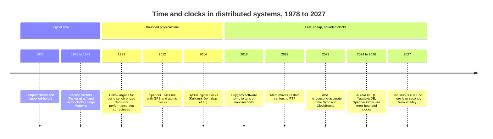
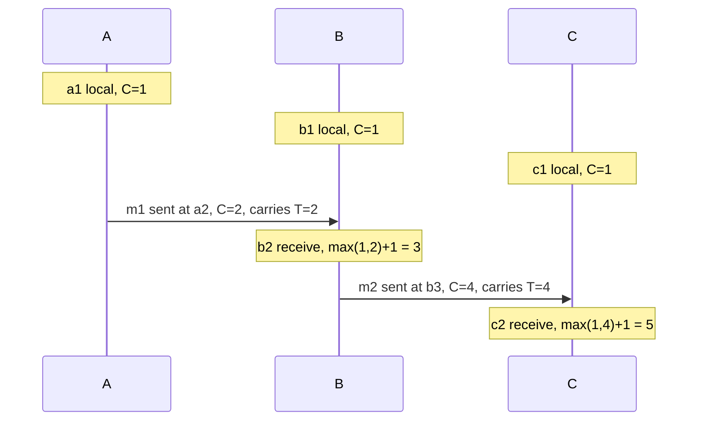
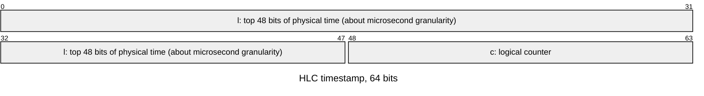
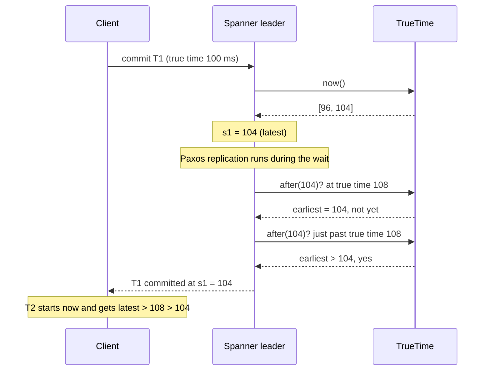

---
tags:
  - distributed-systems
  - foundations
  - time-and-clocks
status: draft
sources:
  - https://amturing.acm.org/p558-lamport.pdf
  - https://decomposition.al/blog/2023/04/08/who-invented-vector-clocks/
  - https://pages.cs.wisc.edu/~remzi/Classes/739/Fall2018/Papers/mattern89.pdf
  - https://www.cse.buffalo.edu//~demirbas/publications/hlc.pdf
  - https://www.cs.princeton.edu/courses/archive/fall15/cos518/papers/spanner.pdf
  - https://cockroachlabs.com/blog/living-without-atomic-clocks/
  - https://www.usenix.org/conference/nsdi18/presentation/geng
  - https://engineering.fb.com/2022/11/21/production-engineering/precision-time-protocol-at-meta/
  - https://engineering.fb.com/2025/02/03/production-engineering/how-precision-time-protocol-ptp-handles-leap-seconds/
  - https://aws.amazon.com/blogs/compute/its-about-time-microsecond-accurate-clocks-on-amazon-ec2-instances
  - https://github.com/aws/clock-bound
  - https://aws.amazon.com/blogs/apn/when-every-microsecond-counts-yugabytedb-amazon-time-sync-service-database-performance
  - https://aws.amazon.com/blogs/database/everything-you-dont-need-to-know-about-amazon-aurora-dsql-part-5-how-the-service-uses-clocks
  - https://www.brooker.co.za/blog/2026/07/19/dsql-paper.html
  - https://brooker.co.za/blog/2023/11/27/about-time.html
  - https://muratbuffalo.blogspot.com/2025/01/use-of-time-in-distributed-databases_14.html
  - https://docs.cloud.google.com/spanner-omni/true-time-external-consistency
  - https://jepsen.io/analyses/tigerbeetle-0.16.11
  - https://blog.cloudflare.com/how-and-why-the-leap-second-affected-cloudflare-dns/
  - https://www.bipm.org/en/cgpm-2022/resolution-4
  - https://www.bipm.org/committees/cg/cgpm/28-2026/resolution-5
  - https://www.euronews.com/2026/10/16/global-timekeeping-rules-change-leap-second-scrapped-from-2027
created: 2026-11-26
updated: 2026-11-26
---

## Table Of Contents

---

- [[#TL;DR|TL;DR]]
- [[#The Problem|The Problem]]
- [[#Foundations|Foundations]]
    - [[#Events, Processes and Messages|Events, Processes and Messages]]
    - [[#Physical Clocks Drift|Physical Clocks Drift]]
    - [[#Wall Clocks vs Monotonic Clocks|Wall Clocks vs Monotonic Clocks]]
    - [[#Partial Order vs Total Order|Partial Order vs Total Order]]
- [[#How We Got Here|How We Got Here]]
- [[#How It Works|How It Works]]
    - [[#Happened-Before|Happened-Before]]
    - [[#Lamport Clocks|Lamport Clocks]]
    - [[#Vector Clocks|Vector Clocks]]
    - [[#Synchronized Physical Clocks and Error Bounds|Synchronized Physical Clocks and Error Bounds]]
    - [[#Hybrid Logical Clocks|Hybrid Logical Clocks]]
    - [[#TrueTime and Commit Wait|TrueTime and Commit Wait]]
    - [[#Living With Uncertainty Instead of Waiting|Living With Uncertainty Instead of Waiting]]
    - [[#Which Clock for Which Job|Which Clock for Which Job]]
- [[#Where It Is Now|Where It Is Now]]
    - [[#Microsecond Clocks Became a Cloud Product|Microsecond Clocks Became a Cloud Product]]
    - [[#Databases Are Spending the Better Clocks|Databases Are Spending the Better Clocks]]
    - [[#The Leap Second Is Ending|The Leap Second Is Ending]]
- [[#Trade-offs & Open Problems|Trade-offs & Open Problems]]
- [[#Resources|Resources]]
- [[#Related Notes|Related Notes]]

## ***TL;DR***
---
*A distributed system has no single clock, so "which happened first" has to be built. Logical clocks capture cause and effect, physical clocks capture real time but are never exact, and modern databases combine the two and treat clock error as an explicit, bounded number.*

- **The core problem:** every machine's clock drifts and gets corrected by a different amount, so timestamps from two machines can disagree about order. Messages take unknown time, so you can't fix this by just asking.
- **Logical clocks (1978):** [Lamport](https://amturing.acm.org/p558-lamport.pdf) showed that what matters is causality ("could $a$ have influenced $b$?"), and a counter carried on every message is enough to respect it. **Vector clocks** (Fidge 1988, Mattern 1989) go further and can tell when two events are concurrent.
- **Physical clocks with error bars:** Google's **TrueTime** (2012) returns an interval $[\text{earliest}, \text{latest}]$ instead of a single time, and Spanner waits out that interval to get linearizable transactions ([Spanner paper](https://www.cs.princeton.edu/courses/archive/fall15/cos518/papers/spanner.pdf)).
- **Hybrid logical clocks (2014):** a 64-bit timestamp that stays within the clock error of real time but still respects causality, with no special hardware ([Kulkarni et al.](https://www.cse.buffalo.edu//~demirbas/publications/hlc.pdf)). Most distributed databases now use one.
- **Where it is now (Nov 2026):** clock error dropped from milliseconds to microseconds or less: AWS sells microsecond-accurate time with an error bound, Meta runs PTP with a sub-microsecond uncertainty window, and databases such as Aurora DSQL and YugabyteDB use those bounds directly. The leap second, a long-running source of outages, ends on 20 May 2027 ([CGPM Resolution 5, Oct 2026](https://www.bipm.org/committees/cg/cgpm/28-2026/resolution-5)).

## ***The Problem***
---
*In one computer, "before" is easy: there is one clock and one sequence of instructions. Across many computers, each with its own imperfect clock and a network with unknown delay, "before" stops being a fact you can read and becomes something you have to construct.*

Three things make time hard in a distributed system:

| Problem | What goes wrong | Example |
|---|---|---|
| Clocks drift | Each machine's quartz oscillator runs slightly fast or slow, so clocks separate unless corrected. | Server frequencies typically differ by 5 to 10 µs per second and up to 30 µs/s ([Huygens, NSDI 2018](https://www.usenix.org/conference/nsdi18/presentation/geng)). At 10 µs/s two clocks separate by about 0.86 s per day. |
| Correction is imperfect | Synchronization works by exchanging messages, and the message delay is unknown, so the correction carries error. | Spanner budgets about 1 ms just for communication delay to its time masters ([Spanner, 2012](https://www.cs.princeton.edu/courses/archive/fall15/cos518/papers/spanner.pdf)). |
| Clocks jump | Correction can step a clock backwards, and leap seconds insert extra seconds into UTC. | On 1 Jan 2017 a leap second made a measured duration negative inside Cloudflare's DNS software, which panicked; about 0.2% of DNS queries failed at peak ([Cloudflare](https://blog.cloudflare.com/how-and-why-the-leap-second-affected-cloudflare-dns/)). |

Why it matters: many core mechanisms quietly depend on ordering events.

- **Last-writer-wins replication** keeps the write with the larger timestamp. If the later write came from a machine whose clock is behind, the earlier write wins and the later one is silently lost. See [[Replication]].
- **Snapshot reads and MVCC** pick "all writes before time $t$". If clocks disagree, a snapshot can miss a write that had already been acknowledged. See [[Distributed Transactions]] and [[Consistency Models]].
- **Leases** let one node act as leader "until time $t$". If the leader's clock runs slow, it can act after its lease has expired, while a new leader is already acting. See [[Coordination Services]].
- **Debugging** means merging logs from many machines. Out-of-order timestamps make cause appear after effect.

## ***Foundations***
---
*You need four ideas: what an event is, why physical clocks drift, the difference between a clock that tells the time and a clock that measures durations, and the difference between a partial order and a total order.*

#### **Events, Processes and Messages**
Model the system as a set of **processes** (nodes, servers). Each process does a sequence of **events**: a local step, sending a message, or receiving a message. Processes share nothing except messages, and messages take an unknown, unbounded time to arrive. That model is the setting of Lamport's paper and of [[Failure Models]].

#### **Physical Clocks Drift**
A computer's clock counts oscillations of a quartz crystal. Temperature and manufacturing variation change the rate, so each clock has a small **rate error**, usually quoted in µs per second or parts per million (ppm). A synchronization protocol (NTP over the network, or PTP with hardware timestamps) periodically measures the offset to a reference and corrects it; see [[Clock Synchronization]].

Two numbers describe a clock:

| Number | Meaning | Lamport's name |
|---|---|---|
| Rate error $\kappa$ | How far its speed is from true speed | PC1 |
| Offset bound $\varepsilon$ | How far apart any two synchronized clocks can be | PC2 |

Between corrections the error grows with drift; at each correction it shrinks back. That gives the "sawtooth" error curve seen in Spanner (about 1 to 7 ms over each 30-second poll interval) ([Spanner](https://www.cs.princeton.edu/courses/archive/fall15/cos518/papers/spanner.pdf)).

#### **Wall Clocks vs Monotonic Clocks**
Operating systems expose two kinds of clock:

| Clock | Answers | Can go backwards? | Use for |
|---|---|---|---|
| Wall clock (time-of-day, e.g. `CLOCK_REALTIME`) | "What time is it?" | Yes, when it is stepped by sync or a leap second | Timestamps that other machines will compare |
| Monotonic clock (e.g. `CLOCK_MONOTONIC`, `CLOCK_BOOTTIME`) | "How long since some point?" | No | Timeouts, measuring durations |

The Cloudflare outage above was a duration measured by subtracting two wall-clock readings. TigerBeetle, by contrast, timestamps with `CLOCK_REALTIME` but uses `CLOCK_BOOTTIME` to measure network latency in its clock messages ([Jepsen, June 2025](https://jepsen.io/analyses/tigerbeetle-0.16.11)).

#### **Partial Order vs Total Order**
- A **total order** ranks every pair of events: for any $a \neq b$, either $a$ comes first or $b$ does. Sorting by a single number gives a total order.
- A **partial order** ranks only some pairs. Causality is a partial order: if two events on different machines never exchanged messages, neither could have influenced the other, so neither is "first". They are **concurrent**.

Logical clocks are about computing the partial order (or a total order consistent with it); physical clocks are about matching the order an outside observer sees.

## ***How We Got Here***
---
*The field started with Lamport's 1978 insight that causality, not real time, is what a system can know. Every step since has been about getting closer to real time cheaply: vectors to detect concurrency, bounded-error physical clocks to get real-time guarantees, and hybrids to get both without special hardware.*

| Year | Step | Problem it answered | Source |
|---|---|---|---|
| 1978 | **Logical clocks.** Order events by a counter that every message carries forward. | No shared clock; physical clocks can't be trusted to order events. | [Lamport](https://amturing.acm.org/p558-lamport.pdf) |
| 1983 to 1989 | **Version and vector clocks.** One counter per process, so concurrency becomes detectable. | Lamport clocks can't tell "concurrent" from "before". | [Who invented vector clocks?](https://decomposition.al/blog/2023/04/08/who-invented-vector-clocks/), [Mattern](https://pages.cs.wisc.edu/~remzi/Classes/739/Fall2018/Papers/mattern89.pdf) |
| 1991 | **Synchronized clocks as an optimization.** Liskov's principle: use time to go faster, never as the only guard of correctness. | Systems needed fewer messages, but clocks fail. | As summarized by [Demirbas, Jan 2025](https://muratbuffalo.blogspot.com/2025/01/use-of-time-in-distributed-databases_14.html) |
| 2012 | **TrueTime.** A clock API that returns an interval guaranteed to contain true time, plus commit wait. | Globally distributed transactions with real-time ordering (external consistency). | [Spanner](https://www.cs.princeton.edu/courses/archive/fall15/cos518/papers/spanner.pdf) |
| 2014 | **Hybrid logical clocks.** Physical time plus a small counter, fixed 64 bits. | TrueTime needs special hardware; vector clocks grow with cluster size. | [Kulkarni et al.](https://www.cse.buffalo.edu//~demirbas/publications/hlc.pdf) |
| 2018 | **Huygens.** Software-only sync to within tens of nanoseconds using probe filtering and a network effect. | NTP is too coarse; PTP needs special switches. | [Geng et al.](https://www.usenix.org/conference/nsdi18/presentation/geng) |
| 2022 | **PTP at Meta.** Sub-microsecond time and a "window of uncertainty" API. | NTP gave millisecond precision. | [Meta](https://engineering.fb.com/2022/11/21/production-engineering/precision-time-protocol-at-meta/) |
| 2023 | **AWS microsecond time and ClockBound.** Time Sync via a PTP hardware clock on Nitro, plus a library that reports the error bound. | Bounded clocks were only available inside a few companies. | [AWS](https://aws.amazon.com/blogs/compute/its-about-time-microsecond-accurate-clocks-on-amazon-ec2-instances) |

## ***How It Works***
---
*Each technique answers a slightly different question. Lamport clocks: "is this ordering consistent with causality?" Vector clocks: "did $a$ cause $b$, or are they concurrent?" Bounded physical clocks: "is time $t$ definitely in the past?" Hybrid clocks: "give me a causally safe timestamp that is also close to real time."*

#### **Happened-Before**
Lamport defines $a \rightarrow b$ ("$a$ happened before $b$") as the smallest relation where ([Lamport, 1978](https://amturing.acm.org/p558-lamport.pdf)):

1. $a$ and $b$ are in the same process and $a$ comes first, or
2. $a$ is the sending of a message and $b$ is its receipt, or
3. there is some $c$ with $a \rightarrow c$ and $c \rightarrow b$ (transitivity).

If neither $a \rightarrow b$ nor $b \rightarrow a$, the events are **concurrent**, written $a \parallel b$.

*In plain English: $a$ happened before $b$ only if information could have flowed from $a$ to $b$, along one machine's timeline or through messages. Everything else is concurrent, no matter what the wall clocks say.*

#### **Lamport Clocks**
Each process keeps a counter $C$. Lamport's two rules ([Lamport](https://amturing.acm.org/p558-lamport.pdf)):

- **IR1:** increment $C$ between any two events in the same process.
- **IR2:** every message carries the sender's $C$ as timestamp $T_m$; on receipt, set $C$ to something greater than both its current value and $T_m$ (in practice $C \leftarrow \max(C, T_m) + 1$).

These guarantee the **Clock Condition**:

$$
a \rightarrow b \;\Longrightarrow\; C(a) < C(b)
$$

*In plain English: if $a$ could have caused $b$, $a$ gets the smaller number. The converse does not hold: a smaller number does not mean $a$ caused $b$.*

To get a **total order**, sort by $C$ and break ties by process id: $(C, \text{pid})$. Lamport used that total order to build a distributed mutual exclusion algorithm where requests are granted in the order they were made.

**Worked example (3 processes).** A, B and C all start at 0.

| Event | Lamport time | Total-order key |
|---|---|---|
| a1 | 1 | (1, A) |
| b1 | 1 | (1, B) |
| c1 | 1 | (1, C) |
| a2 (send m1) | 2 | (2, A) |
| b2 (recv m1) | 3 | (3, B) |
| b3 (send m2) | 4 | (4, B) |
| c2 (recv m2) | 5 | (5, C) |

- a2 → b2 → b3 → c2, and the numbers rise 2, 3, 4, 5, as the Clock Condition requires.
- b1 has time 1 and a2 has time 2, but b1 did **not** cause a2: they are concurrent. Lamport clocks can't tell you that.

**The anomaly Lamport pointed out.** A person submits request A on one computer, then phones a friend, who submits request B on another. The system never saw the phone call, so it may order B before A. Lamport's fix was either to pass ordering information explicitly, or to use physical clocks synchronized tightly enough that

$$
\frac{\varepsilon}{1 - \kappa} \le \mu
$$

where $\mu$ is the shortest message transit time ([Lamport](https://amturing.acm.org/p558-lamport.pdf)). *In plain English: if clocks agree more tightly than the fastest possible message, no message can arrive "before" it was sent by any clock.* That idea is the seed of TrueTime.

#### **Vector Clocks**
With $N$ processes, each process keeps a vector $V$ of $N$ counters. Rules:

- Before each event, process $i$ increments $V[i]$.
- A message carries the sender's whole vector.
- On receipt, take the element-wise maximum of the local and received vectors, then increment $V[i]$.

Compare vectors element by element:

$$
V \le W \iff \forall k:\; V[k] \le W[k], \qquad a \rightarrow b \iff V(a) \le V(b) \text{ and } V(a) \neq V(b)
$$

*In plain English: $a$ caused $b$ exactly when $b$'s vector has seen at least everything $a$'s has. If each vector is ahead in some slot, the events are concurrent.* Unlike Lamport clocks, this is an "if and only if".

**Worked example (same run, vectors are [A, B, C]).**

| Event | Vector | Why |
|---|---|---|
| a1 | [1,0,0] | A increments its slot |
| a2 (send m1) | [2,0,0] | A increments again; m1 carries [2,0,0] |
| b1 | [0,1,0] | B increments its slot |
| b2 (recv m1) | [2,2,0] | max([0,1,0],[2,0,0]) = [2,1,0], then B increments |
| b3 (send m2) | [2,3,0] | m2 carries [2,3,0] |
| c1 | [0,0,1] | |
| c2 (recv m2) | [2,3,2] | max([0,0,1],[2,3,0]) = [2,3,1], then C increments |

- b1 [0,1,0] vs a2 [2,0,0]: b1 is ahead in slot B, a2 is ahead in slot A, so they are **concurrent**. The Lamport clock couldn't see this.
- a1 [1,0,0] ≤ c2 [2,3,2], so a1 → c2, through two messages.

The cost is size: $N$ counters per timestamp, which is prohibitive with thousands of nodes or clients ([Kulkarni et al.](https://www.cse.buffalo.edu//~demirbas/publications/hlc.pdf)). Version vectors (one entry per replica, not per process) are the practical form used to detect conflicting writes in [[Replication|Dynamo-style stores]] and [[CRDTs]].

#### **Synchronized Physical Clocks and Error Bounds**
Physical clocks give real time but no causal guarantee. The modern way to use them safely is to never treat a reading as exact. Instead a clock read returns an **interval** guaranteed (with stated confidence) to contain true time:

$$
\text{now}() = [\,t - \varepsilon,\; t + \varepsilon\,]
$$

Three systems that expose this:

| API | Who | Typical width |
|---|---|---|
| TrueTime `TT.now()` → `[earliest, latest]` | Google | $\varepsilon$ about 1 to 7 ms, 4 ms most of the time (2012) ([Spanner](https://www.cs.princeton.edu/courses/archive/fall15/cos518/papers/spanner.pdf)) |
| `fbclock` window of uncertainty | Meta | about 436 ns at 99.9999% confidence (2022) ([Meta](https://engineering.fb.com/2022/11/21/production-engineering/precision-time-protocol-at-meta/)) |
| ClockBound | AWS | typically under 40 µs over the PTP hardware clock, under 100 µs over NTP (2023) ([AWS](https://aws.amazon.com/blogs/compute/its-about-time-microsecond-accurate-clocks-on-amazon-ec2-instances)) |

With an interval you can ask the two questions that matter: is time $t$ **definitely past** (`earliest > t`) or **definitely future** (`latest < t`)? AWS describes the three zones this creates: the known past, the uncertain present, and the known future ([Aurora DSQL Part 5, Nov 2025](https://aws.amazon.com/blogs/database/everything-you-dont-need-to-know-about-amazon-aurora-dsql-part-5-how-the-service-uses-clocks)).

As Demirbas notes, for an error-bounded clock to cause a correctness bug, two things must fail at once: the clock must be wrong **and** the bound must keep reporting confidence instead of widening ([Demirbas](https://muratbuffalo.blogspot.com/2025/01/use-of-time-in-distributed-databases_14.html)).

#### **Hybrid Logical Clocks**
An HLC timestamp is a pair $(l, c)$: $l$ is the largest physical time the node has heard of, and $c$ is a counter that breaks ties when $l$ doesn't move. Node $j$ with physical clock $pt$ ([Kulkarni et al., 2014](https://www.cse.buffalo.edu//~demirbas/publications/hlc.pdf)):

- **Send or local event:** $l \leftarrow \max(l_{old}, pt)$. If $l$ didn't change, $c \leftarrow c + 1$, else $c \leftarrow 0$.
- **Receive message $m$:** $l \leftarrow \max(l_{old}, l_m, pt)$. Then $c$ is: $\max(c, c_m)+1$ if $l$ equals both $l_{old}$ and $l_m$; $c+1$ if it equals only $l_{old}$; $c_m+1$ if it equals only $l_m$; otherwise $0$.

Timestamps compare lexicographically, $l$ first. Proven properties:

$$
e \rightarrow f \Rightarrow (l_e, c_e) < (l_f, c_f), \qquad pt \le l \le pt + \varepsilon, \qquad c \le N(\varepsilon + 1)
$$

*In plain English: HLC respects causality like a Lamport clock, it never runs behind the local clock and never runs ahead of it by more than the clock skew, and the counter stays small. In their experiments $c$ stayed below 4.*

The paper packs it into one **64-bit, NTP-compatible** timestamp:

**Worked example (2 nodes, times in ms).** Node A's clock is 9 ms ahead of node B's.

| Step | Node | Physical clock $pt$ | Rule | HLC $(l, c)$ |
|---|---|---|---|---|
| 1 | B | 100 | local event | (100, 0) |
| 2 | A | 110 | send m, carries (110, 0) | (110, 0) |
| 3 | B | 101 | receive m: $l = \max(100, 110, 101) = 110 = l_m$, so $c = c_m + 1$ | (110, 1) |
| 4 | B | 103 | local: $l = \max(110, 103) = 110$ unchanged, so $c + 1$ | (110, 2) |
| 5 | B | 111 | local: $l = \max(110, 111) = 111$ changed, so $c = 0$ | (111, 0) |

Step 3 is the point: B's own clock says 101, which would order B's receive before A's send at 110. HLC stamps it (110, 1) instead, after the send. By step 5 B's physical clock has caught up and HLC is plain physical time again. Throughout, $l - pt \le 9$ ms, the skew.

HLC is what most current databases use for MVCC timestamps, including CockroachDB and YugabyteDB ([Demirbas](https://muratbuffalo.blogspot.com/2025/01/use-of-time-in-distributed-databases_14.html), [AWS APN blog](https://aws.amazon.com/blogs/apn/when-every-microsecond-counts-yugabytedb-amazon-time-sync-service-database-performance)). It gives causal order, not real-time order: two transactions that never communicate can still be ordered opposite to real time if their clocks are skewed.

#### **TrueTime and Commit Wait**
Spanner wants **external consistency**: if transaction $T_2$ starts after $T_1$ commits (in real time), then $T_2$'s timestamp is larger. The paper notes this is equivalent to linearizability ([Spanner](https://www.cs.princeton.edu/courses/archive/fall15/cos518/papers/spanner.pdf)). It gets there with two rules:

- **Start:** the coordinator picks commit timestamp $s \ge \text{TT.now().latest}$.
- **Commit wait:** no one can see $T$'s writes until $\text{TT.after}(s)$ is true, that is, until $\text{TT.now().earliest} > s$.

$$
\text{wait} \approx 2\varepsilon
$$

*In plain English: pick a timestamp at the top of the uncertainty window, then sit still until even the most pessimistic clock agrees that moment has passed. Any transaction that starts afterwards must read a later time.*

**Worked example ($\varepsilon$ = 4 ms).**

The wait is about 8 ms, $2\varepsilon$. Spanner's microbenchmarks showed commit wait of "about 5ms", partly hidden behind Paxos replication, and the authors saw "no insurmountable obstacle to reducing ε below 1ms" ([Spanner](https://www.cs.princeton.edu/courses/archive/fall15/cos518/papers/spanner.pdf)). TrueTime is built from GPS receivers and atomic-clock "Armageddon masters" in every datacenter, with daemons polling every 30 seconds and assuming a worst-case drift of 200 µs/s between polls.

#### **Living With Uncertainty Instead of Waiting**
CockroachDB runs on ordinary NTP-synchronized clocks, where waiting out a 100 to 250 ms skew on every commit would be too slow. Instead ([Cockroach Labs, Jan 2022](https://cockroachlabs.com/blog/living-without-atomic-clocks/)):

1. A transaction reads at its HLC timestamp $t$ with an **uncertainty window** $[t,\; t + \text{max offset}]$.
2. A value below $t$ is read normally. A value inside the window might have been written before the read in real time, so the transaction **restarts** at a timestamp just above that value. The upper bound stays fixed, so the window shrinks and each node causes at most one restart.
3. Nodes compare clock offsets; a node that exceeds the configured max offset **self-terminates**.

The result is serializability, not linearizability. CockroachDB documents a "causal reverse" anomaly: two causally related transactions on disjoint keys can get timestamps in the opposite order if the clocks are skewed. A causality token passed between the transactions avoids it ([Cockroach Labs](https://cockroachlabs.com/blog/living-without-atomic-clocks/)).

Spanner pays latency on every write to get real-time order; CockroachDB pays occasional read restarts and a weaker guarantee to avoid special hardware. Tighter clocks shrink both costs, which is why the cloud clock improvements below matter. See [[Distributed SQL]].

#### **Which Clock for Which Job**

| Job | Use | Why |
|---|---|---|
| Timeouts, retries, measuring latency | Monotonic clock | Never goes backwards; see [[Reliability Patterns]] |
| Detecting conflicting concurrent writes | Version or vector clocks | Only they can say "concurrent" |
| Total order consistent with causality, small timestamps | Lamport clock or HLC | Fixed size; HLC also tracks real time |
| MVCC snapshots and transaction timestamps | HLC, ideally with a known error bound | Causal plus close to real time |
| Real-time order across unrelated clients (linearizability) | Error-bounded clock plus commit wait, or a single sequencer / consensus log | Only these see "real time"; see [[Paxos]] and [[Raft]] |
| Leases | Monotonic clock plus a known bound on clock **rate** | Lease safety depends on how fast time passes, not what time it is ([Brooker, Nov 2023](https://brooker.co.za/blog/2023/11/27/about-time.html)) |

## ***Where It Is Now***
---
*As of November 2026, clock error in large data centers is measured in microseconds or nanoseconds rather than milliseconds, and clouds expose the error bound as an API. Databases are turning that into lower latency, and the world's timekeepers have voted to stop inserting leap seconds from May 2027.*

#### **Microsecond Clocks Became a Cloud Product**
- **AWS (since Nov 2023):** Amazon Time Sync Service exposes a PTP hardware clock on Nitro instances; the clock error bound is typically under 40 µs over that device and under 100 µs over NTP, versus about 1 ms before ([AWS](https://aws.amazon.com/blogs/compute/its-about-time-microsecond-accurate-clocks-on-amazon-ec2-instances)). **ClockBound** is the open-source daemon and library that turns that into an interval for applications ([GitHub](https://github.com/aws/clock-bound)).
- **Meta (since 2022):** PTP across its data centers with an end-to-end error around 92 ns and a window of uncertainty of about 436 ns at six nines. In early PTP tests of commit-wait reads it performed about 100x better than Meta's best NTP setup ([Meta](https://engineering.fb.com/2022/11/21/production-engineering/precision-time-protocol-at-meta/)). Meta keeps TAI internally and smears leap seconds linearly in its `fbclock` library ([Meta, Feb 2025](https://engineering.fb.com/2025/02/03/production-engineering/how-precision-time-protocol-ptp-handles-leap-seconds/)).
- **Google Spanner Omni:** the self-managed Spanner runs a **software TrueTime**: one database server is the primary time server, every host syncs to it, and the reported interval widens with round-trip time and drift. It requires a hardware timestamp counter with a bounded rate error and does not support live VM migration, because a migration can break the bound ([Google docs](https://docs.cloud.google.com/spanner-omni/true-time-external-consistency)).

#### **Databases Are Spending the Better Clocks**
- **Aurora DSQL** (AWS, Dec 2024) gives each transaction a start timestamp that is guaranteed to be in the future and holds client responses until start and commit timestamps are verifiably in the past, using ClockBound's bounds; read-only transactions read at the upper bound for linearizable reads ([AWS, Nov 2025](https://aws.amazon.com/blogs/database/everything-you-dont-need-to-know-about-amazon-aurora-dsql-part-5-how-the-service-uses-clocks)). It also uses time-range fences instead of leader election for its adjudicators ([Demirbas](https://muratbuffalo.blogspot.com/2025/01/use-of-time-in-distributed-databases_14.html)). The full design is in the July 2026 paper *Aurora DSQL: Scalable, Multi-Region OLTP* (arXiv:2607.13276), where Brooker lists better time distribution among the changes that moved the consistency trade-offs since Dynamo ([Brooker, Jul 2026](https://www.brooker.co.za/blog/2026/07/19/dsql-paper.html)).
- **YugabyteDB** narrows its HLC uncertainty window with ClockBound (2.23.1, tech preview), reporting up to 3x lower latency and 2x higher throughput because fewer transactions restart ([AWS APN, Feb 2025](https://aws.amazon.com/blogs/apn/when-every-microsecond-counts-yugabytedb-amazon-time-sync-service-database-performance)).
- **TigerBeetle** agrees on "cluster time" by having the leader collect clocks from all replicas and find a time a quorum agrees on within an error margin; if no quorum agrees within a 20-second window for over 60 seconds, the cluster refuses requests. Its documented fault model assumes clocks can jump both ways, and Jepsen injected jumps from milliseconds to hundreds of seconds ([Jepsen, June 2025](https://jepsen.io/analyses/tigerbeetle-0.16.11)). See [[Deterministic Simulation Testing]].
- **The trend:** synchronized clocks moved from read-only transactions and snapshots into read-write paths, and from correctness-adjacent to explicitly bounded. Systems such as Accord and Nezha use clocks for a fast path ([[Leaderless Consensus]]) with a fallback when the clocks disagree ([Demirbas, Jan 2025](https://muratbuffalo.blogspot.com/2025/01/use-of-time-in-distributed-databases_14.html)).

#### **The Leap Second Is Ending**
- In 2022 the CGPM decided the allowed gap between UT1 (Earth rotation) and UTC would be increased "in, or before, 2035" ([Resolution 4](https://www.bipm.org/en/cgpm-2022/resolution-4)).
- On 15 October 2026 the 28th CGPM went further: **continuous UTC becomes effective on 20 May 2027**, and $|UT1 - UTC|$ may grow to 3,600 s, enough for several centuries ([Resolution 5](https://www.bipm.org/committees/cg/cgpm/28-2026/resolution-5), [Euronews](https://www.euronews.com/2026/10/16/global-timekeeping-rules-change-leap-second-scrapped-from-2027)).
- Part of the motivation was the risk of the first-ever **negative** leap second, which the resolution's recitals call high-risk for critical infrastructure and which a 2025 workshop estimated had a 30% chance by 2035 ([Resolution 5](https://www.bipm.org/committees/cg/cgpm/28-2026/resolution-5)).

For systems this removes one cause of clocks jumping, but not the others: sync corrections, VM pauses and bad time sources still happen.

## ***Trade-offs & Open Problems***
---
*Every clock scheme trades between what it can promise (causal order, real-time order, conflict detection) and what it costs (timestamp size, waiting, special hardware). The open questions are about what happens when the error bound itself is wrong, and how far tighter clocks can replace coordination.*

| Approach | Gives you | Costs | Fails how |
|---|---|---|---|
| Lamport clock | Total order consistent with causality | 1 integer | Can't detect concurrency; ignores real time |
| Vector / version clock | Exact causality and concurrency detection | $N$ integers per timestamp | Size grows with nodes or clients |
| Plain wall clock (NTP) | Real time, roughly | Nothing | Silent reordering and lost writes under skew |
| HLC | Causality plus closeness to real time, 64 bits | Needs a max-offset assumption | Real-time anomalies across unrelated transactions if skew exceeds the assumption |
| Error-bounded clock plus commit wait (TrueTime) | Linearizable transactions without extra messages | About $2\varepsilon$ added to every commit; good time infrastructure | Wrong if the bound lies |
| Uncertainty restarts (CockroachDB-style) | Serializable with commodity clocks | Read restarts, worse with bigger offset | Causal reverse on disjoint keys; nodes must die if offset exceeded |

Open problems worth tracking:
- **Trusting the bound.** Everything bounded depends on the reported $\varepsilon$ being honest. VM live migration, suspended processes and a failing time source can break it; Spanner Omni simply forbids live migration ([Google](https://docs.cloud.google.com/spanner-omni/true-time-external-consistency)). How to detect a lying clock fast is open.
- **Time for performance, not correctness.** The Liskov rule says clocks should only make things faster, with locks or consensus keeping them correct ([Demirbas](https://muratbuffalo.blogspot.com/2025/01/use-of-time-in-distributed-databases_14.html)). As systems lean harder on clocks (DSQL's timestamps, Accord's fast path), keeping that separation clean gets harder.
- **Precision vs isolation.** Stricter isolation such as external consistency needs tighter clocks or longer waits; how to adapt between modes when clock quality changes is an active research question ([Demirbas](https://muratbuffalo.blogspot.com/2025/01/use-of-time-in-distributed-databases_14.html)).
- **Testing clock faults.** Clock jumps and skew are among the hardest faults to reproduce; Jepsen and deterministic simulators inject them deliberately ([Jepsen](https://jepsen.io/analyses/tigerbeetle-0.16.11)). See [[Formal Methods in Practice]] and [[Deterministic Simulation Testing]].
- **Leap seconds after 2027.** Continuous UTC removes the hazard, but old code still contains leap-second handling and smearing logic, and UTC and UT1 will slowly drift apart.

## ***Resources***
---
*Lamport's paper is short and still the best place to start. Then read the TrueTime section of the Spanner paper, then the HLC paper, then Brooker and Demirbas for how practice looks today.*

**Primary papers and standards**
- [Time, Clocks, and the Ordering of Events in a Distributed System](https://amturing.acm.org/p558-lamport.pdf): Leslie Lamport, CACM, July 1978. Happened-before, logical clocks, physical clock bounds.
- [Virtual Time and Global States of Distributed Systems](https://pages.cs.wisc.edu/~remzi/Classes/739/Fall2018/Papers/mattern89.pdf): Friedemann Mattern, 1989. Vector time.
- [Spanner: Google's Globally-Distributed Database](https://www.cs.princeton.edu/courses/archive/fall15/cos518/papers/spanner.pdf): Corbett et al., OSDI 2012. Section 3 (TrueTime) and 4.1.2 (commit wait).
- [Logical Physical Clocks (HLC)](https://www.cse.buffalo.edu//~demirbas/publications/hlc.pdf): Kulkarni, Demirbas et al., 2014.
- [Exploiting a Natural Network Effect for Scalable, Fine-grained Clock Synchronization (Huygens)](https://www.usenix.org/conference/nsdi18/presentation/geng): Geng et al., NSDI 2018.
- [CGPM 2022 Resolution 4](https://www.bipm.org/en/cgpm-2022/resolution-4) and [CGPM 2026 Resolution 5](https://www.bipm.org/committees/cg/cgpm/28-2026/resolution-5): the end of leap seconds.

**Engineering posts from the teams that built it**
- [Living Without Atomic Clocks](https://cockroachlabs.com/blog/living-without-atomic-clocks/): Kimball and Sharif, Cockroach Labs, Jan 2022.
- [Precision Time Protocol at Meta](https://engineering.fb.com/2022/11/21/production-engineering/precision-time-protocol-at-meta/): Meta, Nov 2022, and [How PTP Handles Leap Seconds](https://engineering.fb.com/2025/02/03/production-engineering/how-precision-time-protocol-ptp-handles-leap-seconds/), Feb 2025.
- [It's About Time: Microsecond-Accurate Clocks on EC2](https://aws.amazon.com/blogs/compute/its-about-time-microsecond-accurate-clocks-on-amazon-ec2-instances): AWS, Nov 2023, and [ClockBound](https://github.com/aws/clock-bound).
- [Aurora DSQL Part 5: How the Service Uses Clocks](https://aws.amazon.com/blogs/database/everything-you-dont-need-to-know-about-amazon-aurora-dsql-part-5-how-the-service-uses-clocks): AWS, Nov 2025.
- [YugabyteDB and Amazon Time Sync](https://aws.amazon.com/blogs/apn/when-every-microsecond-counts-yugabytedb-amazon-time-sync-service-database-performance): AWS APN, Feb 2025.
- [Spanner Omni: TrueTime and External Consistency](https://docs.cloud.google.com/spanner-omni/true-time-external-consistency): Google Cloud docs.
- [How and Why the Leap Second Affected Cloudflare DNS](https://blog.cloudflare.com/how-and-why-the-leap-second-affected-cloudflare-dns/): Cloudflare, Jan 2017.

**Explainers and analysis**
- [It's About Time!](https://brooker.co.za/blog/2023/11/27/about-time.html): Marc Brooker, Nov 2023. What good clocks are and aren't good for.
- [Use of Time in Distributed Databases, Part 5: Lessons Learned](https://muratbuffalo.blogspot.com/2025/01/use-of-time-in-distributed-databases_14.html): Murat Demirbas, Jan 2025. The best survey of how current databases use time.
- [Who Invented Vector Clocks?](https://decomposition.al/blog/2023/04/08/who-invented-vector-clocks/): Lindsey Kuper, Apr 2023.
- [Jepsen: TigerBeetle 0.16.11](https://jepsen.io/analyses/tigerbeetle-0.16.11): Kyle Kingsbury, June 2025. Clock faults in practice.
- [Aurora DSQL paper announcement](https://www.brooker.co.za/blog/2026/07/19/dsql-paper.html): Marc Brooker, Jul 2026.

## Related Notes

- [[Failure Models]] — The asynchronous model that makes time hard, and why timeouts can't distinguish slow from dead.
- [[Consistency Models]] — Linearizability, serializability and causal consistency, the guarantees clocks are used to deliver.
- [[CAP and PACELC]] — Commit wait is a latency cost paid for consistency, the "else latency" half of PACELC.
- [[Paxos]] — Spanner overlaps commit wait with Paxos replication.
- [[Raft]] — Leader leases and election timeouts depend on clock rate.
- [[Replication]] — Last-writer-wins and version vectors.
- [[Distributed Transactions]] — MVCC snapshots and commit timestamps.
- [[Distributed SQL]] — Spanner, CockroachDB, YugabyteDB and Aurora DSQL, each with a different clock strategy.
- [[CRDTs]] — Use version vectors and causal order instead of wall-clock time.
- [[Coordination Services]] — Leases and fencing tokens.
- [[Reliability Patterns]] — Timeouts and retries, measured with monotonic clocks.
- [[Deterministic Simulation Testing]] — Injecting clock skew and jumps on purpose.
- [[Clock Synchronization]] — How NTP, PTP and cloud time services produce the clocks and error bounds used here.
- [[2. Design Overview|GFS: Design Overview]] — GFS's master grants chunk leases, a time-based mechanism.
