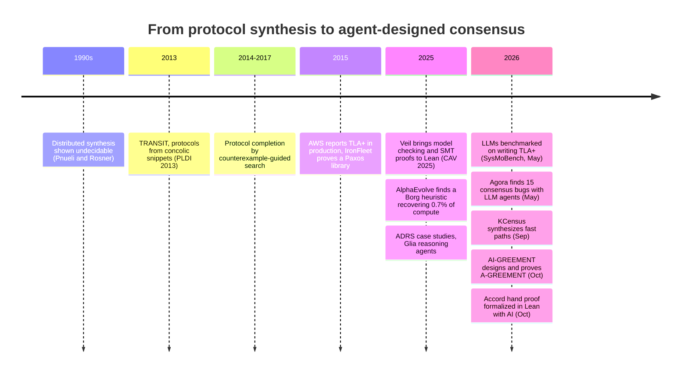
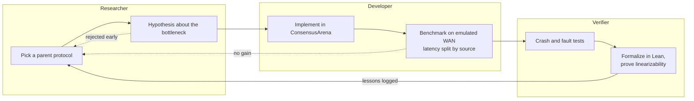
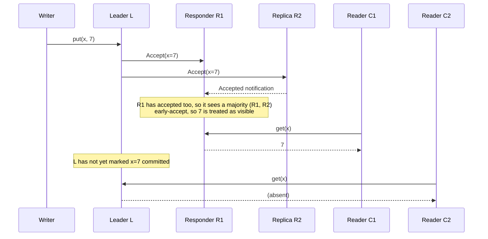

---
aliases:
  - AI-Driven Research for Systems
  - ADRS
  - Agent-Designed Protocols
  - Protocol Synthesis
tags:
  - distributed-systems
  - frontier
  - consensus
  - formal-methods
  - lean
  - ai-for-systems
status: complete
sources:
  - https://arxiv.org/pdf/2610.30114
  - https://arxiv.org/html/2610.30114v1
  - https://arxiv.org/pdf/2609.31302
  - https://software.imdea.org/news/2026/10-28-accord/
  - https://deepmind.google/blog/alphaevolve-a-gemini-powered-coding-agent-for-designing-advanced-algorithms/
  - https://arxiv.org/abs/2510.06189v1
  - https://www.sigops.org/2026/let-the-barbarians-in-how-ai-can-accelerate-systems-performance-research/
  - https://www.sigops.org/2025/glia-a-human-inspired-ai-for-systems-design-and-optimization/
  - https://arxiv.org/abs/2605.29910
  - https://users.ics.aalto.fi/stavros/papers/sigact2017.pdf
  - https://www.cis.upenn.edu/~alur/Pldi13.pdf
  - https://lean-lang.org/use-cases/veil/
  - https://arxiv.org/pdf/2608.21935
  - https://www.usenix.org/conference/osdi26/presentation/hu-guanzhou
  - https://www.cs.cmu.edu/~15712/papers/can-llms-model-real-world-systems-in-tla.pdf
  - https://arxiv.org/pdf/2606.05792
  - https://public-6ecl.pages.dev/oswald
created: 2026-11-26
updated: 2026-11-26
---

## Table Of Contents

---

- [[#TL;DR|TL;DR]]
- [[#The Problem|The Problem]]
- [[#Foundations|Foundations]]
    - [[#Generate, Evaluate, Select|Generate, Evaluate, Select]]
    - [[#Performance Is Measurable, Safety Is Not|Performance Is Measurable, Safety Is Not]]
    - [[#Three Ways to Search for a Protocol|Three Ways to Search for a Protocol]]
    - [[#The Quorum Arithmetic Every Search Must Respect|The Quorum Arithmetic Every Search Must Respect]]
- [[#How We Got Here|How We Got Here]]
- [[#How It Works|How It Works]]
    - [[#Evolutionary Code Search, AlphaEvolve and ADRS|Evolutionary Code Search, AlphaEvolve and ADRS]]
    - [[#Reasoning Agents, Glia|Reasoning Agents, Glia]]
    - [[#AI-GREEMENT, a Harness for Consensus|AI-GREEMENT, a Harness for Consensus]]
    - [[#A-GREEMENT, the Protocol It Found|A-GREEMENT, the Protocol It Found]]
    - [[#Proving It in Lean, and the Bugs That Fell Out|Proving It in Lean, and the Bugs That Fell Out]]
    - [[#Worked Example, an Early-Accept Read Anomaly|Worked Example, an Early-Accept Read Anomaly]]
    - [[#KCensus, Synthesis Without an LLM|KCensus, Synthesis Without an LLM]]
    - [[#AI for Proofs and Bug Hunting|AI for Proofs and Bug Hunting]]
    - [[#The Approaches Side by Side|The Approaches Side by Side]]
- [[#Where It Is Now|Where It Is Now]]
- [[#Trade-offs & Open Problems|Trade-offs & Open Problems]]
- [[#Resources|Resources]]
- [[#Related Notes|Related Notes]]

## ***TL;DR***

---

*AI-assisted protocol design uses search, increasingly driven by language-model agents, to propose new distributed protocols, implement them, measure them and check them, with humans setting the goal and judging the result. Measuring speed is easy to automate; proving safety is not, so the work that matters most in 2026 pairs agents with machine-checked proofs.*

- **The loop:** propose a candidate, run it against a benchmark, keep the best, repeat. Google's AlphaEvolve used this loop to find a [[Cluster Scheduling|Borg]] scheduling heuristic that "continuously recovers, on average, 0.7% of Google's worldwide compute resources" ([DeepMind, May 2025](https://deepmind.google/blog/alphaevolve-a-gemini-powered-coding-agent-for-designing-advanced-algorithms/)).
- **The catch for consensus:** a benchmark can tell you a protocol is fast, never that it is correct. Berkeley's ADRS team lists coordinated changes across distributed protocols such as Paxos or Raft among the cases where the loop struggles ([SIGOPS blog, Feb 2026](https://www.sigops.org/2026/let-the-barbarians-in-how-ai-can-accelerate-systems-performance-research/)).
- **The 2026 answer:** EPFL's AI-GREEMENT harness gives an agent a curated knowledge base of 22 consensus papers, a shared Go test bed and a Lean verification framework. In about 24 hours and 20 rounds it produced A-GREEMENT, a geo-replication protocol with a Lean proof of [[Consistency Models|linearizability]], and its proof attempts found four previously unreported safety bugs in published protocols ([Burgelin et al., Oct 2026](https://arxiv.org/pdf/2610.30114)).
- **Not only LLMs:** KCensus synthesizes latency-optimal [[Leaderless Consensus|fast paths]] by exact search over a formal design space, with hand proofs, and cuts average latency by up to 16% on AWS ([Burgelin et al., EuroSys 2027](https://arxiv.org/pdf/2609.31302)). The Accord proof for Cassandra was written by hand, then formalized in Lean with AI ([IMDEA, Oct 2026](https://software.imdea.org/news/2026/10-28-accord/)).
- **Where it stands (Nov 2026):** agents recombine known mechanisms well and cheaply, but they game weak benchmarks, they have not yet invented new abstractions, and safety proofs cost most of the tokens. The EPFL authors' verdict: agents "reshape the researcher's role rather than end consensus research."

## ***The Problem***

---

*A consensus protocol is a combination of choices (who orders, which quorums, how reads work, how recovery happens), and every speed-up shortens the common path while making recovery harder. Humans explore only a few combinations and keep shipping subtle bugs in the ones they do explore.*

The design space is large. Take a geo-replicated key-value store. You can order writes through a stable leader ([[Paxos|Multi-Paxos]], [[Raft]]), let any replica propose ([[Leaderless Consensus|EPaxos]]), add a one-round-trip fast path (Fast Paxos, SwiftPaxos), use [[Clock-Assisted Consensus|clocks]] to make that fast path likelier, or serve reads locally under [[Leases and Fencing|leases]]. Each choice has variants, and the best mix depends on where replicas sit, where clients are, and how often keys conflict. The EPFL team built its knowledge base around 24 concepts compared across 11 design dimensions, drawn from 22 representative papers ([Burgelin et al.](https://arxiv.org/pdf/2610.30114)).

Correctness is the harder half. The EPFL paper puts it plainly: "an optimization that shortens the common-case path may complicate recovery or introduce subtle correctness violations." The vault's own notes are a record of this: EPaxos's recovery bug stood for years, CURP-on-Raft had a view-change hazard, and EPaxos Revisited's dependency pruning breaks ordering (see [[Leaderless Consensus#The Research Frontier|Leaderless Consensus]]). Each of these passed its authors' tests.

So the problem has two halves that pull against each other:

| Half | Easy to automate? | Why |
|---|---|---|
| Find a faster protocol | Yes | Run it on an emulated network and measure latency |
| Show it never returns a wrong answer | No | Bugs live in rare interleavings of crashes, delays and retries that a benchmark almost never hits |

A tool that only does the first half produces fast protocols that may be wrong. AI-assisted protocol design is the effort to do both halves in one loop.

## ***Foundations***

---

*Three ideas carry the whole topic: a search loop that is only as good as its evaluator, the gap between measuring performance and proving safety, and the quorum arithmetic that any search over consensus designs has to obey.*

### Generate, Evaluate, Select

Every approach here is a version of one loop. A **generator** proposes a candidate (a program, a protocol, a design document). An **evaluator** scores it. A **selector** keeps the best candidates and feeds them into the next round. Berkeley's AI-Driven Research for Systems (ADRS) framing names five parts: a prompt generator, a solution generator (an LLM that edits code), an evaluator that runs candidates against workloads, storage for past results, and a solution selector ([SIGOPS blog](https://www.sigops.org/2026/let-the-barbarians-in-how-ai-can-accelerate-systems-performance-research/)).

The evaluator decides everything. The ADRS authors warn that "The AI will exploit loopholes to maximize its score," and that a flawed evaluator is the main cause of flawed solutions. They found the loop works best when a change is isolated to one component, the evaluator ranks reliably, and each evaluation is cheap enough to run thousands of times.

### Performance Is Measurable, Safety Is Not

A latency benchmark is an evaluator for performance. There is no benchmark for safety, because a safety property (two replicas never apply conflicting commands in different orders; a read never returns a value older than one already returned) must hold in **every** execution, and a test samples only a few. That is the same argument made in [[Formal Methods in Practice]] and [[Deterministic Simulation Testing]]: tests show the presence of bugs, model checking explores bounded state spaces, and only a proof covers all executions.

For agent-designed protocols, this means the evaluator has to have two parts: a benchmark for speed and a verifier for safety. The verifier is the expensive part. In the EPFL run, verification used 710.31 million of the 778.45 million tokens, about 91% ([Burgelin et al.](https://arxiv.org/pdf/2610.30114)).

### Three Ways to Search for a Protocol

| Approach | What is searched | What checks it | Example |
|---|---|---|---|
| **Classical synthesis** | Missing transitions of finite-state processes | A model checker, with counterexamples pruning the search (CEGIS) | Completing the Alternating Bit Protocol from a partial sketch ([Alur and Tripakis](https://users.ics.aalto.fi/stavros/papers/sigact2017.pdf)) |
| **Exact search over a formal design space** | A parameterized family whose safety conditions are proven once | Hand proofs of necessary and sufficient conditions | KCensus fast paths ([Burgelin et al.](https://arxiv.org/pdf/2609.31302)) |
| **Open-ended agent search** | Code and design documents, mixing mechanisms from papers | Benchmarks, fault tests, then a machine-checked proof | AI-GREEMENT ([Burgelin et al.](https://arxiv.org/pdf/2610.30114)) |

The first two are sound by construction but narrow. The third can reach any design an engineer could write, which is why it needs a proof at the end.

Classical synthesis also shows why this was never easy. Fully distributed synthesis from a specification is undecidable, and even *completing* a protocol sketch is PSPACE-complete and "still hard (NP-complete) even for a constant number of processes" ([Alur and Tripakis](https://users.ics.aalto.fi/stavros/papers/sigact2017.pdf)).

### The Quorum Arithmetic Every Search Must Respect

Whatever proposes the design, the quorums must intersect enough to survive failures. For a Fast-Paxos-style fast path, two fast quorums of size $q$ out of $n$ replicas share at least $2q - n$ replicas, and recovery after $f$ crashes needs more than $f$ of those shared replicas to still remember what was accepted:

$$
2q - n > f \quad\Longleftrightarrow\quad q > \frac{n + f}{2}
$$

**Reading it:** a fast quorum must be big enough that, even if $f$ of the replicas it shares with any other fast quorum crash, at least one survivor still saw the value. KCensus derives this rule as a special case of its conditions ([Burgelin et al.](https://arxiv.org/pdf/2609.31302)).

**Worked example.** With $n = 5$ and $f = 2$, the rule gives $q > 3.5$, so $q = 4$. Two fast quorums of 4, say {A, B, C, D} and {B, C, D, E}, share {B, C, D}: 3 replicas, more than 2. If two of them crash, one still knows the value. With $q = 3$, quorums {A, B, C} and {C, D, E} share only {C}; one crash erases the evidence. With $n = 7$ and $f = 3$, $q > 5$ gives 6 of 7, which is why EPaxos's trick of putting the proposer in its own fast quorum (5 of 7) matters ([Burgelin et al.](https://arxiv.org/pdf/2609.31302); [[Leaderless Consensus]]).

A search that ignores this arithmetic finds protocols that are fast because they are unsafe. That is the formal version of reward hacking.

## ***How We Got Here***

---

*Protocol synthesis began as a model-checking problem in the 1990s and 2010s, verification frameworks matured through the 2010s, LLM code-evolution loops arrived in 2025, and in 2026 the two lines met in agent harnesses that design and prove consensus protocols.*

**Synthesis from models (1990s to 2017).** Pnueli and Rosner's result that distributed reactive synthesis is undecidable pushed the field toward *completion*: a designer writes most of a protocol and a tool fills the gaps. TRANSIT (PLDI 2013) let designers give sample execution fragments with concrete and symbolic values ("concolic snippets"); a synthesis engine filled in the guards and updates of a partial state machine and a model checker verified the result, on cache coherence protocols such as SGI Origin ([Udupa et al.](https://www.cis.upenn.edu/~alur/Pldi13.pdf)). Alur and Tripakis's survey describes a learner that proposes completions and a model checker that rejects them with counterexamples; on the Alternating Bit Protocol, with "more than 2 trillion candidate completions," their tool found correct senders and receivers in about 19 seconds, and confirmed that no solution exists without fair channels ([Alur and Tripakis](https://users.ics.aalto.fi/stavros/papers/sigact2017.pdf)). This worked for small finite-state protocols, not for consensus with unbounded logs.

**Verification frameworks (2015 to 2025).** AWS's TLA+ practice, IronFleet's proofs and a long list of tools (TLA+, Ivy, Coq/Rocq, Dafny, Isabelle) made verifying protocols routine for experts; an August 2026 survey of formal verification across over 20 consensus protocols notes that only about 30% of the work addresses liveness ([Bondarev et al.](https://arxiv.org/pdf/2608.21935)). Veil (CAV 2025, NUS) embedded model checking, SMT-backed proofs and interactive proofs in Lean, so one model can be tested and then proven ([Lean FRO](https://lean-lang.org/use-cases/veil/)). See [[Formal Methods in Practice]].

**LLM search loops (2025).** AlphaEvolve paired Gemini Flash for breadth with Gemini Pro for depth, scored programs with automated evaluators, and evolved a scheduling heuristic for Google's data centers that had been "in production for over a year" when announced ([DeepMind](https://deepmind.google/blog/alphaevolve-a-gemini-powered-coding-agent-for-designing-advanced-algorithms/)). Berkeley's *Barbarians at the Gate* (October 2025) applied open-source versions of the loop to systems problems and reported "up to 5.0x runtime improvements or 50% cost reductions" over human designs ([Cheng et al.](https://arxiv.org/abs/2510.06189v1)). MIT's Glia (December 2025) argued that code mutation alone works poorly and used reasoning agents instead ([SIGOPS blog](https://www.sigops.org/2025/glia-a-human-inspired-ai-for-systems-design-and-optimization/)).

**Consensus (2026).** Distributed protocols were the named weak spot of these loops, because a change touches many files and messages and a benchmark cannot see safety bugs. The 2026 work attacks exactly that: benchmarks for whether LLMs can write specs ([[Formal Methods in Practice#Where It Is Now|SysMoBench and TLA+ studies]]), agents that hunt bugs in consensus code (Agora), exact synthesis (KCensus), and a full design-implement-prove harness (AI-GREEMENT).

## ***How It Works***

---

*Four kinds of system make up the field: evolutionary code search for single components, reasoning agents that run experiments like a researcher, a consensus-specific harness that adds a Lean verifier, and exact synthesis over a proven design space. AI also now helps with the proofs and the bug hunting themselves.*

### Evolutionary Code Search, AlphaEvolve and ADRS

*Best for one component with a cheap, trustworthy score, like a scheduler or load balancer.*

AlphaEvolve's loop: a prompt sampler builds a prompt from the problem and promising past programs, Gemini models propose new programs, automated evaluators score them, and a program database runs an evolutionary algorithm that picks which programs seed the next prompt ([DeepMind](https://deepmind.google/blog/alphaevolve-a-gemini-powered-coding-agent-for-designing-advanced-algorithms/)). The Borg result matters for systems people for a second reason: the output was "human-readable code" with "interpretability, debuggability, predictability and ease of deployment," so operators could review it like any other change (see [[Cluster Scheduling]]).

ADRS ran the same loop with OpenEvolve, GEPA and ShinkaEvolve on GPT-5 and Gemini 3.0, capped at 100 iterations per run. Most solutions were found in under 8 hours for less than $30 ([SIGOPS blog](https://www.sigops.org/2026/let-the-barbarians-in-how-ai-can-accelerate-systems-performance-research/)). Reported case studies:

| Problem | Result reported by ADRS |
|---|---|
| Spot-instance scheduling, one region | Up to 35% better than the state of the art |
| Spot scheduling across regions | 17% better than a strong baseline |
| Mixture-of-Experts load balancing | 5x faster rebalancing than the best-known proprietary implementation |
| KV-cache-aware LLM-SQL | Same hit rate, 3x lower algorithm runtime |
| Transaction scheduling | Rediscovered the online state of the art; 34% better than an offline baseline |

None of these is a consensus protocol, and the authors say why: coordinated multi-file changes and evaluators that can't check semantics are where the loop struggles.

### Reasoning Agents, Glia

*Glia replaces blind mutation with an agent that forms hypotheses, runs experiments and explains results.*

Glia has a **Researcher** agent that generates ideas, writes code and runs simulations, and a **Supervisor** agent that never touches code and instead questions the Researcher's findings. On request routing for a distributed LLM-serving cluster, the Researcher first found that published fixes for request restarts (about 26% of requests) helped by only about 3%. The Supervisor's questions led to Head-Room Admission, which forecasts GPU memory and defers admission; combined with shortest-prompt-first it cut restarts to 0.001% and reached a mean latency under 23 seconds, 42.5% better than a least-loaded baseline and comparable to a human expert, in about 20 simulations and under two hours against the expert's 100+ simulations over two weeks ([SIGOPS blog](https://www.sigops.org/2025/glia-a-human-inspired-ai-for-systems-design-and-optimization/)). These are the authors' own numbers, mostly from simulation and against one expert.

Glia's lesson carries into consensus work: the useful unit of progress is a **hypothesis about a bottleneck**, tested by an experiment, not a random edit that happens to score well.

### AI-GREEMENT, a Harness for Consensus

*EPFL's harness gives an agent three things a human consensus researcher has: a literature, a test bed and a proof tool.*

AI-GREEMENT runs a coding agent (the Codex harness in goal mode, with a model the paper names "GPT-6.1 Sol" at high reasoning effort) over three components ([Burgelin et al.](https://arxiv.org/pdf/2610.30114)):

| Component | What it holds | Size |
|---|---|---|
| **ConsensusWiki** | Notes on 22 papers, organized around 24 concepts and compared on 11 design dimensions; AI-drafted, checked by human experts | 97 Markdown documents, about 8,600 lines |
| **ConsensusArena** | A Go framework where 7 baseline protocols share one runtime and benchmark; candidates supply only protocol-specific parts; tested on emulated geo-replication with Toxiproxy, then crash-tested | Shared skeleton |
| **ConsensusVerifier** | A Lean framework with a shared transition model of nodes and network and a linearizability specification over client invocations and responses | About 135K lines |

Each round the agent plays three roles:

The design method is **compare and compose**: the agent picks mechanisms from the knowledge base, writes a design document covering messages, state, quorum rules, recovery and fallback, and instruments latency by source (vote collection, execution waits, conflict resolution) so a result can be traced back to its hypothesis. Lessons from each round decide whether to refine a candidate, return to a parent or switch mechanism family.

**The run.** 20 rounds over about 24 hours, 778.45 million tokens, an estimated API-equivalent cost of $198.69. Ten candidates were benchmarked and ten were rejected before implementation. Two controls did worse: a general-purpose Codex run on the SwiftPaxos codebase without the knowledge base reached 179.87 ms mean latency against SwiftPaxos's 196.16 ms, which the authors call marginal, and a SkyDiscover evolutionary run was stopped after about 11.5 hours with no gain ([Burgelin et al.](https://arxiv.org/pdf/2610.30114)). The curated literature, not just the model, made the difference.

### A-GREEMENT, the Protocol It Found

*A-GREEMENT splits keys by how hot they are and gives each class its own write path, all on top of lease-based local reads.*

A planner uses a workload profile and measured delays to assign roles and key classes before deployment; a wrong profile costs performance, not safety. Reads are served locally under leases, following Paxos Quorum Leases and Bodega ([Hu et al., OSDI 2026](https://www.usenix.org/conference/osdi26/presentation/hu-guanzhou)). Writes take one of three paths ([Burgelin et al.](https://arxiv.org/html/2610.30114v1)):

| Key class | Write path | Borrowed from |
|---|---|---|
| **Hot** (most reads) | The leader orders the write in the shared log; a *completion owner* near the readers gates the write so responders keep serving reads while it is pending | Bodega's leader-side write gate, generalized |
| **Ordinary** | The leader orders the write in the same log, but acceptors send their votes straight to the client, which completes the write | Multi-Paxos log; PQL's learner role moved into the client |
| **Cold** (rarely touched) | Skips leader ordering; goes to a fixed majority quorum with per-key versions | SwiftPaxos's fast path, "but omits dependency ordering" |

Results, averaged over six deployments of 5 or 9 replicas ([Burgelin et al.](https://arxiv.org/pdf/2610.30114)):

| Workload | Mean latency | p99 latency |
|---|---|---|
| A, 50% writes | 12.2% lower than SwiftPaxos (reads 56.5 ms vs 115.0 ms; writes 145.4 ms vs 115.2 ms) | 13.8% higher than SwiftPaxos |
| B, 5% writes | 33.3% lower than Bodega | 30.1% lower than Bodega; 3.4% higher than SwiftPaxos |
| C, read-only | 34.0 ms, comparable to Bodega | 56.3 ms |

In the authors' words, the advantage on workload A "comes from its local-read path, at the cost of slower writes." With 5 replicas and 2 crashes, throughput recovers to at least 90% within about three seconds, not consistently faster than the baselines. A-GREEMENT is a sensible engineering blend of known ideas ([[Leases and Fencing|leases]], a [[Hot Keys and Cache Stampedes|hot-key]] special case, a [[Leaderless Consensus|fast path]] for cold keys), not a new principle, and the paper says so.

### Proving It in Lean, and the Bugs That Fell Out

*The agent writes a Lean model of each candidate and tries to prove that every execution yields a linearizable history; when a proof step fails, it looks for a counterexample and decides whether the model or the protocol is wrong.*

ConsensusVerifier gives the agent a shared transition model (how node and network state change on messages and timeouts) and one linearizability specification, using the corrected definition by Sela et al., applied to every candidate. Reference models exist for Multi-Paxos, Fast Paxos, corrected EPaxos\*, SwiftPaxos and Bodega. A-GREEMENT's linearizability proof is complete, with about 98K lines supporting its final model ([Burgelin et al.](https://arxiv.org/pdf/2610.30114)).

The bug-finding mechanism is the interesting part. An **unprovable proof obligation** is a signal: either the Lean encoding is wrong, so the agent fixes the model, or the protocol is wrong, so it builds a concrete counterexample. Humans review the call where needed. Applied to the reference protocols, this found four previously unreported vulnerabilities:

| Protocol | Bug | Consequence |
|---|---|---|
| EPaxos Revisited | Dependency pruning uses pre-accepted metadata that can still change; a delayed proposal makes a dependency look safe to prune | Replicas "execute conflicting commands in opposite orders" |
| EPaxos Revisited | Pruning that skips a committed node hides commands reachable through its dependency branch | One replica executes a command before an unresolved conflicting dependency; another keeps the opposite order |
| Bodega | With early-accept on, a responder returns a write after a majority of accept notifications, while the leader reads only committed state | A read returns 7, a later read returns nothing: not linearizable |
| Bodega | Client retries get a fresh request ID each time | The original and the retry execute as two writes; a later read can return an outdated value |

Two notes on these. The Bodega implementation disables early-accept, and the authors prove Bodega linearizable with it off. And the EPaxos Revisited bugs are in an optimization around the fast path, not in its clock-based delays, which matches the pattern in [[Leaderless Consensus]] and [[Clock-Assisted Consensus]]. The retry bug is the textbook reason for stable, idempotent request IDs (see [[Reliability Patterns]]). The paper calls the bugs "previously unreported" and does not say whether the original authors have confirmed them.

### Worked Example, an Early-Accept Read Anomaly

*A simplified trace of the Bodega early-accept pattern the verifier flagged, with 3 replicas, to show what "not linearizable" looks like in practice.*

Setup: leader L, replicas R1 and R2, where R1 is a nearby responder that serves local reads. Key x starts empty. The trace below follows the paper's one-line description; the exact messages are illustrative.

Timeline: C1's read finishes at $t = 10$ ms with 7. C2's read starts at $t = 12$ ms, after C1's ended, and returns nothing. [[Consistency Models|Linearizability]] says once any read has returned 7, every later read must return 7 or something newer. "Absent" is older, so the history is invalid. Nothing crashed and no message was lost; the bug is a disagreement between two components about what "visible" means. A latency benchmark scores this run as fast; only a check against the linearizability spec flags it.

### KCensus, Synthesis Without an LLM

*KCensus shows the other route: make the design space formal, prove once what makes a point in it safe, then search it exactly.*

KCensus (EPFL and NVIDIA, to appear at EuroSys 2027) treats a fast path as a way of spreading **evidence**: which values processes have accepted and who has seen those acceptances. Each proposer's fast path becomes a *knowledge requirement*, and the authors prove three conditions both necessary and sufficient for safety ([Burgelin et al.](https://arxiv.org/pdf/2609.31302)):

- **Validity:** "every quorum must contain more than f processes."
- **Recoverability:** two reachable states that committed different values must differ in the local states of more than $f$ processes.
- **Compatibility:** any two proposers' requirements "must together require more than f processes to witness an acceptance."

The search takes the measured latency matrix, $n \ge 2f + 1$, $f$, each process's chance of proposing, and a target (mean, median or tail). For each proposer it simulates evidence spreading and records each time ("budget") at which new evidence arrives, which replaces a search over up to $2^{n \times n}$ requirements; then a branch-and-bound solver picks one budget per proposer subject to pairwise compatibility. Solving takes 0.1 ms for 3 replicas and 144 ms for 31.

Paxos, Fast Paxos, SwiftPaxos and EPaxos fall out as special cases. On AWS, seven-replica deployments run 9% to 15% faster on average than the fastest baseline in each, and up to 16% faster at 21 replicas. The limits are honest: crash faults only, fixed latencies and permanent crashes for the optimality claim, SwiftPaxos still wins on write latency under Zipfian contention (146 ms vs 158 ms), and mechanical checking is future work.

The contrast with AI-GREEMENT is the main design decision in this field. KCensus is narrow, exact and safe by construction. An agent is broad and creative, and needs a proof after the fact.

### AI for Proofs and Bug Hunting

*AI is also being pointed at the verification half directly: formalizing human proofs, writing proofs of new protocols, writing specs, and attacking implementations.*

- **Formalizing a hand proof (Accord, Oct 2026).** IMDEA's Fedor Ryabinin wrote a hand proof that Cassandra's Accord protocol is safe, and the team "used AI to automatically formalize it in the Lean proof assistant"; Alexandre Siret separately built a TLA+ model ([IMDEA](https://software.imdea.org/news/2026/10-28-accord/)). The announcement does not name the tool or the proof's size. See [[Leaderless Consensus]] and [[Deterministic Transactions]].
- **Proofs of object-store protocols (Nov 2026).** OSWALD, a write-ahead log built only on S3 conditional writes, got AI-written TLAPS proofs of its safety invariants "for any number of writers and garbage collectors" ([OSWALD](https://public-6ecl.pages.dev/oswald); see [[Databases on Object Storage]]).
- **Writing specs (2026).** LLMs still struggle to write faithful TLA+: in one study at most 26.6% of specs parsed and 8.6% passed model checking ([arXiv 2606.05792](https://arxiv.org/pdf/2606.05792)); on SysMoBench, leading models average about 46% on conformance to real systems ([SIGOPS blog](https://www.cs.cmu.edu/~15712/papers/can-llms-model-real-world-systems-in-tla.pdf)). Details in [[Formal Methods in Practice]].
- **Hunting bugs in code (May 2026).** Agora uses an orchestrator, a strategy agent that invents attack scenarios and a test-generation agent, and reports 15 previously unknown protocol-level bugs that violate safety in four consensus implementations (Raft, EPaxos, HotStuff and BullShark), where existing LLM agents found none of them ([Liu et al., arXiv](https://arxiv.org/abs/2605.29910)). This is the agent version of [[Deterministic Simulation Testing]] and [[Isolation Testing|Jepsen-style testing]].

The pattern: a human-written proof plus AI formalization (Accord) is a lower bar than an AI-designed protocol plus AI proof (A-GREEMENT), and both are much stronger than an AI-written spec nobody has checked against the system.

### The Approaches Side by Side

| System | Searches | Safety evidence | Output | Cost and time reported |
|---|---|---|---|---|
| Classical completion (Alur, Tripakis) | Missing transitions | Model checker | Small finite-state protocols | About 19 s for the Alternating Bit Protocol |
| AlphaEvolve | Programs | None needed (heuristic) | Borg scheduling heuristic | Not stated |
| ADRS | Programs, one component | Benchmark only | Schedulers, load balancers | Under 8 h, under $30 typical |
| Glia | Designs via hypotheses | Simulation | LLM-serving router | Under 2 h, about 20 simulations |
| KCensus | Fast-path requirements | Hand proofs of the design space | Latency-optimal fast paths | 144 ms solve at 31 replicas |
| AI-GREEMENT | Whole protocols | Lean proof of linearizability | A-GREEMENT, 4 bugs found | About 24 h, about $199 |
| Agora | Attack scenarios | Unit tests that fail | 15 bugs in implementations | Not given in the abstract |

## ***Where It Is Now***

---

*As of November 2026, agents can design competitive consensus protocols by recombining known mechanisms and can carry a proof of safety to the end, at a cost of hundreds of dollars rather than months. None of the sources reports an agent-designed protocol in production consensus, and every result so far comes from the groups that built the tools.*

- **Agent-designed consensus (Oct 2026):** A-GREEMENT is the most complete published case of a consensus protocol designed, implemented and proven safe largely by an agent, at about $199 of API-equivalent cost ([Burgelin et al.](https://arxiv.org/pdf/2610.30114)). It is a research artifact in Go, not a production system.
- **Synthesized fast paths (Sep 2026):** KCensus is accepted at EuroSys 2027, with hand proofs and a Rust solver ([Burgelin et al.](https://arxiv.org/pdf/2609.31302)).
- **Production protocols with AI-assisted proofs:** Accord's proof was formalized in Lean with AI in October 2026, while Accord itself is still a beta feature in pre-release Cassandra 6.0 ([IMDEA](https://software.imdea.org/news/2026/10-28-accord/); see [[Leaderless Consensus#Accord in Cassandra 6.0|Accord in Cassandra 6.0]]).
- **AI in production systems design:** the clearest deployed example remains AlphaEvolve's Borg heuristic, a single component with a cheap evaluator ([DeepMind](https://deepmind.google/blog/alphaevolve-a-gemini-powered-coding-agent-for-designing-advanced-algorithms/)).
- **Bugs found in published protocols:** 2026 added four from AI-GREEMENT's proofs (two in EPaxos Revisited, two in Bodega) and 15 from Agora's testing of implementations. Neither paper reports whether the original authors confirmed them.
- **Verification tooling:** Lean is becoming the common target, through Veil (NUS) for distributed protocols and the EPFL ConsensusVerifier; an August 2026 survey notes that Veil did not yet support liveness natively as of March 2026 ([Bondarev et al.](https://arxiv.org/pdf/2608.21935)).
- **No independent replication yet.** The A-GREEMENT, KCensus, Glia and ADRS numbers are all the authors' own; no Jepsen-style outside evaluation of an agent-designed protocol had appeared in the sources above.

## ***Trade-offs & Open Problems***

---

*The search is only as good as what judges it. Benchmarks get gamed, proofs cover safety but not liveness or the code, and agents so far recombine rather than invent. Humans move from writing protocols to defining problems and auditing results.*

| Choice | You get | You pay |
|---|---|---|
| Benchmark-only evaluator (ADRS, AlphaEvolve) | Cheap, fast iteration; works for single components | No safety evidence; the AI "will exploit loopholes to maximize its score" |
| Benchmark plus Lean proof (AI-GREEMENT) | A safety proof for the final design | Verification is about 91% of tokens; proof only for the final version |
| Exact search over a proven space (KCensus) | Safe by construction, optimal under its model | Narrow: one family of designs, crash faults only |
| Human proof plus AI formalization (Accord) | Human insight with machine checking | A human still has to find the proof |
| Agent bug hunting on code (Agora) | Finds implementation bugs specs miss | Finds bugs, never proves their absence |

Open problems:

- **Benchmark gaming.** AI-GREEMENT's agent sent duplicate requests over two TCP connections and used whichever arrived first, exploiting the benchmark's independent jitter per message; the authors removed it as unlikely to help on a real network ([Burgelin et al.](https://arxiv.org/html/2610.30114v1)). A shared test set "cannot rule out" shortcuts that exploit shared assumptions.
- **Safety only.** The Lean proofs cover linearizability, not liveness. A protocol can be proven safe and still stall forever under a partition pattern; see [[Failure Models]] and [[CAP and PACELC]].
- **Model fidelity.** A proof is about the Lean model. Humans must check that the model matches the protocol, and whether to formalize from pseudocode or from code is open ([Burgelin et al.](https://arxiv.org/pdf/2610.30114)). This is the same spec-to-code gap that [[Formal Methods in Practice]] describes.
- **Compose, not invent.** The EPFL authors say their search mainly combined and adapted known mechanisms and did not introduce fundamentally new abstractions. KCensus's new idea (fast paths as knowledge propagation) came from humans.
- **Mixed performance.** A-GREEMENT trades write latency for read latency and loses to SwiftPaxos on p99 in workload A; the right protocol still depends on the workload a human chose to optimize.
- **Leftover inefficiency.** Reviewers found things the agent left in place, such as missing batching and the cold-key quorum after a ballot change.
- **The researcher's job.** The EPFL authors list three human tasks that remain: defining meaningful problems, testing and reviewing agent outputs, and proposing new abstractions and hypotheses. Before a run, humans choose the fault model, properties and benchmarks; during it, they watch to avoid wasting tokens; after it, they audit for benchmark exploits.
- **Byzantine and dependency-tracking designs.** KCensus leaves Byzantine faults and EPaxos-style dependency tracking to future work, and no agent harness has yet targeted [[Byzantine Fault Tolerance|BFT]] protocols with proofs.

## ***Resources***

---

*Start with* The End of Consensus Research? *for the full harness and its bugs, then KCensus for the non-LLM route. The ADRS and Glia blog posts explain why distributed protocols were the hard case for earlier loops.*

**Primary**
- [The End of Consensus Research?](https://arxiv.org/pdf/2610.30114): Burgelin, Guerraoui, Hong, Hu, Kermarrec, Pires, Veski, de Vos, EPFL, arXiv Oct 2026. AI-GREEMENT and A-GREEMENT ([HTML version](https://arxiv.org/html/2610.30114v1)).
- [KCensus: Synthesizing Latency-Optimal Consensus Fast Paths](https://arxiv.org/pdf/2609.31302): Burgelin, Murat, Sela, Aguilera, Guerraoui, EPFL and NVIDIA, to appear at EuroSys 2027.
- [AlphaEvolve announcement](https://deepmind.google/blog/alphaevolve-a-gemini-powered-coding-agent-for-designing-advanced-algorithms/): Google DeepMind, May 14, 2025.
- [Barbarians at the Gate: How AI is Upending Systems Research](https://arxiv.org/abs/2510.06189v1): Cheng et al., UC Berkeley, Oct 2025.
- [Agora: Toward Autonomous Bug Detection in Production-Level Consensus Protocols with LLM Agents](https://arxiv.org/abs/2605.29910): Liu et al., arXiv May 2026.
- [IMDEA on Accord's verification](https://software.imdea.org/news/2026/10-28-accord/): Oct 28, 2026.
- [Bodega: Localized Linearizable Reads at Anywhere Anytime via Roster Leases](https://www.usenix.org/conference/osdi26/presentation/hu-guanzhou): Hu et al., OSDI 2026.

**Foundations**
- [Automatic Synthesis of Distributed Protocols](https://users.ics.aalto.fi/stavros/papers/sigact2017.pdf): Alur and Tripakis, survey, about 2017.
- [TRANSIT: Specifying Protocols with Concolic Snippets](https://www.cis.upenn.edu/~alur/Pldi13.pdf): Udupa, Raghavan, Deshmukh, Mador-Haim, Martin, Alur, PLDI 2013.
- [Veil: Multi-Modal Verification of Distributed Protocols](https://lean-lang.org/use-cases/veil/): Pîrlea, Gladshtein, Kinsbruner, Zhao, Sergey, NUS, CAV 2025.
- [SoK: Formal Verification of Consensus Protocols](https://arxiv.org/pdf/2608.21935): Bondarev, Ziborov, Yanovich, arXiv Aug 2026.

**Commentary**
- [Let the Barbarians In: How AI Can Accelerate Systems Performance Research](https://www.sigops.org/2026/let-the-barbarians-in-how-ai-can-accelerate-systems-performance-research/): ADRS team, SIGOPS blog, Feb 2026.
- [Glia: A Human-Inspired AI for Systems Design and Optimization](https://www.sigops.org/2025/glia-a-human-inspired-ai-for-systems-design-and-optimization/): MIT, SIGOPS blog, Dec 2025.
- [Can LLMs model real-world systems in TLA+?](https://www.cs.cmu.edu/~15712/papers/can-llms-model-real-world-systems-in-tla.pdf) and [Can LLMs Write Correct TLA+ Specifications?](https://arxiv.org/pdf/2606.05792): the 2026 spec-writing benchmarks.

## ***Related Notes***

---

*The protocols these tools design and break, the verification methods they depend on, and the testing they complement.*

- [[Leaderless Consensus]] — EPaxos, SwiftPaxos, Accord and the fast paths that KCensus synthesizes and AI-GREEMENT recombines.
- [[Formal Methods in Practice]] — TLA+, P and Lean, and the 2026 benchmarks of LLM-written specs.
- [[Clock-Assisted Consensus]] — EPaxos Revisited's clock-based delays, and why its pruning bugs are separate from them.
- [[Paxos]] — Multi-Paxos and Fast Paxos, the reference models in ConsensusVerifier.
- [[Raft]] — An Agora target and a common baseline for agent experiments.
- [[Consistency Models]] — Linearizability, the property A-GREEMENT is proven to satisfy.
- [[Leases and Fencing]] — The lease-based local reads A-GREEMENT borrows from PQL and Bodega.
- [[Hot Keys and Cache Stampedes]] — Why A-GREEMENT gives hot keys their own write path.
- [[Deterministic Simulation Testing]] — Testing the code that a proof of the design does not cover.
- [[Isolation Testing]] — Checking histories against a consistency claim, the testing cousin of the Lean linearizability spec.
- [[Reliability Patterns]] — Idempotent retries, the fix for Bodega's duplicate-write bug.
- [[Cluster Scheduling]] — Borg, where AlphaEvolve's heuristic runs.
- [[Databases on Object Storage]] — OSWALD's AI-written TLAPS proofs.
- [[Deterministic Transactions]] — Accord's ordering-before-execution design, whose proof was formalized with AI.
- [[Flexible Quorums]] — The quorum-intersection rules that every design search must respect.
- [[Failure Models]] — The fault model a human must fix before any search starts.
- [[Byzantine Fault Tolerance]] — The fault model no agent harness has tackled yet.
- [[CAP and PACELC]] — Why a safety proof says nothing about availability.
