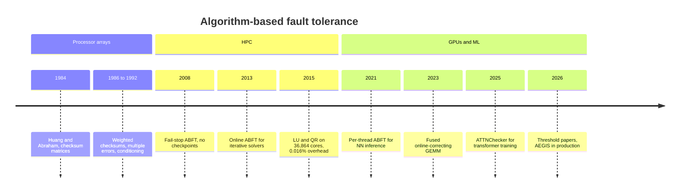
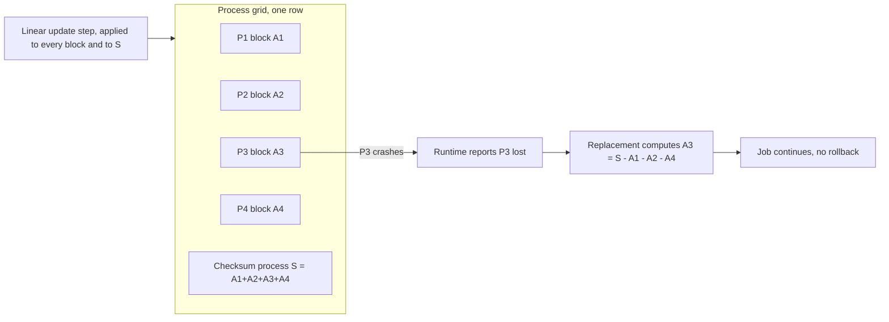

---
tags:
  - distributed-systems
  - fault-tolerance
  - abft
  - silent-data-corruption
  - linear-algebra
  - gpu
  - hpc
  - frontier
status: complete
sources:
  - https://graal.ens-lyon.fr/~abenoit/CR02/papers/abft2.pdf
  - https://maths-people.anu.edu.au/brent/pd/rpb124.pdf
  - https://library.eecs.utk.edu/files/ut-cs-08-630.pdf
  - https://icl.utk.edu/users/herault/papers/012 - Algorithm-Based Fault Tolerance for Dense Matrix Factorizations, Multiple Failures and Accuracy - TOPC (2015).pdf
  - https://www.bohrium.com/en/paper-details/online-abft/813202231435198465-16911
  - https://ar5iv.labs.arxiv.org/html/2104.09455
  - https://arxiv.org/pdf/2305.01024
  - https://arxiv.org/html/2410.11720v3
  - https://arxiv.org/pdf/2507.16676
  - https://www.arxiv.org/pdf/2602.08043
  - https://www.usenix.org/system/files/osdi26-lei.pdf
  - https://arxiv.org/pdf/2609.19758
  - https://arxiv.org/html/2609.19743
  - https://arxiv.org/pdf/2610.02240
  - https://arxiv.org/pdf/2610.18557
  - https://engineering.fb.com/2025/07/22/data-infrastructure/how-meta-keeps-its-ai-hardware-reliable/
created: 2026-11-28
updated: 2026-11-28
---

## Table Of Contents

---

- [[#TL;DR|TL;DR]]
- [[#The Problem|The Problem]]
- [[#Foundations|Foundations]]
    - [[#A Code That Survives the Computation|A Code That Survives the Computation]]
    - [[#Two Fault Models, Two Kinds of ABFT|Two Fault Models, Two Kinds of ABFT]]
    - [[#Detect, Locate, Correct|Detect, Locate, Correct]]
- [[#How We Got Here|How We Got Here]]
- [[#How It Works|How It Works]]
    - [[#Checksum Invariants and the Operations That Keep Them|Checksum Invariants and the Operations That Keep Them]]
    - [[#Weighted Checksums - Locating More With Less|Weighted Checksums - Locating More With Less]]
    - [[#The Threshold Problem in Floating Point|The Threshold Problem in Floating Point]]
    - [[#ABFT Inside a GPU Kernel|ABFT Inside a GPU Kernel]]
    - [[#Fail-Stop ABFT - Rebuilding a Lost Process|Fail-Stop ABFT - Rebuilding a Lost Process]]
    - [[#ABFT for Transformers|ABFT for Transformers]]
- [[#Where It Is Now|Where It Is Now]]
- [[#Trade-offs & Open Problems|Trade-offs & Open Problems]]
- [[#Resources|Resources]]
- [[#Related Notes|Related Notes]]

## ***TL;DR***
---
*Algorithm-based fault tolerance (ABFT) checks a computation with the computation's own algebra: encode the inputs with checksums, and a correct result must carry matching checksums. It catches wrong arithmetic for a few percent of the cost instead of the 2x of running everything twice, but only for linear operations, and in low-precision floating point the hard part is telling a fault from rounding.*

- **The idea (1984):** Huang and Abraham append a row of column sums to $A$ and a column of row sums to $B$. Because matrix multiplication is linear, $AB$ comes out with valid row and column sums; one wrong element breaks one row sum and one column sum, which locates it, and the difference corrects it ([Huang and Abraham](https://graal.ens-lyon.fr/~abenoit/CR02/papers/abft2.pdf)). The basic worked example is in [[Silent Data Corruption#Redundant Computation and ABFT|Silent Data Corruption]].
- **Two uses.** Against *soft errors* (a unit computes a wrong value and keeps going) the checksum detects and fixes the value. Against *fail-stop* failures (a process dies and its memory is gone) checksum processes let survivors rebuild the lost block with no checkpoint: 0.016% overhead for LU on 36,864 cores ([Bouteiller et al., 2015](https://icl.utk.edu/users/herault/papers/012%20-%20Algorithm-Based%20Fault%20Tolerance%20for%20Dense%20Matrix%20Factorizations,%20Multiple%20Failures%20and%20Accuracy%20-%20TOPC%20%282015%29.pdf)).
- **On GPUs (2021 to 2025)** the checksums moved inside the matrix-multiply kernel: per-thread checks for memory-bound neural-net layers, fused detect-and-correct GEMM at about 9% over cuBLAS, and ATTNChecker for INF and NaN errors in transformer attention at about 7% of a training step.
- **The 2026 problem is thresholds.** BF16 and FP8 rounding noise is as big as many faults. Production (ByteDance's AEGIS, 0.86% overhead) checks the FP32 accumulator before the result is narrowed; research papers fit thresholds to measured noise and still find whole classes of bit flips (low mantissa bits) that no threshold can see.
- **Limits:** only operations with linear structure, one error per checksum unless you add weighted codes, and nothing for the code between the matrix multiplies.

## ***The Problem***
---
*Hardware sometimes returns the wrong number without raising an error. Checking every result by recomputing it doubles the cost, and checkpointing a big parallel job to survive a dead node is slow. ABFT asks whether the math can check itself more cheaply.*

[[Silent Data Corruption]] showed that wrong arithmetic is now routine at fleet scale: about one in a thousand AI accelerators by Meta's 2025 count, and around one SDC incident per two million GPU hours in ByteDance's training fleet. The generic answers are expensive:

| Approach | What it costs | What it misses |
|---|---|---|
| Run twice and compare (DMR) | About 2x compute; V-ABFT's authors put DMR at over 200% overhead for GEMM ([Gao et al., 2026](https://www.arxiv.org/pdf/2602.08043)) | Can't say which copy is wrong |
| Run three times and vote (TMR) | About 3x | Nothing, if faults are independent |
| Checkpoint and restart | Time to write state, plus rework after each failure | Corruption written into the checkpoint |
| Loss or NaN monitoring | Nearly free | Most SDCs, which never show in the loss |

Most of the compute in scientific codes and in neural networks is dense linear algebra: matrix multiplies, factorizations, convolutions written as matrix multiplies. Linear operations have structure that a general check doesn't use: sums commute with them. ABFT exploits that structure to check an $O(n^3)$ multiply with $O(n^2)$ extra work.

The same idea answers a second, older problem: when a process in a 10,000-node job dies, the rest of the job loses its piece of the matrix. Checkpointing to disk is the usual cure, and its cost grows with the machine. If the data carries its own redundancy, the survivors can recompute the missing piece instead.

## ***Foundations***
---
*ABFT is error-correcting coding applied to a computation instead of to stored bytes. Three ideas carry it: a code that is preserved by the operation, a fault model saying what kind of failure you defend against, and how much redundancy you need to detect, locate or correct.*

### A Code That Survives the Computation

*An ordinary checksum protects data that should not change. An ABFT checksum protects data that is being transformed, so it only works if the transformation maps a valid codeword to a valid codeword.*

Let $e$ be a vector of ones. For any matrices,

$$
e^\top (AB) = (e^\top A)\,B \qquad\qquad (AB)\,e = A\,(B e)
$$

*In words:* the column sums of a product equal the column-sum row of $A$ times $B$, and its row sums equal $A$ times the row-sum column of $B$. Summing before or after the multiply gives the same answer, so you can compute a cheap prediction of the sums ($O(n^2)$ work) and compare it with the sums of the actual result.

*Worked example:* $A = \begin{pmatrix}1 & 2\\0 & 1\end{pmatrix}$, $B = \begin{pmatrix}3 & 1\\1 & 2\end{pmatrix}$, so $AB = \begin{pmatrix}5 & 5\\1 & 2\end{pmatrix}$. Prediction: $e^\top A = (1, 3)$ and $(1, 3)B = (6, 7)$. Actual column sums: $5 + 1 = 6$ and $5 + 2 = 7$. They match. If the multiplier had produced $AB_{12} = 9$, column 2 would sum to 11 against the predicted 7, flagging a fault of $+4$ somewhere in column 2.

A non-linear step breaks this. $\mathrm{softmax}(x)$ or $\mathrm{GELU}(x)$ of a sum is not the sum of the outputs, so the checksum can't be carried through; each such step needs its own invariant or none at all. That is why ABFT papers keep finding the same boundary: matrix multiplies are covered, the code between them isn't.

ABFT is a cousin of [[Erasure Coding]]. A row of checksums is a parity block; Reed-Solomon codes are what you get when you push weighted checksums far enough (see below). The difference is that erasure coding protects stored data, while ABFT has to keep the parity valid through every arithmetic step.

### Two Fault Models, Two Kinds of ABFT

*ABFT is used against two very different failures, and the literature splits along that line. Know which one a paper means before comparing numbers.*

| | Soft error (fail-continue) | Fail-stop |
|---|---|---|
| What happens | A unit computes a wrong value; the program keeps running | A process or node dies; its memory is lost |
| What you know | Nothing, unless you check | Which process failed (the runtime tells you) |
| [[Failure Models]] class | A narrow, non-malicious slice of Byzantine behavior | Crash-stop |
| What ABFT does | Detect the mismatch, locate the element, correct or recompute | Rebuild the lost block from checksums held by other processes |
| Typical setting | GPU GEMMs, neural-net training and inference | Large MPI jobs in HPC, dense factorizations |
| Key papers | Huang and Abraham 1984; FT-GEMM 2023; ATTNChecker 2025; AEGIS 2026 | Chen and Dongarra 2008; Bouteiller et al. 2015 |

The fail-stop case is easier in one sense: an erasure (you know which piece is gone) needs half the redundancy of an error (something is wrong, location unknown), the same rule as in coding theory.

### Detect, Locate, Correct

*More redundancy buys more: one sum detects, two sums locate one error, more weighted sums locate several.*

| Redundancy | Detects | Locates and corrects | Source |
|---|---|---|---|
| One sum per row (or column) | Any single error in that row | No | Huang and Abraham |
| Row sums and column sums (full checksum matrix) | Single errors | One error per matrix: the crossing of the bad row and bad column | Huang and Abraham |
| Two sums per row, one plain and one weighted | One error per row | One error per row, from the ratio of the two discrepancies | Weighted schemes, Jou and Abraham, Luk ([via Boley et al.](https://maths-people.anu.edu.au/brent/pd/rpb124.pdf)) |
| $m+1$ weighted sums | Up to $m+1$ errors | Up to $\lfloor (m+1)/2 \rfloor$ errors | [Boley, Brent, Golub and Luk, 1992](https://maths-people.anu.edu.au/brent/pd/rpb124.pdf) |
| $2F$ checksum blocks per group | (fail-stop) | Up to $F$ simultaneous lost processes | [Bouteiller et al., 2015](https://icl.utk.edu/users/herault/papers/012%20-%20Algorithm-Based%20Fault%20Tolerance%20for%20Dense%20Matrix%20Factorizations,%20Multiple%20Failures%20and%20Accuracy%20-%20TOPC%20%282015%29.pdf) |

Huang and Abraham put the single-error case in coding terms: a full checksum matrix has minimum distance 4, so "a single erroneous element can be corrected" ([1984](https://graal.ens-lyon.fr/~abenoit/CR02/papers/abft2.pdf)).

## ***How We Got Here***
---
*ABFT was invented for special-purpose processor arrays, rediscovered by HPC as a way to survive node loss without checkpoints, and rediscovered again by GPU and ML systems once accelerators started miscomputing at scale.*

| Year | Step | Why it mattered | Source |
|---|---|---|---|
| 1984 | **Checksum matrices.** Column, row and full checksum matrices; multiplication, addition, LU, transpose preserve them. Designed for mesh and systolic processor arrays. | Error detection and correction for an $O(1/n)$ share of extra hardware instead of duplication. | [Huang and Abraham](https://graal.ens-lyon.fr/~abenoit/CR02/papers/abft2.pdf) |
| 1986 to 1992 | **Weighted checksums.** Checksums with weights (Jou and Abraham used knots $2^j$, Luk $j+1$); Boley, Brent, Golub and Luk correct multiple errors with an error-locator polynomial found by the Lanczos process. | Multiple errors, at the price of numerical conditioning: growing weights lose digits. | [Boley et al., SIAM J. Matrix Anal., 1992](https://maths-people.anu.edu.au/brent/pd/rpb124.pdf) |
| 2008 | **Fail-stop ABFT.** Keep the checksum relation valid *during* a ScaLAPACK matrix multiply so a lost process can be rebuilt; the outer-product formulation preserves it, others don't. | Survive node loss "without checkpointing or message logging". | [Chen and Dongarra](https://library.eecs.utk.edu/files/ut-cs-08-630.pdf) |
| 2011 | **ABFT on GPUs.** Ding et al.'s on-line fault-tolerant matrix multiply, a separate (non-fused) checking pass. | First GPU baseline that later fused kernels compare against. | [Cited by Wu et al.](https://arxiv.org/pdf/2305.01024) |
| 2013 | **Online ABFT for iterative methods.** Soft-error detection inside CG, BiCG and Lanczos iterations instead of a residual check at the end. | Extends ABFT from one-shot factorizations to [[Krylov Solvers on GPUs|Krylov solvers]]. | [Chen, PPoPP 2013](https://www.bohrium.com/en/paper-details/online-abft/813202231435198465-16911) |
| 2015 | **Dense factorizations at scale.** ABFT for the trailing matrix of LU, Cholesky and QR plus a small checkpoint for the panels; $2F$ checksum blocks for $F$ failures. | LU on 36,864 cores with 0.016% overhead. | [Bouteiller et al., ACM TOPC](https://icl.utk.edu/users/herault/papers/012%20-%20Algorithm-Based%20Fault%20Tolerance%20for%20Dense%20Matrix%20Factorizations,%20Multiple%20Failures%20and%20Accuracy%20-%20TOPC%20%282015%29.pdf) |
| 2021 | **Arithmetic-intensity-guided ABFT.** On inference GPUs, many layers are memory-bound, so compute the checks per thread with no extra memory traffic. | 1.09x to 5.3x less overhead than global ABFT. | [Kosaian and Rashmi, SC21](https://ar5iv.labs.arxiv.org/html/2104.09455) |
| 2023 | **Fused online-correcting GEMM.** Checksums updated inside the kernel's main loop; errors corrected as they happen. | 8.89% average overhead over cuBLAS on T4, correcting hundreds of injected errors a minute. | [Wu et al., ICS 2023](https://arxiv.org/pdf/2305.01024) |
| 2025 | **ATTNChecker.** ABFT for the six GEMMs of attention, built to survive INF, NaN and near-INF values. | About 7% training overhead; up to 49x less recovery cost than checkpoint/restore. | [Liang et al., PPoPP 2025](https://arxiv.org/html/2410.11720v3) |
| 2026 | **Thresholds and production.** V-ABFT, CSNB and empirical calibration fight BF16 rounding; AEGIS runs ABFT on FP32 accumulators in ByteDance's training fleet. | ABFT becomes part of LLM training infrastructure, with honest limits. | See [[#Where It Is Now|Where It Is Now]] |

## ***How It Works***
---
*The mechanics are a few identities, then a lot of engineering: which sums to keep, how to compare them when floating point never matches exactly, where in a GPU kernel to compute them, and how to rebuild data after a crash.*

### Checksum Invariants and the Operations That Keep Them

*Each operation you want to protect needs a proof that it maps checksum matrices to checksum matrices. Huang and Abraham proved it for the core dense operations.*

Writing $A_c$ for $A$ with an extra row $e^\top A$, $A_r$ for $A$ with an extra column $Ae$, and $A_f$ for both ([Huang and Abraham, 1984](https://graal.ens-lyon.fr/~abenoit/CR02/papers/abft2.pdf)):

| Operation | Checksum behavior | Theorem |
|---|---|---|
| Multiplication | $A_c \times B_r = (AB)_f$, a full checksum matrix | 4.1 |
| LU decomposition | $A_f$ factors into a column-checksum $L$ and a row-checksum $U$ | 4.2 |
| Addition | $A_f + B_f = (A + B)_f$ | 4.3 |
| Scalar multiplication | $c A_f = (cA)_f$ | 4.4 |
| Transpose | $(A_f)^\top = (A^\top)_f$ | 4.5 |

Checking is then: recompute the sums of the result, compare with the carried checksums, and if one row and one column disagree, the error is "at the intersection of the inconsistent row and inconsistent column". If only a checksum disagrees, the checksum itself was the faulty value and is recomputed.

The cost on the original target hardware: a mesh array for $n \times n$ matrices needed about $2n + 1$ extra processors, a redundancy ratio of $2/n$, and extra time of $2k\log_2 n$ units, where $k$ is the add-to-multiply time ratio. For a uniprocessor under a random-error model, detection probability rose from 75% at $n = 1$ to about 99.99995% at $n = 20$.

Not every algorithm for the same operation keeps the invariant *mid-computation*. Chen and Dongarra found many matrix-multiply orderings only satisfy it at the end, while the outer-product form (the one ScaLAPACK uses) satisfies it after every step ([2008](https://library.eecs.utk.edu/files/ut-cs-08-630.pdf)). That property is what fail-stop recovery needs.

### Weighted Checksums - Locating More With Less

*A plain sum tells you a row is wrong; a second sum with position weights tells you which element. Keep adding weighted sums and you reach Reed-Solomon codes, and the weights' growth becomes a numerical problem.*

For a row $x_1, \dots, x_n$ keep two checksums:

$$
s_0 = \sum_{j=1}^{n} x_j \qquad\qquad s_1 = \sum_{j=1}^{n} j\,x_j
$$

If one element $x_k$ picks up an error $\varepsilon$, the recomputed sums differ from the stored ones by $\Delta_0 = \varepsilon$ and $\Delta_1 = k\,\varepsilon$. *In words:* the plain sum tells you how big the error is, the weighted sum tells you how big times where, so $k = \Delta_1 / \Delta_0$. This locates a single error inside one row without needing column checksums.

*Worked example (4 elements):* $x = (3, 5, 2, 7)$, so $s_0 = 17$ and $s_1 = 1\cdot3 + 2\cdot5 + 3\cdot2 + 4\cdot7 = 47$. A fault turns $x_3$ into 9. Recomputed: $\sum x = 24$, so $\Delta_0 = 7$; $\sum j x_j = 3 + 10 + 27 + 28 = 68$, so $\Delta_1 = 21$. Then $k = 21/7 = 3$ and the correct value is $9 - 7 = 2$. For a matrix product, the weighted row checksum is $A(Bw)$ with $w = (1, 2, \dots, n)^\top$, still $O(n^2)$ extra work.

With $m+1$ weighted sums using polynomial weights $p_i(x_j)$, Boley, Brent, Golub and Luk detect up to $m+1$ errors and correct up to $\lfloor (m+1)/2 \rfloor$ by finding an error-locator polynomial, the same structure as Reed-Solomon decoding ([1992](https://maths-people.anu.edu.au/brent/pd/rpb124.pdf)). The catch is floating point: "exponential growth in the checksum coefficients leads directly to ill-conditioning". With monomial weights and $m = 5$, their parity matrix had a condition number of at least $7 \times 10^5$ (about five digits lost); Chebyshev polynomials brought it to 89.

The 2026 papers show why multi-error capacity matters on GPUs: in a two-fault test on a BF16 GEMM, plain checksum ABFT recovered 2 of 80 and a weighted checksum 0 of 80, because a single checksum localizes only one error ([Napolean et al., Sep 2026](https://arxiv.org/pdf/2609.19758)). Integer arithmetic avoids the conditioning problem entirely: for INT8 GEMMs accumulated in INT32, SProbe computes position-weighted power-sum syndromes in exact modular arithmetic and decodes them with Berlekamp-Massey, locating and exactly correcting up to four colliding errors per row, with "no threshold" ([Napolean et al., 2026](https://arxiv.org/html/2609.19743)).

### The Threshold Problem in Floating Point

*In exact arithmetic a mismatch means a fault. In floating point the two sides always differ by rounding, so ABFT needs a threshold, and in BF16 the rounding noise is large enough to hide many real faults.*

The check is

$$
\big|\, e^\top C - (e^\top A)\,B \,\big| \le \tau
$$

*In words:* flag a fault only if the computed and predicted sums differ by more than $\tau$. Too small a $\tau$ and healthy GPUs raise false alarms (each one costs a replay); too large and faults slip under it. Huang and Abraham already said a "small tolerance" was needed and that avoiding false alarms "requires a detailed analysis of the numerical aspects", which they left out of scope ([1984](https://graal.ens-lyon.fr/~abenoit/CR02/papers/abft2.pdf)).

The classical rounding bound scales like $K u$, where $K$ is the dot-product length and $u$ the unit roundoff, and it requires $K u \le 0.01$. *Worked example:* for FP32 ($u \approx 1.2 \times 10^{-7}$) and $K = 4096$, $K u \approx 4.9 \times 10^{-4}$, comfortably valid (my arithmetic). For BF16 at the same $K$, $K u \approx 32$, so "past float32, the threshold is not conservative; it is undefined" ([Khosla, Oct 2026](https://arxiv.org/pdf/2610.02240)).

Where the fault lands decides whether any threshold can see it. A BF16 number has 8 exponent bits and 7 stored mantissa bits. Take 1.5: flipping its top exponent bit turns the exponent field from 127 into 255, which makes the value NaN, impossible to miss and exactly the case ATTNChecker targets. Flipping its lowest mantissa bit moves it by $2^{-7} \approx 0.008$, which is smaller than the accumulated rounding of a 4096-long dot product. In Khosla's calibrated study, low-mantissa flips were detected in 0 of 600 cases and single exponent-bit flips in 304 of 400 (76%).

Ways to set $\tau$, as of November 2026:

| Approach | How | Reported result |
|---|---|---|
| Analytical worst-case bound | Rounding-error analysis | 10⁴ to 10⁵ times actual errors ([V-ABFT](https://www.arxiv.org/pdf/2602.08043)) |
| A-ABFT | Bound from the $p$ largest values | 160x to 4200x actual rounding error |
| **V-ABFT** (Feb 2026) | Model the verification difference with a variance bound from max, min and mean, $O(n)$ | 6x to 48x tighter than A-ABFT; 0% false positives in BF16, FP16, FP32, FP64 tests; about 12% total overhead ([Gao, Hua, Chen](https://www.arxiv.org/pdf/2602.08043)) |
| **CSNB** (SoCC 2026) | Cauchy-Schwarz bound from input row and column norms, no explicit threshold | 99% of V-ABFT's detection on dense LLM layers at 87% less verification overhead; only 55% on a MoE router gate with 8 outputs ([Altenbernd et al.](https://arxiv.org/pdf/2610.18557)) |
| **Empirical calibration** (Oct 2026) | Fit the tail of 8×10⁷ clean residuals, set $\tau$ for a 10⁻⁶ per-GEMM false-positive rate | $\tau \approx 3.14 \times 10^{-6}$ on one T4 workload; misses all low-mantissa flips ([Khosla](https://arxiv.org/pdf/2610.02240)) |
| **Check before narrowing** | Take the checksum from the FP32 accumulator, before the BF16 store | AEGIS: every confirmed detection came from FP32 accumulators; BF16-output checksums needed far larger perturbations to match (the paper's figure reads as roughly $10^4$x; the extracted text shows "104×", most likely a lost superscript) ([Lei et al., OSDI 2026](https://www.usenix.org/system/files/osdi26-lei.pdf)) |
| **Exact integer checks** | INT8 x INT8 into INT32, verify modulo primes | No threshold at all; only for quantized integer GEMMs ([SProbe](https://arxiv.org/html/2609.19743)) |

The FP-Sketch paper states the narrowing problem directly: "The store discards sixteen mantissa bits, and reading them back returns zeros, not data", so a check that runs on the stored BF16 output is checking a rounded number ([Napolean et al.](https://arxiv.org/pdf/2609.19758)).

### ABFT Inside a GPU Kernel

*Where the checksum is computed matters as much as what it is. A separate checking pass costs memory bandwidth; checks fused into the kernel cost registers and arithmetic, which a GPU often has spare.*

A GPU GEMM ([[Tiled Matrix Multiplication (GEMM)]]) is split across thread blocks, warps and threads, each owning a tile of $C$. The checksum can live at any of those levels:

| Level | How | Cost and fit | Source |
|---|---|---|---|
| Global (kernel-level) | Checksums over whole input matrices, an extra multiply and a separate comparison | Fewest extra dot products; best for compute-bound layers, but extra memory passes | [Kosaian and Rashmi](https://ar5iv.labs.arxiv.org/html/2104.09455) |
| Thread-level | Each thread checks its own small tile during the main loop, "in tandem with" the multiply | More arithmetic, no extra loads or stores; best for memory-bound layers | [Kosaian and Rashmi](https://ar5iv.labs.arxiv.org/html/2104.09455) |
| Threadblock-level, fused | Encodings computed during the tile prefetch, checksums reduced per block | Fastest variant in FT-GEMM; detects and corrects online | [Wu et al.](https://arxiv.org/pdf/2305.01024) |

Kosaian and Rashmi's argument is about [[Tensor Cores]] and memory bandwidth: an inference GPU like the T4 has a compute-to-bandwidth ratio of 203 in FP16, while many neural-net layers have low arithmetic intensity, so their compute units sit idle waiting for memory. Using that idle compute for checks costs almost nothing, as long as the checks "avoid performing additional memory accesses whenever possible". Picking global or thread-level ABFT per layer cut overhead by up to 2.75x for CNNs and 4.55x for DLRM recommendation models against global ABFT alone ([SC21](https://ar5iv.labs.arxiv.org/html/2104.09455)).

FT-GEMM (UC Riverside, ICS 2023) argues for *online* correction: a detect-only check that triggers a full recompute has an expected cost that grows with the error rate, while correcting in place keeps the expected number of computations at one. Its fused FP32 kernel averaged 8.89% overhead over cuBLAS, a detect-only variant about 1%, and it kept correct output with up to 40 errors injected per sub-problem; it assumes ECC covers memory and checkpointing covers fail-stop failures ([Wu et al.](https://arxiv.org/pdf/2305.01024)).

### Fail-Stop ABFT - Rebuilding a Lost Process

*In a distributed job, add processes that hold sums of the others' blocks and keep them updated as the computation runs. When a process dies, its block is the checksum minus the survivors.*

*Worked example (4 workers, 1 checksum process):* the blocks hold 2, 7, 4 and 1, so $S = 14$. The step multiplies every block by 3 (a linear update), giving 6, 21, 12, 3, and $S$ is updated the same way to 42. P3 crashes. The replacement computes $42 - 6 - 21 - 3 = 12$, which is P3's value, and the job continues from the current step instead of rolling back to a checkpoint.

Chen and Dongarra showed this for ScaLAPACK's blocked outer-product matrix multiply under FT-MPI, which detects the failure and lets the job survive it; environment recovery cost was under 0.2%, and encoding overhead falls as $O(1/(Pm))$ with process count ([2008](https://library.eecs.utk.edu/files/ut-cs-08-630.pdf)). Factorizations are harder. In LU and QR, pivoting and the Householder $Q$ break the checksum on the left factor, so Bouteiller, Hérault, Bosilca, Du and Dongarra protect the trailing matrix with ABFT and the finished panels with a small checkpoint written into checksum space no longer needed ([2015](https://icl.utk.edu/users/herault/papers/012%20-%20Algorithm-Based%20Fault%20Tolerance%20for%20Dense%20Matrix%20Factorizations,%20Multiple%20Failures%20and%20Accuracy%20-%20TOPC%20%282015%29.pdf)):

- **Scale:** LU on a 640,000 x 640,000 matrix across 36,864 cores (Kraken, Cray XT5) at over 48 Tflop/s, with 0.016% overhead versus ScaLAPACK.
- **Recovery:** "only 2-3 percent of the execution time" in the largest LU runs; QR paid about 5.7% for one failure at size 160,000.
- **Accuracy:** with up to 16 recoveries in a QR run, the error grew roughly linearly with the number of recoveries and stayed comparable to running on different hardware.

This is the coded-computation version of [[Erasure Coding]], and the alternative to the checkpoint-and-restart path in [[Reliability Patterns]] and [[Distributed Training]].

### ABFT for Transformers

*Attention is mostly matrix multiplies, so ABFT applies, but transformer training adds two twists: faults that become INF or NaN poison the checksums themselves, and FlashAttention never writes the intermediate matrices that classic ABFT would check.*

| System | What it protects | Twist | Overhead |
|---|---|---|---|
| **ATTNChecker** (Oregon, PNNL, William & Mary; PPoPP 2025) | The six GEMMs of attention, in three sections | INF and NaN make checksums useless for location, so separate handling for INF, NaN and near-INF (threshold $10^{10}$); check frequency tuned per section with a Poisson error model | About 7% of a training step (11% of attention); under 3.6% with adaptive frequency; up to 49x less recovery cost than checkpoint/restore ([Liang et al.](https://arxiv.org/html/2410.11720v3)) |
| **Flash-ABFT** (Thrace, preprint Jul 2025) | The whole $Q, K, V$ attention including softmax, as one predicted checksum inside the [[FlashAttention]]-2 loop | A hardware design, not software | 5.3% area, under 1.9% energy in 28 nm; 97% to 99% single-fault detection ([Titopoulos et al.](https://arxiv.org/pdf/2507.16676)) |
| **AEGIS** (ByteDance and Tsinghua, OSDI 2026) | Forward, input-gradient and weight-gradient matmuls; FlashAttention backward | Row checksums for forward and dgrad, row and column for wgrad, accumulated "on-chip in float32"; invariant $\mathbf{1}^\top dV = \mathbf{1}^\top dO$ for attention; tolerance raised 2x when noise rises and decayed when it falls | Under 1.61% average with row checksums, 2.35% with row and column; 0.86% in production with sampling ([Lei et al.](https://www.usenix.org/system/files/osdi26-lei.pdf)) |

ATTNChecker's motivation is that "LLM training typically cannot recover from INF or NaN errors via additional training cycles": in its fault injection most such faults left the model non-trainable. AEGIS's FlashAttention invariant works because each column of the attention probabilities $P^\top$ sums to 1, so summing $dV = P^\top dO$ over rows gives the sum of $dO$; errors in the recomputed scores also break it. What AEGIS's ABFT does *not* cover, standalone element-wise operators and code outside the transformer backbone, is where its remaining production false negative came from.

## ***Where It Is Now***
---
*As of November 2026, ABFT runs in production LLM training at ByteDance, is a standing research topic for GPU GEMMs, and is going through a reckoning about what it can actually see in low precision. It is not, in the sources here, a feature of vendor math libraries.*

- **Production.** AEGIS, ByteDance's in-training SDC detector, uses ABFT on matmuls as its main sensing stage and replays suspicious work in pipeline bubbles; over 35 million GPU hours it found 18 incidents at 0.86% overhead ([Lei et al., OSDI 2026](https://www.usenix.org/system/files/osdi26-lei.pdf); details in [[Silent Data Corruption]]). Its key design choice, checking FP32 accumulators rather than BF16 outputs, is now the consensus fix for the threshold problem.
- **Meta's framing is broader.** Meta lists "algorithmic fault tolerance" as integrating "fault tolerance into training algorithms to handle a range of data corruptions", alongside gradient clipping, with "minimal overhead, as demonstrated in CPU training"; it gives no production deployment details ([Meta, Jul 2025](https://engineering.fb.com/2025/07/22/data-infrastructure/how-meta-keeps-its-ai-hardware-reliable/)).
- **Threshold research, 2026.** V-ABFT (Feb), CSNB (SoCC 2026) and an empirical calibration preprint (Oct) all report zero false positives in their tests, and all report blind spots: low-mantissa and some exponent-bit flips, MoE router gates with few outputs, and faults that slip under a per-layer check and then spread through the [[KV Cache]] at inference time ([Altenbernd et al.](https://arxiv.org/pdf/2610.18557)).
- **Beyond one error per checksum.** Two September 2026 preprints from the same authors attack multi-error location: FP-Sketch sketches the error $AB - C$ without forming $AB$ and recovered 80 of 80 double faults where plain checksums got 2, but its probe cost 25% to 225% of the GEMM; SProbe decodes exact integer syndromes for INT8 inference and found that "recomputation is faster than in place recovery in every configuration we tested" ([FP-Sketch](https://arxiv.org/pdf/2609.19758); [SProbe](https://arxiv.org/html/2609.19743)). Both are single-group preprints with small end-to-end tests.
- **Libraries.** The fast implementations in this note are research kernels (FT-GEMM is on GitHub, the SC21 work is built on CUTLASS) or in-house systems like AEGIS. None of the sources here describes ABFT shipped in [[cuBLAS and cuDNN|cuBLAS]] or another vendor library.

## ***Trade-offs & Open Problems***
---
*ABFT is cheap where it applies and silent where it doesn't. The open problems are about its edges: non-linear code, low-precision noise, multiple errors and trusting the checker.*

| Choice | Gains | Costs |
|---|---|---|
| ABFT vs duplication | Percent-level overhead instead of 2x; locates the bad element | Only linear operations; needs a threshold in floating point |
| Detect-only vs online correction | Detect-only is about 1% in FT-GEMM | Every detection means a recompute; correction costs registers and about 9% |
| Global vs per-thread checks | Global: fewest extra operations | Per-thread: more arithmetic but no extra memory traffic; best choice depends on each layer's arithmetic intensity |
| Plain vs weighted checksums | Weighted locates errors per row and handles several | Weights hurt conditioning in floating point; plain sums localize one error |
| ABFT vs checkpoints for fail-stop | No rollback, 0.016% overhead at 36,864 cores | Needs a fault-tolerant runtime (FT-MPI) and per-algorithm proofs; panels still need checkpoints |
| Tight vs loose threshold | Catches smaller faults | False alarms, each a replay; loose thresholds miss mantissa flips |

Open problems:
- **Invisible faults.** A fault smaller than accumulated rounding can't be separated from it by any threshold; the calibrated BF16 study caught 0 of 600 low-mantissa flips. Whether such faults matter to training is the question the fault-injection studies in [[Silent Data Corruption]] are trying to answer: most are absorbed, a minority aren't.
- **Coverage outside matmuls.** Softmax, normalization, activations, optimizers and communication have no checksum invariant. AEGIS covers some by recomputation fingerprints and still had a false negative from an uninstrumented element-wise operator.
- **Fused kernels.** FlashAttention and similar fused kernels never materialize the intermediate products, so classic per-GEMM ABFT can't check them; it takes a custom invariant per kernel (AEGIS) or a new hardware design (Flash-ABFT).
- **Who checks the checker.** A permanent fault on the device doing verification or recomputation can corrupt the check too; FP-Sketch lists this as out of scope. This is the same regress [[Byzantine Fault Tolerance]] solves with independent replicas.
- **Local checks, global effects.** Per-layer checks miss faults below their threshold that then compound across layers, steps or a KV cache ([Altenbernd et al.](https://arxiv.org/pdf/2610.18557)). Linking per-operation fault metrics to model correctness is the central open problem named in OCP's SDC work ([[Silent Data Corruption#Where It Is Now|Silent Data Corruption]]).
- **Distributed protocols.** ABFT protects a computation, not the agreement on its result. Consensus protocols like [[Raft]] will still replicate a wrong value that passed or skipped a check ([[Failure Models]]).

## ***Resources***
---
*Start with Huang and Abraham for the idea, Bouteiller et al. for fail-stop ABFT at scale, and AEGIS for how it runs in a training fleet today.*

**Foundations**
- Huang and Abraham, [Algorithm-Based Fault Tolerance for Matrix Operations](https://graal.ens-lyon.fr/~abenoit/CR02/papers/abft2.pdf), IEEE Transactions on Computers C-33(6), June 1984.
- Boley, Brent, Golub and Luk, [Algorithmic Fault Tolerance Using the Lanczos Method](https://maths-people.anu.edu.au/brent/pd/rpb124.pdf), SIAM J. Matrix Analysis and Applications, 1992. Weighted checksums, multiple errors, conditioning; also the source for the Jou and Abraham and Luk weighting schemes cited here.

**HPC and fail-stop**
- Chen and Dongarra, [Algorithm-Based Fault Tolerance for Fail-Stop Failures](https://library.eecs.utk.edu/files/ut-cs-08-630.pdf), University of Tennessee report UT-CS-08-630, 2008.
- Chen, Online-ABFT for soft errors in iterative methods, PPoPP 2013, read only through an [index page](https://www.bohrium.com/en/paper-details/online-abft/813202231435198465-16911); the abstract and overhead figures were not available.
- Bouteiller, Hérault, Bosilca, Du and Dongarra, [Algorithm-Based Fault Tolerance for Dense Matrix Factorizations, Multiple Failures and Accuracy](https://icl.utk.edu/users/herault/papers/012%20-%20Algorithm-Based%20Fault%20Tolerance%20for%20Dense%20Matrix%20Factorizations,%20Multiple%20Failures%20and%20Accuracy%20-%20TOPC%20%282015%29.pdf), ACM TOPC, 2015.

**GPUs and neural networks**
- Kosaian and Rashmi, [Arithmetic-Intensity-Guided Fault Tolerance for Neural Network Inference on GPUs](https://ar5iv.labs.arxiv.org/html/2104.09455), SC21.
- Wu, Zhai, Liu, Huang, Jian, Wong and Chen, [Anatomy of High-Performance GEMM with Online Fault Tolerance on GPUs](https://arxiv.org/pdf/2305.01024), ICS 2023.
- Liang, Li, Li, Fang, Ren and Chen, [ATTNChecker: Highly-Optimized Fault Tolerant Attention for Large Language Model Training](https://arxiv.org/html/2410.11720v3), PPoPP 2025.
- Titopoulos, Alexandridis and Dimitrakopoulos, [Custom Algorithm-based Fault Tolerance for Attention Layers in Transformers (Flash-ABFT)](https://arxiv.org/pdf/2507.16676), preprint, July 2025.
- Lei et al., [AEGIS](https://www.usenix.org/system/files/osdi26-lei.pdf), OSDI 2026.

**2026 threshold and multi-error work**
- Gao, Hua and Chen, [V-ABFT: Variance-Based Adaptive Threshold for Fault-Tolerant Matrix Multiplication in Mixed-Precision Deep Learning](https://www.arxiv.org/pdf/2602.08043), preprint, Feb 2026.
- Altenbernd, Everingham, Wiesner and Kao, [Revisiting Cauchy-Schwarz Norm Bounds for SDC Detection in LLM Inference](https://arxiv.org/pdf/2610.18557), SoCC 2026.
- Khosla, [Calibrating the Checksum: An Empirical False-Positive Bound for One-Sided ABFT on bfloat16 GEMM](https://arxiv.org/pdf/2610.02240), preprint, Oct 2026. One GPU, one workload, faults injected at the output.
- Napolean, Srivastava and Periathambi, [Sketching the Error, Not the Product](https://arxiv.org/pdf/2609.19758), preprint, Sep 2026, and [Syndrome Decoding for Silent Data Corruption in Quantized Integer GPU Arithmetic](https://arxiv.org/html/2609.19743), preprint, 2026.

**Industry**
- Meta Engineering, [How Meta keeps its AI hardware reliable](https://engineering.fb.com/2025/07/22/data-infrastructure/how-meta-keeps-its-ai-hardware-reliable/), Jul 2025.

## ***Related Notes***
---
*ABFT is one of the defenses in the Silent Data Corruption note, a coded cousin of erasure coding, and a GPU-kernel topic covered from the other side in the GPU Programming notes.*

- [[Silent Data Corruption]] — The problem ABFT answers, with the basic 2x2 worked example and AEGIS's production numbers.
- [[Failure Models]] — Soft errors are a non-malicious slice of Byzantine faults; fail-stop ABFT handles crash-stop.
- [[Byzantine Fault Tolerance]] — The general, expensive answer to wrong values; ABFT is the cheap, operation-specific one.
- [[Erasure Coding]] — Parity and Reed-Solomon codes for stored data; ABFT keeps the parity valid through arithmetic.
- [[Reliability Patterns]] — Checkpoint and restart, the alternative fail-stop ABFT avoids.
- [[GPU Cluster Infrastructure]] — Where in-training detection runs.
- [[Distributed Training]] — The training jobs whose GEMMs ATTNChecker and AEGIS protect.
- [[Low-Precision Training]] — Why BF16 and FP8 make thresholds hard.
- [[FlashAttention]] — Fused attention that classic ABFT can't see into; AEGIS's invariant check.
- [[KV Cache]] — How a fault missed by a per-layer check spreads during inference.
- [[Tiled Matrix Multiplication (GEMM)]] — The kernel structure that thread- and block-level ABFT hooks into.
- [[Tensor Cores]] — The matrix units whose spare compute pays for per-thread checks.
- [[cuBLAS and cuDNN]] — The vendor libraries that ABFT kernels are measured against.
- [[Dense LU and Cholesky Factorization on GPUs]] — The factorizations Huang and Abraham and Bouteiller et al. protect.
- [[Krylov Solvers on GPUs]] — Iterative methods that Online-ABFT extends checks to.
- [[Floating-Point Semantics]] — Rounding, the reason checksums never match exactly.
- [[GPU Fault Tolerance in Production]] — ECC, Xids and health checks, which don't see silent errors.
- [[Fleet Health and Hardware Screening]] — Finding and quarantining the bad devices before ABFT has to catch their math.
- [[End-to-End Data Integrity]] — Planned: checksums for data at rest, the storage counterpart.
