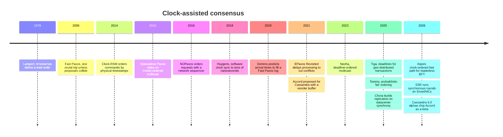
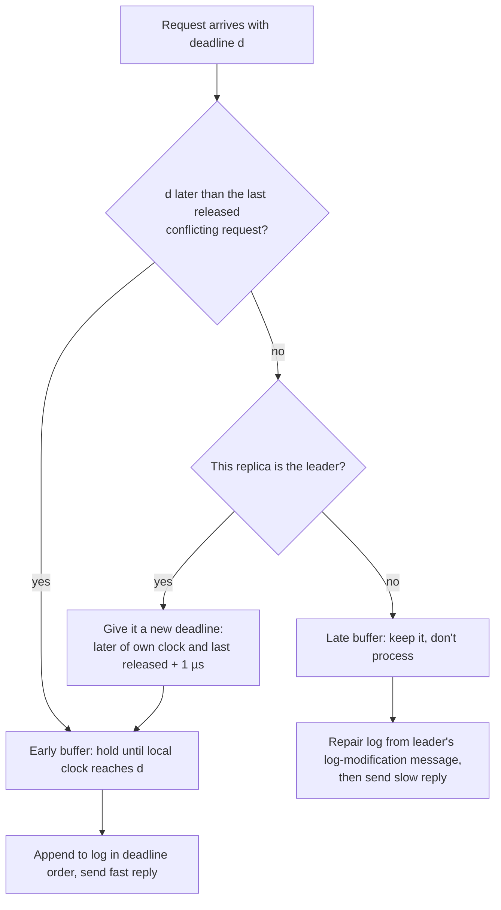
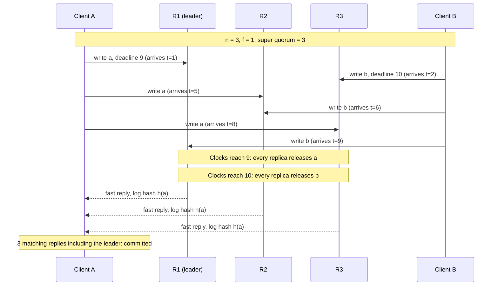

---
aliases:
  - Clocks for Speed Not Safety
  - Deadline-Ordered Multicast
  - Clock-Ordered Consensus
tags:
  - distributed-systems
  - consensus
  - frontier
  - clock-synchronization
  - fast-path
  - nezha
  - tiga
status: complete
sources:
  - https://arxiv.org/abs/2206.03285
  - https://www.vldb.org/pvldb/vol16/p629-geng.pdf
  - https://arxiv.org/html/2509.05759v1
  - https://researchconnect.stonybrook.edu/en/publications/tiga-accelerating-geo-distributed-transactions-with-synchronized-/
  - https://muratbuffalo.blogspot.com/2025/10/tiga-accelerating-geo-distributed.html
  - https://www.inf.usi.ch/pedone/Paper/2014/2014DSNc.pdf
  - https://cs.uwaterloo.ca/~bernard/2020-domino-conext.pdf
  - https://www.usenix.org/conference/nsdi21/presentation/tollman
  - https://cwiki-test.apache.org/confluence/download/attachments/188744725/Accord.pdf?api=v2
  - https://www.instaclustr.com/blog/apache-cassandra-6-accord-transactions-what-you-need-to-know/
  - https://www.usenix.org/conference/nsdi15/technical-sessions/presentation/ports
  - https://blog.acolyer.org/2016/12/08/just-say-no-to-paxos-overhead-replacing-consensus-with-network-ordering/
  - https://arxiv.org/pdf/2601.03390
  - https://arxiv.org/pdf/2510.13664
  - https://arxiv.org/html/2507.12792v1
  - https://www.microsoft.com/en-us/research/wp-content/uploads/2026/09/ssr26ma.pdf
  - https://arxiv.org/html/2607.02275
  - https://arxiv.org/pdf/2610.30114
created: 2026-11-26
updated: 2026-11-26
---

## Table Of Contents

---

- [[#TL;DR|TL;DR]]
- [[#The Problem|The Problem]]
- [[#Foundations|Foundations]]
    - [[#Three Jobs a Clock Can Do|Three Jobs a Clock Can Do]]
    - [[#Fast Paths Need the Same Order Everywhere|Fast Paths Need the Same Order Everywhere]]
    - [[#One-Way Delay and Why It Needs Good Clocks|One-Way Delay and Why It Needs Good Clocks]]
- [[#How We Got Here|How We Got Here]]
- [[#How It Works|How It Works]]
    - [[#The Common Recipe|The Common Recipe]]
    - [[#Nezha and Deadline-Ordered Multicast|Nezha and Deadline-Ordered Multicast]]
    - [[#Worked Example, Two Writers and Three Replicas|Worked Example, Two Writers and Three Replicas]]
    - [[#Clock-RSM, Timestamps as the Order|Clock-RSM, Timestamps as the Order]]
    - [[#Domino, Future Timestamps as Log Slots|Domino, Future Timestamps as Log Slots]]
    - [[#Accord's Reorder Buffer|Accord's Reorder Buffer]]
    - [[#Tiga, Deadlines for Geo-Distributed Transactions|Tiga, Deadlines for Geo-Distributed Transactions]]
    - [[#Aspen and Tommy, Byzantine and Fair Ordering|Aspen and Tommy, Byzantine and Fair Ordering]]
    - [[#The Protocols Side by Side|The Protocols Side by Side]]
- [[#Where It Is Now|Where It Is Now]]
- [[#Trade-offs & Open Problems|Trade-offs & Open Problems]]
- [[#Resources|Resources]]
- [[#Related Notes|Related Notes]]

## ***TL;DR***
---
*Clock-assisted consensus uses synchronized clocks to make replicas see concurrent requests in the same order, so a one-round-trip fast path usually succeeds. The clock only decides how fast a request commits, never whether the answer is right: when clocks or delay estimates are wrong, the protocol falls back to a slower path that is still safe.*

- **The trick:** a sender stamps each request with a **deadline** in synchronized time, roughly "send time plus the longest expected one-way delay to any replica". Each replica holds the request until its own clock passes the deadline and then processes requests in deadline order. If every request arrives before its deadline, every replica ends up with the same order, which is exactly what a [[Leaderless Consensus|fast path]] needs ([Nezha, VLDB 2023](https://www.vldb.org/pvldb/vol16/p629-geng.pdf)).
- **The rule:** "depend on clock synchronization for performance but not for correctness" (Nezha and [Tiga](https://arxiv.org/html/2509.05759v1)). Bad clocks mean more slow paths or longer waits, not wrong results.
- **The family:** Clock-RSM (2014) and Domino (2020) in wide-area replication, EPaxos Revisited (2021), Nezha (2023), Accord's reorder buffer in Cassandra 6.0, Tiga for geo-distributed transactions (SOSP 2025), and in 2026 Aspen for Byzantine fault tolerance.
- **The cost:** a request waits until the slowest expected arrival, so the nearest replica idles, and a skewed or noisy clock pushes requests onto the slow path. It pays off when [[Clock Synchronization]] is tight (PTP, Huygens, cloud time services) and conflicts are common enough that ordering matters.
- **Where it is now (Nov 2026):** Tiga reports 1.3 to 7.2x higher throughput than prior geo-transaction protocols in its own low-contention microbenchmark, Accord is still a beta feature in pre-release Cassandra 6.0, and a separate line of work goes the other way, using datacenter synchrony for the protocol's rounds themselves (Chora, SSR).

## ***The Problem***
---
*A fast path commits in one round trip only if enough replicas saw conflicting requests in the same order. The network does not deliver concurrent requests in the same order to different machines, so under contention the fast path keeps failing.*

[[Leaderless Consensus]] protocols such as Fast Paxos and EPaxos skip the leader: a client (or its proxy) sends a request straight to all replicas, and if a large enough quorum reports the same position for it, it is committed in one round trip. The [[Paxos]] or [[Raft]] alternative is to send to a leader, which orders requests and replicates them, adding a hop and making the leader a bottleneck.

The catch is reordering. Take three replicas and two clients that write the same key at the same moment:

| One-way delay (ms) | Replica R1 | Replica R2 | Replica R3 |
|---|---|---|---|
| Client A | 1 | 5 | 8 |
| Client B | 8 | 5 | 1 |

R1 sees A's write first, R3 sees B's first, and R2 sees them nearly together. No three replicas agree on the order, so neither write can take the fast path and both fall back to a slower recovery. Fast Paxos called this a *collision*, and its slow path can cost far more than the round trip it was trying to save; Domino measured Fast Paxos's slow path at "hundreds of ms" in a wide-area deployment ([Domino, CoNEXT 2020](https://cs.uwaterloo.ca/~bernard/2020-domino-conext.pdf)). EPaxos Revisited showed the same effect in EPaxos: conflicts drive its tail latency to "more than 4x worse than Multi-Paxos" ([NSDI 2021](https://www.usenix.org/conference/nsdi21/presentation/tollman)).

The idea of clock-assisted consensus: if replicas agree *in advance* on when each request should be processed, arrival order stops mattering.

## ***Foundations***
---
*Three ideas carry the rest of the note: a clock can be used for safety, liveness or performance, and these fail very differently; a fast path needs a super quorum with identical order; and estimating one-way delay needs synchronized clocks.*

### Three Jobs a Clock Can Do

*The same clock reading can protect correctness, guarantee progress or merely save time. Clock-assisted consensus deliberately uses clocks only for the last of these.*

| Job | Examples in the vault | If the clock is wrong |
|---|---|---|
| **Safety** | Spanner's commit wait on TrueTime; [[Leases and Fencing\|leader leases]] for local reads ([[Time and Clocks]]) | Wrong answers: stale reads or two leaders |
| **Liveness** | Election timeouts in [[Raft]]; failure detectors ([[Failure Models]]) | Slow failover or needless elections, but no wrong answers |
| **Performance only** | Nezha, Domino, Clock-RSM, Tiga, Accord's reorder buffer, Aspen | More slow paths and more waiting, but no wrong answers |

Accord is a slight exception: its safety does not depend on arrival order, but its liveness proof assumes "process clocks are loosely synchronised" ([Accord whitepaper](https://cwiki-test.apache.org/confluence/download/attachments/188744725/Accord.pdf?api=v2)).

### Fast Paths Need the Same Order Everywhere

*A fast path skips the leader, so after a crash a new leader must be able to reconstruct what committed. That forces a quorum bigger than a majority, and all of its members must report the same order.*

With $n = 2f + 1$ replicas, Nezha and Tiga both use a **super quorum**:

$$
|Q_{\text{fast}}| = f + \left\lceil f/2 \right\rceil + 1
$$

*In words:* more than a majority must agree, so that any later majority overlaps the fast quorum in a majority of its own members and can tell which request was committed. Nezha notes that a plain majority is not enough, because a new leader "could not tell which of two conflicting requests was committed" ([Nezha](https://www.vldb.org/pvldb/vol16/p629-geng.pdf)).

*Example:* $n = 3$ ($f = 1$) needs all 3 replicas; $n = 5$ ($f = 2$) needs 4; $n = 7$ ($f = 3$) needs 6. One slow or reordering replica out of three already loses the fast path, which is why getting the order right matters so much. The [[Leaderless Consensus#Fast Quorum Sizes Side by Side|Leaderless Consensus note]] compares these sizes with EPaxos and Accord.

### One-Way Delay and Why It Needs Good Clocks

*To pick a deadline, a sender must know how long its message takes to reach each replica in one direction. Only synchronized clocks can measure that.*

A round trip is easy to time on one clock. A one-way delay (OWD) is the receive time on the receiver's clock minus the send time on the sender's clock, so any offset between the two clocks goes straight into the measurement. With clocks synchronized to tens of nanoseconds (Huygens) or a few microseconds (PTP, cloud time services), OWDs inside a data center become measurable; with NTP's hundreds of microseconds they are mostly noise. See [[Clock Synchronization]] for how those bounds are produced.

Two practical points recur in every protocol below:
- **Use percentiles, not averages.** Nezha keeps a sliding window of OWD samples per sender and uses a percentile because "just a few outliers" inflate a moving average ([Nezha](https://www.vldb.org/pvldb/vol16/p629-geng.pdf)). Domino uses the 95th percentile over a one-second window ([Domino](https://cs.uwaterloo.ca/~bernard/2020-domino-conext.pdf)).
- **Stable skew is mostly harmless.** If a sender's clock is 3 µs ahead, every measured OWD from it is 3 µs short, and its deadlines are computed from those same short measurements, so the error largely cancels. Domino makes this point: measured arrival times already include the skew ([Domino](https://cs.uwaterloo.ca/~bernard/2020-domino-conext.pdf)). What hurts is skew that *changes* between measurement and use: a clock step, a VM migration, a noisy sync.

## ***How We Got Here***
---
*Lamport showed in 1978 that timestamps can define a total order. For decades consensus avoided physical clocks; in the 2010s systems first borrowed order from the network, then from clocks, and by 2025 clock-ordered fast paths had spread from single data centers to geo-distributed transactions and Byzantine fault tolerance.*

**Timestamps as the order (2014).** Clock-RSM had each replica stamp commands with its local clock and execute them in timestamp order, so it needed "only one round-trip latency to a majority of replicas" for many wide-area placements, and stated that "the correctness of Clock-RSM does not depend on the synchronization precision" ([Du, Sciascia, Pedone, Elnikety, Zwaenepoel, DSN 2014](https://www.inf.usi.ch/pedone/Paper/2014/2014DSNc.pdf)). Loose NTP sync was enough.

**Borrowing order from the network (2015 to 2016).** Inside a data center, Speculative Paxos asked the network for **Mostly-Ordered Multicast**, "a best-effort ordering property for concurrent multicast operations," and relied on it "to order requests in the normal case," reporting 40% lower latency and 2.6x the throughput of standard Paxos ([Ports et al., NSDI 2015](https://www.usenix.org/conference/nsdi15/technical-sessions/presentation/ports)). NOPaxos went further, putting a sequencer in a switch so all receivers process multicasts "in the same order, but messages may be lost," and came within 2% of unreplicated throughput ([Li et al., OSDI 2016](https://blog.acolyer.org/2016/12/08/just-say-no-to-paxos-overhead-replacing-consensus-with-network-ordering/)). Both need control of the network, which cloud tenants don't have.

**Clocks instead of switches (2020 to 2023).** Domino used measured delays to predict when a request would reach each replica and gave it that future timestamp as its log position ([CoNEXT 2020](https://cs.uwaterloo.ca/~bernard/2020-domino-conext.pdf)). EPaxos Revisited added deliberate delays based on synchronized clocks so messages reach replicas in roughly the same order, cutting EPaxos conflicts by at least 50% ([NSDI 2021](https://www.usenix.org/conference/nsdi21/presentation/tollman)). Accord's design for Cassandra added a reorder buffer for the same reason (see [[Leaderless Consensus]]). Nezha, from the Huygens group at Stanford, generalized the idea into a multicast primitive that "can be deployed by cloud tenants without any support from their cloud provider" ([Geng et al., VLDB 2023](https://arxiv.org/abs/2206.03285)).

**Beyond one replica group (2025 to 2026).** Tiga applied deadlines to transactions across shards and regions ([SOSP 2025](https://arxiv.org/html/2509.05759v1)); Tommy turned clock error into a probability of order ([HotNets 2025](https://arxiv.org/pdf/2510.13664)); Aspen brought the idea to Byzantine fault tolerance ([arXiv, v3 Sep 2026](https://arxiv.org/pdf/2601.03390)). Murat Demirbas summed up the trend: "time itself is becoming a coordination primitive" ([Demirbas, Oct 2025](https://muratbuffalo.blogspot.com/2025/10/tiga-accelerating-geo-distributed.html)).

## ***How It Works***
---
*Every protocol here follows the same four steps: measure delays, stamp a deadline, hold until the deadline, process in deadline order. They differ in what the deadline orders (requests, log slots, transactions), where it is computed, and how late arrivals are repaired.*

### The Common Recipe

*Stamp each request with "when everyone should have it", hold it until then, and process in stamp order. A request that misses its stamp goes to a slower, safe path.*

1. **Measure.** Senders (or receivers on their behalf) track one-way delays to each replica using synchronized clocks.
2. **Stamp.** The sender sets a deadline: its send time plus the largest expected delay to the replicas it needs, plus a safety margin.
3. **Hold.** Each replica puts arriving requests in a priority queue ordered by deadline and releases them when its own clock passes the deadline.
4. **Repair.** A request that arrives after a conflicting request with a later deadline was already released can't be slotted in without changing history. It goes to a slow path, usually through a leader.

The time a request waits at replica $r$ is the gap between its deadline and its arrival:

$$
\text{hold}_r \;=\; d - (t_{\text{send}} + \text{OWD}_r) \;\approx\; \max_j \widehat{\text{OWD}}_j - \text{OWD}_r
$$

*In words:* every replica effectively waits for the farthest one, so the nearest replica idles the longest. *Example:* in the table in [[#The Problem|The Problem]], A's write reaches R1 after 1 ms but its deadline is about 8 ms after sending, so R1 holds it for about 7 ms. Ordering is paid for with this wait.

### Nezha and Deadline-Ordered Multicast

*Nezha's primitive, deadline-ordered multicast (DOM), uses synchronized clocks so replicas usually process requests in the same order, then layers a leader-backed fast and slow path on top.*

**Choosing the deadline.** For each sender, a receiver estimates the one-way delay as

$$
\widehat{\text{OWD}}_{s \to r} = P_{50}\big(\text{OWD samples}\big) + \beta\,(\sigma_s + \sigma_r), \qquad \beta = 3
$$

where $\sigma_s, \sigma_r$ are the clock-error standard deviations Huygens reports for sender and receiver. If the estimate falls outside $[0, D]$ it is replaced by a cap $D$, which guards against nonsense from a bad sync. The sender takes the maximum estimate over all receivers and adds it to its send time ([Nezha](https://www.vldb.org/pvldb/vol16/p629-geng.pdf)).

*Example:* median OWDs to three replicas of 40, 55 and 70 µs, and $\sigma = 1$ µs at both ends, give estimates of 46, 61 and 76 µs. A request sent at clock time 1,000,000 µs gets deadline 1,000,076 µs.

**Early and late buffers.** Each replica keeps two structures:
- An **early buffer**, a priority queue by deadline. A request enters only if its deadline is later than the last request already released; it is released at its deadline.
- A **late buffer**, keyed by client and request ID, for requests that arrived too late. Followers keep them unprocessed so they can fetch them locally during repair.

**Fast path.** A stateless proxy multicasts the request. Replicas append it in deadline order; the leader executes it speculatively and returns the result in its fast reply, while followers reply without executing. Each reply carries a hash of the replica's log. The request commits when the proxy has the leader's reply plus matching replies from $f + \lceil f/2 \rceil$ followers, the super quorum.

**Slow path.** When the fast quorum doesn't match, followers sync their logs to the leader's and send slow replies; the proxy commits with the leader's fast reply plus $f$ slow replies, a simple majority, because the leader has already fixed the order. The paper says "the slow path only needs three message delays (1.5 RTTs)."

**Stateless proxies.** Proxies multicast, count quorums and run clock sync for clients, so clients stay simple. A proxy failure looks like a dropped packet, which consensus already handles; the client retries through another proxy.

**Commutativity.** Requests on different keys can execute in either order, so a request only needs a deadline later than the last released request *that conflicts with it*. This is what lets Nezha use the median rather than a high percentile and still take the fast path most of the time; removing it raised latency by up to 24.2% in the ablation.

**Results.** On Google Cloud with 3 replicas, the closed-loop evaluation reports 1.9 to 20.9x higher throughput than the baselines and 1.3 to 4.0x lower latency near saturation; the abstract's medians are 5.4x and 2.3x. The exception was an optimized NOPaxos: in open-loop tests Nezha "sacrifices 33% of latency" against it, but NOPaxos needs a network sequencer. Redis on Nezha came within 5.9% of unreplicated throughput ([Nezha](https://www.vldb.org/pvldb/vol16/p629-geng.pdf)).

### Worked Example, Two Writers and Three Replicas

*The same two conflicting writes from The Problem, now with deadlines. Arrival orders still differ, but release orders don't.*

Clients A and B both write key `x`. Delays are as in the table above, with a 1 ms margin. A sends at $t = 0$ with deadline $0 + 8 + 1 = 9$ ms. B sends at $t = 1$ with deadline $1 + 8 + 1 = 10$ ms.

R3 received b first, but b's deadline is later, so R3 holds it. All three logs read `a, b`, and both writes commit on the fast path. The price is waiting: R1 holds `a` for 8 ms.

Now break a clock. Suppose R3's clock runs 3 ms fast, so it reaches "10" at true time 7 and releases `b` while `a` is still in flight. When `a` arrives at true time 8 with deadline 9, it is earlier than the deadline of `b`, a conflicting request R3 already released, so R3 puts it in the late buffer. The fast quorum for `a` fails (R3's log hash differs). The leader R1 broadcasts its log, R3 repairs to `a, b`, and `a` commits on the slow path. The result is the same; it just took longer.

### Clock-RSM, Timestamps as the Order

*Clock-RSM uses physical timestamps as the total order itself, and waits until no smaller timestamp can still arrive.*

Each replica stamps a client command with "its latest clock time," breaking ties by replica ID, and broadcasts it. A replica commits a command once ([Du et al.](https://www.inf.usi.ch/pedone/Paper/2014/2014DSNc.pdf)):
1. a majority of replicas have logged it;
2. it has seen every command with a smaller timestamp, which it checks by having received something with a timestamp at least this large from every replica;
3. all commands with smaller timestamps are also replicated on a majority.

Condition 2 is the clock dependency: a replica whose clock lags, or which is far away, delays everyone's commits until its timestamps catch up. Correctness never depends on it. Unlike EPaxos, Clock-RSM keeps a total order and provides linearizability, and the paper reports lower latency than Mencius (broadcast variant) at all replicas in its EC2 experiments.

### Domino, Future Timestamps as Log Slots

*Domino makes the predicted arrival time the log position, so a Fast Paxos collision becomes rare.*

Clients probe replicas to estimate one-way delays and predict arrival using the 95th percentile. Each request's timestamp is the time it should reach a supermajority, and that timestamp names "a unique, empty and uncommitted log entry." A replica accepts the request into the slot matching its timestamp; slots nobody claimed are filled with no-ops as clock time passes ([Domino](https://cs.uwaterloo.ca/~bernard/2020-domino-conext.pdf)).

If a request arrives after its slot was already filled with a no-op, that is a collision and Fast Paxos's slow recovery runs, which can take "hundreds of ms." Domino reduces this by padding timestamps by about 8 ms and letting clients switch to a Mencius-style mode (one leader per replica) when the fast path keeps failing. In a 3-replica North American Azure setup, its median commit latency was 48 ms against 64 ms for EPaxos and 75 ms for Mencius. Clock skew "will only affect Domino's performance instead of correctness."

### Accord's Reorder Buffer

*Accord orders transactions by hybrid logical clock timestamps, and holds each PreAccept just long enough that earlier-stamped transactions from slower coordinators arrive first.*

Accord, Cassandra 6.0's transaction protocol, stamps each transaction with a coordinator timestamp $t_0$ from a [[Time and Clocks|hybrid logical clock]] with the node ID appended ([Instaclustr, Apr 2026](https://www.instaclustr.com/blog/apache-cassandra-6-accord-transactions-what-you-need-to-know/)). The whitepaper defines when a replica $P$ may process a PreAccept from coordinator $C$:

$$
\text{Deadline}(t_0, C, P) = t_0 + \text{SkewMax} + \max_{C' \in \mathcal{C}} \text{Latency}(C', P) - \text{Latency}(C, P)
$$

*In words:* it is "the last point in time at which a transaction might arrive from other members of C with an earlier $t_0$." Replicas buffer PreAccepts "in a queue ordered by $t_0$ until the computed Deadline." If "our bounds on message latency and clock synchrony are not breached and processes are responsive," any two transactions with $t_0^\gamma < t_0^\tau$ reach the fast-path electorate in timestamp order, so conflicting transactions still commit on the fast path ([Accord whitepaper](https://cwiki-test.apache.org/confluence/download/attachments/188744725/Accord.pdf?api=v2)). The whitepaper does not define precisely how Latency is measured. If the bounds are breached, safety holds because "P's safety does not depend on message arrival order"; only the fast path is lost. The fast-path quorum and the rest of the protocol are in [[Leaderless Consensus#Leaderless Transactions, Janus and Accord|Leaderless Consensus]].

### Tiga, Deadlines for Geo-Distributed Transactions

*Tiga gives each transaction a future timestamp that covers the farthest shard, so shards on different continents execute it in the same order without first talking to each other, and commits most transactions in one wide-area round trip.*

Tiga merges concurrency control and consensus (the same move as Janus and Accord; see [[Distributed Transactions]]). A coordinator stamps a transaction with ([Geng, Mu, Sivaraman, Prabhakar, SOSP 2025](https://arxiv.org/html/2509.05759v1)):

$$
ts = t_{\text{send}} + \max_{\text{shards}}\ \max_{r \in \text{super quorum}} \text{OWD}_r + \Delta, \qquad \Delta = 10\ \text{ms}
$$

where the super quorum is the $1 + f + \lceil f/2 \rceil$ closest replicas in each shard.

*Example:* two shards, 3 replicas each. OWDs from the coordinator are 5, 60 and 90 ms to shard 1 and 10, 70 and 95 ms to shard 2. With $f = 1$ the super quorum is all 3, so $ts = t_{\text{send}} + 95 + 10 = t_{\text{send}} + 105$ ms. A transaction sent at 12:00:00.000 is executed by every server once its clock passes 12:00:00.105.

- **Servers** hold transactions in a timestamp-ordered queue and reject one whose conflicting successor was already released. A leader may raise a late transaction's timestamp to its own clock; followers never change timestamps.
- **Fast path, about 1 WRTT:** each shard's leader executes optimistically; the coordinator needs matching replies (timestamp plus log hash) from a super quorum in every shard and the same timestamp from all leaders.
- **Leaders agree on the timestamp** by exchanging theirs and taking the maximum. If all match, this costs about half a WRTT and overlaps the fast path. If one leader used a smaller timestamp, it revokes its optimistic execution and re-executes. This step, not the clocks, is what prevents a cross-shard order that contradicts real time.
- **Slow path, 1.5 to 2 WRTT:** leaders sync logs to followers and commit when $f + 1$ servers reach the sync point.

On Google Cloud (South Carolina, Finland, Brazil, with remote coordinators in Hong Kong), Tiga reported MicroBench peak throughput of 157.3k transactions per second against 119.6k for Calvin+ and 77.8k for Janus, and on TPC-C 1.6 to 3.5x the throughput and 1.5 to 3.7x lower median latency of the baselines. It performed about the same with Chrony (about 4.5 ms clock error) as with Huygens (about 0.012 ms); a deliberately bad clock (about 62 ms error) inflated latency but did not break correctness ([Tiga](https://arxiv.org/html/2509.05759v1)). Demirbas calls it "a thoughtful piece of engineering, not a conceptual breakthrough," noting that its core is "essentially the Deadline-Ordered Multicast (DOM) idea from the Nezha paper" ([Demirbas](https://muratbuffalo.blogspot.com/2025/10/tiga-accelerating-geo-distributed.html)).

### Aspen and Tommy, Byzantine and Fair Ordering

*The same idea is spreading to settings where clients or replicas may lie, and to ordering by "who sent first" rather than just "the same order everywhere".*

**Aspen** (NYU and Stony Brook, arXiv 2026) targets leaderless speculative [[Byzantine Fault Tolerance|BFT]], whose fast path breaks when concurrent requests arrive in different orders and forces "costly recovery." Clients attach an estimated time of arrival; replicas release a request when their clock passes it. With $n = 3f + 2p + 1$ replicas, the fast quorum is $n - p$, so the fast path survives $p$ diverged replicas, with background realignment and a PBFT-style repair for the rest. The authors state clock errors "cannot affect safety or liveness," and cap waiting with a maxWait. With 6 replicas across 12 cloud regions, 99.84% of commits over an hour at 50k requests per second took the fast path, and latency was 1.1 to 5.5x lower than the baselines ([Qian et al.](https://arxiv.org/pdf/2601.03390)).

**Tommy** (HotNets 2025) asks a different question: which message was really sent first? Instead of treating clock error as a bound, each client learns the distribution of its clock offset, and a sequencer computes the *probability* that one message preceded another. Messages it can't order confidently (threshold 0.75 in the evaluation) share a batch. This orders events that Lamport's happened-before leaves concurrent, but the relation is not always transitive, and breaking cycles optimally is NP-hard ([Haseeb et al.](https://arxiv.org/pdf/2510.13664)). It is a fairness tool (for exchanges and auctions) more than a consensus protocol.

### The Protocols Side by Side

*Each protocol orders something different by clock, but all fall back to a clock-free path when the prediction fails.*

| Protocol | Setting | What the clock orders | Normal case | When clocks or estimates are wrong |
|---|---|---|---|---|
| **Clock-RSM** (DSN 2014) | Wide-area replication | Every command, by stamp | 1 RTT to a majority for many placements | Commits wait for lagging replicas |
| **Domino** (CoNEXT 2020) | Wide-area replication | Log slots, by predicted arrival | 1 RTT if a supermajority accepts | Collision, slow path of up to hundreds of ms |
| **EPaxos Revisited** (NSDI 2021) | Wide-area replication | Processing delay before EPaxos | More fast paths; at least 50% fewer conflicts | More conflicts, as in plain EPaxos |
| **Nezha** (VLDB 2023) | Data center or WAN | Requests, by deadline | 1 RTT with a super quorum | Late buffer, slow path in 1.5 RTT |
| **Accord** (Cassandra 6.0 beta) | Multi-shard transactions | PreAccepts, by HLC $t_0$ | 1 RTT with fast-path electorate | Slow path; safety unaffected |
| **Tiga** (SOSP 2025) | Geo-distributed transactions | Transactions, by future timestamp | About 1 WRTT | Timestamp agreement or re-execution, up to 2 WRTT |
| **Aspen** (arXiv 2026) | Leaderless BFT | Requests, by estimated arrival | Fast quorum $n - p$ | Realign or PBFT-style repair |

## ***Where It Is Now***
---
*As of November 2026 the idea is established in research and arriving in one production system: Tiga is the most complete design, Accord is still a beta in pre-release Cassandra 6.0, and bounded cloud clocks make the approach deployable. A parallel line uses datacenter synchrony for the protocol itself, not just its speed.*

- **Geo-distributed transactions (SOSP 2025).** Tiga, published at SOSP in October 2025 ([Stony Brook](https://researchconnect.stonybrook.edu/en/publications/tiga-accelerating-geo-distributed-transactions-with-synchronized-/)), is open source and shows clock-ordered commits in one wide-area round trip across shards. Its numbers come from its own testbed and adapted baselines (for example, Calvin+ runs on Nezha), and Demirbas faults it for not citing Unanimous 2PC and for needing "stronger formalization" ([Demirbas, Oct 2025](https://muratbuffalo.blogspot.com/2025/10/tiga-accelerating-geo-distributed.html)).
- **Production: Accord in Cassandra 6.0.** Accord, with its reorder buffer, ships disabled by default as a beta in a release line that was still pre-release as of the latest sources; Instaclustr describes it as "still maturing" ([Instaclustr](https://www.instaclustr.com/blog/apache-cassandra-6-accord-transactions-what-you-need-to-know/)). Status and caveats are tracked in [[Leaderless Consensus#Accord in Cassandra 6.0|Leaderless Consensus]]. No public benchmark yet shows how often its fast path succeeds in real deployments.
- **BFT and fairness (2025 to 2026).** Aspen (v3 dated September 2026) and Tommy (HotNets 2025) extend the same group's idea to Byzantine settings and fair ordering; Byzantine clients that lie about timestamps are an open issue Tommy flags.
- **The other direction: synchrony for the protocol itself.** Chora (NUS and others, 2025) argues "modern data center systems can be designed to provide strong synchrony properties in the common case," runs synchronized rounds under 2 µs with PTP, and falls back to "a *responsive mode*" when synchrony is violated, reporting 255% and 109% higher throughput than single- and multi-leader protocols ([Wan et al.](https://arxiv.org/html/2507.12792v1)). SSR (Max Planck and Microsoft Research, APSys 2026) runs synchronous rounds on FPGA SmartNICs with hardware-synchronized clocks, halting and handing to software recovery when a round's evidence is missing; its 14.9x and 24.9x throughput gains are from a simulator ([Ma, Costa, Xia](https://www.microsoft.com/en-us/research/wp-content/uploads/2026/09/ssr26ma.pdf)). Blockchains use clocks similarly: Cadence (Category Labs, Jul 2026) fixes a common per-slot deadline from synchronized clocks so several proposers can contribute to each block ([Babel et al.](https://arxiv.org/html/2607.02275)).
- **Verification keeps finding bugs in fast-path optimizations.** The October 2026 *The End of Consensus Research?* paper's Lean formalization found two flaws in EPaxos Revisited that "allow replicas to execute conflicting commands in opposite orders." Both are in its dependency-pruning rules, not its clock-based delays ([Burgelin et al.](https://arxiv.org/pdf/2610.30114)). The lesson for clock-assisted designs is that the clock part is the easy part to keep safe; the optimizations around it are where the bugs are. See [[Formal Methods in Practice]] and [[AI-Assisted Protocol Design]].
- **Better clocks are a cloud product.** Cloud time services with error bounds (AWS ClockBound, PTP on cloud instances) give tenants the microsecond clocks these protocols want, without owning switches; see [[Clock Synchronization]].

## ***Trade-offs & Open Problems***
---
*Clocks buy a fast path under contention at the cost of waiting for the slowest expected arrival, and their benefit depends on how good the clocks and delay estimates really are. The safety argument is simple; the performance argument and the surrounding optimizations are not.*

| Choice | You get | You pay |
|---|---|---|
| Leader orders everything (Multi-Paxos, Raft) | Simple, no clock assumptions | Extra hop to the leader; leader bottleneck |
| Dependency graphs (EPaxos, Janus) | No clock assumptions | Conflicts cause slow paths and long execution tails |
| Network ordering (NOPaxos, Speculative Paxos) | Near-unreplicated performance in one data center | Needs control of switches; not available to cloud tenants |
| Clock deadlines (Nezha, Tiga, Accord) | Same order at all replicas under contention; deployable on clouds | Every request waits for the slowest expected arrival; depends on clock and delay quality |
| Clock timestamps as total order (Clock-RSM) | Linearizable total order with loose clocks | Commits wait for the slowest replica's timestamps |
| Synchronous rounds (Chora, SSR) | Microsecond commits without a leader | Needs datacenter synchrony; fallback or halt when it breaks |

Open problems worth tracking:
- **The waiting tax.** Deadlines add the gap between the farthest and nearest replica to every request, conflicting or not. Commutativity checks (Nezha) and per-key conflict tracking (Tiga) reduce how often a late arrival matters, but not the wait itself.
- **Delay estimates under load.** Percentile estimates lag sudden queuing. A replica that becomes slow without failing pushes requests onto the slow path, which is the [[Gray and Fail-Slow Failures]] problem in another form; see also [[Tail Latency and Hedging]].
- **Clock jumps.** Stable skew largely cancels, but a step correction or a VM live migration does not; cloud time interfaces now signal such disruptions so software can stop trusting its clock ([[Clock Synchronization]]).
- **Hot keys.** Under heavy contention on one key, every protocol here leans on its leader or slow path; see [[Hot Keys and Cache Stampedes]].
- **Byzantine timestamps.** A malicious client can pick deadlines to jump the queue or force slow paths. Aspen bounds the damage to performance; Tommy lists manipulation by Byzantine clients as open.
- **Proofs for the whole protocol.** "Clocks don't affect safety" is easy to argue; the recovery paths, log repair and pruning rules around them are where verification has found bugs ([Burgelin et al.](https://arxiv.org/pdf/2610.30114)). [[Deterministic Simulation Testing]] with injected clock skew is the practical check.
- **Production evidence.** Outside research testbeds, Accord in Cassandra 6.0 will be the first widely deployed test of a clock-assisted fast path.

## ***Resources***
---
*Start with Nezha for the core mechanism, then Tiga for the transactional version; read Clock-RSM and Domino for the wide-area history, and Aspen and Tommy for where it's heading.*

**Core papers**
- [Nezha: Deployable and High-Performance Consensus Using Synchronized Clocks](https://www.vldb.org/pvldb/vol16/p629-geng.pdf): Geng, Sivaraman, Prabhakar, Rosenblum, PVLDB 16(4), VLDB 2023 ([arXiv](https://arxiv.org/abs/2206.03285)).
- [Tiga: Accelerating Geo-Distributed Transactions with Synchronized Clocks](https://arxiv.org/html/2509.05759v1): Geng, Mu, Sivaraman, Prabhakar, SOSP 2025 (technical report).
- [Clock-RSM](https://www.inf.usi.ch/pedone/Paper/2014/2014DSNc.pdf): Du, Sciascia, Pedone, Elnikety, Zwaenepoel, DSN 2014.
- [Domino](https://cs.uwaterloo.ca/~bernard/2020-domino-conext.pdf): Yan, Yang, Wong, CoNEXT 2020.
- [EPaxos Revisited](https://www.usenix.org/conference/nsdi21/presentation/tollman): Tollman, Park, Ousterhout, NSDI 2021.
- [Accord whitepaper (draft)](https://cwiki-test.apache.org/confluence/download/attachments/188744725/Accord.pdf?api=v2): reorder buffer and deadline formula.

**Network-ordering predecessors**
- [Designing Distributed Systems Using Approximate Synchrony in Data Center Networks](https://www.usenix.org/conference/nsdi15/technical-sessions/presentation/ports): Ports et al., NSDI 2015 (Speculative Paxos).
- [Just Say NO to Paxos Overhead](https://blog.acolyer.org/2016/12/08/just-say-no-to-paxos-overhead-replacing-consensus-with-network-ordering/): Adrian Colyer's summary of NOPaxos, OSDI 2016.

**Frontier**
- [Aspen: Making Leaderless BFT Fast Paths Practical with Synchronized Clocks](https://arxiv.org/pdf/2601.03390): Qian et al., arXiv 2026.
- [Beyond Lamport, Towards Probabilistic Fair Ordering](https://arxiv.org/pdf/2510.13664): Haseeb et al., HotNets 2025.
- [Building State Machine Replication Using Practical Network Synchrony](https://arxiv.org/html/2507.12792v1): Wan et al., 2025 (Chora).
- [SSR: Synchronous State Machine Replication with a Timing-Aligned Split Architecture](https://www.microsoft.com/en-us/research/wp-content/uploads/2026/09/ssr26ma.pdf): Ma, Costa, Xia, APSys 2026.
- [Cadence: Extreme Pipelining with Multiple Concurrent Proposers](https://arxiv.org/html/2607.02275): Babel et al., arXiv Jul 2026.
- [The End of Consensus Research?](https://arxiv.org/pdf/2610.30114): Burgelin et al., EPFL, Oct 2026.

**Commentary**
- [Tiga review](https://muratbuffalo.blogspot.com/2025/10/tiga-accelerating-geo-distributed.html): Murat Demirbas, Oct 2025.
- [Apache Cassandra 6 Accord transactions: what you need to know](https://www.instaclustr.com/blog/apache-cassandra-6-accord-transactions-what-you-need-to-know/): Instaclustr, 2026.

## ***Related Notes***
---
*The protocols these build on, the clocks they rely on, and the systems that use them.*

- [[Leaderless Consensus]] — The fast paths that clocks make likely: Fast Paxos, EPaxos, Accord and their quorum sizes.
- [[Clock Synchronization]] — How NTP, PTP, Huygens and cloud time services produce the clocks and error bounds used here.
- [[Time and Clocks]] — Lamport clocks, hybrid logical clocks, and clocks used for safety (TrueTime, commit wait).
- [[Paxos]] — The leader-based baseline and the slow path most of these fall back to.
- [[Raft]] — The deployable baseline Nezha set out to match on ease of deployment.
- [[Distributed Transactions]] — Tiga, Janus and Accord merge concurrency control with consensus.
- [[Deterministic Transactions]] — Calvin-style ordering before execution, which Tiga compares against.
- [[Byzantine Fault Tolerance]] — Aspen brings clock-ordered fast paths to BFT.
- [[Failure Models]] — Why safety must hold in an asynchronous model even when clocks lie.
- [[Leases and Fencing]] — The contrasting case where clocks do protect safety.
- [[Gray and Fail-Slow Failures]] — Slow replicas push requests onto the slow path.
- [[Formal Methods in Practice]] — Proofs and model checking for fast paths and their recovery.
- [[Deterministic Simulation Testing]] — Testing with injected clock skew and jumps.
- [[AI-Assisted Protocol Design]] — The agent-designed protocol work that found bugs in EPaxos Revisited.
- [[Hot Keys and Cache Stampedes]] — Contention that no ordering trick removes.
