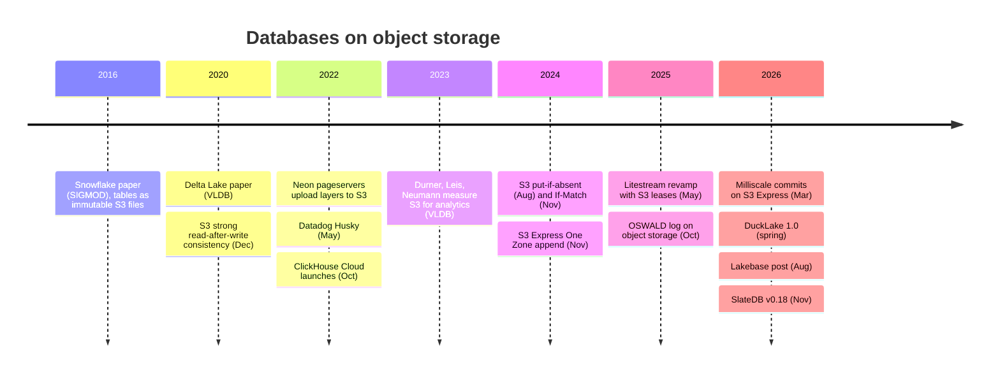
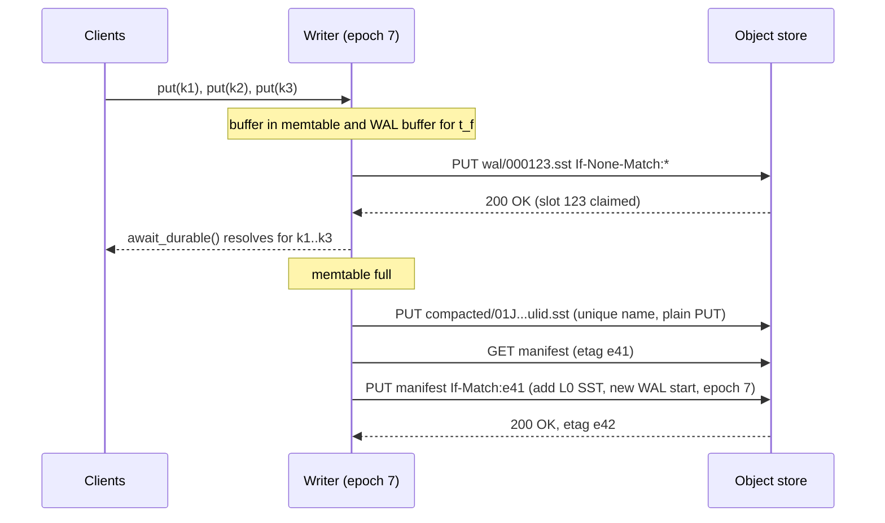
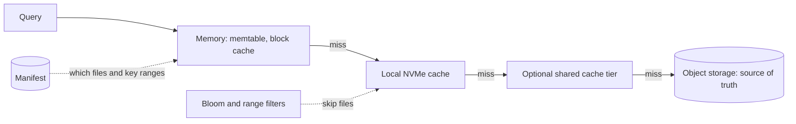
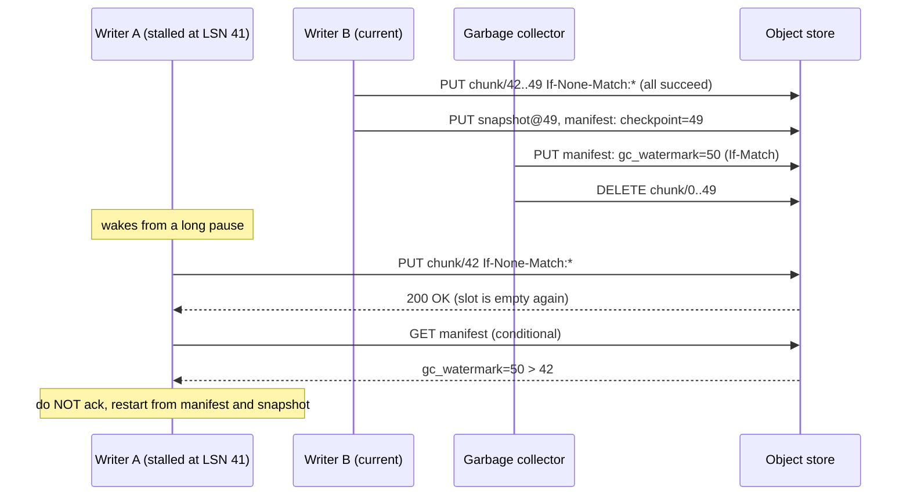

---
aliases:
  - Object-Native Storage Engines
tags:
  - distributed-systems
  - storage
  - object-storage
  - storage-engines
  - lsm
  - disaggregation
  - frontier
status: complete
sources:
  - https://vldb.org/pvldb/vol16/p2769-durner.pdf
  - https://www.cs.cmu.edu/%7E15721-f24/papers/Snowflake.pdf
  - https://www.vldb.org/pvldb/vol13/p3411-armbrust.pdf
  - https://github.com/slatedb/slatedb
  - https://github.com/slatedb/slatedb/releases
  - https://slatedb.io/docs/design/overview/
  - https://slatedb.io/blog/introducing-slatedb/
  - https://slatedb.io/blog/compaction-roadmap/
  - https://slatedb.io/blog/benchmarking-slatedb/
  - https://cljdoc.org/d/io.github.maxweber/slatedb/0.1.0/doc/manifest-design
  - https://www.bitsxpages.com/p/protocols-for-transactional-usage
  - https://public-6ecl.pages.dev/oswald
  - https://arxiv.org/html/2603.02108v1
  - https://docs.aws.amazon.com/AmazonS3/latest/userguide/directory-buckets-objects-append.html
  - https://aws.amazon.com/about-aws/whats-new/2024/11/amazon-s3-express-one-zone-append-data-object
  - https://docs.aws.amazon.com/AmazonS3/latest/userguide/conditional-writes.html
  - https://aws.amazon.com/s3/pricing/
  - https://turbopuffer.com/blog/turbopuffer
  - https://turbopuffer.com/docs/architecture
  - https://www.databricks.com/blog/object-storage-wal-lakebase-postgres-agentic-era
  - https://neon.com/blog/architecture-decisions-in-neon
  - https://clickhouse.com/blog/clickhouse-cloud-stateless-compute
  - https://datadoghq.com/blog/engineering/introducing-husky
  - https://fly.io/blog/litestream-revamped/
  - https://github.com/rockset/rocksdb-cloud
  - https://infoq.com/news/2026/05/ducklake-sql-catalog
  - https://www.tigrisdata.com/blog/object-storage-all-need/
  - https://iceberg.apache.org/spec/
  - https://aws.amazon.com/about-aws/whats-new/2026/11/amazon-s3-increases-read-request-rate/
created: 2026-11-26
updated: 2026-11-26
---

## Table Of Contents

---

- [[#TL;DR|TL;DR]]
- [[#The Problem|The Problem]]
- [[#Foundations|Foundations]]
    - [[#The Primitives an Engine Gets|The Primitives an Engine Gets]]
    - [[#The Request Cost Model|The Request Cost Model]]
    - [[#The Latency Model|The Latency Model]]
- [[#How We Got Here|How We Got Here]]
- [[#How It Works|How It Works]]
    - [[#Where Is the Commit Point|Where Is the Commit Point]]
    - [[#The Write Path: Batching Is the Whole Game|The Write Path: Batching Is the Whole Game]]
    - [[#The Read Path: A Cache Hierarchy in Front of the Truth|The Read Path: A Cache Hierarchy in Front of the Truth]]
    - [[#Compaction and Garbage Collection as Separate Jobs|Compaction and Garbage Collection as Separate Jobs]]
    - [[#Worked Example: The Garbage Collector and the Zombie Writer|Worked Example: The Garbage Collector and the Zombie Writer]]
    - [[#Readers, Checkpoints, Clones and Branches|Readers, Checkpoints, Clones and Branches]]
    - [[#The Low-Latency Tier: Logging to S3 Express One Zone|The Low-Latency Tier: Logging to S3 Express One Zone]]
- [[#Where It Is Now|Where It Is Now]]
- [[#Trade-offs & Open Problems|Trade-offs & Open Problems]]
- [[#Resources|Resources]]
- [[#Related Notes|Related Notes]]

## ***TL;DR***
---
*An object-native storage engine treats an object store such as S3 as its only durable storage, and memory and local SSD as caches. Since S3 became strongly consistent (2020) and gained conditional writes (2024), a whole engine, including its write-ahead log and its commit point, can be built from PUT, GET, LIST and compare-and-swap alone.*

- **The idea:** stop replicating disks yourself. Write immutable files to [[Object Storage|object storage]], publish them by updating a small piece of metadata atomically, and let any number of stateless compute nodes read, compact and cache them. Durability, replication across zones and capacity planning become the object store's problem.
- **The catch:** a request to S3 Standard costs tens to hundreds of milliseconds and is billed per call. S3 lists GETs at \$0.40 and PUTs at \$5.00 per million ([Durner et al., VLDB 2023, Table 1](https://vldb.org/pvldb/vol16/p2769-durner.pdf)). So every design is about *batching* writes into few PUTs and *caching* reads so few requests reach the store.
- **The central design choice is where the commit happens.** Either the object store itself is the commit point (a conditional `PUT` on a manifest or on the next numbered log file), or a small consensus-replicated service sequences commits and the object store only holds bytes ([[#Where Is the Commit Point|below]]).
- **Who builds this way (Nov 2026):** SlateDB (an embedded [[LSM Trees|LSM]], v0.18.1 on 7 November 2026), turbopuffer (search), Neon and Databricks Lakebase (Postgres), ClickHouse Cloud (SharedMergeTree), Datadog's Husky (events), Litestream (SQLite), DuckLake and the lakehouse formats (analytics), and diskless Kafka ([[Diskless Streaming]]).
- **What's new in 2026:** research on committing to the low-latency S3 Express One Zone tier (Milliscale, March 2026), formally checked object-store log protocols (OSWALD, SlateDB's Fizzbee specs), and DuckLake 1.0 putting table metadata back in a SQL database. The open problems are commit latency, single-key contention, multi-writer engines and safe garbage collection.

## ***The Problem***
---
*A classic replicated database keeps three copies of its data on local disks and spends its engineering effort on replication, rebalancing and recovery. Object storage already solves durability and capacity at a fraction of the price, but it is slow, metered per request and has no locks, appends or renames in its standard tier.*

A shared-nothing database such as one built on [[Raft]] stores each byte on three machines' SSDs, ships every write across availability zones, and has to move data when nodes join or fail ([[Replication]], [[Partitioning]]). turbopuffer's founder puts the storage price gap this way, per TB per month: about \$600 for triple-replicated SSD, about \$1,600 with a RAM cache in front (typical of incumbent search and relational systems), and about \$70 for S3 plus an SSD cache ([Eskildsen, updated Mar 2026](https://turbopuffer.com/blog/turbopuffer)). Durner, Leis and Neumann measured the same gap from the other side: EBS gp2 at \$102.4 per TiB-month and instance NVMe at about \$158 per TB-month, against S3's \$23.55 per TiB-month ([VLDB 2023, §2.2](https://vldb.org/pvldb/vol16/p2769-durner.pdf)).

But a storage engine expects things object storage doesn't give:

| An engine expects | Local disk gives | Object storage gives |
|---|---|---|
| Durable small writes (a commit) | `fsync` in microseconds to a millisecond | A whole-object `PUT`, tens to hundreds of ms on S3 Standard |
| Cheap random reads | Free after the hardware is bought | A billed `GET` per request |
| Append to a log file | `write` + `fsync` | No append on S3 Standard; append only on S3 Express One Zone, 10,000 times per object ([AWS docs](https://docs.aws.amazon.com/AmazonS3/latest/userguide/directory-buckets-objects-append.html)) |
| Atomic rename, file locks | POSIX | None; only per-key conditional writes |
| One owner per file | The OS process | Any client with credentials can write any key |

SlateDB's team tried running RocksDB's storage interface against S3 first and found exactly these gaps: no file locks, no caching layer and no links ([SlateDB blog](https://slatedb.io/blog/introducing-slatedb/)). The problem this note covers is: *how do you build a correct, fast, affordable database whose only durable state is in an object store?*

## ***Foundations***
---
*Three things decide every design: the small set of primitives the store offers, a cost model in which requests rather than bytes dominate, and a latency model that rewards large requests and many of them in flight.*

### The Primitives an Engine Gets

*Everything is built from five operations. Conditional writes are the one that turned object stores from dumb bins into coordination primitives.*

Almog Gavra, a SlateDB contributor, lists the primitives a transactional protocol can use ([bits & pages, May 2026](https://www.bitsxpages.com/p/protocols-for-transactional-usage)):

| Primitive | What it guarantees | Typical use |
|---|---|---|
| Atomic `PUT` | The object appears whole or not at all; racing writers have no guaranteed winner | Data files with unique names (ULIDs, UUIDs) |
| Conditional `PUT` (`If-None-Match: *`) | Create only if absent; the loser gets `412` | "Claim the next log slot" (numbered WAL or Delta log files) |
| Conditional `PUT` (`If-Match: <etag>`) | Replace only if unchanged since you read it | Compare-and-swap on a manifest |
| Conditional `GET` (`If-None-Match`) | `304 Not Modified` if unchanged, with no body | Cheap polling of a manifest by readers |
| Strongly consistent `GET`/`LIST` | A successful `PUT` is visible to later reads and listings | Recovery, garbage collection scans |

S3 added put-if-absent in August 2024 and compare-and-swap via `If-Match` in November 2024; a conditional write costs the same as a normal one ([AWS conditional writes](https://docs.aws.amazon.com/AmazonS3/latest/userguide/conditional-writes.html); [Gavra](https://www.bitsxpages.com/p/protocols-for-transactional-usage)). Together with strong read-after-write consistency, a single key becomes a linearizable register, which is enough to build [[Leases and Fencing|fencing]], a log and a commit protocol ([[Consistency Models]], [[Object Storage#Conditional Writes Turn S3 into a Coordination Primitive|Object Storage]]).

### The Request Cost Model

*On object storage you pay per request, almost regardless of size. A naive engine that does one PUT per write is ruinously expensive; a batching one is cheap.*

"Downloading a 1 KiB object costs the same as a 1 TiB object, as long as only one HTTP request is issued" ([Durner et al., §2.2](https://vldb.org/pvldb/vol16/p2769-durner.pdf)). For a writer that flushes one batch every $t_f$ seconds, the monthly PUT bill is:

$$C_{\text{PUT}} = \frac{T_{\text{month}}}{t_f} \cdot p_{\text{PUT}}, \qquad T_{\text{month}} \approx 2.59 \times 10^{6}\ \text{s}$$

*In plain English:* cost depends on how often you flush, not on how much you write.

*Worked example.* Take S3 Standard at $p_{\text{PUT}} = \$5$ per million and a workload of 10,000 operations per second, half writes and half reads.
- **One PUT per write:** 5,000 PUT/s × 2.59M s × \$5/M ≈ \$64,800 a month, plus 5,000 GET/s ≈ \$5,200 for reads: about \$70K a month. SlateDB's introduction uses this same example to explain why batching is mandatory ([SlateDB blog](https://slatedb.io/blog/introducing-slatedb/)).
- **Flush every 100 ms:** 10 PUT/s → 25.9M PUTs ≈ **\$130 a month**, whatever the write rate.
- **Flush every 1 s** (turbopuffer's per-namespace WAL rate, [docs](https://turbopuffer.com/docs/architecture)): ≈ \$13 a month per namespace.

Reads follow the same logic: Durner et al. find that "Sizes of 8 - 16 MiB are cost-throughput optimal" because below about 8 MiB request charges dominate, and above that throughput no longer improves (Finding 3, §2.5). Idle costs matter too: SlateDB found an idle database with default settings spent about \$40 a month just polling, cut to under \$5 ([SlateDB, Aug 2026](https://slatedb.io/blog/benchmarking-slatedb/)). LIST is about 12x the price of a GET, so protocols avoid listing on the hot path ([Gavra](https://www.bitsxpages.com/p/protocols-for-transactional-usage)).

### The Latency Model

*Object store latency is a fixed first-byte cost plus a per-byte cost. To get full bandwidth you need large requests and hundreds of them in flight; to get low commit latency you need small requests and a short batch window, and those pull in opposite directions.*

Durner et al. measured S3 at a median of about 30 ms base latency plus about 20 ms per MiB, and model the number of outstanding requests needed to reach a target throughput $B$ (§2.8):

$$N = \frac{B \cdot (L_0 + s \cdot \ell)}{s}$$

where $L_0$ is base latency, $\ell$ is per-MiB latency and $s$ is request size. *In plain English:* this is [[Message Queues#Backlogs and Little's Law|Little's Law]]; requests in flight equals arrival rate times time in the system.

*Worked example.* A 100 Gbit/s instance moves about 11,900 MiB/s. With $s = 16$ MiB, each request takes 30 + 16 × 20 = 350 ms, so $N$ = 11,900 × 0.35 / 16 ≈ 260 requests in flight. The paper puts the optimum at about 200 to 250, and its Finding 4 is that saturating the network "requires hundreds of outstanding requests." Drop to 1 MiB requests and each takes 50 ms, $N$ ≈ 600, and the GET rate rises from about 745/s to 11,900/s: request charges go from about \$1 to about \$17 an hour at \$0.40 per million.

For commits, the expected latency of a batched write is roughly half the batch window plus one PUT:

$$L_{\text{commit}} \approx \frac{t_f}{2} + L_{\text{PUT}}$$

*Worked example.* SlateDB quotes object-store requests at 50–100 ms ([SlateDB blog](https://slatedb.io/blog/introducing-slatedb/)). With $t_f$ = 100 ms the average write waits 50 ms for its batch, then 50–100 ms for the PUT: about 100–150 ms. turbopuffer reports p50 = 165 ms for a 500 kB write ([docs](https://turbopuffer.com/docs/architecture)). On S3 Express One Zone, appends of 128–512 KB take about 8 ms ([Zhou et al., Mar 2026](https://arxiv.org/html/2603.02108v1)), which is why that tier is the frontier for OLTP ([[#The Low-Latency Tier: Logging to S3 Express One Zone|below]]).

Tails are wide. A single 16 MiB GET ranged from about 25 to 95 MiB/s over eight weeks of measurement, and fewer than 5% of objects were not yet downloaded after 600 ms, so the paper recommends hedged requests ([Durner et al., §2.3, §2.7](https://vldb.org/pvldb/vol16/p2769-durner.pdf); [[Tail Latency and Hedging]]).

## ***How We Got Here***
---
*Analytics engines moved to object storage first, because scans tolerate latency. Transactional engines followed once S3 became consistent and conditional, and the request-cost and latency limits of standard object storage started to be engineered around.*

- **Analytics first.** Snowflake's 2016 paper describes tables "horizontally partitioned into large, immutable files" on S3, with compute nodes caching them on local disk; S3 won despite its latency because "its usability, high availability, and strong durability guarantees were hard to beat" ([Dageville et al., §3.1](https://www.cs.cmu.edu/%7E15721-f24/papers/Snowflake.pdf); [[Disaggregated Systems#Snowflake: Analytics on Object Storage|Disaggregated Systems]]). Delta Lake (2020) made the table itself a log of numbered JSON files in the bucket, but on S3 it needed an external coordination service because S3 had no put-if-absent ([Armbrust et al., §3](https://www.vldb.org/pvldb/vol13/p3411-armbrust.pdf)). Iceberg pushed the atomic swap into a catalog ([Iceberg spec](https://iceberg.apache.org/spec/); [[Lakehouse Table Formats]]).
- **Engines with an external sequencer.** Datadog's Husky (2022) put event files in S3 and used FoundationDB as "the strongly consistent source of truth for the set of files currently visible to each customer"; writers, compactors and readers are all stateless ([Artoul and Watt, May 2022](https://datadoghq.com/blog/engineering/introducing-husky)). Neon kept the commit on a Paxos-replicated WAL service (safekeepers) and pushed page history to S3 off the critical path ([Linnakangas, 2022](https://neon.com/blog/architecture-decisions-in-neon)). ClickHouse Cloud launched in October 2022 on ReplicatedMergeTree and later moved to SharedMergeTree, which keeps the list of data parts in Keeper, its ZooKeeper-compatible coordination service, and the parts in object storage ([Schreiber, Jul 2025](https://clickhouse.com/blog/clickhouse-cloud-stateless-compute); [[Coordination Services]]). RocksDB-Cloud, Rockset's fork, kept a RocksDB database in S3 with only the working set local ([README](https://github.com/rockset/rocksdb-cloud)).
- **Measurement.** Durner, Leis and Neumann (VLDB 2023) showed object retrieval "can reach network bandwidth" and that Umbra reading straight from S3 without a cache performs about like a warehouse with a warm SSD cache (§4–5, §7).
- **The primitives arrive.** Conditional writes (Aug and Nov 2024) let the object store be the commit point with no side service. Express One Zone appends (Nov 2024) gave the first appendable object tier ([AWS, Nov 2024](https://aws.amazon.com/about-aws/whats-new/2024/11/amazon-s3-express-one-zone-append-data-object)).
- **Object-native engines.** SlateDB, an embedded LSM whose WAL, SSTables and manifest all live in object storage, uses those primitives directly. Litestream's May 2025 revamp gets its single-writer guarantee from a time-based lease built on conditional writes, where its sibling LiteFS had used Consul ([Johnson, May 2025](https://fly.io/blog/litestream-revamped/)). OSWALD (Oct 2025) specified a whole write-ahead log in object-store primitives ([Vartolomei](https://public-6ecl.pages.dev/oswald)).

## ***How It Works***
---
*An object-native engine has five parts: a commit protocol, a batched write path, a cached read path, background compaction and garbage collection, and a way for readers and clones to share immutable files. The commit protocol is the part that decides correctness.*

### Where Is the Commit Point

*Every design answers one question: which single atomic action makes a write durable and visible? The answers form four families, trading commit latency and contention against having to run another service.*

| Family | Commit action | Conflict cost | Systems |
|---|---|---|---|
| **CAS on one manifest** | `PUT If-Match` on a single metadata object | Re-read, merge, retry: three round trips; a busy writer can starve others | OpenData Buffer's manifest ([Gavra](https://www.bitsxpages.com/p/protocols-for-transactional-usage)); Iceberg-style metadata swap |
| **Sequenced log files** | `PUT If-None-Match` on the next numbered file | Two round trips; needs garbage collection or the log grows forever | Delta's `_delta_log`; OSWALD chunks keyed by LSN ([Vartolomei](https://public-6ecl.pages.dev/oswald)); SlateDB WAL IDs |
| **Single writer with epoch fencing** | Log or manifest write tagged with the writer's epoch; a conflict means "you have been fenced," not "merge" | The old writer halts | SlateDB (epoch per role: writer, compactor, GC); Litestream's lease |
| **External sequencer or catalog** | A transaction in a consensus-replicated service; object store holds only bytes | Depends on the service; commit latency of a quorum write | Neon/Lakebase safekeepers (Paxos); Husky (FoundationDB); ClickHouse (Keeper); DuckLake (SQL catalog); WarpStream and KIP-1150 coordinators |

- The first three need nothing but the object store, so there is no extra service to operate, but every commit costs at least one object-store round trip, and throughput on one database is capped by how fast one key can change ([[Object Storage#Trade-offs & Open Problems|Object Storage]]).
- The fourth brings back a [[Paxos]]- or [[Raft]]-style log, but keeps commits fast and lets many writers proceed. Lakebase states it directly: "Commits do not write object storage"; a transaction is committed once a quorum of safekeepers acknowledges its WAL record, and pages reach object storage asynchronously ([Murray and Soto, Aug 2026](https://www.databricks.com/blog/object-storage-wal-lakebase-postgres-agentic-era)). This is the [[Disaggregated Systems]] split, and the shared-log design in [[Shared Logs]].
- DuckLake is a deliberate step back toward the fourth family for analytics: its authors argue that "file-based metadata in lake formats leads to complex coordination, slow metadata operations, and many small files," so DuckLake 1.0 keeps table metadata in a SQL database and data in object storage ([InfoQ, May 2026](https://infoq.com/news/2026/05/ducklake-sql-catalog)).

### The Write Path: Batching Is the Whole Game

*Writes collect in memory for a flush interval, go to object storage as one immutable file, and are acknowledged only when that file is durable. The flush interval is the knob between latency, PUT cost and how much an application can lose if it doesn't wait.*

- **Group commit, stretched.** This is [[Write-Ahead Logging#Group Commit and the Flush Math|group commit]] with a 10–1000 ms window instead of microseconds. SlateDB returns a `WriteHandle` immediately; `await_durable()` waits until the write is in object storage, and the flush interval "is configurable" ([README](https://github.com/slatedb/slatedb)). turbopuffer instead acknowledges only durable writes: "If a write returns successfully, data is guaranteed to be durably written to object storage," at one WAL entry per namespace per second, with concurrent writes joining the same batch ([docs](https://turbopuffer.com/docs/architecture)).
- **Unique names avoid conflicts.** Data files get unique names (SlateDB uses ULIDs), so a plain atomic PUT is safe for them; only the small metadata object is contended ([Gavra](https://www.bitsxpages.com/p/protocols-for-transactional-usage)).
- **Fencing on write.** SlateDB's manifest carries a monotonically increasing `writer_epoch`; a new writer bumps it and writes a fencing WAL entry, and an old writer finds out only "when they go to write" and its conditional PUT fails ([manifest design](https://cljdoc.org/d/io.github.maxweber/slatedb/0.1.0/doc/manifest-design); worked example in [[Object Storage#Building Databases and Logs on Object Storage|Object Storage]]). v0.18.0 added epoch-checked manifest acquisition and moved ownership of the next WAL ID to the manifest writer; v0.18.1 validates writer ownership after WAL replay ([releases](https://github.com/slatedb/slatedb/releases)). See [[Leases and Fencing]].
- **Indexing after commit.** Search engines commit raw writes to the WAL and index them later. turbopuffer keeps unindexed data searchable through "a slower exhaustive search of recent data in the log" ([docs](https://turbopuffer.com/docs/architecture)). Husky's writers likewise upload small files and leave merging to compactors ([Artoul and Watt](https://datadoghq.com/blog/engineering/introducing-husky)).

### The Read Path: A Cache Hierarchy in Front of the Truth

*Reads go memory, then local NVMe, then sometimes a shared cache tier, then object storage. Warm queries take milliseconds; cold ones take several object-store round trips, so routing queries to the node that already has the data matters as much as the cache itself.*

| System | Cache tiers | Cold vs warm |
|---|---|---|
| turbopuffer | Memory and NVMe; queries routed to consistent nodes for locality | Docs: p50 874 ms cold vs 14 ms warm for 1M documents; cold queries take "3-4 object storage roundtrips" ([docs](https://turbopuffer.com/docs/architecture)). Blog: p90 444 ms cold vs 10 ms warm for 1M vectors ([Mar 2026](https://turbopuffer.com/blog/turbopuffer)) |
| ClickHouse Cloud | Per-node filesystem cache, a distributed cache service on dedicated nodes, and a userspace page cache | Not quantified in the post ([Schreiber](https://clickhouse.com/blog/clickhouse-cloud-stateless-compute)) |
| Lakebase / Neon | Postgres shared buffers, local NVMe page cache, pageserver; object storage is off the query path | Reads from object storage "hundreds of milliseconds" ([Murray and Soto](https://www.databricks.com/blog/object-storage-wal-lakebase-postgres-agentic-era)) |
| SlateDB | Block cache in memory, SST disk cache, Bloom filters | Reads trailed RocksDB in its June 2026 comparison ([SlateDB blog](https://slatedb.io/blog/introducing-slatedb/)) |

- **Filters and the manifest decide GET counts.** A point lookup that misses the cache costs one GET per SST it has to open, so [[Bloom and Range Filters]] and key ranges held in memory are worth more here than on local disk.
- **Consistency is a read-path choice.** A strongly consistent read must check that it has seen the latest commit, which costs a round trip to the manifest or log. turbopuffer is strongly consistent by default and offers eventual consistency for sub-10 ms queries, with worst-case staleness of about an hour ([docs](https://turbopuffer.com/docs/architecture); [[Consistency Models]]).
- **Hot prefixes.** S3 throttles per prefix; on 20 November 2026 AWS doubled the per-prefix read rate to 11,000 GET/s ([AWS, Nov 2026](https://aws.amazon.com/about-aws/whats-new/2026/11/amazon-s3-increases-read-request-rate/)). Engines spread keys across prefixes for the same reason any system spreads [[Hot Keys and Cache Stampedes|hot keys]].

### Compaction and Garbage Collection as Separate Jobs

*Because files are immutable and shared through the object store, compaction can run on any machine, and garbage collection becomes a distributed-systems problem of its own: deleting a file that some stalled process still believes in.*

- **Compaction anywhere.** Husky's compactors merge small files and swap inputs for outputs "in one atomic metadata transaction," so queries never see a half-compacted state ([Artoul and Watt](https://datadoghq.com/blog/engineering/introducing-husky)). SlateDB's distributed compaction has a coordinator write jobs to a shared transactional object and stateless workers claim them; six single-vCPU workers reached 5.2x one worker's rate, and splitting one compaction 12 ways cut it from 2m37s to about 14 s ([Dielhenn and Gavra, Jul 2026](https://slatedb.io/blog/compaction-roadmap/)). See [[LSM Trees]] and [[Disaggregated LSMs and Compaction Offload]].
- **Roles need their own fences.** Writer, compactor and garbage collector all modify the manifest. SlateDB stores an epoch per role, so a CAS conflict where the epoch still matches means a different, non-conflicting role wrote, and the writer can retry rather than halt ([Gavra](https://www.bitsxpages.com/p/protocols-for-transactional-usage)).
- **Garbage collection must be fenced too.** The naive rule, "delete files older than a minimum age," is unsafe: a writer that stalls past that age and then resumes can silently create a branch of history ([Gavra](https://www.bitsxpages.com/p/protocols-for-transactional-usage)). The fix is a boundary, shown next.

### Worked Example: The Garbage Collector and the Zombie Writer

*Put-if-absent protects a log slot only while the slot's old file exists. Once garbage collection deletes it, a stalled writer can claim the slot again. The fix is to publish a GC watermark first and have writers check it before acknowledging.*

OSWALD's manifest holds a garbage-collection watermark, and "Writers check the watermark before acknowledging an append" ([Vartolomei](https://public-6ecl.pages.dev/oswald)). Without that check:

1. Writers A and B both believe they own the log. A stalls (a GC pause, a VM migration) after reading LSN 41.
2. B appends chunks 42 to 49 with put-if-absent, checkpoints at 49 and the collector deletes everything below 50, first raising the watermark in the manifest.
3. A resumes and writes chunk 42. The conditional PUT *succeeds*, because B's chunk 42 is gone. Without a check, A would acknowledge a write to a client that no reader will ever see.
4. With the check, A reads the manifest (a conditional GET is cheap if it hasn't changed), sees its LSN is below the watermark, refuses to acknowledge, and restarts. The orphaned chunk is removed by the next collection pass.

OSWALD's protocol was specified in P, model-checked in TLA+ by Jack Vanlightly in August 2026, and in November 2026 AI agents wrote TLAPS proofs of its safety invariants that hold "for any number of writers and garbage collectors" ([Vartolomei](https://public-6ecl.pages.dev/oswald)). SlateDB's equivalent boundary protocol is specified in Fizzbee ([Gavra](https://www.bitsxpages.com/p/protocols-for-transactional-usage)). See [[Formal Methods in Practice]] and [[AI-Assisted Protocol Design]].

### Readers, Checkpoints, Clones and Branches

*Immutable files make copies free. A reader, a point-in-time restore, a test clone and a database branch are all just another manifest pointing at existing files, with garbage collection taught not to delete what they reference.*

- **Readers.** SlateDB's `DbReader` opens a database read-only, keeps a checkpoint that it updates on each manifest refresh (v0.15.0), so the files it reads aren't collected; v0.16.0 let it skip WAL replay on open ([releases](https://github.com/slatedb/slatedb/releases)). Conditional GETs make manifest polling cheap: a `304` has no body and is about 2–3x faster than a full fetch ([Gavra](https://www.bitsxpages.com/p/protocols-for-transactional-usage)).
- **Checkpoints and clones.** SlateDB lists clones and database split and merge as implemented, and v0.18.0 added a two-phase checkpoint API ([README](https://github.com/slatedb/slatedb); [releases](https://github.com/slatedb/slatedb/releases)). RocksDB-Cloud offered zero-copy clones between machines ([README](https://github.com/rockset/rocksdb-cloud)).
- **Branches.** In Lakebase, "Creating a branch does not copy pages, it creates a pointer to a specific LSN"; a branch of a 2 TB database appears in seconds, its writes are deltas against the parent, and point-in-time restore is the same operation with an older LSN ([Murray and Soto](https://www.databricks.com/blog/object-storage-wal-lakebase-postgres-agentic-era); [[Backup and Point-in-Time Recovery]], [[Serverless Databases]]).
- **Read replicas as metadata.** Lakebase read replicas request pages from the same storage layer, so creating one is a metadata operation (ibid.). Litestream is building a VFS layer that reads SQLite pages straight from object storage with caching and prefetching ([Johnson](https://fly.io/blog/litestream-revamped/)).

The cost is in garbage collection: every reader, checkpoint and branch is a reference that holds files alive, the object-storage version of the [[MVCC and Version Garbage Collection#The Horizon|MVCC horizon]].

### The Low-Latency Tier: Logging to S3 Express One Zone

*S3 Express One Zone offers single-digit millisecond requests and appendable objects in one availability zone. It makes a commit latency near EBS's possible from object storage alone, if the engine respects its limits.*

- **Append semantics.** You append by `PutObject` with `x-amz-write-offset-bytes` set to the current object size; each append is one part, an object can take 10,000 parts, and each append is billed as a PUT ([AWS docs](https://docs.aws.amazon.com/AmazonS3/latest/userguide/directory-buckets-objects-append.html)).
- **Milliscale** (Zhou, Huang and Wang, arXiv March 2026) is an in-memory OLTP engine that logs to Express One Zone. They measured appends of 128–512 KB at about 8 ms and 2 MB at about 22 ms (against about 77 ms on S3 Standard), concluded the ideal request size is 256 KB to 1 MB for roughly 10 ms commits, and found "a naïve adoption can still lead to high commit latency" ([arXiv 2603.02108](https://arxiv.org/html/2603.02108v1)).
- **Its two fixes** are sharing log buffers between pairs of threads (cutting append requests by about 50% in TPC-C) and tracking dependencies per record rather than per transaction (over 35% lower average latency in YCSB-A/B). It cuts 99.9th-percentile commit latency versus naive Express logging by 62.4% (uniform) and 51.8% (zipfian) on YCSB-A, bringing the 99.99th percentile near EBS gp3's (ibid.).
- **The catch** is one zone. The authors suggest replicating logs to other buckets, which is the same cross-zone replication object storage was meant to remove (ibid.; [[Zonal Isolation and Cell-Based Architecture]]). The same tier is the WAL in several diskless Kafka designs ([[Diskless Streaming]]).

## ***Where It Is Now***
---
*As of late November 2026, object-native engines are in production for search, analytics, events and serverless Postgres, while embedded OLTP engines like SlateDB are maturing but pre-1.0. The research front is low-latency commit tiers and verified protocols.*

| System | Domain | Commit point | Status (Nov 2026) |
|---|---|---|---|
| **SlateDB** | Embedded LSM | Object store (WAL slots, manifest CAS, epochs) | v0.18.1 on 7 Nov 2026; releases about every two months; 21 adopters listed including Dropbox, Prisma and ZeroFS; range deletions still unchecked ([README](https://github.com/slatedb/slatedb); [releases](https://github.com/slatedb/slatedb/releases)) |
| **turbopuffer** | Vector and full-text search | Object store (per-namespace WAL) | Strongly consistent by default; post updated Mar 2026 ([docs](https://turbopuffer.com/docs/architecture)) |
| **Lakebase / Neon** | Postgres | Paxos-replicated safekeepers | Aug 2026 architecture post, page metadata updated 17 Nov 2026 ([Databricks](https://www.databricks.com/blog/object-storage-wal-lakebase-postgres-agentic-era)) |
| **ClickHouse Cloud** | Analytics | Keeper (part metadata) | Stateless compute with shared and distributed caches ([Jul 2025](https://clickhouse.com/blog/clickhouse-cloud-stateless-compute)) |
| **Husky** | Events, logs | FoundationDB | Introduced May 2022 ([Datadog](https://datadoghq.com/blog/engineering/introducing-husky)) |
| **Litestream** | SQLite replication | Object store (lease via conditional writes) | Revamped May 2025; VFS read replicas planned ([Fly.io](https://fly.io/blog/litestream-revamped/)) |
| **DuckLake** | [[Lakehouse Table Formats|Lakehouse tables]] | SQL catalog database | 1.0 in spring 2026 ([InfoQ](https://infoq.com/news/2026/05/ducklake-sql-catalog)) |
| **Diskless Kafka** | Streaming | Batch coordinators (KIP-1150) | KIP accepted Mar 2026; see [[Diskless Streaming]] |
| **Milliscale** | OLTP research | S3 Express appends | arXiv, Mar 2026 |

Trends worth naming:
- **Small teams are using raw object storage as their database.** In September 2026 the founder of Ampbase described a control plane running on Tigris with no relational database, building unique constraints, transactions, indexes and history tables from conditional writes, with retries backing off from 10 ms to 100 ms and capped at five. He is explicit that it works because writes are rare and uncontended, and that "The cache shortens latency; it never gates correctness" ([Tigris blog, Sep 2026](https://www.tigrisdata.com/blog/object-storage-all-need/)).
- **Protocols are being verified, not just tested.** OSWALD (P, TLA+, machine-written TLAPS proofs) and SlateDB (Fizzbee) show object-store protocols are small enough to verify fully ([[Formal Methods in Practice]]).
- **Metadata is moving back into databases for analytics** (DuckLake's SQL catalog, S3 Tables as a managed Iceberg catalog), while OLTP engines are moving metadata *into* the object store. Both follow commit frequency: rare commits fit a CAS on an object; frequent small commits want a real transaction log.
- **RocksDB-Cloud's future is unclear.** OpenAI acquired Rockset in June 2024; the README still names the Rockset team as maintainer, and I couldn't confirm recent activity (see [[LSM Trees#LSMs on Object Storage|LSM Trees]]).

## ***Trade-offs & Open Problems***
---
*An object-native engine trades commit latency and per-request cost for durability, elasticity and cheap storage. Most open problems sit at the commit point: how fast it is, how many writers it admits and how safely its history can be deleted.*

| Choice | You get | You pay |
|---|---|---|
| Object store as commit point | No consensus service to run; any node can take over | One or two object-store round trips per commit; one key's swap rate caps throughput |
| External sequencer | Low-latency commits, many writers | A [[Raft]] or [[Paxos]] service to operate, and a second source of truth to keep consistent |
| Long flush interval | Cheap PUTs, big files | Higher commit latency, or data loss on crash for writers that don't await durability |
| Big read requests (8–16 MiB) | Bandwidth at low request cost | Read amplification for point lookups |
| Strong reads | Read-your-writes | A manifest or log check per query |
| Express One Zone WAL | ~10 ms commits | One zone; you replicate across zones yourself |
| Free clones and branches | Instant test copies, cheap PITR | Garbage collection must track every reference |

Open problems:
- **Multi-writer engines.** SlateDB is single-writer with fencing; multi-writer LSMs on object storage remain future work ([SlateDB blog](https://slatedb.io/blog/introducing-slatedb/)). Sharding the keyspace so each shard has one writer is the usual workaround ([[Partitioning]], [[Auto-Sharding]]).
- **Commit latency without a second zone problem.** Standard S3 gives 100+ ms commits; Express gives ~10 ms but in one zone. Whether a cross-zone low-latency tier appears, or engines keep adding quorum log services, is open.
- **Contention on one key.** CAS loops serialize and can starve writers; conflict costs three round trips ([Gavra](https://www.bitsxpages.com/p/protocols-for-transactional-usage)). Batching commits, splitting manifests or a sequencer are the answers, each with costs.
- **Safe garbage collection.** Time-based deletion is unsafe; boundary protocols fix it but add a check to every acknowledgement. With clones, checkpoints and branches, knowing which files are still referenced is a distributed reference-counting problem ([[MVCC and Version Garbage Collection]]).
- **Cold reads and cache placement.** Failover means a cold cache, a 500–900 ms query and a burst of GETs. Routing for locality, prewarming and shared cache tiers help, but cache sizing is guesswork ([[Caching and Invalidation]], [[Tail Latency and Hedging]]).
- **"S3-compatible" isn't uniform.** Conflict status codes and conditional support still differ across stores, so a protocol proven on S3 can be unsafe elsewhere ([[Object Storage#Trade-offs & Open Problems|Object Storage]]; [[Isolation Testing]], [[Deterministic Simulation Testing]]).
- **Cost surprises.** Request charges, LIST calls, polling and cross-region traffic dominate bills in ways storage-per-GB pricing hides; SlateDB's idle polling bill is one example.

## ***Resources***
---
*Start with Durner et al. for the physics of object storage, Gavra's post and OSWALD for commit protocols, then the SlateDB, turbopuffer and Lakebase documents for three different production answers.*

**Papers**
- [Exploiting Cloud Object Storage for High-Performance Analytics](https://vldb.org/pvldb/vol16/p2769-durner.pdf): Durner, Leis, Neumann, PVLDB 16, 2023. Latency, bandwidth, request sizing and the cost model.
- [Milliscale: Fast Commit on Low-Latency Object Storage](https://arxiv.org/html/2603.02108v1): Zhou, Huang, Wang, arXiv, Mar 2026.
- [The Snowflake Elastic Data Warehouse](https://www.cs.cmu.edu/%7E15721-f24/papers/Snowflake.pdf): Dageville et al., SIGMOD 2016.
- [Delta Lake: High-Performance ACID Table Storage over Cloud Object Stores](https://www.vldb.org/pvldb/vol13/p3411-armbrust.pdf): Armbrust et al., PVLDB 13(12), 2020.

**Protocols**
- [Protocols for transactional usage of object storage](https://www.bitsxpages.com/p/protocols-for-transactional-usage): Almog Gavra, May 2026.
- [OSWALD: Object Storage Write-Ahead Log Device](https://public-6ecl.pages.dev/oswald): Nicolae Vartolomei, Oct 2025, updated Nov 2026.
- [SlateDB manifest design](https://cljdoc.org/d/io.github.maxweber/slatedb/0.1.0/doc/manifest-design) (writer epochs and fencing).
- AWS: [conditional writes](https://docs.aws.amazon.com/AmazonS3/latest/userguide/conditional-writes.html), [appending to objects in directory buckets](https://docs.aws.amazon.com/AmazonS3/latest/userguide/directory-buckets-objects-append.html), [pricing](https://aws.amazon.com/s3/pricing/).

**Systems**
- SlateDB: [README](https://github.com/slatedb/slatedb), [releases](https://github.com/slatedb/slatedb/releases), [design overview](https://slatedb.io/docs/design/overview/), [introduction](https://slatedb.io/blog/introducing-slatedb/), [compaction roadmap](https://slatedb.io/blog/compaction-roadmap/).
- turbopuffer: [architecture docs](https://turbopuffer.com/docs/architecture), [founding post](https://turbopuffer.com/blog/turbopuffer) (Simon Hørup Eskildsen, updated Mar 2026).
- [Object Storage + WAL: Lakebase Postgres for the agentic era](https://www.databricks.com/blog/object-storage-wal-lakebase-postgres-agentic-era): Cassie Murray and Carlota Soto, Aug 2026; [Architecture decisions in Neon](https://neon.com/blog/architecture-decisions-in-neon): Heikki Linnakangas, 2022.
- [No more disks: stateless compute in ClickHouse Cloud](https://clickhouse.com/blog/clickhouse-cloud-stateless-compute): Tom Schreiber, Jul 2025.
- [Introducing Husky](https://datadoghq.com/blog/engineering/introducing-husky): Richard Artoul and Cecilia Watt, Datadog, May 2022.
- [Litestream: Revamped](https://fly.io/blog/litestream-revamped/): Ben Johnson, Fly.io, May 2025.
- [RocksDB-Cloud](https://github.com/rockset/rocksdb-cloud).
- [DuckLake 1.0](https://infoq.com/news/2026/05/ducklake-sql-catalog): InfoQ, May 2026.
- [Object storage is all you need](https://www.tigrisdata.com/blog/object-storage-all-need/): Tigris blog (Ampbase), Sep 2026.

## ***Related Notes***
---
*Notes on the storage, logs and coordination these engines are built from.*

- [[Object Storage]] — The substrate: consistency, conditional writes, costs and the first survey of these systems.
- [[LSM Trees]] — The structure most object-native engines use; SlateDB and RocksDB-Cloud in detail.
- [[Write-Ahead Logging]] — Group commit and the WAL that moves into object storage here.
- [[Disaggregated Systems]] — The compute/storage split; Snowflake, Aurora, Socrates and Neon.
- [[Diskless Streaming]] — The same ideas applied to Kafka.
- [[Leases and Fencing]] — Writer epochs and leases built on conditional writes.
- [[Formal Methods in Practice]] — P, TLA+, TLAPS and Fizzbee specs of these protocols.
- [[Bloom and Range Filters]] — Where filter placement decides GET counts.
- [[MVCC and Version Garbage Collection]] — Horizons and references that hold history alive.
- [[Coordination Services]] — Keeper, FoundationDB-style metadata services as commit points.
- [[Consistency Models]] — Strong vs eventual reads over a cached object store.
- [[Lakehouse Table Formats]] — Delta, Iceberg, Hudi and DuckLake commit protocols and catalogs.
- [[Shared Logs]] — Planned: sequencer plus shared storage.
- [[Cloud-Native Database Storage]] — Planned: page servers and GetPage@LSN.
- [[Disaggregated LSMs and Compaction Offload]] — Compaction as a service: remote workers, scheduling, zombie results.
- [[Serverless Databases]] — Planned: scale to zero and branching.
- [[Backup and Point-in-Time Recovery]] — Planned: PITR as a pointer to an older LSN.
- [[Tail Latency and Hedging]] — Planned: hedged GETs against object-store tails.
