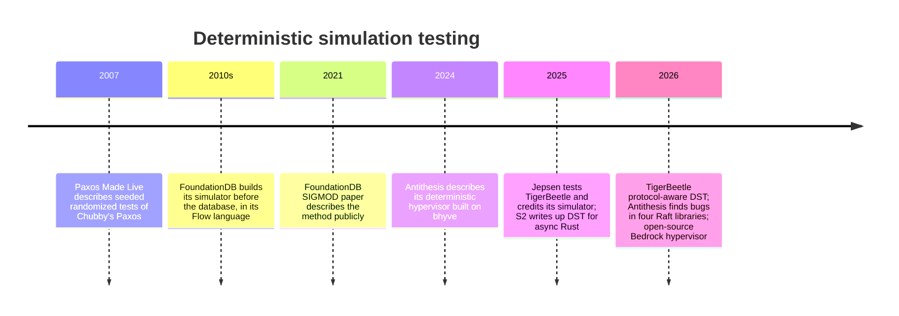
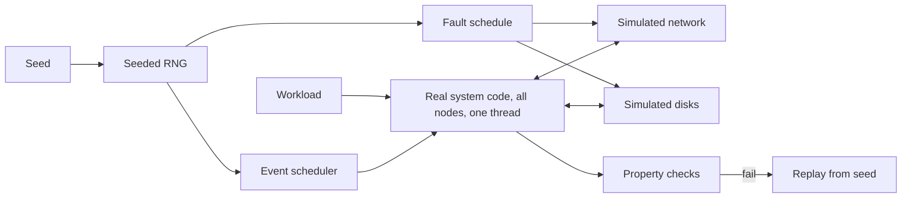

---
tags:
  - distributed-systems
  - testing
  - simulation
  - frontier
status: draft
sources:
  - https://apple.github.io/foundationdb/testing.html
  - https://muratbuffalo.blogspot.com/2022/03/foundationdb-distributed-unbundled.html
  - https://www.andrew.cmu.edu/course/15-440/assets/READINGS/paxos-made-live.pdf
  - https://notes.eatonphil.com/2024-08-20-deterministic-simulation-testing.html
  - https://docs.tigerbeetle.com/concepts/safety/
  - https://tigerbeetle.com/blog/2026-08-20-protocol-aware-dst
  - https://jepsen.io/analyses/tigerbeetle-0.16.11
  - https://freebsdfoundation.org/antithesis-pioneering-deterministic-hypervisors-with-freebsd-and-bhyve/
  - https://antithesis.com/blog/2026/finding-bugs-in-raft-implementations/
  - https://brink.dev/blog/2026/06/25/bedrock-deterministic-hypervisor/
  - https://s2.dev/blog/dst
created: 2026-11-26
updated: 2026-11-26
---

## Table Of Contents

---

- [[#TL;DR|TL;DR]]
- [[#The Problem|The Problem]]
- [[#Foundations|Foundations]]
    - [[#The Three Sources of Nondeterminism|The Three Sources of Nondeterminism]]
    - [[#Why Rare Bugs Need Many Cheap Runs|Why Rare Bugs Need Many Cheap Runs]]
- [[#How We Got Here|How We Got Here]]
- [[#How It Works|How It Works]]
    - [[#The Simulator Loop|The Simulator Loop]]
    - [[#Fault Injection That Finds Deep Bugs|Fault Injection That Finds Deep Bugs]]
    - [[#Checking Properties|Checking Properties]]
    - [[#Three Ways to Get Determinism|Three Ways to Get Determinism]]
- [[#Where It Is Now|Where It Is Now]]
- [[#Trade-offs & Open Problems|Trade-offs & Open Problems]]
- [[#Resources|Resources]]
- [[#Related Notes|Related Notes]]

## ***TL;DR***

---

*Deterministic simulation testing (DST) runs a whole distributed system inside one process where the test, not the operating system, decides every clock tick, random number, message delivery and disk result. That lets you throw millions of faults at real code and replay any failure exactly from a single seed.*

- **The idea:** run every node of the cluster in one single-threaded process, route all time, randomness, network and disk through a simulator, and inject faults from a seeded random number generator ([Phil Eaton](https://notes.eatonphil.com/2024-08-20-deterministic-simulation-testing.html)).
- **The payoff:** a failing run is a seed; rerun the seed and the same bug happens again, step for step ([FoundationDB](https://apple.github.io/foundationdb/testing.html)).
- **Who made it famous:** FoundationDB built its simulator *before* the database itself ([Murat Demirbas on the SIGMOD 2021 paper](https://muratbuffalo.blogspot.com/2022/03/foundationdb-distributed-unbundled.html)). TigerBeetle, Antithesis, WarpStream, S2 and others followed.
- **The catch:** it only tests what runs inside the simulator, and only as well as your fault models and workloads mirror reality. Jepsen still found bugs in TigerBeetle that its simulator missed ([Jepsen](https://jepsen.io/analyses/tigerbeetle-0.16.11)).

## ***The Problem***

---

*Distributed systems bugs hide in rare interleavings of messages, crashes and slow disks. Ordinary tests almost never hit them, and when production does, you usually cannot reproduce what happened.*

A bug in a [[Raft]] or [[Paxos]] implementation often needs a specific sequence: a leader is partitioned, a message arrives late, a node restarts with a half-written log entry. Each step is unlikely, so the combination is rarer still. Unit tests cover the steps one at a time. Integration tests on real machines hit some combinations, but timing on real hardware is not repeatable, so a failure seen once may never show up again.

Black-box fault injection like Jepsen drives a real cluster from outside and checks the history of operations against a [[Consistency Models|consistency model]]. It is powerful, but its runs are not deterministic, so a bug it finds may not be reproducible ([Phil Eaton](https://notes.eatonphil.com/2024-08-20-deterministic-simulation-testing.html)). DST attacks both halves: make rare interleavings common, and make every one of them replayable.

## ***Foundations***

---

*DST rests on one rule: every input the program could see must come from the simulator. Once that holds, the whole run is a pure function of one seed.*

### The Three Sources of Nondeterminism

Phil Eaton's [overview](https://notes.eatonphil.com/2024-08-20-deterministic-simulation-testing.html) names three things the simulator has to own:

| Source | What goes wrong if you don't control it | How DST controls it |
|---|---|---|
| **Time** | Timeouts and leases fire at different moments each run | The simulator owns the clock and jumps it to the next event |
| **Randomness** | Retry jitter, IDs and hash orders change between runs | One global seed feeds every random number |
| **Concurrency and I/O** | Thread scheduling and real disk or network timing differ each run | Collapse to one thread, use asynchronous I/O behind interfaces the simulator can swap |

He also notes smaller leaks: some CPU instructions, system calls and even `malloc` can behave differently between runs. The practical structure is dependency injection: pass the clock, the seed and the I/O layer into the code instead of reading globals, so the simulator can hand in its own versions ([Phil Eaton](https://notes.eatonphil.com/2024-08-20-deterministic-simulation-testing.html)).

This ties directly to [[Failure Models]]: the simulator's network and disk are where you encode which failures your system claims to survive. It also ties to [[Time and Clocks]], since lease and timeout logic is exactly what a controlled clock lets you stress.

### Why Rare Bugs Need Many Cheap Runs

Suppose a bug needs $k$ independent bad events at the right moments, each happening with probability $p$ in a given run. The chance one run triggers it is $p^k$, and the chance at least one of $N$ runs does is:

$$P(\text{found}) = 1 - (1 - p^k)^N$$

*In words:* the bug gets found when you run enough simulations that $N$ is comparable to $1/p^k$. You win either by running more simulations or by making each bad event more likely.

**Worked example.** Take $p = 0.01$ and $k = 3$. Then $p^k = 10^{-6}$, one in a million runs. With $N = 10^6$ runs, $P \approx 1 - e^{-1} \approx 63\%$. Raise $p$ to $0.1$ by injecting faults ten times more often and $p^k = 10^{-3}$, so a thousand runs give the same odds.

That is why DST setups do two things at once: run huge numbers of simulations cheaply, and dial fault rates far above what production sees.

## ***How We Got Here***

---

*Seeded, randomized simulation of distributed protocols showed up at Google in the mid 2000s, FoundationDB turned it into a whole engineering method in the 2010s, and the 2020s added libraries for other languages plus hypervisors that make arbitrary software deterministic.*

- **2007, Google:** *Paxos Made Live* describes testing Chubby's [[Paxos]] with seeded, single-threaded, randomized runs so failures could be replayed. A failover test found five Chubby bugs in its first two weeks ([paper](https://www.andrew.cmu.edu/course/15-440/assets/READINGS/paxos-made-live.pdf)).
- **2010s, FoundationDB:** the team built the simulator first, then the database. Its Flow language, a C++ extension with async and await style actors, made the whole cluster run in one deterministic process. After fault injection found two bugs in Apache ZooKeeper around 2010, they replaced ZooKeeper with their own Paxos written in Flow so it too could run in simulation ([Murat Demirbas](https://muratbuffalo.blogspot.com/2022/03/foundationdb-distributed-unbundled.html)).
- **2020s, spread:** TigerBeetle built its VOPR simulator ([docs](https://docs.tigerbeetle.com/concepts/safety/)). Antithesis built a deterministic hypervisor so systems need not be written for simulation ([FreeBSD Foundation](https://freebsdfoundation.org/antithesis-pioneering-deterministic-hypervisors-with-freebsd-and-bhyve/)). Rust teams adopted libraries like turmoil and madsim ([S2](https://s2.dev/blog/dst)).

## ***How It Works***

---

*A simulator replaces the network, disks, clock and random number generator, drives a workload against the real system code, injects faults from a seed, and checks properties as it goes.*

### The Simulator Loop

The scheduler is a discrete-event loop. When every node is waiting, the simulator does not sleep: it jumps the clock straight to the next scheduled event. That is how simulated time runs far faster than real time when the CPU is not busy ([Murat Demirbas](https://muratbuffalo.blogspot.com/2022/03/foundationdb-distributed-unbundled.html)). TigerBeetle says its VOPR runs at about 1000x speed ([docs](https://docs.tigerbeetle.com/concepts/safety/)).

FoundationDB's simulator models machines, drives (including slow and full ones) and the network, and fails things at the network, machine and whole datacenter level, including machines that come back after appearing dead ([FoundationDB](https://apple.github.io/foundationdb/testing.html)). It also randomizes tuning knobs like response latency and error rates so the system can never quietly depend on one particular setting ([Murat Demirbas](https://muratbuffalo.blogspot.com/2022/03/foundationdb-distributed-unbundled.html)).

### Fault Injection That Finds Deep Bugs

Random faults alone are not enough; the shape of the faults matters. FoundationDB's "swizzle-clogging" stops network traffic to a random subset of nodes one at a time over several seconds, then restores them in a random order. FoundationDB calls it particularly good at finding deep issues that only appear in rare real-world cases ([FoundationDB](https://apple.github.io/foundationdb/testing.html)).

Fault models also have to match how hardware really breaks. In 2025, Jepsen found a TigerBeetle panic triggered by a single flipped bit in padding. VOPR had missed it because its corruption model replaced whole sectors rather than single bits. TigerBeetle then changed VOPR to inject single-byte errors ([Jepsen](https://jepsen.io/analyses/tigerbeetle-0.16.11)). This is the same lesson as [[Silent Data Corruption]] and [[Gray and Fail-Slow Failures]]: the failures you do not model are the ones you do not test.

### Checking Properties

A simulator is only as good as what it checks. There are two broad styles:

- **Outside in:** check the history of client operations against a correctness model, as Jepsen does with linearizability or strong serializability. See [[Isolation Testing]] and [[Consistency Models]].
- **Inside out:** check invariants of the protocol's internal state. TigerBeetle's "protocol-aware" DST checks that replicas agree on the write-ahead log, that storage is byte-identical across replicas, that each replica eventually makes progress, and that recovery does not coordinate more than it needs to. One example from the post: even when each replica is missing 6 of 9 blocks, the cluster must still recover ([TigerBeetle, Aug 2026](https://tigerbeetle.com/blog/2026-08-20-protocol-aware-dst)).

In FoundationDB, developers write synthetic workloads plus assertions about the database's properties, and the simulator runs them end to end against the real code ([Murat Demirbas](https://muratbuffalo.blogspot.com/2022/03/foundationdb-distributed-unbundled.html)).

### Three Ways to Get Determinism

| Approach | How it works | Examples | Cost |
|---|---|---|---|
| **Built in from day one** | The system is written against simulator interfaces; production swaps in real ones | FoundationDB (Flow), TigerBeetle (VOPR) | Every dependency must be simulable, so teams rewrite them (FoundationDB replaced ZooKeeper) |
| **Library or runtime swap** | Replace the async runtime, network and libc calls for time and randomness | S2 with turmoil plus a libc override for `getrandom` and `clock_gettime`; madsim | Leaks from dependencies that use threads, system time or hash randomization must be hunted down ([S2](https://s2.dev/blog/dst)) |
| **Deterministic hypervisor** | Run unmodified software in a VM whose every timing and interrupt is controlled | Antithesis (proprietary, on modified bhyve); Bedrock (open source, Rust kernel module) | Heavy machinery; Bedrock needs recent Intel CPUs to inject interrupts at exact instruction counts ([Brink](https://brink.dev/blog/2026/06/25/bedrock-deterministic-hypervisor/)) |

**Hypervisor detail.** Antithesis's "Determinator" runs containers inside one VM and produces the same results down to the sequence of VM states, which enables snapshots, time-travel debugging and exploring many branches in parallel ([FreeBSD Foundation](https://freebsdfoundation.org/antithesis-pioneering-deterministic-hypervisors-with-freebsd-and-bhyve/)). Bedrock traps reads of the CPU timestamp counter and returns values derived from the instruction count, and uses performance counters to fire interrupts at exact instruction counts ([Brink](https://brink.dev/blog/2026/06/25/bedrock-deterministic-hypervisor/)).

**Checking determinism itself.** S2 runs a CI "meta test" that runs the same seed twice and compares trace-level logs, so a failing seed from CI reproduces on a laptop ([S2](https://s2.dev/blog/dst)).

## ***Where It Is Now***

---

*As of November 2026, DST is standard at a handful of database companies, available as a service through Antithesis, and spreading to Rust systems through libraries. The open question has moved from "does it work" to "how close can the simulator get to real hardware".*

- **FoundationDB:** runs tens of thousands of simulations nightly, about a trillion CPU-hours in total, at roughly 10 simulated seconds per real second ([FoundationDB](https://apple.github.io/foundationdb/testing.html)).
- **TigerBeetle:** VOPR runs around the clock on 1024 cores against the latest code ([docs](https://docs.tigerbeetle.com/concepts/safety/)). In August 2026 it described protocol-aware checks that look inside consensus and storage rather than only at client results ([TigerBeetle](https://tigerbeetle.com/blog/2026-08-20-protocol-aware-dst)).
- **Jepsen and TigerBeetle, 2025:** Jepsen tested versions 0.16.11 to 0.16.30, found two safety issues and seven crashes, judged it consistent with strong serializability from 0.16.26, and credited TigerBeetle's simulation tests. It also stressed that testing shows the presence of bugs, not their absence ([Jepsen](https://jepsen.io/analyses/tigerbeetle-0.16.11)).
- **Antithesis and Raft, July 2026:** found bugs in HashiCorp Raft, Aeron Cluster, OpenRaft and MicroRaft. In HashiCorp Raft, asynchronous heartbeats let a node vote twice in one term, breaking four of five [[Raft]] safety properties; it also found a leadership-transfer deadlock and a snapshot livelock. Network partitions alone were enough, within about an hour of testing ([Antithesis](https://antithesis.com/blog/2026/finding-bugs-in-raft-implementations/)).
- **Rust ecosystem:** S2, a [[Logs and Streaming|streaming log]] service, reports 17 notable bugs found, running DST on every PR plus thousands of nightly trials ([S2, Apr 2025](https://s2.dev/blog/dst)). Phil Eaton lists Polar Signals and WarpStream among users ([Phil Eaton](https://notes.eatonphil.com/2024-08-20-deterministic-simulation-testing.html)).
- **Open hypervisors:** Bedrock, released June 2026, is an open-source alternative to Antithesis's closed hypervisor ([Brink](https://brink.dev/blog/2026/06/25/bedrock-deterministic-hypervisor/)).

## ***Trade-offs & Open Problems***

---

*DST trades engineering effort and some realism for reproducibility and scale. Its blind spots are whatever lives outside the simulator and whatever the fault model forgets.*

| Strength | Limit |
|---|---|
| Every failure replays from a seed | A seed may stop reproducing once code changes, so failing seeds should become regression tests ([Phil Eaton](https://notes.eatonphil.com/2024-08-20-deterministic-simulation-testing.html)) |
| Millions of fault schedules on real code | Mocks are only as good as their fidelity to real disks, networks and latency ([Phil Eaton](https://notes.eatonphil.com/2024-08-20-deterministic-simulation-testing.html)) |
| Faster than real time | Code outside the simulated core, and real integrations with outside systems, go untested ([Phil Eaton](https://notes.eatonphil.com/2024-08-20-deterministic-simulation-testing.html)) |
| Finds deep protocol bugs | Coverage depends on workloads people write; branch coverage is a weak signal ([Phil Eaton](https://notes.eatonphil.com/2024-08-20-deterministic-simulation-testing.html)) |

Open problems:

- **Fault model gaps.** The TigerBeetle bit-flip case shows a simulator can miss a real failure because it models corruption at the wrong granularity ([Jepsen](https://jepsen.io/analyses/tigerbeetle-0.16.11)).
- **Combining styles.** Jepsen's outside-in checks found a missing-results query bug that four of TigerBeetle's fuzzers missed ([Jepsen](https://jepsen.io/analyses/tigerbeetle-0.16.11)), while inside-out invariants catch problems that never surface to clients ([TigerBeetle](https://tigerbeetle.com/blog/2026-08-20-protocol-aware-dst)). The best results use both.
- **Dependencies.** Built-in DST pushes teams to rewrite dependencies so they can be simulated, as FoundationDB did with ZooKeeper ([Murat Demirbas](https://muratbuffalo.blogspot.com/2022/03/foundationdb-distributed-unbundled.html)). Hypervisors avoid that but are heavy and, until Bedrock, closed.
- **Relationship to proofs.** DST explores executions; [[Formal Methods in Practice|formal methods]] explore a model of the design. Neither covers the other's gap: a proof says nothing about the code, and testing cannot show bugs are absent.

## ***Resources***

---

*Start with FoundationDB's page and Phil Eaton's overview, then read the TigerBeetle and Jepsen pieces side by side to see where simulation succeeds and where it misses.*

- [FoundationDB: Simulation and Testing](https://apple.github.io/foundationdb/testing.html): the original public description.
- [Murat Demirbas on the FoundationDB SIGMOD 2021 paper](https://muratbuffalo.blogspot.com/2022/03/foundationdb-distributed-unbundled.html): how simulation shaped the whole design.
- [Phil Eaton, What's the big deal about Deterministic Simulation Testing?](https://notes.eatonphil.com/2024-08-20-deterministic-simulation-testing.html): the clearest introduction.
- [Paxos Made Live](https://www.andrew.cmu.edu/course/15-440/assets/READINGS/paxos-made-live.pdf): early seeded randomized testing at Google.
- [TigerBeetle, Protocol-Aware Deterministic Simulation Testing](https://tigerbeetle.com/blog/2026-08-20-protocol-aware-dst) and [TigerBeetle safety docs](https://docs.tigerbeetle.com/concepts/safety/).
- [Jepsen: TigerBeetle 0.16.11](https://jepsen.io/analyses/tigerbeetle-0.16.11): what an outside-in test found after simulation.
- [Antithesis, Finding bugs in Raft implementations](https://antithesis.com/blog/2026/finding-bugs-in-raft-implementations/).
- [FreeBSD Foundation on Antithesis's deterministic hypervisor](https://freebsdfoundation.org/antithesis-pioneering-deterministic-hypervisors-with-freebsd-and-bhyve/) and [Brink on Bedrock](https://brink.dev/blog/2026/06/25/bedrock-deterministic-hypervisor/).
- [S2, Deterministic simulation testing for async Rust](https://s2.dev/blog/dst): the practical guide for Rust.

## Related Notes

- [[Failure Models]] — the simulator's faults encode which failures the system claims to survive
- [[Time and Clocks]] — a controlled clock is what makes timeout and lease bugs reproducible
- [[Raft]] — Antithesis's 2026 bugs show where real Raft implementations break
- [[Paxos]] — Paxos Made Live was an early use of seeded randomized simulation
- [[Consistency Models]] — the models outside-in checks compare histories against
- [[Isolation Testing]] — how Jepsen and Elle check histories, the complement to simulation
- [[Formal Methods in Practice]] — proving the design versus testing the code
- [[Silent Data Corruption]] — the bit-flip lesson from Jepsen's TigerBeetle analysis
- [[Gray and Fail-Slow Failures]] — slow disks and flaky links a simulator should model
- [[Distributed Transactions]] — FoundationDB and TigerBeetle are transactional systems built around simulation
- [[Reliability Patterns]] — retries and timeouts are the code paths simulation stresses most
