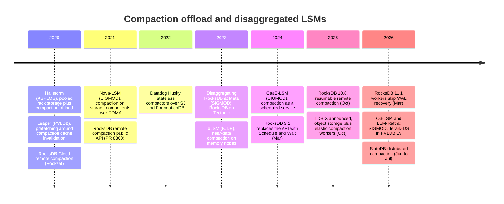
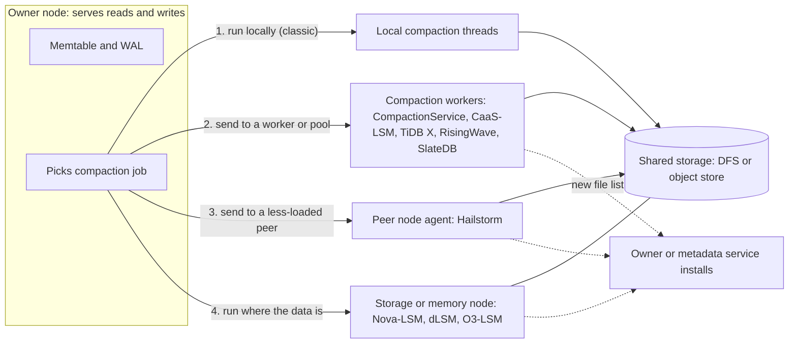
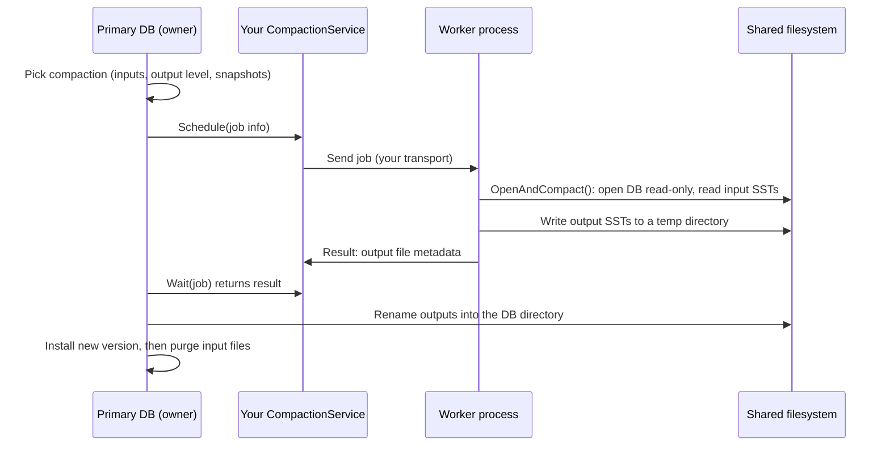
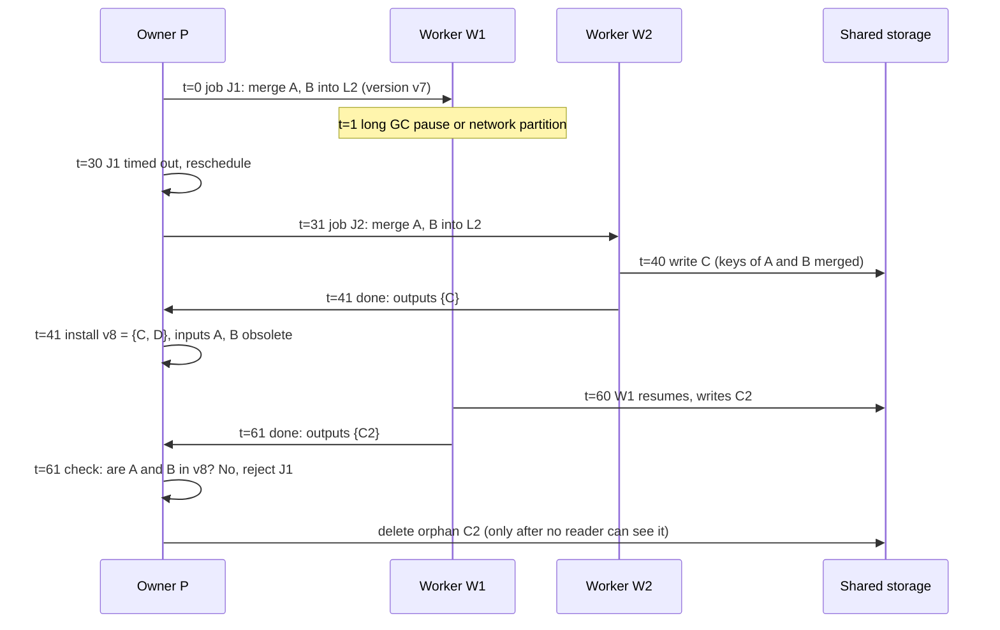

---
aliases:
  - Compaction Offload
  - Remote Compaction
  - Compaction as a Service
tags:
  - distributed-systems
  - storage
  - storage-engines
  - lsm
  - disaggregation
  - compaction
  - frontier
status: complete
sources:
  - https://github.com/facebook/rocksdb/wiki/Remote-Compaction-(Experimental)
  - https://github.com/meta/rocksdb/wiki/Remote-Compaction
  - https://github.com/meta/rocksdb/releases
  - https://github.com/facebook/rocksdb/releases/tag/v9.1.0
  - https://rocksdb.org/blog/2026/05/19/resumable-remote-compaction.html
  - https://git.nextgraph.org/NextGraph/rocksdb/commit/3786181a90bd2daeff22bc0f20e0c06adca95bd2
  - https://doi.org/10.1145/3589772
  - https://datapapers.substack.com/p/papers-on-storage-compute-disaggregation
  - https://www.cs.purdue.edu/homes/csjgwang/pubs/SIGMOD24_CaaSLSM.pdf
  - https://arxiv.org/pdf/2104.01305
  - https://www.cs.purdue.edu/homes/csjgwang/pubs/ICDE23_dLSM.pdf
  - https://www.eecg.utoronto.ca/~ashvin/publications/hailstorm.pdf
  - https://asplos.hosting2.acm.org/wp/wp-content/uploads/2020/abstracts/paper_3_4.html
  - https://arxiv.org/abs/2603.05439
  - https://cs.purdue.edu/homes/csjgwang/pubs/SIGMOD26_O3LSM.pdf
  - https://www.vldb.org/pvldb/vol19/p822-zhang.pdf
  - https://users.cs.utah.edu/~lifeifei/papers/leaper.pdf
  - https://docs.pingcap.com/tidbcloud/tidb-x-architecture/
  - https://www.pingcap.com/blog/tidb-x-index-creation-5-5m-rows-near-zero-business-impact/
  - https://risingwavelabs.github.io/risingwave/design/state-store-overview.html
  - https://docs.risingwave.com/cloud/serverless-compaction
  - https://paimon.apache.org/docs/2.0/maintenance/dedicated-compaction
  - https://cljdoc.org/d/io.github.maxweber/slatedb/0.1.0/doc/manifest-design
  - https://ryandielhenn.github.io/blog/distributed-compaction/
  - https://slatedb.io/blog/compaction-roadmap/
  - https://github.com/slatedb/slatedb/releases
  - https://datadoghq.com/blog/engineering/introducing-husky
  - https://rmarcus.info/dbscholar/papers/hddfd005d29d7b6da
  - https://arxiv.org/pdf/2411.01269
  - https://www.eecg.utoronto.ca/~stumm/Papers/Dong-Fast-21.pdf
  - https://github.com/rockset/rocksdb-cloud
created: 2026-11-26
updated: 2026-11-26
---

## Table Of Contents

---

- [[#TL;DR|TL;DR]]
- [[#The Problem|The Problem]]
- [[#Foundations|Foundations]]
    - [[#Compaction Is a Pure Function of Immutable Files|Compaction Is a Pure Function of Immutable Files]]
    - [[#Who Owns the Tree|Who Owns the Tree]]
    - [[#The Bandwidth Model|The Bandwidth Model]]
- [[#How We Got Here|How We Got Here]]
- [[#How It Works|How It Works]]
    - [[#Where Compaction Can Run|Where Compaction Can Run]]
    - [[#The Remote Compaction Protocol (RocksDB)|The Remote Compaction Protocol (RocksDB)]]
    - [[#Compaction as a Service: Scheduling Many Trees|Compaction as a Service: Scheduling Many Trees]]
    - [[#Near-Data Compaction: Storage and Memory Nodes|Near-Data Compaction: Storage and Memory Nodes]]
    - [[#Splitting the Rest of the Tree: Memtables and Flushes|Splitting the Rest of the Tree: Memtables and Flushes]]
    - [[#Worked Example: The Zombie Compaction Worker|Worked Example: The Zombie Compaction Worker]]
- [[#Where It Is Now|Where It Is Now]]
- [[#Trade-offs & Open Problems|Trade-offs & Open Problems]]
- [[#Resources|Resources]]
- [[#Related Notes|Related Notes]]

## ***TL;DR***
---
*A disaggregated LSM splits the jobs of an [[LSM Trees|LSM tree]] (taking writes, flushing, compacting, serving reads) across different machines instead of doing all of them on the node that owns the data. The most common and most mature split is compaction offload: the owner decides what to merge, someone else does the merging, and the owner installs the result.*

- **Why:** compaction is most of an LSM's I/O, it is bursty, and on a node that also serves queries it causes write stalls and tail-latency spikes. CaaS-LSM puts it bluntly: "compaction creates most of the I/Os from LSM-KVS" ([Yu et al., SIGMOD 2024, §1](https://www.cs.purdue.edu/homes/csjgwang/pubs/SIGMOD24_CaaSLSM.pdf)).
- **Why it is possible:** SSTables are immutable and compaction only reads old files and writes new ones. Once the files live on shared storage ([[Disaggregated Systems]], [[Object Storage]]), any machine that can read them can run the merge.
- **The one rule:** only the owner changes the tree. A worker produces files; the owner (or a metadata service) atomically swaps inputs for outputs in the manifest, and rejects results whose inputs are no longer current. RocksDB's docs: "The compaction worker cannot change the LSM tree" ([RocksDB wiki](https://github.com/meta/rocksdb/wiki/Remote-Compaction)).
- **Where the merge runs:** a dedicated worker or pool (RocksDB's `CompactionService`, CaaS-LSM, TiDB X, RisingWave, SlateDB, Paimon), a less-loaded peer (Hailstorm), or next to the data on a storage or memory node (Nova-LSM, dLSM, O3-LSM).
- **What it costs:** offload moves bytes off the owner's CPU and NIC but does not remove them; it adds a scheduling hop (CaaS-LSM measured remote setup above 10 seconds), new failure modes (zombie workers, orphaned outputs) and cold caches after every swap.
- **Now (Nov 2026):** RocksDB's remote compaction is still labelled experimental but gained resumable jobs (10.8, Oct 2025) and leaner workers (11.1, Mar 2026); TiDB X runs compaction on elastic workers over object storage; RisingWave autoscales its compactors; SlateDB has distributed compaction; and 2026 research (O3-LSM, Terark-DS, LSM-Raft) offloads flushes, memtables and garbage collection too.

## ***The Problem***
---
*An LSM defers the cost of writes into background compaction, and on a single machine that background work competes with the foreground work it was supposed to make cheap. Disaggregation is the attempt to give the background work its own machines.*

An LSM's write path is cheap because it postpones work: writes go to a log and a memtable, and merging sorted files is done later by compaction ([[LSM Trees#How It Works|LSM Trees]]). That later work is large. With leveled compaction, RocksDB's own measurements put write amplification at 10 to 30 ([Dong et al., FAST 2021](https://www.eecg.utoronto.ca/~stumm/Papers/Dong-Fast-21.pdf)), so a node ingesting 50 MB/s of user data is rewriting hundreds of MB/s to over 1 GB/s in the background.

On a classic shared-nothing node that background work causes three problems:

| Problem | What happens | Evidence |
|---|---|---|
| **Interference** | Compaction threads and I/O compete with reads and writes on the same node; when compaction falls behind, the engine stalls writes | Hailstorm cites "interference from background tasks such as flushing, compaction, and data migration" as a main source of throughput and latency problems in distributed LSM databases ([Bindschaedler et al., ASPLOS 2020](https://asplos.hosting2.acm.org/wp/wp-content/uploads/2020/abstracts/paper_3_4.html)) |
| **Provisioning for the peak** | Each node must hold enough spare CPU and bandwidth for its own worst compaction burst, which sits idle most of the time | CaaS-LSM's motivation (§3): static per-instance compaction resources leave some instances starved while others idle |
| **Network amplification on disaggregated storage** | Once the files live on remote storage, every compaction byte read or written crosses the network, often several times for replication | Terark-DS measured replication-driven traffic using up to 87.8% of NIC bandwidth, and RocksDB's write throughput 34.9% lower on disaggregated storage than on local ([Zhang et al., PVLDB 19](https://www.vldb.org/pvldb/vol19/p822-zhang.pdf)) |

The third row is why this topic is "frontier": moving an LSM onto shared storage ([[Disaggregated Systems]], [[Databases on Object Storage]]) solves durability and elasticity, but it turns compaction from a local disk problem into a network problem. The fix is to decide *where* compaction runs as deliberately as where the data lives.

## ***Foundations***
---
*Three ideas make offload safe and tell you when it pays: compaction is a pure function of immutable inputs, exactly one party may change the tree, and the bytes compaction moves have to cross some link no matter where it runs.*

### Compaction Is a Pure Function of Immutable Files

*A compaction reads a set of sorted files that nobody will ever modify, merges them, and writes new files. Nothing about that requires the machine that wrote the inputs.*

Conceptually (this is a summary of what every engine in this note does, not a formula from one paper):

$$
\text{outputs} = \text{merge}\big(\text{inputs},\ \text{watermark},\ \text{bottommost?},\ \text{options}\big)
$$

*In words:* the result depends only on the input files, the oldest snapshot or version still in use (the *watermark*, which decides which old versions can be dropped), whether the output is the bottom level (which decides whether tombstones can be dropped), and the engine's settings (comparator, merge operator, compression).

- **Inputs are immutable**, so the worker needs no locks. Hailstorm's agents need no extra synchronization because "compaction does not modify the files in place" ([Bindschaedler et al., §3.4](https://www.eecg.utoronto.ca/~ashvin/publications/hailstorm.pdf)).
- **The watermark has to travel with the job.** RisingWave's Hummock tracks an epoch low watermark that "determines which key versions compaction can keep" ([Hummock design doc](https://risingwavelabs.github.io/risingwave/design/state-store-overview.html)); see [[MVCC and Version Garbage Collection]]. A worker given an *older* watermark keeps more versions than necessary, which is safe; it must never use one newer than the owner's.
- **Bottommost status is decided by the owner** when it picks the job, because only the owner sees the whole tree.

*Example:* an owner with snapshots at sequence numbers 900 and 1,200 sends a job over two files holding key `k` at versions 850, 950 and 1,300. With watermark 900 the worker must keep 850 (visible to snapshot 900), 950 (visible to 1,200) and 1,300 (latest). If the snapshot at 900 is released before the job runs, keeping 850 anyway is merely wasteful; the next compaction drops it.

### Who Owns the Tree

*The manifest (RocksDB's MANIFEST, SlateDB's manifest object, Hummock's version) says which files make up the tree. Whoever can change it decides what readers see, so offload designs keep that power with one party.*

| System | Who installs compaction results | How |
|---|---|---|
| RocksDB remote compaction | The primary DB | Worker opens the DB read-only and writes to a temp dir; primary renames the outputs into the DB and "purges the compaction input files" ([wiki](https://github.com/meta/rocksdb/wiki/Remote-Compaction)) |
| SlateDB | The compactor (one at a time, fenced by `compactor_epoch`) | Compare-and-swap on the next manifest ID; on conflict, "find the (new) latest manifest and re-apply its changes" ([manifest design](https://cljdoc.org/d/io.github.maxweber/slatedb/0.1.0/doc/manifest-design)) |
| RisingWave Hummock | The Hummock manager on the meta node | "Every operation on the LSM-tree yields a new version on the Hummock manager," compactions included ([design doc](https://risingwavelabs.github.io/risingwave/design/state-store-overview.html)) |
| Datadog Husky | FoundationDB | Compactors swap inputs for outputs "in one atomic metadata transaction" ([Artoul and Watt, 2022](https://datadoghq.com/blog/engineering/introducing-husky)) |
| Hailstorm | The original storage engine | The remote agent returns the new SSTable list; the local engine "takes ownership" and installs it (§3.4) |

This is the same idea as [[Leases and Fencing]]: a worker is a client acting on a lease it may have lost, so every install must be checked against the current owner and the current version.

### The Bandwidth Model

*Offload does not make compaction's bytes disappear; it chooses which network link carries them. A back-of-envelope model tells you which link that is.*

Let $U$ be the user write rate and $W_c$ the compaction part of write amplification (output bytes per user byte). Compaction reads roughly as many bytes as it writes, so its I/O is about $2W_cU$. The bytes that cross the *owner's* NIC per second, for an owner on remote storage, are roughly:

$$
B_{\text{owner}} \approx \underbrace{2U}_{\text{WAL + flush}} + \underbrace{\alpha \cdot 2W_cU}_{\text{compaction, if run locally}}
$$

where $\alpha = 1$ if the owner compacts itself and $\alpha = 0$ if compaction is offloaded. (My simplification for intuition; it ignores storage-side replication, which multiplies the write terms, and compression.)

*Worked example.* $U = 50$ MB/s and $W_c = 20$ (inside RocksDB's measured 10 to 30 for leveled, [Dong et al.](https://www.eecg.utoronto.ca/~stumm/Papers/Dong-Fast-21.pdf)):

| Where compaction runs | Owner NIC | Who else carries it |
|---|---|---|
| On the owner, files on remote storage | $100 + 2{,}000 = 2{,}100$ MB/s ≈ 16.8 Gb/s, two thirds of a 25 Gb/s NIC | Storage network |
| Offloaded to a worker | ≈ 100 MB/s ≈ 0.8 Gb/s | Worker NIC and storage network carry the 2 GB/s |
| Near the data (on the storage or memory node holding the inputs) | ≈ 100 MB/s | Only output replication crosses the network; input reads are local |

*In words:* offload moves 16 Gb/s off the machine serving queries but adds it to a worker; only near-data compaction removes the input reads from the network altogether. That is why research systems with RDMA or disaggregated memory push compaction to where the data sits (Nova-LSM, dLSM), and why Terark-DS shrinks what compaction touches (key-only compaction) rather than only moving it.

## ***How We Got Here***
---
*Compaction offload started as research on pooled rack storage and RDMA around 2020, entered RocksDB as an API in 2021, became a production pattern in cloud-native systems over object storage from 2022, and in 2025 and 2026 grew into offloading the rest of the LSM.*

**Pooling and RDMA (2020 to 2021).** Hailstorm ran MongoDB's RocksDB engines over a rack-wide distributed filesystem so any node could read any engine's SSTables, then had agents offload compactions to the least-loaded peer; it reported 60% higher average throughput, up to 5x lower tail latency and 47 to 56% cost savings on OLTP ([ASPLOS 2020 abstract](https://asplos.hosting2.acm.org/wp/wp-content/uploads/2020/abstracts/paper_3_4.html)). Nova-LSM went further and split an LSM into components connected by RDMA, with storage components that can run compactions themselves ([Huang and Ghandeharizadeh, SIGMOD 2021](https://arxiv.org/pdf/2104.01305)). In industry, Rockset's RocksDB-Cloud fork kept databases in S3 ([README](https://github.com/rockset/rocksdb-cloud)) and is cited in Meta's paper for "RocksDB-Cloud remote compaction" (2020).

**RocksDB gets an API (2021).** Jay Zhuang's PR #8300 added "a public API for remote compaction," letting compaction run on a different host or process ([commit mirror](https://git.nextgraph.org/NextGraph/rocksdb/commit/3786181a90bd2daeff22bc0f20e0c06adca95bd2)). It stayed a building block: you implement the transport and the worker fleet.

**Production on shared storage (2022 to 2023).** Datadog's Husky put event files in S3 with stateless writers, readers and compactors coordinated through FoundationDB ([Artoul and Watt, May 2022](https://datadoghq.com/blog/engineering/introducing-husky)). Meta moved RocksDB from local SSDs onto its Tectonic filesystem; the authors name "metadata overhead and tail latencies" as Tectonic's main performance gaps ([Dong et al., SIGMOD 2023](https://doi.org/10.1145/3589772)), and a summary of the paper lists offloading backup and compaction to other services among the benefits ([Chandramohan, 2024](https://datapapers.substack.com/p/papers-on-storage-compute-disaggregation)). The TPC panel's survey of disaggregated databases notes that compute can be split by function, writes, queries and compaction included ([Ghandeharizadeh et al.](https://arxiv.org/pdf/2411.01269)).

**Scheduling and the rest of the tree (2024 to 2026).** CaaS-LSM argued that pairing each database with a fixed compaction server wastes capacity and built a control plane to schedule jobs across a pool ([SIGMOD 2024](https://www.cs.purdue.edu/homes/csjgwang/pubs/SIGMOD24_CaaSLSM.pdf)). O3-LSM showed that compaction offload alone does not stop write stalls and offloaded memtables and flushes as well ([SIGMOD 2026](https://cs.purdue.edu/homes/csjgwang/pubs/SIGMOD26_O3LSM.pdf)). LSM-Raft avoids repeating compaction on every replica by replicating compacted SSTables through Raft ([[LSM Trees#Why Distributed Databases Sit on LSMs|LSM Trees]]; [dbscholar](https://rmarcus.info/dbscholar/papers/hddfd005d29d7b6da)).

## ***How It Works***
---
*Every design answers the same questions: where the merge runs, how the job and its context get there, who installs the result, and what happens when a worker is slow or dies. The differences are mostly about the first question.*

### Where Compaction Can Run

*From "on the node" to "on the memory node next to the data," each step moves the work further from the queries and closer to (or further from) the bytes.*

| Placement | Inputs reach the merge by | Good when | Examples |
|---|---|---|---|
| **Dedicated worker or pool** | Reading shared storage | Storage is already remote (DFS, object store); many trees share one elastic pool | RocksDB `CompactionService`, CaaS-LSM, TiDB X, RisingWave compactors, SlateDB workers, Paimon's dedicated job, Husky |
| **Peer in the same rack** | Pooled rack storage | Load is skewed across shared-nothing nodes | Hailstorm |
| **Storage component** | Local disk of the storage node | Storage nodes have spare CPU; avoids moving inputs | Nova-LSM StoCs |
| **Memory node** | Local memory of the memory node, over RDMA | Memory disaggregation; compute nodes have little memory | dLSM, O3-LSM |
| **One replica, shipped to the others** | Replication log | Raft groups where every replica would otherwise compact the same data | LSM-Raft; TiDB X, where the Region leader uploads flushed SSTs and compaction workers' outputs are loaded by TiKV nodes ([TiDB X docs](https://docs.pingcap.com/tidbcloud/tidb-x-architecture/)) |

### The Remote Compaction Protocol (RocksDB)

*RocksDB's API is the simplest complete version of the protocol: schedule, compact read-only, return metadata, install by rename. Everything else in this note adds scheduling, placement or failure handling around these four steps.*

- **Wiring:** you set `Options.CompactionService`; the primary calls `CompactionService::Schedule()` and later `CompactionService::Wait()`. These replaced the experimental `StartV2()` and `WaitForCompleteV2()` in 9.1.0 (March 2024) ([RocksDB wiki](https://github.com/meta/rocksdb/wiki/Remote-Compaction); [9.1.0 notes](https://github.com/facebook/rocksdb/releases/tag/v9.1.0)).
- **The worker** calls `DB::OpenAndCompact()`, which opens the DB read-only; "The compaction worker cannot change the LSM tree." Its output goes to a temporary location you configure.
- **Install by rename:** "make sure the temporary workplace and the DB are on the same file system," or copy the outputs over before `Wait()` returns.
- **Benefit claimed:** with compaction offloaded, "there won't be a background compaction job impacting the read/write requests," and one compaction host can serve multiple DBs.
- **Resumption (10.8.0, October 2025):** `OpenAndCompactOptions::allow_resumption`. After each output SST, the worker writes a progress checkpoint; a restarted job with the same output directory continues from it, skipping checkpoints where resuming would be unsafe, for example when range deletions span a file boundary or adjacent files share a user key ([Xiao, May 2026](https://rocksdb.org/blog/2026/05/19/resumable-remote-compaction.html); [releases](https://github.com/meta/rocksdb/releases)). Releases 10.9.1 and 10.10.1 both fixed "resumable compaction incorrectly allowing resumption from a truncated range deletion," a reminder that range tombstones are the sharp edge here too.
- **Leaner workers (11.1.0, March 2026):** "Remote compaction workers now skip WAL recovery when opening the secondary DB instance" ([releases](https://github.com/meta/rocksdb/releases)), cutting startup work that has nothing to do with the job.

### Compaction as a Service: Scheduling Many Trees

*Once compaction is a job, it becomes a scheduling problem: which jobs run remotely, on which worker, and when to fall back to running locally.*

**CaaS-LSM (SIGMOD 2024)** replaces RocksDB's one-database-one-worker pairing with a shared service ([Yu et al.](https://www.cs.purdue.edu/homes/csjgwang/pubs/SIGMOD24_CaaSLSM.pdf)):

- **Execution plane:** stateless Compaction Service Agents (CSAs) on storage nodes or nearby compute nodes; each request carries the metadata needed to run on its own (§4.1 to 4.2).
- **Control plane:** a monitor (heartbeats, resources, job status), a scheduler that ranks jobs by trigger reason, input level and score, and a distributor (§4.3).
- **Hybrid placement:** a job goes remote when the local compaction thread pool is over 95% busy, and stays local when no CSA has capacity or the estimated local time is shorter (§4.3.2). Results come back as `Success`, `Failure` or `UseLocal`.
- **Why fixed pairing fails:** in their Disaggregated-RocksDB test, two of eight instances sharing fixed compaction servers fell from 12K to 8K ops/s (§3.2.1); "Remote compaction is not a silver bullet," because preparing a job outside the instance can take over 10 seconds (§1, §3.2.3).
- **Results:** up to 8x throughput and 98% lower P99 than local compaction; 61% (45% on average) over Disaggregated-RocksDB; 42% over TerarkDB's native remote compaction (§5). These come from a small testbed with two to four CSAs.

**Hailstorm (ASPLOS 2020)** uses a simpler, decentralized rule: each agent samples CPU every second, keeps an exponential moving average shared across the rack, and offloads a compaction "to the node with the lowest EMA value" when the difference exceeds θ (default 0.2) ([§3.4](https://www.eecg.utoronto.ca/~ashvin/publications/hailstorm.pdf)). Offloading needed about 70 lines of changes in RocksDB (§4).

**Production pools.** TiDB X runs compaction, backups, statistics and slow-query work in "a separate elastic compute pool for background tasks"; after a remote compaction, "TiKV nodes are then notified to load the compacted SST files from object storage" ([TiDB X docs](https://docs.pingcap.com/tidbcloud/tidb-x-architecture/)). RisingWave runs compactors as their own node type that "listens for compaction jobs from the meta node" ([Hummock](https://risingwavelabs.github.io/risingwave/design/state-store-overview.html)), and its cloud autoscales them; its manual sizing guidance was 2:1 compute to compactor for steady workloads and up to 1:8 during write-heavy backfills ([RisingWave docs](https://docs.risingwave.com/cloud/serverless-compaction)). That 1:8 ratio is the strongest argument for offload: during a backfill, compaction needs far more machines than serving does, but only for hours.

**Lake tables.** Apache Paimon's primary-key tables are LSMs on a data lake. When several writers compact the same table they can mark the same file deleted and hit commit conflicts, so Paimon offers `write-only` writers plus a separate Flink job that does all compaction ([Paimon docs](https://paimon.apache.org/docs/2.0/maintenance/dedicated-compaction)). Same pattern, enforced by giving compaction a single owner. See [[Lakehouse Table Formats]].

### Near-Data Compaction: Storage and Memory Nodes

*If shipping inputs to a worker costs as much network as running locally, run the merge where the inputs already are. This needs CPU on the storage or memory side, which is why it shows up with RDMA and disaggregated memory.*

- **Nova-LSM (SIGMOD 2021):** LSM-tree components (LTCs) serve requests; storage components (StoCs) store blocks; a coordinator holds partitioning and leases. When StoCs have spare capacity, an LTC "offloads a compaction job to a StoC based on a policy" (round-robin in the paper); the StoC reads the SSTables, merges and writes the outputs. *Dranges* split Level 0 so its compactions can run in parallel. It reported 2.3x to 18x higher throughput than LevelDB and RocksDB on skewed workloads with a 2 TB database, at the cost of more CPU (20 to 30% slower on a CPU-heavy uniform workload) ([Huang and Ghandeharizadeh](https://arxiv.org/pdf/2104.01305)).
- **dLSM (ICDE 2023):** a compute node with "a few GBs" of memory holds memtables and metadata; a memory node with weak CPUs but hundreds of GBs holds the SSTables. "dLSM offloads LSM-tree compaction to the remote memory node to reduce data movement"; the compute node picks the job, the memory node runs it. It also drops blocks to read single key-value pairs over RDMA. Reported 1.6x to 11.7x higher write throughput than the baselines and 2.5x to 3x over Nova-LSM ([Wang et al.](https://www.cs.purdue.edu/homes/csjgwang/pubs/ICDE23_dLSM.pdf)).
- **Terark-DS (PVLDB 19, 2026), HUST and ByteDance:** rather than moving compaction, it shrinks it. With key-value separation on disaggregated storage, compaction is limited to the small key SSTs, and value-log garbage collection is made network-efficient (fetch only valid values, batch GC lookups, coalesce reads up to 2 MB). Files get different redundancy: quorum-replicated WAL, three replicas for key SSTs, 4:2 [[Erasure Coding|erasure coding]] for value SSTs. Reported 20.4% to 63.9% higher write throughput and 22.7% to 58.6% lower cost ([Zhang et al.](https://www.vldb.org/pvldb/vol19/p822-zhang.pdf)).

### Splitting the Rest of the Tree: Memtables and Flushes

*Compaction is not the only background job. Write stalls also come from memtables that can't flush fast enough, so the newest designs offload those too.*

O3-LSM (SIGMOD 2026) found that "compaction offloading does not effectively mitigate write slowdowns and stalls," because compute nodes have little write-buffer memory and flushes still have to push memtables across the network ([Lin et al.](https://cs.purdue.edu/homes/csjgwang/pubs/SIGMOD26_O3LSM.pdf)). It offloads three layers to shared disaggregated memory:

1. **Memtables:** immutable memtables move to disaggregated memory; a memtable is split into a pointer-based index block and a pointer-free key-value block, so only the index needs rebuilding after the copy.
2. **Flushes:** flush control is separated from execution; a four-phase protocol (prepare, assign, execute, finalize) lets a flush run locally, in disaggregated memory or on another compute node.
3. **Compaction:** as before.

Memtables are sharded by key range so shards move and flush independently. Against Disaggregated-RocksDB, CaaS-LSM and Nova-LSM it reported up to 4.5x write throughput, 5.2x range-query throughput and 76% lower P99 latency, on CloudLab nodes with 40 Gb/s NICs and 2 GB of memory per compute node ([arXiv](https://arxiv.org/abs/2603.05439)).

Seen from far enough away, this converges on the database designs in [[Disaggregated Systems]]: Aurora's storage nodes apply redo records into pages themselves, which is background merge work done next to the data, and Neon's pageservers turn delta layers into image layers ([[LSM Trees#LSMs on Object Storage|LSM Trees]]).

### Worked Example: The Zombie Compaction Worker

*Offload turns compaction into a small distributed protocol, and it inherits the classic distributed bug: a slow participant that comes back after everyone has moved on.*

Three processes: owner **P**, workers **W1** and **W2**. The tree's current version is $v_7$ with files $\{A, B, D\}$, where $A$ (L1) and $B$ (L2) overlap.

Without the check at $t = 61$, P would add $C_2$ to L2 beside $C$. Both hold the same keys at the same sequence numbers, so L2 would contain two overlapping files, breaking the invariant that every level past L0 is one sorted run ([[LSM Trees#How It Works|LSM Trees]]); point reads could pick either file, and the next compaction would merge duplicates.

Stated generally (a summary of the mechanisms in [[#Who Owns the Tree|Who Owns the Tree]], not a formula from one paper):

$$
\text{install}(J) \iff \text{inputs}(J) \subseteq \text{files}(V_{\text{current}}) \ \wedge\ \text{epoch}(J) = \text{epoch}_{\text{owner}}
$$

*In words:* a result is installed only if all of its inputs are still live in the current version and it was issued by the current owner. The first clause catches duplicate and stale jobs; the second catches results issued by an owner that has since been replaced (after failover the new owner has a higher epoch). SlateDB gets both from compare-and-swap on the manifest plus a fenced `compactor_epoch`, and warns that starting a second compaction coordinator "will fence the writer and halt all DB operations" ([Dielhenn, Jun 2026](https://ryandielhenn.github.io/blog/distributed-compaction/)); Paimon's commit conflicts are the same check failing ([Paimon docs](https://paimon.apache.org/docs/2.0/maintenance/dedicated-compaction)).

Two loose ends follow from the example:

- **Orphans need garbage collection.** $C_2$ is a file nobody references. Deleting it is safe only after the owner knows no reader or worker holds it; Hummock defers deletion until no pinned version references a file ([design doc](https://risingwavelabs.github.io/risingwave/design/state-store-overview.html)). The reverse bug, deleting $A$ and $B$ while W1 is still reading them, only makes W1 fail, which is why collectors wait. The general problem is in [[Databases on Object Storage#Worked Example: The Garbage Collector and the Zombie Writer|Databases on Object Storage]].
- **Retries should be cheap.** Without resumption, W2 redoes all of J1's work; RocksDB's resumable compaction exists because jobs can process "hundreds of gigabytes of input" ([Xiao, May 2026](https://rocksdb.org/blog/2026/05/19/resumable-remote-compaction.html)). A timeout set too short creates the zombie in the first place, the [[Gray and Fail-Slow Failures|fail-slow]] case.

## ***Where It Is Now***
---
*As of November 2026: compaction offload is a standard feature of cloud-native systems built on object storage (TiDB X, RisingWave, SlateDB, Paimon), an experimental but actively improved API in RocksDB, and the research frontier has moved on to offloading memtables, flushes and garbage collection and to avoiding duplicate compaction across replicas.*

**RocksDB.** The wiki still titles the page "Remote Compaction (Experimental)" ([wiki](https://github.com/facebook/rocksdb/wiki/Remote-Compaction-(Experimental))). Recent work is about making workers cheaper and safer: resumable jobs (10.8.0, October 2025, still marked experimental), two fixes for resuming across truncated range deletions (10.9.1, December 2025; 10.10.1, February 2026), workers that skip WAL recovery (11.1.0, March 2026), and a May 2026 blog post on resumption that lists wiring it into local crash recovery as unfinished ([releases](https://github.com/meta/rocksdb/releases); [Xiao](https://rocksdb.org/blog/2026/05/19/resumable-remote-compaction.html)).

**Distributed SQL.** TiDB X (announced October 2025) treats object storage as "the single source of truth for all data," gives each Region its own LSM tree (an "LSM forest") instead of one RocksDB per node, and runs compaction on elastic workers; PingCAP says scaling is 5x to 10x faster than classic TiDB, which struggled beyond about 6 TiB or 300,000 SST files per TiKV node ([TiDB X docs](https://docs.pingcap.com/tidbcloud/tidb-x-architecture/)). The same worker pool builds indexes: a March 2026 post reports 5.5M rows/s peak index creation, with workers uploading globally sorted SSTs to S3 that production TiKV nodes download, which "reduc[es] RocksDB compactions" ([Shen, Mar 2026](https://www.pingcap.com/blog/tidb-x-index-creation-5-5m-rows-near-zero-business-impact/)). These are vendor numbers. See [[Distributed SQL]].

**Streaming state.** RisingWave Cloud's *serverless compaction* scales compactors under a ceiling you set, rechecking load every few seconds; scale-up takes tens of seconds, and the pool drops to zero only when no compaction has run ([RisingWave docs](https://docs.risingwave.com/cloud/serverless-compaction)). See [[Stream Processing]].

**Object-native LSMs.** SlateDB split its compactor into a single coordinator and any number of stateless workers (RFC-0025, June 2026; [Dielhenn](https://ryandielhenn.github.io/blog/distributed-compaction/)); six single-vCPU workers reached 5.2x one worker's rate ([SlateDB blog, Jul 2026](https://slatedb.io/blog/compaction-roadmap/)), and v0.18.0 (2 November 2026) added incremental compaction ([releases](https://github.com/slatedb/slatedb/releases)). Details in [[LSM Trees#SlateDB and Object-Native LSMs|LSM Trees]].

**Rockset's line has gone quiet.** Rockset's blog posts on remote compaction and compute-compute separation now redirect to OpenAI's June 2024 acquisition announcement, and the RocksDB-Cloud README still names the Rockset team as maintainer; I couldn't confirm current activity ([README](https://github.com/rockset/rocksdb-cloud)).

**Research in 2026.**

| Work | Venue | What it offloads or avoids |
|---|---|---|
| O3-LSM (Lin et al.) | SIGMOD 2026 (PACMMOD 4(3), June 2026) | Memtables, flushes and compaction to disaggregated memory |
| Terark-DS (Zhang et al., HUST and ByteDance) | PVLDB 19(5), 2026 | Compaction shrunk to key SSTs; network-efficient value GC; per-file redundancy |
| LSM-Raft (Zhang et al.) | SIGMOD 2026 | Followers install the leader's compacted SSTables instead of compacting again |
| Tidehunter (Mysten Labs) | VLDB 2026 | Avoids value compaction entirely by keeping the WAL as permanent storage ([[Write-Ahead Logging]]) |

## ***Trade-offs & Open Problems***
---
*Offload buys isolation and elasticity with network bytes, latency to start a job, new failure modes and colder caches. Whether it pays depends on where the data already lives.*

| Choice | You get | You pay |
|---|---|---|
| Compact locally on local SSD | No network, no scheduler, simplest failure model | Compaction competes with queries; provision every node for its peak |
| Compact locally over remote storage | Durability and elasticity of shared storage | All compaction bytes cross the owner's NIC, often multiplied by replication |
| Dedicated worker pool | Query nodes isolated; pool sized for the aggregate, autoscaled | Job setup latency; worker NIC and storage network carry the bytes; zombie and orphan handling |
| Peer offload (Hailstorm) | Uses idle CPU already in the cluster | Needs pooled storage; the "idle" peer may become busy |
| Near-data on storage or memory nodes | Inputs never cross the network | Storage and memory nodes need CPU; tighter coupling to custom hardware (RDMA) |
| Shrink compaction (key-value separation, Terark-DS) | Fewer bytes to move anywhere | Value-log garbage collection, more space, extra read indirection ([[LSM Trees#Key-Value Separation|LSM Trees]]) |

**Open problems.**

- **Cold caches after every install.** A compaction replaces files, so cached blocks of the inputs become useless at once. Leaper (PVLDB 2020, Alibaba) measured this as a main cause of latency spikes and used a learned model to evict cold blocks during compaction and prefetch hot ranges afterwards, eliminating about 70% of cache invalidations and 99% of latency spikes ([Yang et al.](https://users.cs.utah.edu/~lifeifei/papers/leaper.pdf)). With offload the owner didn't even read the new files, so it has nothing warm. Production systems mostly pay this with local SSD caches ([[Databases on Object Storage#The Read Path: A Cache Hierarchy in Front of the Truth|Databases on Object Storage]]).
- **Job startup cost.** Preparing a remote job took over 10 seconds in CaaS-LSM's measurements, so short compactions (especially L0) are often better run locally; the right cutoff is workload-specific.
- **Write stalls need more than compaction offload.** O3-LSM's result says the bottleneck moves to memtable memory and flush bandwidth once compaction is gone.
- **Duplicate work across replicas.** In a [[Raft]] group with local storage, every replica compacts the same data. LSM-Raft ships compacted files instead; with shared storage, systems keep one copy and one compactor. Which is cheaper depends on network versus CPU cost.
- **Fairness and multi-tenancy.** A shared pool serves many trees; ranking jobs (CaaS-LSM's trigger reason, level and score) is a scheduling policy, with the same fairness questions as [[Cluster Scheduling]].
- **Range tombstones and resumption.** RocksDB had to fix resumption across truncated range deletions twice in 2025 and 2026, and SlateDB still listed range deletions as unimplemented in November 2026 ([[LSM Trees#Deletes and Tombstones|LSM Trees]]). Splitting and resuming merges is where subtle deletion bugs live.
- **Verification.** The install rule is simple, but it interacts with fencing, manifest CAS and garbage collection. SlateDB's manifest protocol has been formally specified; most offload paths have not ([[Formal Methods in Practice]]).

## ***Resources***
---
*Read RocksDB's remote compaction wiki for the base protocol, CaaS-LSM for scheduling, Nova-LSM and dLSM for near-data designs, then O3-LSM and Terark-DS for where research is in 2026.*

**Papers**
- [Hailstorm: Disaggregated Compute and Storage for Distributed LSM-based Databases](https://www.eecg.utoronto.ca/~ashvin/publications/hailstorm.pdf): Bindschaedler, Goel, Zwaenepoel, ASPLOS 2020.
- [Nova-LSM: A Distributed, Component-based LSM-tree Key-value Store](https://arxiv.org/pdf/2104.01305): Huang and Ghandeharizadeh, SIGMOD 2021 (extended version).
- [Disaggregating RocksDB: A Production Experience](https://doi.org/10.1145/3589772): Dong et al. (Meta), SIGMOD 2023.
- [dLSM: An LSM-Based Index for Memory Disaggregation](https://www.cs.purdue.edu/homes/csjgwang/pubs/ICDE23_dLSM.pdf): Wang, Wang, Kadam, Özsu, Aref, ICDE 2023.
- [CaaS-LSM: Compaction-as-a-Service for LSM-based Key-Value Stores in Storage Disaggregated Infrastructure](https://www.cs.purdue.edu/homes/csjgwang/pubs/SIGMOD24_CaaSLSM.pdf): Yu et al., SIGMOD 2024.
- [O3-LSM: Maximizing Disaggregated LSM Write Performance via Three-Layer Offloading](https://cs.purdue.edu/homes/csjgwang/pubs/SIGMOD26_O3LSM.pdf): Lin et al., SIGMOD 2026 ([arXiv](https://arxiv.org/abs/2603.05439)).
- [Terark-DS: A High-Performance and Storage-Efficient Key-Value Separation Storage Engine on Disaggregated Storage](https://www.vldb.org/pvldb/vol19/p822-zhang.pdf): Zhang et al., PVLDB 19(5), 2026.
- [Leaper: A Learned Prefetcher for Cache Invalidation in LSM-tree based Storage Engines](https://users.cs.utah.edu/~lifeifei/papers/leaper.pdf): Yang et al., PVLDB 13(11), 2020.
- [Disaggregated Database Management Systems](https://arxiv.org/pdf/2411.01269): Ghandeharizadeh et al., TPC panel survey.

**Systems and docs**
- RocksDB: [Remote Compaction wiki](https://github.com/meta/rocksdb/wiki/Remote-Compaction), [Resumable remote compaction](https://rocksdb.org/blog/2026/05/19/resumable-remote-compaction.html) (Hui Xiao, May 2026), [releases](https://github.com/meta/rocksdb/releases).
- [TiDB X architecture](https://docs.pingcap.com/tidbcloud/tidb-x-architecture/) and [index creation at 5.5M rows/s](https://www.pingcap.com/blog/tidb-x-index-creation-5-5m-rows-near-zero-business-impact/) (Frank Shen, Mar 2026).
- RisingWave: [Hummock overview](https://risingwavelabs.github.io/risingwave/design/state-store-overview.html), [serverless compaction](https://docs.risingwave.com/cloud/serverless-compaction).
- [Apache Paimon dedicated compaction](https://paimon.apache.org/docs/2.0/maintenance/dedicated-compaction).
- SlateDB: [manifest design](https://cljdoc.org/d/io.github.maxweber/slatedb/0.1.0/doc/manifest-design), [Distributed Compaction in SlateDB](https://ryandielhenn.github.io/blog/distributed-compaction/) (Ryan Dielhenn, Jun 2026), [compaction roadmap](https://slatedb.io/blog/compaction-roadmap/).
- [Introducing Husky](https://datadoghq.com/blog/engineering/introducing-husky): Artoul and Watt, Datadog, May 2022.

**Explainers**
- [Papers on storage compute disaggregation](https://datapapers.substack.com/p/papers-on-storage-compute-disaggregation): Vignesh Chandramohan, 2024, a short tour including Meta's RocksDB-on-Tectonic paper.

## ***Related Notes***
---
*The storage engine this note takes apart, and the disaggregated designs it fits into.*

- [[LSM Trees]] — Compaction strategies, write amplification, SlateDB and the 2025–2026 research table.
- [[Disaggregated Systems]] — Storage and memory disaggregation; Aurora, Socrates, Neon, PolarDB.
- [[Databases on Object Storage]] — Commit points, request costs and safe garbage collection for engines on S3.
- [[Object Storage]] — The substrate most production offload designs read from.
- [[Leases and Fencing]] — Epochs that stop zombie owners and workers.
- [[MVCC and Version Garbage Collection]] — The watermark a compaction job must carry.
- [[Write-Ahead Logging]] — The log that stays with the owner; Tidehunter's WAL-as-storage.
- [[Raft]] — Replicas that would otherwise each compact the same data; LSM-Raft.
- [[Distributed SQL]] — TiDB, CockroachDB and YugabyteDB on per-node LSMs.
- [[Stream Processing]] — RisingWave's Hummock and other LSM-backed state stores.
- [[Cluster Scheduling]] — Placing and prioritizing compaction jobs in a shared pool.
- [[Gray and Fail-Slow Failures]] — Slow workers, timeouts and zombies.
- [[Formal Methods in Practice]] — Verified manifest protocols.
- [[Erasure Coding]] — Terark-DS stores value files with 4:2 erasure coding.
- [[Lakehouse Table Formats]] — Planned: Paimon, Iceberg and Delta compaction jobs.
- [[Cloud-Native Database Storage]] — Planned: page servers that do background merge work near the data.
