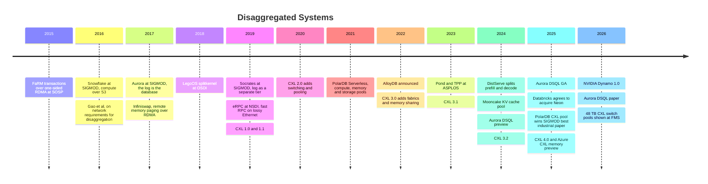
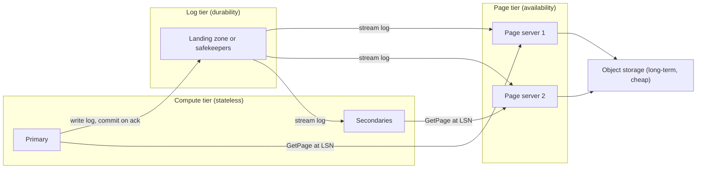
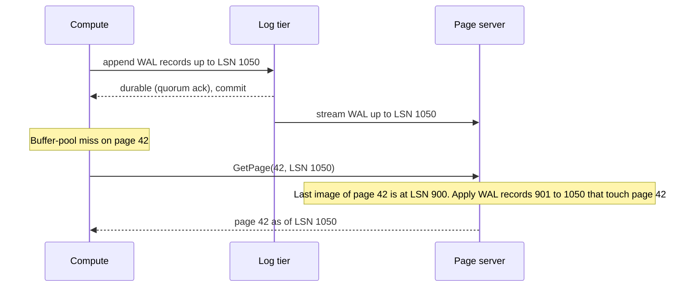

---
tags:
  - distributed-systems
  - disaggregation
  - cloud-databases
  - cxl
  - rdma
status: draft
sources:
  - https://pdos.csail.mit.edu/6.824/papers/aurora.pdf
  - https://www.microsoft.com/en-us/research/uploads/prod/2019/05/socrates.pdf
  - https://muratbuffalo.blogspot.com/2022/08/socrates-new-sql-server-in-cloud-sigmod.html
  - https://www.cs.cmu.edu/%7E15721-f24/papers/Snowflake.pdf
  - https://neon.com/docs/introduction/architecture-overview
  - https://neon.com/blog/get-page-at-lsn
  - https://databricks.com/company/newsroom/press-releases/databricks-agrees-acquire-neon-help-developers-deliver-ai-systems
  - https://cloud.google.com/blog/products/databases/alloydb-for-postgresql-intelligent-scalable-storage/
  - https://users.cs.utah.edu/~lifeifei/papers/polardbserverless-sigmod21.pdf
  - https://www.alibabacloud.com/blog/polardb-brings-alibaba-cloud-another-sigmod-best-paper-award_602713
  - https://www.alibabacloud.com/help/en/polardb/polardb-for-mysql/user-guide/cxl-based-disaggregated-architecture-for-polardb
  - https://arxiv.org/abs/2607.13276
  - https://brooker.co.za/blog/2024/12/05/inside-dsql-writes/
  - https://www.usenix.org/system/files/osdi18-shan.pdf
  - https://www.usenix.org/conference/nsdi17/technical-sessions/presentation/gu
  - https://www.usenix.org/system/files/conference/nsdi17/nsdi17-gu.pdf
  - https://arxiv.org/pdf/2203.00241
  - https://arxiv.org/abs/2206.02878
  - https://en.wikipedia.org/wiki/Compute_Express_Link
  - https://www.businesswire.com/news/home/20251118275848/en/CXL-Consortium-Releases-the-Compute-Express-Link-4.0-Specification-Increasing-Speed-and-Bandwidth
  - https://arxiv.org/pdf/2303.15375
  - https://arxiv.org/pdf/2409.14317
  - https://pdos.csail.mit.edu/6.824/papers/farm-2015.pdf
  - https://www.usenix.org/system/files/nsdi19-kalia.pdf
  - https://www.vldb.org/pvldb/vol16/p2090-haas.pdf
  - https://www.nvidia.com/en-us/networking/products/ethernet/supernic/
  - https://www.usenix.org/conference/osdi16/technical-sessions/presentation/gao
  - https://arxiv.org/pdf/2411.01269
  - https://www.asteralabs.com/news/astera-labs-leo-cxl-smart-memory-controllers-on-microsoft-azure-m-series-virtual-machines-overcome-the-memory-wall/
  - https://futurumgroup.com/insights/marvell-scales-ai-memory-to-48tb-behind-a-single-cxl-switch-at-fms-2026/
  - https://www.techinsights.com/behind-the-headlines/cxl-memory-pooling-samsung-sk-hynix
  - https://arxiv.org/abs/2401.09670
  - https://arxiv.org/abs/2407.00079
  - https://developer.nvidia.com/blog/nvidia-dynamo-1-production-ready/
created: 2026-11-26
updated: 2026-11-28
---

## Table Of Contents

---

- [[#TL;DR|TL;DR]]
- [[#The Problem|The Problem]]
- [[#Foundations|Foundations]]
    - [[#What Gets Split|What Gets Split]]
    - [[#The Latency Ladder|The Latency Ladder]]
    - [[#Caching Decides Everything|Caching Decides Everything]]
    - [[#Why the Network Caught Up|Why the Network Caught Up]]
- [[#How We Got Here|How We Got Here]]
- [[#How It Works|How It Works]]
    - [[#Aurora: Ship the Log, Not the Pages|Aurora: Ship the Log, Not the Pages]]
    - [[#Socrates, Neon and AlloyDB: The Log Becomes Its Own Tier|Socrates, Neon and AlloyDB: The Log Becomes Its Own Tier]]
    - [[#Snowflake: Analytics on Object Storage|Snowflake: Analytics on Object Storage]]
    - [[#Aurora DSQL: Disaggregating the Transaction Itself|Aurora DSQL: Disaggregating the Transaction Itself]]
    - [[#Memory Disaggregation over RDMA|Memory Disaggregation over RDMA]]
    - [[#CXL: Memory on the Load-Store Path|CXL: Memory on the Load-Store Path]]
    - [[#RDMA and Fast RPC|RDMA and Fast RPC]]
    - [[#Worked Example: Fetching a Page|Worked Example: Fetching a Page]]
    - [[#Prefill and Decode Disaggregation in LLM Serving|Prefill and Decode Disaggregation in LLM Serving]]
- [[#Where It Is Now|Where It Is Now]]
    - [[#Disaggregated Storage Is the Default Cloud Database|Disaggregated Storage Is the Default Cloud Database]]
    - [[#CXL Is Shipping, Pooling Is Early|CXL Is Shipping, Pooling Is Early]]
    - [[#Inference Adopted the Pattern|Inference Adopted the Pattern]]
- [[#Trade-offs & Open Problems|Trade-offs & Open Problems]]
- [[#Resources|Resources]]
- [[#Related Notes|Related Notes]]

## ***TL;DR***
---
*A disaggregated system splits the parts of a server (compute, memory, storage) into separate pools connected by a fast network or fabric, so each scales, fails and is paid for on its own. It works only because networks got fast enough that "remote" costs microseconds instead of milliseconds, and only as well as local caching hides that cost.*

- **Storage disaggregation is mainstream.** Cloud databases run stateless or nearly stateless compute over a shared, replicated storage service. Aurora sends only redo log records to storage ("the log is the database"), Socrates and Neon make the log its own durable tier, Snowflake runs analytics over files in S3, and Aurora DSQL splits even transaction processing into separate services ([Verbitski et al., 2017](https://pdos.csail.mit.edu/6.824/papers/aurora.pdf); [Antonopoulos et al., 2019](https://www.microsoft.com/en-us/research/uploads/prod/2019/05/socrates.pdf); [Dageville et al., 2016](https://www.cs.cmu.edu/%7E15721-f24/papers/Snowflake.pdf)).
- **Memory disaggregation is harder.** Memory is touched at nanosecond granularity. Over RDMA it works as a page-level cache tier (Infiniswap, LegoOS, PolarDB Serverless); over CXL it becomes ordinary load-store memory that is 2 to 3.5 times slower than local DRAM, and Linux tiers pages between the two (Pond, Meta's TPP).
- **The latency ladder:** local DRAM about 0.1 µs, CXL memory about 0.2 to 0.4 µs, a one-sided RDMA read about 2 to 3 µs, an NVMe flash read about 100 µs. A 16 KB page over a 100 Gb/s RDMA link costs about 3.3 µs, roughly 30 times a local DRAM access and 30 times faster than flash.
- **Same idea, new workload:** LLM serving splits prefill and decode onto different GPUs and ships the [[KV Cache]] between them (DistServe, Mooncake), with pooled CPU memory and SSD as a cache tier.
- **Now (Nov 2026):** disaggregated storage is the standard design for cloud OLTP (Aurora, Azure SQL Hyperscale, AlloyDB, Neon, PolarDB; Databricks agreed to buy Neon in May 2025). CXL 4.0 was published in November 2025; Azure previewed CXL memory expansion the same month; Alibaba runs a CXL-switch memory pool under PolarDB in canary release. Analysts report CXL pooling moving into production in 2026, but public deployment numbers are still thin.

## ***The Problem***
---
*A traditional server bundles a fixed ratio of CPU, memory and disk. Workloads don't come in that ratio, so some resource is always stranded, and the bundle fails, upgrades and scales as one unit.*

Three costs of the bundle:

| Cost | What happens | Evidence |
|---|---|---|
| **Stranded resources** | Cores run out before memory (or the reverse), leaving the rest of the box idle but unsellable | In Azure, up to 25% of DRAM becomes stranded as more cores are allocated to VMs, and DRAM can be 50% of server cost ([Li et al., Pond, 2023](https://arxiv.org/pdf/2203.00241)). In Facebook and Google traces, more than half of cluster memory sits unused most of the time ([Gu et al., Infiniswap, 2017](https://www.usenix.org/system/files/conference/nsdi17/nsdi17-gu.pdf)) |
| **Coupled scaling** | To get more storage you buy more compute, and vice versa | Snowflake rejected shared-nothing because "it tightly couples compute resources and storage resources" ([Dageville et al., §2](https://www.cs.cmu.edu/%7E15721-f24/papers/Snowflake.pdf)) |
| **Coupled failure and recovery** | Data lives on the machine running the query, so losing the machine means re-replicating its data before it is whole again | A classic SQL DB deployment needed four full copies (one primary, three secondaries) for availability and durability ([Antonopoulos et al., §2](https://www.microsoft.com/en-us/research/uploads/prod/2019/05/socrates.pdf)) |

Disaggregation answers all three by putting each resource in its own pool and reaching it over the network. The price is that every access that used to be local now may cross a wire. Whether that's acceptable depends on three numbers: how far away the remote resource is (latency), how much can be moved per second (bandwidth), and how often the local cache misses. It's the same trade as in [[Replication]] and [[CAP and PACELC]]: you spend latency to buy independence.

## ***Foundations***
---
*Know what is being split, how slow each tier is, why caching makes or breaks the design, and how network speeds changed enough to make it worth doing.*

### What Gets Split

*Disaggregation comes in levels, from separating the database's storage engine from its query engine up to building racks out of memory, compute and storage boxes.*

| Level | Compute talks to | Granularity | Fabric | Examples |
|---|---|---|---|---|
| **Storage disaggregation** | A storage service (log, pages, files) | Log records, pages (8 to 16 KB), files | Ordinary datacenter network (TCP or RDMA) | Aurora, Socrates, Neon, AlloyDB, Snowflake |
| **Memory disaggregation, page level** | A remote memory pool | Pages (4 to 16 KB) | RDMA | Infiniswap, LegoOS, PolarDB Serverless |
| **Memory disaggregation, cache-line level** | Memory on a coherent link | 64-byte cache lines, via CPU loads and stores | CXL | Pond, TPP, PolarDB on CXL |
| **Accelerator and phase disaggregation** | GPUs in another pool | Tensors, KV cache blocks | NVLink, RDMA | DistServe, Mooncake |

A 2022 TPC panel summarized the database version: "Disaggregated DBMSs separate processing from storage, enabling each to scale elastically and independently," and noted that compute can be split further by function (writes, queries, compaction) ([Ghandeharizadeh et al., 2022](https://arxiv.org/pdf/2411.01269)). The compaction split is covered in [[Disaggregated LSMs and Compaction Offload]].

### The Latency Ladder

*Each step away from the core costs roughly an order of magnitude. Every design in this note is a decision about which rung each access lands on.*

| Tier | Access latency | Source |
|---|---|---|
| Local DRAM, same socket | ~78 to 114 ns | 78 ns on Pond's Intel testbed ([Li et al., §6.1](https://arxiv.org/pdf/2203.00241)); 111 to 114 ns on Sapphire and Emerald Rapids ([Liu et al., 2024, Table 1](https://arxiv.org/pdf/2409.14317)) |
| DRAM on the other socket (NUMA) | ~140 to 193 ns | 142 ns ([Li et al.](https://arxiv.org/pdf/2203.00241)); 191 to 193 ns ([Liu et al.](https://arxiv.org/pdf/2409.14317)) |
| CXL memory expander, directly attached | ~214 to 394 ns | Four real devices on the local socket ([Liu et al., Table 1](https://arxiv.org/pdf/2409.14317)) |
| CXL memory behind a switch (pool) | under 460 ns round trip | Vendor figure for Marvell's Structera S switch ([Futurum, Aug 2026](https://futurumgroup.com/insights/marvell-scales-ai-memory-to-48tb-behind-a-single-cxl-switch-at-fms-2026/)) |
| One-sided RDMA read, small, same rack | 1.7 to 2.9 µs | Median, 32 B reads on 25 to 56 Gb/s NICs ([Kalia et al., eRPC, Table 2](https://www.usenix.org/system/files/nsdi19-kalia.pdf)) |
| Small RPC over fast userspace networking | 2.1 to 3.7 µs | Same setup ([Kalia et al.](https://www.usenix.org/system/files/nsdi19-kalia.pdf)) |
| Three-way replicated write (Raft over eRPC) | 5.5 µs median | ([Kalia et al., Table 6](https://www.usenix.org/system/files/nsdi19-kalia.pdf)) |
| NVMe flash random read | ~100 µs | "Flash random read latency is on the order of 100 microseconds" ([Haas and Leis, 2023, §2.3](https://www.vldb.org/pvldb/vol16/p2090-haas.pdf)) |

Two things stand out. CXL memory sits about 2 to 3.5 times above local DRAM, close enough that the CPU can use it directly with ordinary loads. RDMA sits about 20 to 30 times above DRAM but 30 to 50 times below flash, which is why remote memory beats a local SSD as a place to page to. Microbenchmarks also warn that emulating CXL with a remote NUMA node is misleading: real CXL devices ranged from 35% to about 3 times slower than the emulation on loads ([Sun et al., MICRO 2023](https://arxiv.org/pdf/2303.15375)).

### Caching Decides Everything

*Disaggregated systems are fast when most accesses hit a local cache, and the remote tier only pays for misses. The hit ratio, not the remote latency, sets the average.*

$$
T_{avg} = h \cdot T_{local} + (1 - h) \cdot T_{remote}
$$

*In words:* the average access time is the local time weighted by how often you hit, plus the remote time weighted by how often you miss. *Example:* $T_{local} = 0.11$ µs (local DRAM), $T_{remote} = 3.3$ µs (a 16 KB page over RDMA, worked out below).

| Hit ratio $h$ | $T_{avg}$ | Slowdown vs all-local |
|---|---|---|
| 0.99 | $0.99 \times 0.11 + 0.01 \times 3.3 = 0.142$ µs | 1.3x |
| 0.90 | $0.90 \times 0.11 + 0.10 \times 3.3 = 0.429$ µs | 3.9x |
| 0.99, but remote is flash (100 µs) | $0.109 + 1.0 = 1.11$ µs | 10x |

That is why every system keeps a local tier and sizes it carefully: LegoOS leaves each processor a small DRAM "ExCache" and ran 1.3 to 1.7 times slower than Linux with about 25% of the working set cached locally ([Shan et al., §1](https://www.usenix.org/system/files/osdi18-shan.pdf)); PolarDB Serverless sizes its local cache at min{1/8 of remote memory, 128 GB} ([Alibaba, SIGMOD 2021, §3.1.3](https://users.cs.utah.edu/~lifeifei/papers/polardbserverless-sigmod21.pdf)); Socrates caches pages in memory and on SSD in compute nodes and page servers ([Antonopoulos et al., §3.3](https://www.microsoft.com/en-us/research/uploads/prod/2019/05/socrates.pdf)). (The real formula has more terms, such as CPU caches and queueing, but the shape holds.)

### Why the Network Caught Up

*Disaggregation was proposed long before it was practical. What changed was network bandwidth growing faster than per-server needs, kernel-bypass networking cutting software overhead, and coherent links like CXL bringing remote memory inside the server's own memory system.*

- **Bandwidth.** Aurora's 2017 paper sized repair around "a 10Gbps network link" ([Verbitski et al., §2.2](https://pdos.csail.mit.edu/6.824/papers/aurora.pdf)). FaRM (2015) ran on two 56 Gb/s InfiniBand NICs per machine ([Dragojević et al., §6.1](https://pdos.csail.mit.edu/6.824/papers/farm-2015.pdf)); LegoOS (2018) on 40 Gb/s ([Shan et al., §6](https://www.usenix.org/system/files/osdi18-shan.pdf)). NVIDIA's ConnectX-8 SuperNIC offers "up to 800 Gb/s of total network bandwidth" ([NVIDIA](https://www.nvidia.com/en-us/networking/products/ethernet/supernic/)).
- **Software overhead.** RDMA and kernel-bypass RPC reach 2 to 3 µs for a small round trip in one rack ([Kalia et al.](https://www.usenix.org/system/files/nsdi19-kalia.pdf)). FaRM observed that once networks are this fast, "Both RDMA and RPC are now CPU bound," so the CPU, not the wire, becomes the limit ([Dragojević et al., §2.2](https://pdos.csail.mit.edu/6.824/papers/farm-2015.pdf)).
- **Storage got faster too.** A single PCIe 4.0 SSD delivers about 7 GB/s and 1.5 million 4 KB reads per second ([Haas and Leis, 2023](https://www.vldb.org/pvldb/vol16/p2090-haas.pdf)), which is 56 Gb/s from one drive. Disaggregated storage only wins if the network keeps up with the drives it replaces, so designs ship as little as possible over the wire (Aurora's log-only writes) and keep hot data local.
- **The question was asked directly** by Gao et al.'s "Network Requirements for Resource Disaggregation" (OSDI 2016), which estimated the latency and bandwidth a network must deliver for disaggregation not to degrade application performance ([Gao et al., 2016](https://www.usenix.org/conference/osdi16/technical-sessions/presentation/gao)).

## ***How We Got Here***
---
*Fast datacenter networks (2014 to 2015) made remote memory practical; cloud databases (2016 to 2019) disaggregated storage first because it tolerates microseconds; CXL (2019 on) brought memory pooling to standard servers; and LLM serving (2024 on) applied the same split to GPUs.*

**Remote memory as a fast-network idea (2015 to 2018).** FaRM showed that a cluster's memory could be used as one transactional store, reaching 140 million TATP transactions per second on 90 machines ([Dragojević et al., 2015](https://pdos.csail.mit.edu/6.824/papers/farm-2015.pdf)). Infiniswap (NSDI 2017) used other machines' idle memory as swap space over one-sided RDMA, and LegoOS (OSDI 2018) went further: an operating system for hardware that is already split into processor, memory and storage components.

**Storage first in databases (2016 to 2019).** Storage could be disaggregated before memory because it already lived behind an I/O interface measured in hundreds of microseconds. Snowflake (SIGMOD 2016) put a data warehouse's tables in S3 and its compute in elastic clusters. Aurora (SIGMOD 2017) put an OLTP engine's storage behind a replicated service that understands redo logs. Socrates (SIGMOD 2019) split the log out as its own service. Murat Demirbas calls Aurora "the first commercial system that adopted this idea," with Socrates adding the separate log tier ([Demirbas, 2022](https://muratbuffalo.blogspot.com/2022/08/socrates-new-sql-server-in-cloud-sigmod.html)).

**A standard for memory (2019 on).** CXL 1.0 (March 2019) put a cache-coherent protocol on the PCIe 5.0 physical layer; 2.0 (November 2020) added switching and memory pooling across hosts; 3.0 (August 2022) moved to PCIe 6.0 signaling and added multi-level switching and memory sharing ([Wikipedia summary of CXL releases](https://en.wikipedia.org/wiki/Compute_Express_Link)). Microsoft's Pond and Meta's TPP (both ASPLOS 2023) showed how a cloud and a hyperscaler would actually use it.

**Disaggregation everywhere (2024 on).** Aurora DSQL split transaction processing into separate services; LLM serving split prefill and decode onto different GPUs. See [[Distributed SQL]] and [[KV Cache]].

## ***How It Works***
---
*Each design below answers the same questions: what crosses the network on a write, what crosses it on a read, where the durable copy lives, and what local cache hides the remote latency.*

### Aurora: Ship the Log, Not the Pages

*A traditional database writes both log records and full data pages to disk; mirrored, that's a lot of network traffic. Aurora writes only redo log records to a storage service that builds pages itself.*

- **What moves:** "the only writes that cross the network are redo log records" ([Verbitski et al., §3.2](https://pdos.csail.mit.edu/6.824/papers/aurora.pdf)). Storage nodes apply those records to produce pages in the background, so "as far as the engine is concerned, the log is the database" (§3.2).
- **What moved out of the database instance:** "redo logging, durable storage, crash recovery, and backup/restore" (§1).
- **Layout:** the volume is cut into 10 GB segments, each replicated six ways (two per availability zone) into a protection group, with a 4-of-6 write quorum. The quorum design is covered in [[Replication#Quorum Replication|Replication]].
- **The I/O win:** in the paper's comparison, Aurora sustained 35 times more transactions than mirrored MySQL with 7.7 times fewer I/Os per transaction on the database node (0.95 against 7.4) (§3.2, Table 1).
- **Readers for free:** one writer and up to 15 read replicas mount the same storage volume; replicas "add no additional costs in terms of consumed storage or disk write operations," and replica lag is typically 20 ms or less (§4.2.4).
- **Recovery:** no checkpoint replay on the database instance, so recovery is "generally under 10 seconds," even after crashing under 100,000 writes per second (§4.3).

The single writer still orders everything; the storage tier is quorum-replicated but not a consensus group. That makes Aurora disaggregated storage under a classic primary, which is why scaling writes needed a different design (DSQL, below).

### Socrates, Neon and AlloyDB: The Log Becomes Its Own Tier

*Aurora's storage nodes both make the log durable and serve pages. Socrates split those jobs: a small, fast log service for durability, and separate page servers for availability. Neon and AlloyDB follow the same shape for PostgreSQL.*

**Socrates (Azure SQL Database Hyperscale)** has four tiers: compute, the XLOG log service, page servers, and Azure Storage (XStore) ([Antonopoulos et al., §4.2](https://www.microsoft.com/en-us/research/uploads/prod/2019/05/socrates.pdf)).
- "A novel feature of the Socrates architecture is that it separates availability from durability" (§6). Durability lives in the log and XStore; compute nodes and page servers can be lost without losing data.
- The primary writes log blocks synchronously to a small, fast *landing zone* on Azure Premium Storage, which keeps three replicas; XLOG then spreads the log to page servers and secondaries (§4.3).
- Against the earlier design: 2 copies of data instead of 4 (plus backup), commit latency under 0.5 ms instead of 3 ms, log throughput 100+ MB/s instead of 50, maximum size 100 TB instead of 4 TB (Table 1). Each page server covers a partition of about 128 GB, so a database of hundreds of terabytes runs thousands of page servers (§6).

**Neon** (serverless PostgreSQL) uses the same three roles ([Neon docs](https://neon.com/docs/introduction/architecture-overview); [Linnakangas, 2023](https://neon.com/blog/get-page-at-lsn)):
- **Compute** is stock PostgreSQL that "streams WAL ([[Write-Ahead Logging]]) to the storage layer" instead of writing it to local disk; "Compute nodes do not own durable state and can be replaced freely."
- **Safekeepers:** WAL goes to three safekeeper nodes that replicate it with a Paxos-like protocol; a transaction commits when a quorum acknowledges (see [[Paxos]]).
- **Pageservers** turn WAL into immutable *delta layers* (changes over a key and LSN range) and periodic *image layers* (full snapshots), uploaded to object storage. Because history is kept, a *branch* is just a pointer to an older LSN with copy-on-write, and an idle compute can scale to zero (the 2023 post says after five minutes of inactivity).

**AlloyDB** (Google, May 2022) writes WAL synchronously to low-latency regional log storage at commit; a *log processing service* replays it asynchronously into blocks stored in sharded regional block storage, once per zone across three zones. Because storage replays the WAL, the primary needs no checkpoints or full-page writes, and read pool instances attach to the same storage instead of copying the database ([Murthy and Goindi, 2022](https://cloud.google.com/blog/products/databases/alloydb-for-postgresql-intelligent-scalable-storage/)).

**The read path is the same in all three:** compute asks for page $p$ *as of* log position $L$. The page server applies any log records up to $L$ that it hasn't yet folded in, then returns the page.

If the page server hasn't received WAL up to $L$ yet, the request waits; AlloyDB says such stalls should be rare ([Murthy and Goindi](https://cloud.google.com/blog/products/databases/alloydb-for-postgresql-intelligent-scalable-storage/)).

### Snowflake: Analytics on Object Storage

*For analytics, the data can sit in an object store with high latency, because scans are large and sequential. Compute clusters come and go and cache what they touch.*

Snowflake's three layers are data storage on S3, *virtual warehouses* (elastic clusters of VMs that run queries) and a cloud services layer for metadata, transactions and optimization ([Dageville et al., §3](https://www.cs.cmu.edu/%7E15721-f24/papers/Snowflake.pdf)).
- **Immutable files.** "Tables are horizontally partitioned into large, immutable files"; S3 objects "can only be (over-)written in full," so a change writes a new file (§3.1, §3.3.2). See [[Object Storage]] and [[LSM Trees]] for the same write-new-never-modify pattern.
- **Local cache.** "each compute node caches some table data on local disk" (§2).
- **Cache affinity.** The optimizer assigns files to workers "using consistent hashing over table file names," so the same files keep landing on the same node; when workers change, the hashing is lazy and "no data is shuffled immediately" (§3.2.2). See [[Partitioning]].
- **File stealing.** A worker that finishes early asks peers for files they haven't started, taking ownership only for that query (§3.2.2).
- **Why S3 anyway:** higher latency and per-request CPU overhead, but "its usability, high availability, and strong durability guarantees were hard to beat" (§3.1).

### Aurora DSQL: Disaggregating the Transaction Itself

*Aurora, Socrates and Neon still have one writer. DSQL splits query processing, conflict checking, the journal and storage into separately scaled services, so writes scale out too.*

Query processors are stateless and buffer writes; at commit an adjudicator checks write-write conflicts, the journal makes the transaction durable, and storage replicas apply it with no consensus of their own ([Brooker, Dec 2024](https://brooker.co.za/blog/2024/12/05/inside-dsql-writes/); [DSQL paper, 2026](https://arxiv.org/abs/2607.13276)). The full walk-through, isolation level and limits are in [[Distributed SQL#Aurora DSQL: Disaggregated and Optimistic|Distributed SQL]]; the commit path is in [[Distributed Transactions]]. What matters here: DSQL is the clearest example of disaggregation moving from *resources* (CPU vs disk) to *functions* (execute vs order vs persist), each scaled on its own.

### Memory Disaggregation over RDMA

*Over RDMA, remote memory is too slow for loads and stores but fast enough to page to. Systems treat it as a page-level tier below local DRAM, fetched with one-sided reads that don't use the remote CPU.*

| System | What it is | Key result |
|---|---|---|
| **Infiniswap** (NSDI 2017) | Swap space split into slabs placed in other machines' unused memory, accessed with one-sided RDMA, no application or OS changes | Up to 15.4x the throughput of swapping to disk; cluster memory utilization up 1.47x (40.8% to 60%) ([Gu et al.](https://www.usenix.org/conference/nsdi17/technical-sessions/presentation/gu); [§7.4.1](https://www.usenix.org/system/files/conference/nsdi17/nsdi17-gu.pdf)) |
| **LegoOS** (OSDI 2018) | A *splitkernel*: separate monitors on processor (pComponent), memory (mComponent) and storage (sComponent) components; page tables and most memory live on memory components; processors keep a small ExCache | 1.3 to 1.7x slower than Linux with 25% of the working set cached; estimated MTTF 17% to 49% better than an equivalent monolithic cluster ([Shan et al.](https://www.usenix.org/system/files/osdi18-shan.pdf)) |
| **PolarDB Serverless** (SIGMOD 2021) | Compute, memory and storage pools; the buffer pool lives in a remote memory pool of 1 GB slabs holding 16 KB pages, read and written with one-sided RDMA | 5.3x faster failure recovery than the local-resource design, because the buffer pool survives a compute failure ([Alibaba](https://users.cs.utah.edu/~lifeifei/papers/polardbserverless-sigmod21.pdf)) |

PolarDB's recovery result shows a benefit beyond utilization: when memory is a separate pool, it outlives the compute node. On an unplanned failure the service resumed in 16 seconds with the remote buffer pool, against 85 seconds without page materialization (§6.3).

### CXL: Memory on the Load-Store Path

*CXL (Compute Express Link) runs cache-coherent memory traffic over the PCIe physical layer. To the CPU, CXL memory looks like a NUMA node with no cores: slower than local DRAM, but reached with ordinary loads and stores, not page faults or RDMA.*

**Three protocols, three device types** ([Wikipedia](https://en.wikipedia.org/wiki/Compute_Express_Link)):
- *CXL.io* (PCIe-style configuration and DMA), *CXL.cache* (a device caches host memory coherently), *CXL.mem* (the host accesses device memory coherently).
- Type 1 = accelerators with no memory (io + cache); Type 2 = accelerators with memory, like GPUs (all three); **Type 3 = memory expanders** (io + mem), the devices used for pooling.

| Version | Released | What it added |
|---|---|---|
| 1.0 / 1.1 | Mar 2019 / Jun 2019 | Coherent memory over the PCIe 5.0 PHY; direct-attached expanders. CXL 1.1 support was announced for Intel Sapphire Rapids and AMD Genoa |
| 2.0 | Nov 2020 | Switching; **memory pooling** (a device's memory carved up among several hosts); integrity and encryption |
| 3.0 | Aug 2022 | PCIe 6.0 signaling (64 GT/s), multi-level switching, peer-to-peer, **memory sharing** (several hosts coherently access the same region) |
| 3.1 / 3.2 | Nov 2023 / Dec 2024 | Incremental releases |
| 4.0 | Nov 18, 2025 | 128 GT/s (double 3.x), bundled ports, native x2 width, up to four retimers, memory RAS improvements; backward compatible to 1.0 ([CXL Consortium, Nov 2025](https://www.businesswire.com/news/home/20251118275848/en/CXL-Consortium-Releases-the-Compute-Express-Link-4.0-Specification-Increasing-Speed-and-Bandwidth)) |

Pooling and sharing are different: pooling gives each host its own slice of a shared device (no coherence across hosts needed); sharing lets hosts read and write the same bytes, which needs coherence across hosts and is much harder.

**Pond (Microsoft, ASPLOS 2023)** asked how much pooling Azure would really save ([Li et al.](https://arxiv.org/pdf/2203.00241)):
- Pooling across 8 to 16 sockets captures most of the benefit, and adds 70 to 90 ns over same-NUMA-node DRAM.
- In Azure traces, stranded memory is 3% to 27% at the 95th percentile, and the median VM leaves 50% of its memory untouched.
- Many workloads barely notice CXL latency: of 158 workloads, 43% stayed within 5% of local performance at the smaller emulated overhead. Pond uses a machine-learning model to predict which VMs tolerate pool memory and how much memory a VM won't touch, and places that in the pool.
- Result: 7% less DRAM, which Pond translates into about 3.5% lower overall cloud server cost.

**TPP (Meta, ASPLOS 2023)** handles the other half: once a server has a fast local tier and a slow CXL tier, the kernel must keep hot pages local. TPP demotes cold pages to CXL memory and promotes hot ones back, and came within 1% of an all-local baseline, about 18% better than default Linux. Most of it was merged in Linux 5.18 ([Maruf et al.](https://arxiv.org/abs/2206.02878)). The [[#Caching Decides Everything|hit-ratio formula]] explains why: if only 10% of accesses go to 300 ns CXL memory, $0.9 \times 0.11 + 0.1 \times 0.3 = 0.129$ µs, about 1.17x local.

### RDMA and Fast RPC

*RDMA lets a NIC read or write another machine's memory without involving that machine's CPU. It's the tool behind remote memory pools and microsecond-scale distributed transactions, but well-engineered ordinary RPC gets surprisingly close.*

- **Verbs.** *Two-sided* verbs (send/receive) are a message exchange: the receiver's CPU handles each message. *One-sided* verbs (READ, WRITE, atomics) are served entirely by the remote NIC: "One-sided RDMA uses no remote CPU" ([Dragojević et al., §1](https://pdos.csail.mit.edu/6.824/papers/farm-2015.pdf)).
- **FaRM (SOSP 2015)** built transactions on that. Single-object reads are lock-free one-sided RDMA reads; commit uses one-sided writes into log buffers on primaries and backups, $P_w(f + 3)$ writes where $P_w$ is the number of primaries written, against $4P(2f + 1)$ messages for Paxos-based 2PC in Spanner (§4). On 90 machines with 56 Gb/s InfiniBand it ran 140 million TATP transactions per second at 58 µs median latency (9 µs at low load) and recovered from failures in under 50 ms ([Dragojević et al.](https://pdos.csail.mit.edu/6.824/papers/farm-2015.pdf)). Its 10 ms leases are an example of [[Leases and Fencing]] at microsecond scale.
- **eRPC (NSDI 2019, best paper)** argued the opposite: you don't need RDMA or lossless fabrics. A carefully built RPC library on commodity lossy Ethernet does 10 million small RPCs per second per core and 75 Gb/s per core for large messages, and is "at most 800 ns slower than RDMA reads." A production [[Raft]] port replicated three ways in 5.5 µs ([Kalia et al.](https://www.usenix.org/system/files/nsdi19-kalia.pdf)). Its congestion argument: an RTT of 6 µs gives a bandwidth-delay product of about 19 kB, tiny against 12 MB switch buffers, so limiting each flow to one BDP in flight avoids most loss.

The practical lesson: one-sided RDMA wins when the remote CPU is the bottleneck or must stay out of the path (memory pools); fast RPC wins when the operation needs remote logic anyway (consensus, page servers that replay WAL).

### Worked Example: Fetching a Page

*How much does it cost to pull one database page from a remote memory pool instead of local DRAM? A round trip plus the time to push the bytes through the link.*

$$
T_{fetch} \approx T_{rtt} + \frac{S}{B}
$$

*In words:* the fetch costs one network round trip plus the page size divided by the link bandwidth. Take a 16 KB page (PolarDB's page size) and $T_{rtt} = 2.0$ µs (a one-sided RDMA read in the same rack, [Kalia et al.](https://www.usenix.org/system/files/nsdi19-kalia.pdf)). $S = 16{,}384 \times 8 = 131{,}072$ bits.

| Link | $S / B$ | $T_{fetch}$ | vs local DRAM (0.11 µs) | vs NVMe flash (100 µs) |
|---|---|---|---|---|
| 10 Gb/s (Aurora-era) | 13.1 µs | 15.1 µs | 137x slower | 6.6x faster |
| 56 Gb/s (FaRM-era) | 2.3 µs | 4.3 µs | 39x slower | 23x faster |
| 100 Gb/s | 1.3 µs | 3.3 µs | 30x slower | 30x faster |
| 800 Gb/s | 0.16 µs | 2.2 µs | 20x slower | 45x faster |

Three readings. First, at 10 Gb/s the transfer dominates; from 100 Gb/s on, the round trip does, so faster links stop helping and latency, not bandwidth, becomes the wall. Second, a remote page is always tens of times slower than local DRAM, so this only works behind a cache with a high hit ratio. Third, a remote page is tens of times faster than reading flash, which is why remote memory beats local SSD as a swap or buffer-pool extension. (These are idealized: they leave out queueing, NIC and PCIe overheads, and contention; Infiniswap, for example, reports application-level gains rather than per-page latency.)

### Prefill and Decode Disaggregation in LLM Serving

*LLM inference has two phases with opposite resource profiles. Running them on separate GPU pools, and moving the KV cache between them, is disaggregation applied to accelerators.*

- **Prefill** processes the whole prompt in parallel and is compute-bound; **decode** generates one token at a time and is memory-bandwidth-bound (see [[KV Cache]]). On the same GPU, prefill bursts stall decode.
- **DistServe** (OSDI 2024) puts prefill and decode on different GPUs, picks resources and parallelism per phase for the time-to-first-token and time-per-output-token targets, and places phases according to cluster bandwidth to limit cache transfer cost. It serves up to 7.4x more requests, or meets 12.6x tighter latency targets ([Zhong et al.](https://arxiv.org/abs/2401.09670)).
- **Mooncake** (Moonshot AI's Kimi) is "KVCache-centric": separate prefill and decode clusters plus a disaggregated KV cache built from otherwise idle CPU memory, DRAM and SSD in the GPU cluster. Under real workloads Kimi handled 75% more requests ([Qin et al.](https://arxiv.org/abs/2407.00079)).
- The parallel with databases is close: the KV cache is the "page," GPU memory is the local buffer pool, and the CPU/SSD pool is the page server. [[PagedAttention]]'s fixed-size blocks are what make the cache movable in pieces.

## ***Where It Is Now***
---
*As of November 2026: disaggregated storage is the standard architecture for cloud relational databases; CXL hardware ships and the first cloud previews exist, but large pooled deployments are still mostly vendor claims; and LLM serving made prefill/decode splitting and pooled KV caches routine.*

### Disaggregated Storage Is the Default Cloud Database

- **Every major cloud has one.** Aurora (AWS), Azure SQL Hyperscale (Socrates), AlloyDB (Google) and PolarDB (Alibaba) all separate compute from a log-aware storage service, as described above.
- **Aurora DSQL** went GA in May 2025 and published its architecture paper in July 2026, extending disaggregation from storage to the transaction path ([[Distributed SQL]]; [DSQL paper](https://arxiv.org/abs/2607.13276)).
- **Databricks agreed to buy Neon.** Databricks announced its agreement to acquire Neon on May 14, 2025, citing telemetry that over 80% of databases provisioned on Neon were created by AI agents and that Neon launches an isolated Postgres in 500 ms or less; it framed the point as removing the need for compute and storage "to scale in tandem" ([Databricks, May 2025](https://databricks.com/company/newsroom/press-releases/databricks-agrees-acquire-neon-help-developers-deliver-ai-systems)). Cheap, short-lived databases are only possible when an idle database costs only its storage.
- **Neon's design documentation** was still being updated in 2026 (the storage deep dive shows a March 2026 update) ([Neon](https://neon.com/blog/get-page-at-lsn)).

### CXL Is Shipping, Pooling Is Early

*Expanders are in products and cloud previews; switch-based pools are being announced; independent evidence of pooling at scale is still limited.*

- **Spec:** CXL 4.0, November 18, 2025, at 128 GT/s ([CXL Consortium](https://www.businesswire.com/news/home/20251118275848/en/CXL-Consortium-Releases-the-Compute-Express-Link-4.0-Specification-Increasing-Speed-and-Bandwidth)).
- **First cloud CXL memory:** Microsoft previewed CXL memory expansion on Azure M-series VMs on November 18, 2025, using Astera Labs' CXL 2.0 Leo controllers (up to 2 TB per controller); it was a private preview, not GA, as of that announcement ([Astera Labs, Nov 2025](https://www.asteralabs.com/news/astera-labs-leo-cxl-smart-memory-controllers-on-microsoft-azure-m-series-virtual-machines-overcome-the-memory-wall/)). This is expansion (more memory per host), not pooling across hosts.
- **A CXL-switch pool in a database:** Alibaba's PolarDB paper "Unlocking the Potential of CXL for Disaggregated Memory in Cloud-Native Databases" won SIGMOD 2025's best industrial paper (June 2025). Alibaba reports a CXL 2.0 switch-based pool at 10 TB scale with up to 2.1x the performance of an RDMA-based pool in the same configuration ([Alibaba, Dec 2025](https://www.alibabacloud.com/blog/polardb-brings-alibaba-cloud-another-sigmod-best-paper-award_602713)). The PolarDB for MySQL docs (updated March 2026) list CXL memory extension as a **canary release** available by ticket, expanding a single node to 8 TB ([Alibaba docs](https://www.alibabacloud.com/help/en/polardb/polardb-for-mysql/user-guide/cxl-based-disaggregated-architecture-for-polardb)). These are vendor numbers.
- **Bigger switches:** at FMS in August 2026, Marvell showed the Structera S 30260 CXL 3.x switch connecting 16 or 32 hosts to up to 48 TB of pooled memory with under 460 ns round-trip latency; Futurum notes that "no hyperscaler is named and no deployment volume is quantified" ([Futurum, Aug 2026](https://futurumgroup.com/insights/marvell-scales-ai-memory-to-48tb-behind-a-single-cxl-switch-at-fms-2026/)).
- **Analyst view:** TechInsights (October 2026) says pooling "has moved from forecast to production in 2026" on new Intel and AMD platforms, forecasts pooling revenue overtaking plain expansion by 2027 to 2028, and reports Samsung and SK hynix pitching CXL for KV cache workloads at OCP 2026 ([TechInsights, Oct 2026](https://www.techinsights.com/behind-the-headlines/cxl-memory-pooling-samsung-sk-hynix)). This is a forecast from a paywalled report; treat the numbers as directional.

### Inference Adopted the Pattern

- **Mooncake** posted its fifth revision in October 2026 ([arXiv v5](https://arxiv.org/abs/2407.00079)).
- **NVIDIA Dynamo 1.0** (March 2026) ships disaggregated serving with a KV block manager that moves cache blocks across "GPU memory, CPU memory, local SSD, and remote storage," including S3-style object storage, and the NIXL library that vLLM, SGLang and TensorRT-LLM use for cache transfers. NVIDIA reports up to 7x more requests on Blackwell in the SemiAnalysis InferenceX benchmark, and integration into the managed Kubernetes services of AWS, Google Cloud, Azure, Alibaba Cloud and Oracle ([NVIDIA, Mar 2026](https://developer.nvidia.com/blog/nvidia-dynamo-1-production-ready/)). More in [[KV Cache]] and [[GPU Cluster Infrastructure]].
- The memory industry is now pitching CXL pools as the next KV cache tier ([TechInsights](https://www.techinsights.com/behind-the-headlines/cxl-memory-pooling-samsung-sk-hynix); [Futurum](https://futurumgroup.com/insights/marvell-scales-ai-memory-to-48tb-behind-a-single-cxl-switch-at-fms-2026/)), which would join the two halves of this note.

## ***Trade-offs & Open Problems***
---
*Disaggregation trades latency and a new shared dependency for utilization, elasticity and faster recovery. The open problems are about the shared pools: what happens when they are slow, fail, or are shared by too many tenants.*

| Choice | You get | You pay |
|---|---|---|
| Log-only writes to storage (Aurora) | Far less network I/O; storage does recovery and backup | Storage must understand the database's log format; single writer |
| Separate log tier (Socrates, Neon) | Durability from a small fast tier, availability from cheap page servers; fewer full copies | More components and hops; reads can wait for log replay |
| Object storage as the base (Snowflake, Neon's history) | Cheapest durable bytes; instant scale-out and branching | High latency; depends on local caches and immutable files |
| Remote memory over RDMA | Uses idle memory cluster-wide; buffer pool outlives compute | Microseconds per miss; needs a large local cache; RDMA operations at scale |
| CXL memory | Load-store access at 2 to 3.5x DRAM latency; no code changes | Lower bandwidth per device; needs kernel tiering (TPP); pooling needs switches and new failure handling |
| Disaggregating transaction functions (DSQL) | Each function scales on its own; writes scale out | Optimistic aborts, transaction size limits ([[Distributed SQL]]) |
| Prefill/decode split | Each phase tuned to its bottleneck | KV cache transfer bandwidth; harder scheduling |

Open problems worth tracking:
- **Blast radius.** A shared storage or memory pool is a shared dependency: when it is slow, every compute node attached to it is slow. Slow-but-not-dead storage nodes are exactly the [[Gray and Fail-Slow Failures]] problem, and Aurora's quorum writes exist partly to ride out such nodes ([[Replication]]).
- **Failure semantics for memory.** A crashed RDMA memory node or a failed CXL device takes memory with it, which operating systems traditionally treat as fatal. LegoOS estimated better MTTF from splitting components ([Shan et al.](https://www.usenix.org/system/files/osdi18-shan.pdf)), but replicating or recovering pooled memory without a big latency cost is open; see [[Failure Models]].
- **Sharing, not just pooling.** CXL 3.x memory sharing allows several hosts to access the same bytes, but coherence across hosts and failure handling for shared regions are early. Most real use is expansion or pooling.
- **Emulation vs reality.** Much CXL research used remote NUMA nodes to emulate CXL; real devices differ by up to 26% in latency and widely in bandwidth ([Sun et al.](https://arxiv.org/pdf/2303.15375)), so older results need re-checking on hardware.
- **Network is now the bottleneck again.** One SSD can fill a 56 Gb/s link ([Haas and Leis](https://www.vldb.org/pvldb/vol16/p2090-haas.pdf)); 800 Gb/s NICs move the wall but don't remove it. Designs keep minimizing bytes on the wire (log shipping, pushdown, compression).
- **Corruption and correctness across tiers.** More tiers mean more places for a page and its log to disagree; see [[Silent Data Corruption]] and [[Deterministic Simulation Testing]] for how teams test this.
- **Scheduling.** Placing compute near its cached data (Snowflake's consistent hashing, Mooncake's cache-aware scheduler) is a placement problem; see [[Cluster Scheduling]].

## ***Resources***
---
*Read the Aurora paper first, then Socrates for the separate log tier and Snowflake for analytics. For memory, read Pond (why pool) and TPP (how to tier), then LegoOS for the most radical version. FaRM and eRPC are the RDMA pair.*

**Primary papers: storage disaggregation**
- [Amazon Aurora: Design Considerations for High Throughput Cloud-Native Relational Databases](https://pdos.csail.mit.edu/6.824/papers/aurora.pdf): Verbitski et al., SIGMOD 2017. "The log is the database."
- [Socrates: The New SQL Server in the Cloud](https://www.microsoft.com/en-us/research/uploads/prod/2019/05/socrates.pdf): Antonopoulos et al., SIGMOD 2019. Separating durability from availability.
- [The Snowflake Elastic Data Warehouse](https://www.cs.cmu.edu/%7E15721-f24/papers/Snowflake.pdf): Dageville et al., SIGMOD 2016.
- [PolarDB Serverless: A Cloud Native Database for Disaggregated Data Centers](https://users.cs.utah.edu/~lifeifei/papers/polardbserverless-sigmod21.pdf): Alibaba, SIGMOD 2021. Compute, memory and storage pools.
- [Aurora DSQL: Scalable, Multi-Region OLTP](https://arxiv.org/abs/2607.13276): Brooker et al., arXiv, Jul 2026.

**Primary papers: memory and networking**
- [LegoOS: A Disseminated, Distributed OS for Hardware Resource Disaggregation](https://www.usenix.org/system/files/osdi18-shan.pdf): Shan et al., OSDI 2018.
- [Efficient Memory Disaggregation with Infiniswap](https://www.usenix.org/system/files/conference/nsdi17/nsdi17-gu.pdf): Gu et al., NSDI 2017.
- [Pond: CXL-Based Memory Pooling Systems for Cloud Platforms](https://arxiv.org/pdf/2203.00241): Li et al., ASPLOS 2023.
- [TPP: Transparent Page Placement for CXL-Enabled Tiered-Memory](https://arxiv.org/abs/2206.02878): Maruf et al., ASPLOS 2023.
- [No compromises: distributed transactions with consistency, availability, and performance](https://pdos.csail.mit.edu/6.824/papers/farm-2015.pdf): Dragojević et al., SOSP 2015 (FaRM).
- [Datacenter RPCs can be General and Fast](https://www.usenix.org/system/files/nsdi19-kalia.pdf): Kalia, Kaminsky and Andersen, NSDI 2019 (eRPC).
- [Network Requirements for Resource Disaggregation](https://www.usenix.org/conference/osdi16/technical-sessions/presentation/gao): Gao et al., OSDI 2016.
- [Demystifying CXL Memory with Genuine CXL-Ready Systems and Devices](https://arxiv.org/pdf/2303.15375): Sun et al., MICRO 2023. Real CXL vs NUMA emulation.
- [Dissecting CXL Memory Performance at Scale](https://arxiv.org/pdf/2409.14317): Liu et al., 2024. Measured latencies for four CXL devices.
- [What Modern NVMe Storage Can Do, And How To Exploit It](https://www.vldb.org/pvldb/vol16/p2090-haas.pdf): Haas and Leis, VLDB 2023.

**Primary papers: LLM serving**
- [DistServe: Disaggregating Prefill and Decoding for Goodput-optimized LLM Serving](https://arxiv.org/abs/2401.09670): Zhong et al., OSDI 2024.
- [Mooncake: A KVCache-centric Disaggregated Architecture for LLM Serving](https://arxiv.org/abs/2407.00079): Qin et al., 2024, revised Oct 2026.

**Analysis**
- [Socrates: The New SQL Server in the Cloud](https://muratbuffalo.blogspot.com/2022/08/socrates-new-sql-server-in-cloud-sigmod.html): Murat Demirbas, Aug 2022.
- [Disaggregated Database Management Systems](https://arxiv.org/pdf/2411.01269): Ghandeharizadeh, Bernstein, Borthakur et al., TPCTC 2022 panel summary.
- [Marvell scales AI memory to 48 TB behind a single CXL switch](https://futurumgroup.com/insights/marvell-scales-ai-memory-to-48tb-behind-a-single-cxl-switch-at-fms-2026/): Futurum, Aug 2026.
- [CXL memory pooling: why Samsung and SK hynix are racing](https://www.techinsights.com/behind-the-headlines/cxl-memory-pooling-samsung-sk-hynix): TechInsights, Oct 2026.

**Docs and project pages**
- [Neon architecture overview](https://neon.com/docs/introduction/architecture-overview) and [Deep dive into Neon storage engine](https://neon.com/blog/get-page-at-lsn): Heikki Linnakangas, 2023 (updated 2026).
- [AlloyDB for PostgreSQL under the hood: intelligent, database-aware storage](https://cloud.google.com/blog/products/databases/alloydb-for-postgresql-intelligent-scalable-storage/): Google, May 2022.
- [CXL-based disaggregated architecture for PolarDB](https://www.alibabacloud.com/help/en/polardb/polardb-for-mysql/user-guide/cxl-based-disaggregated-architecture-for-polardb): Alibaba docs, updated Mar 2026.
- [CXL 4.0 release](https://www.businesswire.com/news/home/20251118275848/en/CXL-Consortium-Releases-the-Compute-Express-Link-4.0-Specification-Increasing-Speed-and-Bandwidth): CXL Consortium, Nov 2025. Version history in the [Wikipedia CXL article](https://en.wikipedia.org/wiki/Compute_Express_Link).
- [NVIDIA Dynamo 1.0](https://developer.nvidia.com/blog/nvidia-dynamo-1-production-ready/): NVIDIA, Mar 2026.

## Related Notes

- [[Replication]] — Aurora's 4-of-6 storage quorum, the replication layer under disaggregated storage.
- [[Distributed SQL]] — Aurora DSQL, which disaggregates the transaction path itself.
- [[Distributed Transactions]] — FaRM's RDMA commit and DSQL's single commit-time check.
- [[Paxos]] — Neon's safekeepers replicate WAL with a Paxos-like protocol.
- [[Raft]] — Replicated in 5.5 µs over eRPC; the log many storage tiers are built on.
- [[CAP and PACELC]] — Disaggregation spends latency for independence, the EL side of the trade.
- [[Failure Models]] — What it means for a memory pool or storage tier to fail.
- [[Leases and Fencing]] — FaRM's 10 ms leases; single-writer fencing over shared storage.
- [[Logs and Streaming]] — "The log is the database"; storage tiers built around a replicated log.
- [[Object Storage]] — The cheapest tier, under Snowflake and Neon.
- [[Databases on Object Storage]] — Engines with no durable state but the object store, and how they commit.
- [[LSM Trees]] — Immutable files and layers, as in Snowflake files and Neon's delta and image layers.
- [[Disaggregated LSMs and Compaction Offload]] — Splitting an LSM's compaction, flushes and memtables across machines.
- [[Partitioning]] — Page-server partitions and Snowflake's consistent hashing of files to workers.
- [[Gray and Fail-Slow Failures]] — Slow shared storage or memory slows every attached node.
- [[Silent Data Corruption]] — More tiers, more places for pages and logs to diverge.
- [[Cluster Scheduling]] — Placing compute next to its cached data.
- [[Overcommit and Vertical Autoscaling]] — The other answer to stranded and idle memory: oversell it, offload it, or shrink the request (Coach, TMO).
- [[GPU Cluster Infrastructure]] — Prefill/decode pools and KV cache transfer fabrics.
- [[KV Cache]] — The "page" of LLM serving, moved between prefill and decode pools.
- [[PagedAttention]] — Fixed-size KV blocks that make the cache movable and poolable.
- [[Deterministic Simulation Testing]] — Testing multi-tier storage systems under injected faults.
- [[Stream Processing]] — Flink 2.0's disaggregated state (ForSt): remote primary state with a local cache.
- [[Diskless Streaming]] — Kafka-style logs split into stateless brokers, object storage and a metadata coordinator.
- [[Write-Ahead Logging]] — The log these designs make into the database: Aurora, Socrates, Neon, AlloyDB and DSQL's journal.
- [[Multi-Tenant Storage QoS]] — Isolating tenants on shared remote flash: ReFlex and Gimbal.
