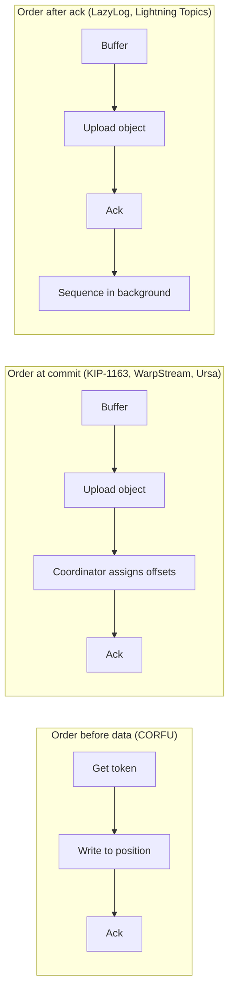
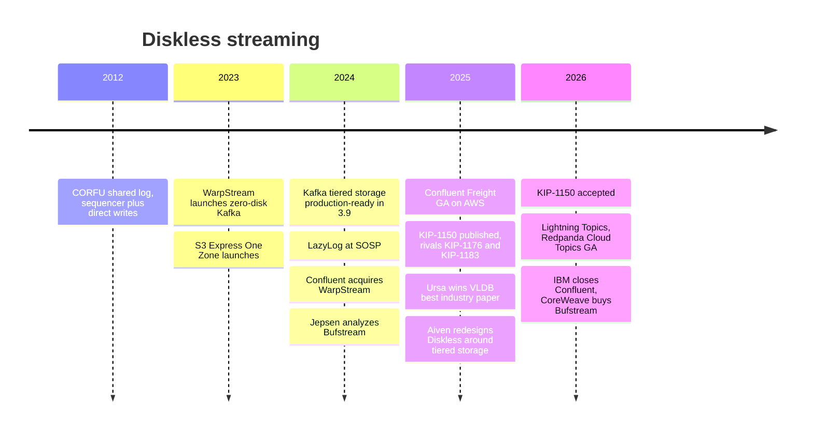
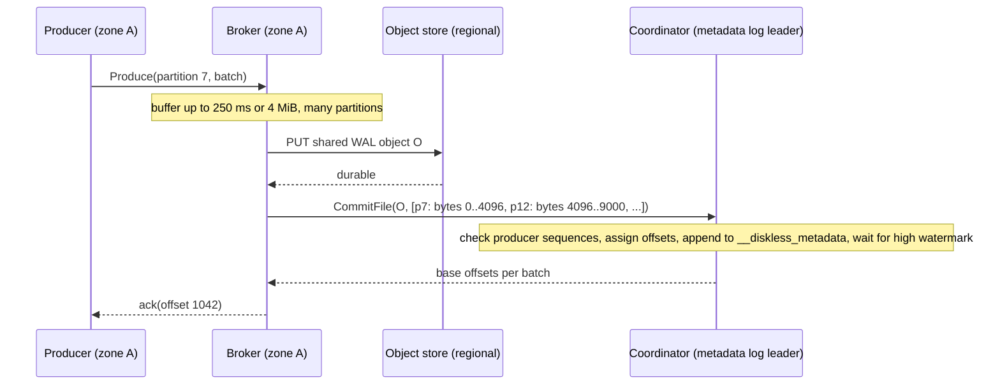

---
tags:
  - distributed-systems
  - diskless
  - kafka
  - object-storage
  - shared-log
  - streaming
  - kip-1150
status: complete
sources:
  - https://cwiki.apache.org/confluence/display/KAFKA/KIP-1150%3A+Diskless+Topics
  - https://cwiki.apache.org/confluence/display/KAFKA/KIP-1163:+Diskless+Core
  - https://cwiki.apache.org/confluence/display/KAFKA/KIP-1164:+Diskless+Coordinator
  - https://cwiki.apache.org/confluence/spaces/KAFKA/pages/354454090/KIP-1176+Tiered+Storage+for+Active+Log+Segment
  - https://aiven.io/blog/kip-1150-accepted-and-the-road-ahead
  - https://aiven.io/blog/diskless-unified-zero-copy-apache-kafka
  - https://aiven.io/blog/benchmarking-diskless-inkless-topics-part-1
  - https://jack-vanlightly.com/blog/2025/10/22/a-fork-in-the-road-deciding-kafkas-diskless-future
  - https://www.warpstream.com/diskless-kafka
  - https://docs.warpstream.com/warpstream/overview/architecture/write-path
  - https://docs.warpstream.com/warpstream/overview/architecture/read-path
  - https://warpstream.com/blog/unlocking-idempotency-with-retroactive-tombstones
  - https://www.warpstream.com/blog/the-art-of-being-lazy-log-lower-latency-and-higher-availability-with-delayed-sequencing
  - https://redpanda.com/blog/cloud-topics-architecture
  - https://redpanda.com/blog/cloud-topics-metastore
  - https://www.redpanda.com/blog/26-1-r1-cloud-topics
  - https://docs.automq.com/automq/architecture/s3stream-shared-streaming-storage/s3-storage
  - https://docs.automq.com/automq/eliminate-inter-zone-traffics/overview
  - https://www.automq.com/blog/automq-s3-wal-integration
  - https://aws.amazon.com/blogs/storage/achieving-sub-10ms-latency-and-94-cost-savings-with-diskless-kafka-using-automq-and-amazon-fsx-for-netapp-ontap/
  - https://www.vldb.org/pvldb/vol18/p5184-guo.pdf
  - https://streamnative.io/blog/from-streams-to-lakestreams
  - https://jepsen.io/analyses/bufstream-0.1.0
  - https://blog.acolyer.org/2017/05/02/corfu-a-distributed-shared-log/
  - https://usenix.org/conference/nsdi12/technical-sessions/presentation/balakrishnan
  - https://jiyuuuhuuu.github.io/publications/2024-11-05-LazyLog-A-New-Shared-Log-Abstraction-for-Low-Latency-Applications
  - https://aws.amazon.com/blogs/aws/up-to-85-price-reductions-for-amazon-s3-express-one-zone
  - https://www.kai-waehner.de/blog/2026/09/21/data-streaming-trends-q3-2026-what-changes-through-2027/
  - https://www.ajayk.sh/blog/apache-kafka-2026-kraft-diskless/
  - https://msp-channel.com/news/24574-solace-adds-kafka-compatible-diskless-streaming-and-agent-governance-in-fall-edition
created: 2026-11-26
updated: 2026-11-26
---

## Table Of Contents

---

- [[#TL;DR|TL;DR]]
- [[#The Problem|The Problem]]
- [[#Foundations|Foundations]]
    - [[#What "Diskless" Means|What "Diskless" Means]]
    - [[#The Shared Log Lineage|The Shared Log Lineage]]
    - [[#When Is the Offset Assigned|When Is the Offset Assigned]]
    - [[#The Cost Model|The Cost Model]]
    - [[#The Latency Budget|The Latency Budget]]
- [[#How We Got Here|How We Got Here]]
- [[#How It Works|How It Works]]
    - [[#The Write Path|The Write Path]]
    - [[#The Coordinator|The Coordinator]]
    - [[#Idempotence and Transactions|Idempotence and Transactions]]
    - [[#The Read Path|The Read Path]]
    - [[#From Mixed Objects to Per-Partition Data|From Mixed Objects to Per-Partition Data]]
    - [[#Leaderless Versus Leader-Based Designs|Leaderless Versus Leader-Based Designs]]
    - [[#The Systems Side by Side|The Systems Side by Side]]
- [[#Where It Is Now|Where It Is Now]]
- [[#Trade-offs & Open Problems|Trade-offs & Open Problems]]
- [[#Resources|Resources]]
- [[#Related Notes|Related Notes]]

## ***TL;DR***
---
*A diskless log stops replicating records between brokers and writes them straight to [[Object Storage]], keeping only a small, consensus-replicated metadata log that says which bytes in which object hold which offsets. It trades hundreds of milliseconds of produce latency for removing the cross-zone replication bill and making brokers stateless.*

- **The idea:** brokers buffer records from many partitions for about 250 ms, upload one shared object, then ask a *coordinator* (or *sequencer*) to assign offsets to the batches inside it. The producer is acknowledged only after both steps, so the data is as durable as the object store ([KIP-1163](https://cwiki.apache.org/confluence/display/KAFKA/KIP-1163:+Diskless+Core), [WarpStream write path](https://docs.warpstream.com/warpstream/overview/architecture/write-path)).
- **Why:** classic [[Logs and Streaming|Kafka]] copies every byte to followers in other availability zones, and cloud providers bill that traffic (about \$0.02 per GiB on AWS, as KIP-1150 cites). Writing to a regional object store removes that replication traffic, and zone-local routing removes most producer and consumer cross-zone traffic too ([KIP-1150](https://cwiki.apache.org/confluence/display/KAFKA/KIP-1150%3A+Diskless+Topics)).
- **The core design question is *when* order is decided.** [[#The Shared Log Lineage|CORFU]] assigned log positions before the write; diskless systems assign them after the data is durable but before the ack; WarpStream's Lightning Topics, following LazyLog, assign them after the ack.
- **Two families:** *leaderless* designs (WarpStream, Ursa, Kafka's KIP-1163) let any broker write any partition and put ordering in a coordinator; *leader-based* designs (AutoMQ, Redpanda Cloud Topics) keep a partition leader that orders tiny metadata records while the bytes go to object storage.
- **Now (Nov 2026):** Apache Kafka accepted KIP-1150 on March 2, 2026, but its implementation KIPs (1163, 1164) are still under discussion and no release through 4.4.0 ships diskless topics. Every major vendor ships an object-storage mode: WarpStream and Confluent Freight (both under IBM), AutoMQ, Redpanda Cloud Topics, StreamNative Ursa, Bufstream (CoreWeave), Aiven's Inkless fork, and since October 2026 Solace.

## ***The Problem***
---
*Kafka's replication was designed for data centers where moving bytes between racks was free. In the cloud, the same design pays per gigabyte every time a record crosses a zone, and that bill dominates.*

A classic Kafka partition has a leader and followers spread across three zones for durability ([[Replication]]). A record crosses zone boundaries several times:

1. A producer in zone A sends it to a leader that is in another zone two times out of three.
2. The leader ships it to two followers, each in another zone.
3. Consumers in other zones fetch it from the leader, unless follower fetching is set up.

WarpStream puts inter-zone networking at "~80%" of a typical cloud Kafka bill and storage on replicated block volumes at roughly \$0.60 per GiB-month effective (three copies at about 40% fullness) versus about \$0.023 for one copy in S3 ([WarpStream](https://www.warpstream.com/diskless-kafka)). Those are a vendor's numbers, but KIP-1150, written by Aiven and accepted by the Apache Kafka community, makes the same argument from the same per-GiB prices ([KIP-1150](https://cwiki.apache.org/confluence/display/KAFKA/KIP-1150%3A+Diskless+Topics)).

There is also an operational cost. A stateful broker owns its partitions' data, so adding a broker means copying data to it, and losing one means re-replicating. [[Partitioning|Rebalancing]] a large cluster takes hours. If brokers keep nothing that matters, scaling becomes starting and stopping processes ([Vanlightly, Oct 2025](https://jack-vanlightly.com/blog/2025/10/22/a-fork-in-the-road-deciding-kafkas-diskless-future)).

Object storage solves durability and replication for you (it is already replicated across zones), but it is slow (around 100 ms median per upload, by KIP-1163's estimate), charges per request, and offers no append or ordering. A diskless design has to rebuild a totally ordered, low-latency log on top of it.

## ***Foundations***
---
*Diskless streaming is a shared log: data goes to shared storage, and a separate small service decides the order. The ideas that matter are when that order is decided, what crosses a zone, and where the latency goes.*

### What "Diskless" Means

---

*Not "no disks anywhere": local disks become caches, and nothing on them is needed for durability.*

KIP-1150 sets the requirement that diskless topics keep Kafka's semantics (ordering, idempotence, transactions, consumer groups) and "use local disks only as caches" ([KIP-1150](https://cwiki.apache.org/confluence/display/KAFKA/KIP-1150%3A+Diskless+Topics)). The distinction from [[Logs and Streaming#Tiered Storage and Diskless Kafka|tiered storage]] (KIP-405) is what holds the *active* data:

| | Classic | Tiered storage | Diskless |
|---|---|---|---|
| Recent records | Leader and follower disks | Leader and follower disks | Object storage |
| Old segments | Disks | Object storage | Object storage |
| Cross-zone replication | Yes | Yes | No |
| Ack means | Replicated to the in-sync replicas | Same | Object written and metadata committed |
| Broker state | Owns its partitions | Owns recent data | Cache only |

### The Shared Log Lineage

---

*The pattern of "clients write data to shared storage, a sequencer hands out positions" is older than Kafka. Diskless designs reinvent it with S3 as the storage units.*

**CORFU (NSDI 2012)** built a shared log over a cluster of flash units. A client gets a *token* (a log position) from a sequencer, then writes directly to the storage page for that position; clients read by mapping positions to pages themselves. Write-once storage means "only one write to any given log position can succeed," and since clients write directly, throughput scales with the cluster's aggregate bandwidth, not a single leader's ([CORFU, NSDI 2012](https://usenix.org/conference/nsdi12/technical-sessions/presentation/balakrishnan); [Colyer's summary](https://blog.acolyer.org/2017/05/02/corfu-a-distributed-shared-log/)). A client that takes a token and dies leaves a *hole*, which others fill with junk.

**LazyLog (SOSP 2024)**, by Luo, Bhat, Hu, Alagappan and Ganesan, observed that durability must be guaranteed before acknowledging a write, but a global order is only needed when someone reads, so ordering can happen lazily ([LazyLog, SOSP 2024](https://jiyuuuhuuu.github.io/publications/2024-11-05-LazyLog-A-New-Shared-Log-Abstraction-for-Low-Latency-Applications)). WarpStream's Lightning Topics are "loosely based on" it ([WarpStream, Feb 2026](https://www.warpstream.com/blog/the-art-of-being-lazy-log-lower-latency-and-higher-availability-with-delayed-sequencing)).

[[Disaggregated Systems]] and [[Cluster Metadata and Routing]] describe the same split elsewhere: a small strongly consistent metadata tier, a large dumb data tier.

### When Is the Offset Assigned

---

*Every shared log must decide where in the write the global position gets fixed. Earlier means simpler reads and slower writes; later means faster acks and weaker producer guarantees.*

| Order fixed | Example | Producer learns its offset | Cost |
|---|---|---|---|
| Before the write | CORFU | Yes, up front | Holes when a writer dies mid-write; the sequencer is on every write |
| After the write, before the ack | KIP-1163, WarpStream classic topics, Ursa, Inkless | Yes, in the ack | Coordinator round trip on every flush |
| After the ack | LazyLog, WarpStream Lightning Topics | No (gets 0) | No idempotence or transactions; a later record can get a lower offset than an earlier acknowledged one |

Commit-time ordering also explains why diskless brokers can upload *in parallel without coordinating*: the bytes are already durable and immutable, so all the coordinator does is append "batch X in object O at bytes [a, b)" to a log and number it. KIP-1163 puts it as brokers uploading in parallel but committing in sequence ([KIP-1163](https://cwiki.apache.org/confluence/display/KAFKA/KIP-1163:+Diskless+Core)).

### The Cost Model

---

*Cross-zone traffic in classic Kafka grows with the replication factor and with the number of consumer groups; in a diskless design with zone-local routing it is close to zero.*

For ingest rate $R$, replication factor $r$, $z$ zones with producers and consumers spread evenly, and $F$ consumer groups reading from leaders, classic Kafka's cross-zone traffic is

$$
X_{\text{classic}} = R\left[\underbrace{\tfrac{z-1}{z}}_{\text{producer}\to\text{leader}} + \underbrace{(r-1)}_{\text{replication}} + \underbrace{F\cdot\tfrac{z-1}{z}}_{\text{leader}\to\text{consumers}}\right], \qquad X_{\text{diskless}} \approx \text{metadata only}
$$

*In words:* the replication term is fixed at $(r-1)R$, but the producer and consumer terms only vanish if clients talk to a broker in their own zone, which a leader-based design can't guarantee and a leaderless one can.

*Worked example (illustrative arithmetic, not a quoted figure):* $R = 1$ GiB/s, $r = 3$, $z = 3$, $F = 3$, no follower fetching. Then $X = 1 \times (2/3 + 2 + 2) \approx 4.67$ GiB/s. At \$0.02 per GiB that is $4.67 \times 86{,}400 \times 0.02 \approx \$8{,}064$ a day, about \$242,000 for a 30-day month. Turning on follower fetching drops the consumer term: $X = 2.67$ GiB/s, about \$4,600 a day, and replication is still 75% of it. For comparison, WarpStream's own calculator puts a 1 GiB/s, three-zone, seven-day-retention workload at about \$227,000 a month self-hosted versus about \$26,000 on WarpStream ([WarpStream](https://www.warpstream.com/diskless-kafka)), and Aiven measured Inkless's metadata traffic at about 1.4 MiB/s at the same ingest rate ([Aiven, Dec 2025](https://aiven.io/blog/benchmarking-diskless-inkless-topics-part-1)).

What replaces it is per-request cost. A broker that flushes every $T$ seconds makes $1/T$ `PUT`s per second regardless of record count, so with $B$ brokers the cluster makes $B/T$. *Worked example:* 6 brokers flushing every 250 ms make $6 \times 4 \times 86{,}400 \times 30 \approx 62.2$ million `PUT`s a month; at S3 Express One Zone's \$0.00113 per 1,000 `PUT`s (April 2025 price) that is about \$70 ([AWS, Apr 2025](https://aws.amazon.com/blogs/aws/up-to-85-price-reductions-for-amazon-s3-express-one-zone)). That is why every design batches across partitions: one object per partition per flush would multiply the count by the partition count. [[Object Storage]] has the request-cost model in more detail.

### The Latency Budget

---

*Produce latency is buffering plus one object write plus one metadata commit. Object-store write latency is the floor, which is why the fast variants move to zone-local storage or drop the commit from the critical path.*

$$
L_{\text{produce}} \approx L_{\text{buffer}} + L_{\text{PUT}} + L_{\text{commit}}
$$

KIP-1163's own estimate ([KIP-1163](https://cwiki.apache.org/confluence/display/KAFKA/KIP-1163:+Diskless+Core)):

| Component | P50 | P99 |
|---|---|---|
| Buffering | up to 250 ms or 4 MiB (configurable) | same |
| Upload to object storage | ~100 ms | ~200–400 ms |
| Commit batch coordinates | ~10 ms | ~20–50 ms |
| **Target produce latency** | **~500 ms** | **~1–2 s** |

*Worked example:* a producer sends a batch 100 ms into a 250 ms buffer window. It waits 150 ms for the flush, 100 ms for the `PUT`, 10 ms for the commit: about 260 ms, close to the ~250 ms median that WarpStream and Inkless both report on S3 Standard. WarpStream's low-latency path shortens the window to 50 ms on S3 Express One Zone and gets roughly 30 + 20 + 50 ms; Lightning Topics drop $L_{\text{commit}}$ from the critical path and shorten the window to 25 ms, reaching a 33 ms median and under 50 ms p99 ([WarpStream, Feb 2026](https://www.warpstream.com/blog/the-art-of-being-lazy-log-lower-latency-and-higher-availability-with-delayed-sequencing)).

## ***How We Got Here***
---
*Shared logs came from research; tiered storage moved old Kafka data to S3; WarpStream showed the whole log could live there; the rest of the industry followed, and Apache Kafka agreed on a design in 2026 after a year of competing proposals.*

**Zero disks (2023–2024).** WarpStream launched in 2023 with stateless Agents writing files to object storage and a metadata store run as "a replicated state machine operated 24/7 by WarpStream" ([WarpStream](https://www.warpstream.com/diskless-kafka)). Confluent bought it in September 2024, and shipped its own direct-write Freight clusters (GA January 2025) ([[Logs and Streaming#Tiered Storage and Diskless Kafka|Logs and Streaming]]). AutoMQ forked Kafka and replaced its log with S3Stream ([AutoMQ docs](https://docs.automq.com/automq/architecture/s3stream-shared-streaming-storage/s3-storage)). Bufstream used etcd as its coordinator, and Jepsen's November 2024 analysis found five Bufstream bugs and several Kafka transaction bugs along the way ([Jepsen](https://jepsen.io/analyses/bufstream-0.1.0)).

**Three proposals for Apache Kafka (2025).** Aiven published KIP-1150 on April 16, 2025 ([Aiven, Mar 2026](https://aiven.io/blog/kip-1150-accepted-and-the-road-ahead)). KIP-1176, by Henry Cai and Thomas Thornton, kept leader-based partitions and acks but tiered the *active* segment to object storage through a per-broker WAL ([KIP-1176](https://cwiki.apache.org/confluence/spaces/KAFKA/pages/354454090/KIP-1176+Tiered+Storage+for+Active+Log+Segment)), and KIP-1183 ("Unified Shared Storage") proposed AutoMQ-style storage abstractions without an implementation, per Vanlightly; Aiven attributes KIP-1183 to authors at Slack. Jack Vanlightly framed the choice as *evolutionary* (fit object storage into leader-follower) versus *revolutionary* (leaderless on object storage) and argued for KIP-1150's leaderless first revision ([Vanlightly, Oct 2025](https://jack-vanlightly.com/blog/2025/10/22/a-fork-in-the-road-deciding-kafkas-diskless-future)).

**Diskless 2.0 (September 2025).** Aiven reworked its design so it reuses Kafka's tiered storage: replicas materialize the shared WAL objects into ordinary per-partition segments, a designated replica uploads them through tiering, and the coordinator holds only about two segments' worth of metadata per partition. A separate object compactor (KIP-1165) was dropped ([Aiven, Sep 2025](https://aiven.io/blog/diskless-unified-zero-copy-apache-kafka)).

**Consensus (2026).** KIP-1183's authors withdrew it and backed KIP-1150; KIP-1176 was marked withdrawn; KIP-1150 passed on March 2, 2026 with 9 binding votes ([Aiven, Mar 2026](https://aiven.io/blog/kip-1150-accepted-and-the-road-ahead); [KIP-1176](https://cwiki.apache.org/confluence/spaces/KAFKA/pages/354454090/KIP-1176+Tiered+Storage+for+Active+Log+Segment)).

## ***How It Works***
---
*Kafka's KIP-1163 and KIP-1164 are the most completely specified public design, so this section follows them, then shows where WarpStream, Redpanda, AutoMQ and Ursa differ.*

### The Write Path

---

*Buffer across partitions, upload one object, commit coordinates, ack. Each step exists to cut either request count or cross-zone bytes.*

Step by step, from KIP-1163 ([KIP-1163](https://cwiki.apache.org/confluence/display/KAFKA/KIP-1163:+Diskless+Core)):

1. A producer sends to *any* broker. Clients using a new metadata version are steered to a `PreferredProduceBrokers` list, normally in their own rack; older clients can opt in by putting `diskless_rack_id=<rack>` in their client ID.
2. The broker buffers until a size or time limit.
3. It builds one *shared WAL segment* holding the batches of many partitions, plus *batch coordinates* (object key, byte offset, size) for each.
4. It uploads the object.
5. It commits the coordinates to the Diskless Coordinator, which "assigns offsets, persists the batch coordinates," and responds.
6. The broker answers every produce request whose batches were in that object.

*Failure cases.* If the broker dies after step 4 but before step 5, the object is orphaned: no metadata points to it, so readers never see it, and KIP-1164's orphan scanner deletes files unknown to every coordinator after a grace period ([KIP-1164](https://cwiki.apache.org/confluence/display/KAFKA/KIP-1164:+Diskless+Coordinator)). The producer times out and retries, which is safe only with the idempotent producer, as KIP-1163 notes. WarpStream states the outcome simply: losing all Agents loses no acknowledged data, because nothing is acknowledged before it is in the object store and the metadata store ([WarpStream write path](https://docs.warpstream.com/warpstream/overview/architecture/write-path)).

### The Coordinator

---

*The coordinator is the partition leader's replacement: it orders batches and tracks producer state. In KIP-1164 it is itself a Kafka partition, so ordering rests on Kafka's own replication.*

KIP-1164's design ([KIP-1164](https://cwiki.apache.org/confluence/display/KAFKA/KIP-1164:+Diskless+Coordinator)):

- **State lives in an internal topic,** `__diskless_metadata`, with several partitions. Each partition's leader is the coordinator for the user partitions mapped to it at creation. This is [[Partitioning]] of the metadata, so no single coordinator sees all traffic.
- **A local SQLite database** holds the materialized state as a cache that can be rebuilt from the log plus periodic snapshots (as KRaft does with KIP-630). The page expects this state to reach "hundreds of megabytes or even gigabytes."
- **A commit:** check that this broker leads the metadata partition (else `NOT_COORDINATOR`); apply the operation speculatively and run checks; append the metadata records atomically in one batch; wait for the high watermark to pass them (the `acks=all` equivalent); apply them locally; respond. Reads that must be current wait for earlier records to replicate; `DisklessFindBatches` may be served stale, even by followers.
- **Failover:** a new leader replays the same log. Deletion and handover work retries forever if storage is down.
- **Deletion is logical.** Retention and `DeleteRecords` move the log start offset; the coordinator marks batches deleted, and an object is physically removed once none of its bytes are live ([KIP-1163](https://cwiki.apache.org/confluence/display/KAFKA/KIP-1163:+Diskless+Core)).

The invariant the coordinator protects is the usual log one: within a partition, offsets are dense and strictly increasing in commit order.

$$
\text{for consecutive commits } b_k, b_{k+1} \text{ to partition } p:\quad \text{base}(b_{k+1}) = \text{base}(b_k) + |b_k|
$$

*In words:* offsets are dense (no gaps, no reuse), and the order of commits to the coordinator *is* the order of the partition, whatever order the objects were uploaded in. *Worked example:* brokers B1 (zone A) and B2 (zone B) both hold batches for partition 7. B2's object finishes uploading first and commits a 3-record batch: offsets 100–102. B1's upload, started earlier, commits next with a 5-record batch: offsets 103–107. A consumer reads 100–107 in that order even though B1's object is older; WarpStream's read path says the same: the metadata store returns an ordered list of batches, so records come back in order "even when files were written to object storage out of order" ([WarpStream read path](https://docs.warpstream.com/warpstream/overview/architecture/read-path)).

Other systems put this role elsewhere: WarpStream runs it as its hosted control plane; Ursa uses Oxia (pluggable with etcd or Spanner) ([Ursa, VLDB 2025](https://www.vldb.org/pvldb/vol18/p5184-guo.pdf)); Aiven's Inkless fork uses PostgreSQL, a choice Vanlightly cautions against ([Vanlightly](https://jack-vanlightly.com/blog/2025/10/22/a-fork-in-the-road-deciding-kafkas-diskless-future); [Aiven, Dec 2025](https://aiven.io/blog/benchmarking-diskless-inkless-topics-part-1)); Bufstream used etcd ([Jepsen](https://jepsen.io/analyses/bufstream-0.1.0)). See [[Coordination Services]].

### Idempotence and Transactions

---

*In classic Kafka the partition leader deduplicates retries by producer sequence number. A stateless broker can't, so deduplication moves to commit time.*

WarpStream's answer, "retroactive tombstones" ([Artoul, Nov 2023](https://warpstream.com/blog/unlocking-idempotency-with-retroactive-tombstones)): the metadata store keeps the sequence numbers of the last 5 committed batches per (producer ID, partition). When an Agent commits a file, the store drops any batch whose sequence it has already seen. The duplicate bytes stay in the immutable file, but no metadata points to them, so no reader ever sees them, and compaction later leaves them out. KIP-1164's commit request carries the same fields (`ProducerId`, `ProducerEpoch`, `BaseSequence`, `LastSequence`) and returns `IsDuplicate` ([KIP-1164](https://cwiki.apache.org/confluence/display/KAFKA/KIP-1164:+Diskless+Coordinator)).

*Worked example:* a producer sends batch seq 40–49 to Agent A1. A1 uploads and commits it, then its network drops before the ack. The producer retries the same batch through A2, which uploads a second object containing seq 40–49 and commits. The store sees 40–49 already in its last-5 window, marks it duplicate and returns the original offsets. Partition contents: one copy.

Transactions are harder. KIP-1163 says diskless topics should support them as classic topics do, across diskless and classic topics, but only for transaction version 2 (the per-transaction epoch bump of KIP-890), with the detailed design left to a future KIP ([KIP-1163](https://cwiki.apache.org/confluence/display/KAFKA/KIP-1163:+Diskless+Core)). That matters because Jepsen's Bufstream analysis found the classic transaction protocol let a delayed `EndTxn` commit or abort the wrong transaction (KAFKA-17754) ([Jepsen](https://jepsen.io/analyses/bufstream-0.1.0); see [[Distributed Transactions]]). Redpanda sidesteps the question by routing placeholder batches through each partition's normal [[Raft]] log, which lets it reuse its existing transaction and idempotence code ([Redpanda, Mar 2026](https://redpanda.com/blog/cloud-topics-architecture)). WarpStream's Lightning Topics give up both and reject idempotent or transactional producers ([WarpStream, Feb 2026](https://www.warpstream.com/blog/the-art-of-being-lazy-log-lower-latency-and-higher-availability-with-delayed-sequencing)).

### The Read Path

---

*Reading straight from object storage per fetch would cost a `GET` per consumer per partition and add 100 ms. Every design puts a zone-local cache in front.*

- **KIP-1163:** replicas build local segments as *caches* and serve fetches from them; a replica reads object storage directly only when it has fallen far behind the coordinator or the offset is older than its local data. A direct read asks the coordinator for batch coordinates, issues one or more `GET`s, and injects offsets and timestamps in memory. Fetches go to the leader or "the closest replica by rack," and diskless replicas are never in the ISR, since replica placement now only steers traffic and caching ([KIP-1163](https://cwiki.apache.org/confluence/display/KAFKA/KIP-1163:+Diskless+Core)).
- **WarpStream:** a per-zone cache that "behaves like a distributed mmap." Agents in a zone form a consistent-hashing ring; a fetch is forwarded to the Agent that owns the file, which loads an aligned 4 MiB chunk once and serves every later request for it from memory. "Reads never cross a zone to reach a 'leader'" ([WarpStream read path](https://docs.warpstream.com/warpstream/overview/architecture/read-path); [WarpStream](https://www.warpstream.com/diskless-kafka)).
- **AutoMQ:** keeps a leader but creates a read-only partition in each other zone that reads the leader's data from S3 on demand ([AutoMQ docs](https://docs.automq.com/automq/eliminate-inter-zone-traffics/overview)).
- **Redpanda:** tailing consumers are usually served from memory; reads above the partition's *Last Reconciled Offset* follow Raft-log pointers into L0 objects, reads below it go to per-partition L1 objects ([Redpanda, Mar 2026](https://redpanda.com/blog/cloud-topics-architecture)).

A cache that serves many consumers from one object load is exactly where [[Hot Keys and Cache Stampedes|stampedes]] matter: a thousand consumers catching up on the same hour all miss at once.

### From Mixed Objects to Per-Partition Data

---

*A shared WAL object mixes many partitions, which is cheap to write and terrible to read back for one partition or to delete by retention. Every system rewrites it into per-partition data in the background, much like an [[LSM Trees|LSM]] compacts L0 into sorted levels.*

| System | Write format | Rewritten into | Trigger |
|---|---|---|---|
| Kafka Diskless 2.0 | Shared WAL objects | Ordinary per-partition tiered segments, uploaded by one designated replica (leadership can rotate) | Segment roll (`segment.ms`, `segment.bytes`) ([Aiven, Sep 2025](https://aiven.io/blog/diskless-unified-zero-copy-apache-kafka)) |
| WarpStream | Files with many partitions | Files merged and reorganized by partition | Background compaction by Agents ([write path](https://docs.warpstream.com/warpstream/overview/architecture/write-path)) |
| Redpanda Cloud Topics | L0 files | L1 files, one partition each, sorted by offset | Reconciler; L0 garbage-collected after ([Redpanda](https://redpanda.com/blog/cloud-topics-architecture)) |
| AutoMQ | Stream Set Objects | Stream Objects (one stream each) for streams over 16 MiB after merging | Every 20 minutes per broker; range copy via multipart copy ([AutoMQ docs](https://docs.automq.com/automq/architecture/s3stream-shared-streaming-storage/s3-storage)) |
| Ursa | Shared WAL objects | Parquet files committed to Iceberg or Delta Lake tables, batched 100 to 1,000 files per commit | Compaction service; WAL objects deleted after ([Ursa, VLDB 2025](https://www.vldb.org/pvldb/vol18/p5184-guo.pdf)) |

Ursa's version is the most ambitious: the "compacted" form of the stream is a [[Lakehouse Table Formats|lakehouse table]], so the same bytes serve Kafka consumers and SQL engines. In its paper's two-hour test (10 billion records), 180 GB of compressed input became about 2,597 Parquet files totaling 55 GB.

### Leaderless Versus Leader-Based Designs

---

*The real fork in the road is whether a partition still has one owner. Leaderless removes all cross-zone produce traffic and makes brokers truly interchangeable; leader-based keeps Kafka's machinery and its latency options.*

| | Leaderless (WarpStream, Ursa, KIP-1163) | Leader-based (AutoMQ, Redpanda Cloud Topics, KIP-1176) |
|---|---|---|
| Who orders a partition | A coordinator / sequencer service | The partition leader (Raft or KRaft-elected) |
| Producer routing | Any broker, normally in the client's zone | The leader, or a local proxy that forwards to it (AutoMQ uses S3-based proxy channels) |
| Scaling a broker | Start or stop a process | Move leadership; no data copy, but still a reassignment |
| Existing idempotence and transactions | Must be reimplemented in the coordinator | Reused |
| Low-latency option | Zone-local object storage, or lazy sequencing | A fast replicated WAL in front of S3 (AutoMQ on FSx for ONTAP: 5.98 ms average, 12.87 ms p99 writes) |

Sources: [KIP-1163](https://cwiki.apache.org/confluence/display/KAFKA/KIP-1163:+Diskless+Core), [Vanlightly](https://jack-vanlightly.com/blog/2025/10/22/a-fork-in-the-road-deciding-kafkas-diskless-future), [AutoMQ](https://docs.automq.com/automq/eliminate-inter-zone-traffics/overview), [AWS Storage Blog, Jun 2026](https://aws.amazon.com/blogs/storage/achieving-sub-10ms-latency-and-94-cost-savings-with-diskless-kafka-using-automq-and-amazon-fsx-for-netapp-ontap/), [Redpanda](https://redpanda.com/blog/cloud-topics-architecture).

The accepted Kafka design is a hybrid: produce is leaderless, but partition leaders are still elected to upload tiered segments and serve `ShareFetch` for [[Message Queues|share groups]] ([KIP-1163](https://cwiki.apache.org/confluence/display/KAFKA/KIP-1163:+Diskless+Core)).

### The Systems Side by Side

---

*Same idea, different places for the order and different ack points. Latency figures are each vendor's own.*

| System | Ordering | Metadata store | Produce latency (vendor) |
|---|---|---|---|
| **WarpStream** (Confluent, IBM) | Commit-time sequencer; Lightning Topics sequence after ack | Hosted replicated state machine | ~250 ms median / ~500 ms p99 on S3 Standard; ~105 / ~170 ms on S3 Express; Lightning ~33 / under 50 ms ([WarpStream](https://www.warpstream.com/diskless-kafka)) |
| **Apache Kafka KIP-1163/1164** | Coordinator per `__diskless_metadata` partition | Internal topic plus SQLite cache | Target ~500 ms p50, ~1–2 s p99 |
| **Aiven Inkless** | KIP-1150 revision-1 coordinator | PostgreSQL | ~250 ms p50, ~500 ms p99 at 1 GiB/s in, 3 GiB/s out ([Aiven, Dec 2025](https://aiven.io/blog/benchmarking-diskless-inkless-topics-part-1)) |
| **StreamNative Ursa** | Oxia assigns offsets transactionally | Oxia (pluggable) | p99 under 1 s at 1 GB/s; a BookKeeper-backed latency mode flushes every 5 ms ([VLDB 2025](https://www.vldb.org/pvldb/vol18/p5184-guo.pdf)) |
| **Redpanda Cloud Topics** | Placeholder batches through per-partition Raft | Raft log plus an LSM metastore whose SSTables live in object storage | Batches 0.25 s or 4 MB ([Redpanda](https://redpanda.com/blog/cloud-topics-architecture), [metastore](https://redpanda.com/blog/cloud-topics-metastore)) |
| **AutoMQ** | Partition leader | KRaft | S3 WAL: 168 ms average, 296 ms p99 append ([AutoMQ, Jan 2025](https://www.automq.com/blog/automq-s3-wal-integration)) |
| **Bufstream** (CoreWeave) | Coordinator | etcd at Jepsen's test | — ([Jepsen](https://jepsen.io/analyses/bufstream-0.1.0)) |

## ***Where It Is Now***
---
*As of November 26, 2026: object-storage streaming is a shipped product category from every major vendor, while Apache Kafka has agreed on a design but not yet merged code.*

- **Apache Kafka.** KIP-1150 accepted March 2, 2026 ([Aiven](https://aiven.io/blog/kip-1150-accepted-and-the-road-ahead)). KIP-1163 (last edited October 15, 2026) and KIP-1164 (September 30, 2026) are both still "Under Discussion" under KAFKA-19161 ([KIP-1163](https://cwiki.apache.org/confluence/display/KAFKA/KIP-1163:+Diskless+Core), [KIP-1164](https://cwiki.apache.org/confluence/display/KAFKA/KIP-1164:+Diskless+Coordinator)). Neither Kafka 4.3.0 (May 2026) nor 4.4.0 (October 22, 2026) includes diskless topics ([Kumar, Nov 2026](https://www.ajayk.sh/blog/apache-kafka-2026-kraft-diskless/)). Aiven calls the road ahead "a long journey" and notes that tiered storage (KIP-405) took two years and three months from draft to acceptance.
- **Inkless** is the only running implementation of the upstream design, as Aiven's open-source fork; Aiven says "the whole purpose of our Inkless fork is to be deleted once Diskless topics are merged upstream," and validated it with [[Deterministic Simulation Testing|Antithesis]] ([Aiven](https://aiven.io/blog/kip-1150-accepted-and-the-road-ahead); [Waehner, Sep 2026](https://www.kai-waehner.de/blog/2026/09/21/data-streaming-trends-q3-2026-what-changes-through-2027/)). A November 2026 roundup lists inkless-release-0.51 (November 6, 2026) as current ([Kumar](https://www.ajayk.sh/blog/apache-kafka-2026-kraft-diskless/)).
- **WarpStream** shipped Lightning Topics (February 2026) and prices writes from \$0.01 per GiB; with Confluent, it has been part of IBM since March 2026 ([WarpStream](https://www.warpstream.com/diskless-kafka)).
- **Redpanda Cloud Topics** went GA in 26.1 (March 2026), letting topics in one cluster choose between low-latency and object-storage modes ([Redpanda, Mar 2026](https://www.redpanda.com/blog/26-1-r1-cloud-topics)); its metastore design was published in June 2026 ([Redpanda, Jun 2026](https://redpanda.com/blog/cloud-topics-metastore)).
- **AutoMQ** published a sub-10 ms design with FSx for NetApp ONTAP as a multi-zone WAL, claiming about \$18,000 versus \$317,000 a month for classic Kafka at the same latency target (vendor and AWS figures, June 2026) ([AWS Storage Blog](https://aws.amazon.com/blogs/storage/achieving-sub-10ms-latency-and-94-cost-savings-with-diskless-kafka-using-automq-and-amazon-fsx-for-netapp-ontap/)).
- **StreamNative** won VLDB 2025's best industry paper with Ursa and in April 2026 launched "Ursa for Kafka" on a "Lakestream" architecture that writes streams straight into Iceberg or Delta tables, with plans to open-source Ursa ([StreamNative, Apr 2026](https://streamnative.io/blog/from-streams-to-lakestreams)).
- **Solace** added "diskless Kafka-compatible streaming" in its Fall 2026 release (October 28, 2026) ([MSP Channel](https://msp-channel.com/news/24574-solace-adds-kafka-compatible-diskless-streaming-and-agent-governance-in-fall-edition)).
- **The market's shape:** teams that want object-storage economics now buy a product; those waiting for upstream Kafka face a long timeline ([Waehner, Sep 2026](https://www.kai-waehner.de/blog/2026/09/21/data-streaming-trends-q3-2026-what-changes-through-2027/)).

This note found no Jepsen analysis of a diskless system since Bufstream 0.1.0 (November 2024).

## ***Trade-offs & Open Problems***
---
*Diskless buys cost and elasticity with latency and a new critical dependency. The open questions are about getting the latency back, specifying transactions, and keeping the coordinator from becoming the next bottleneck.*

| Gain | Price |
|---|---|
| No cross-zone replication; zone-local clients | Hundreds of ms produce latency on standard object storage |
| Stateless, interchangeable brokers | Correctness now rests on the coordinator and the object store's consistency ([[Disaggregated Systems]]) |
| One durable copy in cheap storage | Per-request costs; batching is mandatory |
| Instant scaling, no rebalance copies | Background compaction to undo the mixed write format |

**Open problems.**

- **Latency without giving the savings back.** Zone-local object tiers like S3 Express One Zone are fast but single-zone, so durability needs writes to several zones, which reintroduces a quorum one layer down ([[Logs and Streaming]]). Lazy sequencing gets 33 ms but drops idempotence and transactions. A replicated WAL in front (AutoMQ, Ursa's BookKeeper mode) gets milliseconds but adds a stateful tier back.
- **Transactions in a leaderless log.** KIP-1163 defers the design; given Kafka's history of transaction bugs ([[Isolation Testing]], [Jepsen](https://jepsen.io/analyses/bufstream-0.1.0)), this is where a diskless implementation is most likely to be wrong.
- **The coordinator as a bottleneck and a single dependency.** Every flush in the cluster commits through it. KIP-1164 partitions it, Diskless 2.0 caps its state at about two segments per partition, and Redpanda keeps its metastore's SSTables in object storage. Bufstream's stuck consumers after etcd lease expiry show how a coordinator hiccup can wedge everything ([[Leases and Fencing]], [[Reliability Patterns]]).
- **Orphans and garbage.** Failed commits leave objects nobody references; logical deletion leaves objects partly dead. Both need background scanners with grace periods, which is a classic place for leaks.
- **Ordering versus upload order.** Commit order defines partition order; a slow upload can be overtaken. That is correct but surprising to anyone reasoning from producer send times, and LazyLog-style designs can even give a later record a lower offset than an earlier acknowledged one ([[Consistency Models]]).
- **Read amplification on catch-up.** Cold reads from mixed objects need many `GET`s until compaction runs; Ursa's test still saw p99.9 spikes during catch-up reads ([Ursa](https://www.vldb.org/pvldb/vol18/p5184-guo.pdf)).
- **Streams as tables.** Ursa and Lakestream fold the log into [[Lakehouse Table Formats|lakehouse]] tables that [[Stream Processing|stream processors]] and SQL engines both read; whether Kafka itself grows table-native storage is open.

## ***Resources***
---
*Start with KIP-1150 for the requirements and KIP-1163/1164 for the design, then Vanlightly's essay for the trade-offs. WarpStream's docs are the clearest description of a shipped leaderless system, and the Ursa paper is the only peer-reviewed one.*

**Design documents**
- [KIP-1150: Diskless Topics](https://cwiki.apache.org/confluence/display/KAFKA/KIP-1150%3A+Diskless+Topics): requirements and motivation; accepted Mar 2026.
- [KIP-1163: Diskless Core](https://cwiki.apache.org/confluence/display/KAFKA/KIP-1163:+Diskless+Core): write path, read path, latency budget.
- [KIP-1164: Diskless Coordinator](https://cwiki.apache.org/confluence/display/KAFKA/KIP-1164:+Diskless+Coordinator): coordinator state, commits, failover.
- [KIP-1176: Tiered Storage for Active Log Segment](https://cwiki.apache.org/confluence/spaces/KAFKA/pages/354454090/KIP-1176+Tiered+Storage+for+Active+Log+Segment): the leader-based alternative; withdrawn.

**Papers**
- [CORFU: A Shared Log Design for Flash Clusters](https://usenix.org/conference/nsdi12/technical-sessions/presentation/balakrishnan): Balakrishnan et al., NSDI 2012. The sequencer-plus-shared-storage pattern; [Colyer's summary](https://blog.acolyer.org/2017/05/02/corfu-a-distributed-shared-log/).
- [LazyLog: A New Shared Log Abstraction for Low-Latency Applications](https://jiyuuuhuuu.github.io/publications/2024-11-05-LazyLog-A-New-Shared-Log-Abstraction-for-Low-Latency-Applications): Luo et al., SOSP 2024. Order lazily, durability first.
- [Ursa: A Lakehouse-Native Data Streaming Engine for Kafka](https://www.vldb.org/pvldb/vol18/p5184-guo.pdf): PVLDB 18, VLDB 2025 best industry paper.

**Analysis**
- [A Fork in the Road: Deciding Kafka's Diskless Future](https://jack-vanlightly.com/blog/2025/10/22/a-fork-in-the-road-deciding-kafkas-diskless-future): Jack Vanlightly, Oct 2025.
- [Jepsen: Bufstream 0.1.0](https://jepsen.io/analyses/bufstream-0.1.0): Kyle Kingsbury, Nov 2024.
- [Data Streaming Trends Q3 2026](https://www.kai-waehner.de/blog/2026/09/21/data-streaming-trends-q3-2026-what-changes-through-2027/): Kai Waehner, Sep 2026.
- [Apache Kafka in 2026](https://www.ajayk.sh/blog/apache-kafka-2026-kraft-diskless/): Ajay Kumar, Nov 2026, release and KIP status roundup.

**From the builders**
- [Diskless 2.0: Unified, Zero-Copy Apache Kafka](https://aiven.io/blog/diskless-unified-zero-copy-apache-kafka): Aiven, Sep 2025.
- [KIP-1150 Accepted, and the Road Ahead](https://aiven.io/blog/kip-1150-accepted-and-the-road-ahead): Aiven, Mar 2026.
- [Benchmarking Diskless Topics, Part 1](https://aiven.io/blog/benchmarking-diskless-inkless-topics-part-1): Aiven, Dec 2025.
- [What Is Diskless Apache Kafka?](https://www.warpstream.com/diskless-kafka), [write path](https://docs.warpstream.com/warpstream/overview/architecture/write-path) and [read path](https://docs.warpstream.com/warpstream/overview/architecture/read-path): WarpStream.
- [Unlocking Idempotency with Retroactive Tombstones](https://warpstream.com/blog/unlocking-idempotency-with-retroactive-tombstones): Richard Artoul, Nov 2023.
- [The Art of Being Lazy(Log)](https://www.warpstream.com/blog/the-art-of-being-lazy-log-lower-latency-and-higher-availability-with-delayed-sequencing): WarpStream, Feb 2026. Lightning Topics.
- [Under the hood: Redpanda Cloud Topics architecture](https://redpanda.com/blog/cloud-topics-architecture) and [the metastore](https://redpanda.com/blog/cloud-topics-metastore): Redpanda, Mar and Jun 2026.
- [AutoMQ S3 storage](https://docs.automq.com/automq/architecture/s3stream-shared-streaming-storage/s3-storage), [eliminating inter-zone traffic](https://docs.automq.com/automq/eliminate-inter-zone-traffics/overview), [S3 WAL](https://www.automq.com/blog/automq-s3-wal-integration).
- [Sub-10 ms diskless Kafka with AutoMQ and FSx for ONTAP](https://aws.amazon.com/blogs/storage/achieving-sub-10ms-latency-and-94-cost-savings-with-diskless-kafka-using-automq-and-amazon-fsx-for-netapp-ontap/): AWS Storage Blog, Jun 2026.
- [From Streams to Lakestreams](https://streamnative.io/blog/from-streams-to-lakestreams): StreamNative, Apr 2026.
- [S3 Express One Zone price reductions](https://aws.amazon.com/blogs/aws/up-to-85-price-reductions-for-amazon-s3-express-one-zone): AWS, Apr 2025.

## ***Related Notes***
---
*Diskless streaming is the log moved onto object storage, with a consensus-replicated metadata tier deciding the order.*

- [[Logs and Streaming]] — Kafka's classic design, tiered storage, and the first pass at diskless.
- [[Object Storage]] — The storage layer, its latency, consistency and request costs.
- [[Disaggregated Systems]] — The same split of compute, storage and metadata in databases.
- [[Cluster Metadata and Routing]] — KRaft, metadata logs and client routing.
- [[Coordination Services]] — etcd, Oxia and friends as the ordering tier.
- [[Replication]] — What classic Kafka's ISR replication does that diskless removes.
- [[Raft]] — Redpanda's per-partition log that carries Cloud Topics' placeholders.
- [[Partitioning]] — Partition placement, and partitioning the coordinator itself.
- [[LSM Trees]] — Background compaction from mixed L0 to sorted per-key data.
- [[Distributed Transactions]] — Kafka transactions and why they are the hard part here.
- [[Message Queues]] — Share groups, still served by a partition leader.
- [[Stream Processing]] — Consumers on top, and streams that are also tables.
- [[Change Data Capture]] — Streams landing in tables.
- [[Leases and Fencing]] — Coordinator leases and what happens when they lapse.
- [[Hot Keys and Cache Stampedes]] — Zone caches under catch-up load.
- [[Deterministic Simulation Testing]] — How Inkless was validated.
- [[Lakehouse Table Formats]] — Planned: Iceberg and Delta, where Ursa writes.
- [[Write-Ahead Logging]] — Planned: WAL tiers in front of object storage.
- [[Databases on Object Storage]] — Planned: commit-point versus sequencer designs.
