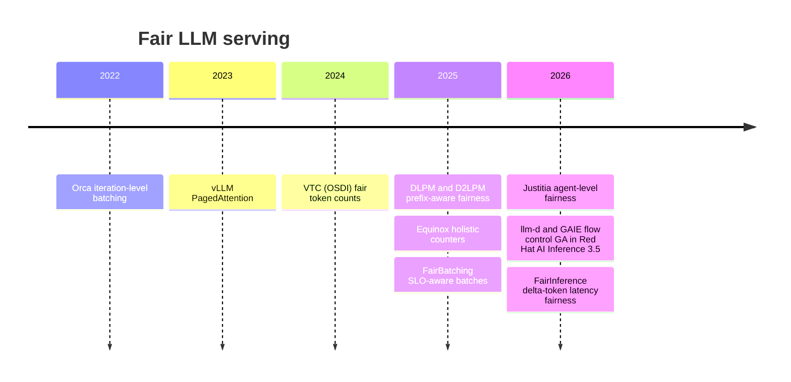
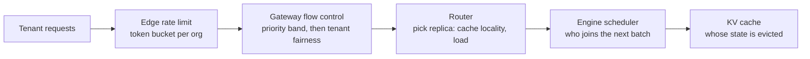

---
tags:
  - distributed-systems
  - fairness
  - llm-serving
  - multi-tenancy
  - scheduling
  - kv-cache
  - frontier
status: complete
sources:
  - https://usenix.org/conference/osdi24/presentation/sheng
  - https://arxiv.org/pdf/2401.00588
  - https://arxiv.org/html/2501.14312v1
  - https://arxiv.org/html/2508.16646v1
  - https://arxiv.org/html/2510.14392v1
  - https://arxiv.org/pdf/2510.17015
  - https://arxiv.org/pdf/2609.18112
  - https://llm-d.ai/docs/dev/guides/flow-control
  - https://gateway-api-inference-extension.sigs.k8s.io/guides/flow-control/
  - https://developers.redhat.com/articles/2026/08/27/llm-d-flow-control-priority-queuing-for-shared-gpu-inference
  - https://docs.nvidia.com/dynamo/dev/user-guides/agents/priority-scheduling
  - https://platform.claude.com/docs/en/api/rate-limits
created: 2026-11-28
updated: 2026-11-28
---

## Table Of Contents

---

- [[#TL;DR|TL;DR]]
- [[#The Problem|The Problem]]
- [[#Foundations|Foundations]]
    - [[#What Is Being Shared|What Is Being Shared]]
    - [[#What Does a Request Cost|What Does a Request Cost]]
    - [[#Four Meanings of Fair|Four Meanings of Fair]]
- [[#How We Got Here|How We Got Here]]
- [[#How It Works|How It Works]]
    - [[#The Fairness Stack|The Fairness Stack]]
    - [[#VTC, Fair Queuing for Continuous Batching|VTC, Fair Queuing for Continuous Batching]]
    - [[#DLPM and D2LPM, Fairness Without Losing the Prefix Cache|DLPM and D2LPM, Fairness Without Losing the Prefix Cache]]
    - [[#Equinox, Counting Latency and Efficiency|Equinox, Counting Latency and Efficiency]]
    - [[#FairBatching, Fairness Between Prefill and Decode|FairBatching, Fairness Between Prefill and Decode]]
    - [[#Justitia, Fairness Between Agents|Justitia, Fairness Between Agents]]
    - [[#FairInference, Bounded Token Latency|FairInference, Bounded Token Latency]]
    - [[#Fair KV-Cache Eviction|Fair KV-Cache Eviction]]
- [[#Where It Is Now|Where It Is Now]]
- [[#Trade-offs & Open Problems|Trade-offs & Open Problems]]
- [[#Resources|Resources]]
- [[#Related Notes|Related Notes]]

## ***TL;DR***
---
*Fair LLM serving is the question of how one GPU pool shared by many tenants decides whose tokens go next, and whose cached state gets thrown away, when demand exceeds capacity. The research line went from fair token counts (2024) to fair token latency (2026), and production is building the same ideas into gateways and engines.*

- **Why it's hard:** an LLM request's cost isn't known when it arrives (output length is unknown), requests from different tenants share one batch on one GPU, and the [[KV Cache]] is shared state that one tenant can evict for everyone. Requests-per-minute limits waste capacity and still don't isolate tenants ([VTC, OSDI 2024](https://arxiv.org/pdf/2401.00588)).
- **VTC (OSDI 2024)** applied fair queuing to continuous batching: charge each client weighted tokens as they are processed, admit the client with the smallest counter, and lift a returning client's counter so idle time is not banked. It proves two busy clients' service differs by at most $2U$, within 2× of what any work-conserving scheduler can promise.
- **Follow-ups fixed what VTC gave up.** DLPM and D²LPM (2025) keep the prefix cache warm with a deficit quantum, up to 2.87× VTC's throughput. Equinox (2025) mixes latency and GPU efficiency into the counter. FairBatching (2025) fixes unfairness between prefill and decode inside one batch. Justitia (2026) schedules whole agents by KV memory-time.
- **FairInference (September 2026)** changed the goal: each token of a well-behaved tenant must arrive within $\delta$ of when it would on a private $1/N$ slice. It enforces this with per-token deadlines, deadline-aware admission and a KV-cache eviction policy that reserves memory for well-behaved tenants. On a WildChat trace it cut a well-behaved tenant's p99 time to first token from 171 s under VTC to 1.15 s.
- **In production, Nov 2026:** API providers rate-limit with token buckets over input and output tokens (Anthropic does not count cache reads); the Kubernetes Gateway API Inference Extension and llm-d added *flow control* (priority bands, then per-tenant fairness, then ordering) at the router, generally available in Red Hat AI Inference 3.5 (Aug 2026); engines (vLLM, SGLang, TensorRT-LLM) offer priority scheduling, and SGLang can evict cache by priority. Nobody ships δ-token fairness yet.

## ***The Problem***
---
*Sharing a GPU pool is far cheaper than giving each tenant its own, but only if one heavy tenant can't wreck everyone else's latency. In LLM serving the heavy tenant hurts others in three places at once: the queue, the batch and the cache.*

A serving pool for one model takes traffic from many tenants: product teams, customers, internal batch jobs, agents. When demand is below capacity, nothing needs deciding. When one tenant bursts, three things go wrong, and each needs its own fix.

| Where | What the heavy tenant takes | What others see |
|---|---|---|
| Queue | Admission slots: its requests are ahead in FCFS order | Time to first token (TTFT) grows with the heavy tenant's backlog |
| Batch | Decode slots and compute in each step | Slower time between tokens (TBT), and prefills delayed by long decodes or the reverse |
| [[KV Cache]] | GPU memory: its long contexts push others' cached prefixes and running state out | Others must recompute evicted state, so their next token or next turn is slow |

FairInference measured how bad this gets on one A100 serving Llama-3 8B with eight tenants: under plain SGLang, a well-behaved tenant's p99 TTFT reached 512 s on a WildChat replay with one high-demand tenant; even VTC and DLPM left it at 171 s and 273 s ([Bali et al., 2026](https://arxiv.org/pdf/2609.18112)).

The obvious fixes fall short:

- **Static partitioning** (a slice of GPUs or memory per tenant) isolates perfectly but wastes whatever a quiet tenant isn't using. FairInference's own static-partition baseline had p99 time to last token of 64.7 s vs 35.8 s for its shared scheduler on the same trace.
- **Requests-per-minute limits** are not work-conserving: they throttle a tenant even when the GPU is idle, and a request can be 50 tokens or 50,000. On the LMSYS trace, a 5-requests-per-minute limit narrowed the service gap only by cutting throughput from about 777 to about 340 tokens/s ([VTC](https://arxiv.org/pdf/2401.00588)).
- **FCFS with a big queue** is efficient but gives no isolation at all.

So the field borrowed fair queuing from networking ([[Resource Fairness]]) and then had to change it, because LLM requests break three of its assumptions: the "packet" size isn't known up front, many packets are served at once in a batch, and serving one packet can make another cheaper (shared prefixes) or more expensive (evicted state).

## ***Foundations***
---
*Three questions define any fair LLM scheduler: what resource is being divided, how a request's cost is measured, and what "fair" promises. Every system below is a different set of answers.*

### What Is Being Shared

*A serving GPU has two scarce things, compute per step and KV memory, and the two phases of a request use them differently.*

- **Prefill** processes the whole prompt in parallel; it is compute-bound and sets TTFT.
- **Decode** produces one token per step for every running request; it is memory-bandwidth-bound and sets TBT.
- **KV memory** holds every running request's attention state plus any cached prefixes. A request's footprint grows by one token's worth per decode step until it finishes.

[[LLM Serving#Two Phases, Two Bottlenecks|LLM Serving]] covers these in depth. For fairness, the point is that a long-output request is expensive mainly in *memory held over time*, while a long-prompt request is expensive mainly in *compute at admission*. A fairness policy that counts only one of them can be gamed through the other.

### What Does a Request Cost

*To share fairly you must charge each tenant for what it uses, and the choice of meter is the most consequential design decision in this note.*

| Meter | Formula | Used by | Weak spot |
|---|---|---|---|
| Requests | 1 per request | RPM limits | A 50k-token request costs the same as a 50-token one |
| Weighted tokens | $w_p n_p + w_q n_q$ | VTC, provider pricing | Ignores that cached tokens are nearly free and that memory is held over time |
| Uncached tokens | input not served from cache, plus output | DLPM (charges "extend" tokens), Anthropic ITPM | Who pays for a prefix many tenants share is unclear |
| KV token-time | $p\,d + d^2/2$ | Justitia | Needs a prediction of $d$ |
| Latency vs isolation | token arrival time vs a private-slice simulation | FairInference | Needs an accurate performance model |

Here $n_p, n_q$ are input and output tokens; $p, d$ are prompt and decode lengths.

*Worked example:* a request with $p = 1{,}000$ input tokens and $d = 500$ output tokens costs $1{,}000 + 2 \times 500 = 2{,}000$ weighted tokens under VTC's weights ($w_p = 1, w_q = 2$). Under Justitia's KV token-time it costs $1{,}000 \times 500 + 500^2/2 = 625{,}000$ token-steps, because its prompt sits in memory for all 500 decode steps and its output grows the footprint step by step. Double the output to 1,000 tokens and the weighted-token cost rises 1.5× (to 3,000), but KV token-time rises 2.4× (to 1,500,000). That gap is why memory-centric schedulers treat long generations as much more expensive than token pricing suggests ([Justitia](https://arxiv.org/pdf/2510.17015)).

### Four Meanings of Fair

*"Fair" can mean equal service, equal latency relative to some baseline, meeting each request's SLO, or equal job completion. They lead to different schedulers.*

1. **Service fairness:** backlogged tenants receive equal (or weighted) amounts of service over any interval. This is max-min fairness from [[Resource Fairness#Foundations|Resource Fairness]] applied to tokens. VTC, DLPM, Equinox.
2. **Isolation fairness:** a well-behaved tenant gets latency close to what it would get on its own $1/N$ slice. FairInference's $\delta$-token fairness.
3. **SLO fairness:** each *request* meets its TTFT and per-token targets, with capacity going to whoever is closest to missing. FairBatching.
4. **Finish-time fairness:** each *job or agent* finishes no later than under an idealized fair scheduler. Justitia, and Themis for GPU training jobs ([[Resource Fairness]]).

The first is cheap to enforce but says nothing about any single request's latency; the second promises latency but needs a model of the private slice. The trade-off is the theme of the rest of the note.

## ***How We Got Here***
---
*LLM serving inherited rate limits from web APIs, then fair queuing from networking once continuous batching made per-token scheduling possible. Each later system repaired a cost of the one before it.*

- **Before 2024, rate limits.** Hosted APIs limited requests and tokens per minute per organization. This bounds abuse but is not work-conserving and gives no latency isolation. Continuous batching ([[LLM Serving#How We Got Here|Orca, vLLM]]) made it possible to decide admission every decode step, which is what a fair scheduler needs.
- **2024, VTC.** Sheng, Cao, Li, Zhu, Li, Zhuo, Gonzalez and Stoica (Berkeley, Stanford, Duke) defined service fairness for LLM serving, gave VTC with matching upper and lower bounds, and implemented it in S-LoRA ([OSDI 2024](https://usenix.org/conference/osdi24/presentation/sheng)).
- **2025, repairs.** Cao, Wang and colleagues at Berkeley and LMSYS showed VTC's fair order breaks up requests that share a prefix and wastes the cache; DLPM restores locality with a bounded fairness cost ([arXiv 2501.14312](https://arxiv.org/html/2501.14312v1)). Equinox (SJTU) argued token counts ignore latency and efficiency ([arXiv 2508.16646](https://arxiv.org/html/2508.16646v1)). FairBatching (SJTU) found the unfairness inside each batch, between prefills and decodes ([arXiv 2510.14392](https://arxiv.org/html/2510.14392v1)).
- **2026, agents and isolation.** Justitia (SJTU, preprint March 2026) moved fairness to the level of whole task-parallel agents ([arXiv 2510.17015](https://arxiv.org/pdf/2510.17015)). Production routers gained flow control. FairInference (Berkeley, September 2026) redefined the goal as bounded token latency relative to isolation ([arXiv 2609.18112](https://arxiv.org/pdf/2609.18112)).

## ***How It Works***
---
*Fairness is enforced at several layers, from the API edge down to the cache. The research schedulers sit at the engine layer; read VTC first, since every later system is a modification of it.*

### The Fairness Stack

*A request passes four decision points, and each can be fair or unfair independently.*

| Layer | Decides | Example mechanism |
|---|---|---|
| Edge | Whether a tenant may send at all | Token buckets on RPM, input and output tokens per minute |
| Gateway | Which queued request is dispatched when the pool is saturated | llm-d / GAIE flow control |
| Router | Which replica gets it | Prefix-aware routing; D²LPM adds per-tenant deficits |
| Engine | Which waiting request joins the running batch | VTC, DLPM, Equinox, FairBatching, FairInference, priority scheduling |
| Cache | Whose blocks are evicted under memory pressure | LRU by default; FairInference reservations; SGLang priority eviction |

Fairness at one layer can be undone at another: a gateway can dispatch tenants round-robin, but if the engine runs FCFS and the cache is LRU, a tenant with long contexts still evicts everyone else.

### VTC, Fair Queuing for Continuous Batching

*VTC keeps one counter per client of weighted tokens served and always admits from the client that is furthest behind. It charges tokens as they are produced, so it never needs to know output lengths in advance.*

**Algorithm** ([Sheng et al., OSDI 2024](https://arxiv.org/pdf/2401.00588)):

1. Keep a counter $c_i$ for each client.
2. When the batch has room, admit the head request of the queued client with the smallest $c_i$; add $w_p \times$ its input tokens to $c_i$.
3. After each decode step, add $w_q$ for every token generated to its client's counter.
4. **Counter lift:** when a client with no queued or running requests sends a new request, set $c_u \leftarrow \max\{c_u, \min_{i \text{ queued}} c_i\}$.
5. **Weighted VTC:** divide each counter increment by the client's weight, so service converges to the weight ratios (the paper's 1:2:3:4 test tracked those ratios closely).

The paper's default weights are $w_p = 1, w_q = 2$, following API input and output pricing.

*Worked example:* client A sends requests with 1,000 input and 500 output tokens; client B sends 100 input and 50 output; both counters start at 0 and the batch can admit one request per step. A is admitted first (tie), so $c_A = 1{,}000$. Now B is behind, so B is admitted ($c_B = 100$), then B again ($200$), and so on, while each decode step adds 2 per running request to each counter. B keeps getting admitted until its counter catches up to A's, about ten of B's requests (200 weighted tokens each, once finished) per one of A's (2,000), which is equal weighted service. Without step 4, a client C that was idle for an hour with $c_C = 200$, returning when the queued minimum is 5,000, would have 4,800 weighted tokens of priority and would lock out A and B; with the lift, $c_C$ becomes 5,000 and C simply takes its turn.

**Guarantees.** Let $L_{\text{input}}$ be the longest allowed input, $M$ the most tokens a running batch can hold, and $U = \max(w_p L_{\text{input}}, w_q M)$. For two clients $f, g$ backlogged over $[t_1, t_2)$:

$$
|W_f(t_1,t_2) - W_g(t_1,t_2)| \le 2U \qquad \text{and, for any work-conserving non-preemptive scheduler, some input forces } \ge w_q M
$$

*In words:* VTC keeps two busy clients' service within twice the largest single admission or batch of output, and no scheduler that never idles and never preempts can always do better than one batch of output tokens, so VTC is within 2× of optimal. A backlogged client also gets at least $W_g - 4U$ against any other client $g$, and a client that returns to an empty queue waits at most $2(n-1)U/a$ before dispatch, where $n$ is the number of clients and $a$ a lower bound on server capacity (Theorems 4.4, 4.8, 4.9, 4.11).

*Example:* with $L_{\text{input}} = 4{,}000$ and $M = 10{,}000$ (the paper's Llama-2-7B setup), $U = 20{,}000$, so the upper bound is 40,000 weighted tokens and the lower bound 20,000. For the latency bound, take $n = 4$ clients and an illustrative capacity of $a = 1{,}500$ weighted tokens/s: $2 \times 3 \times 20{,}000 / 1{,}500 = 80$ s. The bound holds whatever the heavy client does, but 80 s is far from interactive. That looseness is what FairInference later attacks.

**Length prediction** helps only on average: VTC(predict) charges the predicted output (mean of the client's last five requests) at admission and corrects later. On the LMSYS trace its maximum service gap was 365 vs 368 for plain VTC and 329 with a perfect oracle. The worst-case bound does not change.

### DLPM and D2LPM, Fairness Without Losing the Prefix Cache

*Fair order interleaves tenants, but prefix caching wants requests that share a prefix to run together. DLPM keeps the cache-friendly order and adds a deficit quantum so that no tenant can be skipped for long.*

SGLang's default order is *longest prefix match* (LPM): run the waiting requests whose prompts share the longest cached prefix first ([[LLM Serving#Prefix Caching and Cache-Aware Routing|prefix caching]]). That maximizes cache hits but starves tenants with no cached prefix. VTC fixes the starvation but scatters cache-friendly requests.

**DLPM (Deficit Longest Prefix Match)** ([Cao, Wang et al., 2025](https://arxiv.org/html/2501.14312v1)):

1. Each client $i$ has a deficit $q_i$, starting at 0. When every active client has $q_i \le 0$, each gets $+Q^u$.
2. Every batching step, sort the queue by prefix match length (LPM order).
3. Walk the sorted queue; admit a request only if its client has $q_i > 0$ and it fits in memory.
4. Charge $w_e \times$ the request's *extend* tokens (input not already cached) on admission, and $w_q \times$ output tokens after each decode step ($w_e = 1, w_q = 2$).

DLPM is work-conserving: it reorders but never rejects a request that fits.

*Worked example:* $Q^u = 2{,}000$. Client A's requests share a cached 4,000-token prefix and each adds 200 new tokens; client B's single request has 1,000 uncached tokens. Ignoring decode charges, A can admit 10 requests ($10 \times 200 = 2{,}000$) in LPM order before its deficit hits zero, then B's request is admitted even though it matches nothing. Because DLPM charges only uncached tokens, a tenant with good locality gets more requests per quantum: cache efficiency is rewarded rather than penalized.

**Bound.** For backlogged clients on one worker, $|W_f - W_g| \le 2(U + Q^u)$; with $U = 20{,}000$ and $Q^u = 2{,}000$ that is 44,000, only 10% looser than VTC's 40,000.

**D²LPM** distributes it across data-parallel workers $W$ without a central scheduler on the hot path:

- A global radix tree records which worker caches which prefix; workers report insertions and evictions asynchronously.
- For each request, find the workers $G$ holding its longest match. Among those where this client still has a positive per-worker deficit $q_{i,w}$, pick the shortest queue; otherwise pick the shortest queue among workers where the deficit is positive; if none, refill all of that client's per-worker deficits by $Q^w$.
- Each worker runs local DLPM.

The per-worker quantum $Q^w$ caps how sticky a client becomes to one worker; the paper proves an infinite $Q^w$ is unfair because load can pile onto one worker. The fairness bound grows to $2|W|(U + Q^u)$. Raising $Q^w$ from 2,000 to 40,000 lowered Jain's index from 0.855 to 0.83 while raising throughput.

**Results** (SGLang, Llama-3.1-8B on A100 and Llama-3.2-3B on A10G): up to 2.87× VTC's throughput; well-behaved clients' latency up to 7.96× better than VTC and 9.55× better than SGLang's default; Jain's index slightly below VTC's. The paper only rewards prefix sharing *within* a client; who pays for a prefix shared across clients is left open.

### Equinox, Counting Latency and Efficiency

*Equinox argues that equal tokens don't feel equal: a token after a long wait is worth less to the user, and a request that runs the GPU efficiently is worth more to the operator. It schedules on a blend of the two, using predicted output lengths.*

Equinox (Wei et al., SJTU and collaborators, 2025) keeps two counters per client ([arXiv 2508.16646](https://arxiv.org/html/2508.16646v1)):

- **User Fairness Counter (UFC):** adds the request's weighted tokens (input + 4× output) divided by $1 + 0.1 \times$ (wait time + predicted inference time), so slow service counts as less service.
- **Resource Fairness Counter (RFC):** adds weight × predicted tokens per second × GPU utilization.

It admits from the client with the lowest $HF = 0.7\,UFC + 0.3\,RFC$. Output lengths come from a Mixture of Prediction Experts: a router sends each prompt to one of three BERT-base regressors (short under 53 tokens, medium 53 to 210, long above 210), adding about 4.5 ms per request.

Reported against VTC: up to 1.3× throughput and up to 60% lower response time on synthetic load, and about 13% higher Jain's index. Two cautions from the paper itself: Jain's index is computed on Equinox's own HF metric, and reordering by predictions can starve some clients. It was tested on up to 8 GPUs in one node.

### FairBatching, Fairness Between Prefill and Decode

*Unfairness also lives inside each batch. Stall-free batching protects decodes so strongly that they run far ahead of schedule while new requests miss their first-token deadline.*

Sarathi-style schedulers give running decodes a fixed share of every batch. Lyu, Liu, Wu and Chen (SJTU, late 2025) observed decodes running at least 1,000 tokens ahead of a 50 ms per-token target while prefills missed a 500 ms TTFT target ([arXiv 2510.14392](https://arxiv.org/html/2510.14392v1)).

FairBatching gives every token $j$ of a request a deadline:

$$
\text{deadline}_j = \text{arrival} + \text{TTFT}_{\text{SLO}} + j \cdot \text{TPOT}_{\text{SLO}}
$$

*In words:* the first token is due one TTFT target after arrival, and each later token one per-token target after the previous one. *Example:* arrival at 0, TTFT target 500 ms, TPOT target 50 ms: token 0 is due at 500 ms, token 10 at 1,000 ms. A request that has already produced 30 tokens by 800 ms has 700 ms of slack and can yield its slot.

Each batch gets a *time* budget of $\max(\text{min slack}, \text{min TPOT target})$, predicted with a linear model of new tokens and context length, and is filled in order: urgent decodes, then prefills, then the remaining decodes, each by slack. Against vLLM with Sarathi-style batching it reported 2.29× lower p99 TTFT and 12.28× lower p99 TPOT on one trace, and with prefill-admission-budget routing a 54.3% capacity gain on an 8-way data-parallel group. It is request-level SLO fairness, not tenant isolation, but its per-token deadlines are the same tool FairInference uses.

### Justitia, Fairness Between Agents

*An agent issues dozens of parallel calls and only finishes when the last returns, so fair shares per call can still leave every agent slow. Justitia serves whole agents in the order an ideal fair scheduler would finish them.*

Justitia (Yang et al., SJTU, preprint March 2026) charges each agent the KV token-time of all its calls, predicted from the prompt with a small per-agent-type MLP (about 2.16 ms per prediction) ([arXiv 2510.17015](https://arxiv.org/pdf/2510.17015)). It runs virtual-time fair queuing in which virtual time advances at $M / N_t$ (KV capacity over active agents), stamps each agent with a virtual finish time on arrival, and serves agents in that order, giving the current agent all free capacity ("selective pampering"). It proves each agent finishes within $2c_{\max} + C_{\max}/M$ of its ideal fair finish time.

On vLLM with 300 agents of nine types, average completion time was 57.5% lower than VTC; about 92% of agents finished no later than under VTC, and the worst delay was 26%. Charging by compute instead of memory made completion times up to 42.3% worse, which supports memory-time as the meter for long generations.

### FairInference, Bounded Token Latency

*FairInference promises latency, not service: a well-behaved tenant's every token arrives no more than δ later than it would on a private slice of the GPU. One parameter moves the system between shared serving and static partitioning.*

Bali, Ponnapalli, Wang, Crooks, Shenker and Zaharia (Berkeley, September 2026), "Token Latency Fairness: Performance Isolation for Multi-Tenant LLM Serving" ([arXiv 2609.18112](https://arxiv.org/pdf/2609.18112)).

**Definition.** A client is *well-behaved* if its usage stays within its fair share $f_i$. For such a client, if token $k$ would be produced at time $T_k^{\text{ISO}}$ when running alone on a $1/N$ slice of memory, bandwidth and compute, then in the shared system it must be produced by

$$
d_k = T_k^{\text{ISO}} + \delta
$$

*In words:* sharing may cost each of your tokens at most $\delta$ of extra delay, as long as you use no more than your share. $\delta \to \infty$ is today's shared serving; $\delta = 0$ is static partitioning.

*Worked example:* $\delta = 1$ s. The isolation simulator says a well-behaved request would get its first token 0.4 s after arrival and then one token every 30 ms. Its deadlines are 1.4 s for token 0 and $0.4 + 0.03k + 1$ s for token $k$, so token 100 is due at 4.4 s. The scheduler may delay this request behind others as long as no deadline is missed. Of the first token's $\delta$, 80% (0.8 s) is budgeted for restoring evicted cache and 20% (0.2 s) for waiting to prefill.

**Mechanism.**

- **Isolation simulator.** GPUs can't really be split into $1/N$ slices, so a C worker thread replays arrivals and token counts through a linear performance model (fit on an A100 for Llama-3 8B, deliberately overestimating about 90% of the time) to produce $T_k^{\text{ISO}}$. Deadlines already in the past are raised to now, to prevent starvation.
- **Earliest deadline first** in both the prefill queue and the running decode set.
- **Admission.** Prefills from under-share clients are admitted; over-share clients' prefills only if KV memory is free; any prefill that would make a running decode miss its deadline is skipped. Decodes run in groups of about 10 steps to reduce switching.
- **Preemption.** Decodes preempted for a prefill go back in the queue with their original deadlines.

**Results** (one A100 80 GB, Llama-3 8B, about 320,000-token cache, SGLang v0.3.0 fork, 3,000 to 4,000 lines):

| Workload (p99, well-behaved tenant) | FairInference δ = 1 s | VTC | DLPM | SGLang |
|---|---|---|---|---|
| Heavy tenants with long shared prompts, TTFT | 64.7 ms | 370 ms | 374.5 ms | 371.3 ms |
| One tenant with 6,000-token completions, TTFT | 1.06 s | 92.5 s | 73.7 s | 217 s |
| WildChat, 7 normal + 1 heavy tenant, TTFT | 1.15 s | 171 s | 273 s | 512 s |
| WildChat, time to last token | 35.8 s | 217 s | 356 s | 546 s |

The price is total throughput: on WildChat, 1,475 completion tokens/s at $\delta = 1$ s vs about 1,787 for VTC, recovering to 1,817 at $\delta = 5$ s. The guarantee also has limits the paper states: it covers decodes only above a minimum pooled batch size, prefills only below a rate that depends on $\delta$ (suggesting a prefill rate limiter), and one GPU only; underestimating latency in the simulator hurts decodes most.

### Fair KV-Cache Eviction

*Scheduling fairly is not enough if the cache is LRU: a heavy tenant's long contexts push a light tenant's state out, and the light tenant pays to recompute it. FairInference reserves cache for well-behaved tenants and evicts from whoever has the most to spare.*

FairInference's eviction policy ([arXiv 2609.18112](https://arxiv.org/pdf/2609.18112)):

$$
\rho_i = \max(f_i - R_i^{\text{cache}},\ 0) \qquad s_i = \max(u_i - \rho_i,\ 0)
$$

*In words:* a well-behaved client $i$ with fair share $f_i$ gets a reservation $\rho_i$: its share minus however much of its state could be evicted and restored within $\delta_{\text{cache}}$, the part of the latency budget set aside for cache misses. Eviction never takes a client below its reservation, and victims are chosen by *spare* $s_i$, usage $u_i$ above the reservation, largest first. During decode the highest-memory client is evicted first, last-in-first-out within it, to lose the least work.

*Worked example (in tokens rather than blocks):* a 320,000-token cache shared by 8 clients gives $f_i = 40{,}000$. If the system can recompute or reload 25,000 tokens of a client's state within $\delta_{\text{cache}} = 0.8$ s, then $R^{\text{cache}} = 25{,}000$ and $\rho = 15{,}000$: the client keeps at least 15,000 tokens resident. A heavy tenant holding 200,000 tokens has no reservation, so its spare is 200,000 and it is evicted first. A larger $\delta$ raises $R^{\text{cache}}$ and shrinks the reservation; that is why the shared-prompt workload's p99 TTFT rose from 64.7 ms to 379.4 ms at $\delta = 5$ s.

**In engines today**, eviction is mostly LRU over a radix tree of cached prefixes. SGLang offers `--radix-eviction-policy priority`, which evicts low-priority requests' cache first under memory pressure; NVIDIA's Dynamo lists priority-based cache eviction as supported for SGLang and planned for vLLM and TensorRT-LLM ([Dynamo docs](https://docs.nvidia.com/dynamo/dev/user-guides/agents/priority-scheduling)). That is priority, not per-tenant fairness. For the cache as a distributed system in its own right, see the planned [[KV Cache Serving as a Distributed Cache]].

## ***Where It Is Now***
---
*As of November 28, 2026: production has fairness and priority at the edge and the gateway, priority (not fairness) in engines, and LRU in caches. The research frontier is latency isolation and agent-level fairness, neither shipped.*

**At the API edge: token buckets over tokens.** Anthropic's API limits requests, input tokens and output tokens per minute per organization with a token bucket that "is continuously replenished up to your maximum limit, rather than being reset at fixed intervals." Cache reads do not count toward the input-token limit, so with a 2,000,000 limit and an 80% cache hit rate an organization can process 10,000,000 input tokens per minute. Output tokens are counted as they are generated, not from `max_tokens`. *Ramp limits* also cap how fast usage may grow, one step per minute above recent peak ([rate-limits docs](https://platform.claude.com/docs/en/api/rate-limits)). Charging only uncached tokens is the same choice DLPM makes inside the engine. Limits are maximums, not guaranteed minimums, so this bounds tenants but doesn't isolate them.

**At the gateway: flow control.** The Kubernetes Gateway API Inference Extension's endpoint picker, used by llm-d, can hold requests centrally when the pool is saturated instead of pushing them into a replica's local queue ([llm-d guide](https://llm-d.ai/docs/dev/guides/flow-control)):

- Each request gets a flow key: a fairness ID (`x-gateway-inference-fairness-id`) and a priority band chosen by its `InferenceObjective` (`x-gateway-inference-objective`); bands below 0 are sheddable.
- Dispatch serves the highest band first, then rotates across tenants within the band (round-robin in the Red Hat benchmark), then orders within a tenant (FCFS by default). It is work-conserving: nothing waits while GPUs have capacity.
- Saturation comes from a `utilization-detector` (default) or a `concurrency-detector` (recommended for production); requests are rejected only when `maxRequests` or `maxBytes` limits are hit.
- The out-of-the-box fairness policy is `global-strict-fairness-policy`, which preserves FCFS; per-tenant fairness has to be turned on. The guide warns the fairness headers are a trust boundary: the ingress must strip client-supplied `x-gateway-*` headers and set them from the caller's API key or JWT.
- Status: "[Experimental]" behind a `flowControl` feature gate in the upstream llm-d guide; generally available in Red Hat AI Inference 3.5 (Aug 27, 2026), whose gpt-oss-20B benchmark on H100s kept higher-priority tenants' TTFT under one second while a bursting tenant's latency grew ([Red Hat](https://developers.redhat.com/articles/2026/08/27/llm-d-flow-control-priority-queuing-for-shared-gpu-inference)).

**In engines: priority, not fairness.** vLLM has `--scheduling-policy priority`, SGLang supports priority scheduling, and TensorRT-LLM added it in v1.8.0. NVIDIA Dynamo's router adds a soft `priority` and a `strict_priority` tier with `fcfs`, `wspt` or `edf` queue policies, but its docs are explicit that priority reserves no capacity, doesn't preempt admitted work and doesn't order across router replicas ([Dynamo docs](https://docs.nvidia.com/dynamo/dev/user-guides/agents/priority-scheduling)). None of the major engines ships VTC-style per-tenant counters as a default.

**In research:** the line has moved from service fairness (VTC, DLPM) to latency isolation (FairInference) and agent-level finish times (Justitia), with FairInference's authors planning comparisons with FairBatching and an open-source SGLang fork. Multi-GPU and disaggregated prefill/decode versions of latency fairness are stated future work.

## ***Trade-offs & Open Problems***
---
*Every fair LLM scheduler gives up some throughput, some cache locality or some accuracy of its cost model. The open problems are what to charge for, how to share what tenants share, and how to give latency guarantees across a cluster.*

| Choice | You get | You pay |
|---|---|---|
| Strict per-tenant order (VTC, round-robin) | Tight service bounds | Lost prefix locality and batching; up to 2.87× throughput left on the table vs DLPM |
| Deficit quantum (DLPM) | Locality and throughput | Bound loosens by $2Q^u$ per worker, $2|W|(U+Q^u)$ across workers |
| Latency isolation (FairInference) | Per-token bounds for well-behaved tenants | Lower total throughput at small $\delta$; needs an accurate performance model |
| Prediction-based scores (Equinox, Justitia) | Better average latency and completion | Mispredictions and gaming; possible starvation without a bound |
| Priority bands | Simple premium vs best-effort | Starvation of low bands under sustained load; no fairness within a band unless configured |
| Charge uncached tokens | Rewards cache reuse | Unclear who pays for a prefix many tenants share |

**Open problems:**

- **Who pays for shared prefixes.** DLPM rewards reuse within a client only; charging a system prompt that a hundred tenants share is unsolved.
- **Cluster-wide latency fairness.** FairInference covers one GPU. Disaggregated prefill and decode, wide expert parallelism ([[LLM Serving#Disaggregated Serving|LLM Serving]]) and multi-replica routing each add a place where isolation can leak, and D²LPM's bound already scales with worker count.
- **A trustworthy isolation baseline.** "What you'd get on $1/N$ of a GPU" is a simulation. Underestimates break guarantees; overestimates waste capacity.
- **Fairness for agents and programs.** Calls inside one agent depend on each other; per-call fairness can slow the whole agent, and per-agent fairness needs predictions ([Justitia](https://arxiv.org/pdf/2510.17015)).
- **Trust.** Gateway fairness keys are headers; if clients can set them, a tenant can claim many identities. The tenant ID must come from authentication, the same lesson as shuffle sharding and [[Resource Fairness#Shuffle Sharding|per-tenant isolation]] elsewhere.
- **Stability.** Fair schedulers still face queueing collapse when load exceeds capacity; fairness decides who waits, not whether the queue grows ([[Queueing Theory for Systems]], [[Reliability Patterns]]).

## ***Resources***
---
*Start with the VTC paper for the model and bounds, then FairInference for the latency view. The production pages show how much of this has shipped.*

**Papers**
- Sheng et al., [Fairness in Serving Large Language Models (VTC)](https://arxiv.org/pdf/2401.00588), OSDI 2024 ([USENIX page](https://usenix.org/conference/osdi24/presentation/sheng)).
- Cao, Wang et al., [Locality-aware Fair Scheduling in LLM Serving (DLPM, D²LPM)](https://arxiv.org/html/2501.14312v1), 2025.
- Wei et al., [Equinox: Holistic Fair Scheduling in Serving Large Language Models](https://arxiv.org/html/2508.16646v1), 2025.
- Lyu, Liu, Wu, Chen, [FairBatching: Fairness-Aware Batch Formation for LLM Inference](https://arxiv.org/html/2510.14392v1), 2025.
- Yang et al., [Justitia: Fair and Efficient Scheduling of Task-parallel LLM Agents with Selective Pampering](https://arxiv.org/pdf/2510.17015), preprint March 2026.
- Bali, Ponnapalli, Wang, Crooks, Shenker, Zaharia, [Token Latency Fairness: Performance Isolation for Multi-Tenant LLM Serving (FairInference)](https://arxiv.org/pdf/2609.18112), September 2026.

**Production docs**
- [llm-d flow control guide](https://llm-d.ai/docs/dev/guides/flow-control) and [Gateway API Inference Extension flow control](https://gateway-api-inference-extension.sigs.k8s.io/guides/flow-control/).
- Red Hat, [llm-d flow control: priority queuing for shared GPU inference](https://developers.redhat.com/articles/2026/08/27/llm-d-flow-control-priority-queuing-for-shared-gpu-inference), Aug 2026.
- NVIDIA Dynamo, [Priority scheduling](https://docs.nvidia.com/dynamo/dev/user-guides/agents/priority-scheduling).
- Anthropic, [API rate limits](https://platform.claude.com/docs/en/api/rate-limits).

## ***Related Notes***
---
*This note is the LLM-serving deep dive of a broader fairness topic, and it leans on the AI & ML serving notes for how batching and caching work.*

- [[Resource Fairness]] — Max-min fairness, fair queuing, the no-banked-credit floor and DRF; this note's summary table of VTC, DLPM, Equinox and FairInference lives there.
- [[LLM Serving]] — Continuous batching, chunked prefill, prefix caching and disaggregation, the machinery these schedulers control.
- [[KV Cache]] — The memory whose sharing and eviction decide isolation.
- [[KV Cache Serving as a Distributed Cache]] — Planned: prefix caches, admission and metastable collapse in agent serving.
- [[Queueing Theory for Systems]] — Stability of batched LLM queues; why fairness can't prevent overload.
- [[Tail Latency and Hedging]] — Tails in batched serving and per-token latency targets.
- [[Reliability Patterns]] — Load shedding and quotas; flow control decides who is shed.
- [[Message Queues]] — SQS fair queues, the same noisy-tenant problem with message groups as tenants.
- [[GPU Cluster Infrastructure]] — The shared accelerators underneath.
- [[Cluster Scheduling]] — Fairness at the level of whole GPU jobs rather than tokens.
- [[Multi-Tenant Storage QoS]] — The same reservations, limits and cost models for shared disks and SSDs.
