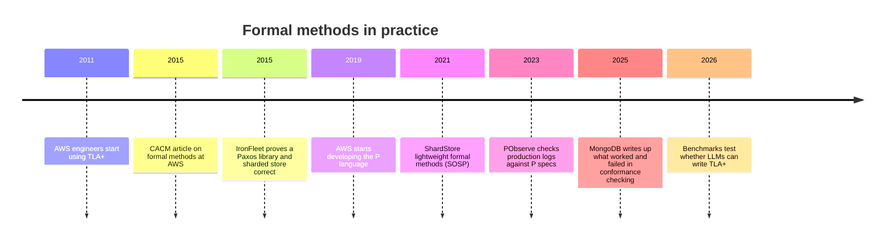
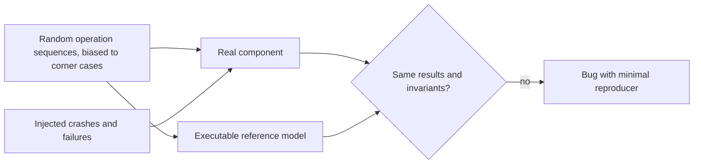

---
tags:
  - distributed-systems
  - formal-methods
  - tla-plus
  - verification
  - frontier
status: draft
sources:
  - https://6826.csail.mit.edu/2019/papers/formal-methods-amazon.pdf
  - https://lamport.azurewebsites.net/tla/amazon-excerpt.html
  - https://queue.acm.org/detail.cfm?id=3712057
  - https://muratbuffalo.blogspot.com/2021/10/using-lightweight-formal-methods-to.html
  - https://www.microsoft.com/en-us/research/publication/ironfleet-proving-practical-distributed-systems-correct/
  - https://mongodb.com/blog/post/engineering/conformance-checking-at-mongodb-testing-our-code-matches-our-tla-specs
  - https://www.cs.cmu.edu/~15712/papers/can-llms-model-real-world-systems-in-tla.pdf
  - https://arxiv.org/pdf/2606.05792
  - https://public-6ecl.pages.dev/oswald
  - https://www.bitsxpages.com/p/protocols-for-transactional-usage
  - https://arxiv.org/pdf/2610.30114
  - https://software.imdea.org/news/2026/10-28-accord/
created: 2026-11-26
updated: 2026-11-26
---

## Table Of Contents

---

- [[#TL;DR|TL;DR]]
- [[#The Problem|The Problem]]
- [[#Foundations|Foundations]]
    - [[#Safety and Liveness|Safety and Liveness]]
    - [[#Model Checking and the State Explosion|Model Checking and the State Explosion]]
- [[#How We Got Here|How We Got Here]]
- [[#How It Works|How It Works]]
    - [[#A Spectrum of Rigor|A Spectrum of Rigor]]
    - [[#TLA+ and PlusCal at AWS|TLA+ and PlusCal at AWS]]
    - [[#P and Checking Production Logs|P and Checking Production Logs]]
    - [[#Lightweight Formal Methods|Lightweight Formal Methods]]
    - [[#Closing the Spec to Code Gap|Closing the Spec to Code Gap]]
    - [[#Full Proofs|Full Proofs]]
- [[#Where It Is Now|Where It Is Now]]
- [[#Trade-offs & Open Problems|Trade-offs & Open Problems]]
- [[#Resources|Resources]]
- [[#Related Notes|Related Notes]]

## ***TL;DR***

---

*Formal methods in practice means writing a precise, checkable description of a system's design, then letting a tool explore every possible behavior to find the rare interleaving that breaks it. AWS showed in 2015 that ordinary engineers could do this with TLA+ and find serious bugs in S3 and DynamoDB designs; the field has since moved toward checking code and production logs against those specs, and in 2026 toward asking whether AI can write them.*

- **What it catches:** design bugs that need long, unlikely sequences of events. One DynamoDB bug needed a 35-step trace ([AWS, CACM 2015](https://6826.csail.mit.edu/2019/papers/formal-methods-amazon.pdf)).
- **What engineers call it:** "exhaustively testable pseudo-code" ([AWS, CACM 2015](https://6826.csail.mit.edu/2019/papers/formal-methods-amazon.pdf)).
- **Tools:** TLA+ and PlusCal with the TLC model checker; AWS's P language; executable reference models in Rust; full proofs in Dafny, Lean or Kani for the most critical pieces ([Brooker and Desai, ACM Queue](https://queue.acm.org/detail.cfm?id=3712057)).
- **The gap:** a checked design says nothing about whether the code matches it. MongoDB spent about 10 weeks trying to check server traces against its Raft spec and gave up ([MongoDB, 2025](https://mongodb.com/blog/post/engineering/conformance-checking-at-mongodb-testing-our-code-matches-our-tla-specs)).
- **2026:** LLMs write syntactically valid TLA+ almost always, but leading models average only about 46% on matching real system behavior ([SIGOPS blog, May 2026](https://www.cs.cmu.edu/~15712/papers/can-llms-model-real-world-systems-in-tla.pdf)).

## ***The Problem***

---

*Distributed protocols fail in interleavings too rare for testing to hit and too subtle for design review to spot. Formal methods search every interleaving of a small model instead of sampling a few of the real system.*

A protocol like [[Raft]] or [[Paxos]] has a short description and an enormous number of possible executions once you add crashes, message reordering, duplicates and timeouts. Bugs hide in sequences dozens of steps long. Reviews miss them because humans reason about the common path. Tests miss them because the bad sequence is astronomically unlikely in any one run (see [[Deterministic Simulation Testing]] for one way to raise those odds).

The AWS engineers put it plainly: formal methods "help engineers to get the design right," a necessary first step toward getting the code right ([AWS, CACM 2015](https://6826.csail.mit.edu/2019/papers/formal-methods-amazon.pdf)).

## ***Foundations***

---

*Two ideas underpin everything here: correctness splits into safety (nothing bad happens) and liveness (something good eventually happens), and a model checker proves properties by visiting every reachable state of a model small enough to enumerate.*

### Safety and Liveness

Safety properties describe "what the system is allowed to do"; liveness properties describe "what the system must eventually do" ([AWS, CACM 2015](https://6826.csail.mit.edu/2019/papers/formal-methods-amazon.pdf)). In temporal logic notation:

$$\text{Safety: } \Box\, \neg\text{Bad} \qquad\qquad \text{Liveness: } \Box\,(\text{Request} \Rightarrow \Diamond\, \text{Response})$$

*In words:* $\Box$ means "always" and $\Diamond$ means "eventually". Safety says a bad state never occurs. Liveness says every request is eventually answered.

**Worked example.** For a lock, safety is "at no point do two clients both hold it": $\Box\,\neg(\text{holds}(A) \land \text{holds}(B))$. A counterexample is a finite trace ending in the bad state, which a checker can print. Liveness is "a client that asks eventually gets the lock". A counterexample is an infinite trace where it waits forever, which is harder to find. AWS's own table shows the cost of skipping liveness: a spec of a lock-free data structure in an internal lock manager missed a liveness bug because liveness was not checked ([AWS, CACM 2015](https://6826.csail.mit.edu/2019/papers/formal-methods-amazon.pdf)). Both properties matter for [[Coordination Services]] and [[Leases and Fencing]].

### Model Checking and the State Explosion

A model checker like TLC "exhaustively checks the desired correctness properties across all possible execution traces" of a model ([Lamport's excerpt of the AWS paper](https://lamport.azurewebsites.net/tla/amazon-excerpt.html)). The catch is size. If each of $n$ nodes can be in one of $s$ local states, the system alone has up to

$$s^{\,n} \text{ combined states}$$

before counting messages in flight, which multiply it further.

*In words:* every node you add multiplies the state space, so checkers work on small configurations, a few nodes and a few values, and a bug that only appears with many nodes can be missed.

**Worked example.** Three local states per node and five nodes give $3^5 = 243$ combinations; ten nodes give $3^{10} = 59{,}049$; twenty give about 3.5 billion. That is why specs check three or five replicas, not a hundred.

## ***How We Got Here***

---

*Formal methods for distributed systems were long seen as academic. AWS's 2015 report changed the conversation by showing working engineers using them on production designs; the decade since has been about lowering the cost and connecting specs to real code.*

- **2011 to 2015, AWS:** engineers used TLA+ on 10 large systems by the time of the CACM article ([Lamport's excerpt](https://lamport.azurewebsites.net/tla/amazon-excerpt.html)) and could "get useful results in two to three weeks" ([AWS, CACM 2015](https://6826.csail.mit.edu/2019/papers/formal-methods-amazon.pdf)).
- **2015, IronFleet:** Microsoft Research proved a Paxos-based replicated state machine library and a lease-based sharded key-value store correct, for both safety and liveness, with competitive performance ([Microsoft Research](https://www.microsoft.com/en-us/research/publication/ironfleet-proving-practical-distributed-systems-correct/)).
- **2019 onward, P:** AWS develops and open-sources P, which models designs as communicating state machines ([ACM Queue](https://queue.acm.org/detail.cfm?id=3712057)).
- **2021, ShardStore:** S3's storage node validated with executable models and property-based testing ([Murat Demirbas](https://muratbuffalo.blogspot.com/2021/10/using-lightweight-formal-methods-to.html)).

## ***How It Works***

---

*Teams pick a point on a spectrum: a design model checked exhaustively, an executable model that tests the real code, or a machine-checked proof of the code itself. Each step up buys more assurance for more effort.*

### A Spectrum of Rigor

| Approach | Checks | Effort | Example |
|---|---|---|---|
| Design model checking | The design, all interleavings of a small model | Weeks | TLA+ at AWS ([CACM 2015](https://6826.csail.mit.edu/2019/papers/formal-methods-amazon.pdf)) |
| Spec as test oracle | Logs or tests from the real code against the spec | Weeks to months | PObserve; MongoDB test generation ([Queue](https://queue.acm.org/detail.cfm?id=3712057); [MongoDB](https://mongodb.com/blog/post/engineering/conformance-checking-at-mongodb-testing-our-code-matches-our-tla-specs)) |
| Lightweight formal methods | Real code against executable reference models | Ongoing, by the dev team | ShardStore ([Murat Demirbas](https://muratbuffalo.blogspot.com/2021/10/using-lightweight-formal-methods-to.html)) |
| Full proof | The code itself, for all inputs | Highest | IronFleet; Cedar in Dafny; Kani on Firecracker ([Microsoft Research](https://www.microsoft.com/en-us/research/publication/ironfleet-proving-practical-distributed-systems-correct/); [Queue](https://queue.acm.org/detail.cfm?id=3712057)) |

### TLA+ and PlusCal at AWS

TLA+ describes a system as a set of variables and the steps that can change them. PlusCal is a more C-like language that compiles to TLA+, which several AWS engineers found more productive ([Lamport's excerpt](https://lamport.azurewebsites.net/tla/amazon-excerpt.html)). What they found, from the 2015 paper ([AWS, CACM 2015](https://6826.csail.mit.edu/2019/papers/formal-methods-amazon.pdf)):

| System | Component | Spec size | Result |
|---|---|---|---|
| S3 | Fault-tolerant low-level network algorithm | 804 lines PlusCal | 2 bugs, plus bugs in proposed optimizations |
| S3 | Background data redistribution | 645 lines PlusCal | 1 bug, plus a bug in the first fix |
| DynamoDB | Replication and group membership | 939 lines TLA+ | 3 bugs, some needing 35-step traces |
| EBS | Volume management | 102 lines PlusCal | 3 bugs |
| Internal lock manager | Lock-free data structure | 223 lines PlusCal | More confidence; missed a liveness bug |
| Unnamed | Fault-tolerant replication and reconfiguration | 318 lines TLA+ | 1 bug; verified an aggressive optimization |

Notice how small the specs are: a few hundred lines each.

### P and Checking Production Logs

P models a design as state machines exchanging messages, closer to how engineers already think about services. AWS teams used it to validate the protocol changes behind [[Object Storage|S3]]'s move to strong read-after-write consistency. **PObserve** (2023) takes structured logs from running systems and checks them against the P spec, so the spec keeps earning its keep after launch ([Brooker and Desai, ACM Queue](https://queue.acm.org/detail.cfm?id=3712057)). Brooker and Desai describe specs as "test oracles that provide the correct answers" for testing.

Modeling also pays off in performance: modeling Aurora's commit protocol let AWS cut distributed commits from two to 1.5 network round trips without losing safety ([ACM Queue](https://queue.acm.org/detail.cfm?id=3712057)). Compare [[Distributed Transactions]].

### Lightweight Formal Methods

ShardStore, [[Object Storage|S3]]'s 40,000-line Rust storage node, uses three pieces ([Murat Demirbas on the SOSP 2021 paper](https://muratbuffalo.blogspot.com/2021/10/using-lightweight-formal-methods-to.html)):

- **Reference models:** each component gets a simple Rust model with the same interface (a hash table standing in for the real [[LSM Trees|LSM tree]] index). Developers maintain them alongside the code, and they double as mocks in unit tests.
- **Conformance by property-based testing:** apply the same operations to model and implementation and compare, with failure injection. Crash-consistency checks caught a bug that needed a specific ID, a chunk spilling onto a second page, and a crash losing only that page.
- **Concurrency by stateless model checking:** Loom exhaustively checks small critical code like custom locks; Shuttle randomly explores interleavings of bigger harnesses.

### Closing the Spec to Code Gap

The AWS engineers admitted in 2015 that they did not know how to verify that code implements a verified design ([AWS, CACM 2015](https://6826.csail.mit.edu/2019/papers/formal-methods-amazon.pdf)). MongoDB's experience shows how hard that is ([MongoDB, June 2025](https://mongodb.com/blog/post/engineering/conformance-checking-at-mongodb-testing-our-code-matches-our-tla-specs)):

| Attempt | Result |
|---|---|
| **Trace checking** the server against RaftMongo.tla | Failed: about a month just to snapshot multithreaded state consistently, about 10 weeks total, no spec ever matched. The spec was written late, too abstract, and merged steps the code does separately |
| **Test-case generation** for the Mobile SDK's array merge rules | Succeeded: translating 21 rules took about two weeks; the model checker found an infinite-recursion bug; 4,913 generated tests reached 100% branch coverage versus 21% for handwritten tests and 92% for AFL fuzzing |

The lesson: write the spec before the code and fix mismatches immediately. Davis also lists newer research tools (Mocket, SandTable, trace validation with TLC inferring missing variables, and a TLA+ to Go compiler) that try to make conformance cheaper ([MongoDB](https://mongodb.com/blog/post/engineering/conformance-checking-at-mongodb-testing-our-code-matches-our-tla-specs)).

### Full Proofs

At the top of the spectrum, the code itself is proven. IronFleet combined TLA-style refinement with Hoare-logic verification to prove a Paxos library and sharded store correct, aiming to move distributed systems from "tested" to "correct" ([Microsoft Research](https://www.microsoft.com/en-us/research/publication/ironfleet-proving-practical-distributed-systems-correct/)). At AWS, Cedar's authorization engine is written in Dafny and checked against its Rust code by differential testing, Kani verified Firecracker's virtio security boundary, and HOL Light proved RSA optimizations on Graviton 2 correct, optimizations that improved throughput up to 94% ([ACM Queue](https://queue.acm.org/detail.cfm?id=3712057)).

## ***Where It Is Now***

---

*As of November 2026, formal methods are routine at AWS and a few database companies, conformance checking is an active research area, and the newest question is whether LLMs can lower the cost of writing specs. Early answers: they can write the syntax, not yet the substance.*

- **Industrial practice:** AWS combines TLA+, P, PObserve, lightweight methods, deterministic simulation, fuzzing, [[Fault Injection and Chaos Engineering|fault injection]] (733 experiments before Prime Day 2024) and proofs, and expects AI assistants to help developers write models ([ACM Queue](https://queue.acm.org/detail.cfm?id=3712057)).
- **LLMs and TLA+ from English (June 2026):** across 30 models, at most 26.6% of generated specs parsed and only 8.6% passed model checking; GPT-5 parsed all 26 tasks but passed TLC on 7. The authors conclude current LLMs "do not generate reliable TLA+ specifications without expert oversight" ([arXiv 2606.05792](https://arxiv.org/pdf/2606.05792)).
- **LLMs modeling real systems (May 2026):** SysMoBench asks models to write TLA+ that conforms to traces from real systems like etcd Raft, ZooKeeper leader election and RedisRaft. Leading models average about 46% on conformance and 41% on invariants, and drop sharply on complex protocols; Claude Sonnet 4.6 scored 25% overall on RedisRaft and CURP. The authors report their agent Specula reaches full scores on the current tasks ([SIGOPS blog](https://www.cs.cmu.edu/~15712/papers/can-llms-model-real-world-systems-in-tla.pdf)).
- **Object-store commit protocols (2025–2026):** protocols built only on S3 conditional writes are small enough to verify end to end. OSWALD, a write-ahead log on object storage, has a P specification, a TLA+ model by Jack Vanlightly (August 2026) and, in November 2026, AI-written TLAPS proofs of its safety invariants "for any number of writers and garbage collectors" ([OSWALD](https://public-6ecl.pages.dev/oswald)). SlateDB specifies its garbage-collection boundary protocol in Fizzbee ([Gavra, May 2026](https://www.bitsxpages.com/p/protocols-for-transactional-usage)). See [[Databases on Object Storage]].
- **Agents that design and prove protocols (Oct 2026):** EPFL's AI-GREEMENT harness had a coding agent design a geo-replication protocol and prove its linearizability in Lean (about 98K lines for the final model); the failed proof attempts on reference protocols turned up four previously unreported safety bugs in EPaxos Revisited and Bodega. Verification took about 91% of the run's tokens ([Burgelin et al., arXiv Oct 2026](https://arxiv.org/pdf/2610.30114)). The same month, IMDEA reported formalizing a hand proof of Accord in Lean with AI ([IMDEA](https://software.imdea.org/news/2026/10-28-accord/)). See [[AI-Assisted Protocol Design]].

## ***Trade-offs & Open Problems***

---

*Formal methods trade engineering time for certainty about a model. The open problems are making sure the model matches the code, modeling performance, and making the whole thing cheap enough for every team.*

| Choice | Gain | Cost |
|---|---|---|
| Design model (TLA+, P) | Finds deep design bugs in weeks | Says nothing about the code ([CACM 2015](https://6826.csail.mit.edu/2019/papers/formal-methods-amazon.pdf)) |
| Small configurations | Tractable checking | A bug that needs many nodes can be missed |
| Safety only | Easier to check | Misses liveness bugs ([CACM 2015](https://6826.csail.mit.edu/2019/papers/formal-methods-amazon.pdf)) |
| Executable models (ShardStore) | Tests real code, owned by devs | Not exhaustive ([Murat Demirbas](https://muratbuffalo.blogspot.com/2021/10/using-lightweight-formal-methods-to.html)) |
| Full proof (IronFleet, Dafny) | Code-level guarantees ([Microsoft Research](https://www.microsoft.com/en-us/research/publication/ironfleet-proving-practical-distributed-systems-correct/)) | Steep learning curves and academic tooling ([Queue](https://queue.acm.org/detail.cfm?id=3712057)) |

Open problems:

- **Spec to code conformance.** Still hard for multithreaded production code ([MongoDB](https://mongodb.com/blog/post/engineering/conformance-checking-at-mongodb-testing-our-code-matches-our-tla-specs)).
- **Emergent performance failures.** In 2015 AWS knew of no feasible way to model a real system so tools could predict sustained slowdowns from feedback loops like retries ([CACM 2015](https://6826.csail.mit.edu/2019/papers/formal-methods-amazon.pdf)). By 2025 AWS was using discrete-event simulation and probabilistic model checking for this ([ACM Queue](https://queue.acm.org/detail.cfm?id=3712057)). See [[Reliability Patterns]].
- **Skills.** Steep learning curves, academic tooling and a gap in formal methods education remain the main barriers ([ACM Queue](https://queue.acm.org/detail.cfm?id=3712057)).
- **AI help.** LLMs write plausible-looking specs that admit impossible states or forbid real ones ([SIGOPS blog](https://www.cs.cmu.edu/~15712/papers/can-llms-model-real-world-systems-in-tla.pdf)), so a human still has to judge whether the model is faithful.

## ***Resources***

---

*Start with the AWS CACM paper, then Brooker and Desai's 2025 update to see how practice evolved. MongoDB's blog is the most honest account of the spec to code gap.*

- [Newcombe et al., How Amazon Web Services Uses Formal Methods (CACM 2015)](https://6826.csail.mit.edu/2019/papers/formal-methods-amazon.pdf) and [Lamport's excerpt](https://lamport.azurewebsites.net/tla/amazon-excerpt.html).
- [Brooker and Desai, Systems Correctness Practices at AWS (ACM Queue)](https://queue.acm.org/detail.cfm?id=3712057).
- [Murat Demirbas on ShardStore (SOSP 2021)](https://muratbuffalo.blogspot.com/2021/10/using-lightweight-formal-methods-to.html).
- [IronFleet (SOSP 2015)](https://www.microsoft.com/en-us/research/publication/ironfleet-proving-practical-distributed-systems-correct/).
- [Davis, Conformance Checking at MongoDB (2025)](https://mongodb.com/blog/post/engineering/conformance-checking-at-mongodb-testing-our-code-matches-our-tla-specs).
- [Can LLMs model real-world systems in TLA+? (SIGOPS blog, 2026)](https://www.cs.cmu.edu/~15712/papers/can-llms-model-real-world-systems-in-tla.pdf) and [Can LLMs Write Correct TLA+ Specifications? (2026)](https://arxiv.org/pdf/2606.05792).

## Related Notes

- [[Deterministic Simulation Testing]] — testing the code where formal methods check the design
- [[Raft]] — etcd Raft and RedisRaft are SysMoBench targets
- [[Paxos]] — IronFleet proved a Paxos library correct
- [[Distributed Transactions]] — modeling Aurora's commit protocol saved half a round trip
- [[Consistency Models]] — S3's move to strong consistency was validated with P
- [[Coordination Services]] — lock managers and leader election are classic spec targets
- [[Leases and Fencing]] — safety properties of locks and leases
- [[Reliability Patterns]] — the emergent performance failures that specs struggle to model
- [[Failure Models]] — specs make the assumed failures explicit
- [[Byzantine Fault Tolerance]] — BFT protocols are notoriously hard to get right without proofs
- [[Isolation Testing]] — checking a running database's histories against its isolation claim, and a 2026 proof-based alternative
- [[Databases on Object Storage]] — object-store log and GC protocols checked in P, TLA+, TLAPS and Fizzbee
- [[AI-Assisted Protocol Design]] — agents that design protocols and prove them in Lean, and what their proofs found
- [[Fault Injection and Chaos Engineering]] — testing the code under injected faults, the complement to proving the design
