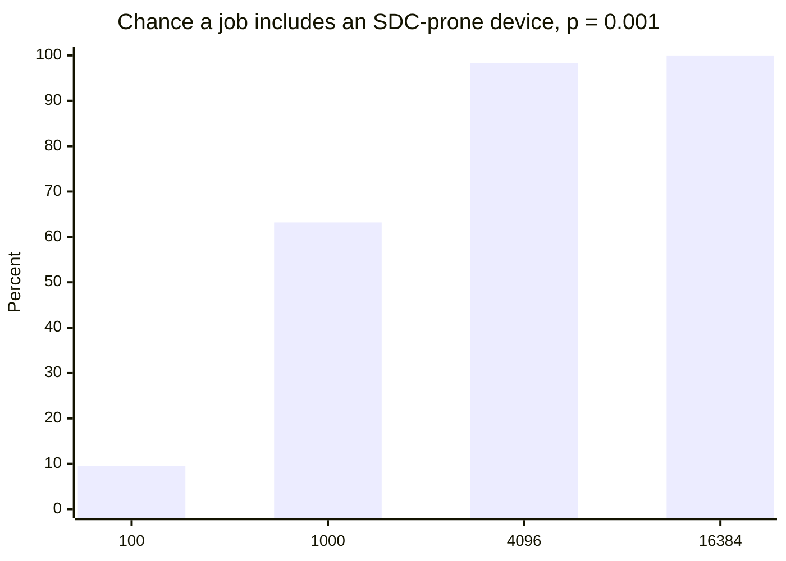
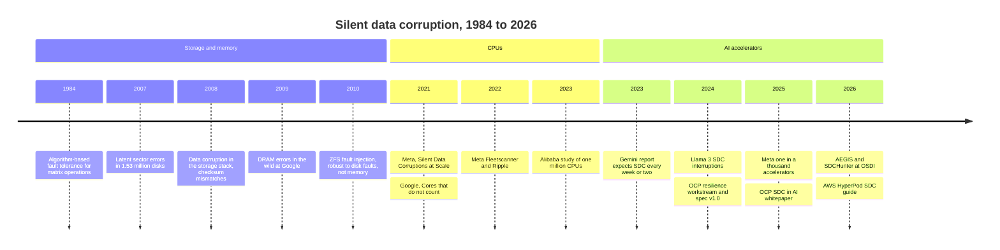
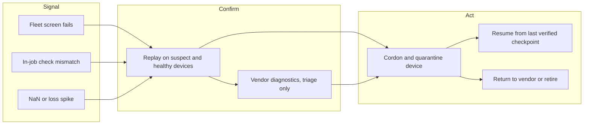
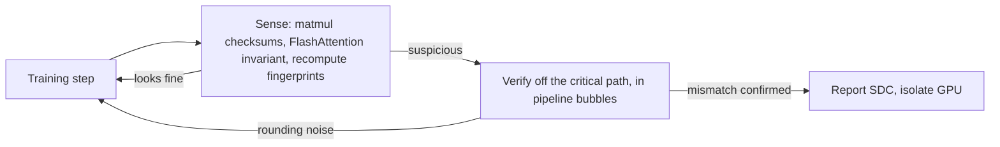

---
tags:
  - distributed-systems
  - frontier
  - silent-data-corruption
  - hardware-reliability
  - fault-tolerance
status: draft
sources:
  - https://pages.cs.wisc.edu/~remzi/Classes/739/Fall2015/Papers/latent-sigmetrics07.pdf
  - https://www.cs.utoronto.ca/~bianca/papers/fast08.pdf
  - https://www.ush.it/team/ascii/sigmetrics09.pdf
  - https://static.usenix.org/events/fast10/tech/full_papers/zhang.pdf
  - https://queue.acm.org/detail.cfm?id=1317400
  - https://graal.ens-lyon.fr/~abenoit/CR02/papers/abft2.pdf
  - https://arxiv.org/abs/2102.11245
  - https://engineering.fb.com/2021/02/23/data-infrastructure/silent-data-corruption/
  - https://research.google/pubs/pub50337/
  - https://arxiv.org/abs/2203.08989
  - https://engineering.fb.com/2022/03/17/production-engineering/silent-errors/
  - https://yangwang83.github.io/papers/sosp2023-Wang.pdf
  - https://arxiv.org/pdf/2312.11805
  - https://arxiv.org/pdf/2407.21783
  - https://www.opencompute.org/news/computings-hidden-menace-the-ocp-takes-action-against-silent-data-corruption-sdc/
  - https://www.opencompute.org/news/ocps-server-resilience-initiative-sdc-academic-research-awards-announced/
  - https://www.opencompute.org/documents/external-ver-1-0-open-compute-specification-server-component-resilience-sdc-workstream-docx-1-pdf-1/
  - https://www.opencompute.org/projects/semi-private-workstreams/server-component-resilience/
  - https://www.opencompute.org/documents/sdc-in-ai-ocp-whitepaper-ver-1-1-final-pdf/
  - https://engineering.fb.com/2025/07/22/data-infrastructure/how-meta-keeps-its-ai-hardware-reliable/
  - https://arxiv.org/abs/2502.12340
  - https://www.arxiv.org/abs/2508.01786
  - https://docs.kernel.org/arch/x86/ifs.html
  - https://www.usenix.org/conference/osdi26/presentation/lei
  - https://www.usenix.org/system/files/osdi26-lei.pdf
  - https://www.usenix.org/system/files/osdi26-zheng.pdf
  - https://arxiv.org/html/2604.00726v1
  - https://arxiv.org/pdf/2604.10390
  - https://arxiv.org/abs/2605.04213
  - https://arxiv.org/abs/2605.15638
  - https://arxiv.org/pdf/2608.30769
  - https://aws.amazon.com/blogs/machine-learning/detecting-and-recovering-from-silent-data-corruption-on-amazon-sagemaker-hyperpod/
  - https://jepsen.io/analyses/tigerbeetle-0.16.11
created: 2026-11-26
updated: 2026-11-28
---

## Table Of Contents

---

- [[#TL;DR|TL;DR]]
- [[#The Problem|The Problem]]
- [[#Foundations|Foundations]]
    - [[#Detected, Corrected and Silent Errors|Detected, Corrected and Silent Errors]]
    - [[#Where Corruption Comes From|Where Corruption Comes From]]
    - [[#Fleet Arithmetic|Fleet Arithmetic]]
- [[#How We Got Here|How We Got Here]]
- [[#How It Works|How It Works]]
    - [[#Storage - End-to-End Checksums and Scrubbing|Storage - End-to-End Checksums and Scrubbing]]
    - [[#Memory - ECC and Its Limits|Memory - ECC and Its Limits]]
    - [[#CPUs - Mercurial Cores|CPUs - Mercurial Cores]]
    - [[#Fleet Screening|Fleet Screening]]
    - [[#Redundant Computation and ABFT|Redundant Computation and ABFT]]
    - [[#SDC in AI Training|SDC in AI Training]]
    - [[#From Suspicion to Quarantine|From Suspicion to Quarantine]]
- [[#Where It Is Now|Where It Is Now]]
    - [[#An Industry Problem With a Shared Vocabulary|An Industry Problem With a Shared Vocabulary]]
    - [[#Online Detection Inside Training Jobs|Online Detection Inside Training Jobs]]
    - [[#What Corruption Actually Does to a Model|What Corruption Actually Does to a Model]]
    - [[#Better Screens for CPUs|Better Screens for CPUs]]
- [[#Trade-offs & Open Problems|Trade-offs & Open Problems]]
- [[#Resources|Resources]]
- [[#Related Notes|Related Notes]]

## ***TL;DR***
---
*Silent data corruption (SDC) is hardware producing a wrong result with no error raised: no crash, no ECC report, no log line. It is rare per device, certain at fleet scale, and invisible to every protocol that assumes nodes either work correctly or stop.*

- **What it is.** A disk returns the wrong block, a memory bit flips past ECC, or a CPU or GPU core computes a wrong answer, and nothing in the hardware notices. The OCP specification defines an SDC-causing system as one where a bug-free workload gives incorrect results without any built-in error detection flagging it ([OCP SCR spec v1.0, 2024](https://www.opencompute.org/documents/external-ver-1-0-open-compute-specification-server-component-resilience-sdc-workstream-docx-1-pdf-1/)).
- **How common.** Alibaba found 3.61 SDC-causing CPUs per 10,000 across over a million processors ([Wang et al., SOSP 2023](https://yangwang83.github.io/papers/sosp2023-Wang.pdf)); Google saw "a few mercurial cores per several thousand machines" ([Hochschild et al., HotOS 2021](https://research.google/pubs/pub50337/)); Meta now sees about one per thousand AI accelerators ([Meta, Jul 2025](https://engineering.fb.com/2025/07/22/data-infrastructure/how-meta-keeps-its-ai-hardware-reliable/)).
- **Why distributed systems care.** [[Raft]], [[Paxos]] and [[Replication]] assume crash faults. A corrupt node is a Byzantine node that doesn't know it, and replication copies its wrong output faithfully ([[Failure Models]], [[Byzantine Fault Tolerance]]).
- **The defenses** are layered: end-to-end checksums for data at rest and in flight, fleet screening to find bad parts, redundant or checksummed computation (ABFT) to catch wrong math, and quarantine to remove the device once found.
- **Now (Nov 2026):** the problem has moved to AI clusters. Online detectors run inside training jobs (ByteDance's AEGIS, 0.86% overhead over 35 million GPU hours, [OSDI 2026](https://www.usenix.org/conference/osdi26/presentation/lei)), AWS published an SDC playbook for SageMaker HyperPod in November 2026 ([AWS](https://aws.amazon.com/blogs/machine-learning/detecting-and-recovering-from-silent-data-corruption-on-amazon-sagemaker-hyperpod/)), and OCP's vendor-and-hyperscaler workstream has a draft test spec and an AI whitepaper (v1.1, December 2025).

## ***The Problem***
---
*Every layer of a system trusts the layer below to either return the right answer or report an error. SDC breaks that contract silently, so the wrong value flows into checkpoints, replicas, indexes and model weights, and is often found months later, if ever.*

Hardware has error detection almost everywhere: ECC on DRAM, parity on caches, CRCs on links and disk sectors. Those catch most faults and turn them into *detected* errors, which software handles as crashes or retries. SDC is what gets past all of them. Meta's 2021 paper puts it plainly: "SDCs are not captured by error reporting mechanisms within a Central Processing Unit (CPU)" ([Dixit et al., 2021](https://arxiv.org/abs/2102.11245)).

Three properties make it hard:

| Property | Why it hurts | Example |
|---|---|---|
| **No signal** | Nothing triggers a retry, failover or alert | Meta's corrupt core left system event and kernel logs clean ([Dixit et al.](https://arxiv.org/abs/2102.11245)) |
| **Propagation** | Wrong values are stored, replicated and used as inputs to later work | A math error made a file look empty, so it was never written, and the query layer reported data loss ([Meta, Feb 2021](https://engineering.fb.com/2021/02/23/data-infrastructure/silent-data-corruption/)) |
| **Intermittence** | Faults depend on data, core, temperature and age, so tests miss them | Alibaba's SDC rates ranged from about 0.01 to hundreds per minute, and some appeared only above a temperature threshold ([Wang et al.](https://yangwang83.github.io/papers/sosp2023-Wang.pdf)) |

For a distributed system, the consequence is a broken assumption. [[Failure Models]] separates crash faults (a node stops) from Byzantine faults (a node does anything). Consensus protocols like [[Raft]] and [[Paxos]] tolerate $f$ crashes with $2f+1$ nodes, but a single node that computes a wrong value and signs it with a correct checksum looks perfectly healthy to them. The leader replicates the bad value to a majority, the majority commits it, and every replica now agrees on the wrong answer. That's why [[Replication]] lists corruption as an open problem: replication protects against loss, not against wrongness.

## ***Foundations***
---
*Three ideas are enough: the difference between corrected, detected and silent errors; where corruption physically comes from; and the arithmetic that turns a one-in-a-thousand device rate into a near-certainty for a large job.*

### Detected, Corrected and Silent Errors

*An error is only dangerous if nothing notices it. The question for any component is what fraction of its faults fall into the last row of this table.*

| Outcome | What happens | Example mechanism |
|---|---|---|
| **Corrected** | Hardware fixes the error and carries on, maybe logging it | ECC corrects a single-bit DRAM error |
| **Detected, uncorrectable** | Hardware knows the result is bad and raises an error; software crashes or retries | ECC sees a multi-bit error and raises a machine check |
| **Silent** | The result is wrong and nothing flags it | A defective ALU returns 0 for a power computation ([Dixit et al.](https://arxiv.org/abs/2102.11245)) |

A detected error becomes an ordinary crash fault, which systems already handle. A silent one becomes an arbitrary (Byzantine) fault. Google's paper names CPU-originated silent errors *corrupt execution errors* (CEEs) and the cores that produce them *mercurial* ([Hochschild et al.](https://research.google/pubs/pub50337/)).

Two further distinctions matter for mitigation:
- **Transient vs permanent.** A transient fault (for example a particle strike) happens once; a permanent defect recurs on the same device. Every SDC that ByteDance's AEGIS detected in production was permanent, recurring on the same GPUs ([Lei et al., OSDI 2026](https://www.usenix.org/system/files/osdi26-lei.pdf)). Permanent faults are why quarantine works: remove the device and the problem goes away.
- **Time zero vs degradation.** Some defects escape manufacturing tests; others appear with age. Meta repeated a computation daily on one device for six months before it failed ([Dixit et al., 2022](https://arxiv.org/abs/2203.08989)). In ByteDance's GPU study, only 25% of SDC defects appeared during burn-in, and 40% surfaced around a year into service ([Zheng et al., OSDI 2026](https://www.usenix.org/system/files/osdi26-zheng.pdf)).

### Where Corruption Comes From

*Corruption can enter at rest (disks, memory) or in computation (CPUs, GPUs). Storage got its defenses first because it can be checked cheaply; computation is the hard case because checking it means computing again.*

| Layer | Fault | Typical guard | What still slips through |
|---|---|---|---|
| Disk and SSD | Latent sector errors, bit rot, misdirected or lost writes | Sector ECC, RAID parity, scrubbing | Corruption the drive returns as valid data |
| Storage stack | Firmware and controller bugs, wrong block returned | File-system checksums | Corruption before the checksum is computed |
| DRAM | Bit flips, often from hard (permanent) errors | ECC | Multi-bit errors ECC can't see; corruption in cached data |
| CPU and GPU | Defective logic in ALUs, vector units, FPUs, tensor cores | Very little: "There is no ECC on a tensor-core result" ([AWS, Nov 2026](https://aws.amazon.com/blogs/machine-learning/detecting-and-recovering-from-silent-data-corruption-on-amazon-sagemaker-hyperpod/)) | Almost everything |

Meta lists the physical causes for compute: device errors (design corner cases, timing-path errors, manufacturing variation), early-life failures that pass factory tests, degradation with use, and end-of-life wear-out ([Dixit et al., 2021](https://arxiv.org/abs/2102.11245)). Google adds that frequency, voltage and temperature affect failure rates in "complex, sometimes counterintuitive ways" (lower frequency sometimes raised failure rates), and that faulty cores often get worse with time ([Hochschild et al.](https://research.google/pubs/pub50337/)). Meta attributes the growth in accelerator SDC to higher silicon density: soft-error bitflips used to be about one per million devices, SDC is now about one per thousand ([Meta, Jul 2025](https://engineering.fb.com/2025/07/22/data-infrastructure/how-meta-keeps-its-ai-hardware-reliable/)).

### Fleet Arithmetic

*A rare per-device defect becomes routine across a fleet, and near-certain inside one large synchronous job. This is the single calculation that explains why SDC went from curiosity to infrastructure problem.*

If each device independently has probability $p$ of being SDC-prone, a fleet or job of $N$ devices contains on average $Np$ bad ones, and the chance that at least one is bad is:

$$
E[\text{bad devices}] = N p \qquad P(\text{at least one bad}) = 1 - (1 - p)^N \approx 1 - e^{-Np}
$$

*In words:* the expected count grows linearly with fleet size, and the chance that a job touches at least one bad device climbs toward 1 once $Np$ passes about 3.

*Worked example, with Meta's rate of about one per thousand accelerators* ([Meta, Jul 2025](https://engineering.fb.com/2025/07/22/data-infrastructure/how-meta-keeps-its-ai-hardware-reliable/)), $p = 0.001$:

| Job or fleet size $N$ | Expected bad devices $Np$ | $P(\text{at least one})$ |
|---|---|---|
| 100 GPUs | 0.1 | $1 - 0.999^{100} \approx$ 9.5% |
| 1,000 GPUs | 1 | $1 - 0.999^{1000} \approx$ 63.2% |
| 4,096 GPUs | 4.1 | about 98.3% |
| 16,384 GPUs (Llama 3 405B scale) | 16.4 | about 99.99999% |

The same arithmetic on CPUs: Alibaba's 3.61 per 10,000 means a 100,000-CPU fleet holds about $100{,}000 \times 0.000361 \approx 36$ SDC-causing processors at any time, and a 1,000-CPU job has a $1 - (1 - 0.000361)^{1000} \approx 30\%$ chance of including one ([Wang et al.](https://yangwang83.github.io/papers/sosp2023-Wang.pdf)). The 16,384-GPU row is the size of Meta's Llama 3 405B training cluster, which logged 6 interruptions attributed to SDC out of 419 unexpected ones in 54 days ([Llama 3 paper, 2024](https://arxiv.org/pdf/2407.21783)), and those are only the SDCs that caused a visible interruption.

Two caveats. These per-device rates are fractions of devices found defective over a study period, not per-hour rates, so they say how many bad parts you own, not how often each one misbehaves. And a bad device doesn't corrupt every result: a defect may fire once a minute or once in millions of operations, which is exactly what makes testing hard (below).

## ***How We Got Here***
---
*Storage corruption was measured and largely solved with end-to-end checksums in the 2000s. Compute corruption was assumed away until Meta and Google published fleet data in 2021; by 2025 the focus had moved to AI accelerators, and in 2026 to online detection inside training jobs.*

| Year | Step | What it showed | Source |
|---|---|---|---|
| 1984 | **ABFT.** Encode matrices with row and column checksums that survive multiplication. | Wrong arithmetic can be detected, located and corrected by algebra, without full duplication. | [Huang and Abraham](https://graal.ens-lyon.fr/~abenoit/CR02/papers/abft2.pdf) |
| 2007 | **Latent sector errors.** 3.45% of 1.53 million disks developed them over 32 months; nearline 8.5%, enterprise 1.9%. | Disks lose data silently until read; scrubbing finds more than 60% of these errors. | [Bairavasundaram et al., SIGMETRICS](https://pages.cs.wisc.edu/~remzi/Classes/739/Fall2015/Papers/latent-sigmetrics07.pdf) |
| 2008 | **Storage-stack corruption.** Over 400,000 checksum mismatches in 1.53 million disks over 41 months. | Drives return wrong data as if it were right; only a file-system checksum catches it. | [Bairavasundaram et al., FAST](https://www.cs.utoronto.ca/~bianca/papers/fast08.pdf) |
| 2009 | **DRAM errors in the wild.** About a third of Google machines see a memory error per year. | Memory errors are far more common than lab rates, and mostly hard errors. | [Schroeder et al., SIGMETRICS](https://www.ush.it/team/ascii/sigmetrics09.pdf) |
| 2010 | **ZFS case study.** Checksums catch all injected disk corruption; memory corruption gets through. | End-to-end checking must cover memory too. | [Zhang et al., FAST](https://static.usenix.org/events/fast10/tech/full_papers/zhang.pdf) |
| 2021 | **SDCs at scale; mercurial cores.** Hundreds of bad CPUs in hundreds of thousands of Meta machines; a few per several thousand at Google. | CPUs are not fail-stop. | [Dixit et al.](https://arxiv.org/abs/2102.11245), [Hochschild et al.](https://research.google/pubs/pub50337/) |
| 2022 | **Fleetscanner and Ripple.** Out-of-production and in-production testing combined. | Detection is a fleet-operations problem, not a one-time test. | [Dixit et al.](https://arxiv.org/abs/2203.08989) |
| 2023 | **One million CPUs.** 3.61 per 10,000 cause SDC; five vulnerable CPU features. | Rates and triggers at scale, plus a cheaper test framework (Farron). | [Wang et al., SOSP](https://yangwang83.github.io/papers/sosp2023-Wang.pdf) |
| 2023 | **Gemini.** "We can expect SDC events to impact training every week or two." | SDC is a scheduled cost of frontier training. | [Gemini team](https://arxiv.org/pdf/2312.11805) |
| 2024 | **OCP Server Component Resilience.** Meta, Google, Intel, ARM, AMD, Microsoft and NVIDIA. | Vendors and buyers agree on a shared test vocabulary. | [OCP, Jan 2024](https://www.opencompute.org/news/computings-hidden-menace-the-ocp-takes-action-against-silent-data-corruption-sdc/) |

## ***How It Works***
---
*Defenses split by what they protect: checksums protect data that should not change, screening finds the devices that corrupt, and redundant or checksummed computation protects the results of math. None alone is enough; production systems stack them.*

### Storage - End-to-End Checksums and Scrubbing

*Store a checksum away from the data, verify it on every read, and periodically read everything. That turns silent storage corruption into a detected error you can repair from another copy.*

The NetApp studies are the reason storage systems checksum everything:
- **Checksum mismatches** (the drive returned the wrong bytes): 0.66% of nearline disks and 0.06% of enterprise disks developed at least one in their first 17 months. Mismatches cluster: given one on a disk, the chance of more is about 0.6, and one nearline system had 92 disks with mismatches ([Bairavasundaram et al., FAST 2008](https://www.cs.utoronto.ca/~bianca/papers/fast08.pdf)).
- **Where they are found:** scrubbing found about 49% of mismatches on nearline disks and 73% on enterprise disks; about 8% were found only during RAID reconstruction ([[Erasure Coding]]), which is the worst time, because the redundancy needed to repair them is already being used.
- **Latent sector errors** show strong temporal locality: 40% to 80% arrive within a minute of the previous one ([Bairavasundaram et al., SIGMETRICS 2007](https://pages.cs.wisc.edu/~remzi/Classes/739/Fall2015/Papers/latent-sigmetrics07.pdf)).

**End-to-end checksums.** ZFS's designers put it as "never, ever trust the underlying hardware": compute the checksum while the data is still in the application's fault domain and store data and checksum separately, so one failure can't destroy both ([Bonwick and Moore, ACM Queue 2007](https://queue.acm.org/detail.cfm?id=1317400)). ZFS keeps each block's checksum in its parent block pointer, so the tree of pointers checks itself from the root down ([Zhang et al., FAST 2010](https://static.usenix.org/events/fast10/tech/full_papers/zhang.pdf)).

**The memory gap.** Zhang et al. injected faults into ZFS. Every on-disk corruption was detected; metadata was repaired from "ditto" copies, and single-copy data was reported as an error rather than returned bad. Memory was different: ZFS doesn't re-verify blocks already in the page cache, and a dirty block corrupted in memory gets a fresh, valid checksum when it is flushed, making the corruption permanent. A single bit flip in memory had a 0.6% to 7.1% chance of returning corrupt data, depending on workload ([Zhang et al.](https://static.usenix.org/events/fast10/tech/full_papers/zhang.pdf)).

*Worked example:* a block holds `balance = 100` with checksum `c(100)` stored in its parent. The disk later returns `balance = 108`. On read, the file system recomputes `c(108)`, it doesn't match the parent's `c(100)`, and the read fails instead of returning 108; with a mirror, the good copy is read and the bad one rewritten. Now suppose instead the bit flips in RAM before the write: the file system computes `c(108)` over the bad value and stores both. Every later read verifies. That is why end-to-end checking has to start where the data is created, not where it reaches the disk.

Checksums also have to cover everything the code later trusts. Jepsen found that TigerBeetle checksummed each chunk's data but not its zero padding, so one flipped bit in padding passed the checksum and tripped an assertion that crashed the server on startup; TigerBeetle's simulator had missed it because it corrupted whole sectors, not single bits ([Jepsen, Jun 2025](https://jepsen.io/analyses/tigerbeetle-0.16.11); see [[Deterministic Simulation Testing]]).

### Memory - ECC and Its Limits

*ECC turns most memory errors into corrected or detected ones, but at fleet scale even the uncorrectable rate is high, and ECC protects storage of bits, not the logic that computes them.*

Schroeder, Pinheiro and Weber measured memory errors across Google's fleet ([SIGMETRICS 2009](https://www.ush.it/team/ascii/sigmetrics09.pdf)):

| Measure | Value |
|---|---|
| Machines with at least one memory error per year | about a third |
| DIMMs affected per year | more than 8% |
| Correctable error rate | 25,000 to 70,000 errors per billion device hours per Mbit |
| Uncorrectable errors per year | 1.3% of machines, 0.22% of DIMMs |
| Cause | Dominated by hard errors, not soft errors |
| Temperature effect | "surprisingly small" in the field |

Two lessons carry over to SDC. First, rates in the field were far above what lab estimates suggested, which is the same pattern Google later reported for CPU test escapes (below). Second, errors cluster on the same DIMM, so a device that has erred once is likely to again, which is the basis for retiring hardware on repeated errors.

### CPUs - Mercurial Cores

*Some cores pass every factory test and then occasionally compute wrong answers. They're rare, specific to a core and often to certain instructions or data, and nothing in the CPU reports them.*

**Meta's case study (2021).** A Spark decompression pipeline checks a file's computed size before writing it. On one host, Scala's `math.pow` returned 0 for a file with a non-zero size, so the file was skipped and the query layer reported data loss. Engineers narrowed it to one machine, then to one core: on core 59, `Int(1.1^53)` returned 0 while `Int(1.1^52)` correctly returned 142. Other results on that core: $1.1^3$ gave 0 instead of 1, $1.1^{107}$ gave 32809 instead of 26854. Reducing the reproducer from 430K lines of JIT assembly to 60 lines took a dedicated investigation ([Dixit et al., 2021](https://arxiv.org/abs/2102.11245); [Meta, Feb 2021](https://engineering.fb.com/2021/02/23/data-infrastructure/silent-data-corruption/)).

**Google's mercurial cores (2021).** Symptoms included violated lock semantics, corrupted loads, stores and vector operations, repeated bit flips in strings, corruption during garbage collection that lost live data in a storage system, and database index corruption that depended on which replica's core served the query. The strangest was a deterministic AES miscomputation that was "self-inverting": encrypt and decrypt on the same bad core and you get the original back; decrypt anywhere else and you get garbage ([Hochschild et al.](https://research.google/pubs/pub50337/)). That is the textbook case of why replication doesn't help: the bad node's output looks consistent to itself.

**Alibaba's population study (2023)**, over a million processors in 28 data centers over 32 months ([Wang et al., SOSP 2023](https://yangwang83.github.io/papers/sosp2023-Wang.pdf)):

| Finding | Detail |
|---|---|
| Rate | 3.61 per 10,000 CPUs overall; 3.262 per 10,000 caught by pre-production tests and 0.348 per 10,000 by regular in-production tests; per-microarchitecture rates from 0.082 to 9.29 per 10,000 |
| Vulnerable features | Integer arithmetic, vector operations, floating point, cache coherency, transactional memory |
| Scope | About half of faulty CPUs had one bad physical core; the other half affected all cores |
| Data | Floating-point types most affected; flips mostly in fraction bits, so errors were often small |
| Triggers | Temperature (for six of 27 studied CPUs, log error frequency rose linearly with core temperature), and heavy use of the defective instruction |
| Test coverage | 560 of 633 test cases never detected an error in production |

The last row is the testing problem in one line: most tests are useless for any given defect, so you need many different tests, run often, under the right conditions. Alibaba's Farron framework averaged 1.02 hours per regular test round against 10.55 hours for the baseline, and backs off when cores get hot.

### Fleet Screening

*Since bad parts escape the factory and others degrade in service, operators test their own fleets continuously, both during maintenance windows and alongside live workloads. The two find different defects.*

Meta's two systems ([Dixit et al., 2022](https://arxiv.org/abs/2203.08989); [Meta, Mar 2022](https://engineering.fb.com/2022/03/17/production-engineering/silent-errors/)):

| | Fleetscanner (out of production) | Ripple (in production) |
|---|---|---|
| When it runs | Maintenance events: reboots, kernel and firmware upgrades, reimages, provisioning, repairs | Alongside live workloads, with per-service cadence and on-off controls |
| Test length | Minutes | Hundreds of milliseconds |
| Scale | About 68 million tests and 4 billion test seconds over its lifetime | About 2.5 billion tests and 100 million fleet seconds per month |
| Unique coverage | 23% of detected SDCs found only this way | 7% found only this way |
| Time to 70% coverage | About 6 months | About 15 days |

Both are needed: "the last 30 percent of the faults are only detectable with opportunistic testing" ([Meta, Mar 2022](https://engineering.fb.com/2022/03/17/production-engineering/silent-errors/)). By 2025 Meta scheduled Fleetscanner to cover the fleet every 45 to 60 days, Ripple reached fleet-wide coverage in days, and a third system, Hardware Sentinel, which analyzes kernel exceptions instead of running tests, outperformed test-based detection by 41% ([Meta, Jul 2025](https://engineering.fb.com/2025/07/22/data-infrastructure/how-meta-keeps-its-ai-hardware-reliable/); [OCP whitepaper v1.1](https://www.opencompute.org/documents/sdc-in-ai-ocp-whitepaper-ver-1-1-final-pdf/)).

Vendors expose their own hooks. Intel's In-Field Scan runs circuit-level tests on a CPU core "to detect problems that are not caught by parity or ECC checks"; the core is effectively offline for up to 200 ms per test, and results appear in sysfs ([Linux kernel docs](https://docs.kernel.org/arch/x86/ifs.html)). The OCP specification lists NVIDIA DCGM for GPUs, Intel OpenDCDiag and AMD Open Field Health Check for CPUs as the open frameworks its test flow is built around ([OCP SCR spec v1.0](https://www.opencompute.org/documents/external-ver-1-0-open-compute-specification-server-component-resilience-sdc-workstream-docx-1-pdf-1/)).

How many tests a defect needs is the same arithmetic as above. If a single test run triggers a given intermittent defect with probability $q$, then after $n$ independent runs:

$$
P(\text{detected}) = 1 - (1 - q)^n
$$

*In words:* each extra run is another lottery ticket. *Example:* a defect that fires in 5% of runs ($q = 0.05$) is caught with probability $1 - 0.95^{20} \approx 64\%$ after 20 runs and $1 - 0.95^{60} \approx 95\%$ after 60. A defect that needs a hot core may have $q \approx 0$ on a cool, idle machine, which is why Alibaba controls temperature during tests and why short in-production tests on loaded machines find faults that maintenance-window tests miss.

### Redundant Computation and ABFT

*To catch wrong math you have to check the math. Running it twice is general but doubles the cost; algorithm-based fault tolerance exploits the algebra of an operation to check it for a small fraction of the cost.*

| Technique | How it checks | Cost | Catches |
|---|---|---|---|
| **Dual execution** | Compute on two cores or devices, compare | About 2x compute | Any disagreement, but can't say which copy is wrong |
| **Triple modular redundancy** | Three copies, majority vote | About 3x | And corrects it ([Hochschild et al.](https://research.google/pubs/pub50337/)) |
| **Replay on another device** | Recompute a sample of steps elsewhere | Proportional to sample rate | Permanent faults, given deterministic execution |
| **ABFT** | Carry checksums through the computation | A few percent for matrix math | Errors in the protected operation, with location |
| **End-to-end application checks** | Checksums or invariants on results | Small | Corruption that changes checked properties |

**ABFT** comes from Huang and Abraham's 1984 paper ([IEEE Trans. Computers](https://graal.ens-lyon.fr/~abenoit/CR02/papers/abft2.pdf)). Append a row of column sums to $A$ and a column of row sums to $B$. Because multiplication is linear, the product carries both checksums:

$$
(e^\top A)\,B = e^\top (AB) \qquad A\,(B\,e) = (AB)\,e
$$

where $e$ is a vector of ones. *In words:* the column sums of the result must equal the checksum row times $B$, and the row sums must equal $A$ times the checksum column. One bad element breaks exactly one row sum and one column sum, which locates it, and the difference corrects it.

*Worked example:* $A = \begin{pmatrix}1 & 2\\3 & 4\end{pmatrix}$, $B = \begin{pmatrix}5 & 6\\7 & 8\end{pmatrix}$, so $C = AB = \begin{pmatrix}19 & 22\\43 & 50\end{pmatrix}$.
- Column checksum: $e^\top A = (4, 6)$, and $(4, 6)B = (62, 72)$. Column sums of $C$: $19 + 43 = 62$, $22 + 50 = 72$. They match.
- Row checksum: $Be = (11, 15)^\top$, and $A(11, 15)^\top = (41, 93)^\top$. Row sums of $C$: 41 and 93. They match.
- Now a faulty multiplier writes 47 instead of 43. Column 1 sums to 66 (expected 62) and row 2 sums to 97 (expected 93). The only element in both is $C_{21}$, off by 4, so the correct value is $47 - 4 = 43$.

On GPUs, the catch is floating-point rounding: checksums never match exactly, so detectors need a tolerance that separates real faults from rounding noise. AEGIS accumulates its matrix-multiply checksums in float32 for exactly that reason ([Lei et al.](https://www.usenix.org/system/files/osdi26-lei.pdf)). Weighted checksums, fail-stop recovery, GPU kernel placement and the 2026 threshold work are in [[Algorithm-Based Fault Tolerance]].

### SDC in AI Training

*Large synchronous training jobs are close to the worst case: thousands of accelerators, each step depending on all of them, and weeks of state that a single corrupt gradient can poison. Many SDCs never produce a NaN or a loss spike at all.*

What SDC does to a training run, from the 2025 and 2026 evidence:
- **NaN cascades.** A corrupt value becomes a NaN that spreads through the iteration, the host and the cluster, and can halt the whole job ([Meta, Jul 2025](https://engineering.fb.com/2025/07/22/data-infrastructure/how-meta-keeps-its-ai-hardware-reliable/)). This is the *easy* case, because it is visible.
- **Silent gradient corruption.** Corrupted gradients don't trip NaN checks and can push training toward explosion, implosion or a worse minimum, with effects showing up weeks or months later ([Meta, Jul 2025](https://engineering.fb.com/2025/07/22/data-infrastructure/how-meta-keeps-its-ai-hardware-reliable/)).
- **Masked by loss noise.** In AEGIS's production data, "the majority of SDC incidents silently corrupted training correctness and escaped alarms", including NaN and inf checks, and only 3 of 18 incidents showed observable training failures ([Lei et al., OSDI 2026](https://www.usenix.org/system/files/osdi26-lei.pdf)).
- **Parameter drift.** On real faulty nodes pulled from a cloud fleet, single-step gradient errors were small (worst case 5.1% of the gradient's norm), and loss curves looked normal, yet parameters drifted away from a healthy run; one fine-tuning run hit a loss spike and ended at 0% accuracy on its task ([Ma et al., 2025](https://arxiv.org/abs/2502.12340)).

The Gemini team planned around it: SDC was expected "every week or two", handled with "deterministic replay to isolate incorrect computations" plus "proactive SDC scanners on idle machines and hot standbys" ([Gemini, 2023](https://arxiv.org/pdf/2312.11805)). Meta's toolbox adds *reductive triage* (binary search over shrinking sub-clusters to find the bad node), *hyper-checkpointing* (checkpoints at increasing frequency to narrow the window), deterministic training, shadow nodes that recompute random steps, and *algorithmic fault tolerance*, which Meta describes as building tolerance of corruption into the training algorithm itself, alongside gradient clipping ([Meta, Jul 2025](https://engineering.fb.com/2025/07/22/data-infrastructure/how-meta-keeps-its-ai-hardware-reliable/)). See [[GPU Cluster Infrastructure]].

**Checkpoints are the dangerous part.** A checkpoint written from a corrupted replica preserves the corruption, and restarting from it can bring the problem back. AWS's guide says its weight-fingerprint check "is the only one that can stop a checkpoint from being written out of a corrupted copy", so it forces that check on checkpoint steps ([AWS, Nov 2026](https://aws.amazon.com/blogs/machine-learning/detecting-and-recovering-from-silent-data-corruption-on-amazon-sagemaker-hyperpod/)).

### From Suspicion to Quarantine

*Detection is a pipeline: a cheap signal raises suspicion, a precise check confirms it, the device is pinned down and removed, and work resumes from state known to be clean.*

- **Confirm by replay.** ByteDance's SDCHunter makes training deterministic (fixed kernels and NCCL settings, so healthy hardware gives bit-identical results), splits the job into two data-parallel replicas fed identical batches, compares tensor hashes, then replays the bad step layer by layer to find the first divergent tensor and the GPU that produced it ([Zheng et al., OSDI 2026](https://www.usenix.org/system/files/osdi26-zheng.pdf)).
- **Don't trust a clean bill of health.** Vendor diagnostics caught only 2 of 8 previously faulty machines in AEGIS's comparison ([Lei et al.](https://www.usenix.org/system/files/osdi26-lei.pdf)); synthetic stress tests missed over 60% of defective GPUs in ByteDance's study ([Zheng et al.](https://www.usenix.org/system/files/osdi26-zheng.pdf)). AWS calls its deep health check "Triage, not proof" ([AWS](https://aws.amazon.com/blogs/machine-learning/detecting-and-recovering-from-silent-data-corruption-on-amazon-sagemaker-hyperpod/)).
- **Quarantine at the right granularity.** Google suggested removing a single core from a running OS instead of a whole machine ([Hochschild et al.](https://research.google/pubs/pub50337/)); for accelerators the unit is usually a GPU or node.
- **Resume from before the suspect window**, and verify weights after loading, before the first new step ([AWS](https://aws.amazon.com/blogs/machine-learning/detecting-and-recovering-from-silent-data-corruption-on-amazon-sagemaker-hyperpod/)).

## ***Where It Is Now***
---
*As of November 2026, SDC is treated as an operational cost of large AI clusters, not an anomaly. The frontier is online detection inside training jobs at around 1% overhead, shared test vocabulary across vendors, and evidence that today's factory and fleet tests let far too many defective chips through.*

### An Industry Problem With a Shared Vocabulary

*The chip vendors and the largest buyers work on SDC together through the Open Compute Project, which publishes a draft test specification and an AI-focused whitepaper.*

- **January 2024:** OCP's Server Component Resilience workstream, made up of Meta, Google, Intel, ARM, AMD, Microsoft and NVIDIA, called for academic research on screening, software detection, coverage assessment and hardware resilience ([OCP, Jan 2024](https://www.opencompute.org/news/computings-hidden-menace-the-ocp-takes-action-against-silent-data-corruption-sdc/)).
- **June 2024:** six projects chosen from 19 proposals received unrestricted gifts, at Auburn, Arizona State, CMU, Stanford with UW, Chicago and Athens ([OCP, Jun 2024](https://www.opencompute.org/news/ocps-server-resilience-initiative-sdc-academic-research-awards-announced/)).
- **September 2024:** specification v1.0, a draft for community feedback, standardizes test inputs, test outputs (including reproduction rate and error-detection latency), part history (whether a failure was present at time zero or appeared with age) and metrics such as test efficiency, defined as $TE = 1/TTF$ with time to fail in hours ([OCP SCR spec v1.0](https://www.opencompute.org/documents/external-ver-1-0-open-compute-specification-server-component-resilience-sdc-workstream-docx-1-pdf-1/)). *Example:* a test that first catches a defective part after 4 hours of running has $TE = 0.25$; one that never catches any part in a sub-pool has $TE = 0$. The spec sets no FIT targets or pass thresholds.
- **August and December 2025:** the *Silent Data Corruption in AI* whitepaper (v1.0 August 2025, v1.1 December 2025), with authors from NVIDIA, Meta, Google, AMD, Intel, ARM and Microsoft, collects training and inference effects and mitigations and names linking hardware fault metrics (FIT, AVF) to model correctness as the central open problem ([OCP whitepaper v1.1](https://www.opencompute.org/documents/sdc-in-ai-ocp-whitepaper-ver-1-1-final-pdf/)).
- **Status:** the workstream now sits under OCP's Hardware Management Project; its project page, last modified October 2026, still describes the scope as forthcoming and lists a specification in development ([OCP project page](https://www.opencompute.org/projects/semi-private-workstreams/server-component-resilience/)).

### Online Detection Inside Training Jobs

*The 2026 systems papers moved detection from the fleet into the job itself, cheap enough to run on every step and precise enough to name the GPU.*

- **AEGIS (ByteDance and Tsinghua, OSDI, July 2026):** a sensing stage runs inline with mixed-precision ABFT checks on matrix multiplies, an invariant check on [[FlashAttention]], and fingerprints of values that training recomputes anyway (activation recomputation, FlashAttention's backward pass); a verification stage replays suspicious work during pipeline bubbles. Production overhead was 0.86%; over 35 million GPU hours it found 18 SDC incidents (13 in the first half of deployment, 5 in the second) on 13 faulty GPUs, all permanent and all non-deterministic even on the same program ([Lei et al.](https://www.usenix.org/system/files/osdi26-lei.pdf)). That is roughly one incident per 2 million GPU hours, my calculation from their totals.
- **SDCHunter (ByteDance Seed and SJTU, OSDI, July 2026):** characterizes 23 SDC-defective GPUs and diagnoses them by deterministic replay, with end-to-end overhead under 4% against about 4x for full tensor signatures; it mitigated 40 production incidents. The paper estimates that diagnosing a 0.01% SDC rate by naive software replay would cost about as much compute as training three full LLMs ([Zheng et al.](https://www.usenix.org/system/files/osdi26-zheng.pdf)).
- **AWS (November 2026):** a public playbook for SageMaker HyperPod recommends three checks in the training loop (non-finite gradients before and after all-reduce, a "ring replay audit" where each GPU recomputes another node's micro-batch, starting at every 100 steps, and weight fingerprints across replicas), then cordon, confirm, replace with a human approval step, and resume from a checkpoint tagged with the last passing audit ([AWS, Nov 11 2026](https://aws.amazon.com/blogs/machine-learning/detecting-and-recovering-from-silent-data-corruption-on-amazon-sagemaker-hyperpod/)). Its point, "A clean panel doesn't clear the node", is that hardware telemetry can't rule SDC out.

### What Corruption Actually Does to a Model

*A cluster of 2026 fault-injection studies asks how much SDC actually matters to model quality. The answer: most faults are absorbed, a minority cause crashes, and a dangerous tail degrades the model without any visible sign.*

| Study (date) | Setup | Finding |
|---|---|---|
| [Altenbernd et al., TU Berlin](https://arxiv.org/html/2604.00726v1) (Apr 2026) | Bit flips in matrix-multiply instructions, LLaMA-style models 60M to 1.3B | Only exponent-bit flips mattered; backward-pass faults sent gradient norms as high as 1e19; faults every step raised eval loss from 4.30 to 7.38, one in a thousand steps left it at 4.30 |
| [Tung et al.](https://arxiv.org/abs/2605.04213) (May 2026) | Gate-level stuck-at faults in a data-center GPU, over 3 million simulator hours | NaN and infinities were only 1.01% of SDC outcomes; single-bit flips under 40% of flip events, so single-bit fault models are unrealistic |
| [LLM-PRISM, Rochester and NVIDIA](https://arxiv.org/pdf/2604.10390) (v2 Sep 2026) | 7,664 fault-injected GPT-2 runs on H100s in FP16, BF16, FP8 | 57% to 76% of runs ended indistinguishable from baseline; crash rates rose from 16.7% (FP16) to 41.9% (FP8); FP16 showed the most persistent silent degradation; loss curves can hide weight divergence |
| [TrainSDC, Zhejiang and Huawei](https://arxiv.org/pdf/2608.30769) (Aug 2026) | Llama 3.2-1B, Qwen3-0.6B | A mitigation at 1.65% to 6.76% overhead kept dense-fault runs from diverging |

Together with AEGIS's production data, these say loss monitoring is not a detector: most corruption either vanishes or hides under normal loss noise, and the cases that matter most are the quiet ones.

### Better Screens for CPUs

*CPU work in 2025 and 2026 argues that factory tests let far too many bad chips through, and tries to catch them in the field with cheaper checks.*

- **Test escapes (August 2025):** Google researchers report that defective compute chips escape manufacturing tests at "at least an order of magnitude more than industrial targets" across all compute chip types in data centers, and call for fast diagnosis from system-level misbehavior, in-field detection, and new test experiments ([Mitra et al., arXiv 2508.01786](https://www.arxiv.org/abs/2508.01786)).
- **ITHICA (May 2026, revised September 2026):** an intra-thread instruction-checking approach that, on over 3,000 CPU servers, detected 39% more defective servers than baseline industrial checks ([Vavelidou et al., arXiv 2605.15638](https://arxiv.org/abs/2605.15638)). It is a preprint as of its September 2026 revision.

## ***Trade-offs & Open Problems***
---
*Every SDC defense trades compute, latency or operational cost against coverage, and none covers everything. The open problems are general low-overhead detection for arbitrary computation, linking hardware faults to application correctness, and deciding when a device is truly clean.*

| Choice | Buys | Costs |
|---|---|---|
| End-to-end checksums | Detects storage and transfer corruption cheaply | Nothing for wrong computation; must start before data can be corrupted |
| Scrubbing | Finds latent errors before redundancy is needed | Background I/O; finds only what is stored |
| Out-of-production fleet testing | Long, thorough tests; unique coverage | Slow fleet coverage (months); longer maintenance |
| In-production testing | Fast coverage under real load and temperature | Steals production cycles; short tests miss some defects |
| Dual or triple execution | General; TMR also corrects | 2x to 3x compute |
| [[Algorithm-Based Fault Tolerance|ABFT]] and invariant checks | A few percent overhead, locates errors | Only for operations with algebraic structure; floating-point tolerance tuning |
| Deterministic training plus replay | Precise localization | Constrains kernels and communication; replay compute |
| Aggressive quarantine | Removes bad devices quickly | Retires good hardware on false positives; AWS keeps a human in the loop |

Open problems worth tracking:
- **General detection.** ABFT covers matrix math; AEGIS also needs FlashAttention invariants and recomputation it gets for free. Arbitrary code, like the database index and garbage-collector corruptions Google saw, still has nothing cheap ([Hochschild et al.](https://research.google/pubs/pub50337/); [Lei et al.](https://www.usenix.org/system/files/osdi26-lei.pdf)).
- **Hardware metrics vs correctness.** There is no established way to map FIT or AVF to loss, accuracy or business impact ([OCP whitepaper v1.1](https://www.opencompute.org/documents/sdc-in-ai-ocp-whitepaper-ver-1-1-final-pdf/)).
- **Aging.** Defects that appear a year into service mean screening can never stop ([Zheng et al.](https://www.usenix.org/system/files/osdi26-zheng.pdf); [Dixit et al., 2022](https://arxiv.org/abs/2203.08989)).
- **Inference.** A faulty serving device can corrupt results for thousands of users, and small deviations are much harder to detect than large ones ([OCP whitepaper v1.1](https://www.opencompute.org/documents/sdc-in-ai-ocp-whitepaper-ver-1-1-final-pdf/)).
- **Distributed protocols.** Crash-fault consensus will replicate a corrupt leader's output. Full [[Byzantine Fault Tolerance]] costs $3f+1$ replicas and isn't used for data systems in practice, so the working answer is detect-and-isolate plus checksums at every boundary; how far toward Byzantine tolerance storage and consensus systems should move is open ([[Failure Models]]).
- **Fault models in testing.** Simulators and fault injectors that corrupt whole sectors or flip single bits miss real failure patterns ([Jepsen](https://jepsen.io/analyses/tigerbeetle-0.16.11); [Tung et al.](https://arxiv.org/abs/2605.04213)); see [[Deterministic Simulation Testing]].

## ***Resources***
---
*Read Meta's 2021 paper and Google's "Cores that don't count" first; together they are short and change how you think about CPUs. Then the Alibaba SOSP paper for numbers, the NetApp FAST 2008 paper for storage, and the two OSDI 2026 papers for the AI-era state of the art.*

**Primary papers: storage and memory**
- [An Analysis of Latent Sector Errors in Disk Drives](https://pages.cs.wisc.edu/~remzi/Classes/739/Fall2015/Papers/latent-sigmetrics07.pdf): Bairavasundaram et al., SIGMETRICS 2007. 1.53 million disks.
- [An Analysis of Data Corruption in the Storage Stack](https://www.cs.utoronto.ca/~bianca/papers/fast08.pdf): Bairavasundaram et al., FAST 2008. Checksum mismatches, scrubbing.
- [DRAM Errors in the Wild: A Large-Scale Field Study](https://www.ush.it/team/ascii/sigmetrics09.pdf): Schroeder, Pinheiro, Weber, SIGMETRICS 2009.
- [End-to-end Data Integrity for File Systems: A ZFS Case Study](https://static.usenix.org/events/fast10/tech/full_papers/zhang.pdf): Zhang et al., FAST 2010. Why memory breaks end-to-end checksums.
- [Algorithm-Based Fault Tolerance for Matrix Operations](https://graal.ens-lyon.fr/~abenoit/CR02/papers/abft2.pdf): Huang and Abraham, IEEE Transactions on Computers, 1984.

**Primary papers: CPUs**
- [Silent Data Corruptions at Scale](https://arxiv.org/abs/2102.11245): Dixit et al. (Meta), Feb 2021. The core 59 case study.
- [Cores That Don't Count](https://research.google/pubs/pub50337/): Hochschild et al. (Google), HotOS 2021. Mercurial cores.
- [Detecting Silent Data Corruptions in the Wild](https://arxiv.org/abs/2203.08989): Dixit et al. (Meta), Mar 2022. Fleetscanner and Ripple.
- [Understanding Silent Data Corruptions in a Large Production CPU Population](https://yangwang83.github.io/papers/sosp2023-Wang.pdf): Wang et al. (Tsinghua, Ohio State, Alibaba), SOSP 2023.
- [Silent Data Corruption by 10x Test Escapes Threatens Reliable Computing](https://www.arxiv.org/abs/2508.01786): Mitra et al. (Google), Aug 2025.
- [ITHICA](https://arxiv.org/abs/2605.15638): Vavelidou et al., May 2026 preprint.

**Primary papers: AI accelerators**
- [Safeguarding LLM Training at Scale: Online SDC Detection and Insights from 35 Million GPU Hours](https://www.usenix.org/system/files/osdi26-lei.pdf): Lei et al. (ByteDance, Tsinghua), OSDI 2026. AEGIS.
- [SDCs in the Wild: Characterizing and Diagnosing SDC-defective GPUs in Production LLM Training](https://www.usenix.org/system/files/osdi26-zheng.pdf): Zheng et al. (ByteDance Seed, SJTU), OSDI 2026. SDCHunter.
- [Understanding Silent Data Corruption in LLM Training](https://arxiv.org/abs/2502.12340): Ma et al. (Harvard, AWS), Feb 2025, ACL 2025.
- [LLM-PRISM](https://arxiv.org/pdf/2604.10390): Tyagi et al. (Rochester, NVIDIA, Duke), 2026.
- [The Anatomy of Silent Data Corruption](https://arxiv.org/abs/2605.04213): Tung et al., May 2026.
- [Exploring Silent Data Corruption as a Reliability Challenge in LLM Training](https://arxiv.org/html/2604.00726v1): Altenbernd, Wiesner, Kao (TU Berlin), Apr 2026.
- [TrainSDC](https://arxiv.org/pdf/2608.30769): Xia et al. (Zhejiang, Huawei), Aug 2026.
- [Gemini: A Family of Highly Capable Multimodal Models](https://arxiv.org/pdf/2312.11805): Gemini team, Dec 2023. Training infrastructure section.
- [The Llama 3 Herd of Models](https://arxiv.org/pdf/2407.21783): Meta, 2024. Table 5, interruption causes.

**Engineering posts**
- [Mitigating the Effects of Silent Data Corruption at Scale](https://engineering.fb.com/2021/02/23/data-infrastructure/silent-data-corruption/): Meta, Feb 2021.
- [Detecting Silent Errors in the Wild](https://engineering.fb.com/2022/03/17/production-engineering/silent-errors/): Meta, Mar 2022.
- [How Meta Keeps Its AI Hardware Reliable](https://engineering.fb.com/2025/07/22/data-infrastructure/how-meta-keeps-its-ai-hardware-reliable/): Dixit and Sankar, Jul 2025.
- [Detecting and Recovering from Silent Data Corruption on Amazon SageMaker HyperPod](https://aws.amazon.com/blogs/machine-learning/detecting-and-recovering-from-silent-data-corruption-on-amazon-sagemaker-hyperpod/): AWS, Nov 2026. Practical in-loop checks.
- [ZFS interview](https://queue.acm.org/detail.cfm?id=1317400): Bonwick, Moore and Dawidek, ACM Queue, 2007.

**Standards and docs**
- [OCP Server Component Resilience specification v1.0](https://www.opencompute.org/documents/external-ver-1-0-open-compute-specification-server-component-resilience-sdc-workstream-docx-1-pdf-1/): OCP, Sep 2024 draft.
- [Silent Data Corruption in AI whitepaper v1.1](https://www.opencompute.org/documents/sdc-in-ai-ocp-whitepaper-ver-1-1-final-pdf/): OCP, Dec 2025.
- [Computing's Hidden Menace](https://www.opencompute.org/news/computings-hidden-menace-the-ocp-takes-action-against-silent-data-corruption-sdc/) and [research awards](https://www.opencompute.org/news/ocps-server-resilience-initiative-sdc-academic-research-awards-announced/): OCP, Jan and Jun 2024.
- [Intel In-Field Scan](https://docs.kernel.org/arch/x86/ifs.html): Linux kernel documentation.

**Analysis**
- [Jepsen: TigerBeetle 0.16.11](https://jepsen.io/analyses/tigerbeetle-0.16.11): Kyle Kingsbury, Jun 2025. A bit flip outside checksum coverage.

## Related Notes

- [[Failure Models]] — SDC is the hardware-made Byzantine fault that crash-stop models leave out.
- [[Byzantine Fault Tolerance]] — The full answer to nodes that compute wrong values, and why it is rarely used for data systems.
- [[Replication]] — Copies protect against loss but faithfully replicate corrupted values.
- [[Raft]] — Trusts every message; a corrupt leader's entries commit like any others.
- [[Paxos]] — Paxos Made Live's disk-corruption handling is an early production answer.
- [[Gray and Fail-Slow Failures]] — The other class of partial failures that health checks miss.
- [[GPU Cluster Infrastructure]] — Where SDC detection, triage and quarantine now run.
- [[Deterministic Simulation Testing]] — Fault models must include realistic corruption to find these bugs.
- [[Anti-Entropy and Repair]] — Scrubbing and repair from replicas after a checksum mismatch.
- [[Object Storage]] — Storage services where the end-to-end checksum argument applies at scale.
- [[LSM Trees]] — Storage engines where on-disk corruption must be detected and handled.
- [[Reliability Patterns]] — Checkpointing, isolation and retries around unreliable components.
- [[FlashAttention]] — Its recomputation and invariants give AEGIS cheap SDC checks.
- [[Erasure Coding]] — Checksums turn corrupt fragments into erasures that parity can rebuild.
- [[Algorithm-Based Fault Tolerance]] — Checksummed computation in depth, from 1984 processor arrays to GPU training.
