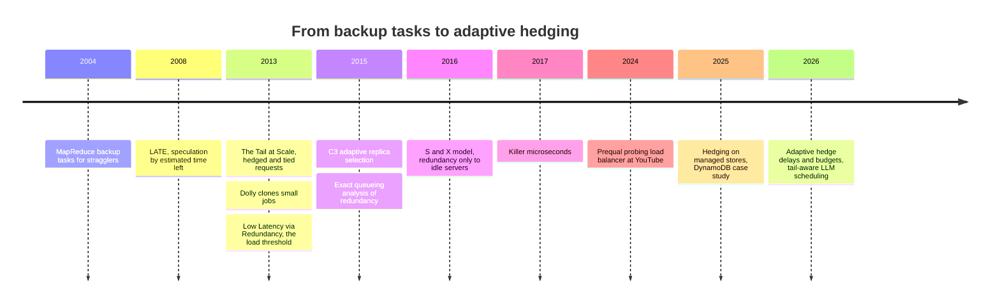
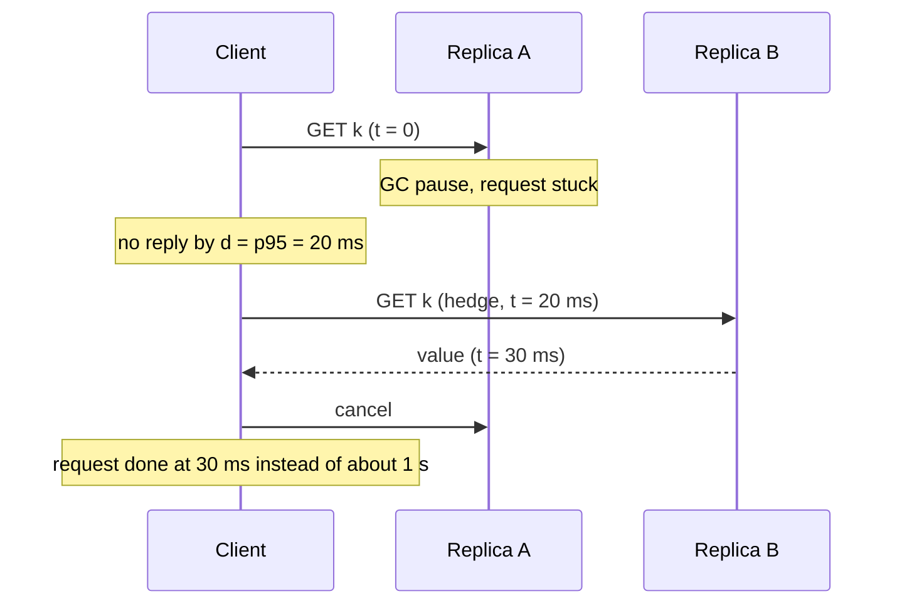

---
tags:
  - distributed-systems
  - tail-latency
  - hedged-requests
  - stragglers
  - load-balancing
  - performance
  - frontier
status: complete
sources:
  - https://pdos.csail.mit.edu/6.824/papers/tail-dean.pdf
  - https://research.google/pubs/pub62/
  - https://storage.googleapis.com/gweb-research2023-media/pubtools/4449.pdf
  - https://www.usenix.org/legacy/event/osdi08/tech/full_papers/zaharia/zaharia_html/
  - https://www.usenix.org/conference/nsdi13/technical-sessions/presentation/ananthanarayanan
  - https://arxiv.org/pdf/1306.3707
  - https://usenix.org/conference/nsdi15/technical-sessions/presentation/suresh
  - https://schmiste.github.io/nsdi15_slides_suresh.pdf
  - https://kgardner.people.amherst.edu/papers/gardner_sigmetrics15.pdf
  - https://kgardner.people.amherst.edu/papers/gardner_opre17.pdf
  - https://www.andrew.cmu.edu/user/gaurij/18-847F-Readings/better_model_redun.pdf
  - https://cacm.acm.org/research/attack-of-the-killer-microseconds
  - https://arxiv.org/pdf/2312.10172
  - https://brooker.co.za/blog/2021/04/19/latency/
  - https://groups.google.com/g/mechanical-sympathy/c/icNZJejUHfE
  - https://grpc.io/docs/guides/request-hedging
  - https://raw.githubusercontent.com/grpc/proposal/dc9fd4fe5b94b90b82fe2833ad1d80938e6a49c1/A6-client-retries.md
  - https://www.envoyproxy.io/docs/envoy/v1.15.5/configuration/http/http_filters/router_filter
  - https://cassandra.apache.org/doc/latest/cassandra/reference/cql-commands/create-table.html
  - https://apache.googlesource.com/cassandra-java-driver/+show/HEAD/manual/core/speculative_execution/README.md
  - https://aws.amazon.com/blogs/database/how-global-payments-inc-improved-their-tail-latency-using-request-hedging-with-amazon-dynamodb
  - https://www.infoq.com/articles/adaptive-hedged-requests-p99-latency/
  - https://www.microsoft.com/en-us/research/publication/beyond-prediction-tail-aware-scheduling-for-llm-inference/
  - https://arxiv.org/pdf/2601.22438
created: 2026-11-28
updated: 2026-11-28
---

## Table Of Contents

---

- [[#TL;DR|TL;DR]]
- [[#The Problem|The Problem]]
- [[#Foundations|Foundations]]
    - [[#Percentiles and Where the Tail Comes From|Percentiles and Where the Tail Comes From]]
    - [[#Fan-Out Turns Rare into Common|Fan-Out Turns Rare into Common]]
    - [[#Why Redundancy Can Help at All|Why Redundancy Can Help at All]]
- [[#How We Got Here|How We Got Here]]
- [[#How It Works|How It Works]]
    - [[#Hedged Requests|Hedged Requests]]
    - [[#Tied Requests|Tied Requests]]
    - [[#When Redundancy Hurts, the Load Threshold|When Redundancy Hurts, the Load Threshold]]
    - [[#Choosing Better Instead of Asking Twice|Choosing Better Instead of Asking Twice]]
    - [[#Cross-Request Fixes, Probation and Micro-Partitions|Cross-Request Fixes, Probation and Micro-Partitions]]
    - [[#Good Enough Answers and Canaries|Good Enough Answers and Canaries]]
    - [[#Stragglers in Batch Jobs, Backup Tasks and Clones|Stragglers in Batch Jobs, Backup Tasks and Clones]]
    - [[#Hedging in Practice, Safety Rules|Hedging in Practice, Safety Rules]]
    - [[#Measuring the Tail Honestly|Measuring the Tail Honestly]]
- [[#Where It Is Now|Where It Is Now]]
- [[#Trade-offs & Open Problems|Trade-offs & Open Problems]]
- [[#Resources|Resources]]
- [[#Related Notes|Related Notes]]

## ***TL;DR***
---
*Tail latency is the latency of your slowest requests, the p99 and beyond. In a system where one user request touches many servers, the rare slow server becomes the common user experience, and the fixes are less about making each server faster than about routing around whichever one is slow right now.*

- **Fan-out amplifies the tail.** If each server is slow 1% of the time and a request waits for 100 of them, 63% of requests are slow ([Dean and Barroso, CACM 2013](https://pdos.csail.mit.edu/6.824/papers/tail-dean.pdf)).
- **You can't eliminate variability, so tolerate it.** Dean and Barroso's thesis: just as fault-tolerant systems are built from unreliable parts, large services need "tail-tolerant" techniques that "reduce latency hiccups regardless of root cause".
- **Hedged requests.** Send to one replica, and if it hasn't answered by roughly its p95, send a second copy and take whichever returns first. Google cut a BigTable p99.9 from 1,800 ms to 74 ms for 2% more requests.
- **Tied requests.** Enqueue on two servers at once, each knowing about the other, and let the first one to *start* cancel the twin. This removes queueing delay at under 1% extra disk load.
- **Redundancy is only free at low load.** Duplicating every request helps mean latency only below roughly 25–50% utilization (exactly 1/3 for exponential service with independent queues) ([Vulimiri et al., 2013](https://arxiv.org/pdf/1306.3707)). Above that, the copies become the queue (1/3 is derived under an independence approximation; the 25–50% range is the authors' conjecture).
- **Choose better, not just more.** Adaptive replica selection (C3, up to 3x better p99.9 in Cassandra) and probing load balancers (Google's Prequal, about 2x lower tail latency at YouTube) attack the tail without duplicating work.
- **Now (Nov 2026):** Hedging is a standard knob in gRPC (Java), Envoy, Cassandra and its drivers, and is used on managed stores like DynamoDB for about 30% lower p99. The frontier has moved to adaptive delays and hedge budgets, microsecond-scale tails, and LLM serving, where output lengths vary so much that the tail is the main problem.

## ***The Problem***
---
*Users feel the slowest part of a request, not the average one. Large services build every request out of many smaller ones, so a small fraction of slow components ends up setting the latency of most user requests.*

Picture a search query. The front end sends it to 100 leaf servers, each holding one slice of the index, and waits for all of them before ranking results. Each leaf answers in about 10 ms, but 1 time in 100 it takes a full second: a garbage-collection pause, a background compaction, a noisy neighbor on the same machine. On one server that is a 1% problem. On the query it is a 63% problem, because the query is only as fast as the slowest of its 100 leaves.

The same shape appears everywhere in this vault:

- A [[Secondary Indexes|local secondary index]] query or a [[Sharded Postgres|sharded Postgres]] query with no shard key scatters to every partition and waits for the slowest.
- A large read from [[Object Storage]] or [[Erasure Coding|erasure-coded]] storage touches many devices; the slowest device sets the latency.
- A microservice call graph adds latencies in series and takes the maximum in parallel, so every extra hop is another chance to land in someone's tail ([Brooker, 2021](https://brooker.co.za/blog/2021/04/19/latency/)).
- A [[Gray and Fail-Slow Failures|fail-slow]] disk or NIC doesn't crash, it just makes a few percent of requests slow, which is exactly what fan-out punishes.

You could try to make every server consistently fast. Dean and Barroso argue that is impractical at scale: the sources of variability (shared caches and memory bandwidth, daemons, network switches, garbage collection, power management, queueing) are too many and too entangled. So the field's answer is to make the *request path* tolerant of slow components, the same way replication makes systems tolerant of crashed ones.

## ***Foundations***
---
*Three ideas carry the topic: what a percentile measures and where tail latency comes from, the math of waiting for the slowest of many, and why sending the same work twice can make things faster.*

### Percentiles and Where the Tail Comes From

*The p99 is the latency that 99% of requests beat. It tells you about the requests averages hide, and in a fan-out system those are the ones users actually see.*

| Term | Meaning | Example |
|---|---|---|
| p50 (median) | Half of requests are faster | 5 ms |
| p99 | 1 in 100 is slower | 60 ms |
| p99.9 | 1 in 1,000 is slower | 400 ms |
| Tail latency | The high percentiles, informally p99 and up | |
| Straggler | One sub-request or task far slower than its peers | A leaf stuck in a GC pause |

Dean and Barroso list where component-level variability comes from ([CACM 2013](https://pdos.csail.mit.edu/6.824/papers/tail-dean.pdf)):

- **Shared resources** on one machine: CPU cores, caches, memory bandwidth, network bandwidth, contended by co-located work ([[Overcommit and Vertical Autoscaling]], [[Performance Isolation and Colocation]]).
- **Daemons and background tasks** that cause "multi-millisecond hiccups".
- **Global resource sharing:** switches, shared file systems.
- **Maintenance:** data reconstruction, log compaction ([[LSM Trees]]), garbage collection.
- **Queueing** in servers and switches, which amplifies all of the above ([[Queueing Theory for Systems]]).
- **Hardware trends:** power limits and energy-saving modes, and flash garbage collection, which can raise SSD read latency "by a factor of 100".

Queueing is the multiplier. [[Queueing Theory for Systems#Variability, Pollaczek-Khinchine and Kingman|Kingman's formula]] says waiting time grows with both utilization and service-time variance, so a server that is occasionally slow also makes everything queued behind it slow.

### Fan-Out Turns Rare into Common

*When a request waits for all of $n$ independent sub-requests, it is slow whenever any one of them is slow. The probability of that grows fast with $n$.*

$$
P(\text{request slow}) = 1 - (1 - p)^{n}
$$

*In plain English:* each sub-request is fast with probability $1-p$; all $n$ are fast with probability $(1-p)^n$; anything else is a slow request.

**Worked example.** With $p = 0.01$ (each server slow 1 time in 100):

| Fan-out $n$ | Requests slow |
|---|---|
| 1 | 1% |
| 10 | 9.6% |
| 100 | 63.4% |
| 2,000 with $p = 10^{-4}$ | 18.1% |

The last row is Dean and Barroso's: even a 1-in-10,000 server hiccup makes "almost one in five" user requests slow at 2,000-way fan-out.

**Turned around**, if you want the *request* p99 to meet a target, each leaf must meet that target at a much higher percentile:

$$
q_{\text{leaf}} = 0.99^{1/n}
$$

For $n = 100$, $q_{\text{leaf}} = 0.99^{0.01} \approx 0.9999$. A 100-way fan-out with a p99 objective needs every leaf to hit that latency at its **p99.99**.

**Measured at Google.** Dean and Barroso's Table 1, latencies seen at the root of a fan-out service:

| What the root waits for | p50 | p95 | p99 |
|---|---|---|---|
| One random leaf | 1 ms | 5 ms | 10 ms |
| 95% of all leaves | 12 ms | 32 ms | 70 ms |
| 100% of all leaves | 40 ms | 87 ms | 140 ms |

Waiting for the last 5% of leaves accounts for half of the p99 (70 ms of 140 ms). That is the motivation for "good enough" answers, below.

### Why Redundancy Can Help at All

*If a slow response is usually bad luck at one server rather than a property of the request, a second independent try is unlikely to be unlucky too.*

If two replicas are slow independently with probability $p$ each, a request sent to both is slow only if both are:

$$
P(\text{both slow}) = p^{2}
$$

At $p = 0.01$ that is $10^{-4}$, a 100x reduction for one extra request. This is the whole intuition behind hedging, and its two assumptions are the whole of its risks:

1. **Independence.** If slowness comes from the request itself (a huge scan) or from something both replicas share (a hot key, a switch, an overloaded cluster), the second copy is slow too ([[Gray and Fail-Slow Failures#Tolerance by Hedging, Masking or Eviction|Gray and Fail-Slow Failures]] works the same example).
2. **Spare capacity.** The extra copy is extra load. If the servers are busy, that load raises everyone's queueing delay, and the cure becomes the disease ([[#When Redundancy Hurts, the Load Threshold|below]]).

## ***How We Got Here***
---
*Redundant execution started as a batch-processing trick for slow machines, became an online-serving technique with Google's "The Tail at Scale", and was then put on a theoretical footing by queueing researchers who showed when it helps and when it backfires.*

| Year | Milestone | What it added |
|---|---|---|
| 2004 | **MapReduce backup tasks** ([Dean and Ghemawat, OSDI](https://research.google/pubs/pub62/)) | Near the end of a job, run spare copies of still-running tasks and take whichever finishes. Disabling it made a large sort take 44% longer (891 s to 1,283 s). |
| 2008 | **LATE** ([Zaharia et al., OSDI](https://www.usenix.org/legacy/event/osdi08/tech/full_papers/zaharia/zaharia_html/)) | Speculate the task with the longest estimated time left, cap speculation at 10% of slots, avoid slow nodes. Up to 2x faster jobs on 200 EC2 VMs. |
| 2013 | **The Tail at Scale** ([Dean and Barroso, CACM](https://pdos.csail.mit.edu/6.824/papers/tail-dean.pdf)) | Brought the idea to interactive serving: fan-out math, hedged and tied requests, micro-partitions, probation, good-enough and canary requests. |
| 2013 | **Dolly** ([Ananthanarayanan et al., NSDI](https://www.usenix.org/conference/nsdi13/technical-sessions/presentation/ananthanarayanan)) | Clone small jobs up front rather than waiting to spot stragglers; 34–46% faster small jobs for about 5% extra resources. |
| 2013 | **Low Latency via Redundancy** ([Vulimiri et al.](https://arxiv.org/pdf/1306.3707)) | A load threshold (25–50%) below which duplicating requests helps, plus wide-area wins for DNS and TCP handshakes. |
| 2015 | **C3** ([Suresh et al., NSDI](https://usenix.org/conference/nsdi15/technical-sessions/presentation/suresh)) | Pick the replica likely to be fastest using server feedback, with no duplicates. |
| 2015–16 | **Exact redundancy models** ([Gardner et al., SIGMETRICS 2015](https://kgardner.people.amherst.edu/papers/gardner_sigmetrics15.pdf); [MASCOTS 2016](https://www.andrew.cmu.edu/user/gaurij/18-847F-Readings/better_model_redun.pdf)) | Exact response times for redundant queues, and a model where naive redundancy goes unstable under load while "redundant to idle queue" stays stable. |
| 2017 | **Attack of the Killer Microseconds** ([Barroso et al., CACM](https://cacm.acm.org/research/attack-of-the-killer-microseconds)) | As networks and storage reach microseconds, software overheads and queueing dominate the tail. |
| by 2024 | **gRPC hedging** ([gRFC A6](https://raw.githubusercontent.com/grpc/proposal/dc9fd4fe5b94b90b82fe2833ad1d80938e6a49c1/A6-client-retries.md)) | Hedging as a declarative per-method policy with a shared throttle and server pushback. |
| 2024 | **Prequal** ([Wydrowski et al., NSDI](https://arxiv.org/pdf/2312.10172)) | Load balancing on requests-in-flight and probed latency instead of CPU; about 2x lower tail latency at YouTube. |
| 2025–26 | **Adaptive hedging in production** ([AWS, 2025](https://aws.amazon.com/blogs/database/how-global-payments-inc-improved-their-tail-latency-using-request-hedging-with-amazon-dynamodb); [InfoQ, 2026](https://www.infoq.com/articles/adaptive-hedged-requests-p99-latency/)) | Hedge delays set from live percentile sketches and capped by a token budget. |

## ***How It Works***
---
*The toolkit splits into within-request fixes (hedge, tie, choose a better replica, give a good-enough answer) and across-request fixes (move load off slow machines, put them on probation). Every redundant technique is bounded by the same two limits: independence and spare capacity.*

### Hedged Requests

*Send the request once. If no answer arrives within a delay $d$, send a copy to another replica, use the first response, and cancel the rest. The delay is what keeps the extra load small.*

With $T_1, T_2$ the latencies of the original and the hedge, the hedged latency is

$$
T_h = \min(T_1,\; d + T_2), \qquad
P(T_h > t) = P(T_1 > t)\cdot P(T_2 > t - d) \;\; \text{for } t > d
$$

and the extra load is the fraction of requests still outstanding at $d$:

$$
\text{extra load} = P(T_1 > d)
$$

*In plain English:* a hedged request is slow only if the original *and* the late copy are both slow, and you pay for a copy only when the original has already been slow for $d$. Set $d$ at the p95 and at most about 5% of requests get a copy, which is Dean and Barroso's recommended default.

**Worked example.** A replica answers in 10 ms 98% of the time and stalls for 1,000 ms 2% of the time, independently per request. Hedge after $d = 20$ ms:

| Outcome | Probability | Latency |
|---|---|---|
| Original fast | 98% | 10 ms |
| Original stalls, hedge fast | $0.02 \times 0.98 = 1.96\%$ | $20 + 10 = 30$ ms |
| Both stall | $0.02 \times 0.02 = 0.04\%$ | about 1,000 ms |

The p99 and p99.9 fall from 1,000 ms to 30 ms, for 2% extra requests. The p99.99 is still about a second: hedging shrinks the tail by squaring its probability, it does not remove it.

**What Google measured.** Reading 1,000 keys spread over 100 BigTable servers, hedging after 10 ms cut p99.9 from 1,800 ms to 74 ms while sending 2% more requests ([CACM 2013](https://pdos.csail.mit.edu/6.824/papers/tail-dean.pdf)).

**Picking $d$.** Too short and you double load for no gain; too long and you hedge after the user has already waited. Choices seen in practice:

| Source | Delay rule | Result |
|---|---|---|
| Dean and Barroso | p95 of expected latency | Extra load about 5% |
| DynamoDB case study ([AWS, Aug 2025](https://aws.amazon.com/blogs/database/how-global-payments-inc-improved-their-tail-latency-using-request-hedging-with-amazon-dynamodb)) | p80 of non-hedged latency, recomputed every 10 s | p99 9.5 ms to 6.7 ms (29%) for 8% duplicate requests; at p50, 26% for 27% duplicates |
| Adaptive hedging ([InfoQ, May 2026](https://www.infoq.com/articles/adaptive-hedged-requests-p99-latency/)) | Per-host p90 from a rolling DDSketch, capped by a 10% token budget | Simulated p99 65 ms to 17.3 ms for 8.9% extra load |
| Cassandra `speculative_retry` ([docs](https://cassandra.apache.org/doc/latest/cassandra/reference/cql-commands/create-table.html)) | A percentile of the table's own read latency, a fixed `Nms`, `ALWAYS` or `NONE` | Server-side: the coordinator asks another replica |

The DynamoDB table shows the curve flattening: going from a p80 to a p50 delay more than tripled the duplicates and made the p99 slightly *worse* (29% to 26%).

### Tied Requests

*Hedging waits before sending the copy, which wastes time when the delay is queueing. Tied requests send both copies at once but let only one of them run.*

The client enqueues the request on two servers, tagging each copy with the other's identity. When one server *starts* executing it, it sends a cancel to its twin. If both queues are empty, both may start, so the client sends the second copy after about twice the network delay (around 1 ms in a datacenter) to make that race rare ([CACM 2013](https://pdos.csail.mit.edu/6.824/papers/tail-dean.pdf)).

BigTable reads, second copy after 1 ms:

| Percentile | Idle cluster, no hedge → tied | Busy cluster (concurrent sort), no hedge → tied |
|---|---|---|
| p50 | 19 → 16 ms (−16%) | 24 → 19 ms (−21%) |
| p90 | 38 → 29 ms (−24%) | 56 → 38 ms (−32%) |
| p99 | 67 → 42 ms (−37%) | 108 → 67 ms (−38%) |
| p99.9 | 98 → 61 ms (−38%) | 159 → 108 ms (−32%) |

Extra disk utilization was under 1%, because cancelled copies rarely do real work. Note that tied requests help even at the median: they are, in effect, a way to always wait in the shorter of two queues.

Dean and Barroso compare this with **probing** queues and sending to the least loaded server, which they found less effective: load changes between probe and request, service times are hard to estimate, and many clients probing at once all pick the same "best" server and create a hot spot. Prequal ([[#Choosing Better Instead of Asking Twice|below]]) is the modern answer to those objections.

### When Redundancy Hurts, the Load Threshold

*Duplicates are extra work. Below some utilization the latency you save is worth more than the queueing you add; above it, every copy slows everyone down.*

Vulimiri et al. modelled servers that each get a copy of every request with no cancellation ([2013](https://arxiv.org/pdf/1306.3707)). With independent M/M/1 queues, replicating to two servers doubles each server's load to $2\rho$, and the client takes the faster of two exponential response times:

$$
E[T_{\text{single}}] = \frac{S}{1 - \rho}, \qquad
E[T_{\text{dup}}] = \frac{S}{2(1 - 2\rho)}
$$

Duplicating wins when $2(1-2\rho) > 1 - \rho$, that is when

$$
\rho < \tfrac{1}{3}
$$

which matches the paper's Theorem 1 for exponential service.

*In plain English:* if servers are less than one-third busy, sending every request twice makes the average faster. Beyond that, the doubled load costs more than the second chance gains.

**Worked example** ($S = 1$ ms):

| Utilization $\rho$ | Single copy | Two copies |
|---|---|---|
| 10% | 1.11 ms | 0.63 ms |
| 20% | 1.25 ms | 0.83 ms |
| 33% | 1.50 ms | 1.50 ms |
| 40% | 1.67 ms | 2.50 ms |

The threshold depends on the service-time distribution: about 26% for deterministic service, approaching 50% for heavy-tailed service. Their experiments matched: a disk-backed database halved its p99 (150 to 75 ms) at 20% load, while memcached, with tiny uniform service times, got *worse* with replication at every load from 10% to 90%. Replicating DNS queries to 10 wide-area servers cut the share of queries over 500 ms by 6.5x.

Two refinements from the queueing literature:

- **With cancellation, things improve.** Gardner et al. analysed copies that are killed when one finishes and found that in their two-server models the redundant class's response time stays exponential, but redundancy "can hurt" non-redundant traffic sharing the same servers by up to 50% ([SIGMETRICS 2015](https://kgardner.people.amherst.edu/papers/gardner_sigmetrics15.pdf)). Their follow-up warns that for low-variability service, mean response time "actually increases" as you add copies ([Redundancy-d, 2017](https://kgardner.people.amherst.edu/papers/gardner_opre17.pdf)).
- **Separate the job from the server.** The S&X model gives each job an inherent size $X$ and each server an independent slowdown $S$, so runtime is $X \cdot S$. A big job is big everywhere; only the slowdown is luck. Under it, sending copies to $d$ random servers goes unstable at high load, while **Redundant-to-Idle-Queue** (copy only to servers that are idle right now) stays stable even with copies to every server ([MASCOTS 2016](https://www.andrew.cmu.edu/user/gaurij/18-847F-Readings/better_model_redun.pdf)). This is the theoretical case for delayed hedges and hedge budgets: only spend redundancy where capacity is free.

### Choosing Better Instead of Asking Twice

*If the client knew which replica would be fast, it wouldn't need a second copy. Adaptive replica selection and probing load balancers try to know.*

**C3** ([Suresh et al., NSDI 2015](https://usenix.org/conference/nsdi15/technical-sessions/presentation/suresh)) targets Cassandra reads. Servers piggyback their queue length and service time on each response. Each client estimates a server's queue as its last reported length plus the client's own outstanding requests to it scaled by the number of clients, then picks the replica with the lowest queue-times-service-time score, with the queue term cubed so that a fast server with a long queue (say, mid GC pause) is avoided ([slides](https://schmiste.github.io/nsdi15_slides_suresh.pdf)). A per-server rate limiter that adjusts like TCP CUBIC stops many clients from stampeding the same replica. Against Cassandra's Dynamic Snitching on EC2: 2–3x better p99.9 and 26–43% more throughput, up to 3x and 50% under heavier load.

**Prequal** ([Wydrowski et al., NSDI 2024](https://arxiv.org/pdf/2312.10172)) is Google's load balancer for multi-tenant services, deployed at YouTube. Its title is its thesis: "load is not what you should balance". Instead of CPU it uses **requests-in-flight** (RIF) and estimated latency, gathered by asynchronous probes into a pool of 16. Its hot-cold rule: probes whose RIF is above a quantile are "hot"; pick the lowest-latency cold server, or the lowest-RIF one if all are hot. Against weighted round robin on the YouTube homepage service: tail latency about 2x lower, tail RIF 5–10x lower, tail CPU utilization about 2x lower, and load-imbalance error spikes nearly eliminated. It is the power-of-d-choices idea from [[Queueing Theory for Systems#Load Balancing, the Power of Two Choices|Queueing Theory for Systems]] with the probe-staleness and herd problems that Dean and Barroso worried about handled explicitly.

### Cross-Request Fixes, Probation and Micro-Partitions

*Hedging reacts within one request. These techniques notice persistent slowness across many requests and move load away from it.*

From [Dean and Barroso](https://pdos.csail.mit.edu/6.824/papers/tail-dean.pdf):

- **Micro-partitions.** Give each machine many small partitions (about 20) instead of one big one, so load can shift off a slow machine in roughly 5% steps, in about 1/20th the time a one-partition-per-machine layout would take. BigTable servers hold 20 to 1,000 tablets. See [[Partitioning]] and [[Auto-Sharding]].
- **Selective replication.** Keep extra copies of items predicted to be hot, so their load spreads over more machines; Google's web search does this for popular documents ([[Hot Keys and Cache Stampedes]]).
- **Latency-induced probation.** Stop sending live traffic to a server that has become slow, keep sending shadow requests to watch it, and readmit it when it recovers. This turns a [[Gray and Fail-Slow Failures|gray failure]] into a temporary, reversible removal.

### Good Enough Answers and Canaries

*For search-like systems, the last few percent of results are worth less than the time spent waiting for them, and a bad query is cheaper to catch on one server than on a thousand.*

- **Good enough.** Return once a sufficient fraction of leaves have answered, or skip nonessential subsystems (ads, spelling correction) that are running late. Table 1 above shows why: the last 5% of leaves cost half the p99.
- **Canary requests.** Send the query to one or two leaves first, and fan out to the rest only if those answer successfully in reasonable time. This protects against a query of death crashing or slowing every leaf at once; Google does it for every request in its large fan-out search systems.

### Stragglers in Batch Jobs, Backup Tasks and Clones

*In batch processing the "request" is a job of many tasks, and the job finishes when its last task does. The same redundancy ideas apply, with different costs.*

- **Backup tasks.** MapReduce runs spare copies of the last in-progress tasks near the end of a job and takes whichever finishes; the mechanism is tuned to cost "no more than a few percent" extra resources, and without it a large sort took 1,283 s instead of 891 s, 44% longer ([Dean and Ghemawat, OSDI 2004](https://storage.googleapis.com/gweb-research2023-media/pubtools/4449.pdf)).
- **LATE.** Hadoop's original rule speculated any task 20% behind average progress, which in heterogeneous clusters launched far too many copies (80% of reducers in one 900-node EC2 run). LATE instead estimates each task's time left as $(1 - \text{progress}) / \text{progress rate}$, speculates the one finishing furthest in the future, caps speculation at 10% of slots and avoids slow nodes ([Zaharia et al., OSDI 2008](https://www.usenix.org/legacy/event/osdi08/tech/full_papers/zaharia/zaharia_html/)).
- **Clones.** Dolly observed that small jobs, which are most jobs but a small share of resources, still had stragglers averaging 8x slower than the median task. Cloning them up front for about 5% extra resources made them 34–46% faster ([NSDI 2013](https://www.usenix.org/conference/nsdi13/technical-sessions/presentation/ananthanarayanan)).

In synchronous [[Distributed Training]] the job waits for the slowest GPU every step, so the same problem shows up as a fleet health problem ([[Gray and Fail-Slow Failures]], [[GPU Cluster Infrastructure]]).

### Hedging in Practice, Safety Rules

*Hedging is a retry that doesn't wait for failure, so it inherits every danger of retries and adds one: the server may run the same request twice at the same time.*

| Rule | Why | Where it is enforced |
|---|---|---|
| **Only hedge idempotent operations** | Both copies may execute | gRPC: hedging "is only enabled for methods that are safe to execute multiple times" ([gRFC A6](https://raw.githubusercontent.com/grpc/proposal/dc9fd4fe5b94b90b82fe2833ad1d80938e6a49c1/A6-client-retries.md)); the Cassandra Java driver never speculates a non-idempotent query ([docs](https://apache.googlesource.com/cassandra-java-driver/+show/HEAD/manual/core/speculative_execution/README.md)) |
| **Budget the hedges** | Under overload, hedges add load exactly when there is none to spare ([[Reliability Patterns#Retries Multiply|Retries Multiply]]) | gRPC's `retryThrottling` token bucket: hedges beyond the first are sent only while tokens are above half the maximum ([gRPC guide](https://grpc.io/docs/guides/request-hedging)); token budgets in adaptive hedgers |
| **Let servers say stop** | The server knows it is overloaded before the client does | gRPC `grpc-retry-pushback-ms`; a negative value means "don't hedge" |
| **Cancel the loser** | Abandoned work still consumes the server | gRPC cancels outstanding attempts on first success; Envoy's per-try-timeout hedging leaves the original "in flight" and races a retry ([router docs](https://www.envoyproxy.io/docs/envoy/v1.15.5/configuration/http/http_filters/router_filter)) |
| **One deadline for the whole chain** | Hedges must not extend the user's wait | gRPC deadlines apply to all hedged attempts together |
| **Watch write ordering** | A cancelled write can still land later and undo a newer delete | Cassandra driver advice: use client-side timestamps |
| **Hedge to a different failure domain** | Two replicas behind the same switch or disk are not independent | Placement and [[Replication]] choices |

gRPC's policy fields: `maxAttempts` (capped at 5), `hedgingDelay` (omit it and all attempts go out at once) and `nonFatalStatusCodes` (any other error cancels everything and returns). A non-fatal error sends the next hedge immediately ([gRPC guide](https://grpc.io/docs/guides/request-hedging)). The DynamoDB case study hedged only `GetItem` reads, and left balance updates unhedged "to preserve transactional integrity" ([AWS](https://aws.amazon.com/blogs/database/how-global-payments-inc-improved-their-tail-latency-using-request-hedging-with-amazon-dynamodb)).

Writes are harder but, as Dean and Barroso note, often more tail-tolerant already: quorum protocols like [[Paxos]] and [[Raft]] commit once a majority of 3 or 5 replicas respond, so one slow replica doesn't hold up a write. The slow *leader* is the hard case ([[Gray and Fail-Slow Failures]], [[Witness Replicas]]).

### Measuring the Tail Honestly

*You can't fix a tail you can't see, and the most common load-testing setup hides exactly the slow requests you care about.*

- **Coordinated omission.** A load generator that waits for each response before sending the next stops sending during a stall, so the stall shows up as one slow sample instead of hundreds. Gil Tene named this in 2013 using a logging benchmark where calls that froze for about 536 ms each hid roughly 535 expected samples, making the published p99.99 far too low ([mechanical-sympathy](https://groups.google.com/g/mechanical-sympathy/c/icNZJejUHfE)). It is the measurement side of the open-versus-closed distinction in [[Queueing Theory for Systems#Open vs Closed Systems|Queueing Theory for Systems]].
- **Measure end to end, for the calls users actually make.** Brooker's model (99% of calls at 10 ms, 1% at 100 ms) shows a 10-way fan-out hitting the slow mode about 10% of the time, and he recommends tracking high percentiles and end-to-end latency for common client paths rather than one summary statistic ([Brooker, 2021](https://brooker.co.za/blog/2021/04/19/latency/)).
- **Merge distributions, not percentiles.** Per-host p99s can't be averaged into a fleet p99; keep histograms or quantile sketches (HdrHistogram, DDSketch) and merge those. Planned: [[Load Testing and Benchmarking]], [[Probabilistic Sketches]].

## ***Where It Is Now***
---
*As of November 2026, hedging is a configuration option in mainstream RPC stacks and databases, the research frontier is adaptive control of when and how much to hedge, and the hardest tails have moved to microsecond-scale systems and LLM serving.*

**Built into the stack.**

| System | What it offers (as of Nov 2026) |
|---|---|
| gRPC | Declarative hedging policy, throttling and pushback. The guide lists hedging examples for Java, with C++ "not yet available" and Go "not yet supported" ([gRPC guide](https://grpc.io/docs/guides/request-hedging)); gRFC A6, last updated Aug 2024, marks it implemented in Java, .NET and Node, with Go and C-core lacking hedging ([A6](https://raw.githubusercontent.com/grpc/proposal/dc9fd4fe5b94b90b82fe2833ad1d80938e6a49c1/A6-client-retries.md)). |
| Envoy and service meshes | Route-level hedge policy; `hedge_on_per_try_timeout` issues a retry without resetting the original request ([router docs](https://www.envoyproxy.io/docs/envoy/v1.15.5/configuration/http/http_filters/router_filter)). |
| Cassandra | Server-side `speculative_retry` (rapid read protection) by percentile, fixed delay, always or never; client-side speculative executions in the drivers, idempotent queries only. |
| Managed key-value stores | Client-side hedging with the SDK, as in the DynamoDB case study: about 30% lower p99 in production at Global Payments (Aug 2025). |
| Erasure-coded and object storage | Read $k+1$ fragments and decode from the first $k$ ([[Erasure Coding]]); hedged GETs against object-store tails ([[Databases on Object Storage]]). |

**Adaptive hedging.** Fixed delays drift out of date as load changes. The 2025–26 pattern is a per-target latency sketch that sets the delay at a live percentile (p80 to p90), plus a token budget so hedging switches itself off during an outage ([InfoQ, May 2026](https://www.infoq.com/articles/adaptive-hedged-requests-p99-latency/)). This is Redundant-to-Idle-Queue's lesson turned into engineering: redundancy only while there is capacity for it.

**Smarter balancing.** Prequal's success at YouTube has pushed load balancing toward requests-in-flight and probed latency instead of CPU, which reduces how often hedging is needed in the first place.

**Microsecond tails.** As fabrics reach about 2 µs per RDMA operation, software overheads can turn them into "a nearly 100µs datacenter fabric", and queueing across host, application and network adds "tens to hundreds of microseconds" that hit the tail hardest ([Barroso et al.](https://cacm.acm.org/research/attack-of-the-killer-microseconds)). At that scale a hedge's own overhead competes with the latency it saves; planned [[RDMA and Datacenter Transports]] covers the transports.

**LLM serving.** Output lengths vary by orders of magnitude, so tails dominate. Two 2026 directions:

- **Tail-aware scheduling.** Li et al. (ICML 2026) argue that length-prediction schedulers that approximate SRPT give little control over p90–p99, and propose prediction-free priority boosting with cache-aware preemption: up to 35–50% lower p99 time-to-last-token than SRPT with perfect length knowledge ([MSR](https://www.microsoft.com/en-us/research/publication/beyond-prediction-tail-aware-scheduling-for-llm-inference/)).
- **Redundant state instead of redundant requests.** Re-sending a long generation is expensive, so KevlarFlow (Purdue, Jan 2026) replicates each request's KV cache in the background so in-flight requests continue on another node after a failure, improving p99 latency under failure 2.8x for 2–4% runtime overhead ([arXiv](https://arxiv.org/pdf/2601.22438)).

See also [[LLM Serving]] and planned [[Fair LLM Serving]].

## ***Trade-offs & Open Problems***
---
*Every tail technique buys latency with load, complexity or consistency risk, and all redundancy rests on an independence assumption that real failures often break.*

| Technique | Buys | Costs |
|---|---|---|
| Hedged requests | Large tail cuts (p99.9 1,800 → 74 ms) for a few % more load | Useless when slowness is correlated; extra load under overload; needs idempotency |
| Tied requests | Removes queueing delay, helps even the median | Needs server cooperation and cross-server cancel messages |
| Duplicate everything | Biggest gains at low load | Only below roughly 25–50% utilization; worse than nothing above |
| Adaptive replica selection (C3) | No duplicates, better throughput too | Needs server feedback; herd effects without rate control |
| Probing balancers (Prequal) | Tail and utilization wins together | Probe traffic and tuning of hot-cold thresholds |
| Good enough results | Bounded latency | Slightly incomplete answers |
| Probation, micro-partitions | Fixes persistent slowness | Reacts over seconds, not within a request |

Open problems:

- **Correlated slowness.** Hedging assumes the second replica is slow independently. Shared switches, hot keys, request-inherent size and cluster-wide overload all break that, and then hedges only add load. The S&X model formalizes this; production systems mostly cope with budgets.
- **Hedging and metastability.** Hedges are retries that fire on slowness, not failure, so they can join the feedback loops behind [[Reliability Patterns#Metastable Failures|metastable failures]]. Budgets and server pushback are the defences; good models of hedging inside those loops are still scarce.
- **Choosing the delay.** Live percentile sketches work but react with a lag of tens of seconds, and the right delay differs per request size and per target.
- **Writes and side effects.** Hedging non-idempotent operations needs idempotency tokens or conditional writes ([[Reliability Patterns#Idempotency Tokens|Idempotency Tokens]]), and cancelled writes can still land late.
- **Cost accounting.** On pay-per-request services every hedge is billed; the DynamoDB curve shows diminishing returns past a p80 delay.
- **Deep call graphs.** Hedging at every layer of a microservice graph multiplies copies; hedging only at the edge leaves inner tails untouched. There is no agreed method for where in a graph to hedge.

## ***Resources***
---
*Read The Tail at Scale first; it is short and frames everything else. Then Vulimiri et al. for when redundancy backfires, and C3 and Prequal for the choose-better alternative.*

**Foundational papers**
- Jeffrey Dean and Luiz André Barroso, [The Tail at Scale](https://pdos.csail.mit.edu/6.824/papers/tail-dean.pdf), *Communications of the ACM*, 2013.
- Jeffrey Dean and Sanjay Ghemawat, [MapReduce: Simplified Data Processing on Large Clusters](https://research.google/pubs/pub62/), OSDI 2004 ([PDF](https://storage.googleapis.com/gweb-research2023-media/pubtools/4449.pdf)).
- Matei Zaharia et al., [Improving MapReduce Performance in Heterogeneous Environments](https://www.usenix.org/legacy/event/osdi08/tech/full_papers/zaharia/zaharia_html/), OSDI 2008.
- Ganesh Ananthanarayanan et al., [Effective Straggler Mitigation: Attack of the Clones](https://www.usenix.org/conference/nsdi13/technical-sessions/presentation/ananthanarayanan), NSDI 2013.
- Ashish Vulimiri et al., [Low Latency via Redundancy](https://arxiv.org/pdf/1306.3707), CoNEXT 2013.
- Luiz Barroso, Mike Marty, David Patterson, Parthasarathy Ranganathan, [Attack of the Killer Microseconds](https://cacm.acm.org/research/attack-of-the-killer-microseconds), *CACM*, 2017.

**Replica selection and load balancing**
- Lalith Suresh, Marco Canini, Stefan Schmid, Anja Feldmann, [C3: Cutting Tail Latency in Cloud Data Stores via Adaptive Replica Selection](https://usenix.org/conference/nsdi15/technical-sessions/presentation/suresh), NSDI 2015 ([slides](https://schmiste.github.io/nsdi15_slides_suresh.pdf)).
- Bartek Wydrowski, Robert Kleinberg, Stephen Rumble, Aaron Archer, [Load is not what you should balance: Introducing Prequal](https://arxiv.org/pdf/2312.10172), NSDI 2024.

**Queueing theory of redundancy**
- Kristen Gardner et al., [Reducing Latency via Redundant Requests: Exact Analysis](https://kgardner.people.amherst.edu/papers/gardner_sigmetrics15.pdf), SIGMETRICS 2015.
- Kristen Gardner et al., [Redundancy-d: The Power of d Choices for Redundancy](https://kgardner.people.amherst.edu/papers/gardner_opre17.pdf), *Operations Research*, 2017.
- Kristen Gardner, Mor Harchol-Balter, Alan Scheller-Wolf, [A Better Model for Job Redundancy: Decoupling Server Slowdown and Job Size](https://www.andrew.cmu.edu/user/gaurij/18-847F-Readings/better_model_redun.pdf), MASCOTS 2016.

**Practice and docs**
- gRPC, [Request Hedging guide](https://grpc.io/docs/guides/request-hedging) and [gRFC A6: Client Retries](https://raw.githubusercontent.com/grpc/proposal/dc9fd4fe5b94b90b82fe2833ad1d80938e6a49c1/A6-client-retries.md).
- Envoy, [Router filter](https://www.envoyproxy.io/docs/envoy/v1.15.5/configuration/http/http_filters/router_filter) (per-try timeout hedging).
- Apache Cassandra, [CREATE TABLE: speculative_retry](https://cassandra.apache.org/doc/latest/cassandra/reference/cql-commands/create-table.html) and [Java driver speculative executions](https://apache.googlesource.com/cassandra-java-driver/+show/HEAD/manual/core/speculative_execution/README.md).
- AWS Database Blog, [How Global Payments Inc. improved their tail latency using request hedging with Amazon DynamoDB](https://aws.amazon.com/blogs/database/how-global-payments-inc-improved-their-tail-latency-using-request-hedging-with-amazon-dynamodb), Aug 2025.
- Prathamesh Bhope, [Stragglers, Not Failures: How Adaptive Hedged Requests Reduce p99 Latency by 74 Percent](https://www.infoq.com/articles/adaptive-hedged-requests-p99-latency/), InfoQ, May 2026.
- Marc Brooker, [Tail Latency Might Matter More Than You Think](https://brooker.co.za/blog/2021/04/19/latency/), 2021.
- Gil Tene, [Coordinated Omission](https://groups.google.com/g/mechanical-sympathy/c/icNZJejUHfE), mechanical-sympathy list, 2013.

**Frontier (2026)**
- Yueying Li et al., [Beyond Prediction: Tail-Aware Scheduling for LLM Inference](https://www.microsoft.com/en-us/research/publication/beyond-prediction-tail-aware-scheduling-for-llm-inference/), ICML 2026.
- Shangshu Qian et al., [Towards Resiliency in Large Language Model Serving with KevlarFlow](https://arxiv.org/pdf/2601.22438), arXiv, Jan 2026.

## ***Related Notes***
---
*Where tails come from, and where these fixes show up elsewhere in the vault.*

- [[Queueing Theory for Systems]] — Why waiting time and variance grow with load; the threshold math here builds on it.
- [[Gray and Fail-Slow Failures]] — Slow components as the main source of stragglers; detection and eviction.
- [[Reliability Patterns]] — Timeouts, retry budgets, idempotency and metastable failures, the safety rails hedging needs.
- [[Partitioning]] — Micro-partitions and why scatter-gather queries pay the fan-out tax.
- [[Secondary Indexes]] — Local indexes as a fan-out over every partition.
- [[Sharded Postgres]] — Scatter queries across shards.
- [[Erasure Coding]] — Reading extra fragments as a coded hedge.
- [[Object Storage]] — Tails from spreading reads over many devices.
- [[Databases on Object Storage]] — Hedged GETs against object-store tails.
- [[Hot Keys and Cache Stampedes]] — Selective replication and why hot keys defeat hedging.
- [[Auto-Sharding]] — Moving load off slow owners over minutes.
- [[Overcommit and Vertical Autoscaling]] — Colocation interference as a tail source.
- [[LSM Trees]] — Compaction as background work that shows up in the tail.
- [[Paxos]] and [[Raft]] — Majority quorums as built-in tail tolerance for writes.
- [[Witness Replicas]] — Keeping quorums small and fast.
- [[Replication]] — Replica placement, which decides whether a hedge is independent.
- [[Message Queues]] — Queueing delay as tail latency in pipelines.
- [[GPU Cluster Infrastructure]] — Stragglers in synchronous training fleets.
- [[Distributed Training]] — Where one slow GPU slows every step.
- [[LLM Serving]] — The newest place where tails dominate.
- [[Performance Isolation and Colocation]] — Planned: interference-driven tails.
- [[Load Testing and Benchmarking]] — Planned: open-loop load and coordinated omission.
- [[Probabilistic Sketches]] — Planned: quantile sketches for mergeable percentiles.
- [[RDMA and Datacenter Transports]] — Planned: microsecond fabrics and their tails.
- [[Fair LLM Serving]] — Planned: fairness and tails in batched LLM serving.
- [[Fault Injection and Chaos Engineering]] — Planned: injecting slowness to test tail tolerance.
